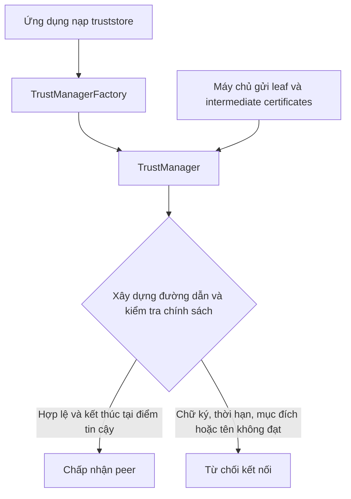

# TrustedCertificateEntry

`TrustedCertificateEntry` là loại entry trong Java `KeyStore` dùng để lưu một chứng chỉ số mà ứng dụng hoặc người quản trị đã quyết định tin cậy. Entry này chứa chứng chỉ công khai, thường là chứng chỉ CA gốc, CA trung gian hoặc trong một số thiết kế là chứng chỉ đầu cuối được tin cậy trực tiếp. Nó không chứa private key.

Trong module `SECURITY_KEY_MANAGEMENT_FUNDAMENTALS`, `TrustedCertificateEntry` minh họa cách một ứng dụng thiết lập ranh giới tin cậy cho public key và danh tính. Việc đưa chứng chỉ vào trust store là một quyết định bảo mật: ứng dụng có thể dùng chứng chỉ đó làm điểm neo tin cậy khi xác minh certificate chain. Vì vậy, nguồn chứng chỉ, fingerprint, phạm vi tin cậy, quyền sửa kho và quy trình cập nhật đều cần được kiểm soát.

## 1. `TrustedCertificateEntry` là gì?

Java định nghĩa `KeyStore.TrustedCertificateEntry` như một entry chứa một `Certificate` được đánh dấu là tin cậy. Với định dạng JKS, `keytool -importcert` thường tạo loại entry này khi alias đích chưa tồn tại và chứng chỉ được nhập như một chứng chỉ tin cậy độc lập.

Entry được định danh bằng alias, ví dụ:

- `corp-root-ca`: chứng chỉ Root CA của tổ chức.
- `partner-intermediate-ca`: chứng chỉ CA trung gian của đối tác.
- `legacy-device-01`: chứng chỉ đầu cuối được ứng dụng tin cậy trực tiếp theo một chính sách đặc biệt.

Alias chỉ là tên để tìm entry. Nó không xác minh nguồn gốc chứng chỉ và không tạo ra sự tin cậy về mặt mật mã. Quyết định tin cậy phụ thuộc vào chứng chỉ thực tế, cách chứng chỉ được xác minh trước khi nhập và cách ứng dụng sử dụng trust store.

Một `TrustedCertificateEntry` chứa đúng một chứng chỉ. Nếu cần lưu private key cùng certificate chain, loại entry phù hợp là `PrivateKeyEntry`. Nếu cần lưu khóa bí mật đối xứng, phải dùng định dạng/provider có hỗ trợ `SecretKeyEntry`; triển khai JKS tiêu chuẩn không hỗ trợ loại entry này.

## 2. Phân biệt các loại entry trong KeyStore

| Loại entry | Nội dung | Có private key? | Mục đích phổ biến |
|---|---|---:|---|
| `PrivateKeyEntry` | Private key và certificate chain tương ứng | Có | Cung cấp danh tính cho TLS hoặc ký số |
| `TrustedCertificateEntry` | Một chứng chỉ công khai được đánh dấu tin cậy | Không | Cung cấp chứng chỉ tin cậy cho quá trình xác minh |
| `SecretKeyEntry` | Một khóa bí mật đối xứng | Có khóa bí mật | Mã hóa/giải mã dữ liệu đối xứng; cần định dạng/provider hỗ trợ |

Không nên nhầm `TrustedCertificateEntry` với chứng chỉ nằm trong certificate chain của một `PrivateKeyEntry`. Chain trong `PrivateKeyEntry` mô tả các chứng chỉ liên kết với public key của private key entry. `TrustedCertificateEntry` là một entry độc lập mà ứng dụng có thể sử dụng làm dữ liệu tin cậy.

Một trust store thường chứa nhiều `TrustedCertificateEntry`; một identity keystore thường chứa một hoặc nhiều `PrivateKeyEntry`. Hai vai trò có thể được lưu trong cùng một file, nhưng tách riêng identity keystore và trust store giúp giới hạn quyền, đơn giản hóa cập nhật và giảm nguy cơ một thao tác quản trị làm thay đổi cả danh tính lẫn tập CA tin cậy.

## 3. Chứng chỉ tin cậy và trust anchor

Trust anchor (điểm neo tin cậy) là đầu mối mà bên xác minh đã tin cậy trước khi bắt đầu kiểm tra đường dẫn chứng chỉ. Trong PKI phổ biến, trust anchor thường là Root CA. Client kiểm tra chữ ký của các chứng chỉ trong chain, áp dụng các ràng buộc và xác định đường dẫn kết thúc tại một trust anchor đã cấu hình.

Một chứng chỉ trong `TrustedCertificateEntry` có thể là:

- **Root CA certificate:** trường hợp phổ biến nhất. Chứng chỉ CA gốc được phân phối qua kênh quản trị tin cậy và cài trong trust store.
- **Intermediate CA certificate:** có thể được cấu hình như một điểm tin cậy trực tiếp trong một số hệ thống. Điều này thay đổi điểm kết thúc đường dẫn và cần đánh giá phạm vi tin cậy cẩn thận.
- **End-entity certificate:** có thể được tin cậy trực tiếp trong một số mô hình pinning hoặc tích hợp đối tác. Cách này gắn tin cậy với một chứng chỉ cụ thể, do đó thay chứng chỉ có thể yêu cầu cập nhật trust store.

Không phải cứ có `TrustedCertificateEntry` là mọi chứng chỉ được cấp bởi chủ thể đó đều tự động hợp lệ trong mọi ứng dụng. Trust manager, thuật toán xây dựng đường dẫn, mục đích sử dụng, chính sách và cấu hình runtime quyết định cách entry được áp dụng. Cần kiểm thử bằng đúng provider và cấu hình triển khai.

Chứng chỉ root thường tự ký, nhưng chữ ký tự ký không làm nó đáng tin. Nó được tin cậy vì tổ chức đã xác minh và phân phối fingerprint/chứng chỉ qua kênh đáng tin cậy rồi cài đặt vào trust store. Nếu kẻ tấn công có thể thay trust store bằng một file khác, họ có thể thêm CA giả và khiến ứng dụng tin cậy danh tính do CA đó cấp.

## 4. Cách `TrustedCertificateEntry` được dùng khi xác minh TLS

Khi ứng dụng Java kết nối TLS, `TrustManagerFactory` có thể được khởi tạo từ một `KeyStore` chứa các chứng chỉ tin cậy. Trust manager sử dụng tập chứng chỉ này làm đầu vào để xác minh chứng chỉ peer theo thuật toán và chính sách của provider.



Ví dụ, trust store có `corp-root-ca`. Máy chủ gửi chứng chỉ leaf và intermediate. Client xác minh chữ ký leaf bằng public key của intermediate, xác minh chứng chỉ intermediate theo đường dẫn phù hợp, sau đó kiểm tra điểm kết thúc có được trust store chấp nhận hay không. Với TLS máy chủ, ứng dụng còn phải kiểm tra hostname hoặc IP đích với Subject Alternative Name (SAN), thời hạn, Key Usage, Extended Key Usage và chính sách thuật toán.

Trust store chỉ cung cấp dữ liệu tin cậy cho bước xác minh. Nó không tự đảm bảo hostname đúng, chứng chỉ còn hạn, private key máy chủ chưa bị lộ hoặc trạng thái thu hồi đã được kiểm tra. Những điều kiện đó cần được thực thi theo cấu hình TLS/PKI của ứng dụng.

## 5. Tạo trust store và nhập chứng chỉ bằng keytool

`keytool` có trong JDK và hỗ trợ nhập chứng chỉ vào một keystore. Trước khi import, cần lấy chứng chỉ từ nguồn xác thực và kiểm tra fingerprint qua một kênh độc lập, chẳng hạn tài liệu nội bộ đã ký, cổng quản trị được xác thực hoặc xác nhận trực tiếp từ quản trị CA.

### Xem chứng chỉ và fingerprint trước khi nhập

```bash
keytool -printcert -file corp-root-ca.pem -v
```

Kiểm tra tối thiểu:

- Subject và Issuer có đúng CA dự kiến không.
- Serial number và khoảng thời gian hiệu lực có phù hợp không.
- Basic Constraints có chỉ ra `CA:TRUE` nếu đây là CA không.
- Key Usage có phù hợp với vai trò CA, ví dụ `keyCertSign` không.
- SHA-256 fingerprint có khớp giá trị nhận qua kênh độc lập không.

Không xác nhận import chỉ vì tên file, alias hoặc Subject trông đúng. Kẻ tấn công có thể tạo chứng chỉ với Subject giống CA thật nhưng public key và fingerprint khác.

### Tạo trust store JKS bằng cách import chứng chỉ

```bash
keytool -importcert \
  -alias corp-root-ca \
  -file corp-root-ca.pem \
  -keystore truststore.jks \
  -storetype JKS
```

Nếu file chưa tồn tại, `keytool` tạo keystore mới. Công cụ yêu cầu mật khẩu và hiển thị thông tin chứng chỉ để người vận hành xác nhận. Chỉ chấp nhận sau khi đã đối chiếu fingerprint và nguồn chứng chỉ. Không dùng `-noprompt` trong quy trình mà chưa có bước xác minh độc lập và phê duyệt rõ ràng.

Khi alias chưa tồn tại, thao tác nhập chứng chỉ độc lập sẽ tạo `TrustedCertificateEntry`. Nếu alias đã là một key entry, `keytool -importcert` có thể được hiểu là nhập certificate reply cho key pair đó; cần xác định đúng alias và mục đích trước khi chạy.

### Liệt kê và kiểm tra entry sau khi import

```bash
keytool -list \
  -keystore truststore.jks \
  -storetype JKS

keytool -list -v \
  -alias corp-root-ca \
  -keystore truststore.jks \
  -storetype JKS
```

Kết quả cần hiển thị loại entry là `trustedCertEntry`. Kiểm tra lại Subject, Issuer, serial number, thời hạn và fingerprint trong kho để xác nhận đúng chứng chỉ đã được nhập.

### Xuất chứng chỉ công khai để kiểm tra hoặc phân phối

```bash
keytool -exportcert -rfc \
  -alias corp-root-ca \
  -file exported-corp-root-ca.pem \
  -keystore truststore.jks \
  -storetype JKS
```

Lệnh này chỉ xuất chứng chỉ công khai. Có thể so sánh fingerprint của file xuất với chứng chỉ nguồn. Chứng chỉ không phải bí mật, nhưng việc phân phối phải bảo đảm tính toàn vẹn và nguồn gốc.

### Xóa một chứng chỉ tin cậy

```bash
keytool -delete \
  -alias old-corp-root-ca \
  -keystore truststore.jks \
  -storetype JKS
```

Xóa entry khỏi trust store làm thay đổi tập chứng chỉ được ứng dụng sử dụng. Trước khi thực hiện, cần xác định các ứng dụng, kết nối và certificate chain phụ thuộc vào CA đó. Nếu CA bị xâm phạm hoặc bị distrust, cần phối hợp cập nhật trust store trên toàn bộ hệ thống liên quan.

## 6. Truy cập `TrustedCertificateEntry` bằng Java API

API `java.security.KeyStore` cung cấp các phương thức để kiểm tra loại entry và lấy chứng chỉ:

- `isCertificateEntry(alias)` cho biết alias có phải certificate entry hay không.
- `getCertificate(alias)` lấy chứng chỉ được gắn với alias.
- `getEntry(alias, null)` có thể lấy `TrustedCertificateEntry` mà không cần `ProtectionParameter` cho private key.
- `TrustedCertificateEntry.getTrustedCertificate()` trả về chứng chỉ tin cậy.
- `setCertificateEntry(alias, certificate)` thêm hoặc thay entry chứng chỉ tin cậy.
- `deleteEntry(alias)` xóa entry.

Ví dụ nạp JKS, xác nhận entry là chứng chỉ tin cậy và in fingerprint SHA-256:

```java
import java.io.InputStream;
import java.nio.file.Files;
import java.nio.file.Path;
import java.security.KeyStore;
import java.security.MessageDigest;
import java.security.cert.Certificate;
import java.util.Arrays;

public class ReadTrustedCertificate {
    public static void main(String[] args) throws Exception {
        char[] storePassword = obtainStorePassword();
        try {
            KeyStore trustStore = KeyStore.getInstance("JKS");
            try (InputStream input = Files.newInputStream(
                    Path.of("truststore.jks"))) {
                trustStore.load(input, storePassword);
            }

            String alias = "corp-root-ca";
            if (!trustStore.isCertificateEntry(alias)) {
                throw new IllegalStateException(
                        "Alias is not a trusted certificate entry");
            }

            KeyStore.TrustedCertificateEntry entry =
                    (KeyStore.TrustedCertificateEntry)
                            trustStore.getEntry(alias, null);
            Certificate certificate = entry.getTrustedCertificate();

            byte[] digest = MessageDigest.getInstance("SHA-256")
                    .digest(certificate.getEncoded());
            System.out.println("Alias: " + alias);
            System.out.println("Certificate type: " + certificate.getType());
            System.out.println("SHA-256: " + toHex(digest));
        } finally {
            Arrays.fill(storePassword, '\0');
        }
    }

    private static String toHex(byte[] bytes) {
        StringBuilder result = new StringBuilder(bytes.length * 2);
        for (byte value : bytes) {
            result.append(String.format("%02X", value & 0xff));
        }
        return result.toString();
    }

    private static char[] obtainStorePassword() {
        // Lấy từ secret manager hoặc nguồn bí mật được kiểm soát.
        throw new UnsupportedOperationException("Configure secret source");
    }
}
```

Hàm `obtainStorePassword()` là điểm tích hợp với secret manager, không phải nơi hardcode mật khẩu. Mảng `char[]` được xóa sau khi nạp kho để giảm thời gian giữ bí mật trong bộ nhớ; điều này không bảo đảm mọi bản sao trong JVM đã được xóa. Chứng chỉ là dữ liệu công khai nên không cần key password riêng. Store password vẫn có vai trò kiểm tra tính toàn vẹn theo cơ chế của keystore.

### Thêm một chứng chỉ tin cậy bằng API

Đoạn mã sau là phần thân của thao tác cập nhật, chạy sau khi `trustStore` đã được nạp và chứng chỉ đã được xác minh. Các import cần thiết là `java.io.OutputStream`, `java.nio.file.Files` và `java.nio.file.Path`.

```java
Certificate certificate = loadAndVerifyCertificate("corp-root-ca.pem");
trustStore.setCertificateEntry("corp-root-ca", certificate);

try (OutputStream output = Files.newOutputStream(
        Path.of("truststore.jks"))) {
    trustStore.store(output, storePassword);
}
```

`loadAndVerifyCertificate` là phần ứng dụng phải triển khai để đọc chứng chỉ và xác minh nguồn, fingerprint, mục đích trước khi thêm vào kho. `setCertificateEntry` thay entry chứng chỉ cùng alias nếu đã tồn tại; nếu alias đang chứa một loại entry không tương thích, thao tác có thể thất bại. Khi cập nhật trust store, cần ghi file theo cách an toàn, tránh để ứng dụng đọc một file đang ghi dở.

## 7. Tích hợp trust store với TrustManagerFactory

Để dùng trust store tùy chỉnh trong TLS, khởi tạo `TrustManagerFactory` từ `KeyStore` chứa các `TrustedCertificateEntry`:

```java
import java.io.InputStream;
import java.nio.file.Files;
import java.nio.file.Path;
import java.security.KeyStore;
import javax.net.ssl.SSLContext;
import javax.net.ssl.TrustManagerFactory;

char[] trustStorePassword = obtainTrustStorePassword();
try {
    KeyStore trustStore = KeyStore.getInstance("JKS");
    try (InputStream input = Files.newInputStream(
            Path.of("truststore.jks"))) {
        trustStore.load(input, trustStorePassword);
    }

    TrustManagerFactory trustManagers = TrustManagerFactory.getInstance(
            TrustManagerFactory.getDefaultAlgorithm());
    trustManagers.init(trustStore);

    SSLContext sslContext = SSLContext.getInstance("TLS");
    sslContext.init(
            null,
            trustManagers.getTrustManagers(),
            null);
} finally {
    java.util.Arrays.fill(trustStorePassword, '\0');
}
```

Đoạn mã minh họa cấu hình trust manager cho một `SSLContext`; ứng dụng client có thể dùng context này cho kết nối TLS. Trong server, nếu cần trình bày danh tính của máy chủ, phải cấu hình thêm `KeyManager` từ identity keystore. Trong mutual TLS, server cũng cần trust manager để xác minh chứng chỉ client.

Thuật toán mặc định của `TrustManagerFactory` và hành vi path validation phụ thuộc JDK/provider. Nếu cần chính sách PKIX cụ thể, ứng dụng cần cấu hình và kiểm thử các tham số tương ứng, bao gồm chính sách thuật toán, kiểm tra tên máy chủ ở lớp TLS và trạng thái thu hồi. Chỉ nạp một trust store không có nghĩa CRL/OCSP đã được bật hoặc kiểm tra theo yêu cầu của hệ thống.

## 8. Xác minh chứng chỉ trước khi đưa vào trust store

Một quy trình nhập chứng chỉ nên có các bước:

1. **Lấy chứng chỉ từ nguồn xác thực.** Ví dụ cổng CA nội bộ, kho cấu hình được ký hoặc kênh phân phối đã được kiểm soát.
2. **Kiểm tra fingerprint qua kênh độc lập.** Dùng SHA-256 fingerprint và đối chiếu với giá trị được quản trị CA công bố qua kênh đáng tin cậy.
3. **Kiểm tra danh tính và vai trò.** Đọc Subject, Issuer, SAN, Basic Constraints, Key Usage, EKU và thời hạn theo loại chứng chỉ.
4. **Kiểm tra chuỗi phát hành.** Xác minh chữ ký và đường dẫn đến CA được tổ chức chấp nhận; kiểm tra chính sách thuật toán.
5. **Đánh giá phạm vi tin cậy.** Xác định chứng chỉ có cần làm trust anchor hay có cách cấu hình giới hạn hơn. Không thêm root CA toàn cục chỉ để sửa một kết nối.
6. **Phê duyệt và import.** Ghi lại người phê duyệt, alias, fingerprint, nguồn, mục đích, môi trường và thời điểm.
7. **Kiểm tra sau import.** Liệt kê entry, đối chiếu fingerprint và kiểm thử ứng dụng bằng đúng trust manager/provider.

Ví dụ, khi tích hợp với API đối tác, trước hết nên xác định CA mà đối tác sử dụng và cơ chế cấp chứng chỉ. Tin cậy root CA của đối tác có thể cho phép ứng dụng chấp nhận nhiều chứng chỉ hợp lệ do CA đó cấp, trong phạm vi các chính sách khác. Tin cậy trực tiếp leaf certificate giới hạn vào chứng chỉ cụ thể hơn nhưng sẽ cần cập nhật khi đối tác gia hạn hoặc thay chứng chỉ. Quyết định phụ thuộc yêu cầu vận hành và mô hình rủi ro.

## 9. Rủi ro khi quản lý TrustedCertificateEntry

| Rủi ro | Hệ quả | Kiểm soát |
|---|---|---|
| Import nhầm chứng chỉ giả | Ứng dụng có thể tin cậy CA hoặc peer do kẻ tấn công kiểm soát | Xác minh fingerprint và nguồn qua kênh độc lập trước khi import |
| Thêm root CA quá rộng | Nhiều danh tính do CA đó cấp có thể được chấp nhận | Giới hạn trust store theo ứng dụng, môi trường và phạm vi nghiệp vụ |
| Trust store bị sửa trái phép | Kẻ tấn công có thể thêm, thay hoặc xóa chứng chỉ tin cậy | Hạn chế quyền file, kiểm soát thay đổi, ký/phê duyệt artifact và audit |
| Chứng chỉ hết hạn hoặc CA bị compromise | Kết nối có thể lỗi hoặc tiếp tục tin cậy sai nếu chính sách không được cập nhật | Theo dõi thời hạn, thu hồi/distrust và quy trình thay trust anchor |
| Xóa entry đang được sử dụng | Ứng dụng không còn xác minh được peer hợp lệ | Lập danh mục phụ thuộc, thử nghiệm và triển khai theo đợt |
| Dùng trust store mặc định ngoài dự kiến | Ứng dụng tin cậy tập CA khác với thiết kế | Cấu hình rõ trust store và kiểm tra runtime thực tế |

Trust store có thể chỉ chứa chứng chỉ công khai, nhưng tính toàn vẹn của nó rất quan trọng. Kẻ tấn công không cần đánh cắp private key của ứng dụng nếu họ có thể thay đổi danh sách trust anchor mà ứng dụng sử dụng.

## 10. Cập nhật, thu hồi và xoay vòng chứng chỉ tin cậy

Chứng chỉ tin cậy cần được quản lý theo vòng đời. Một CA có thể thay khóa, đổi chứng chỉ, hết hạn, bị compromise hoặc bị tổ chức ngừng tin cậy. Khi đó, việc cập nhật trust store phải được phối hợp với CA, các ứng dụng và dịch vụ phụ thuộc.

Quy trình cập nhật thông thường:

- Xác minh chứng chỉ CA mới và fingerprint qua kênh độc lập.
- Đánh giá việc chuyển tiếp giữa CA cũ và CA mới, gồm chain cũ, chain mới và khả năng tương thích client.
- Import chứng chỉ mới dưới alias có ý nghĩa, kiểm tra nội dung và triển khai theo môi trường.
- Kiểm thử các kết nối sử dụng trust store mới.
- Chỉ xóa chứng chỉ cũ khi các dịch vụ phụ thuộc đã chuyển đổi và chính sách cho phép.
- Ghi lại thay đổi, người phê duyệt, thời điểm và kết quả kiểm thử.

Khi CA bị compromise hoặc bị distrust, cần ưu tiên loại bỏ tin cậy theo kế hoạch ứng phó sự cố. Việc chỉ xóa một alias khỏi một file không cập nhật các bản sao trust store trong container image, máy chủ, thiết bị hoặc tiến trình đang chạy. Có thể cần triển khai lại ứng dụng, reload cấu hình hoặc khởi động lại tiến trình để thay đổi có hiệu lực.

## 11. Những lỗi thường gặp

| Triệu chứng | Nguyên nhân có thể | Hướng xử lý |
|---|---|---|
| `Certificate was added to keystore` nhưng ứng dụng vẫn không tin cậy | Ứng dụng đang nạp trust store khác hoặc chưa reload cấu hình | Kiểm tra đường dẫn, loại kho, alias và runtime thực tế |
| `trustedCertEntry` không có private key | Đây là hành vi đúng của loại entry | Dùng `PrivateKeyEntry` trong identity keystore nếu cần private key |
| `Alias ... already exists` | Alias đã được dùng cho một entry | Kiểm tra loại entry hiện tại trước khi cập nhật hoặc chọn alias khác |
| TLS báo `PKIX path building failed` | Không có đường dẫn phù hợp đến trust anchor hoặc thiếu intermediate | Kiểm tra trust store, chain máy chủ gửi và chính sách PKIX |
| TLS báo hostname mismatch | SAN không khớp tên đích | Kiểm tra hostname và yêu cầu cấp chứng chỉ đúng SAN |
| Chứng chỉ đúng Subject nhưng fingerprint khác | Có thể là chứng chỉ khác hoặc giả mạo | Không import cho đến khi xác minh được nguồn và fingerprint |
| Kết nối lỗi sau khi xóa entry | Một chain đang phụ thuộc chứng chỉ đã xóa | Khôi phục theo quy trình được phê duyệt hoặc triển khai trust anchor thay thế sau khi xác minh |

Không nên giải quyết lỗi bằng cách nhập mọi chứng chỉ máy chủ vào trust store, tắt xác minh hostname hoặc cài một `TrustManager` chấp nhận tất cả chứng chỉ. Các cách đó làm mất ý nghĩa của việc kiểm tra danh tính peer.

## 12. Checklist vận hành

- [ ] Xác định rõ từng `TrustedCertificateEntry` được dùng cho ứng dụng và môi trường nào.
- [ ] Xác minh nguồn chứng chỉ, SHA-256 fingerprint, Subject, Issuer và thời hạn trước khi import.
- [ ] Kiểm tra Basic Constraints, Key Usage, EKU và certificate chain theo vai trò chứng chỉ.
- [ ] Xác định entry là root, intermediate hay leaf được tin cậy trực tiếp; ghi rõ phạm vi tin cậy.
- [ ] Tách trust store khỏi identity keystore khi cần giới hạn quyền và thay đổi độc lập.
- [ ] Hạn chế quyền sửa file trust store và bảo vệ artifact khi phân phối.
- [ ] Ghi nhận alias, fingerprint, người phê duyệt, lý do và thời điểm import/xóa.
- [ ] Theo dõi thời hạn chứng chỉ, sự kiện CA compromise và thay đổi chính sách tin cậy.
- [ ] Kiểm thử TrustManagerFactory, PKIX, hostname và trạng thái thu hồi trong đúng runtime.
- [ ] Có quy trình cập nhật, thay thế và gỡ bỏ trust anchor trên tất cả hệ thống phụ thuộc.

`TrustedCertificateEntry` lưu chứng chỉ công khai được ứng dụng chọn làm dữ liệu tin cậy. Sử dụng an toàn đòi hỏi xác minh nguồn và fingerprint trước khi import, giới hạn phạm vi trust anchor, bảo vệ tính toàn vẹn trust store và duy trì quy trình cập nhật khi chứng chỉ hoặc chính sách CA thay đổi.
