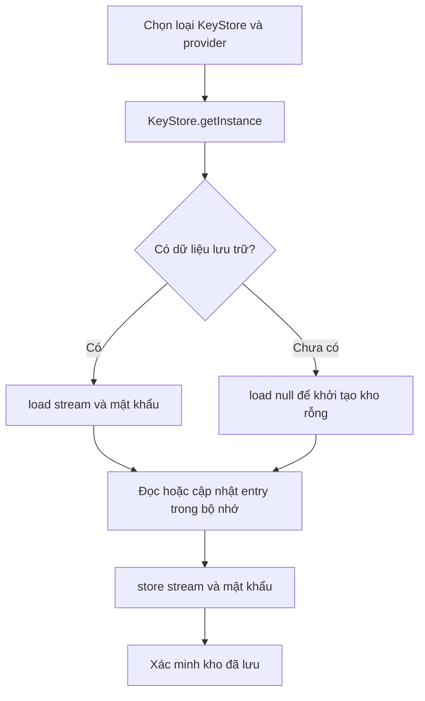

# Load và save KeyStore

Java KeyStore cung cấp một API thống nhất để ứng dụng nạp, truy xuất, cập nhật và lưu khóa mật mã cùng chứng thư số. Trong vòng đời quản lý khóa, thao tác **load** đưa dữ liệu từ kho lưu trữ vào đối tượng `KeyStore` trong bộ nhớ; thao tác **save** ghi trạng thái hiện tại của đối tượng trở lại nơi lưu trữ. Hai thao tác này tưởng đơn giản nhưng ảnh hưởng trực tiếp đến tính toàn vẹn, khả năng phục hồi và tính sẵn sàng của khóa.

Một lỗi phổ biến là nạp sai loại keystore, truyền sai mật khẩu, vô tình khởi tạo kho rỗng rồi ghi đè dữ liệu cũ, hoặc ghi trực tiếp lên tệp đang hoạt động khiến tệp bị hỏng khi tiến trình dừng giữa chừng. Để tránh các lỗi này, ứng dụng cần xác định rõ loại keystore và provider, quản lý mật khẩu đúng phạm vi, đóng stream đúng cách và có quy trình lưu an toàn.

## 1. KeyStore là đối tượng trong bộ nhớ

`java.security.KeyStore` là API đại diện cho một kho chứa các entry. Mỗi entry có một alias và thuộc một loại nhất định:

| Loại entry | Nội dung |
|---|---|
| `PrivateKeyEntry` | Khóa riêng cùng chuỗi chứng thư liên quan |
| `SecretKeyEntry` | Khóa bí mật, thường dùng cho thuật toán đối xứng |
| `TrustedCertificateEntry` | Chứng thư công khai được ứng dụng xem là đáng tin cậy |

Khi gọi `KeyStore.getInstance("PKCS12")`, ứng dụng yêu cầu provider tạo một đối tượng KeyStore có khả năng đọc và ghi loại dữ liệu tương ứng. Đối tượng này tồn tại trong bộ nhớ. `load()` nạp dữ liệu từ nguồn vào đối tượng; `setEntry()`, `setKeyEntry()` hoặc `deleteEntry()` thay đổi trạng thái trong bộ nhớ; `store()` mới ghi trạng thái đã thay đổi ra đích lưu trữ.



Điểm cần nhớ là thay đổi trên đối tượng Java chưa đồng nghĩa dữ liệu đã được ghi bền vững. Nếu ứng dụng cập nhật entry nhưng kết thúc trước khi `store()` hoàn tất, thay đổi đó có thể mất.

## 2. Chọn loại keystore và provider trước khi load

Ứng dụng nên chỉ định rõ loại keystore khi định dạng lưu trữ đã được quy định:

```java
KeyStore keyStore = KeyStore.getInstance("PKCS12");
```

Các loại thường gặp gồm `PKCS12`, `JKS` và `JCEKS`. Từ Java 9, PKCS12 là loại mặc định trong nhiều bản JDK khi ứng dụng không chỉ định loại khác; tuy nhiên giá trị mặc định còn chịu ảnh hưởng của cấu hình bảo mật runtime. `KeyStore.getDefaultType()` trả về loại mặc định tại runtime và có thể khác giữa môi trường.

Không nên chọn loại keystore chỉ dựa trên phần mở rộng của tệp. Tệp có tên `server.p12` không tự chứng minh nội dung hợp lệ là PKCS12. Loại được chỉ định phải khớp với định dạng thực tế và provider phải hỗ trợ loại đó.

Nếu cần một provider cụ thể, có thể yêu cầu rõ provider:

```java
import java.security.Provider;
import java.security.Security;
import java.security.KeyStore;

Provider provider = Security.getProvider("SUN");
if (provider == null) {
    throw new IllegalStateException("Required provider is unavailable");
}
KeyStore keyStore = KeyStore.getInstance("JKS", provider);
```

Tên provider trong ví dụ chỉ minh họa cho JKS trên các JDK có provider tương ứng. Trong ứng dụng thực tế, hãy chọn provider theo chính sách triển khai và kiểm tra sự hiện diện của nó trước khi dùng. Không hard-code một provider cụ thể nếu môi trường cần hỗ trợ nhiều nhà cung cấp.

## 3. Load một keystore đã tồn tại

Phương thức `load(InputStream, char[])` đọc dữ liệu từ stream và nạp vào đối tượng KeyStore:

```java
KeyStore keyStore = KeyStore.getInstance("PKCS12");

try (InputStream input = Files.newInputStream(Path.of("server.p12"))) {
    keyStore.load(input, storePassword);
}
```

Trong ví dụ:

1. `getInstance("PKCS12")` tạo đối tượng có khả năng đọc định dạng PKCS12.
2. `Files.newInputStream()` mở tệp ở chế độ đọc.
3. `load()` đọc cấu trúc kho và dùng mật khẩu theo cơ chế của provider để kiểm tra tính toàn vẹn hoặc giải mã dữ liệu cần thiết.
4. Khối `try-with-resources` đóng stream sau khi nạp xong, kể cả khi có ngoại lệ.

Theo hợp đồng API, `KeyStore.load()` tiêu thụ stream nhưng không tự đóng stream. Vì vậy, bên gọi nên quản lý vòng đời stream bằng `try-with-resources`. Tương tự, `store()` ghi vào stream nhưng không tự đóng stream.

Sau khi load, ứng dụng có thể kiểm tra alias và loại entry:

```java
if (!keyStore.containsAlias("tls-server")) {
    throw new IllegalStateException("Required alias is missing");
}

if (!keyStore.isKeyEntry("tls-server")) {
    throw new IllegalStateException("Alias is not a key entry");
}
```

Các phương thức như `containsAlias()`, `isKeyEntry()`, `isCertificateEntry()`, `aliases()` và `getCreationDate()` giúp kiểm tra cấu trúc kho. Việc alias tồn tại chưa chứng minh khóa có thể được sử dụng đúng mục đích; ứng dụng vẫn cần truy xuất entry bằng thông tin bảo vệ thích hợp và xác minh chứng thư hoặc thuật toán theo chính sách.

## 4. Khởi tạo một keystore mới

Nếu chưa có dữ liệu lưu trữ, có thể khởi tạo một kho rỗng bằng cách truyền `null` làm stream:

```java
KeyStore keyStore = KeyStore.getInstance("PKCS12");
keyStore.load(null, storePassword);
```

Đối tượng KeyStore lúc này được khởi tạo nhưng chưa có entry. Ứng dụng có thể thêm khóa hoặc chứng thư rồi gọi `store()` để tạo tệp:

```java
keyStore.setCertificateEntry("company-root", rootCertificate);

try (OutputStream output = Files.newOutputStream(Path.of("truststore.p12"))) {
    keyStore.store(output, storePassword);
}
```

Không được nhầm `load(null, password)` với việc nạp một tệp không tồn tại. Đây là thao tác khởi tạo kho mới trong bộ nhớ. Nếu ứng dụng dùng nó trong khi tệp cũ đã tồn tại, sau đó lưu lên đúng tệp cũ, các entry trước đó có thể bị thay thế hoàn toàn.

Trước khi khởi tạo kho mới, hãy xác định rõ đây là lần tạo đầu tiên hay một quy trình thay thế có chủ đích. Với kho đang được sử dụng, nên kiểm tra sự tồn tại, quyền truy cập, bản sao lưu và trạng thái triển khai trước khi ghi đè.

## 5. Store một keystore xuống stream

Phương thức `store(OutputStream, char[])` ghi trạng thái hiện tại của đối tượng KeyStore vào stream:

```java
try (OutputStream output = Files.newOutputStream(Path.of("server.p12"))) {
    keyStore.store(output, storePassword);
}
```

`Files.newOutputStream()` với tùy chọn mặc định sẽ tạo tệp nếu chưa tồn tại và cắt nội dung tệp nếu tệp đã tồn tại. Vì vậy, ví dụ này phù hợp với trường hợp đơn giản hoặc tệp đích đã được chuẩn bị để ghi. Nếu tệp đang hoạt động và cần bảo đảm khả năng phục hồi khi ghi lỗi, không nên ghi trực tiếp lên tệp gốc.

`store()` không tự đóng stream. Dùng `try-with-resources` để đóng stream và giải phóng tài nguyên. Khi `store()` ném ngoại lệ, ứng dụng phải xem lần lưu đó là chưa hoàn tất và xử lý tệp đích theo quy trình phục hồi.

Mật khẩu truyền cho `store()` được provider sử dụng theo định dạng. Với một số loại keystore, nó bảo vệ tính toàn vẹn của toàn kho; khóa trong entry có thể còn có mật khẩu riêng. Với một số provider hoặc định dạng, các mật khẩu phải trùng nhau. Cần xác minh chính sách của provider thay vì giả định mọi kho dùng một quy tắc.

## 6. Load, cập nhật và save mà không làm mất entry

Quy trình cập nhật một kho hiện có thường có dạng:

1. Nạp đúng loại keystore từ tệp hiện tại.
2. Xác minh alias và trạng thái cần thiết trước khi thay đổi.
3. Thêm, thay thế hoặc xóa entry theo kế hoạch.
4. Ghi trạng thái mới ra tệp đích.
5. Nạp lại tệp vừa ghi và xác minh các entry quan trọng.

Ví dụ minh họa việc nạp một kho hiện có, thêm chứng thư tin cậy và lưu lại:

```java
Path file = Path.of("truststore.p12");
KeyStore keyStore = KeyStore.getInstance("PKCS12");

try (InputStream input = Files.newInputStream(file)) {
    keyStore.load(input, storePassword);
}

if (keyStore.containsAlias("partner-ca")) {
    throw new IllegalStateException("Alias already exists");
}

keyStore.setCertificateEntry("partner-ca", partnerCertificate);

try (OutputStream output = Files.newOutputStream(file)) {
    keyStore.store(output, storePassword);
}
```

Đoạn mã ngắn này thể hiện đúng thứ tự load rồi cập nhật rồi store, nhưng vẫn ghi trực tiếp lên tệp. Với hệ thống quan trọng, hãy dùng chiến lược lưu an toàn ở phần tiếp theo để tránh mất bản gốc nếu quá trình ghi thất bại.

## 7. Ghi tệp an toàn bằng tệp tạm và atomic move

Nếu ghi trực tiếp lên tệp hiện tại, hệ điều hành có thể cắt tệp trước khi provider ghi xong. Mất điện, hết dung lượng, lỗi filesystem hoặc tiến trình bị dừng có thể khiến keystore bị hỏng. Một cách phổ biến là ghi sang tệp tạm trong cùng thư mục, đóng stream thành công rồi thay thế tệp đích bằng thao tác di chuyển nguyên tử nếu filesystem hỗ trợ.

```java
import java.io.IOException;
import java.io.OutputStream;
import java.nio.file.AtomicMoveNotSupportedException;
import java.nio.file.Files;
import java.nio.file.Path;
import java.nio.file.StandardCopyOption;
import java.security.KeyStore;

public final class KeyStorePersistence {
    public static void saveAtomically(
            KeyStore keyStore,
            Path target,
            char[] storePassword) throws Exception {

        Path absoluteTarget = target.toAbsolutePath();
        Path parent = absoluteTarget.getParent();
        if (parent == null || !Files.isDirectory(parent)) {
            throw new IOException("Target directory does not exist");
        }

        Path temporary = Files.createTempFile(parent, "keystore-", ".tmp");
        try {
            // Áp dụng ACL hoặc quyền filesystem tối thiểu trước khi ghi bí mật.
            try (OutputStream output = Files.newOutputStream(temporary)) {
                keyStore.store(output, storePassword);
                output.flush();
            }

            Files.move(
                    temporary,
                    absoluteTarget,
                    StandardCopyOption.ATOMIC_MOVE,
                    StandardCopyOption.REPLACE_EXISTING);
        } catch (AtomicMoveNotSupportedException e) {
            throw new IOException(
                    "Filesystem does not support atomic replacement", e);
        } finally {
            Files.deleteIfExists(temporary);
        }
    }
}
```

Tệp tạm được tạo trong cùng thư mục để tăng khả năng thao tác di chuyển nằm trên cùng filesystem. `ATOMIC_MOVE` yêu cầu filesystem/provider hỗ trợ di chuyển nguyên tử. Khi dùng `ATOMIC_MOVE`, việc đích đã tồn tại được xử lý theo đặc tả của provider; không nên giả định mọi filesystem đều thay thế đích theo cùng một cách chỉ vì có truyền thêm `REPLACE_EXISTING`. Hãy kiểm thử hành vi trên filesystem triển khai thực tế và thiết kế quy trình phục hồi tương ứng. Nếu không hỗ trợ di chuyển nguyên tử, ví dụ trên báo lỗi để bên gọi quyết định phương án thay thế theo chính sách. Không nên âm thầm chuyển sang ghi đè không nguyên tử đối với kho khóa quan trọng.

Một số điểm vận hành cần bổ sung tùy nền tảng:

- Đặt quyền đọc/ghi tối thiểu cho tệp tạm trước khi ghi dữ liệu nhạy cảm. Cách cấu hình ACL trên Windows và POSIX permissions trên Linux/macOS khác nhau.
- Kiểm soát quyền ghi thư mục cha; người có quyền thay thế hoặc tạo liên kết trong thư mục có thể ảnh hưởng đến tệp đích.
- Nếu cần độ bền dữ liệu trước sự cố mất điện, cần đánh giá đồng bộ dữ liệu xuống thiết bị lưu trữ và giới hạn của filesystem; `flush()` của stream không tự bảo đảm mọi dữ liệu đã bền vững trên thiết bị.
- Giữ bản sao lưu có kiểm soát trước khi thay thế kho đang hoạt động. Bản sao lưu cũng chứa dữ liệu nhạy cảm nên phải được bảo vệ tương đương.
- Khi thao tác thay thế tệp trên Windows, tệp có thể không di chuyển được nếu một tiến trình khác đang giữ handle hoặc khóa tệp.

## 8. Xác minh sau khi save

Lưu thành công ở mức API chưa đủ để khẳng định ứng dụng có thể dùng khóa. Một bước xác minh độc lập nên nạp lại tệp đích bằng đúng loại keystore và mật khẩu, sau đó kiểm tra alias, loại entry và dữ liệu chứng thư cần thiết.

```java
KeyStore verify = KeyStore.getInstance("PKCS12");
try (InputStream input = Files.newInputStream(target)) {
    verify.load(input, storePassword);
}

if (!verify.containsAlias("tls-server")) {
    throw new IllegalStateException("Saved keystore is missing tls-server");
}

if (!verify.isKeyEntry("tls-server")) {
    throw new IllegalStateException("tls-server is not a key entry");
}
```

Với `PrivateKeyEntry`, có thể truy xuất entry bằng key password và xác minh chuỗi chứng thư, thời hạn, mục đích sử dụng và khóa công khai tương ứng. Với `SecretKeyEntry`, có thể thực hiện một phép kiểm thử mật mã trong môi trường kiểm thử để xác nhận ứng dụng lấy được khóa đúng. Không ghi giá trị khóa hoặc `getEncoded()` vào log để phục vụ xác minh.

Nếu kho được dùng cho TLS, sau khi cập nhật cần tạo lại `KeyManagerFactory` hoặc `TrustManagerFactory` tương ứng và xây dựng lại `SSLContext` theo thiết kế ứng dụng. Việc ghi tệp mới không tự làm các đối tượng SSL đã khởi tạo trong JVM nạp lại kho. Các kết nối đang mở cũng có thể tiếp tục dùng trạng thái cũ cho đến khi được tạo lại.

## 9. Quản lý mật khẩu và stream

Mật khẩu dùng để load hoặc store cần được cấp từ nguồn bí mật được kiểm soát, chẳng hạn secret manager hoặc cơ chế quản lý credential của nền tảng. Tránh đặt mật khẩu trực tiếp trong mã nguồn, tệp cấu hình, tham số dòng lệnh hoặc log.

Các lưu ý quan trọng:

- Dùng `char[]` thay vì tạo `String` nếu có thể để ứng dụng chủ động ghi đè mảng sau khi dùng.
- Không chia sẻ một mảng mật khẩu có thể bị sửa đổi giữa các luồng mà không có đồng bộ phù hợp.
- Không lưu store password cạnh tệp keystore hoặc trong cùng artifact triển khai không được bảo vệ.
- Dùng `try-with-resources` cho `InputStream` và `OutputStream`; API KeyStore không tự đóng stream.
- Phân biệt store password với entry password; một số provider yêu cầu chúng giống nhau.
- Không truyền `null` chỉ để bỏ qua kiểm tra toàn vẹn. Chỉ dùng cách nạp không mật khẩu khi provider và chính sách cho phép rõ ràng.
- Giới hạn quyền đọc tệp, thư mục cha, bản sao lưu, snapshot và tài khoản dịch vụ.

Khi ứng dụng kết thúc thao tác, xóa mảng mật khẩu do ứng dụng sở hữu trong `finally`. Nếu dùng `KeyStore.PasswordProtection`, gọi `destroy()` khi hoàn tất. Đây là biện pháp giảm thời gian bí mật tồn tại trong bộ nhớ, không phải cam kết xóa mọi bản sao do JVM hoặc provider tạo ra.

## 10. LoadStoreParameter và keystore không dùng tệp thông thường

Không phải mọi KeyStore đều được lưu trong một tệp cục bộ. Provider có thể kết nối với thiết bị phần cứng, token hoặc dịch vụ quản lý khóa. Với những trường hợp này, API còn có các phương thức:

```java
keyStore.load(loadStoreParameter);
keyStore.store(loadStoreParameter);
```

`KeyStore.LoadStoreParameter` cho phép truyền thông tin cấu hình và cơ chế bảo vệ thông qua một đối tượng thay vì chỉ dùng `InputStream` hoặc `OutputStream`. `KeyStore.PasswordProtection` có thể đại diện cho mật khẩu; `KeyStore.CallbackHandlerProtection` có thể kết nối tới callback handler để lấy thông tin xác thực theo cách provider hỗ trợ.

Một số provider PKCS#11 đại diện cho keystore gắn với token hoặc HSM. Việc nạp và lưu có thể phụ thuộc trạng thái thiết bị, phiên đăng nhập, PIN, quyền truy cập và hành vi provider. Không nên áp dụng máy móc quy trình tệp tạm và atomic move cho keystore phần cứng; cần theo tài liệu provider và quy trình của thiết bị.

## 11. Xử lý lỗi khi load và save

Các thao tác load/save có thể thất bại vì nhiều nguyên nhân. Ứng dụng cần phân loại lỗi để xử lý phù hợp và ghi log đủ thông tin vận hành mà không làm lộ bí mật.

| Lỗi hoặc tình huống | Nguyên nhân có thể | Cách xử lý |
|---|---|---|
| `NoSuchAlgorithmException` | Thuật toán cần cho kiểm tra tính toàn vẹn hoặc bảo vệ entry không khả dụng | Kiểm tra provider, phiên bản JDK và cấu hình thuật toán được phép |
| `CertificateException` | Chứng thư trong kho không đọc hoặc phân tích được | Kiểm tra tệp, định dạng chứng thư và nguồn dữ liệu |
| `IOException` | Tệp không tồn tại, quyền truy cập sai, dữ liệu hỏng hoặc mật khẩu không đúng trong một số provider | Kiểm tra đường dẫn, quyền, tính toàn vẹn và thông tin xác thực; tránh ghi đè bản gốc |
| `UnrecoverableKeyException` | Không thể lấy khóa, thường do sai key password hoặc entry bị lỗi | Kiểm tra key password và loại entry; không nhầm với store password |
| `KeyStoreException` | Loại keystore/provider không hỗ trợ thao tác hoặc trạng thái không phù hợp | Xác minh loại, provider và thao tác được hỗ trợ |
| `AtomicMoveNotSupportedException` | Filesystem không hỗ trợ thao tác di chuyển nguyên tử | Dừng thay thế và chọn quy trình dự phòng đã được phê duyệt, có kiểm tra khả năng phục hồi |

Thông báo lỗi có thể chứa đường dẫn hoặc chi tiết nội bộ; cần ghi log theo chính sách. Không ghi mật khẩu, khóa, nội dung entry hay toàn bộ dữ liệu keystore. Khi load thất bại, không tự động tạo kho rỗng rồi lưu lên tệp cũ vì điều đó có thể biến một lỗi đọc thành mất dữ liệu.

## 12. Đồng bộ, sao lưu và vòng đời khóa

Nếu nhiều luồng hoặc nhiều tiến trình cùng cập nhật một keystore, có nguy cơ ghi đè thay đổi của nhau. Ví dụ, hai tiến trình cùng nạp phiên bản A; tiến trình thứ nhất thêm alias mới và lưu phiên bản B; tiến trình thứ hai thêm alias khác trên bản A rồi lưu phiên bản C, làm mất thay đổi của tiến trình thứ nhất.

Để tránh mất cập nhật:

- Chỉ định một tiến trình hoặc dịch vụ chịu trách nhiệm ghi kho khi có thể.
- Dùng khóa đồng bộ liên tiến trình hoặc cơ chế quản lý phiên bản phù hợp; khóa `synchronized` trong JVM không bảo vệ được nhiều tiến trình.
- Kiểm tra phiên bản hoặc dấu vân tay tệp trước khi ghi để phát hiện thay đổi kể từ lần load.
- Lưu bản sao lưu có kiểm soát và kiểm thử khôi phục định kỳ.
- Ghi nhận thay đổi alias, người thực hiện, thời điểm và lý do nghiệp vụ.

Load/save cũng cần gắn với vòng đời khóa. Khi tạo khóa mới, cần ghi nhận alias, mục đích, chủ sở hữu và thời điểm. Khi xoay vòng, cần lưu khóa mới, cập nhật ứng dụng và duy trì khả năng giải mã dữ liệu cũ trong giai đoạn chuyển tiếp. Khi thu hồi hoặc hủy, cần xử lý các bản sao, backup và entry cũ theo chính sách. Xóa alias khỏi một keystore không tự chứng minh mọi bản sao của khóa đã bị hủy.

## 13. Checklist triển khai load/save KeyStore

- Chọn rõ loại keystore và provider; không dựa vào phần mở rộng tệp.
- Phân biệt nạp kho hiện có với khởi tạo kho rỗng bằng `load(null, password)`.
- Quản lý store password và key/entry password theo yêu cầu của provider.
- Dùng `try-with-resources` để đóng stream do ứng dụng mở.
- Không ghi trực tiếp lên tệp gốc nếu cần khả năng phục hồi khi thao tác lưu thất bại.
- Dùng tệp tạm, quyền truy cập hạn chế và atomic move khi filesystem hỗ trợ.
- Xử lý rõ trường hợp atomic move không được hỗ trợ; không âm thầm hạ mức an toàn.
- Nạp lại tệp sau khi lưu và xác minh alias, loại entry, chứng thư hoặc khả năng sử dụng khóa.
- Đồng bộ khi nhiều luồng hoặc tiến trình cùng cập nhật kho.
- Sao lưu và kiểm thử khôi phục; bảo vệ bản sao lưu như dữ liệu khóa đang hoạt động.
- Không tự tạo kho rỗng khi load thất bại trên một tệp hiện có.
- Với keystore gắn HSM/token, dùng cơ chế load/store và xác thực do provider hỗ trợ.

Load và save KeyStore là hai bước nền tảng để đưa khóa mật mã vào ứng dụng và duy trì chúng qua các lần khởi động. Một triển khai an toàn cần kiểm soát đồng thời định dạng, provider, mật khẩu, stream, quyền filesystem, tính nguyên tử của thao tác lưu, xác minh sau lưu và khả năng khôi phục. Những kiểm soát này giúp bảo đảm thay đổi khóa được ghi nhận đúng, không làm mất dữ liệu hiện có và phù hợp với chính sách quản lý khóa của toàn hệ thống.
