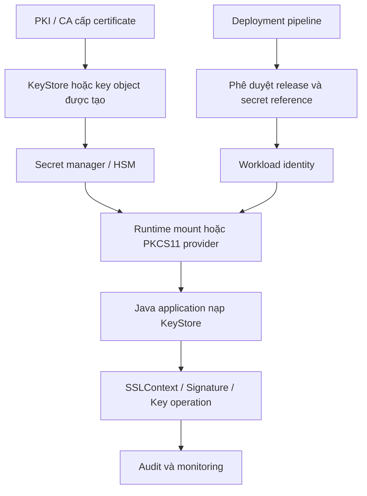
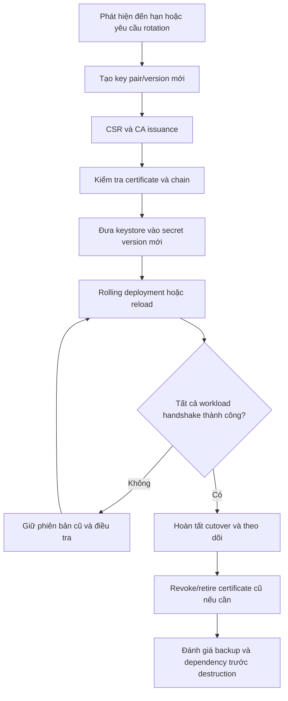

# Quản lý KeyStore trong deployment

Quản lý Java KeyStore trong deployment là quá trình đưa certificate, private key và trust material tới đúng ứng dụng, đúng môi trường, với quyền truy cập và vòng đời được kiểm soát. Một keystore có thể được tạo đúng nhưng vẫn gây sự cố hoặc rò rỉ khóa nếu được đóng gói vào container image, truyền password qua command line, mount sai quyền, dùng chung giữa staging và production hoặc không được rotation khi certificate sắp hết hạn.

Trong Java, KeyStore là API chuẩn để truy cập key entry và trusted certificate entry. Khi triển khai, cần quyết định loại keystore, nơi lưu, cách cấp credential, cách ứng dụng nạp store, cách cấu hình TLS và cách cập nhật mà không làm gián đoạn dịch vụ. Private key phải được bảo vệ như secret; truststore thường chứa public certificate nhưng vẫn cần bảo vệ tính toàn vẹn vì thay trust anchor có thể thay đổi đối tượng mà ứng dụng tin cậy.

Bài học này kết nối Java KeyStore với vòng đời khóa mật mã: tạo và cấp phát, lưu trữ, sử dụng, backup, rotation, thu hồi và destruction. Các ví dụ dùng PKCS12 cho file-based deployment, đồng thời chỉ ra khi nào nên dùng PKCS11/HSM hoặc dịch vụ quản lý secret bên ngoài.

## 1. Vai trò của KeyStore trong production

Ứng dụng Java thường cần certificate và key material trong các tình huống như:

- TLS server: chứng minh danh tính máy chủ và thiết lập kết nối bảo mật.
- TLS client/mTLS: xác thực workload hoặc người dùng với dịch vụ từ xa.
- Ký số: ký artifact, tài liệu hoặc thông điệp bằng private key.
- Xác minh chữ ký: lấy public key/certificate và kiểm tra chữ ký.
- Kết nối tới hệ thống nội bộ: tin cậy private CA hoặc certificate của đối tác.
- Mã hóa dữ liệu: sử dụng key entry hoặc tích hợp với KMS/HSM theo kiến trúc ứng dụng.

KeyStore giúp ứng dụng truy cập các đối tượng đó qua một API thống nhất. Nó không tự quyết định ai được phép dùng khóa, secret được phân phối ra sao, certificate có đúng danh tính hay không, hoặc khi nào cần rotation. Những quyết định đó thuộc cấu hình deployment, IAM, PKI, secret management và quy trình vận hành.

Một triển khai an toàn phải trả lời được các câu hỏi: file hoặc token nào chứa key; ai có thể đọc hoặc sử dụng; credential được cấp qua kênh nào; ứng dụng xác minh alias và certificate ra sao; cách cập nhật và rollback như thế nào; bản backup và bản cũ được giữ trong bao lâu; ai xác nhận thao tác.

## 2. Phân biệt keystore và truststore

Hai thuật ngữ thường được dùng trong cấu hình TLS nhưng có mục đích khác nhau.

| Thành phần | Nội dung thường chứa | Dùng để làm gì? | Mức bảo vệ |
|---|---|---|---|
| Keystore | Private key entry và certificate chain tương ứng; đôi khi có trusted certificate entry | Cung cấp danh tính của chính ứng dụng khi ký hoặc bắt tay TLS | Rất nhạy cảm nếu có private key; hạn chế đọc, sao chép và quyền sử dụng |
| Truststore | Trusted certificate entry, thường là CA certificate hoặc certificate được pin | Xác định CA/đối tượng mà ứng dụng chấp nhận | Thường không chứa bí mật, nhưng phải bảo vệ tính toàn vẹn và quyền ghi |

Trong TLS server, keystore chứa private key và certificate của server. Truststore có thể không cần nếu server không xác thực client certificate. Trong mTLS, server cần truststore để xác minh certificate client. Ở phía client, truststore dùng để xác minh server; client keystore chỉ cần khi client phải trình certificate của mình.

Không nên mặc định mọi file có tên `truststore` đều an toàn để thay đổi công khai. Nếu attacker thêm CA của họ vào truststore, ứng dụng có thể tin certificate giả cho nhiều dịch vụ. Truststore cần quy trình thay đổi và phê duyệt tương tự một cấu hình bảo mật quan trọng.

## 3. Chọn loại KeyStore

Java hỗ trợ nhiều loại keystore thông qua provider. Loại phù hợp phụ thuộc định dạng, runtime, khả năng tương thích và nơi lưu key material.

| Loại | Đặc điểm | Tình huống triển khai |
|---|---|---|
| PKCS12 | Định dạng chuẩn phổ biến, có thể chứa private key, certificate chain và trusted certificate | Lựa chọn mặc định hợp lý cho file-based deployment hiện đại |
| JKS | Định dạng keystore Java truyền thống | Hệ thống cũ hoặc môi trường cần tương thích với tooling legacy |
| PKCS11 | Keystore abstraction ánh xạ tới token/HSM qua PKCS#11 provider | Private key cần được giữ trong HSM hoặc token, không lưu như file thông thường |
| Windows-MY/Windows-ROOT | Truy cập certificate store của Windows qua provider tương ứng | Ứng dụng chạy trên Windows và dùng certificate store do hệ điều hành quản lý |
| Provider-specific | Định dạng hoặc token do nhà cung cấp triển khai | Khi hệ thống cần tích hợp KMS/HSM hoặc nền tảng riêng |

PKCS12 thường là lựa chọn tốt cho deployment dùng file vì tính tương thích rộng. JKS vẫn có thể gặp trong hệ thống cũ; không nên đổi định dạng trong cùng một thay đổi production nếu chưa kiểm tra toolchain, password, alias, certificate chain và ứng dụng tiêu thụ.

Từ JDK 9, PKCS12 trở thành định dạng keystore mặc định của JDK thay cho JKS trong nhiều luồng mặc định. Tuy nhiên, ứng dụng production nên khai báo rõ `KeyStore` type thay vì phụ thuộc vào default của runtime.

### 3.1. File keystore và HSM khác nhau

File-based keystore lưu dữ liệu trong file được bảo vệ bằng password và cơ chế mã hóa của định dạng. Tiến trình có quyền đọc file và password có thể yêu cầu provider truy cập private key; vì vậy cần bảo vệ file, credential và môi trường chạy.

PKCS11 KeyStore truy cập object trong token/HSM. Ứng dụng thường nạp keystore bằng `load(null, pin)` sau khi cấu hình provider. Không có file PKCS12 cần mount, và việc backup/restore phụ thuộc cơ chế của token hoặc nhà cung cấp HSM. Không dùng `KeyStore.store()` như giả định rằng toàn bộ HSM token sẽ được backup thành file.

Nếu yêu cầu quy định private key không được rời khỏi HSM, file PKCS12 không đáp ứng mục tiêu đó chỉ vì file được mã hóa bằng password. Hãy dùng PKCS11 hoặc dịch vụ quản lý khóa có security boundary đáp ứng yêu cầu.

## 4. Mô hình phân phối KeyStore trong deployment

Một kiến trúc thường dùng là tạo hoặc nhập key vào hệ thống quản lý khóa, tạo certificate qua CA, lưu bản triển khai trong secret manager hoặc HSM, rồi cấp quyền cho workload lấy đúng phiên bản khi khởi động.



Deployment pipeline nên lưu tham chiếu tới secret version hoặc key ID thay vì lưu bản sao private key trong source repository. Runtime workload dùng identity riêng để lấy secret hoặc gọi HSM. Quyền cấp phát cần giới hạn theo application, environment, namespace và mục đích.

Các mô hình phổ biến:

- Secret manager cấp file hoặc credential lúc khởi động.
- Orchestrator mount secret thành file chỉ đọc vào container.
- CSI driver hoặc external secret integration đồng bộ secret từ hệ thống quản lý bên ngoài.
- HSM/PKCS11 provider cho phép ứng dụng dùng key handle mà không cần file private key.
- Certificate manager tự động cấp và gia hạn certificate, sau đó cập nhật secret được workload sử dụng.

Chọn mô hình dựa trên yêu cầu bảo vệ key material, khả năng reload, thời gian sẵn sàng, audit và recovery. Không phải nền tảng nào cũng có cùng semantics về đồng bộ secret, cache hoặc rotation.

## 5. Không đóng gói private key vào source hoặc image

Không commit keystore production, private key, store password, key password, PIN hoặc credential truy cập secret manager vào Git. File có đuôi `.p12`, `.pfx`, `.jks`, `.pem` hay tên như `server-keystore` phải được kiểm tra nội dung trước khi phân loại; phần mở rộng không cho biết chắc nó có chứa private key hay không.

Không copy keystore production vào container image bằng `COPY`, build argument hoặc layer build. Image thường được lưu trong registry, cache, mirror, máy developer và hệ thống scan; xóa file ở layer sau không loại bỏ dữ liệu đã có trong layer trước. Nếu build thực sự cần secret, dùng cơ chế secret mount của build system và giới hạn thời gian truy cập. Tốt hơn, cấp secret khi runtime nếu build không cần dùng key.

Không dùng chung keystore giữa development, test, staging và production. Mỗi môi trường cần key pair, certificate, trust policy và quyền riêng. Nếu một môi trường thử nghiệm bị compromise, attacker không được dùng cùng private key để giả mạo production.

### 5.1. `.gitignore` chỉ là lớp hỗ trợ

Có thể thêm pattern để tránh vô tình đưa file vào commit:

```gitignore
*.p12
*.pfx
*.jks
*.keystore
*.key
*.pem
```

Pattern này chỉ hỗ trợ phòng ngừa. Nó có thể bỏ qua cả public certificate hoặc fixture cần lưu trong repository, và không xóa secret đã được commit trước đó. Nếu private key đã vào Git history, phải coi là có nguy cơ lộ: chặn sử dụng, rotation/revoke theo incident response, xử lý history và bản clone/cache theo quy trình tổ chức.

## 6. Lưu password và credential

File keystore có thể được bảo vệ bằng store password; private key entry cũng có thể có cơ chế bảo vệ riêng. PKCS12 ở mức định dạng có các trường bảo vệ nội dung và kiểm tra tính toàn vẹn, nhưng provider và công cụ Java có thể áp dụng giới hạn riêng; một số implementation yêu cầu store password và key password giống nhau hoặc bỏ qua key password khác biệt. Hãy xác minh hành vi của đúng JDK/provider và file được tạo. Không giả định password của container và password của từng key entry luôn độc lập hoặc có cùng semantics.

Các nguyên tắc triển khai:

- Lấy password từ secret manager, workload identity hoặc credential channel được bảo vệ.
- Không hardcode password trong source, Dockerfile, Helm values công khai, manifest ConfigMap hoặc file cấu hình được commit.
- Tránh truyền password bằng command line vì có thể lộ trong process list, shell history, job log hoặc telemetry.
- Không ghi password, PIN hoặc private key vào log, exception message, tracing span hay crash report.
- Cấp quyền đọc secret theo workload identity và environment; không dùng một credential chung cho mọi service.
- Có quy trình rotate password và cập nhật đồng bộ với secret version được deployment tham chiếu.
- Hạn chế thời gian tồn tại của password trong memory; xóa mảng `char[]` theo best-effort sau khi dùng.

Environment variable có thể tiện lợi hơn hardcode nhưng không phải secret manager. Tùy hệ điều hành và cách chạy, giá trị có thể xuất hiện trong process inspection, diagnostic dump, crash dump hoặc công cụ quản trị. Nếu dùng environment variable, cần giới hạn quyền truy cập process và hệ thống quan sát; ưu tiên file credential hoặc API secret manager khi nền tảng hỗ trợ.

## 7. Quyền file và filesystem

Với file-based keystore, bảo vệ filesystem là một phần của key management. Một tiến trình khác có quyền đọc file và password có thể sử dụng private key, dù ứng dụng chính không bao giờ xuất key material.

Các kiểm soát thường dùng:

- Đặt keystore trong thư mục riêng, không nằm trong web root hoặc thư mục static.
- Chỉ user/group của workload được đọc file; ví dụ mode `0400` hoặc `0440` tùy cách quản lý user/group.
- Mount read-only nếu ứng dụng không cần ghi keystore.
- Bảo vệ parent directory và symlink để người khác không thay file bằng một file giả.
- Xác minh owner, mode, đường dẫn thực và phiên bản secret trước khi load.
- Trên Windows, dùng ACL giới hạn service account và administrator được ủy quyền.
- Hạn chế backup agent, support bundle, antivirus quarantine và file indexing truy cập nội dung secret.
- Xử lý file tạm và bản copy theo cùng chính sách; xóa file gốc không xóa backup hoặc snapshot.

Không dùng quyền `0777` để khắc phục lỗi permission. Nếu container chạy bằng non-root user, hãy cấu hình owner/group hoặc `fsGroup` phù hợp thay vì mở quyền đọc cho mọi user.

## 8. Cấu hình đường dẫn và alias

Đường dẫn keystore nên được cấu hình riêng theo môi trường. Không hardcode đường dẫn máy developer như `C:\Users\...` hoặc `/home/alice/...` vào ứng dụng. Dùng một đường dẫn runtime rõ ràng, ví dụ `/run/secrets/app-keystore.p12`, và kiểm tra file tồn tại, là regular file, quyền đọc phù hợp và không bị trỏ ra ngoài thư mục secret dự kiến.

Alias là tên tham chiếu tới entry trong keystore. Ứng dụng phải xác minh alias được cấu hình có tồn tại và là key entry nếu cần private key. Không giả định keystore chỉ có một alias hoặc alias luôn giống tên file. Khi cấp certificate mới, alias có thể thay đổi theo quy ước của CA hoặc toolchain.

Metadata deployment nên ghi:

| Trường | Mục đích |
|---|---|
| `keystore_type` | PKCS12, JKS, PKCS11 hoặc provider-specific |
| `secret_reference` | Tham chiếu secret/version; không lưu secret value |
| `key_alias` | Alias entry ứng dụng cần sử dụng |
| `key_id` / `key_version` | Định danh khóa logic và phiên bản |
| `certificate_serial` | Đối chiếu certificate đang triển khai |
| `certificate_fingerprint` | Đối chiếu chính xác certificate |
| `not_after` | Theo dõi thời điểm hết hạn |
| `owner` / `environment` | Xác định trách nhiệm và phạm vi |
| `rotation_policy` | Chu kỳ, trigger và quy trình thay thế |

Không đưa password hoặc raw private key vào metadata. Fingerprint và serial có thể công khai nhưng cần được bảo vệ tính toàn vẹn để tránh gắn nhầm key version.

## 9. Nạp PKCS12 trong Java

Ví dụ sau nạp PKCS12 từ đường dẫn runtime. Password được cấp qua một abstraction `SecretProvider`, để phần đọc secret phụ thuộc nền tảng mà không gắn credential vào source code.

```java
import java.io.InputStream;
import java.nio.file.Files;
import java.nio.file.Path;
import java.security.KeyStore;
import java.util.Arrays;

public final class KeyStoreLoader {
    private KeyStoreLoader() {}

    public static KeyStore loadPkcs12(
            Path path,
            char[] storePassword) throws Exception {

        if (storePassword == null) {
            throw new IllegalArgumentException(
                "Keystore password is required"
            );
        }
        try {
            if (path == null || !Files.isRegularFile(path)
                    || !Files.isReadable(path)) {
                throw new IllegalStateException(
                    "Keystore path is missing or unreadable"
                );
            }

            KeyStore keyStore = KeyStore.getInstance("PKCS12");
            try (InputStream input = Files.newInputStream(path)) {
                keyStore.load(input, storePassword);
                return keyStore;
            }
        } finally {
            Arrays.fill(storePassword, '\0');
        }
    }
}
```

Đây là ví dụ tối giản. Production cần kiểm tra symlink/path policy, secret version, alias dự kiến, certificate validity và public key/certificate mapping. `Arrays.fill` chỉ xóa mảng đang giữ trong đoạn mã; JVM/provider có thể đã tạo bản sao nội bộ và không thể khẳng định toàn bộ dấu vết trong memory đã biến mất.

Với file-based PKCS12, provider phải giải mã key entry để ứng dụng sử dụng; private key object hoặc dữ liệu liên quan có thể tồn tại trong memory của JVM. Password mã hóa file không tạo ra thuộc tính non-exportable như HSM. Nếu yêu cầu private key không rời security boundary, hãy dùng PKCS11/HSM thay vì xem file PKCS12 được mã hóa là tương đương.

Nếu ứng dụng cần dùng private key, hãy kiểm tra entry type và lấy key bằng alias. Không in đối tượng key, encoded bytes hoặc password ra log.

```java
import java.security.Key;
import java.security.KeyStore;
import java.security.PrivateKey;

public final class KeyEntryAccess {
    private KeyEntryAccess() {}

    public static PrivateKey requirePrivateKey(
            KeyStore keyStore,
            String alias,
            char[] keyPassword) throws Exception {

        if (alias == null || alias.isBlank()) {
            throw new IllegalArgumentException("Key alias is required");
        }
        if (!keyStore.containsAlias(alias)
                || !keyStore.isKeyEntry(alias)) {
            throw new IllegalStateException(
                "Configured alias is not a key entry"
            );
        }

        try {
            Key key = keyStore.getKey(alias, keyPassword);
            if (!(key instanceof PrivateKey privateKey)) {
                throw new IllegalStateException(
                    "Configured entry is not a private key"
                );
            }
            return privateKey;
        } finally {
            if (keyPassword != null) {
                java.util.Arrays.fill(keyPassword, '\0');
            }
        }
    }
}
```

Với Java 8, pattern matching `instanceof` chưa có; cần viết cast theo cú pháp Java 8. Ví dụ này dùng cú pháp Java hiện đại. Password cho key entry có thể là `null` nếu provider/keystore cho phép hoặc password giống store password; hãy dùng đúng semantics của file và provider đã tạo.

Hai hàm minh họa chủ động xóa mảng password được truyền vào, vì vậy caller phải chuyển quyền sở hữu mảng đó cho hàm và không dùng lại sau lời gọi. Nếu PKCS12/provider yêu cầu cùng một password để load store và mở key entry, secret provider cần cấp hai mảng `char[]` mới có cùng giá trị; không truyền lại mảng đã bị xóa.

## 10. Tạo SSLContext từ keystore và truststore

Để TLS server hoặc client dùng certificate, Java thường khởi tạo `KeyManagerFactory` từ keystore và `TrustManagerFactory` từ truststore, sau đó tạo `SSLContext`.

```java
import java.security.KeyStore;
import java.util.Arrays;
import javax.net.ssl.KeyManagerFactory;
import javax.net.ssl.SSLContext;
import javax.net.ssl.TrustManagerFactory;

public final class TlsContextFactory {
    private TlsContextFactory() {}

    public static SSLContext create(
            KeyStore identityStore,
            char[] privateKeyPassword,
            KeyStore trustStore) throws Exception {

        try {
            KeyManagerFactory keyManagers = KeyManagerFactory.getInstance(
                KeyManagerFactory.getDefaultAlgorithm()
            );
            keyManagers.init(identityStore, privateKeyPassword);

            TrustManagerFactory trustManagers = TrustManagerFactory.getInstance(
                TrustManagerFactory.getDefaultAlgorithm()
            );
            trustManagers.init(trustStore);

            SSLContext context = SSLContext.getInstance("TLS");
            context.init(
                keyManagers.getKeyManagers(),
                trustManagers.getTrustManagers(),
                null
            );
            return context;
        } finally {
            if (privateKeyPassword != null) {
                Arrays.fill(privateKeyPassword, '\0');
            }
        }
    }
}
```

`identityStore` cung cấp certificate/private key của chính workload; `trustStore` xác định CA mà workload tin cậy. Đối với TLS client thông thường, có thể chỉ cần truststore. Đối với mTLS, client cần cả hai. TLS server cần identity store; nếu yêu cầu client certificate, server cũng cần truststore để xác minh client.

Hàm ví dụ nhận `privateKeyPassword` và xóa mảng sau khi `KeyManagerFactory` khởi tạo. Caller cần cấp một mảng mới và không tái sử dụng mảng đó sau lời gọi.

Không tạo `TrustManager` chấp nhận mọi certificate hoặc tắt hostname verification để khắc phục lỗi kết nối. Hãy sửa chain, SAN, trust anchor, thời gian hệ thống hoặc cấu hình endpoint đúng nguyên nhân. Nếu dùng custom `SSLContext`, cần xác minh hostname ở TLS client vẫn được thực hiện theo API/client library đang dùng.

## 11. Cấu hình ứng dụng theo môi trường

Ứng dụng nên nhận đường dẫn, alias, loại keystore và secret reference từ cấu hình deployment. Giá trị cụ thể của password được nạp từ secret channel ở runtime.

Ví dụ cấu hình không chứa secret value:

```yaml
security:
  key-store:
    type: PKCS12
    path: /run/secrets/orders-client.p12
    alias: orders-mtls-v7
    password-secret-ref: prod/orders/client-keystore-password
  trust-store:
    type: PKCS12
    path: /run/secrets/internal-ca-trust.p12
    password-secret-ref: prod/orders/truststore-password
  tls:
    protocol: TLS
    client-auth: NEED
```

`password-secret-ref` là tên tham chiếu minh họa cho ứng dụng hoặc secret manager; không phải thuộc tính chuẩn của Java. Không lưu password thật trong YAML được commit. Có thể lưu `path` và alias trong cấu hình, nhưng cần bảo vệ tính toàn vẹn của cấu hình vì attacker có thể đổi path hoặc alias để ứng dụng dùng nhầm key.

Nếu dùng Spring Boot hoặc framework khác, hãy ánh xạ cấu hình vào abstraction của framework nhưng vẫn giữ các nguyên tắc: secret được cấp runtime, type được khai báo rõ, identity và trust được tách, certificate được kiểm tra và reload có kiểm soát.

## 12. Deployment trong container

Container image nên chứa ứng dụng và dependency, còn keystore/private key được cấp lúc runtime. Cách này giảm số nơi lưu bản sao key material và cho phép thay secret mà không build lại image.

Một mô hình container:

1. Image chạy bằng non-root user.
2. Runtime platform lấy keystore từ secret manager hoặc volume secret.
3. File được mount read-only vào đường dẫn ổn định.
4. Password được cấp qua file credential hoặc API secret manager.
5. Ứng dụng xác minh file, alias và certificate trước khi mở listener.
6. Monitoring theo dõi secret version, certificate expiry và lỗi TLS.

Không mount toàn bộ thư mục host chứa key vào container. Chỉ mount đúng file hoặc secret cần thiết. Không dùng writable shared volume cho private key nếu ứng dụng không cần ghi; nếu cần tạo keystore mới, dùng quy trình provisioning riêng rồi chuyển bản đã phê duyệt sang runtime.

### 12.1. Docker Compose và local development

Local development có thể dùng secret file được tạo ngoài repository và mount vào container. `.env` chỉ nên chứa giá trị không nhạy cảm hoặc tham chiếu; tránh commit password và file keystore. Các secret của developer không được dùng lại trong staging/production.

Với Docker Swarm, Docker secrets có thể được mount thành file trong container theo cơ chế của Swarm. Với Docker Compose thông thường, semantics phụ thuộc phiên bản và cấu hình; không mặc định mọi khai báo `secrets` đều có mã hóa at-rest giống một secret manager chuyên dụng. Kiểm tra cách nền tảng lưu, phân phối và bảo vệ secret.

### 12.2. Ví dụ Dockerfile

```dockerfile
FROM eclipse-temurin:21-jre

WORKDIR /app
COPY build/libs/orders-service.jar /app/orders-service.jar

USER 10001:10001
EXPOSE 8443

ENTRYPOINT ["java", "-jar", "/app/orders-service.jar"]
```

Dockerfile không copy keystore hoặc password. Runtime mount file vào `/run/secrets` và cấp quyền đọc cho UID/GID `10001` theo cơ chế của nền tảng. Không dùng `ARG KEYSTORE_PASSWORD` hoặc `ENV KEYSTORE_PASSWORD=...` để đưa production secret vào image.

## 13. Deployment trên Kubernetes

Kubernetes Secret giúp đưa dữ liệu nhạy cảm tới Pod, nhưng giá trị trong manifest thường được biểu diễn Base64. Base64 là encoding, không phải encryption. Cần cấu hình encryption at rest cho dữ liệu Secret trong etcd, RBAC tối thiểu, audit, bảo vệ etcd backup và giới hạn quyền đọc Secret.

Các nguyên tắc quan trọng:

- Dùng Secret volume hoặc CSI/external secret integration; không đặt private key trong ConfigMap.
- Giới hạn `get/list/watch` Secret theo namespace và service account.
- Không cấp quyền đọc mọi Secret cho mọi workload trong namespace nếu không cần.
- Dùng workload identity để lấy secret từ secret manager bên ngoài khi có thể.
- Mount file read-only và đặt `runAsNonRoot`, `runAsUser`, `fsGroup` phù hợp.
- Không truyền store password vào command line hoặc log.
- Bảo vệ backup etcd và kiểm soát ai có thể đọc manifest rendered trong CI/CD.
- Theo dõi Secret version và rollout để chắc chắn Pod đã nạp phiên bản mới.

Ví dụ Pod tham chiếu Secret đã được provision trước:

```yaml
apiVersion: apps/v1
kind: Deployment
metadata:
  name: orders-service
spec:
  replicas: 3
  selector:
    matchLabels:
      app: orders-service
  template:
    metadata:
      labels:
        app: orders-service
    spec:
      serviceAccountName: orders-service
      securityContext:
        runAsNonRoot: true
        runAsUser: 10001
        fsGroup: 10001
      containers:
        - name: app
          image: registry.example.internal/orders-service:2026.11.28
          volumeMounts:
            - name: tls-keystore
              mountPath: /run/secrets/tls
              readOnly: true
          env:
            - name: KEYSTORE_PATH
              value: /run/secrets/tls/identity.p12
      volumes:
        - name: tls-keystore
          secret:
            secretName: orders-tls-v7
            defaultMode: 0440
```

Manifest không chứa nội dung Secret. `orders-tls-v7` phải được tạo và quản lý qua quy trình secret provisioning có kiểm soát. Nếu password cũng được lưu trong Kubernetes Secret, cần mount riêng hoặc dùng external secret integration; tránh đặt password vào cùng một ConfigMap.

### 13.1. Cập nhật Secret và reload

Kubernetes cập nhật nội dung Secret volume theo cơ chế eventual update, nhưng ứng dụng không tự động nạp lại KeyStore đã load trong memory. Một ứng dụng có thể tiếp tục dùng SSLContext cũ cho tới khi reload hoặc restart. Mount qua `subPath` không tự nhận cập nhật Secret theo cơ chế projected volume thông thường.

Các cách triển khai rotation thường gặp:

- Tạo Secret version mới, cập nhật Pod template và rolling deployment.
- Dùng controller/sidecar báo thay đổi secret, sau đó ứng dụng reload SSLContext một cách an toàn.
- Dùng certificate manager/CSI driver có cơ chế cập nhật file, kết hợp reload hoặc rollout rõ ràng.

Không coi việc Secret object đã cập nhật là bằng chứng mọi Pod đã sử dụng certificate mới. Cần theo dõi phiên bản đang chạy và xác minh handshake từ bên ngoài.

## 14. Deployment trên máy chủ và systemd

Với ứng dụng Java chạy trực tiếp trên VM hoặc máy chủ, có thể đặt keystore trong thư mục do service account quản lý, hoặc dùng systemd credentials nếu phiên bản systemd hỗ trợ. Cách cấp credential phải phù hợp với OS, quyền admin và cơ chế backup.

Ví dụ unit file rút gọn:

```ini
[Service]
User=orders
Group=orders
WorkingDirectory=/opt/orders
LoadCredential=keystore-password:/etc/credstore/orders-keystore-password
Environment=KEYSTORE_PATH=/etc/orders/tls/identity.p12
ExecStart=/usr/bin/java -jar /opt/orders/orders-service.jar
Restart=on-failure
NoNewPrivileges=true
PrivateTmp=true
ProtectSystem=strict
ProtectHome=true
ReadOnlyPaths=/etc/orders/tls
```

`LoadCredential` chỉ khả dụng trên các phiên bản systemd hỗ trợ; cần kiểm tra phiên bản và quyền truy cập của credential source. Ứng dụng có thể đọc credential từ thư mục do systemd cung cấp, thay vì lấy password qua command line. Ví dụ unit cần được điều chỉnh theo filesystem và hardening policy thực tế.

Không cấp quyền ghi rộng vào `/etc/orders/tls`. Nếu rotation yêu cầu cập nhật file, một agent được ủy quyền có thể ghi bản mới vào staging path, kiểm tra fingerprint/chain rồi atomic rename hoặc kích hoạt rollout theo runbook.

## 15. Cấu hình TLS server và mTLS

Keystore deployment thường gắn với TLS listener. Server phải trình certificate chain phù hợp và chứng minh sở hữu private key. Client phải kiểm tra trust chain và hostname. Với mTLS, hai phía còn xác minh certificate của nhau theo trust policy.

| Vai trò | Keystore | Truststore |
|---|---|---|
| HTTPS server không yêu cầu client cert | Certificate/private key server | Có thể không cần custom truststore |
| HTTPS server yêu cầu mTLS | Certificate/private key server | CA được phép cấp client certificate |
| HTTPS client thông thường | Không cần nếu không có client authentication | CA được phép cấp server certificate |
| HTTPS client dùng mTLS | Certificate/private key client | CA được phép cấp server certificate |

Phải kiểm tra SAN của certificate server khớp hostname mà client truy cập. Một truststore có CA hợp lệ không làm certificate sai hostname trở thành hợp lệ. Tương tự, certificate còn hạn nhưng đã bị thu hồi hoặc có EKU không phù hợp vẫn phải bị từ chối theo policy.

Không tắt hostname verification hoặc dùng trust-all manager trong production. Nếu cần private CA, cài đúng CA certificate vào truststore thay vì bỏ kiểm tra certificate.

## 16. Startup validation và readiness

Ứng dụng nên phát hiện sớm lỗi KeyStore trước khi nhận traffic. Startup validation có thể kiểm tra:

- File/token truy cập được và loại KeyStore đúng.
- Secret reference/version tồn tại và password load thành công.
- Alias được cấu hình tồn tại và là private key entry khi cần.
- Certificate chain có certificate phù hợp, đúng SAN/EKU và còn thời hạn theo policy.
- Private key tương ứng có thể thực hiện một phép ký thử hoặc thao tác kiểm tra được phê duyệt.
- Truststore có trust anchor dự kiến và không chứa CA ngoài policy.
- Secret version, certificate serial/fingerprint và key version khớp deployment manifest.

Readiness probe chỉ nên báo ready sau khi TLS context và key material cần thiết đã được nạp. Liveness probe không nên phụ thuộc vào việc secret manager tạm thời chậm nếu ứng dụng đã khởi động an toàn và có thể tiếp tục phục vụ. Phân biệt lỗi cấu hình vĩnh viễn với lỗi dependency tạm thời để tránh restart loop.

Không log password hoặc encoded private key khi startup validation thất bại. Log nên có secret reference, alias, certificate serial/fingerprint, provider và mã lỗi đã được làm sạch.

## 17. Rotation và certificate renewal trong deployment

Rotation có thể thay private key, certificate hoặc cả hai. Renewal có thể cấp certificate mới trên cùng key pair nếu policy cho phép; khi private key bị compromise, cần key pair mới. Lịch rotation nên được quyết định theo cryptoperiod, mức rủi ro, yêu cầu CA, sự kiện compromise và khả năng vận hành.

Một quy trình rotation có kiểm soát:

1. Tạo key version mới trong HSM hoặc tạo keystore mới ở provisioning environment.
2. Gửi CSR và hoàn tất xác minh/approval với CA.
3. Kiểm tra certificate mới: SAN, issuer, validity, KU/EKU, chain và public key mapping.
4. Lưu keystore mới dưới secret version mới; cập nhật metadata inventory.
5. Triển khai canary hoặc rolling update, bảo đảm workload có thể nạp file và credential.
6. Xác minh TLS handshake, mTLS và các client phụ thuộc.
7. Theo dõi lỗi, latency, certificate serial và secret version đang hoạt động.
8. Hoàn tất rollout; giữ overlap theo thời gian cần thiết.
9. Thu hồi certificate cũ nếu cần và theo dõi CRL/OCSP propagation.
10. Hủy private key cũ sau khi xử lý dependency, backup, retention và yêu cầu xác minh lịch sử.



Không xóa keystore cũ ngay sau khi deploy bản mới. Một số dữ liệu, chữ ký lịch sử hoặc client cũ có thể còn phụ thuộc private key/certificate trước đó. Với signing key, public key/certificate cũ có thể cần giữ để verify chữ ký đã tạo. Với encryption key, dữ liệu cũ có thể cần decrypt. Thời điểm destruction phải dựa trên dependency inventory và policy.

### 17.1. Blue/green và rolling deployment

Rolling deployment giúp thay từng nhóm instance để duy trì availability. Blue/green có thể giữ hai phiên bản song song trong giai đoạn chuyển tiếp. Cả hai cách cần bảo đảm certificate mới đã được tin cậy bởi client, truststore có CA cần thiết và mọi endpoint có thể phục vụ đúng chain.

Nếu certificate pinning được sử dụng, phải cập nhật pin hoặc có backup pin trước cutover. Nếu CA intermediate thay đổi, cần kiểm tra chain và trust store của client cũ. Với mTLS, server và client có thể cần overlap trust policy để hai thế hệ certificate giao tiếp trong giai đoạn migration.

## 18. Reload KeyStore an toàn

Nhiều ứng dụng chỉ nạp KeyStore một lần khi khởi động. Thay file trên disk không tự thay private key hoặc certificate đang nằm trong `SSLContext`, `KeyManager` hay connection pool. Cần có cơ chế reload được thiết kế rõ.

Một mô hình reload:

1. Phát hiện secret version mới.
2. Nạp keystore/truststore mới vào object độc lập.
3. Kiểm tra alias, key entry, certificate, chain, expiry và trust policy.
4. Tạo `KeyManagerFactory`, `TrustManagerFactory` và `SSLContext` mới.
5. Chạy health check hoặc handshake thử tới endpoint kiểm thử.
6. Atomically chuyển reference của ứng dụng sang SSLContext mới.
7. Cho connection cũ drain theo timeout; tạo connection mới bằng context mới.
8. Ghi audit và metric xác nhận phiên bản đang hoạt động.

Không thay đổi object `SSLContext` đang được nhiều thread dùng bằng cách mutate tùy tiện. Có thể dùng immutable context mới và `AtomicReference` để chuyển phiên bản. Việc thay context không tự thay certificate trên mọi connection đã mở; TLS session, connection pool và long-lived connection cần được xử lý theo policy.

## 19. Truststore rotation và CA rollover

Truststore rotation có thể liên quan tới việc thêm CA mới, thay intermediate hoặc loại bỏ root CA không còn tin cậy. Đây là thay đổi trust boundary, có thể ảnh hưởng mọi kết nối TLS của ứng dụng.

Một quy trình CA rollover an toàn thường gồm:

- Xác định CA cũ, CA mới, các chain và client/server phụ thuộc.
- Thêm trust anchor mới trước khi chuyển certificate server/client sang issuer mới.
- Triển khai truststore mới tới workload và xác minh các kết nối vẫn thành công.
- Chuyển dần certificate sang CA mới.
- Theo dõi certificate cũ, CRL/OCSP và các client chưa cập nhật.
- Loại trust anchor cũ sau khi không còn dependency hoặc khi có incident buộc phải loại bỏ.

Không xóa CA cũ khỏi truststore trước khi các endpoint đã chuyển nếu không có kế hoạch outage được phê duyệt. Ngược lại, khi CA root/intermediate bị compromise, có thể phải loại bỏ trust khẩn cấp và chấp nhận ảnh hưởng dịch vụ theo incident response.

## 20. Backup và recovery của keystore

Backup keystore phải bảo vệ cả file và password/credential cần để mở nó. Backup file mà mất password có thể không dùng được; backup password mà không kiểm soát file cũng làm tăng khả năng truy cập trái phép. Cần tách quyền, mã hóa backup và kiểm thử restore.

Các nguyên tắc:

- Chỉ backup key còn cần cho decrypt, verify, recovery hoặc yêu cầu retention.
- Mã hóa backup và lưu trong storage độc lập với workload chính.
- Giới hạn quyền đọc, tải xuống, restore và xóa backup.
- Bảo vệ backup password/KEK riêng và có quorum khi cần.
- Ghi inventory liên kết file, key ID/version, certificate serial và checksum.
- Kiểm thử restore trong môi trường cô lập; xác minh alias, key entry, chain và khả năng sử dụng.
- Giữ backup theo retention policy; xử lý legal hold và destruction riêng.
- Không copy production keystore sang môi trường test để thuận tiện.

Với PKCS11/HSM, backup/restore thường là cơ chế vendor-specific, có thể cần security domain, backup appliance, quorum hoặc wrapped backup package. Không giả định export private key là cách backup hợp lệ. Với secret manager, kiểm tra replication, version history, deletion recovery window và quyền khôi phục theo tài liệu provider.

## 21. Thu hồi và xử lý khi keystore bị lộ

Nếu file keystore hoặc password bị lộ, phải xem xét cả private key material và quyền sử dụng. Chỉ xóa file trên máy chủ không làm key pair cũ mất hiệu lực. Nếu private key có thể đã bị sao chép, cần chặn sử dụng, tạo key pair mới, cấp certificate mới, thu hồi certificate cũ và đánh giá dữ liệu/chữ ký phụ thuộc.

Runbook sự cố nên bao gồm:

1. Xác định secret version, alias, key ID, certificate serial/fingerprint và phạm vi deployment.
2. Thu hồi credential/identity có quyền đọc hoặc dùng keystore.
3. Cô lập workload hoặc chặn thao tác ký/giải mã theo mức độ sự cố.
4. Tạo key pair mới trong security boundary phù hợp.
5. Cấp certificate mới và triển khai theo quy trình khẩn cấp.
6. Revoke certificate cũ và kiểm tra CRL/OCSP/trust propagation.
7. Rà soát image, registry, Git history, backup, snapshot, logs và support bundle.
8. Giữ bằng chứng cần thiết cho điều tra; không xóa dấu vết trước khi được phép.
9. Xử lý backup/replica và destruction của key cũ theo incident policy.
10. Ghi audit, nguyên nhân gốc và hành động ngăn tái diễn.

Nếu chỉ password bị lộ nhưng file không bị lộ, mức độ ảnh hưởng vẫn cần đánh giá theo khả năng truy cập file và provider. Nếu private key đã lộ, đổi password trên cùng keystore không tạo ra key pair mới và không khắc phục compromise.

## 22. Giám sát và audit

Deployment cần có khả năng trả lời phiên bản keystore nào đang được workload sử dụng và certificate nào đang được trình bày. Các trường giám sát hữu ích:

| Metric/event | Ý nghĩa |
|---|---|
| Secret version loaded | Phiên bản secret đang hoạt động trên từng instance |
| KeyStore load success/failure | Phát hiện lỗi file, password hoặc provider |
| Active certificate serial/fingerprint | Đối chiếu certificate đang được triển khai |
| Certificate expiry days | Cảnh báo trước khi certificate hết hạn |
| TLS handshake failure | Phát hiện chain, hostname, trust hoặc key mismatch |
| Trust validation failure | Phát hiện CA/chain không được chấp nhận |
| Rotation rollout progress | Theo dõi số instance đã cập nhật |
| HSM operation errors/latency | Theo dõi PKCS11/KMS khi dùng key handle |
| Secret access audit | Xác định workload/person nào đã truy cập secret |
| Keystore file permission drift | Phát hiện quyền hoặc owner bị thay đổi |

Log chỉ nên chứa metadata cần thiết: secret reference, alias, serial, fingerprint, provider, key version và error code đã được làm sạch. Không log password, PIN, private key, encoded key bytes hoặc toàn bộ secret payload.

## 23. Cấu hình TLS qua system properties

Java hỗ trợ một số system property như `javax.net.ssl.keyStore`, `javax.net.ssl.keyStoreType`, `javax.net.ssl.trustStore` và các property liên quan. Chúng có thể tiện cho ứng dụng đơn giản nhưng cần thận trọng:

- Property là cấu hình ở phạm vi JVM và có thể ảnh hưởng nhiều thư viện.
- Password đặt qua `javax.net.ssl.keyStorePassword` có thể lộ trong process arguments hoặc diagnostic output nếu truyền trên command line.
- Một cấu hình global khó đáp ứng nhiều trust domain hoặc nhiều client với policy khác nhau.
- Thay system property sau khi SSLContext đã khởi tạo không bảo đảm context đang dùng được cập nhật.

Với ứng dụng phức tạp, nên nạp KeyStore rõ ràng và tạo SSLContext riêng cho từng trust domain hoặc use case. Nếu dùng system property, lấy giá trị qua secret channel được bảo vệ và kiểm tra hành vi của thư viện sử dụng JSSE.

## 24. Tình huống thực tế: triển khai mTLS cho dịch vụ Orders

Một dịch vụ `orders` chạy ba replica trên Kubernetes và cần mTLS tới `inventory`. Ban đầu nhóm đóng gói `orders-client.p12` cùng password vào image. Khi image được đẩy lên registry và dùng ở staging, cùng một private key xuất hiện ở nhiều môi trường.

Nhóm chuyển sang cấp certificate riêng cho từng environment. CA nội bộ xác minh workload identity, cấp certificate client có SAN/identity phù hợp và lưu private key theo policy. Secret provisioning tạo Secret version `orders-client-v7`; Pod mount keystore read-only vào `/run/secrets/tls`. Password được cấp riêng qua external secret integration và chỉ service account của `orders` có quyền đọc. Truststore chứa CA nội bộ được cập nhật qua một version riêng.

Java service nạp PKCS12, kiểm tra alias `orders-mtls-v7`, khởi tạo KeyManagerFactory và TrustManagerFactory, rồi tạo SSLContext. Readiness chỉ thành công sau khi load và kiểm tra certificate. Monitoring ghi secret version, serial và ngày hết hạn, không ghi password.

Khi certificate sắp hết hạn, nhóm tạo key pair và certificate mới, provision Secret version `v8`, cập nhật Pod template để rolling deployment. Họ kiểm tra handshake từ cả ba replica, sau đó thu hồi certificate cũ khi không còn client phụ thuộc. Private key cũ được xử lý theo backup/retention policy và destruction runbook. Image registry không chứa file keystore; staging có key riêng.

## 25. Các lỗi thường gặp khi triển khai

- **Đóng gói production keystore vào image:** mọi bản image, cache và registry có thể trở thành bản sao key.
- **Commit password trong cấu hình:** secret có thể tồn tại lâu trong Git history và bản clone.
- **Dùng chung key giữa môi trường:** compromise staging có thể ảnh hưởng production.
- **Nhầm keystore với truststore:** ứng dụng có thể thiếu private key hoặc tin sai CA.
- **Không khai báo rõ type:** runtime/provider khác nhau có thể diễn giải định dạng không như dự kiến.
- **Không kiểm tra alias:** ứng dụng có thể dùng nhầm certificate hoặc không tìm thấy private key.
- **Mở quyền file quá rộng:** user khác trong host/container có thể đọc keystore.
- **Dùng Base64 như encryption:** Kubernetes Secret được encode không có nghĩa dữ liệu đã mã hóa at rest.
- **Cập nhật Secret nhưng không reload:** Pod vẫn tiếp tục dùng SSLContext/certificate cũ.
- **Dùng `subPath` và mong file tự cập nhật:** projected Secret update không hoạt động như mong đợi với kiểu mount này.
- **Tắt hostname verification:** mở đường cho MITM dù certificate chain có thể hợp lệ.
- **Trust-all manager:** bỏ qua chính sách tin cậy để chữa lỗi tạm thời.
- **Không kiểm tra backup:** bản keystore cũ vẫn có thể được phục hồi hoặc sử dụng.
- **Đổi password nhưng giữ private key đã compromise:** key pair cũ vẫn bị lộ.
- **Xóa key cũ ngay sau rotation:** dữ liệu lịch sử hoặc chữ ký cũ có thể không còn xử lý được.
- **Không theo dõi certificate expiry:** hết hạn có thể làm gián đoạn TLS hoặc API.
- **Không xác minh mọi replica:** một số instance có thể vẫn trình certificate cũ sau rollout.

## 26. Checklist trước khi đưa KeyStore vào production

- [ ] Đã xác định mục đích: TLS server, mTLS client, signing, trust hay use case khác.
- [ ] Đã chọn rõ PKCS12, JKS, PKCS11 hoặc provider phù hợp.
- [ ] Đã tách identity keystore khỏi truststore theo đúng vai trò.
- [ ] Key pair/certificate thuộc đúng environment và workload.
- [ ] Private key được cấp qua secret manager, HSM hoặc cơ chế runtime được phê duyệt.
- [ ] Không có keystore/password trong Git, Docker image, build layer hoặc artifact không được phép.
- [ ] Password/PIN được cấp riêng qua secret channel; không hardcode hoặc log.
- [ ] File nằm ngoài web root, mount read-only và có owner/mode/ACL phù hợp.
- [ ] Đường dẫn, symlink, alias và secret version được xác minh khi startup.
- [ ] Certificate chain, SAN, KU/EKU, validity và fingerprint được kiểm tra.
- [ ] Truststore chỉ chứa CA/anchor được phê duyệt và có kiểm soát integrity.
- [ ] TLS hostname verification được bật; không có trust-all manager.
- [ ] Readiness chỉ thành công sau khi KeyStore và TLS context sẵn sàng.
- [ ] Có quy trình rotation, renewal, reload và rollback.
- [ ] Mọi replica được xác minh đã nạp phiên bản mới.
- [ ] Có cảnh báo expiry, TLS failures, secret access và permission drift.
- [ ] Backup được mã hóa, phân quyền và kiểm thử restore.
- [ ] Có quy trình revoke, incident response và destruction cho key cũ.
- [ ] Inventory liên kết secret reference, key version, alias, serial, owner và expiry.
- [ ] Audit evidence không chứa private key, password, PIN hoặc recovery share.

## 27. Câu hỏi tự kiểm tra

1. Keystore và truststore khác nhau như thế nào trong TLS server và TLS client?
2. Vì sao PKCS12 thường phù hợp với file-based deployment hiện đại?
3. Khi nào nên dùng PKCS11/HSM thay cho file PKCS12?
4. Vì sao private key không nên được copy vào Docker image hoặc Git repository?
5. Base64 trong Kubernetes Secret có bảo vệ dữ liệu như encryption không?
6. Tại sao cần RBAC, encryption at rest và audit cho Kubernetes Secret?
7. Store password và key password có vai trò gì? Vì sao cần kiểm tra semantics của provider?
8. Vì sao environment variable không luôn là nơi lưu secret tốt nhất?
9. `KeyStore.load(InputStream, password)` và `KeyStore.load(null, pin)` khác nhau trong PKCS12 và PKCS11 ra sao?
10. Vì sao phải kiểm tra alias và `isKeyEntry` trước khi lấy private key?
11. `KeyManagerFactory` và `TrustManagerFactory` nhận những loại KeyStore nào?
12. Vì sao truststore cần bảo vệ tính toàn vẹn dù thường chỉ chứa public certificate?
13. Tại sao thay file keystore trên disk không tự cập nhật SSLContext đang chạy?
14. Vì sao Kubernetes Secret mount qua `subPath` cần được xem xét riêng khi rotation?
15. Khi nào cần rolling restart và khi nào có thể reload SSLContext an toàn?
16. Vì sao phải giữ overlap giữa certificate cũ và mới trong một số lần rotation?
17. Khi private key bị compromise, tại sao chỉ đổi store password là chưa đủ?
18. Những dependency nào cần kiểm tra trước khi destruction private key cũ?
19. Cần theo dõi những metric nào để biết mọi replica đã dùng certificate mới?
20. Backup keystore cần bảo vệ file, password và recovery path như thế nào?

Quản lý KeyStore trong deployment là một phần của vận hành vòng đời khóa. Khi private key được cấp đúng lúc, đúng workload, qua secret channel có kiểm soát; khi ứng dụng xác minh alias, certificate và trust policy; và khi rotation, backup, revoke cùng destruction có bằng chứng rõ ràng, hệ thống Java có thể sử dụng KeyStore an toàn mà vẫn duy trì khả năng triển khai và phục hồi dịch vụ.
