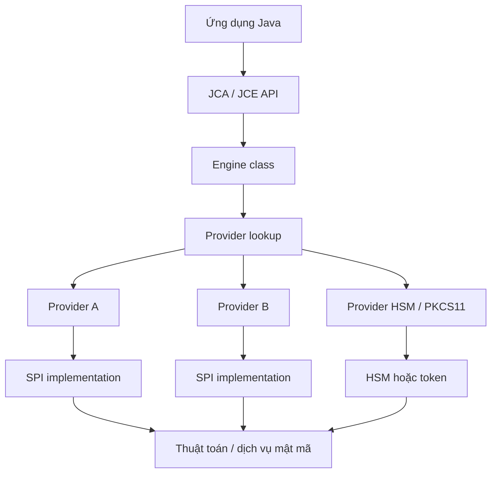

# JCA là gì

Trong chương **Java Cryptography Architecture** của module SECURITY_KEY_MANAGEMENT_FUNDAMENTALS, bài học này giới thiệu Java Cryptography Architecture (JCA) và vai trò của nó trong việc xây dựng ứng dụng Java sử dụng mật mã an toàn. JCA cung cấp các API chuẩn và kiến trúc provider để ứng dụng gọi những dịch vụ như tạo khóa, băm, ký số, xác minh chữ ký, mã hóa, giải mã, quản lý chứng thư và lưu trữ khóa. Nhờ đó, mã ứng dụng có thể làm việc với giao diện thống nhất trong khi phần triển khai thuật toán được cung cấp bởi các provider phù hợp.

## 1. JCA là gì?

**Java Cryptography Architecture (JCA)** là kiến trúc mật mã của nền tảng Java. Nó định nghĩa các API, lớp engine và cơ chế provider để ứng dụng sử dụng các chức năng mật mã thông qua giao diện chuẩn. JCA bao gồm các dịch vụ nền tảng như quản lý khóa, tạo số ngẫu nhiên, băm, chữ ký số và xác minh chứng thư; các API mã hóa và mật mã mở rộng thường được gọi chung là Java Cryptography Extension (JCE).

Khi viết ứng dụng, lập trình viên thường gọi các lớp như `MessageDigest`, `Signature`, `KeyPairGenerator`, `KeyStore` hoặc `Cipher`. Các lớp này là giao diện cấp cao. Một provider được cài trong runtime cung cấp phần triển khai thuật toán thông qua Service Provider Interface (SPI).

Ví dụ, ứng dụng gọi:

```java
MessageDigest digest = MessageDigest.getInstance("SHA-256");
```

JCA tìm một provider có dịch vụ `MessageDigest` hỗ trợ thuật toán `SHA-256`, tạo đối tượng triển khai phù hợp và trả về qua kiểu API chuẩn `MessageDigest`. Ứng dụng không cần tự cài đặt thuật toán SHA-256.

JCA là nền tảng tích hợp các dịch vụ mật mã, không phải một thuật toán, giao thức mạng hoặc hệ thống quản lý khóa tập trung. JCA cũng không tự quyết định dữ liệu nào cần mã hóa, ai được quyền sử dụng khóa hay khóa phải được rotate khi nào. Những quyết định đó thuộc thiết kế bảo mật và hệ thống quản lý khóa của ứng dụng.

## 2. Vì sao Java cần JCA?

Nếu mỗi ứng dụng tự cài đặt thuật toán hoặc gọi trực tiếp một thư viện mật mã cụ thể, mã nguồn dễ phụ thuộc vào nhà cung cấp, khó thay đổi triển khai và dễ mắc lỗi khi xử lý thuật toán, tham số hoặc key material.

JCA giải quyết các nhu cầu chính:

- **API thống nhất:** ứng dụng gọi các lớp chuẩn thay vì phụ thuộc vào API riêng của từng thư viện.
- **Tách API khỏi triển khai:** provider cung cấp thuật toán và cơ chế lưu khóa phía sau giao diện JCA.
- **Khả năng thay thế provider:** có thể chọn provider khác khi cần thuật toán, phần cứng hoặc yêu cầu triển khai khác.
- **Hỗ trợ nhiều loại dịch vụ:** băm, chữ ký, mã hóa, sinh khóa, thỏa thuận khóa, chứng thư và KeyStore.
- **Tích hợp phần cứng:** provider phù hợp có thể kết nối token, smart card, HSM hoặc thiết bị PKCS#11.
- **Quản lý thuật toán theo policy:** runtime có cơ chế cấu hình provider và giới hạn thuật toán bị vô hiệu hóa.

Các lợi ích này chỉ có được khi ứng dụng chọn thuật toán, provider và tham số phù hợp. Dùng JCA không tự động làm một thiết kế mật mã trở nên an toàn nếu ứng dụng chọn thuật toán lỗi thời, tái sử dụng nonce sai cách hoặc để lộ private key.

## 3. JCA, JCE và các package chính

JCA và JCE thường được nhắc cùng nhau. Về lịch sử, JCE từng được phân phối như phần mở rộng cho các chức năng mã hóa và mật mã bổ sung. Trong các phiên bản Java hiện đại, những API này đã được tích hợp vào Java SE và thường được sử dụng như một hệ sinh thái thống nhất.

| Khu vực API | Package tiêu biểu | Chức năng |
|---|---|---|
| JCA core | `java.security` | Message digest, signature, key pair, key factory, provider, SecureRandom, KeyStore |
| Certificate và PKI | `java.security.cert` | CertificateFactory, CertPath, CertPathValidator, CertPathBuilder, CRL |
| JCE | `javax.crypto` | Cipher, Mac, KeyAgreement, KeyGenerator, SecretKeyFactory |
| Tham số và đặc tả mật mã | `javax.crypto.spec`, `java.security.spec` | GCMParameterSpec, IvParameterSpec, PBEKeySpec, X509EncodedKeySpec và các đặc tả khác |
| Giao diện khóa | `java.security.interfaces`, `javax.crypto.interfaces` | Các interface mô tả loại khóa như RSA, EC hoặc DSA |

JCA là tên kiến trúc rộng; JCE là nhóm API và chức năng mã hóa được tích hợp trong nền tảng. Khi đọc tài liệu hoặc mã nguồn, có thể gặp cách gọi “JCA/JCE” để chỉ chung cơ chế mật mã của Java.

## 4. Kiến trúc Provider và SPI

JCA tách phần API mà ứng dụng gọi khỏi phần triển khai thuật toán. Provider đăng ký các dịch vụ mà nó hỗ trợ; mỗi dịch vụ thường ánh xạ một loại engine và một tên thuật toán tới lớp triển khai SPI.

Các thành phần chính:

- **Engine class:** lớp API cấp cao mà ứng dụng gọi, ví dụ `Cipher` hoặc `Signature`.
- **Provider:** đối tượng mô tả nhà cung cấp dịch vụ, tên provider, phiên bản và tập dịch vụ hỗ trợ.
- **Service Provider Interface (SPI):** lớp trừu tượng mà provider triển khai để cung cấp hành vi cụ thể, ví dụ `CipherSpi` hoặc `SignatureSpi`.
- **Security framework:** cơ chế tra cứu provider, áp dụng thứ tự ưu tiên và tạo engine instance.



Ví dụ, `Signature.getInstance("SHA256withRSA")` yêu cầu engine Signature tìm provider có dịch vụ chữ ký tương ứng. Provider có thể thực hiện phép ký bằng phần mềm hoặc chuyển thao tác tới thiết bị bảo vệ khóa. Ứng dụng vẫn làm việc qua kiểu `Signature` chuẩn.

Một provider có thể cung cấp nhiều dịch vụ, nhưng không nhất thiết hỗ trợ mọi thuật toán. Một thuật toán cũng có thể có nhiều triển khai từ các provider khác nhau. Khả năng hỗ trợ phụ thuộc phiên bản JDK, provider, cấu hình runtime và thiết bị.

## 5. Engine classes thường dùng

Engine class là điểm vào API cho một nhóm chức năng mật mã. Các lớp phổ biến gồm:

| Engine class | Chức năng | Ví dụ |
|---|---|---|
| `SecureRandom` | Tạo số ngẫu nhiên mật mã | Nonce, salt, dữ liệu ngẫu nhiên cho key generation |
| `MessageDigest` | Tính hash | SHA-256, SHA-384 |
| `Signature` | Tạo và xác minh chữ ký số | SHA256withRSA, SHA256withECDSA |
| `Cipher` | Mã hóa và giải mã | AES/GCM/NoPadding |
| `Mac` | Tạo và kiểm tra mã xác thực thông điệp | HmacSHA256 |
| `KeyGenerator` | Sinh khóa đối xứng | AES |
| `KeyPairGenerator` | Sinh cặp khóa bất đối xứng | RSA, EC |
| `KeyFactory` | Chuyển đổi giữa key specification và key object | RSA public/private key |
| `SecretKeyFactory` | Tạo khóa bí mật từ đặc tả hoặc đầu vào dẫn xuất | PBKDF2WithHmacSHA256 |
| `KeyAgreement` | Thỏa thuận khóa | ECDH |
| `KeyStore` | Lưu và truy xuất key entry/certificate entry | PKCS12, JKS, PKCS11 |
| `CertificateFactory` | Tạo đối tượng certificate từ dữ liệu mã hóa | X.509 |
| `CertPathValidator` | Xác minh đường dẫn chứng thư | PKIX |

Tên thuật toán được truyền vào các factory method phải theo tên chuẩn được Java và provider hỗ trợ. Không nên suy luận rằng một provider hỗ trợ mọi biến thể chỉ vì nó hỗ trợ thuật toán gốc.

## 6. Quy trình gọi một dịch vụ JCA

Phần lớn engine class được sử dụng theo cùng một mô hình:

1. Chọn engine class phù hợp với mục tiêu.
2. Gọi `getInstance()` với tên thuật toán hoặc transformation.
3. Để JCA chọn provider theo cấu hình, hoặc chỉ định provider rõ ràng khi có yêu cầu.
4. Khởi tạo engine với khóa, tham số và chế độ phù hợp.
5. Cung cấp dữ liệu đầu vào.
6. Hoàn tất thao tác và lấy kết quả.
7. Xử lý lỗi, lưu metadata cần thiết và giải phóng trạng thái tạm thời.

Ví dụ với `MessageDigest`:

```java
import java.nio.charset.StandardCharsets;
import java.security.MessageDigest;

public final class DigestExample {
    public static String sha256(String value) throws Exception {
        MessageDigest digest = MessageDigest.getInstance("SHA-256");
        byte[] result = digest.digest(
                value.getBytes(StandardCharsets.UTF_8));
        StringBuilder hex = new StringBuilder(result.length * 2);
        for (byte item : result) {
            hex.append(String.format("%02x", item & 0xff));
        }
        return hex.toString();
    }
}
```

Hash là phép biến đổi một chiều, không phải mã hóa. Không thể dùng SHA-256 để giải mã dữ liệu ban đầu. Hash phù hợp cho kiểm tra toàn vẹn hoặc làm thành phần của giao thức; lưu mật khẩu người dùng cần password hashing/KDF chuyên dụng với salt và tham số chi phí phù hợp, không chỉ hash trực tiếp bằng SHA-256.

## 7. Ví dụ: tạo và xác minh chữ ký số

JCA cung cấp engine `Signature` để ký dữ liệu bằng private key và xác minh chữ ký bằng public key tương ứng. Chữ ký số giúp phát hiện thay đổi dữ liệu và xác nhận bên ký nắm giữ private key; danh tính của bên ký cần được kiểm tra riêng qua certificate hoặc một cơ chế tin cậy khác.

```java
import java.nio.charset.StandardCharsets;
import java.security.PrivateKey;
import java.security.PublicKey;
import java.security.Signature;

public final class SignatureExample {
    public static byte[] sign(byte[] data, PrivateKey privateKey)
            throws Exception {
        Signature signer = Signature.getInstance("SHA256withRSA");
        signer.initSign(privateKey);
        signer.update(data);
        return signer.sign();
    }

    public static boolean verify(
            byte[] data, byte[] signed, PublicKey publicKey)
            throws Exception {
        Signature verifier = Signature.getInstance("SHA256withRSA");
        verifier.initVerify(publicKey);
        verifier.update(data);
        return verifier.verify(signed);
    }

    public static void main(String[] args) throws Exception {
        byte[] payload = "transaction-123"
                .getBytes(StandardCharsets.UTF_8);
        // privateKey và publicKey được nạp từ nguồn tin cậy.
        // byte[] signed = sign(payload, privateKey);
        // boolean valid = verify(payload, signed, publicKey);
    }
}
```

Đoạn mã tập trung vào luồng API; việc nạp khóa, xác minh certificate chain và quản lý quyền ký phải được thực hiện theo kiến trúc ứng dụng. Không hard-code private key vào mã nguồn. Với khóa nằm trong HSM, provider có thể thực hiện ký bên trong thiết bị mà không xuất key material.

Tên `SHA256withRSA` mô tả thuật toán chữ ký kết hợp hash SHA-256 với RSA. Ví dụ dùng tên thuật toán phổ biến để minh họa API; với thiết kế mới, hãy chọn scheme theo policy, chẳng hạn RSA-PSS khi phù hợp. Nếu dùng EC, cần chọn thuật toán ECDSA tương ứng và kiểm tra hỗ trợ của provider. Không tự ghép tên hash và thuật toán theo suy đoán.

## 8. Ví dụ: mã hóa xác thực bằng AES-GCM

`Cipher` là engine dùng cho mã hóa và giải mã. Khi thiết kế ứng dụng mới, cần chọn transformation nêu rõ thuật toán, mode và padding. Ví dụ dưới đây dùng AES-GCM, một chế độ authenticated encryption cung cấp cả tính bí mật và khả năng phát hiện dữ liệu bị sửa đổi.

```java
import java.security.SecureRandom;
import javax.crypto.Cipher;
import javax.crypto.SecretKey;
import javax.crypto.spec.GCMParameterSpec;

public final class AesGcmExample {
    private static final int NONCE_LENGTH = 12;
    private static final int TAG_LENGTH_BITS = 128;

    public static byte[] encrypt(
            byte[] plaintext,
            byte[] aad,
            SecretKey key,
            SecureRandom random) throws Exception {

        byte[] nonce = new byte[NONCE_LENGTH];
        random.nextBytes(nonce);

        Cipher cipher = Cipher.getInstance("AES/GCM/NoPadding");
        cipher.init(Cipher.ENCRYPT_MODE, key,
                new GCMParameterSpec(TAG_LENGTH_BITS, nonce), random);
        if (aad != null) {
            cipher.updateAAD(aad);
        }
        byte[] ciphertextAndTag = cipher.doFinal(plaintext);

        // Lưu nonce cùng ciphertextAndTag; nonce không phải bí mật.
        byte[] result = new byte[nonce.length + ciphertextAndTag.length];
        System.arraycopy(nonce, 0, result, 0, nonce.length);
        System.arraycopy(ciphertextAndTag, 0, result,
                nonce.length, ciphertextAndTag.length);
        return result;
    }

    public static byte[] decrypt(
            byte[] stored,
            byte[] aad,
            SecretKey key) throws Exception {

        if (stored.length < NONCE_LENGTH + TAG_LENGTH_BITS / 8) {
            throw new IllegalArgumentException("Invalid encrypted payload");
        }
        byte[] nonce = new byte[NONCE_LENGTH];
        byte[] ciphertextAndTag =
                new byte[stored.length - NONCE_LENGTH];
        System.arraycopy(stored, 0, nonce, 0, nonce.length);
        System.arraycopy(stored, nonce.length, ciphertextAndTag,
                0, ciphertextAndTag.length);

        Cipher cipher = Cipher.getInstance("AES/GCM/NoPadding");
        cipher.init(Cipher.DECRYPT_MODE, key,
                new GCMParameterSpec(TAG_LENGTH_BITS, nonce));
        if (aad != null) {
            cipher.updateAAD(aad);
        }
        return cipher.doFinal(ciphertextAndTag);
    }
}
```

Ví dụ minh họa cách gắn nonce và authentication tag với ciphertext; phần tạo/lưu khóa được quản lý riêng. Nonce GCM 96 bit cần duy nhất cho mỗi lần mã hóa dưới cùng một khóa. Sinh nonce ngẫu nhiên làm xác suất trùng rất nhỏ ở quy mô phù hợp, nhưng hệ thống có lượng lớn bản mã cần thiết kế cơ chế bảo đảm uniqueness và giới hạn số lần sử dụng theo khuyến nghị của chuẩn và provider. Không được tái sử dụng nonce với cùng key.

AAD (Additional Authenticated Data) là dữ liệu không mã hóa nhưng được xác thực, ví dụ tenant ID, record ID hoặc phiên bản schema. Khi giải mã, AAD phải khớp với giá trị đã dùng lúc mã hóa. Nếu tag không hợp lệ, `doFinal()` ném lỗi xác thực (thường là `AEADBadTagException`); ứng dụng phải từ chối dữ liệu, không sử dụng plaintext chưa xác minh.

Không dùng ECB cho dữ liệu ứng dụng thông thường. Tránh transformation mơ hồ như `AES` vì mode/padding mặc định có thể phụ thuộc provider. GCM cần nonce mới cho mỗi lần mã hóa bằng cùng khóa; nếu hệ thống không thể đảm bảo điều đó, phải chọn thiết kế khác đã được đánh giá.

## 9. Sinh khóa và số ngẫu nhiên

JCA cung cấp `SecureRandom`, `KeyGenerator` và `KeyPairGenerator` để tạo dữ liệu ngẫu nhiên và khóa. Ứng dụng không nên tự viết thuật toán sinh khóa hoặc dùng `java.util.Random` cho mục đích mật mã.

Ví dụ tạo AES key:

```java
import java.security.SecureRandom;
import javax.crypto.KeyGenerator;
import javax.crypto.SecretKey;

public final class KeyGenerationExample {
    public static SecretKey newAesKey() throws Exception {
        SecureRandom random = new SecureRandom();
        KeyGenerator generator = KeyGenerator.getInstance("AES");
        generator.init(256, random);
        return generator.generateKey();
    }
}
```

Độ dài khóa được chọn phải phù hợp policy, JDK, provider và môi trường triển khai. Không giả định mọi provider hoặc thiết bị đều hỗ trợ cùng độ dài. Với private key, có thể tạo cặp khóa qua `KeyPairGenerator`; nếu yêu cầu khóa không exportable, hãy tạo trong HSM/token qua provider tương ứng.

Không log hoặc in nội dung khóa. Đối tượng `SecretKey` và `PrivateKey` nên được truyền tới thành phần có quyền sử dụng, tránh chuyển đổi sang byte array nếu không cần. Khi dùng KMS/HSM, ứng dụng thường chỉ cần key ID hoặc handle và quyền gọi thao tác mật mã.

## 10. Provider: lựa chọn và thứ tự ưu tiên

Provider là thành phần đăng ký các dịch vụ mật mã với JCA. Runtime có thể có nhiều provider cùng lúc; thứ tự provider ảnh hưởng tới provider được chọn khi ứng dụng không chỉ định cụ thể.

Liệt kê provider đang cài:

```java
import java.security.Provider;
import java.security.Security;

public final class ProviderInventory {
    public static void printProviders() {
        for (Provider provider : Security.getProviders()) {
            System.out.println(provider.getName()
                    + ": " + provider.getInfo());
        }
    }
}
```

Có thể yêu cầu thuật toán từ một provider cụ thể:

```java
Signature signature =
        Signature.getInstance("SHA256withRSA", "SunRsaSign");
```

Tên provider trong ví dụ phụ thuộc JDK và cấu hình runtime. Chỉ chỉ định provider khi ứng dụng có yêu cầu tương thích hoặc chính sách rõ ràng; nếu triển khai sang môi trường khác, phải xác minh provider đó đã được cài và hỗ trợ đúng thuật toán.

Nếu không chỉ định provider, JCA tìm provider theo thứ tự ưu tiên và dịch vụ khả dụng. Điều này thuận tiện nhưng có thể khiến hai môi trường chọn triển khai khác nhau. Khi cần tính nhất quán, hãy kiểm tra provider thực tế bằng `engine.getProvider()`, ghi nhận phiên bản runtime và provider trong kiểm thử triển khai.

Không nên thêm provider không rõ nguồn gốc hoặc tự thay đổi thứ tự provider để “sửa” lỗi mà chưa đánh giá ảnh hưởng. Provider có thể xử lý private key, dữ liệu nhạy cảm và thao tác mật mã; nguồn gốc, phiên bản, chữ ký gói và quy trình cập nhật của nó là một phần của chuỗi cung ứng bảo mật.

## 11. Provider và Service Provider Interface

Provider triển khai các lớp SPI tương ứng với engine class. Một số SPI tiêu biểu:

| Engine API | SPI triển khai |
|---|---|
| `MessageDigest` | `MessageDigestSpi` |
| `Signature` | `SignatureSpi` |
| `Cipher` | `CipherSpi` |
| `KeyStore` | `KeyStoreSpi` |
| `SecureRandom` | `SecureRandomSpi` |
| `KeyPairGenerator` | `KeyPairGeneratorSpi` |
| `KeyGenerator` | `KeyGeneratorSpi` |

Provider công bố dịch vụ bằng metadata để JCA tra cứu. Nhà cung cấp có thể triển khai thuật toán trong phần mềm thuần Java, native library hoặc chuyển tiếp thao tác tới phần cứng. Việc provider có tên một thuật toán không đủ để kết luận mọi biến thể, key size, mode hay tham số đều được hỗ trợ.

Tự viết provider là công việc chuyên sâu. Lỗi trong SPI có thể ảnh hưởng tới nhiều ứng dụng cùng runtime. Phần lớn ứng dụng nên dùng provider đã được duy trì và đánh giá phù hợp thay vì tự triển khai thuật toán mật mã.

## 12. Tích hợp KeyStore, trust store và chứng thư

JCA cung cấp `KeyStore` để truy cập các loại kho khóa thông qua provider. Một KeyStore có thể chứa:

- `PrivateKeyEntry`: private key và certificate chain tương ứng.
- `TrustedCertificateEntry`: chứng thư được cấu hình tin cậy.
- `SecretKeyEntry`: khóa bí mật đối xứng nếu loại store/provider hỗ trợ.

Ví dụ nạp PKCS12:

```java
import java.io.InputStream;
import java.nio.file.Files;
import java.nio.file.Path;
import java.security.KeyStore;

public final class KeyStoreLoader {
    public static KeyStore load(Path path, char[] password)
            throws Exception {
        KeyStore store = KeyStore.getInstance("PKCS12");
        try (InputStream input = Files.newInputStream(path)) {
            store.load(input, password);
        }
        return store;
    }
}
```

KeyStore là API lưu và truy xuất entry; nó không tự động xác minh mọi certificate chain theo policy của ứng dụng. Khi xác minh chứng thư, cần dùng trust manager hoặc CertPath API phù hợp, kiểm tra hostname cho TLS server và áp dụng trạng thái thu hồi theo policy.

Trong TLS, `KeyManagerFactory` thường dùng identity keystore để chọn private key/certificate chain của chính ứng dụng. `TrustManagerFactory` dùng trust store để xác minh certificate của peer. Hai cấu hình này có mục đích khác nhau và không nên nhầm lẫn.

## 13. Tích hợp HSM, PKCS#11 và KMS

JCA có thể kết nối tới HSM hoặc token thông qua provider, thường là provider PKCS#11. Trong mô hình này, private key có thể được tạo và giữ bên trong thiết bị; ứng dụng nhận một đối tượng key handle và yêu cầu provider thực hiện ký hoặc giải mã. Key material không cần được export vào heap của ứng dụng.

Luồng điển hình:

1. Cài provider và cấu hình kết nối tới HSM/token theo hướng dẫn nhà cung cấp.
2. Xác thực ứng dụng hoặc operator với thiết bị theo policy.
3. Tạo hoặc truy xuất key object bằng alias/label/ID.
4. Dùng engine JCA như `Signature` hoặc `Cipher` với key handle.
5. Provider chuyển thao tác tới HSM và trả kết quả cho ứng dụng.
6. HSM ghi audit hoặc áp dụng policy phần cứng nếu được cấu hình.

Không phải mọi HSM đều hỗ trợ đầy đủ mọi API, thuật toán hoặc cách chọn alias. Cần kiểm tra provider, phiên bản firmware, cơ chế login/session, quyền object và danh sách thuật toán được thiết bị hỗ trợ.

Cloud KMS thường cung cấp API riêng qua SDK hoặc REST. Một số nhà cung cấp có provider JCA để tích hợp trực tiếp với engine classes; một số khác yêu cầu adapter hoặc gọi SDK. JCA không tự động kết nối tới mọi KMS. Cần xác minh provider chính thức, mô hình xác thực, phạm vi quyền và cách ánh xạ key ID.

HSM/KMS giúp bảo vệ key material, nhưng không tự ngăn ứng dụng bị chiếm quyền lạm dụng thao tác mật mã. Nếu service account có quyền ký mọi dữ liệu, kẻ tấn công có thể gọi signing operation dù không lấy được private key. Cần giới hạn principal, operation, key usage, context, quota và audit.

## 14. Chọn thuật toán và transformation an toàn

JCA cung cấp nhiều thuật toán, nhưng ứng dụng phải chọn thuật toán và tham số theo yêu cầu bảo mật hiện tại. Không nên chọn chỉ vì một tên thuật toán được provider hỗ trợ.

| Nhu cầu | Lựa chọn thường gặp | Lưu ý |
|---|---|---|
| Hash dữ liệu | SHA-256 hoặc SHA-384 | Hash không mã hóa và không tự xác thực nguồn dữ liệu |
| Password storage | PBKDF2WithHmacSHA256 hoặc password hashing scheme phù hợp | Dùng salt ngẫu nhiên và cost phù hợp; cân nhắc Argon2/scrypt qua thư viện được đánh giá nếu policy yêu cầu |
| Mã hóa dữ liệu | AES/GCM/NoPadding | Quản lý nonce duy nhất, tag và AAD; bảo vệ khóa riêng |
| Chữ ký RSA | SHA256withRSA hoặc cấu hình RSA-PSS phù hợp | Chọn padding/signature scheme theo policy; tránh RSA PKCS#1 v1.5 cho thiết kế mới nếu policy yêu cầu PSS |
| Chữ ký EC | SHA256withECDSA hoặc biến thể phù hợp | Chọn curve và định dạng chữ ký tương thích |
| MAC | HmacSHA256 | Dùng khóa bí mật; so sánh tag theo cách chống timing phù hợp |
| Thỏa thuận khóa | ECDH với curve được phê duyệt | Cần KDF và xác thực peer; shared secret không nên dùng trực tiếp làm khóa ứng dụng |

Với `Cipher.getInstance()`, nên chỉ định transformation đầy đủ, ví dụ `AES/GCM/NoPadding`, thay vì chỉ ghi `AES`. Tránh ECB cho dữ liệu thông thường vì nó làm lộ cấu trúc lặp của plaintext. Với CBC, nếu còn phải hỗ trợ, cần IV ngẫu nhiên và cơ chế xác thực riêng; ưu tiên authenticated encryption khi thiết kế mới.

Không tự giảm key size hoặc bật lại thuật toán đã bị vô hiệu hóa chỉ để tương thích một hệ thống cũ. Nếu cần tương thích, tạo kế hoạch chuyển đổi, giới hạn phạm vi và thời hạn ngoại lệ.

## 15. Cấu hình thuật toán bị vô hiệu hóa và policy

Java runtime có security properties để kiểm soát provider và thuật toán. Một số thuộc tính có thể giới hạn thuật toán yếu trong TLS hoặc certificate path validation, ví dụ:

- `jdk.tls.disabledAlgorithms`: thuật toán hoặc tham số TLS không được phép sử dụng.
- `jdk.certpath.disabledAlgorithms`: thuật toán hoặc điều kiện chứng thư không được chấp nhận khi xây dựng đường dẫn chứng thư.
- `crypto.policy`: chính sách giới hạn mật mã của runtime ở các phiên bản có thuộc tính này.

Tên và giá trị thuộc tính phụ thuộc phiên bản JDK và bản phân phối. Không chỉnh sửa security properties theo hướng nới lỏng toàn cục nếu chưa đánh giá tác động. Một cấu hình ngoại lệ cho hệ thống cũ có thể khiến mọi ứng dụng cùng runtime chấp nhận thuật toán yếu.

Trong môi trường yêu cầu FIPS, cần dùng module/provider và chế độ vận hành đã được chứng nhận cho đúng phiên bản, cấu hình và phạm vi triển khai. Chỉ cài một provider có chữ “FIPS” hoặc gọi API JCA không chứng minh toàn bộ ứng dụng đang chạy trong chế độ FIPS hợp lệ.

## 16. Ngoại lệ và lỗi thường gặp

JCA dùng exception cụ thể để báo thuật toán, khóa, tham số hoặc provider không phù hợp:

| Exception | Nguyên nhân thường gặp |
|---|---|
| `NoSuchAlgorithmException` | Provider hiện tại không có thuật toán được yêu cầu |
| `NoSuchProviderException` | Provider được chỉ định chưa được cài hoặc không được nhận diện |
| `NoSuchPaddingException` | Cipher provider không hỗ trợ padding được yêu cầu |
| `InvalidKeyException` | Khóa sai loại, sai độ dài hoặc không được provider chấp nhận |
| `InvalidAlgorithmParameterException` | Tham số như IV, nonce hoặc key spec không phù hợp |
| `InvalidKeySpecException` | Key specification không hợp lệ hoặc không tương thích |
| `SignatureException` | Lỗi trong quá trình ký hoặc xác minh |
| `BadPaddingException` / `AEADBadTagException` | Dữ liệu giải mã sai hoặc kiểm tra xác thực thất bại |
| `UnrecoverableKeyException` | Không thể lấy key entry, thường do password hoặc provider |
| `ProviderException` | Lỗi từ provider hoặc lớp triển khai bên dưới |

Các lỗi thường gặp trong thiết kế:

- Chỉ định tên thuật toán không được provider hỗ trợ.
- Dùng transformation không đầy đủ khiến mode/padding phụ thuộc provider.
- Tái sử dụng nonce GCM với cùng khóa.
- Dùng SHA-256 trực tiếp để lưu mật khẩu người dùng.
- Dùng `java.util.Random` thay cho `SecureRandom` để tạo khóa hoặc nonce.
- Chọn provider không rõ nguồn gốc hoặc dựa vào thứ tự provider ngoài dự kiến.
- Nhầm certificate/trust store với private key identity store.
- Cho rằng lấy được `PrivateKey` object đồng nghĩa key material đã được export.
- Bỏ qua lỗi authentication tag và tiếp tục xử lý dữ liệu chưa xác thực.
- Log key, password, nonce kèm bí mật hoặc plaintext nhạy cảm.

Không nên bắt mọi exception rồi chuyển sang thuật toán yếu hơn như một fallback tự động. Nếu thuật toán hoặc provider không khả dụng, ứng dụng nên dừng thao tác nhạy cảm, ghi lỗi không chứa bí mật và yêu cầu cấu hình hợp lệ.

## 17. Vòng đời khóa trong ứng dụng dùng JCA

JCA cung cấp công cụ để tạo và sử dụng khóa, nhưng vòng đời khóa phải được ứng dụng và hệ thống quản lý khóa xác định. Một thiết kế thực tế cần:

1. **Tạo:** dùng `KeyGenerator` hoặc `KeyPairGenerator` với CSPRNG và tham số được phê duyệt; ưu tiên HSM/KMS khi cần.
2. **Định danh:** gán key ID, alias, purpose, version, owner và metadata.
3. **Lưu trữ:** dùng KeyStore, HSM hoặc KMS; giới hạn export và quyền gọi operation.
4. **Sử dụng:** gọi engine class phù hợp, kiểm tra policy và audit thao tác.
5. **Backup/recovery:** chỉ backup khi có lý do; bảo vệ bản sao và diễn tập restore.
6. **Rotation:** tạo phiên bản mới, chuyển ứng dụng, giữ phiên bản cũ trong thời gian dữ liệu còn phụ thuộc.
7. **Revocation/disable:** ngăn sử dụng khóa hoặc chứng thư khi có sự cố, theo trạng thái của từng loại tài sản.
8. **Destruction:** hủy key material và bản sao có thể phục hồi khi hết nhu cầu, giữ lại bằng chứng không chứa bí mật.

Ví dụ, một dịch vụ mã hóa dữ liệu có thể dùng JCA `Cipher` để mã hóa bằng DEK. DEK được bọc bởi KEK trong KMS; ứng dụng chỉ lưu wrapped DEK và key ID. Khi rotation KEK, ứng dụng có thể rewrap DEK theo quy trình mà không nhất thiết phải mã hóa lại toàn bộ ciphertext. Khi hủy dữ liệu, cần xử lý wrapped DEK, backup và mọi đường phục hồi, không chỉ xóa một đối tượng trong KeyStore.

## 18. Nguyên tắc sử dụng JCA an toàn

- Dùng thuật toán và transformation đầy đủ, được policy chấp thuận.
- Dùng `SecureRandom` do JCA cung cấp; không tự tạo nguồn ngẫu nhiên.
- Không tái sử dụng nonce/IV khi thuật toán yêu cầu uniqueness.
- Dùng authenticated encryption hoặc cơ chế xác thực phù hợp cho dữ liệu mã hóa.
- Không dùng hash nhanh trực tiếp để lưu mật khẩu.
- Giữ private key trong HSM/KMS khi yêu cầu bảo vệ cần thiết; không export nếu không có lý do.
- Kiểm tra provider thực tế và chỉ dùng provider có nguồn gốc tin cậy.
- Phân tách identity keystore và trust store theo mục đích.
- Không log key material, password hoặc plaintext nhạy cảm.
- Xử lý lỗi xác thực, chữ ký và giải mã theo hướng fail closed.
- Ghi audit cho thao tác nhạy cảm bằng key ID và operation, không ghi bí mật.
- Kiểm thử trên đúng JDK, provider, hệ điều hành và thiết bị sẽ triển khai.

## 19. Checklist đánh giá một ứng dụng JCA

- [ ] Ứng dụng dùng engine class phù hợp với thao tác mật mã.
- [ ] Thuật toán và transformation được chỉ định rõ, không dựa vào mặc định mơ hồ.
- [ ] Provider được kiểm tra nguồn gốc, phiên bản và khả năng hỗ trợ.
- [ ] SecureRandom được dùng cho nonce, salt và key generation.
- [ ] Nonce/IV được quản lý đúng theo yêu cầu thuật toán.
- [ ] Dữ liệu mã hóa có cơ chế xác thực toàn vẹn.
- [ ] Private key và secret key được lưu trong nơi phù hợp, có quyền tối thiểu.
- [ ] KeyStore entry và trust anchor được phân biệt rõ.
- [ ] HSM/KMS provider được cấu hình và kiểm thử nếu có.
- [ ] Thuật toán yếu bị chặn theo policy và không có fallback không an toàn.
- [ ] Exception không làm lộ bí mật và không khiến ứng dụng tiếp tục với dữ liệu chưa xác thực.
- [ ] Rotation, backup, recovery, revocation và destruction có quy trình riêng.

JCA là kiến trúc giúp ứng dụng Java tiếp cận các dịch vụ mật mã qua API thống nhất và provider có thể thay thế. Hiểu engine class, SPI, provider selection và cách quản lý khóa giúp lập trình viên chọn đúng công cụ cho từng thao tác. Để hệ thống thực sự an toàn, cần kết hợp API JCA với thuật toán hiện đại, tham số đúng, quản lý private/secret key, kiểm soát provider và quy trình vòng đời khóa được kiểm chứng.
