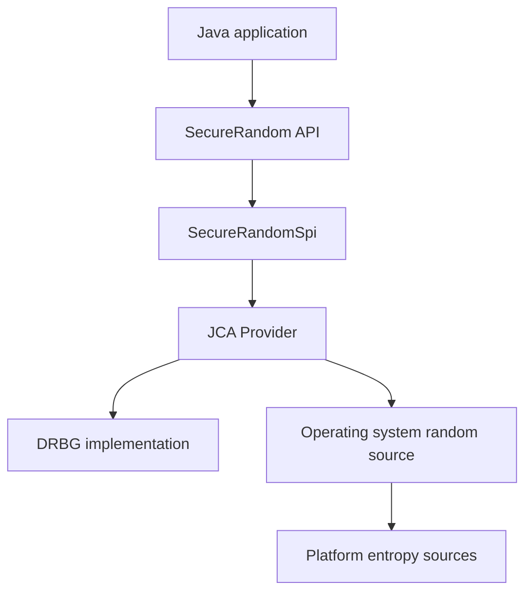

# SecureRandom

## Mục tiêu học tập

Sau bài học này, bạn có thể:

- Giải thích vai trò của `SecureRandom` trong Java Cryptography Architecture (JCA) và phân biệt nó với `Random` hoặc `ThreadLocalRandom`.
- Hiểu mối quan hệ giữa entropy, seed, cryptographically secure pseudorandom number generator (CSPRNG) và DRBG.
- Chọn và cấu hình `SecureRandom` theo provider, algorithm và yêu cầu triển khai.
- Dùng `nextBytes` để sinh key material, nonce, salt và token với độ dài phù hợp.
- Tránh các lỗi phổ biến như seed bằng timestamp, gọi `setSeed` với dữ liệu dễ đoán hoặc dùng random thông thường cho bí mật.
- Tích hợp `SecureRandom` với `KeyGenerator`, `KeyPairGenerator`, AES-GCM và quy trình quản lý khóa.
- Đánh giá tác động của môi trường production như container, VM snapshot, entropy starvation, concurrency và yêu cầu FIPS.

## 1. SecureRandom là gì?

`java.security.SecureRandom` là API JCA cung cấp bộ sinh số giả ngẫu nhiên an toàn về mặt mật mã. Ứng dụng dùng nó để tạo các giá trị khó dự đoán, ví dụ key material, nonce, salt, challenge, session identifier hoặc token có tính bí mật.

SecureRandom thường được gọi là CSPRNG. Nó tạo đầu ra bằng một thuật toán xác định dựa trên trạng thái bí mật bên trong, nhưng trạng thái đó được khởi tạo và duy trì bằng entropy đủ mạnh. Người không biết trạng thái nội bộ và không kiểm soát được nguồn entropy không thể dự đoán đầu ra tiếp theo với xác suất thực tế.

Điều này khác với việc tạo số ngẫu nhiên để mô phỏng hoặc chia tải. `java.util.Random` và `ThreadLocalRandom` được tối ưu cho mục đích thông thường; chúng không được thiết kế để bảo vệ bí mật. Không dùng chúng để tạo AES key, password reset token, nonce bảo mật hoặc session token.

Trong quản lý khóa, SecureRandom là một thành phần nền tảng: khóa đối xứng, cặp khóa bất đối xứng và nhiều giá trị mật mã khác cần được sinh từ nguồn ngẫu nhiên an toàn. Một thuật toán mã hóa mạnh vẫn có thể thất bại nếu key hoặc nonce được tạo từ nguồn dễ đoán.

## 2. SecureRandom nằm ở đâu trong JCA?

JCA cung cấp API thống nhất và provider có thể cung cấp implementation. `SecureRandom` là lớp API phía ứng dụng; phần thực thi thuật toán được cung cấp thông qua `SecureRandomSpi` của provider.



Provider có thể triển khai DRBG, lấy seed từ nguồn ngẫu nhiên của hệ điều hành hoặc kết hợp các cơ chế phù hợp. API giúp ứng dụng không phải tự xây dựng thuật toán CSPRNG.

Một số API quan trọng:

| API | Vai trò |
|---|---|
| `SecureRandom()` | Tạo instance theo lựa chọn mặc định của runtime/provider |
| `SecureRandom(byte[] seed)` | Tạo instance rồi nạp seed do caller cung cấp; cần hiểu rõ semantics và chất lượng seed |
| `getInstance(algorithm)` | Chọn algorithm cụ thể được provider hỗ trợ |
| `getInstance(algorithm, provider)` | Chọn algorithm và provider cụ thể |
| `getInstanceStrong()` | Chọn implementation được cấu hình là strong theo security property của runtime |
| `nextBytes(byte[])` | Điền byte ngẫu nhiên vào buffer |
| `generateSeed(int)` | Yêu cầu provider tạo byte seed để dùng cho mục đích seeding khác |
| `setSeed(...)` | Bổ sung seed vào trạng thái generator theo semantics của implementation |
| `reseed(...)` | Yêu cầu reseed khi implementation hỗ trợ |
| `getAlgorithm()` / `getProvider()` | Kiểm tra algorithm và provider đang dùng |

## 3. Random, ThreadLocalRandom và SecureRandom

| Đặc điểm | `Random` | `ThreadLocalRandom` | `SecureRandom` |
|---|---|---|---|
| Mục đích | Số giả ngẫu nhiên thông thường | Số giả ngẫu nhiên hiệu năng cao theo thread | Số giả ngẫu nhiên an toàn về mật mã |
| Chống dự đoán | Không | Không | Được thiết kế để chống dự đoán khi provider và entropy được cấu hình đúng |
| Seed | Caller có thể đặt seed | Runtime quản lý trạng thái theo thread | Provider quản lý seed và trạng thái; caller không nên tự seed bằng dữ liệu yếu |
| Dùng cho key/token | Không | Không | Có |
| Chi phí | Thấp | Thấp | Có thể cao hơn tùy provider và nguồn entropy |

Không dùng `new Random()`, `Math.random()` hoặc `ThreadLocalRandom.current()` để sinh key, IV/nonce bảo mật, token khôi phục mật khẩu hoặc challenge xác thực. Nếu cần số ngẫu nhiên không bí mật cho thuật toán mô phỏng, các API thông thường có thể phù hợp hơn.

## 4. Entropy, seed và đầu ra giả ngẫu nhiên

Entropy mô tả mức độ bất định của một nguồn dữ liệu. Seed là dữ liệu khởi tạo trạng thái của generator. Một CSPRNG có thể tạo ra rất nhiều byte từ một lượng entropy ban đầu, nhưng khả năng chống dự đoán phụ thuộc vào chất lượng seed, thuật toán và cách reseed.

```text
Entropy source
      |
      v
Seed material
      |
      v
SecureRandom / DRBG state
      |
      +---- nextBytes() ----> cryptographic bytes
      |
      +---- reseed() <------ fresh seed material
```

Byte đầu ra của SecureRandom không phải là entropy mới độc lập cho từng byte. DRBG dùng trạng thái bên trong để mở rộng seed thành chuỗi đầu ra dài. Đây là cách thiết kế bình thường của CSPRNG.

Ứng dụng không nên tự đo entropy của timestamp, process ID, MAC address hoặc counter rồi coi chúng là seed đủ mạnh. Nguồn entropy, cách kết hợp và kiểm tra sức khỏe nguồn entropy thuộc trách nhiệm của nền tảng và provider.

## 5. DRBG là gì?

Deterministic Random Bit Generator (DRBG) là bộ sinh bit giả ngẫu nhiên có trạng thái, được khởi tạo từ seed và có thể reseed bằng entropy mới. Một số thiết kế DRBG được mô tả trong NIST SP 800-90A, chẳng hạn Hash_DRBG, HMAC_DRBG và CTR_DRBG.

DRBG có thể cung cấp:

- **Instantiation:** khởi tạo generator với seed, nonce và personalization input theo thiết kế.
- **Generate:** tạo các bit/byte đầu ra từ trạng thái hiện tại.
- **Reseed:** cập nhật trạng thái bằng entropy mới.
- **Prediction resistance:** trong cấu hình hỗ trợ, yêu cầu entropy mới trước khi tạo đầu ra theo semantics của DRBG.
- **Uninstantiate:** loại bỏ trạng thái khi generator kết thúc vòng đời.

Tên algorithm hoặc việc có chữ DRBG không tự chứng minh implementation đã được kiểm định theo một chương trình compliance cụ thể. Nếu hệ thống có yêu cầu FIPS, phải chọn đúng provider/module đã được validation và cấu hình đúng security boundary.

## 6. Nguồn entropy của hệ điều hành

Các hệ điều hành hiện đại cung cấp giao diện random của kernel. Kernel tổng hợp entropy từ nhiều nguồn nền tảng và cung cấp dữ liệu cho user space. Provider Java có thể dùng các giao diện này trực tiếp hoặc dùng chúng để seed DRBG.

Không nên tự thu thập mouse movement, thời điểm request, số lần context switch hoặc dữ liệu ứng dụng rồi trộn bằng một hash tự viết để thay nguồn entropy hệ điều hành. Việc ước lượng entropy và bảo đảm không có bias là vấn đề chuyên môn của nền tảng mật mã.

Trên một số nền tảng, các nguồn random có thể có hành vi blocking khác nhau. Ví dụ, implementation có thể đợi kernel có đủ entropy trong một số tình huống khởi động sớm. Hành vi cụ thể phụ thuộc OS, JDK, provider và cấu hình.

## 7. Khởi tạo SecureRandom mặc định

Trong đa số ứng dụng Java, cách đơn giản là:

```java
SecureRandom secureRandom = new SecureRandom();
byte[] randomBytes = new byte[32];
secureRandom.nextBytes(randomBytes);
```

Constructor mặc định để runtime/provider chọn implementation phù hợp. Cách này tránh hardcode một algorithm hoặc provider không tương thích với môi trường triển khai.

Provider chịu trách nhiệm khởi tạo và seed generator theo implementation. Ứng dụng không cần gọi `setSeed(System.currentTimeMillis())` hoặc tự tạo seed từ các giá trị dễ đoán. Trên một số implementation, gọi `setSeed` trước lần tự seed đầu tiên còn có thể làm thay đổi đường khởi tạo; vì vậy, không tự seed nếu không có yêu cầu chuyên biệt và nguồn entropy thực sự đủ mạnh.

## 8. Chọn algorithm cụ thể bằng getInstance

Khi cần kiểm soát algorithm, dùng `getInstance`:

```java
SecureRandom secureRandom = SecureRandom.getInstance("DRBG");
```

Hoặc chọn provider cụ thể:

```java
SecureRandom secureRandom = SecureRandom.getInstance("DRBG", "SUN");
```

Tên provider ở ví dụ phụ thuộc JDK và môi trường. Không giả định mọi runtime đều có provider tên `SUN` hoặc hỗ trợ algorithm `DRBG`. Nếu yêu cầu triển khai phụ thuộc provider cụ thể, cần kiểm tra cấu hình trên tất cả môi trường và xử lý `NoSuchAlgorithmException` hoặc `NoSuchProviderException`.

Không nên hardcode algorithm cũ chỉ vì nó hoạt động trên một máy phát triển. Hãy chọn theo security policy, JDK baseline, provider được hỗ trợ và yêu cầu interoperability.

## 9. getInstanceStrong có ý nghĩa gì?

`SecureRandom.getInstanceStrong()` yêu cầu runtime chọn một implementation được chỉ định là strong trong security property `securerandom.strongAlgorithms`.

```java
SecureRandom strongRandom = SecureRandom.getInstanceStrong();
```

Tên gọi `strong` không có nghĩa đây luôn là lựa chọn tốt nhất cho mọi request. Implementation được cấu hình có thể chặn khi chờ entropy hoặc có chi phí khởi tạo cao hơn. Nếu gọi trong đường xử lý request, ứng dụng có thể gặp latency hoặc thread bị block.

Trước khi dùng `getInstanceStrong`, cần:

- Xem security property đang được cấu hình trong runtime.
- Kiểm tra algorithm và provider thực tế.
- Đo thời gian khởi tạo và `nextBytes` trong môi trường production tương đương.
- Kiểm tra hành vi khi entropy nguồn hệ điều hành thấp.
- Tránh tạo mới instance strong cho từng request nếu không cần.

`getInstanceStrong()` cũng không tự chứng minh provider đáp ứng FIPS. Compliance phụ thuộc module, phiên bản, cấu hình và boundary đã được validation.

## 10. DRBG parameters trong Java 17

Java hỗ trợ API `DrbgParameters` để yêu cầu cấu hình instantiation cho DRBG khi provider có hỗ trợ.

```java
SecureRandom drbg = SecureRandom.getInstance(
        "DRBG",
        DrbgParameters.instantiation(
                256,
                DrbgParameters.Capability.RESEED_ONLY,
                null));

byte[] output = new byte[32];
drbg.nextBytes(output);
```

Ví dụ yêu cầu security strength 256 bit và capability reseed. Provider có thể từ chối nếu không hỗ trợ algorithm, strength hoặc capability đó. Không được bắt lỗi rồi âm thầm chuyển sang `Random` hoặc một generator yếu hơn.

Personalization string nếu được dùng nên là dữ liệu công khai, có mục đích phân biệt instance hoặc domain. Nó không phải password, không thay entropy và không cần chứa secret.

## 11. nextBytes là API chính để sinh byte

`nextBytes(byte[])` điền dữ liệu ngẫu nhiên vào buffer do caller cấp.

```java
byte[] tokenBytes = new byte[32];
secureRandom.nextBytes(tokenBytes);
```

Độ dài buffer quyết định số byte được yêu cầu. Với token bí mật 32 byte, không gian giá trị lý thuyết là (2^{256}) nếu generator hoạt động đúng và đầu ra không bị rò rỉ.

Sau khi sinh, ứng dụng cần bảo vệ dữ liệu đầu ra giống như một secret. Không log token, không đưa vào URL nếu có thể tránh, không lưu trong analytics và không ghi vào exception. Nếu token dùng để xác thực, nên lưu hash hoặc verifier khi mô hình giao thức cho phép, thay vì lưu plaintext token.

## 12. generateSeed khác nextBytes

`generateSeed(numBytes)` yêu cầu provider tạo dữ liệu seed. API này chủ yếu hữu ích khi một ứng dụng cần seed cho một generator khác.

```java
byte[] seedMaterial = secureRandom.generateSeed(32);
```

Không cần gọi `generateSeed` trước mỗi lần `nextBytes`. SecureRandom đã quản lý seed và trạng thái nội bộ. Để tạo key hoặc token, dùng API sinh key chuyên dụng hoặc `nextBytes` theo thiết kế.

Không dùng `generateSeed` như một cách né tránh cấu hình provider, cũng không giả định số byte trả về tương đương chính xác số bit entropy độc lập.

## 13. setSeed: API dễ bị dùng sai

`setSeed` bổ sung dữ liệu vào trạng thái generator theo semantics của implementation. Nó không phải API để reset generator thành một trạng thái bảo mật mới bằng một giá trị tùy ý.

Ví dụ không an toàn:

```java
secureRandom.setSeed(System.currentTimeMillis());
```

Timestamp có ít entropy và dễ ước lượng. Các giá trị như process ID, counter, hostname, username hoặc UUID do caller tạo cũng không tự trở thành entropy đủ mạnh.

Các nguyên tắc:

- Thông thường không cần gọi `setSeed` trong ứng dụng.
- Không gọi `setSeed` bằng timestamp hoặc dữ liệu có thể dự đoán.
- Không nghĩ rằng seed dài về số byte đồng nghĩa có nhiều entropy.
- Không dùng seed cố định để làm kết quả có thể lặp lại trong production.
- Nếu cần reseed, dùng cơ chế reseed được provider hỗ trợ hoặc để provider tự quản lý theo policy.

Một seed có 32 byte toàn số 0 vẫn có thể có entropy bằng 0. Độ dài không thay thế chất lượng nguồn.

## 14. Reseed và prediction resistance

Reseed cập nhật trạng thái generator bằng seed material mới. Provider có thể reseed theo chu kỳ, theo số lượng request hoặc theo điều kiện nội bộ. Một số API và DRBG capability cho phép ứng dụng yêu cầu reseed.

Prediction resistance là thuộc tính nâng cao: generator cố gắng lấy entropy mới theo yêu cầu trước khi trả đầu ra. Nó có thể tăng chi phí và phụ thuộc nguồn entropy sẵn có. Không bật hoặc yêu cầu prediction resistance cho mọi thao tác nếu threat model không cần.

Ứng dụng không nên tự đặt lịch reseed dựa trên một con số tùy tiện mà không hiểu provider. Hãy dùng default của provider được đánh giá, hoặc cấu hình cụ thể theo tài liệu và policy của implementation.

## 15. Sinh AES key bằng KeyGenerator

Khi sinh symmetric key, ưu tiên API `KeyGenerator` thay vì tự tạo byte rồi tự bọc thành `SecretKeySpec` trong mọi trường hợp.

```java
SecureRandom secureRandom = new SecureRandom();
KeyGenerator generator = KeyGenerator.getInstance("AES");
generator.init(256, secureRandom);
SecretKey aesKey = generator.generateKey();
```

`KeyGenerator` tạo key theo thuật toán và provider. Truyền SecureRandom giúp ứng dụng chỉ rõ nguồn ngẫu nhiên được dùng cho quá trình sinh key. Provider của KeyGenerator cũng có thể có cơ chế riêng; cần bảo đảm cấu hình provider tương thích với yêu cầu của hệ thống.

Không in `aesKey.getEncoded()` ra console hoặc log. Nếu key phải non-exportable, dùng provider HSM/KMS và tránh yêu cầu raw bytes.

## 16. Sinh cặp khóa bất đối xứng

`KeyPairGenerator` cũng có thể nhận SecureRandom:

```java
SecureRandom secureRandom = new SecureRandom();
KeyPairGenerator generator = KeyPairGenerator.getInstance("RSA");
generator.initialize(3072, secureRandom);
KeyPair keyPair = generator.generateKeyPair();
```

Kích thước key và thuật toán phải theo security baseline hiện hành, policy của hệ thống và khả năng tương thích. Không lấy ví dụ key size làm khuyến nghị cố định cho mọi giao thức; một số hệ thống có thể dùng EC hoặc thuật toán khác theo chuẩn triển khai.

Với private key của CA, signing service hoặc production identity, nên tạo trong HSM hoặc thiết bị phù hợp khi yêu cầu non-exportability. SecureRandom là nguồn ngẫu nhiên, không thay thế ranh giới bảo vệ private key.

## 17. Sinh nonce và IV cho AES-GCM

Nonce/IV cần đáp ứng yêu cầu của mode mã hóa. Với AES-GCM, nonce 96 bit thường được dùng. Điều kiện quan trọng là không tái sử dụng nonce với cùng một key.

```java
byte[] nonce = new byte[12];
secureRandom.nextBytes(nonce);
```

Random nonce không tự bảo đảm không trùng tuyệt đối. Với số lượng encryption lớn dưới cùng một key, xác suất va chạm tăng theo birthday bound. Hệ thống cần giới hạn số lần dùng key hoặc dùng nonce construction có tính duy nhất, chẳng hạn counter được quản lý an toàn theo key và phân vùng workload.

Nonce thường không cần giữ bí mật và phải được lưu cùng ciphertext để decrypt. Tuy nhiên, phải bảo đảm nonce không bị sửa sai và được gắn đúng ciphertext/tag. Không dùng lại nonce chỉ vì dữ liệu plaintext giống nhau.

## 18. Sinh salt, challenge và token

SecureRandom cũng phù hợp để sinh:

- Salt ngẫu nhiên cho password hashing. Salt thường công khai nhưng phải duy nhất hoặc đủ ngẫu nhiên theo thiết kế.
- Challenge nonce trong giao thức xác thực để chống replay.
- Reset token, invitation token hoặc API credential có tính bí mật.
- Session identifier nếu giao thức yêu cầu entropy cao và token khó đoán.
- Randomized padding hoặc tham số ngẫu nhiên theo yêu cầu của thuật toán mật mã.

Không dùng một giá trị ngẫu nhiên cho nhiều mục đích nếu điều đó làm lẫn lộn domain hoặc lifecycle. Token phải có độ dài đủ, có expiry, scope và cơ chế revoke. SecureRandom chỉ tạo tính khó đoán; ứng dụng vẫn phải quản lý authorization và replay.

## 19. Độ dài đầu ra và entropy hiệu dụng

Nếu tạo token 16 byte, không gian tối đa lý thuyết là 128 bit; 32 byte là 256 bit. Nhưng entropy thực tế không thể vượt quá entropy trạng thái generator và có thể bị giới hạn bởi cách ứng dụng xử lý hoặc lưu token.

Một số lưu ý:

- Độ dài phải dựa trên threat model, tuổi thọ token và số lượng token được phát hành.
- Mã hóa Base64/hex chỉ đổi cách biểu diễn, không tăng entropy.
- Cắt ngắn digest làm giảm không gian giá trị.
- Nếu token bị log, gửi qua referrer hoặc lưu trong analytics, entropy cao không cứu được tính bí mật.
- Không tự tạo token bằng cách hash timestamp cộng counter rồi cho rằng SHA-256 làm nó khó đoán.

## 20. Thread safety và chia sẻ instance

`SecureRandom` được thiết kế để an toàn khi dùng từ nhiều thread. Một instance có thể được chia sẻ trong ứng dụng hoặc được inject qua dependency injection.

```java
final class TokenGenerator {
    private final SecureRandom secureRandom;

    TokenGenerator(SecureRandom secureRandom) {
        this.secureRandom = secureRandom;
    }

    byte[] newTokenBytes() {
        byte[] value = new byte[32];
        secureRandom.nextBytes(value);
        return value;
    }
}
```

Không cần tạo một SecureRandom mới cho mỗi request. Việc tạo instance liên tục có thể gây chi phí khởi tạo, seed và contention tùy provider. Nếu có vấn đề hiệu năng, hãy đo đạc và xem xét provider hoặc kiến trúc trước khi tự chia generator theo thread.

Không chuyển sang `ThreadLocalRandom` để giải quyết contention cho token hoặc key. Tối ưu hiệu năng không được làm suy yếu yêu cầu bảo mật.

## 21. Chọn provider và kiểm tra runtime

JCA provider quyết định implementation cụ thể. Trong môi trường khác nhau, cùng đoạn code có thể dùng algorithm/provider khác nhau nếu constructor mặc định được chọn theo cấu hình runtime.

Có thể ghi nhận metadata không nhạy cảm để kiểm toán:

```java
System.out.println("SecureRandom algorithm: " + secureRandom.getAlgorithm());
System.out.println("SecureRandom provider: " + secureRandom.getProvider().getName());
```

Thông tin này có ích khi chẩn đoán sự khác biệt giữa local, test, container và production. Không ghi seed hoặc output random vào log.

Khi yêu cầu algorithm/provider cụ thể, cấu hình phải được quản lý tập trung và kiểm thử trên mọi JDK được hỗ trợ. Thêm provider mới hoặc đổi thứ tự provider có thể thay đổi implementation được chọn.

## 22. getInstanceStrong và nguy cơ blocking

Một số strong implementation có thể phụ thuộc vào nguồn entropy có hành vi blocking. Nếu gọi khi hệ điều hành mới khởi động, trong container khởi tạo đồng loạt hoặc khi nguồn entropy bị hạn chế, ứng dụng có thể thấy thời gian chờ bất thường.

Không giải quyết vấn đề bằng cách seed thủ công từ timestamp hoặc hạ cấp sang `Random`. Thay vào đó:

1. Xác định algorithm/provider thực tế.
2. Đo khởi tạo và tạo byte trong môi trường tương đương production.
3. Kiểm tra entropy availability trên OS/VM/container.
4. Khởi tạo generator ở thời điểm phù hợp nếu cần tránh latency trên request path.
5. Dùng implementation được phê duyệt và có fallback policy rõ ràng.

Nếu không thể khởi tạo SecureRandom an toàn, hệ thống nên fail startup hoặc báo lỗi theo policy. Không tự động chuyển sang nguồn ngẫu nhiên không an toàn.

## 23. Container, VM snapshot và clone trạng thái

Môi trường ảo hóa có thể tạo nhiều instance từ cùng image hoặc snapshot. Nếu một snapshot chứa trạng thái generator đã được khởi tạo, việc clone/restore thiếu reseed có thể tạo rủi ro các instance sinh chuỗi giống nhau hoặc có quan hệ dễ dự đoán, tùy provider và cách nền tảng phục hồi entropy.

Thực hành vận hành:

- Không đóng gói seed hoặc trạng thái SecureRandom vào image.
- Tránh snapshot một JVM đang chạy rồi nhân bản nhiều instance nếu chưa xác minh hành vi RNG.
- Dùng OS/JDK/provider hiện đại có hỗ trợ an toàn cho môi trường ảo hóa.
- Sau restore/clone, tuân theo hướng dẫn reseed của nền tảng và provider.
- Kiểm thử uniqueness của output giữa các instance như một kiểm tra phát hiện lỗi, nhưng không coi test đó là bằng chứng mật mã đầy đủ.
- Theo dõi entropy và lỗi provider khi autoscaling hoặc khởi động hàng loạt.

Không tự xây cơ chế entropy riêng cho container. Cần dựa trên nguồn random của kernel và implementation Java đã được hỗ trợ.

## 24. Bảo vệ seed và trạng thái generator

Seed và trạng thái nội bộ của CSPRNG là dữ liệu nhạy cảm. Nếu attacker lấy được toàn bộ trạng thái generator tại một thời điểm, khả năng dự đoán đầu ra trước hoặc sau thời điểm đó phụ thuộc thuật toán, reseed và prediction resistance.

Vì vậy:

- Không log seed, state hoặc raw entropy.
- Không serialize SecureRandom object để chia sẻ qua file hoặc message.
- Không cache seed trong database hoặc configuration repository.
- Không expose trạng thái generator qua debug endpoint.
- Giới hạn heap dump, core dump và quyền attach debugger trong môi trường nhạy cảm.
- Để provider quản lý state lifecycle và reseed.

Không nên coi `SecureRandom` object là một credential có thể lưu lâu dài rồi restore ở nhiều node. Mỗi runtime cần khởi tạo state theo cơ chế được provider hỗ trợ.

## 25. Kiểm thử mà không làm yếu production

Kiểm thử cần lặp lại được nhưng không được khiến production dùng seed cố định. Có thể inject một abstraction hoặc `SecureRandom` riêng trong test để kiểm tra logic xử lý buffer, encoding, độ dài và lỗi.

Ví dụ thiết kế:

```java
interface RandomBytes {
    void nextBytes(byte[] target);
}

final class SecureRandomBytes implements RandomBytes {
    private final SecureRandom random;

    SecureRandomBytes(SecureRandom random) {
        this.random = random;
    }

    @Override
    public void nextBytes(byte[] target) {
        random.nextBytes(target);
    }
}
```

Trong test, có thể dùng implementation giả định trước đầu ra để kiểm tra code nghiệp vụ. Production phải inject SecureRandom thật từ provider được phê duyệt. Không dùng `setSeed(new byte[]{...})` cố định trong cấu hình production để làm test dễ lặp lại.

Các kiểm tra thống kê như phân bố byte, uniqueness hoặc entropy estimation có thể phát hiện lỗi hiển nhiên, nhưng không chứng minh generator an toàn về mật mã. Đánh giá CSPRNG cần xem thuật toán, seed source, implementation và validation.

## 26. Compliance và FIPS

Một số môi trường yêu cầu FIPS 140-3 hoặc tiêu chuẩn tương đương. Khi đó, việc dùng class `SecureRandom` hoặc algorithm tên `DRBG` không tự động đáp ứng compliance.

Phải xác minh:

- Provider/module cụ thể có certificate validation còn hiệu lực cho phạm vi triển khai không.
- Phiên bản JDK, provider, native library và HSM có nằm trong cấu hình đã được validation không.
- DRBG và entropy source được cấu hình theo security policy của module.
- Các API seed/reseed có được phép theo policy không.
- Key generation và random generation có thực sự chạy trong cryptographic boundary yêu cầu không.
- Cấu hình production không bị thay đổi ngoài quy trình kiểm soát.

Không quảng cáo hệ thống “FIPS compliant” chỉ vì code gọi `getInstanceStrong()` hoặc `getInstance("DRBG")`. Compliance là thuộc tính của toàn bộ module, cấu hình, môi trường và quy trình được đánh giá.

## 27. SecureRandom trong kiến trúc quản lý khóa

SecureRandom là nguồn đầu vào cho nhiều thao tác trong vòng đời khóa:

| Giai đoạn | Vai trò của SecureRandom |
|---|---|
| Tạo DEK | Cung cấp randomness cho KeyGenerator hoặc provider |
| Tạo key pair | Cung cấp randomness cho KeyPairGenerator |
| Mã hóa dữ liệu | Sinh nonce/IV khi mode yêu cầu |
| Password storage | Sinh salt ngẫu nhiên cho password hashing |
| Authentication | Sinh challenge và token khó đoán |
| Rotation | Hỗ trợ tạo key material mới độc lập với key cũ |
| Recovery | Sinh token hoặc nonce cho giao thức recovery nếu cần |

SecureRandom không quản lý key lifecycle, access policy, backup hay destruction. Sau khi sinh key, ứng dụng vẫn cần lưu trong KeyStore/HSM/KMS, giới hạn quyền, gắn metadata, rotation và kiểm toán.

Nếu KMS tạo data key từ xa, KMS chịu trách nhiệm randomness bên trong boundary của nó. Ứng dụng không cần tự sinh một key rồi gửi lên KMS trừ khi kiến trúc BYOK/import yêu cầu rõ.

## 28. Các lỗi thường gặp

| Lỗi | Hậu quả | Cách khắc phục |
|---|---|---|
| Dùng `Random` để sinh token | Đầu ra có thể dự đoán | Dùng SecureRandom |
| Seed bằng timestamp | Trạng thái ban đầu có entropy thấp | Để provider tự seed từ nguồn phù hợp |
| Gọi `setSeed` bằng counter | Có thể làm suy yếu quá trình seed | Không tự seed bằng dữ liệu yếu |
| Dùng một nonce GCM lặp lại với cùng key | Có thể phá vỡ bảo mật GCM | Đảm bảo uniqueness theo key và giới hạn usage |
| Tạo SecureRandom mỗi request | Tăng chi phí và có thể gây latency | Tái sử dụng instance an toàn theo thread |
| Gọi `getInstanceStrong` trên request path mà chưa đo | Có thể blocking | Đánh giá provider và khởi tạo có kiểm soát |
| Dùng seed cố định trong production | Đầu ra lặp lại/dễ dự đoán | Chỉ dùng deterministic fake trong test |
| Dùng `generateSeed` thay `nextBytes` mọi lúc | Nhầm lẫn vai trò API | Dùng API đúng mục đích |
| In token/key bytes ra log | Làm lộ bí mật | Chỉ log metadata không nhạy cảm |
| Coi DRBG là mặc nhiên FIPS | Tuyên bố compliance sai | Xác minh module và cấu hình validation |

## 29. Ví dụ Java 17: sinh AES key, nonce và token

Ví dụ sau dùng một SecureRandom được tạo từ provider mặc định. Nó truyền generator vào `KeyGenerator`, sinh nonce 12 byte và tạo token ngẫu nhiên 32 byte. Chương trình chỉ in metadata, không in key hoặc token.

```java
import java.security.SecureRandom;
import java.util.Arrays;
import javax.crypto.KeyGenerator;
import javax.crypto.SecretKey;

public final class SecureRandomDemo {
    private SecureRandomDemo() {}

    public static void main(String[] args) throws Exception {
        SecureRandom secureRandom = new SecureRandom();

        KeyGenerator aesGenerator = KeyGenerator.getInstance("AES");
        aesGenerator.init(256, secureRandom);
        SecretKey dataKey = aesGenerator.generateKey();

        byte[] gcmNonce = new byte[12];
        secureRandom.nextBytes(gcmNonce);

        byte[] resetToken = new byte[32];
        secureRandom.nextBytes(resetToken);

        System.out.println("Algorithm: " + secureRandom.getAlgorithm());
        System.out.println("Provider: " + secureRandom.getProvider().getName());
        System.out.println("Generated key algorithm: " + dataKey.getAlgorithm());
        System.out.println("GCM nonce bytes: " + gcmNonce.length);
        System.out.println("Reset token bytes: " + resetToken.length);

        // Demo cleanup for temporary buffers; this is not guaranteed
        // to erase every copy made by the JVM or provider.
        Arrays.fill(gcmNonce, (byte) 0);
        Arrays.fill(resetToken, (byte) 0);
    }
}
```

Lưu ý khi chuyển sang production:

- Key phải được lưu trong KeyStore/HSM/KMS theo policy; không in `getEncoded()`.
- Nonce GCM phải duy nhất với cùng key. Nếu workload lớn, dùng bộ đếm hoặc cấu trúc nonce được quản lý an toàn thay vì chỉ dựa vào random 96 bit.
- Reset token cần expiry, scope, one-time use và lưu verifier/hash nếu mô hình cho phép.
- Việc ghi đè array chỉ là biện pháp giảm thời gian tồn tại của buffer tạm; JVM/provider có thể có bản sao khác.
- Nếu cần provider hoặc DRBG cụ thể, cấu hình và kiểm thử riêng thay vì dựa vào mặc định không được ghi nhận.

## 30. Quy trình vận hành SecureRandom trong production

Một quy trình triển khai có thể gồm:

1. **Xác định use case:** key, nonce, salt, challenge hay token; xác định độ dài và lifetime.
2. **Chọn nguồn:** dùng provider/JDK được phê duyệt và entropy source của nền tảng.
3. **Cấu hình:** quyết định default provider, DRBG parameters hoặc strong algorithm nếu cần.
4. **Khởi tạo:** tạo instance ở lifecycle phù hợp, tránh tạo mới cho từng request.
5. **Sinh dữ liệu:** dùng `nextBytes` hoặc KeyGenerator/KeyPairGenerator với SecureRandom.
6. **Bảo vệ đầu ra:** không log, không serialize tùy tiện, lưu key trong boundary phù hợp.
7. **Theo dõi:** ghi nhận provider/algorithm, lỗi, latency và sự kiện cấu hình không nhạy cảm.
8. **Kiểm thử môi trường:** startup sớm, container, VM clone, autoscaling, concurrency và entropy availability.
9. **Rà soát định kỳ:** cập nhật JDK/provider, kiểm tra compliance và thay đổi security property.

Nếu SecureRandom không thể khởi tạo hoặc provider báo lỗi, xử lý như lỗi bảo mật/vận hành. Không tự hạ cấp sang PRNG thông thường.

## 31. Checklist triển khai

- [ ] Dùng `SecureRandom` cho key material, nonce, salt và token bí mật.
- [ ] Không dùng `Random`, `ThreadLocalRandom` hoặc `Math.random()` cho mục đích mật mã.
- [ ] Không seed bằng timestamp, counter, process ID hoặc dữ liệu dễ đoán.
- [ ] Hiểu provider/algorithm đang được runtime lựa chọn.
- [ ] Đã đánh giá `getInstanceStrong()` và nguy cơ blocking trước khi dùng.
- [ ] Nếu dùng DRBG parameters, provider hỗ trợ strength/capability đã yêu cầu.
- [ ] `KeyGenerator` và `KeyPairGenerator` nhận SecureRandom phù hợp.
- [ ] Nonce GCM duy nhất với từng key và có usage limit.
- [ ] Token có entropy, expiry, scope và replay protection phù hợp.
- [ ] Không log seed, trạng thái generator, key bytes hoặc token.
- [ ] Instance được tái sử dụng theo cách an toàn cho concurrency.
- [ ] Container/VM snapshot và restore được đánh giá.
- [ ] Test dùng fake generator riêng; production không dùng seed cố định.
- [ ] Yêu cầu FIPS được xác minh ở cấp provider/module/configuration.
- [ ] Có giám sát latency, provider error và thay đổi cấu hình RNG.

## 32. Câu hỏi tự kiểm tra

**1. SecureRandom dùng để làm gì?**

Nó tạo byte giả ngẫu nhiên an toàn về mật mã cho key, nonce, salt, challenge và token.

**2. SecureRandom khác Random thế nào?**

SecureRandom được thiết kế để chống dự đoán trong khi Random phục vụ mục đích giả ngẫu nhiên thông thường và không phù hợp cho bí mật.

**3. DRBG là gì?**

DRBG là bộ sinh bit giả ngẫu nhiên có trạng thái, được khởi tạo từ seed và có thể reseed bằng entropy mới.

**4. Entropy và seed khác nhau thế nào?**

Entropy mô tả mức bất định của nguồn; seed là dữ liệu được dùng để khởi tạo trạng thái generator.

**5. Vì sao không seed bằng timestamp?**

Timestamp dễ ước lượng và có entropy thấp, làm trạng thái ban đầu dễ dự đoán.

**6. `setSeed` có phải reset generator an toàn không?**

Không. Nó bổ sung seed theo semantics provider và có thể làm thay đổi quá trình auto-seeding nếu gọi quá sớm.

**7. `nextBytes` khác `generateSeed` thế nào?**

`nextBytes` tạo đầu ra cho ứng dụng; `generateSeed` yêu cầu seed material để dùng cho generator khác.

**8. `getInstanceStrong()` có luôn nhanh và không block không?**

Không. Implementation được cấu hình strong có thể chờ entropy hoặc có chi phí cao tùy runtime và nền tảng.

**9. DRBG có mặc nhiên đạt FIPS không?**

Không. Phải xác minh provider/module, phiên bản, cấu hình và cryptographic boundary đã được validation.

**10. Vì sao cần truyền SecureRandom vào KeyGenerator?**

Để chỉ rõ nguồn ngẫu nhiên dùng trong quá trình sinh key và kiểm soát cấu hình JCA theo yêu cầu.

**11. Nonce AES-GCM có cần bí mật không?**

Thông thường không, nhưng phải duy nhất với cùng key và được lưu đúng cùng ciphertext.

**12. Random nonce 96 bit có bảo đảm không trùng không?**

Không tuyệt đối. Xác suất va chạm tăng theo số lần sử dụng; cần usage limit hoặc nonce construction duy nhất.

**13. Vì sao không tạo SecureRandom cho từng request?**

Khởi tạo có thể tốn chi phí hoặc cần seed; instance được thiết kế để dùng an toàn đa luồng.

**14. Có thể dùng ThreadLocalRandom để tránh contention không?**

Không cho key/token. Hãy tối ưu provider hoặc cách chia sẻ SecureRandom mà không hạ cấp bảo mật.

**15. Có nên log token để debug không?**

Không. Token là bí mật; chỉ log metadata không nhạy cảm hoặc mã định danh sự kiện.

**16. Snapshot VM có thể ảnh hưởng RNG thế nào?**

Clone trạng thái generator có thể tạo ra trạng thái tương quan hoặc đầu ra lặp nếu nền tảng/provider không reseed đúng sau restore.

**17. `SecureRandom.getAlgorithm()` và `getProvider()` giúp gì?**

Chúng giúp quan sát implementation thực tế để chẩn đoán khác biệt môi trường và kiểm toán cấu hình.

**18. Có nên tự thu thập entropy từ mouse hoặc timestamp trong ứng dụng server không?**

Không. Nên dùng nguồn entropy và provider của nền tảng đã được đánh giá.

**19. SecureRandom có thay thế HSM/KMS không?**

Không. Nó tạo randomness; HSM/KMS quản lý và bảo vệ key material cùng quyền sử dụng.

**20. Nếu SecureRandom lỗi, có nên fallback sang Random không?**

Không. Phải báo lỗi hoặc dừng theo policy; fallback yếu có thể làm lộ key và token.

## 33. Kết luận

`SecureRandom` là nguồn sinh byte an toàn về mật mã trong JCA và là nền tảng cho việc tạo key, nonce, salt, challenge và token. Chất lượng của nó phụ thuộc provider, thuật toán, entropy, seed lifecycle và cấu hình runtime. Ứng dụng nên để provider quản lý seed, tránh `setSeed` với dữ liệu dễ đoán, dùng API sinh key chuyên dụng và bảo vệ đầu ra như tài sản nhạy cảm.

Trong production, cần kiểm tra algorithm/provider thực tế, đo hành vi blocking, xử lý container và VM restore, bảo đảm nonce uniqueness, tách test randomness khỏi production và xác minh compliance ở cấp cryptographic module. SecureRandom tạo ra randomness; quy trình KeyStore, HSM/KMS, access control, backup, rotation và destruction mới hoàn thiện vòng đời bảo vệ khóa.
