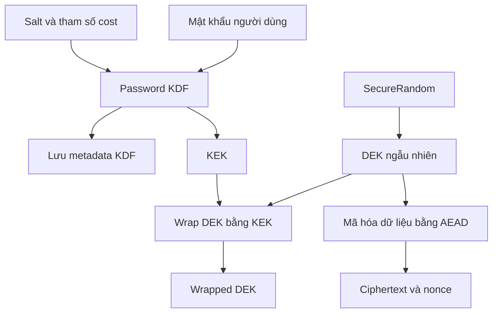

# KDF

**Key Derivation Function (KDF)** là hàm dẫn xuất khóa: nhận một đầu vào bí mật hoặc vật liệu khóa ban đầu, kết hợp với tham số như salt và thông tin ngữ cảnh, rồi tạo ra một hoặc nhiều khóa có độ dài xác định. KDF giúp chuyển bí mật đầu vào thành khóa phù hợp với một mục đích mật mã cụ thể, đồng thời tách các khóa dùng cho những chức năng khác nhau.

Trong Java Cryptography Architecture (JCA), KDF kết nối nhiều thành phần: `SecureRandom` tạo salt, `SecretKeyFactory` hỗ trợ các cơ chế dẫn xuất dựa trên mật khẩu như PBKDF2, `KeyAgreement` tạo bí mật chung như ECDH, `Mac` cung cấp HMAC làm nền tảng cho HKDF, còn `Cipher` sử dụng khóa đã dẫn xuất để mã hóa hoặc giải mã. Chọn đúng KDF rất quan trọng trong quản lý khóa vì một KDF phù hợp có thể tăng chi phí đoán mật khẩu, tách khóa theo ngữ cảnh và đưa bí mật thô về dạng khóa có thể quản lý.

## 1. KDF giải quyết vấn đề gì?

Một bí mật đầu vào không phải lúc nào cũng là khóa thích hợp để đưa trực tiếp vào thuật toán mã hóa. Ví dụ:

- Mật khẩu do con người chọn thường có entropy thấp và dễ bị đoán. Cần một password-based KDF để làm cho mỗi lần thử mật khẩu tốn tài nguyên đáng kể.
- ECDH tạo ra bí mật chung giữa hai bên. Bí mật này cần được đưa qua KDF để tạo khóa phiên có độ dài, ngữ cảnh và mục đích rõ ràng.
- Một khóa gốc có thể cần tạo ra các khóa con riêng cho mã hóa dữ liệu, xác thực hoặc từng tenant. KDF có thể tạo các đầu ra tách biệt từ cùng vật liệu đầu vào.
- Một giao thức có thể cần nhiều khóa cho hai hướng truyền dữ liệu hoặc nhiều giai đoạn. Dẫn xuất theo nhãn và ngữ cảnh giúp tránh dùng lại cùng một khóa cho các mục đích khác nhau.

KDF là phép biến đổi xác định: cùng đầu vào và cùng tham số sẽ tạo cùng đầu ra. KDF không tự tạo thêm entropy cho một bí mật yếu. Nó có thể làm chậm việc thử đoán mật khẩu hoặc định dạng lại vật liệu khóa có entropy cao, nhưng không thể biến một mật khẩu dễ đoán thành bí mật mạnh chỉ bằng cách tăng độ dài đầu ra.

## 2. Vị trí của KDF trong Java Cryptography Architecture

JCA cung cấp các lớp API theo chức năng. KDF không đồng nghĩa với tạo khóa ngẫu nhiên hay thỏa thuận khóa.

| Thành phần JCA | Vai trò | Quan hệ với KDF |
|---|---|---|
| `SecureRandom` | Sinh dữ liệu ngẫu nhiên mật mã | Tạo salt duy nhất; cũng có thể sinh khóa ngẫu nhiên độc lập |
| `SecretKeyFactory` | Chuyển `KeySpec` thành `SecretKey` | Cung cấp các thuật toán dẫn xuất dựa trên mật khẩu, ví dụ PBKDF2 |
| `KeyAgreement` | Tính bí mật chung giữa các bên, ví dụ ECDH | Đầu ra thường là vật liệu đầu vào cho KDF tiếp theo |
| `Mac` | Tạo mã xác thực thông điệp, thường dùng HMAC | Là khối xây dựng để thực hiện HKDF khi provider hoặc API phù hợp không cung cấp trực tiếp |
| `SecretKeySpec` | Đóng gói mảng byte thành một đối tượng khóa có tên thuật toán | Có thể dùng để chuyển byte đã dẫn xuất thành khóa AES hoặc HMAC phù hợp |
| `Cipher` | Mã hóa và giải mã | Sử dụng khóa đầu ra của KDF |
| `MessageDigest` | Tính hàm băm | Có thể được dùng trong các cấu trúc mật mã, nhưng gọi SHA-256 đơn lẻ không tự tạo thành KDF an toàn |
| `KeyGenerator` | Sinh khóa ngẫu nhiên cho thuật toán | Dùng khi cần khóa mới ngẫu nhiên; không thay thế KDF khi cần dẫn xuất từ một bí mật đã có |

Các lớp này lấy implementation từ provider. Khả năng hỗ trợ thuật toán, tên thuật toán và mức bảo đảm phụ thuộc JDK, provider và cấu hình triển khai. Vì vậy, cần kiểm tra môi trường thực tế thay vì giả định mọi máy Java đều có cùng danh sách thuật toán.

## 3. Các thành phần thường gặp của một KDF

Một KDF có thể sử dụng các thành phần sau:

- **Input Keying Material (IKM):** vật liệu đầu vào. Đây có thể là mật khẩu, bí mật chung ECDH hoặc một khóa gốc có entropy cao.
- **Salt:** dữ liệu bổ sung thường không bí mật, được tạo ngẫu nhiên hoặc theo yêu cầu của thuật toán. Salt làm cho cùng một mật khẩu không tạo cùng kết quả ở các lần đăng ký khác nhau và chống việc dùng trước bảng kết quả tính sẵn.
- **Iteration count hoặc cost parameter:** tham số điều chỉnh chi phí tính toán. Với password KDF, chi phí càng cao thì việc thử nhiều mật khẩu càng tốn tài nguyên, trong giới hạn vận hành cho phép.
- **Memory cost và parallelism:** tham số quan trọng của các KDF kháng phần cứng chuyên dụng như Argon2id hoặc scrypt.
- **Info hoặc context:** dữ liệu mô tả mục đích của khóa, chẳng hạn tên giao thức, phiên bản, vai trò, tenant hoặc hướng truyền dữ liệu. HKDF dùng trường `info` để tách đầu ra theo ngữ cảnh.
- **Output length:** độ dài đầu ra. Phải chọn theo thuật toán sử dụng và không yêu cầu đầu ra dài hơn mức cần thiết.

Salt và info thường không cần giữ bí mật, nhưng phải được lưu hoặc tái tạo chính xác khi cần dẫn xuất lại khóa. Mật khẩu, IKM, khóa trung gian và đầu ra KDF có thể là dữ liệu nhạy cảm; không đưa chúng vào log hoặc telemetry.

Salt không phải nonce. Salt là tham số của quá trình dẫn xuất khóa; nonce là đầu vào của một phép mã hóa cụ thể và thường phải đáp ứng quy tắc duy nhất theo khóa. Không dùng một giá trị thay thế cho cả hai chỉ vì cả hai đều có thể là dữ liệu công khai.

## 4. Hai nhóm KDF chính

### 4.1. Password-based KDF

Password-based KDF (PBKDF) được thiết kế cho đầu vào có entropy thấp như mật khẩu. Nó chủ động tiêu tốn thời gian, và với một số thuật toán còn tiêu tốn bộ nhớ, để làm tăng chi phí của mỗi lần đoán mật khẩu.

Các thuật toán thường gặp:

| Thuật toán | Đặc điểm | Trường hợp sử dụng và lưu ý |
|---|---|---|
| PBKDF2 | Lặp hàm giả ngẫu nhiên, thường là HMAC, theo số vòng cấu hình | Được hỗ trợ rộng trong hệ sinh thái Java và nhiều chuẩn; cần chọn PRF mạnh, salt riêng và số vòng được hiệu chỉnh |
| scrypt | Thiết kế memory-hard, yêu cầu bộ nhớ đáng kể | Giảm lợi thế của phần cứng chuyên dụng; cần cấu hình bộ nhớ, chi phí CPU và mức song song phù hợp |
| Argon2id | KDF mật khẩu memory-hard, kết hợp đặc tính của Argon2i và Argon2d | Thường là lựa chọn ưu tiên cho hệ thống mới khi thư viện/provider đáng tin cậy hỗ trợ và chính sách cho phép |
| bcrypt | Cơ chế băm mật khẩu có cost factor, được dùng rộng rãi trong hệ thống cũ | Phù hợp cho xác minh mật khẩu trong hệ sinh thái hỗ trợ; giới hạn đầu vào và cách xử lý mật khẩu phụ thuộc triển khai |

PBKDF2 có ưu điểm về khả năng tương thích và thường có sẵn qua `SecretKeyFactory`. Argon2id hoặc scrypt có thể phù hợp hơn khi cần khả năng chống tấn công bằng phần cứng chuyên dụng, nhưng thường cần thư viện hoặc provider bổ sung. Không nên tự viết lại thuật toán memory-hard trong ứng dụng.

### 4.2. KDF cho vật liệu khóa có entropy cao

Nhóm này nhận đầu vào đã có entropy đủ cao, ví dụ bí mật chung từ ECDH hoặc khóa gốc ngẫu nhiên. KDF tạo khóa đầu ra có độ dài và mục đích cụ thể.

**HKDF** là một ví dụ phổ biến, được định nghĩa theo RFC 5869 và xây dựng từ HMAC. HKDF có hai giai đoạn:

1. **Extract:** kết hợp IKM với salt để tạo pseudorandom key (PRK).
2. **Expand:** dùng PRK cùng `info` và bộ đếm khối để tạo đầu ra có độ dài cần thiết.

HKDF hữu ích sau ECDH hoặc khi cần dẫn xuất nhiều khóa con từ một bí mật gốc. Nó không được thiết kế để chống đoán mật khẩu. Nếu đầu vào là mật khẩu, hãy dùng password KDF trước; không dùng HKDF thay cho PBKDF2, scrypt hoặc Argon2id.

## 5. Chọn KDF theo nguồn đầu vào

Nguồn đầu vào quyết định cách chọn thuật toán:

| Nguồn đầu vào | KDF phù hợp | Ghi chú |
|---|---|---|
| Mật khẩu người dùng | Argon2id, scrypt hoặc PBKDF2 theo yêu cầu tương thích/chính sách | Dùng salt riêng, cấu hình cost phù hợp và lưu tham số để xác minh lại |
| Bí mật chung ECDH | HKDF với HMAC phù hợp | Không dùng trực tiếp bí mật ECDH làm khóa AES; ràng buộc giao thức và vai trò trong info |
| Khóa gốc ngẫu nhiên | HKDF hoặc KDF được chuẩn hóa cho hệ thống | Tách khóa con theo mục đích, phiên bản và tenant |
| Khóa do KMS/HSM quản lý | KDF hoặc thao tác dẫn xuất được dịch vụ hỗ trợ | Ưu tiên giữ khóa gốc trong miền bảo vệ; kiểm tra API và chính sách export |
| Dữ liệu có entropy thấp nhưng không phải mật khẩu | Đánh giá mô hình đe dọa và dùng cơ chế phù hợp | Không mặc định dùng HKDF nếu đầu vào dễ đoán |

Nếu cần nhiều khóa, nên dùng KDF có hỗ trợ dẫn xuất nhiều đầu ra hoặc dẫn xuất riêng theo nhãn. Không cắt một chuỗi byte tùy tiện rồi dùng các đoạn cho những giao thức khác nhau mà không có quy tắc phân tách được thiết kế rõ ràng.

## 6. Dùng PBKDF2 trong Java với SecretKeyFactory

`PBEKeySpec` mang mật khẩu và các tham số PBKDF2; `SecretKeyFactory` thực hiện dẫn xuất. Ví dụ sau minh họa cách tạo khóa AES 256-bit từ mật khẩu. Salt phải được sinh mới cho mỗi bí mật hoặc đối tượng dữ liệu và được lưu cùng metadata mã hóa để có thể dẫn xuất lại.

```java
import java.security.GeneralSecurityException;
import java.util.Arrays;
import javax.crypto.SecretKey;
import javax.crypto.SecretKeyFactory;
import javax.crypto.spec.PBEKeySpec;
import javax.crypto.spec.SecretKeySpec;

public final class PasswordKdf {
    private PasswordKdf() {}

    public static SecretKey deriveAesKey(
            char[] password,
            byte[] salt,
            int iterations) throws GeneralSecurityException {

        if (password == null || password.length == 0) {
            throw new IllegalArgumentException("Password is required");
        }
        if (salt == null || salt.length < 16) {
            throw new IllegalArgumentException("Use a unique random salt of at least 16 bytes");
        }
        if (iterations < 1) {
            throw new IllegalArgumentException("Iterations must be positive");
        }

        PBEKeySpec spec = new PBEKeySpec(password, salt, iterations, 256);
        byte[] encoded = null;
        try {
            SecretKeyFactory factory =
                    SecretKeyFactory.getInstance("PBKDF2WithHmacSHA256");
            encoded = factory.generateSecret(spec).getEncoded();
            return new SecretKeySpec(encoded, "AES");
        } finally {
            spec.clearPassword();
            if (encoded != null) {
                Arrays.fill(encoded, (byte) 0);
            }
        }
    }
}
```

Đoạn mã minh họa cách dùng API và dọn bản sao byte do phương thức tạo ra. Ứng dụng gọi phương thức vẫn phải xóa mảng `char[]` đầu vào khi không còn cần thiết. Đối tượng `SecretKeySpec` giữ bản sao khóa để sử dụng, nên cần giới hạn thời gian sống và quyền truy cập của đối tượng. Không chuyển mật khẩu thành `String`, vì chuỗi bất biến và không thể được ứng dụng chủ động ghi đè.

Số vòng trong ví dụ được truyền từ cấu hình máy chủ có chủ đích. Hãy hiệu chỉnh cost trên phần cứng triển khai và theo tải đăng nhập thực tế; không sao chép một con số cũ cho mọi hệ thống. Chỉ chấp nhận các tham số nằm trong chính sách được máy chủ cho phép, không nhận số vòng tùy ý từ client vì giá trị quá lớn có thể gây cạn CPU. Khi xác minh mật khẩu, dùng đúng salt, thuật toán, PRF, số vòng và độ dài đã lưu cho bản ghi đó. So sánh kết quả bằng phương thức so sánh thời gian hằng như `MessageDigest.isEqual`, thay vì tự so sánh từng byte và dừng ở byte khác đầu tiên.

## 7. Sinh và lưu salt đúng cách

Salt nên được tạo từ `SecureRandom`, đủ dài theo yêu cầu thuật toán và duy nhất cho từng mật khẩu hoặc đối tượng dẫn xuất. Ví dụ:

```java
import java.security.SecureRandom;

SecureRandom random = new SecureRandom();
byte[] salt = new byte[16];
random.nextBytes(salt);
```

Salt không cần giữ bí mật. Khi lưu thông tin xác minh mật khẩu hoặc dữ liệu mã hóa, cần lưu đủ metadata để có thể tái tạo đầu ra:

- Tên thuật toán và phiên bản định dạng.
- Salt.
- PRF hoặc hash được dùng, nếu thuật toán có lựa chọn này.
- Số vòng hoặc các tham số cost/memory/parallelism.
- Độ dài đầu ra.
- Tham chiếu đến phiên bản chính sách nếu hệ thống quản lý tham số tập trung.

Không dùng một salt cố định cho toàn bộ người dùng. Không dùng salt làm secret và không dùng salt thay cho pepper. Pepper là bí mật bổ sung do hệ thống bảo vệ riêng; nếu dùng pepper, phải quản lý trong KMS/HSM hoặc kho bí mật phù hợp, có quy trình xoay vòng và khôi phục.

## 8. HKDF và bí mật chung từ ECDH

Trong một giao thức trao đổi khóa, hai bên có thể dùng ECDH để tạo bí mật chung. Kết quả ECDH là IKM cho HKDF. `info` nên ràng buộc đầu ra với phiên giao tiếp, danh tính hoặc vai trò hai bên, thuật toán, phiên bản giao thức và hướng truyền dữ liệu theo thiết kế giao thức.

Ví dụ về các nhãn dẫn xuất:

| Nhãn ngữ cảnh | Mục đích |
|---|---|
| `app-v1/client-to-server/aes-256-gcm` | Khóa mã hóa dữ liệu từ client đến server |
| `app-v1/server-to-client/aes-256-gcm` | Khóa mã hóa dữ liệu từ server đến client |
| `app-v1/exporter` | Vật liệu khóa dành riêng cho chức năng exporter của giao thức |

Hai bên phải mã hóa các trường ngữ cảnh theo cùng một định dạng chuẩn hóa để tránh khác biệt do nối chuỗi mơ hồ. Không đưa thông tin có thể thay đổi hoặc do bên không tin cậy kiểm soát vào `info` mà không xác thực và ràng buộc nó với transcript giao thức.

Trong JCA, `Mac.getInstance("HmacSHA256")` cung cấp HMAC làm nền tảng cho HKDF. Một số phiên bản JDK hoặc provider có API KDF chuyên biệt; khả năng và tên thuật toán phải được kiểm tra theo tài liệu của runtime. Nếu dùng thư viện ngoài để cung cấp HKDF, chọn thư viện được duy trì, có triển khai đã được kiểm thử với vector chuẩn và dùng đúng phiên bản được tổ chức phê duyệt. Tránh tự triển khai HKDF trong mã ứng dụng nếu không có nhu cầu và năng lực kiểm chứng mật mã.

## 9. Tách khóa theo mục đích và domain separation

Một lỗi phổ biến là dùng cùng một khóa cho nhiều chức năng vì khóa đó “đã có sẵn”. Cách làm này có thể tạo liên hệ ngoài ý muốn giữa các giao thức hoặc làm tăng hậu quả khi một khóa bị lộ.

Domain separation là nguyên tắc dùng nhãn và ngữ cảnh khác nhau để tạo các đầu ra độc lập về mặt mật mã cho các mục đích khác nhau. Ví dụ, từ một IKM có entropy cao, hệ thống có thể dẫn xuất khóa mã hóa, khóa xác thực và khóa cho hai hướng truyền dữ liệu với `info` riêng. Định dạng nhãn cần có namespace, phiên bản, vai trò và mục đích để tránh va chạm giữa các thành phần.

Không nên dùng cùng đầu ra KDF cho AES và HMAC. Nếu giao thức cần cả mã hóa và xác thực, ưu tiên một chế độ AEAD như AES-GCM hoặc ChaCha20-Poly1305 theo chính sách; nếu giao thức thực sự yêu cầu hai khóa độc lập, hãy dẫn xuất riêng từng khóa bằng nhãn khác nhau. Việc phân tách khóa không thay thế xác thực danh tính hoặc thiết kế giao thức an toàn.

## 10. Dùng KDF để bảo vệ dữ liệu bằng mật khẩu

Khi người dùng cần mã hóa dữ liệu bằng mật khẩu, một thiết kế thường gặp là:

1. Sinh một DEK ngẫu nhiên bằng `SecureRandom`.
2. Dùng DEK để mã hóa dữ liệu bằng một chế độ AEAD.
3. Dùng password KDF với mật khẩu và salt riêng để tạo KEK.
4. Dùng KEK để bọc DEK; lưu ciphertext, nonce, salt, tham số KDF và wrapped DEK.
5. Khi mở dữ liệu, dẫn xuất lại KEK từ mật khẩu và metadata, rồi dùng KEK mở DEK.

Cách này tách khóa dữ liệu khỏi mật khẩu. Khi cần đổi mật khẩu, có thể bọc lại DEK bằng KEK mới mà không cần mã hóa lại toàn bộ dữ liệu. Thiết kế phải xác định rõ cách xác thực metadata và xử lý lỗi để tránh oracle hoặc rò rỉ thông tin.



Không dùng trực tiếp mật khẩu làm khóa AES. Cũng không nên dùng password KDF một lần rồi tái sử dụng cùng đầu ra cho mọi tệp mà không có thiết kế phân tách theo đối tượng. Có thể dùng một DEK ngẫu nhiên riêng cho từng đối tượng hoặc một cấu trúc khóa được quản lý rõ ràng.

## 11. Quản lý tham số và nâng cấp KDF

Tham số KDF là một phần của định dạng dữ liệu và chính sách bảo mật. Khi thay đổi thuật toán hoặc cost, hệ thống phải biết cách đọc các bản ghi cũ và có kế hoạch nâng cấp.

- Chọn cost dựa trên phép đo trên phần cứng thật, đồng thời đặt giới hạn để tránh cạn tài nguyên khi có nhiều yêu cầu đăng nhập đồng thời.
- Lưu thuật toán và tham số cùng bản ghi; không dựa vào giá trị mặc định có thể đổi sau khi nâng cấp thư viện.
- Khi người dùng đăng nhập thành công, nếu tham số cũ yếu hơn chính sách hiện tại, có thể dẫn xuất lại và cập nhật bản ghi theo quy trình nâng cấp.
- Hỗ trợ phiên bản định dạng để phân biệt PBKDF2 cũ với Argon2id hoặc cấu hình mới.
- Có giới hạn đầu vào và giới hạn tài nguyên để ngăn người dùng gửi tham số cost quá lớn gây từ chối dịch vụ.
- Theo dõi thời gian xử lý, lỗi provider và tỷ lệ nâng cấp để phát hiện cấu hình không phù hợp.

Không giảm tham số tùy tiện chỉ để tăng tốc. Nếu hiệu năng không đạt, xem xét tối ưu triển khai, giới hạn tốc độ, tăng năng lực hoặc điều chỉnh kiến trúc xác thực trước khi làm yếu KDF.

## 12. Những lỗi thường gặp

| Lỗi | Hậu quả | Cách khắc phục |
|---|---|---|
| Dùng SHA-256 đơn lẻ để lưu mật khẩu | Kẻ tấn công có thể thử mật khẩu rất nhanh | Dùng password KDF với salt và cost được hiệu chỉnh |
| Dùng cùng salt cho mọi người dùng | Các mật khẩu giống nhau tạo đầu ra giống nhau và hỗ trợ tấn công tiền tính toán | Sinh salt ngẫu nhiên riêng cho từng bản ghi |
| Dùng HKDF trực tiếp trên mật khẩu | Không làm chậm việc đoán mật khẩu | Dùng Argon2id, scrypt hoặc PBKDF2 trước khi có đầu ra phù hợp |
| Dùng bí mật ECDH trực tiếp làm khóa mã hóa | Bỏ qua bước chuẩn hóa và ràng buộc ngữ cảnh | Dùng KDF như HKDF sau KeyAgreement |
| Dùng một đầu ra cho nhiều mục đích | Tạo liên hệ giữa các chức năng và tăng tác động khi lộ khóa | Dùng domain separation hoặc đầu ra riêng |
| Ghi mật khẩu, IKM hoặc khóa dẫn xuất vào log | Tạo thêm bản sao bí mật ngoài kiểm soát | Lọc dữ liệu nhạy cảm và chỉ log metadata cần thiết |
| Chọn cost quá thấp | Tấn công đoán mật khẩu vẫn rẻ | Đo và cập nhật tham số theo chính sách |
| Chọn cost quá cao không kiểm soát | Dễ gây cạn CPU/bộ nhớ khi tải tăng | Hiệu chỉnh, giới hạn tốc độ và giới hạn tham số đầu vào |
| Không lưu metadata KDF | Không thể tái tạo khóa hoặc xác minh mật khẩu sau này | Lưu salt, thuật toán, tham số và phiên bản định dạng |
| Tự triển khai thuật toán mật mã | Dễ mắc lỗi chi tiết hoặc không tương thích vector chuẩn | Dùng API/provider/thư viện đã được kiểm chứng |

## 13. Checklist triển khai KDF trong Java

Trước khi đưa KDF vào hệ thống, hãy kiểm tra:

- [ ] Đã xác định đầu vào là mật khẩu, bí mật ECDH hay khóa gốc ngẫu nhiên.
- [ ] Đã chọn đúng họ KDF cho mức entropy và mô hình đe dọa.
- [ ] Salt được tạo bằng `SecureRandom`, đủ độ dài và riêng cho từng đối tượng.
- [ ] Các tham số cost được hiệu chỉnh và lưu cùng metadata.
- [ ] Đầu ra chỉ có độ dài cần thiết và được gắn với đúng thuật toán sử dụng.
- [ ] Các khóa cho mục đích khác nhau được tách bằng domain separation.
- [ ] Mật khẩu và bản sao vật liệu khóa được xử lý trong thời gian ngắn; không ghi bí mật vào log.
- [ ] Provider và thuật toán được kiểm tra trên JDK triển khai thực tế.
- [ ] Có kế hoạch xác minh bản ghi cũ và nâng cấp tham số KDF.
- [ ] Có giới hạn tài nguyên và kiểm soát tải cho các thao tác dẫn xuất tốn CPU/bộ nhớ.

KDF là cầu nối giữa bí mật đầu vào và khóa được sử dụng trong hệ thống. Khi chọn đúng thuật toán, tham số, salt và ngữ cảnh, ứng dụng Java có thể dẫn xuất khóa nhất quán, hạn chế tấn công đoán mật khẩu và tách biệt các mục đích mật mã. Hiệu quả cuối cùng vẫn phụ thuộc vào chất lượng đầu vào, cách bảo vệ khóa gốc, provider được triển khai và quy trình quản lý vòng đời khóa.
