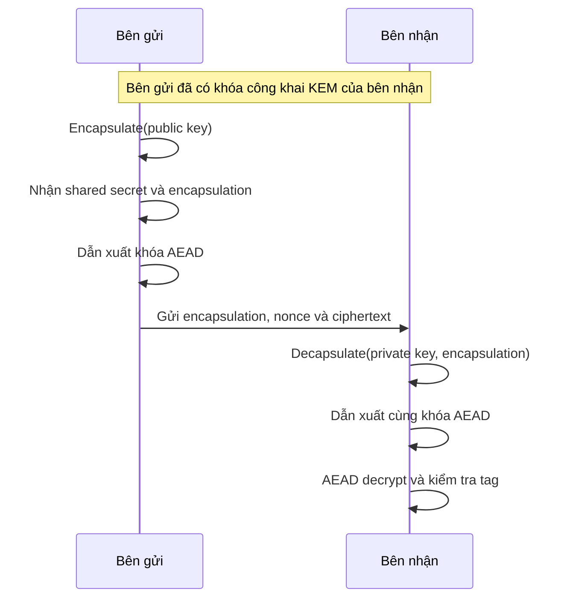

# KEM

Khi hai hệ thống cần trao đổi dữ liệu bí mật qua một mạng không tin cậy, chúng cần thiết lập một khóa đối xứng mà người nghe lén không thể tính ra. **KEM (Key Encapsulation Mechanism)** là cơ chế dùng khóa công khai của bên nhận để tạo một bí mật dùng chung và một gói dữ liệu *encapsulation*. Bên nhận dùng khóa riêng tương ứng cùng gói encapsulation để khôi phục cùng bí mật đó.

KEM thường là thành phần đầu tiên của mã hóa lai: KEM thiết lập bí mật, sau đó hệ thống dùng khóa dẫn xuất từ bí mật để mã hóa dữ liệu bằng thuật toán đối xứng có xác thực như AES-GCM hoặc ChaCha20-Poly1305. KEM không tự mã hóa một thông điệp tùy ý và cũng không tự xác thực danh tính người gửi. Thiết kế an toàn cần kết hợp KEM với KDF, AEAD, xác minh khóa công khai và quy trình quản lý khóa.

Trong Java Cryptography Architecture (JCA/JCE), API `javax.crypto.KEM` được chuẩn hóa từ Java 21. API này cho phép ứng dụng yêu cầu provider thực hiện encapsulation và decapsulation mà không phải tự cài đặt toán học mật mã của thuật toán.

## 1. KEM giải quyết vấn đề gì?

Giả sử một dịch vụ cần gửi dữ liệu cho một máy chủ nhận. Máy chủ có một cặp khóa KEM gồm khóa công khai và khóa riêng. Khóa công khai có thể được phân phối cho các bên gửi; khóa riêng được giữ bí mật tại máy chủ.

Nếu bên gửi chỉ mã hóa dữ liệu bằng khóa công khai, nó cần một thuật toán mã hóa khóa công khai có thể mã hóa trực tiếp dữ liệu. KEM giải quyết một nhiệm vụ hẹp hơn: bên gửi dùng khóa công khai để tạo ra một bí mật ngẫu nhiên và một encapsulation; bên nhận dùng khóa riêng để khôi phục bí mật tương ứng. Hai bên sau đó dùng bí mật này để dẫn xuất khóa đối xứng.

KEM phù hợp với mô hình mã hóa lai vì:

- Mật mã khóa công khai dùng để thiết lập bí mật mà không cần chia sẻ khóa bí mật từ trước.
- Mật mã đối xứng xử lý dữ liệu lớn với hiệu năng tốt.
- Khóa đối xứng được tạo riêng cho từng phiên hoặc thông điệp, giúp giới hạn phạm vi ảnh hưởng khi một khóa bị lộ.
- Cơ chế có thể được chuẩn hóa và thay thế theo thuật toán KEM mà provider hỗ trợ.

## 2. Encapsulation và decapsulation

Một KEM có hai thao tác chính:

1. **Encapsulation:** bên gửi nhận khóa công khai của bên nhận, sinh bí mật dùng chung và tạo dữ liệu encapsulation. Kết quả gồm bí mật/khóa được dẫn xuất và gói encapsulation cần gửi cho bên nhận.
2. **Decapsulation:** bên nhận dùng khóa riêng cùng gói encapsulation để tái tạo bí mật/khóa giống bên gửi.



Hai bên phải dùng cùng thuật toán, tham số, cách dẫn xuất khóa và ngữ cảnh giao thức. Nếu thay đổi một trong các thành phần đó mà không cập nhật đồng bộ, hai bên có thể không tạo ra cùng khóa hoặc không giải mã được dữ liệu.

Gói encapsulation không phải khóa bí mật. Nó là dữ liệu cần thiết để bên nhận tái tạo bí mật. Trong các KEM dựa trên Diffie-Hellman, dữ liệu này thường chứa thông tin khóa công khai tạm thời hoặc dữ liệu tương đương theo thuật toán. Kẻ nghe lén có thể nhìn thấy encapsulation nhưng không được phép suy ra bí mật nếu thuật toán và khóa được dùng đúng.

## 3. KEM khác gì key agreement và mã hóa khóa công khai?

Các cơ chế này có liên quan nhưng có mô hình sử dụng khác nhau:

| Cơ chế | Đầu vào chính | Kết quả | Cách dùng thường gặp |
|---|---|---|---|
| Key agreement, ví dụ ECDH | Khóa riêng của mỗi bên và khóa công khai của bên kia | Bí mật dùng chung | Hai bên đều có đóng góp khóa riêng vào quá trình thiết lập bí mật |
| KEM | Khóa công khai của bên nhận ở phía encapsulator; khóa riêng của bên nhận ở phía decapsulator | Bí mật dùng chung và dữ liệu encapsulation | Bên gửi tạo bí mật cho người nhận mà không cần khóa riêng dài hạn của chính mình |
| Public-key encryption, ví dụ RSA-OAEP | Khóa công khai để mã hóa; khóa riêng để giải mã | Bản rõ được mã hóa và khôi phục | Mã hóa trực tiếp một lượng dữ liệu nhỏ hoặc một khóa đối xứng ngẫu nhiên |

Một số KEM được xây dựng từ phép toán Diffie-Hellman và có quan hệ toán học với key agreement, nhưng KEM chuẩn hóa giao diện theo cặp thao tác encapsulate/decapsulate. Ứng dụng không nên tự thay thế KEM bằng cách gọi ECDH rồi tự ghép dữ liệu nếu giao thức yêu cầu một KEM chuẩn cụ thể.

KEM cũng khác với việc mã hóa trực tiếp dữ liệu lớn bằng RSA. Trong kiến trúc lai, KEM thiết lập khóa; AEAD mã hóa dữ liệu. Cách phân chia này phù hợp với giao thức hiện đại và tránh giới hạn kích thước bản rõ của thuật toán khóa công khai.

## 4. KEM trong Java Cryptography Architecture

API `javax.crypto.KEM` được giới thiệu trong Java 21. Đây là API JCE có thể lấy implementation từ provider thông qua cơ chế `getInstance()` tương tự `Cipher`, `Mac` hoặc `KeyAgreement`.

Các kiểu quan trọng gồm:

| Thành phần | Vai trò |
|---|---|
| `KEM` | Đối tượng đại diện cho implementation KEM do provider cung cấp |
| `KEM.Encapsulator` | Tạo encapsulation bằng khóa công khai của bên nhận |
| `KEM.Decapsulator` | Khôi phục khóa từ encapsulation bằng khóa riêng của bên nhận |
| `KEM.Encapsulated` | Kết quả encapsulation, gồm khóa, dữ liệu encapsulation và tham số liên quan |
| `KEM.getInstance()` | Chọn thuật toán KEM và provider |
| `newEncapsulator()` | Tạo đối tượng thực hiện encapsulation |
| `newDecapsulator()` | Tạo đối tượng thực hiện decapsulation |

Ví dụ khởi tạo implementation:

```java
KEM kem = KEM.getInstance("DHKEM");
System.out.println(kem.getAlgorithm());
KEM.Encapsulator encapsulator = kem.newEncapsulator(recipientPublicKey);
System.out.println(encapsulator.providerName());
```

Tên thuật toán được hỗ trợ phụ thuộc provider và phiên bản JDK. `DHKEM` là tên thuật toán KEM dựa trên Diffie-Hellman được các provider hỗ trợ theo cấu hình tương ứng. Không được giả định mọi JDK hoặc provider đều cung cấp cùng danh sách thuật toán, nhóm đường cong hoặc bộ tham số.

Nếu không chỉ định provider trong `KEM.getInstance()`, provider được chọn cho encapsulator và decapsulator có thể khác nhau tùy khóa và tham số truyền vào. Có thể xem provider thực tế bằng `providerName()` trên từng đối tượng. Ứng dụng có thể chỉ định provider rõ ràng nếu kiến trúc yêu cầu:

```java
KEM kem = KEM.getInstance("DHKEM", provider);
```

Trong triển khai thực tế, hãy kiểm tra provider được phép sử dụng và xử lý `NoSuchAlgorithmException` hoặc lỗi khởi tạo khi thuật toán không có sẵn.

## 5. Ví dụ encapsulate và decapsulate bằng Java 21+

Đoạn mã dưới đây minh họa luồng cơ bản với `DHKEM`. `recipientPublicKey` và `recipientPrivateKey` là một cặp khóa tương thích với thuật toán và provider được chọn. Trong ví dụ, hai bên yêu cầu API tạo khóa AES 128 bit từ cùng một vùng của bí mật KEM.

```java
import java.security.PrivateKey;
import java.security.PublicKey;
import javax.crypto.KEM;
import javax.crypto.SecretKey;

public final class KemExample {
    public record SenderResult(byte[] encapsulation, SecretKey key) {}

    public static SenderResult encapsulate(PublicKey recipientPublicKey)
            throws Exception {
        KEM kem = KEM.getInstance("DHKEM");
        KEM.Encapsulator encapsulator =
                kem.newEncapsulator(recipientPublicKey);

        KEM.Encapsulated result = encapsulator.encapsulate(0, 16, "AES");
        return new SenderResult(result.encapsulation(), result.key());
    }

    public static SecretKey decapsulate(
            PrivateKey recipientPrivateKey,
            byte[] encapsulation) throws Exception {
        KEM kem = KEM.getInstance("DHKEM");
        KEM.Decapsulator decapsulator =
                kem.newDecapsulator(recipientPrivateKey);

        return decapsulator.decapsulate(encapsulation, 0, 16, "AES");
    }
}
```

Phía gửi gọi `encapsulate()` và giữ `result.key()` làm khóa AES; phía nhận truyền đúng `encapsulation` vào `decapsulate()` và nhận khóa AES tương ứng. Hai bên cần thống nhất `from`, `to` và tên thuật toán (`AES`). Ví dụ dùng vùng byte từ 0 đến 16 để tạo khóa AES 128 bit. Có thể chọn độ dài khác nếu KEM và thuật toán đích hỗ trợ. Đây là ví dụ trích một vùng của bí mật KEM theo API; giao thức sản xuất nên tuân theo KDF và key schedule đã chuẩn hóa (chẳng hạn HPKE) để ràng buộc khóa với mục đích và ngữ cảnh sử dụng.

Không truyền tham số cho `encapsulate()` sẽ tạo `SecretKey` mang toàn bộ bí mật với tên thuật toán `Generic`; đây thường là đầu vào cho KDF. Overload `encapsulate(from, to, algorithm)` trả về một phần bí mật dưới dạng khóa có tên thuật toán được chỉ định. Provider có thể không hỗ trợ mọi tổ hợp vùng byte và tên thuật toán, vì vậy cần kiểm tra khả năng hỗ trợ của implementation.

Đoạn mã chỉ minh họa trao đổi khóa. Ứng dụng vẫn cần xác minh khóa công khai của bên nhận đến từ đúng nguồn, chọn bộ tham số được chấp thuận và dùng khóa sinh ra với một thuật toán bảo vệ dữ liệu phù hợp.

Một số KEM cần `AlgorithmParameterSpec` khi tạo encapsulator. Khi đó, bên gửi dùng overload `newEncapsulator(publicKey, spec, secureRandom)`. Nếu tham số cần được chuyển cho bên nhận, provider có thể đưa chúng vào `KEM.Encapsulated.params()`. Bên nhận phải tái tạo đúng `AlgorithmParameterSpec` và truyền vào `newDecapsulator(privateKey, spec)`. Metadata này cần được chuyển và ràng buộc với đúng thông điệp theo giao thức.

## 6. Dùng khóa KEM với AEAD để mã hóa dữ liệu

KEM chỉ tạo bí mật/khóa. Để mã hóa dữ liệu, ứng dụng thường dùng khóa đó với một AEAD như `AES/GCM/NoPadding`. AEAD vừa bảo vệ tính bí mật vừa kiểm tra tính toàn vẹn của ciphertext và dữ liệu bổ sung được xác thực (AAD).

Ví dụ phía gửi sau khi encapsulate:

```java
import java.security.SecureRandom;
import javax.crypto.Cipher;
import javax.crypto.spec.GCMParameterSpec;

byte[] nonce = new byte[12];
new SecureRandom().nextBytes(nonce);

Cipher cipher = Cipher.getInstance("AES/GCM/NoPadding");
cipher.init(
        Cipher.ENCRYPT_MODE,
        senderKey,
        new GCMParameterSpec(128, nonce));
cipher.updateAAD(contextInfo);
byte[] ciphertext = cipher.doFinal(plaintext);
```

Phía nhận dùng khóa tạo ra từ `decapsulate()` và đúng nonce, AAD:

```java
Cipher cipher = Cipher.getInstance("AES/GCM/NoPadding");
cipher.init(
        Cipher.DECRYPT_MODE,
        recipientKey,
        new GCMParameterSpec(128, nonce));
cipher.updateAAD(contextInfo);
byte[] plaintext = cipher.doFinal(ciphertext);
```

Trong thông điệp truyền đi, bên gửi cần chuyển cho bên nhận tối thiểu dữ liệu encapsulation, nonce, ciphertext và thông tin phiên bản/thuật toán cần thiết. Không gửi khóa AES hoặc bí mật KEM dưới dạng bản rõ. `contextInfo` có thể chứa định danh giao thức, phiên bản, danh tính hai bên hoặc metadata cần ràng buộc với ciphertext; hai bên phải tạo AAD giống hệt nhau.

Với AES-GCM, nonce 96 bit là lựa chọn phổ biến. Không được tái sử dụng cùng nonce với cùng khóa AES. Nếu mỗi encapsulation tạo một khóa AES mới cho một thông điệp, vẫn cần bảo đảm mỗi cặp khóa/nonce không bị sử dụng lặp lại do retry, khôi phục trạng thái hoặc lỗi triển khai.

## 7. KEM, KDF và HPKE

Trong thiết kế giao thức, KEM thường được kết hợp với **KDF (Key Derivation Function)** và **AEAD**. KDF tạo khóa theo mục đích sử dụng từ bí mật KEM và ngữ cảnh giao thức. AEAD dùng khóa đã dẫn xuất để bảo vệ bản tin.

**HPKE (Hybrid Public Key Encryption)** là một cấu trúc chuẩn hóa kết hợp KEM, KDF và AEAD. HPKE quy định cách thiết lập context, dẫn xuất khóa, nonce và xử lý bản tin, giúp các triển khai tương thích với nhau. KEM API của Java cung cấp thao tác KEM; chỉ gọi `KEM.encapsulate()` và `decapsulate()` không có nghĩa ứng dụng đã triển khai đầy đủ HPKE.

Nếu cần tương thích HPKE, phải tuân theo đúng phiên bản RFC, suite identifier, KEM, KDF, AEAD, mode, serialization và test vector của giao thức. Không tự ghép các thuật toán có vẻ tương thích rồi gọi kết quả là HPKE.

Trong JCA, KDF có thể được cung cấp bởi API/provider phù hợp hoặc thư viện giao thức. Hãy dùng một KDF đã được chuẩn hóa, có domain separation và context binding theo thiết kế. Không dùng trực tiếp bí mật KEM làm mật khẩu, IV hoặc khóa cho nhiều thuật toán khác nhau mà không có quy trình dẫn xuất khóa rõ ràng.

## 8. Khóa công khai, xác thực và danh tính bên nhận

KEM bảo đảm bên gửi và bên nhận có thể tạo cùng bí mật khi khóa được sử dụng đúng, nhưng không tự xác nhận khóa công khai thuộc về danh tính nào. Nếu kẻ tấn công thay khóa công khai của máy chủ bằng khóa của chính mình, bên gửi có thể encapsulate bí mật cho kẻ tấn công.

Trước khi encapsulate, ứng dụng phải xác minh nguồn gốc khóa công khai, ví dụ:

- Xác minh chứng thư X.509 và chuỗi tin cậy theo chính sách PKI.
- Kiểm tra thời hạn, mục đích sử dụng, thuật toán và trạng thái thu hồi của chứng thư.
- Xác minh khóa công khai lấy từ một kênh phân phối khóa đã xác thực hoặc một kho khóa có kiểm soát.
- Ràng buộc khóa với định danh bên nhận và định danh ứng dụng trong metadata/AAD.

KEM cũng không tự xác thực bên gửi. Bất kỳ ai có khóa công khai của bên nhận đều có thể tạo một encapsulation mới. Nếu giao thức cần xác thực người gửi, phải bổ sung chữ ký số, chứng thư, xác thực ở tầng giao thức hoặc một chế độ đã được chuẩn hóa có xác thực. Không nên coi việc giải mã AEAD thành công là bằng chứng danh tính người gửi nếu giao thức không có cơ chế xác thực tương ứng.

## 9. Quản lý vòng đời khóa KEM

Khóa KEM của bên nhận là tài sản mật mã cần được quản lý như các khóa riêng quan trọng khác. Khóa công khai có thể được phân phối rộng hơn, nhưng cần bảo đảm tính xác thực và gắn với đúng key identifier. Khóa riêng phải được bảo vệ, giới hạn quyền decapsulation và có quy trình thay thế khi hết hạn hoặc bị xâm phạm.

| Giai đoạn | Kiểm soát cần có |
|---|---|
| Tạo khóa | Dùng provider và nguồn ngẫu nhiên được chấp thuận; chọn thuật toán/nhóm tham số theo chính sách |
| Cấp phát khóa công khai | Xác thực danh tính bên nhận, công bố key ID, thuật toán, tham số và thời hạn |
| Lưu trữ khóa riêng | Giới hạn quyền đọc và decapsulation; cân nhắc HSM/KMS nếu provider hỗ trợ |
| Sử dụng | Ghi audit thao tác, giới hạn đối tượng được yêu cầu decapsulation và tránh xuất khóa riêng |
| Xoay vòng | Phát hành khóa công khai mới, cập nhật bên gửi và duy trì khả năng giải mã dữ liệu cũ trong thời gian chuyển tiếp |
| Thu hồi | Ngừng phân phối khóa công khai cũ, đánh dấu key ID không còn được dùng và cập nhật chính sách chấp nhận |
| Hủy | Xử lý bản sao lưu, bản sao khóa và metadata theo chính sách lưu giữ, phục hồi và hủy khóa |

Đối với dữ liệu lưu trữ lâu dài, ciphertext cần mang key ID và metadata đủ để chọn đúng khóa riêng khi giải mã. Khi xoay vòng khóa KEM, không được xóa khóa riêng cũ ngay nếu dữ liệu cũ vẫn cần được giải mã. Một chiến lược thường dùng là tạo DEK cho dữ liệu, dùng KEM để thiết lập bí mật, qua KDF tạo KEK rồi dùng KEK để bọc (wrap) DEK; ciphertext dữ liệu được lưu cùng encapsulation và key ID. Khi xoay vòng, có thể bọc lại DEK bằng KEK mới theo chính sách mà không nhất thiết mã hóa lại toàn bộ dữ liệu lớn.

## 10. Bảo vệ khóa riêng bằng KMS/HSM và provider

JCA chọn implementation thông qua provider. Một provider có thể thực hiện KEM trong phần mềm hoặc kết nối tới thiết bị/phần cứng mật mã tùy dịch vụ được triển khai. Nếu khóa riêng KEM được giữ trong HSM, ứng dụng cần kiểm tra provider có hỗ trợ thuật toán KEM và thao tác decapsulation với khóa không xuất được hay không.

Không phải mọi KMS/HSM đều hỗ trợ mọi KEM hoặc cho phép dùng trực tiếp qua `javax.crypto.KEM`. Có thể cần provider PKCS#11, provider chuyên biệt hoặc API riêng của dịch vụ. Trước khi chọn kiến trúc, cần xác minh:

- Thuật toán KEM và nhóm tham số có được thiết bị/provider hỗ trợ không.
- Có thể tạo khóa trong thiết bị và giữ khóa riêng không xuất được không.
- Quyền decapsulation có thể giới hạn theo danh tính dịch vụ và mục đích không.
- Provider có audit, xử lý lỗi, giới hạn tốc độ và hỗ trợ xoay vòng không.
- Có thể khôi phục hoặc chuyển đổi khóa theo yêu cầu nghiệp vụ mà không làm lộ khóa riêng không.

Việc đưa khóa vào HSM không tự giải quyết xác thực khóa công khai hoặc quản lý metadata. Ứng dụng vẫn phải xác minh khóa công khai, quản lý key ID, bảo vệ encapsulation/ciphertext và giám sát hoạt động sử dụng khóa.

## 11. Lỗi thường gặp và cách xử lý

| Tình huống | Nguyên nhân có thể | Cách xử lý |
|---|---|---|
| `NoSuchAlgorithmException` | Provider không có KEM được yêu cầu | Kiểm tra JDK, provider, tên thuật toán và cấu hình triển khai |
| `InvalidKeyException` | Khóa không phù hợp với KEM hoặc provider | Kiểm tra loại khóa, nhóm tham số và nguồn cấp khóa |
| `InvalidAlgorithmParameterException` | Tham số không được provider hỗ trợ | Dùng bộ tham số được công bố và kiểm thử trên đúng provider |
| `DecapsulateException` | Encapsulation sai định dạng, không hợp lệ hoặc không thể xử lý | Từ chối thông điệp, ghi log an toàn và không bỏ qua lỗi |
| Hai bên tạo khóa khác nhau | Không thống nhất thuật toán, tham số hoặc vùng byte/algorithm đầu ra | Đồng bộ cấu hình KEM và cách gọi encapsulate/decapsulate |
| AEAD xác thực thất bại | Khóa, nonce, AAD hoặc ciphertext không khớp; dữ liệu bị sửa | Từ chối bản tin; không trả plaintext một phần hoặc bỏ qua tag |
| Không giải mã được dữ liệu cũ | Khóa riêng cũ đã bị xóa hoặc key ID không còn tra cứu được | Duy trì chính sách lưu giữ khóa và metadata cho dữ liệu cần giải mã |

Không nên thử nhiều khóa riêng tùy tiện cho đến khi một khóa giải mã được bản tin. Cách làm đó có thể tạo ra lỗ hổng oracle hoặc mở rộng quyền truy cập ngoài chính sách. Hãy định tuyến bằng key ID đã xác thực, giới hạn số lần thử và ghi audit theo quy định.

## 12. Lựa chọn thuật toán và khả năng tương thích

Việc chọn KEM cần dựa trên giao thức, mức bảo mật, hiệu năng, yêu cầu tương thích và khả năng của provider. Cần xác định rõ:

- Tên thuật toán KEM và phiên bản chuẩn tương ứng.
- Loại khóa và nhóm tham số được sử dụng.
- Độ dài bí mật hoặc khóa đầu ra cần thiết.
- Cách kết hợp KDF và AEAD, bao gồm key size, nonce và AAD.
- Định dạng serialization của encapsulation và metadata.
- Khả năng tương tác giữa các JDK/provider và hệ thống bên ngoài.
- Lộ trình thay thế thuật toán khi có thay đổi tiêu chuẩn hoặc chính sách mật mã.

Không nên tự thiết kế KEM mới hoặc sửa thuật toán chuẩn để phù hợp với một API cục bộ. Nếu provider không hỗ trợ KEM mong muốn, hãy chọn implementation đã được kiểm định và tương thích với giao thức, hoặc thay đổi kiến trúc theo quy trình đánh giá bảo mật.

## 13. Checklist triển khai KEM trong Java

- Xác định Java runtime tối thiểu; API `javax.crypto.KEM` yêu cầu Java 21 trở lên.
- Xác minh provider có triển khai thuật toán KEM và loại khóa cần dùng.
- Xác minh khóa công khai của bên nhận trước khi encapsulate.
- Dùng `KEM.Encapsulator` và `KEM.Decapsulator` với cùng thuật toán, tham số và cách tạo khóa đầu ra.
- Gửi encapsulation cùng metadata cần thiết; không gửi shared secret hoặc khóa AES.
- Kết hợp khóa KEM với AEAD và nonce đúng quy tắc; ràng buộc ngữ cảnh bằng AAD.
- Bổ sung xác thực bên gửi nếu giao thức yêu cầu; KEM tự thân không xác thực danh tính người gửi.
- Quản lý key ID, thời hạn, quyền decapsulation, audit, xoay vòng, thu hồi và hủy khóa riêng.
- Duy trì khóa cũ khi còn ciphertext cần giải mã và kiểm thử quy trình phục hồi.
- Kiểm thử interoperability, lỗi encapsulation/decapsulation, sai AAD, sửa ciphertext và tình huống provider không khả dụng.

KEM là một khối xây dựng quan trọng trong kiến trúc mã hóa lai. Khi dùng API `javax.crypto.KEM` đúng cách, ứng dụng Java có thể thiết lập bí mật với khóa công khai của bên nhận và chuyển phần bảo vệ dữ liệu sang AEAD. Mức an toàn cuối cùng vẫn phụ thuộc vào xác thực khóa công khai, lựa chọn provider và tham số, quản lý khóa riêng, cách ràng buộc ngữ cảnh và khả năng vận hành xuyên suốt vòng đời khóa.

## Tài liệu tham khảo

- [Java SE 21 API: `javax.crypto.KEM`](https://docs.oracle.com/en/java/javase/21/docs/api/java.base/javax/crypto/KEM.html)
- [Java SE 21 API: `KEM.Encapsulator`](https://docs.oracle.com/en/java/javase/21/docs/api/java.base/javax/crypto/KEM.Encapsulator.html) và [`KEM.Decapsulator`](https://docs.oracle.com/en/java/javase/21/docs/api/java.base/javax/crypto/KEM.Decapsulator.html)
- [Java SE 21 API: `KEM.Encapsulated`](https://docs.oracle.com/en/java/javase/21/docs/api/java.base/javax/crypto/KEM.Encapsulated.html)
- [JEP 452: Key Encapsulation Mechanism API](https://openjdk.org/jeps/452)
- [RFC 9180: Hybrid Public Key Encryption (HPKE)](https://www.rfc-editor.org/rfc/rfc9180)
