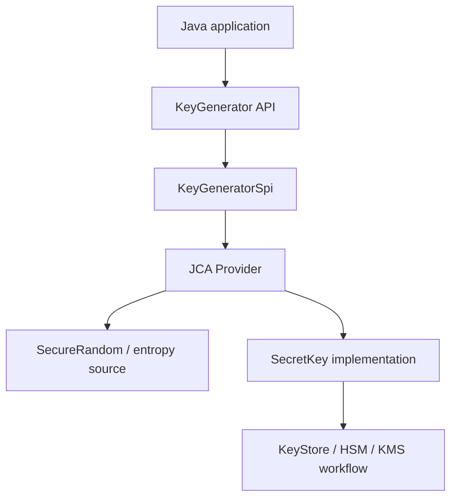

# KeyGenerator

## Mục tiêu học tập

Sau bài học này, bạn có thể:

- Giải thích vai trò của `javax.crypto.KeyGenerator` trong Java Cryptography Architecture (JCA).
- Phân biệt sinh secret key mới bằng `KeyGenerator` với tạo key pair bất đối xứng, import key và dẫn xuất key từ password hoặc secret khác.
- Chọn algorithm, key size, provider và `SecureRandom` phù hợp khi khởi tạo generator.
- Sinh AES, HMAC và các secret key được provider hỗ trợ, đồng thời hiểu giới hạn của từng algorithm.
- Sử dụng `SecretKey` trong AES-GCM và lưu key vào KeyStore, HSM hoặc KMS theo kiến trúc.
- Quản lý purpose, version, rotation, backup, access control và destruction cho key được tạo.
- Nhận diện lỗi cấu hình, key export ngoài ý muốn và các khác biệt giữa software provider với HSM/KMS provider.

## 1. KeyGenerator là gì?

`javax.crypto.KeyGenerator` là engine class của JCA dùng để tạo khóa bí mật cho thuật toán mật mã đối xứng. Ứng dụng yêu cầu một generator theo tên algorithm, cấu hình key size hoặc tham số cần thiết, rồi gọi `generateKey()` để nhận một đối tượng `SecretKey`.

Ví dụ cơ bản:

```java
KeyGenerator generator = KeyGenerator.getInstance("AES");
generator.init(256);
SecretKey key = generator.generateKey();
```

KeyGenerator giúp ứng dụng không phải tự tạo một mảng byte rồi đoán cách chuyển nó thành key hợp lệ. Provider chịu trách nhiệm tạo key material theo algorithm và implementation đã chọn.

Trong quản lý khóa, KeyGenerator thường tham gia bước tạo DEK hoặc HMAC key. Sau khi sinh, ứng dụng vẫn phải quyết định key được lưu ở đâu, ai được sử dụng, dữ liệu nào phụ thuộc vào key và khi nào phải rotate hoặc destroy.

## 2. KeyGenerator nằm ở đâu trong JCA?

JCA cung cấp API thống nhất cho các thao tác mật mã. `KeyGenerator` là API phía ứng dụng; implementation thuật toán được cung cấp bởi provider thông qua `KeyGeneratorSpi`.



Provider có thể tạo key trong software, trong token hoặc bên trong HSM. Đối tượng `SecretKey` trả về có thể chứa key bytes có thể export hoặc chỉ là handle opaque tham chiếu tới key được bảo vệ trong thiết bị.

Các API thường dùng:

| API | Vai trò |
|---|---|
| `KeyGenerator.getInstance(algorithm)` | Lấy generator theo algorithm từ provider được chọn |
| `KeyGenerator.getInstance(algorithm, provider)` | Chọn provider cụ thể |
| `init(int keysize)` | Khởi tạo với key size theo bit |
| `init(int keysize, SecureRandom random)` | Chỉ định key size và nguồn random |
| `init(SecureRandom random)` | Dùng tham số mặc định của provider với random được chỉ định |
| `init(AlgorithmParameterSpec params)` | Khởi tạo bằng tham số thuật toán nếu provider hỗ trợ |
| `init(AlgorithmParameterSpec params, SecureRandom random)` | Chỉ định cả parameters và random |
| `generateKey()` | Sinh và trả về `SecretKey` |
| `getAlgorithm()` / `getProvider()` | Kiểm tra algorithm và provider thực tế |

## 3. KeyGenerator tạo loại khóa nào?

KeyGenerator chủ yếu tạo secret key dùng chung cho thuật toán đối xứng hoặc MAC. Ví dụ:

- AES key để mã hóa và giải mã dữ liệu.
- HMAC key để tạo và xác minh message authentication code.
- ChaCha20 key nếu provider hỗ trợ algorithm đó.
- Secret key cho các algorithm khác được provider đăng ký.

KeyGenerator không tạo cặp public/private key như RSA hoặc EC. Với thuật toán bất đối xứng, dùng `KeyPairGenerator`.

| Nhu cầu | API phù hợp |
|---|---|
| Tạo AES key | `KeyGenerator.getInstance("AES")` |
| Tạo HMAC key | `KeyGenerator.getInstance("HmacSHA256")` |
| Tạo ChaCha20 key | `KeyGenerator.getInstance("ChaCha20")` nếu provider hỗ trợ |
| Tạo RSA key pair | `KeyPairGenerator.getInstance("RSA")` |
| Tạo EC key pair | `KeyPairGenerator.getInstance("EC")` |
| Dẫn xuất key từ password | `SecretKeyFactory` với KDF phù hợp, ví dụ PBKDF2 |

## 4. KeyGenerator, KeyPairGenerator và SecretKeyFactory

Ba API có mục đích khác nhau:

| API | Đầu vào chính | Kết quả | Use case |
|---|---|---|---|
| `KeyGenerator` | Algorithm, key size/parameters, SecureRandom | `SecretKey` mới | AES, HMAC, secret key đối xứng |
| `KeyPairGenerator` | Algorithm, key size/parameters, SecureRandom | `KeyPair` gồm public/private key | RSA, EC và thuật toán bất đối xứng |
| `SecretKeyFactory` | `KeySpec` hoặc material được provider hỗ trợ | `SecretKey` được tạo/chuyển đổi từ key specification | PBKDF2, chuyển đổi representation hoặc import theo provider |

Không dùng `KeyGenerator` để tạo key từ password bằng cách coi password là seed. Password thường có entropy thấp và cần KDF chuyên dụng có salt, cost parameters và policy phù hợp.

## 5. Lấy KeyGenerator instance

Lấy generator theo algorithm:

```java
KeyGenerator generator = KeyGenerator.getInstance("AES");
```

Chọn provider cụ thể khi hệ thống yêu cầu:

```java
KeyGenerator generator = KeyGenerator.getInstance("AES", provider);
```

Hoặc chọn provider theo tên:

```java
KeyGenerator generator = KeyGenerator.getInstance("AES", "SunJCE");
```

Provider name trong ví dụ phụ thuộc JDK và môi trường. Không giả định mọi runtime đều có `SunJCE`, hoặc mọi provider hỗ trợ cùng algorithm và key size. Nếu chỉ định provider không tồn tại, API có thể ném `NoSuchProviderException`; nếu algorithm không được hỗ trợ, có thể ném `NoSuchAlgorithmException`.

Trong production, provider selection phải được kiểm soát bằng cấu hình, dependency và security policy. Không tự động hạ cấp sang provider khác khi provider yêu cầu không sẵn sàng mà không có phê duyệt.

## 6. Khởi tạo bằng key size

`init(int keysize)` nhận kích thước khóa theo bit. Ví dụ AES hỗ trợ các kích thước chuẩn 128, 192 và 256 bit trong các provider Java phổ biến.

```java
KeyGenerator generator = KeyGenerator.getInstance("AES");
generator.init(256);
SecretKey key = generator.generateKey();
```

Key size phải được chọn theo algorithm, security baseline, policy và khả năng tương thích. Không phải mọi algorithm cho phép mọi kích thước. Provider có thể từ chối key size không hợp lệ bằng `InvalidParameterException` hoặc lỗi tương ứng.

Không suy ra rằng key size lớn hơn luôn tốt hơn. Chọn đúng kích thước theo chuẩn và yêu cầu của thuật toán; key quá lớn có thể làm giảm interoperability hoặc tăng chi phí mà không đem lại lợi ích tương ứng.

## 7. Khởi tạo bằng SecureRandom

Có thể truyền `SecureRandom` khi khởi tạo:

```java
SecureRandom secureRandom = new SecureRandom();
KeyGenerator generator = KeyGenerator.getInstance("AES");
generator.init(256, secureRandom);
SecretKey key = generator.generateKey();
```

SecureRandom cung cấp randomness cho quá trình sinh key. Không dùng `Random`, `ThreadLocalRandom`, timestamp hoặc seed cố định để tạo key production.

Thông thường, ứng dụng có thể để provider tự quản lý seed bằng `new SecureRandom()`. Không gọi `setSeed(System.currentTimeMillis())`; dữ liệu đó dễ đoán và có thể làm suy yếu quá trình khởi tạo tùy implementation.

## 8. Khởi tạo bằng AlgorithmParameterSpec

Một số algorithm hoặc provider cần tham số ngoài key size. API cho phép truyền `AlgorithmParameterSpec`:

```java
generator.init(parameterSpec, secureRandom);
```

Loại parameter spec được chấp nhận phụ thuộc algorithm và provider. Không phải mọi KeyGenerator đều hỗ trợ một parameter spec cụ thể. Nếu provider không hiểu parameters, có thể ném `InvalidAlgorithmParameterException`.

Đối với AES, các tham số như GCM nonce/tag length thường thuộc cấu hình `Cipher` khi mã hóa, không phải tham số để sinh AES key. Không trộn lẫn key generation parameters với encryption operation parameters.

## 9. Không khởi tạo tường minh: provider default

Nếu gọi `generateKey()` mà chưa gọi `init`, provider có thể dùng default parameters của algorithm. Giá trị mặc định có thể khác nhau giữa provider hoặc phiên bản JDK.

```java
KeyGenerator generator = KeyGenerator.getInstance("AES");
SecretKey key = generator.generateKey();
```

Đoạn code có thể chạy, nhưng production nên khởi tạo tường minh khi key size hoặc tham số là một phần của security policy. Việc ghi rõ `init(256, secureRandom)` làm cho ý định và yêu cầu dễ review hơn.

Không dựa vào default nếu cần interoperability giữa nhiều provider, HSM hoặc runtime khác nhau.

## 10. Sinh AES key

AES là block cipher đối xứng phổ biến. Các key size chuẩn gồm 128, 192 và 256 bit. Ví dụ tạo AES-256 key:

```java
KeyGenerator aesGenerator = KeyGenerator.getInstance("AES");
aesGenerator.init(256, new SecureRandom());
SecretKey aesKey = aesGenerator.generateKey();
```

Key được dùng với `Cipher` có transformation phù hợp, chẳng hạn `AES/GCM/NoPadding`. KeyGenerator chỉ tạo key; nó không tự quyết định mode, nonce, tag length, AAD hoặc quy trình lưu ciphertext.

Không dùng AES-ECB cho dữ liệu nghiệp vụ mới. Với mã hóa dữ liệu cần xác thực, AES-GCM là lựa chọn phổ biến nếu nonce được quản lý đúng và giới hạn sử dụng được tuân thủ.

## 11. Sinh HMAC key

HMAC dùng secret key chung để tạo và xác minh MAC. Có thể tạo key qua KeyGenerator:

```java
KeyGenerator hmacGenerator = KeyGenerator.getInstance("HmacSHA256");
hmacGenerator.init(256, new SecureRandom());
SecretKey hmacKey = hmacGenerator.generateKey();
```

Key size nên theo policy và yêu cầu của HMAC algorithm. HMAC-SHA-256 thường dùng key có entropy cao; không dùng password người dùng trực tiếp làm HMAC key.

Không dùng cùng key cho AES encryption và HMAC. Tách purpose giúp giảm rủi ro key reuse, đơn giản hóa access control và hỗ trợ rotation độc lập.

## 12. Sinh ChaCha20 key

Một số provider Java hỗ trợ `KeyGenerator` cho ChaCha20:

```java
KeyGenerator generator = KeyGenerator.getInstance("ChaCha20");
generator.init(256, new SecureRandom());
SecretKey key = generator.generateKey();
```

ChaCha20 dùng key 256 bit. Nonce/counter được cung cấp khi khởi tạo cipher theo API tương ứng, ví dụ `ChaCha20ParameterSpec`; chúng không được sinh bởi KeyGenerator cùng với key.

Khả năng hỗ trợ phụ thuộc JDK/provider. Kiểm tra algorithm có sẵn trong môi trường triển khai trước khi phụ thuộc vào nó.

## 13. KeyGenerator không sinh nonce hoặc IV

Key và nonce/IV là hai loại dữ liệu khác nhau. KeyGenerator sinh secret key. Nonce/IV được sinh hoặc quản lý khi thực hiện encryption.

Ví dụ với AES-GCM:

```java
byte[] nonce = new byte[12];
secureRandom.nextBytes(nonce);
GCMParameterSpec parameters = new GCMParameterSpec(128, nonce);
cipher.init(Cipher.ENCRYPT_MODE, aesKey, parameters);
```

Nonce GCM 96 bit thường được dùng. Nonce không cần bí mật nhưng phải duy nhất với cùng key theo yêu cầu của GCM. Nếu dùng random nonce, cần giới hạn số lần mã hóa và xác suất va chạm; workload lớn có thể cần nonce counter được quản lý an toàn.

Không gọi `KeyGenerator` để “tạo IV”. Cũng không dùng lại key như nonce hoặc ngược lại.

## 14. Ví dụ Java 17: tạo AES key và mã hóa AES-GCM

Ví dụ sau tạo AES-256 key, sinh nonce 12 byte, mã hóa dữ liệu với AES-GCM và xác minh bằng giải mã. AAD được dùng để ràng buộc ciphertext với context.

```java
import java.nio.charset.StandardCharsets;
import java.security.SecureRandom;
import java.util.Arrays;
import javax.crypto.Cipher;
import javax.crypto.KeyGenerator;
import javax.crypto.SecretKey;
import javax.crypto.spec.GCMParameterSpec;

public final class KeyGeneratorAesGcmDemo {
    private KeyGeneratorAesGcmDemo() {}

    public static void main(String[] args) throws Exception {
        SecureRandom random = new SecureRandom();

        KeyGenerator generator = KeyGenerator.getInstance("AES");
        generator.init(256, random);
        SecretKey key = generator.generateKey();

        byte[] nonce = new byte[12];
        random.nextBytes(nonce);
        byte[] aad = "tenant=42;record=invoice-9001"
                .getBytes(StandardCharsets.UTF_8);
        byte[] plaintext = "amount=125000;currency=VND"
                .getBytes(StandardCharsets.UTF_8);

        Cipher encryptor = Cipher.getInstance("AES/GCM/NoPadding");
        encryptor.init(Cipher.ENCRYPT_MODE, key,
                new GCMParameterSpec(128, nonce));
        encryptor.updateAAD(aad);
        byte[] ciphertextAndTag = encryptor.doFinal(plaintext);

        Cipher decryptor = Cipher.getInstance("AES/GCM/NoPadding");
        decryptor.init(Cipher.DECRYPT_MODE, key,
                new GCMParameterSpec(128, nonce));
        decryptor.updateAAD(aad);
        byte[] recovered = decryptor.doFinal(ciphertextAndTag);

        if (!Arrays.equals(plaintext, recovered)) {
            throw new IllegalStateException("Plaintext verification failed");
        }

        System.out.println("Key algorithm: " + key.getAlgorithm());
        System.out.println("Nonce length: " + nonce.length);
        System.out.println("Ciphertext and tag length: " + ciphertextAndTag.length);
        System.out.println("AES-GCM round trip succeeded");

        Arrays.fill(plaintext, (byte) 0);
        Arrays.fill(recovered, (byte) 0);
    }
}
```

Đây là ví dụ học API, không phải code lưu trữ production. Trong hệ thống thật, ciphertext phải được lưu cùng nonce, tag (ở đây được nối trong kết quả `doFinal`) và metadata cần thiết. Key phải được lưu trong KeyStore/HSM/KMS; không ghi raw key vào log hoặc database. Buffer cleanup chỉ giảm thời gian tồn tại của một số bản sao trong bộ nhớ, không bảo đảm JVM xóa mọi bản sao.

## 15. KeyGenerator và SecureRandom

KeyGenerator có thể tự sử dụng nguồn random của provider nếu caller không truyền `SecureRandom`. Khi cần kiểm soát rõ nguồn random, truyền instance đã được chọn theo policy.

Các nguyên tắc:

- Dùng SecureRandom, không dùng PRNG thông thường.
- Không tự seed bằng timestamp, counter hoặc giá trị cố định.
- Không tạo SecureRandom mới cho mỗi key nếu không cần; đánh giá lifecycle và provider.
- Ghi nhận algorithm/provider để chẩn đoán cấu hình, không ghi seed hoặc key output.
- Không hạ cấp sang generator yếu khi provider được yêu cầu không khả dụng.

SecureRandom cung cấp randomness; KeyGenerator áp dụng randomness vào quy trình sinh key theo algorithm/provider.

## 16. Key size và security strength

Key size là số bit của key representation. Security strength thực tế còn phụ thuộc algorithm, cấu trúc mật mã, mode, implementation và các giới hạn khác.

| Algorithm | Key size thường gặp | Ghi chú |
|---|---:|---|
| AES | 128, 192, 256 bit | Chọn theo security policy và compatibility |
| HMAC-SHA-256 | Có thể cấu hình; 256 bit là lựa chọn phổ biến | Key phải có entropy cao, không dùng password trực tiếp |
| ChaCha20 | 256 bit | Nonce/counter được cấu hình ở Cipher |
| DES | 56 bit hiệu dụng | Đã lỗi thời, không dùng cho hệ thống mới |
| 3DES | 112/168 bit danh nghĩa tùy biến thể | Đã bị loại bỏ/giới hạn trong nhiều tiêu chuẩn và hệ thống mới |

Không chọn algorithm cũ chỉ vì provider còn hỗ trợ. Kiểm tra baseline của tổ chức, tiêu chuẩn áp dụng và khả năng tương thích với peer.

## 17. AlgorithmParameterSpec không phải Cipher parameters

`KeyGenerator.init(AlgorithmParameterSpec, SecureRandom)` cấu hình quá trình sinh key nếu algorithm/provider yêu cầu. Còn `Cipher.init(...)` cấu hình một thao tác mã hóa/giải mã cụ thể.

Ví dụ:

- AES key size thuộc KeyGenerator.
- GCM nonce và tag length thuộc `GCMParameterSpec` khi khởi tạo Cipher.
- ChaCha20 nonce/counter thuộc `ChaCha20ParameterSpec` khi khởi tạo Cipher.
- RSA OAEP parameters thuộc `OAEPParameterSpec` khi cấu hình Cipher, không phải tạo AES key.

Nhầm hai lớp tham số có thể khiến code không hoạt động hoặc tạo ra giả định bảo mật sai.

## 18. Provider và khả năng tương thích

Một algorithm name có thể được hỗ trợ bởi nhiều provider. Các provider có thể khác nhau về key size, parameter spec, key encoding, khả năng import/export, hiệu năng và cách báo lỗi.

Khi chọn provider, kiểm tra:

- Algorithm có được hỗ trợ không?
- Key size được chấp nhận là gì?
- Có thể truyền SecureRandom hoặc parameters không?
- Key trả về có export được không?
- Có hỗ trợ lưu key trong KeyStore hoặc token không?
- Key object có dùng được với Cipher provider khác không?
- Provider có được phê duyệt cho yêu cầu compliance không?
- Hành vi khi thiết bị hoặc service không sẵn sàng là gì?

Không giả định một `SecretKey` tạo từ provider A luôn có thể dùng trực tiếp với Cipher provider B. Hãy kiểm thử interoperability trên đúng runtime và thiết bị đích.

## 19. KeyGenerator và HSM/PKCS#11

HSM có thể cung cấp KeyGenerator qua provider PKCS#11 hoặc provider chuyên biệt. Khi đó, key có thể được tạo bên trong HSM và trả về dưới dạng opaque `SecretKey` handle.

Một số điểm cần kiểm tra:

- HSM hỗ trợ algorithm và key size cần thiết không?
- Key được tạo trong token nào, slot nào và partition nào?
- Object có được lưu bền vững qua restart không?
- Key có thuộc tính non-extractable hay không?
- Ai được phép tạo, sử dụng, backup, rotate và destroy key?
- HSM có HA, backup, quorum và audit phù hợp không?
- Key handle có dùng được từ nhiều node hoặc provider session không?

Không phải mọi HSM/provider đều hỗ trợ cùng capability. Việc `KeyGenerator.getInstance("AES", pkcs11Provider)` thành công chưa chứng minh key có thể được lưu bền vững hoặc đáp ứng policy non-exportable.

## 20. getEncoded có thể trả null

Với software provider, `SecretKey.getEncoded()` thường trả byte array chứa key encoding. Với key opaque hoặc non-exportable, method có thể trả `null`.

```java
byte[] encoded = secretKey.getEncoded();
if (encoded == null) {
    // Key is not available as an exportable byte representation.
}
```

`null` không nhất thiết là lỗi. Nó có thể thể hiện provider cố ý không cho export key material. Nếu yêu cầu non-exportable, không gọi API export để ép lấy raw bytes; hãy dùng Cipher/Signature hoặc API provider để thực hiện phép toán trong boundary bảo vệ.

Không đưa key bytes vào log, exception, telemetry, database hoặc file tạm để “debug”.

## 21. KeyGenerator và KeyStore

Sau khi tạo key, ứng dụng có thể lưu nó vào KeyStore nếu provider hỗ trợ `SecretKeyEntry`:

```java
KeyStore keyStore = KeyStore.getInstance("JCEKS");
keyStore.load(null, storePassword);

KeyStore.SecretKeyEntry entry = new KeyStore.SecretKeyEntry(secretKey);
KeyStore.ProtectionParameter protection =
        new KeyStore.PasswordProtection(entryPassword);

keyStore.setEntry("payments-aes-v1", entry, protection);
keyStore.store(outputStream, storePassword);
```

KeyGenerator và KeyStore giải quyết hai việc khác nhau: KeyGenerator tạo key; KeyStore quản lý việc lưu và truy xuất entry. KeyStore type/provider phải hỗ trợ secret key. Software KeyStore vẫn phụ thuộc password, filesystem và bảo vệ host; nó không tương đương HSM.

## 22. KeyGenerator và KMS

KMS có thể tạo key trực tiếp trong service hoặc cung cấp API tạo data key. Trong envelope encryption, ứng dụng thường nhận DEK plaintext trong thời gian ngắn và một wrapped DEK để lưu; KEK được giữ trong KMS.

Không cần tạo key cục bộ bằng KeyGenerator rồi gửi lên KMS nếu KMS đã cung cấp chức năng generate data key phù hợp. Nếu tổ chức dùng BYOK/import, phải xác định rõ nguồn entropy, quá trình import, key origin và bản sao key material.

| Mô hình | Cách tạo key | Vị trí quản lý |
|---|---|---|
| Software local | `KeyGenerator` trong JVM | KeyStore/secret storage được bảo vệ |
| HSM-backed | KeyGenerator provider tạo trong HSM | HSM object, thường opaque/non-exportable |
| KMS-generated | API KMS tạo key hoặc DEK | KMS quản lý key material và policy |
| BYOK/import | Tạo bên ngoài rồi import theo quy trình | KMS/HSM sau import, cùng kiểm soát bản gốc |

Không tải raw KEK từ KMS về JVM nếu mục tiêu là giữ KEK non-exportable. Hãy dùng wrap/unwrap hoặc encryption/decryption API theo kiến trúc.

## 23. Sinh key khác dẫn xuất key

KeyGenerator tạo key mới bằng nguồn random. Key derivation tạo key từ một secret đầu vào, chẳng hạn password hoặc master secret, thông qua KDF.

| Nhu cầu | Công cụ phù hợp |
|---|---|
| Tạo AES key độc lập mới | `KeyGenerator` |
| Dẫn xuất key từ password người dùng | PBKDF2, scrypt, Argon2 hoặc KDF được phê duyệt |
| Dẫn xuất subkey từ master secret | HKDF hoặc KDF phù hợp với chuẩn/protocol |
| Tạo RSA/EC key pair | `KeyPairGenerator` |
| Import key material theo format | Provider/API import được hỗ trợ, ví dụ `SecretKeyFactory` và `KeySpec` |

Không hash password một lần rồi dùng kết quả làm AES key. Password có entropy thấp và cần KDF có salt cùng work factor phù hợp. Không tự xây HKDF/PBKDF bằng cách nối hash thủ công.

## 24. Purpose separation và key metadata

KeyGenerator chỉ trả `SecretKey`; nó không tự quản lý policy nghiệp vụ. Ứng dụng cần gắn metadata cho key:

- Key ID, alias và version.
- Algorithm, key size và provider.
- Purpose: data encryption, HMAC, wrapping hoặc purpose được phép.
- Owner, service, tenant và environment.
- Creation time, cryptoperiod và trạng thái.
- Exportability, extractability hoặc HSM attributes nếu có.
- Dữ liệu/ciphertext phụ thuộc vào key.
- Backup, rotation, revocation và destruction plan.

Không dùng một AES key cho nhiều tenant hoặc nhiều mục đích chỉ để giảm số lượng key. Tách key theo purpose và ranh giới dữ liệu giúp giảm blast radius.

## 25. Rotation key được tạo bằng KeyGenerator

Khi cần rotation, tạo key mới dưới version mới thay vì ghi đè key cũ. Một mô hình đơn giản:

```text
payments-aes-v1 -> decrypt historical data
payments-aes-v2 -> encrypt new data and decrypt v2 data
```

Quy trình thường gồm:

1. Tạo key mới bằng KeyGenerator hoặc KMS/HSM.
2. Lưu key dưới alias/version mới.
3. Cập nhật writer dùng key mới.
4. Reader chọn key theo metadata version của ciphertext.
5. Re-encrypt dữ liệu cũ hoặc rewrap DEK nếu kiến trúc envelope encryption cho phép.
6. Kiểm thử backup/restore và đối soát dependency.
7. Chỉ retire/destroy key cũ khi không còn dữ liệu hoặc backup cần key đó.

Trong giai đoạn chuyển đổi, có thể dùng dual-read/single-write: đọc được version cũ và mới nhưng chỉ ghi bằng version mới. Không xóa key cũ ngay sau khi writer chuyển đổi.

## 26. Quản lý lỗi và xử lý provider failure

Các lỗi thường gặp:

| Lỗi | Nguyên nhân có thể | Cách xử lý |
|---|---|---|
| `NoSuchAlgorithmException` | Provider không có algorithm | Kiểm tra JDK/provider và algorithm name |
| `NoSuchProviderException` | Provider name không tồn tại | Xác minh provider registration và cấu hình |
| `InvalidParameterException` | Key size hoặc parameter không hợp lệ | Kiểm tra giới hạn algorithm/provider |
| `InvalidAlgorithmParameterException` | Provider không hỗ trợ parameter spec | Dùng parameters đúng algorithm hoặc provider khác đã được phê duyệt |
| `ProviderException` | Lỗi nội bộ provider hoặc thiết bị | Kiểm tra HSM/KMS/provider health và audit |
| Key không export được | Key opaque/non-extractable | Dùng phép toán qua provider, không ép export |

Không fallback sang `Random`, key cố định hoặc provider yếu khi KeyGenerator lỗi. Với key generation cho production, lỗi provider cần được xử lý như lỗi bảo mật/vận hành và có cảnh báo.

## 27. Concurrency và vòng đời KeyGenerator

Không nên giả định mọi implementation `KeyGenerator` đều an toàn khi nhiều thread gọi đồng thời trên cùng một instance. Hãy tạo instance theo operation hoặc quản lý bằng cơ chế đồng bộ rõ ràng, tùy chi phí và provider.

Các nguyên tắc:

- Không chia sẻ generator mutable giữa nhiều thread nếu chưa xác minh thread-safety.
- Không gọi `init` lại trên instance đang được thread khác sử dụng.
- Tách cấu hình theo algorithm/key size/purpose.
- Với HSM, đánh giá session, slot và giới hạn concurrent operation.
- Đo latency và throughput trên provider thật; không tối ưu bằng cách giảm chất lượng randomness.

KeyGenerator thường không phải object cần lưu lâu dài. Có thể tạo generator, cấu hình, sinh key rồi bỏ instance theo lifecycle của ứng dụng.

## 28. Kiểm thử KeyGenerator

Test suite nên xác minh:

- Provider hỗ trợ algorithm và key size dự kiến.
- `generateKey()` trả key có algorithm đúng.
- Với software key có thể export, độ dài encoding đúng kỳ vọng.
- Key được sinh độc lập qua nhiều lần gọi; không có hardcode hoặc seed cố định.
- AES-GCM round trip thành công với nonce duy nhất.
- Thay AAD hoặc ciphertext làm xác thực thất bại.
- KeyStore có thể lưu và đọc key nếu kiến trúc sử dụng file KeyStore.
- HSM key có đúng extractability, persistence và policy attributes.
- Provider failure không kích hoạt fallback yếu.
- Rotation giữ khả năng đọc dữ liệu cũ và writer chỉ dùng version mới.

Kiểm tra thống kê hoặc so sánh hai key khác nhau không chứng minh CSPRNG an toàn. Đánh giá randomness cần xem provider, entropy source, thuật toán và validation.

## 29. Ví dụ: kiểm tra cấu hình generator

Có thể ghi nhận algorithm và provider để hỗ trợ vận hành:

```java
KeyGenerator generator = KeyGenerator.getInstance("AES");
generator.init(256, new SecureRandom());

System.out.println("Algorithm: " + generator.getAlgorithm());
System.out.println("Provider: " + generator.getProvider().getName());
```

Không log key bytes, seed hoặc password. Thông tin provider giúp điều tra khác biệt giữa môi trường local, test và production. Nếu hệ thống có compliance requirement, metadata này cần được đối chiếu với provider/module đã được phê duyệt.

## 30. Anti-pattern cần tránh

1. **Tự tạo AES key từ timestamp hoặc counter.** Key có thể dự đoán.
2. **Dùng `Random` thay SecureRandom.** Không đáp ứng yêu cầu mật mã.
3. **Không gọi `init` khi policy yêu cầu key size cụ thể.** Kết quả phụ thuộc provider default.
4. **Dùng KeyGenerator để tạo RSA key pair.** Phải dùng KeyPairGenerator.
5. **Dùng KeyGenerator để sinh nonce GCM.** Nonce thuộc encryption operation và cần uniqueness theo key.
6. **Dùng cùng key cho AES và HMAC.** Vi phạm purpose separation.
7. **Dùng password trực tiếp làm key.** Cần KDF phù hợp hoặc sinh key ngẫu nhiên.
8. **Ghi `getEncoded()` vào log hoặc database.** Tạo bản sao key material ngoài kiểm soát.
9. **Giả định HSM luôn hỗ trợ mọi algorithm/key size.** Capability phụ thuộc thiết bị và provider.
10. **Coi `SecretKey` luôn export được.** Opaque key có thể trả `null` từ `getEncoded()`.
11. **Ghi đè key cũ khi rotation.** Có thể làm mất khả năng decrypt dữ liệu lịch sử.
12. **Fallback sang provider yếu khi provider được phê duyệt lỗi.** Làm mất kiểm soát security policy.

## 31. Case study: tạo DEK cho dữ liệu thanh toán

Một service Java cần mã hóa trường dữ liệu thanh toán bằng AES-GCM. Nhóm tạo AES-256 DEK bằng KeyGenerator và SecureRandom, sau đó dùng key cho một phạm vi dữ liệu được xác định. Mỗi ciphertext lưu nonce, tag và key version để reader chọn đúng key khi giải mã.

Trong giai đoạn đầu, key được lưu trong software KeyStore với quyền filesystem hạn chế. Khi hệ thống mở rộng sang nhiều instance, nhóm chuyển sang envelope encryption: KMS quản lý KEK, DEK được tạo bằng API KMS, wrapped DEK được lưu cùng metadata. Ứng dụng chỉ giữ plaintext DEK trong thời gian cần thiết.

Khi rotation, writer dùng DEK mới; reader vẫn đọc được dữ liệu lịch sử theo key version. Nhóm kiểm thử backup restore, migration và dependency trước khi retire key cũ. Đây là ví dụ cho thấy KeyGenerator chỉ giải quyết khâu tạo key; thiết kế lưu trữ và lifecycle quyết định mức an toàn tổng thể.

## 32. Checklist triển khai

- [ ] Dùng `KeyGenerator` cho secret key đối xứng; dùng `KeyPairGenerator` cho key pair bất đối xứng.
- [ ] Chọn algorithm được phê duyệt và provider phù hợp.
- [ ] Khởi tạo key size/parameters tường minh theo policy.
- [ ] Dùng SecureRandom hoặc nguồn random được provider quản lý.
- [ ] Không seed thủ công bằng timestamp, counter hoặc dữ liệu cố định.
- [ ] Kiểm thử provider support trên JDK và môi trường production.
- [ ] Tách key theo purpose, tenant, service và environment.
- [ ] Không nhầm key generation với nonce/IV generation hoặc KDF.
- [ ] Lưu key trong KeyStore/HSM/KMS theo yêu cầu bảo vệ.
- [ ] Xử lý opaque/non-exportable key mà không cố export raw bytes.
- [ ] Gắn key ID, version, owner, algorithm, purpose và cryptoperiod.
- [ ] Có rotation, dual-read/single-write và retention cho key cũ.
- [ ] Kiểm thử backup/restore, concurrency và provider failure.
- [ ] Không log key material, seed hoặc secret token.
- [ ] Có quy trình revoke/disable/retire/destroy và xác minh dependency.

## 33. Câu hỏi tự kiểm tra

**1. KeyGenerator dùng để làm gì?**

Nó tạo secret key cho thuật toán đối xứng hoặc MAC theo algorithm và provider được chọn.

**2. KeyGenerator có tạo RSA key pair không?**

Không. RSA/EC dùng `KeyPairGenerator`; KeyGenerator tạo `SecretKey`.

**3. KeyGenerator khác SecretKeyFactory thế nào?**

KeyGenerator tạo key mới bằng randomness; SecretKeyFactory tạo hoặc chuyển đổi key từ key specification/material theo provider.

**4. `init(256)` có nghĩa gì?**

Yêu cầu generator tạo key size 256 bit nếu algorithm/provider hỗ trợ kích thước đó.

**5. Vì sao truyền SecureRandom vào KeyGenerator?**

Để chỉ định nguồn random dùng trong quá trình sinh key và đáp ứng policy của ứng dụng.

**6. Nếu không gọi init thì sao?**

Provider có thể dùng default parameters; hành vi có thể khác nhau giữa provider nên production nên cấu hình tường minh.

**7. KeyGenerator có sinh nonce AES-GCM không?**

Không. Nó sinh AES key; nonce được tạo/quản lý riêng khi khởi tạo Cipher.

**8. Vì sao không dùng cùng key cho AES và HMAC?**

Tách purpose giảm key reuse, giới hạn blast radius và hỗ trợ rotation độc lập.

**9. ChaCha20 key size phổ biến là bao nhiêu?**

256 bit; nonce/counter được cấu hình ở Cipher theo API tương ứng.

**10. `getEncoded()` trả null có nghĩa gì?**

Key có thể opaque hoặc non-exportable; provider có thể vẫn sử dụng key qua handle.

**11. Khi nào nên dùng HSM provider?**

Khi cần tạo và giữ key trong phần cứng, non-exportability, audit hoặc kiểm soát truy cập thiết bị.

**12. KeyGenerator có thay thế KMS không?**

Không. KMS quản lý key lifecycle, policy và các phép toán tập trung; KeyGenerator chỉ tạo secret key qua provider.

**13. Có nên tạo key bằng cách hash password không?**

Không nên. Dùng KDF chuyên dụng có salt và work factor phù hợp nếu cần dẫn xuất từ password.

**14. GCM nonce có cần bí mật không?**

Không, nhưng phải duy nhất với cùng key và được lưu cùng ciphertext.

**15. Vì sao phải lưu key version cùng ciphertext?**

Để reader xác định đúng key cần dùng sau rotation và tránh giải mã bằng key sai.

**16. Có thể ghi đè key cũ khi rotation không?**

Không nếu dữ liệu lịch sử còn phụ thuộc vào key cũ. Hãy dùng version mới và giữ key cũ đến khi hết dependency.

**17. Provider có thể khác nhau ở điểm nào?**

Algorithm, key size, parameters, key encoding, exportability, hiệu năng, persistence và lỗi.

**18. KeyGenerator có thread-safe không?**

Không nên giả định mọi implementation an toàn khi dùng chung nhiều thread; tạo instance theo operation hoặc đồng bộ theo provider.

**19. Có thể dùng KeyGenerator để derive HKDF không?**

Không. HKDF là KDF; dùng API/library/provider hỗ trợ KDF theo chuẩn thay vì KeyGenerator.

**20. KeyGenerator có hoàn tất vòng đời quản lý khóa không?**

Không. Sau khi tạo key vẫn cần lưu trữ, access control, metadata, backup, rotation, revocation và destruction.

## 34. Kết luận

`KeyGenerator` là API JCA để tạo secret key mới cho các thuật toán đối xứng như AES và HMAC. Ứng dụng chọn algorithm/provider, khởi tạo key size hoặc parameters và nguồn `SecureRandom`, rồi nhận `SecretKey` từ `generateKey()`.

KeyGenerator chỉ giải quyết bước tạo key. Một hệ thống an toàn còn cần phân biệt key generation với key derivation và nonce generation, bảo vệ key trong KeyStore/HSM/KMS, giới hạn purpose, quản lý version và rotation, kiểm thử provider, bảo vệ backup và xác minh dependency trước khi retire hoặc destroy. Khi yêu cầu key non-exportable hoặc quản trị tập trung, hãy để HSM/KMS tạo và giữ key trong boundary phù hợp thay vì đưa raw key material ra JVM.
