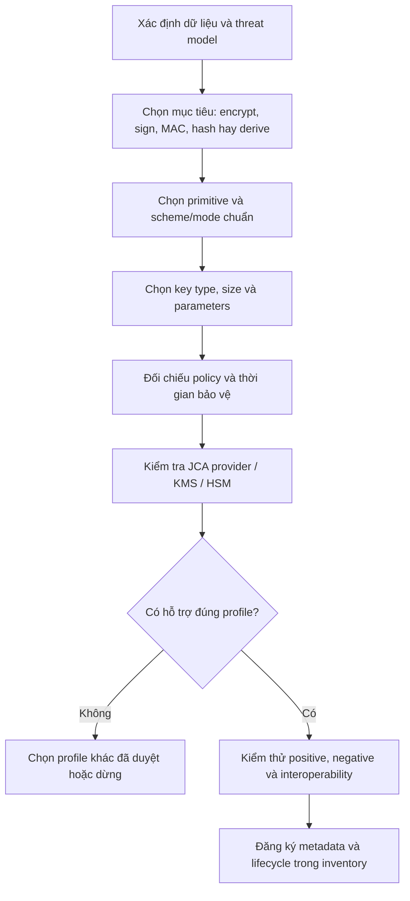

# Lựa chọn thuật toán mật mã

Lựa chọn thuật toán mật mã là quyết định chọn primitive, chế độ hoạt động, tham số và implementation phù hợp với mục đích bảo vệ dữ liệu, threat model, yêu cầu tương thích và vòng đời khóa. Một thuật toán mạnh vẫn có thể tạo ra hệ thống yếu nếu dùng sai mode, tái sử dụng nonce, đặt sai Key Usage, chọn provider không được phép hoặc giữ khóa lâu hơn thời gian cần thiết.

Trong quản lý khóa mật mã, lựa chọn thuật toán phải gắn với cách tạo, lưu trữ, cấp phát, sử dụng, xoay vòng, thu hồi và hủy khóa. AES-GCM cần quản lý nonce theo từng key; RSA-OAEP cần tham số padding/hash rõ ràng; chữ ký số cần phân biệt signing key với encryption key; password hashing cần KDF chuyên dụng; còn HSM/KMS chỉ hỗ trợ một tập mechanism nhất định. Vì vậy, không có một thuật toán duy nhất phù hợp cho mọi thao tác.

Bài học này xây dựng cách ra quyết định theo use case, so sánh các nhóm thuật toán, giải thích độ dài khóa và tham số, lựa chọn JCA provider trong Java, quản lý tương thích và crypto agility, đồng thời đưa ra ví dụ triển khai và kiểm tra policy. Phạm vi thuộc module SECURITY_KEY_MANAGEMENT_FUNDAMENTALS: bảo vệ khóa trong toàn bộ vòng đời và hiểu rủi ro khi quản lý sai khóa.

## 1. Thuật toán, mode, provider và protocol là các lớp khác nhau

Khi đọc cấu hình mật mã, cần phân biệt các thành phần sau:

| Thành phần | Ý nghĩa | Ví dụ |
|---|---|---|
| Primitive/algorithm | Phép toán mật mã nền tảng | AES, RSA, SHA-256, ECDSA |
| Mode hoặc scheme | Cách dùng primitive cho một mục đích cụ thể | GCM, XTS, OAEP, PSS |
| Parameters | Tham số quyết định hành vi và mức an toàn | Key size, nonce, tag length, curve, salt, iteration count |
| Protocol | Quy tắc trao đổi thông điệp, chọn thuật toán và xử lý lỗi | TLS 1.3, SSH, CMS, JOSE |
| Provider/implementation | Phần mềm hoặc module thực thi API mật mã | SunJCE, SunEC, SunPKCS11, provider của HSM |
| Key object | Vật liệu khóa và metadata được quản lý | AES key version, RSA private key, EC key pair |

Ví dụ `AES/GCM/NoPadding` là transformation trong JCA: AES là primitive, GCM là authenticated encryption mode, `NoPadding` mô tả cách API biểu diễn transformation. Nó vẫn cần key AES, nonce, tag và có thể có Additional Authenticated Data (AAD). Chỉ ghi `AES` vào inventory là chưa đủ để tái tạo chính xác thao tác.

Tương tự, `SHA256withRSA` là tên dịch vụ ký trong JCA, còn `RSASSA-PSS` là scheme chữ ký với tham số PSS. Provider quyết định implementation nào được dùng; thuật toán trong protocol quyết định cách hai bên trao đổi và diễn giải dữ liệu. Những lớp này cần được ghi nhận riêng trong policy và audit.

## 2. Bắt đầu từ mục đích và threat model

Không chọn thuật toán trước khi xác định điều cần bảo vệ. Hãy mô tả dữ liệu, đối tượng đe dọa, tác động khi khóa bị lộ, thời gian cần bảo vệ và môi trường triển khai.

Các câu hỏi cần trả lời:

1. Cần bảo vệ confidentiality, integrity, authenticity, non-repudiation hay nhiều thuộc tính cùng lúc?
2. Dữ liệu là một message, file, volume, backup, stream, password hay key material?
3. Ai tạo dữ liệu và ai cần đọc, xác minh hoặc giải mã?
4. Khóa có nằm trong ứng dụng, KMS, HSM, TPM, thiết bị người dùng hay nhiều region?
5. Dữ liệu cần được bảo vệ trong bao lâu; có cần giải mã hoặc xác minh lịch sử sau khi key rotation không?
6. Có yêu cầu tiêu chuẩn, chứng nhận, jurisdiction, interoperability hoặc thuật toán bắt buộc không?
7. Hệ thống có giới hạn CPU, latency, memory, bandwidth, firmware hoặc thiết bị legacy nào?
8. Nếu provider hoặc thuật toán không khả dụng, hệ thống phải fail closed, chuyển sang implementation dự phòng đã duyệt hay tạm dừng giao dịch?

Ví dụ, một dịch vụ lưu dữ liệu cần confidentiality và integrity thường dùng AEAD với khóa đối xứng. Một hệ thống ký artifact cần chữ ký số và private signing key có quyền rất hẹp. Một cơ sở dữ liệu password cần password hashing chậm, có salt; không dùng AES hoặc SHA-256 trực tiếp để lưu password. Một HSM có thể giữ KEK nhưng không nhất thiết phải mã hóa toàn bộ payload trong HSM.

## 3. Ma trận chọn thuật toán theo use case

Bảng sau là định hướng ban đầu. Việc triển khai cụ thể phải đối chiếu policy tổ chức, chuẩn áp dụng, khả năng provider và protocol.

| Use case | Lựa chọn thường phù hợp | Điều cần quản lý |
|---|---|---|
| Mã hóa message/file có integrity | AES-GCM hoặc ChaCha20-Poly1305 | Nonce không lặp dưới cùng key, tag, AAD, key version |
| Mã hóa sector/disk | AES-XTS theo chuẩn lưu trữ | Hai key component, data unit/tweak, không dùng cho message tùy ý |
| Wrap key đối xứng | AES-KW hoặc AES-KWP; hoặc cơ chế wrap được KMS/HSM hỗ trợ | KEK purpose, key attributes, context và backup |
| Trao đổi khóa trong giao thức | ECDHE/X25519 hoặc cơ chế hybrid đã được protocol hỗ trợ | Ephemeral key, transcript, downgrade protection và KDF |
| Mã hóa khóa cho tương thích legacy | RSA-OAEP với hash/parameters được chỉ định rõ | RSA key purpose, padding, label, ciphertext size |
| Chữ ký số | RSA-PSS, ECDSA hoặc Ed25519 tùy hệ sinh thái | Signing key riêng, parameter, certificate EKU, timestamp |
| MAC cho message có secret chung | HMAC-SHA-256/384 hoặc CMAC trong hệ sinh thái AES | Shared secret, key separation, constant-time compare |
| Hash dữ liệu công khai | SHA-256, SHA-384, SHA-512 hoặc SHA-3 theo policy | Collision requirement, encoding và domain separation |
| Dẫn xuất key từ shared secret | HKDF | Salt, info/context và tách key theo purpose |
| Dẫn xuất key từ password | PBKDF2 theo yêu cầu tương thích; Argon2id/scrypt khi được hỗ trợ | Salt riêng, cost parameters, migration và rate limiting |
| Sinh số ngẫu nhiên | `SecureRandom` hoặc DRBG được phê duyệt | Entropy source, reseed, provider và fork/process behavior |

Không chọn một thuật toán chỉ vì nó có tên phổ biến hoặc được một thư viện hỗ trợ. Hãy xác định chính xác primitive, scheme/mode, tham số, key type, provider và cách hệ thống kiểm tra kết quả.

Quy trình ra quyết định có thể biểu diễn như sau:



## 4. Mã hóa đối xứng và AEAD

Mã hóa đối xứng dùng cùng một secret key hoặc các key liên quan theo scheme để mã hóa và giải mã. Nó phù hợp với lượng dữ liệu lớn vì thường nhanh và dễ triển khai ở mức thông lượng cao. Đổi lại, bên dùng phải bảo vệ key và kiểm soát cách phân phối key tới các thành phần được phép.

### 4.1. AES-GCM

AES-GCM là chế độ authenticated encryption with associated data (AEAD). Nó cung cấp confidentiality và kiểm tra integrity/authenticity của ciphertext cùng AAD. AAD không bị mã hóa nhưng được xác thực; có thể chứa tenant ID, record ID, schema version hoặc purpose để ràng buộc ciphertext với ngữ cảnh.

Các yếu tố phải quản lý:

- AES key có độ dài được policy cho phép, thường là 128 hoặc 256 bit.
- Nonce/IV phải duy nhất dưới cùng key theo yêu cầu của GCM. Nonce 96 bit là lựa chọn phổ biến.
- Authentication tag thường dùng độ dài 128 bit; chỉ giảm độ dài nếu chuẩn và policy cho phép.
- AAD phải được serialize canonical, không phụ thuộc thứ tự field hoặc cách biểu diễn mơ hồ.
- Khi xác minh tag thất bại, không trả plaintext một phần cho caller.
- Phải lưu đủ metadata để giải mã: algorithm ID, key version, nonce, tag/ciphertext representation và AAD context cần tái tạo.

Nonce trùng dưới cùng AES-GCM key có thể làm lộ thông tin và phá hỏng bảo đảm xác thực. Không được tạo nonce từ timestamp đơn giản hoặc bộ đếm không có đồng bộ giữa nhiều instance. Random nonce 96 bit có xác suất trùng tăng theo số lần dùng; thiết kế phải tuân theo giới hạn invocation của chuẩn/provider và quy mô dữ liệu. Với hệ thống nhiều writer, cân nhắc counter/sequence được phân vùng an toàn, key riêng theo writer hoặc rotate key trước khi vượt ngưỡng.

### 4.2. ChaCha20-Poly1305

ChaCha20-Poly1305 cũng là AEAD, thường hữu ích trên nền tảng thiếu tăng tốc AES hoặc trong hệ sinh thái protocol đã hỗ trợ. Nonce cũng phải tuân theo yêu cầu duy nhất cho mỗi key. Không tự thay AES-GCM bằng ChaCha20-Poly1305 chỉ bằng cách đổi tên algorithm; format lưu trữ, protocol negotiation, provider và client tương thích phải hỗ trợ.

### 4.3. Khi nào không dùng AEAD?

Trong hệ thống mới, AEAD thường là lựa chọn mặc định cho mã hóa dữ liệu. Nếu phải tương thích với mode không xác thực như CBC, cần thiết kế Encrypt-then-MAC bằng key tách biệt, xác thực ciphertext trước khi giải mã và tránh oracle qua lỗi/pattern phản hồi. Không dùng CBC hoặc CTR đơn lẻ như thể chúng tự bảo vệ integrity.

### 4.4. AES-XTS và dữ liệu lưu trữ

AES-XTS được thiết kế cho mã hóa sector/block storage. Nó không cung cấp authentication như AEAD, nên không phù hợp để mã hóa message hoặc record tùy ý nếu ứng dụng cần phát hiện sửa đổi. Không dùng cùng một mode cho disk encryption và API payload encryption chỉ để đơn giản hóa cấu hình.

## 5. Key wrapping và bảo vệ key material

Key wrapping bảo vệ một khóa khác khi lưu hoặc truyền. Khóa được bảo vệ thường gọi là target key/DEK; khóa dùng để wrap gọi là KEK. AES-KW và AES-KWP là các cơ chế wrap tiêu chuẩn. KMS/HSM cũng có thể cung cấp thao tác wrap/unwrap riêng theo policy.

Chọn cơ chế wrap theo yêu cầu:

- AES-KW phù hợp với key material có kích thước và cấu trúc đáp ứng điều kiện của scheme.
- AES-KWP bổ sung padding để hỗ trợ độ dài đầu vào linh hoạt hơn theo chuẩn.
- AEAD wrapping có thể hữu ích khi thiết kế cần AAD/context, nhưng phải dùng một format và protocol được định nghĩa rõ, không tự phát minh scheme.
- RSA-OAEP có thể dùng cho key transport trong môi trường cần public-key encryption, nhưng không phải lựa chọn chung để mã hóa dữ liệu lớn.

Không dùng cùng một key cho payload encryption, key wrapping, signing và MAC nếu policy không có thiết kế tách biệt được chứng minh. Mỗi purpose nên có key riêng hoặc key derivation context tách biệt. Metadata phải liên kết wrapped key với KEK ID/version và dữ liệu/context tương ứng.

Với envelope encryption, ứng dụng thường mã hóa payload bằng DEK và wrap DEK bằng KEK trong KMS/HSM. Nếu KEK rotation chỉ yêu cầu thay lớp bảo vệ DEK, có thể rewrap DEK; không nhất thiết phải mã hóa lại payload. Nếu DEK bị compromise hoặc nonce/data encryption có vấn đề, cần đánh giá re-encrypt dữ liệu bằng DEK mới.

## 6. Mật mã bất đối xứng: encryption và key agreement

Mật mã bất đối xứng dùng cặp public/private key. Các use case khác nhau cần scheme khác nhau; không phải mọi RSA/ECC key đều dùng chung cho mã hóa, trao đổi khóa và chữ ký.

### 6.1. RSA-OAEP

RSA-OAEP là scheme mã hóa RSA có padding an toàn hơn raw RSA và PKCS#1 v1.5 encryption trong thiết kế mới. Nếu cần dùng vì interoperability, phải xác định hash, MGF1 hash, label và giới hạn kích thước plaintext. Không dùng RSA trực tiếp để mã hóa file hoặc payload lớn; thường dùng hybrid encryption: tạo DEK đối xứng, mã hóa dữ liệu bằng AEAD, rồi bảo vệ DEK bằng RSA-OAEP hoặc cơ chế KMS phù hợp.

Không dùng raw RSA. Không dùng một private key ký số để đồng thời giải mã dữ liệu nếu policy và hệ sinh thái có thể tách hai purpose. Certificate Key Usage và inventory phải phản ánh đúng mục đích.

### 6.2. ECDH, ECDHE và X25519

Key agreement cho phép hai bên tạo shared secret mà không gửi secret trực tiếp. ECDHE dùng ephemeral key để hỗ trợ forward secrecy trong các protocol phù hợp. X25519 là một lựa chọn key agreement phổ biến trong các hệ sinh thái hỗ trợ.

Shared secret thô không nên được dùng trực tiếp làm AES key. Hãy đưa nó qua KDF như HKDF, dùng salt/context và `info` để tạo các key riêng cho encryption, MAC hoặc từng chiều giao tiếp. Không tự xây protocol trao đổi khóa nếu có thể dùng TLS hoặc protocol chuẩn đã được triển khai và kiểm tra.

### 6.3. Hybrid encryption

Hybrid encryption kết hợp public-key cryptography để thiết lập/bảo vệ key và symmetric AEAD để mã hóa payload. Đây là mô hình phổ biến vì symmetric encryption xử lý dữ liệu lớn hiệu quả, còn public-key cryptography giải quyết phân phối hoặc thỏa thuận key.

Khi chọn hybrid scheme, phải quản lý cả thuật toán public-key, KDF, AEAD, key encapsulation/transport metadata, AAD, version và quá trình rotation. Đừng tự ghép primitive nếu protocol chuẩn như TLS, CMS hoặc HPKE đáp ứng yêu cầu.

## 7. Chữ ký số và xác minh

Chữ ký số cung cấp authenticity và integrity cho dữ liệu được ký; nó không tự mã hóa dữ liệu. Private signing key phải được bảo vệ, public key/certificate phải được xác minh theo trust policy và định dạng dữ liệu cần ký phải có canonicalization rõ ràng.

| Scheme | Đặc điểm | Điều cần chú ý |
|---|---|---|
| RSA-PSS | Chữ ký RSA với probabilistic salt và tham số rõ | Chọn hash, MGF1, salt length và trailer theo profile |
| ECDSA | Chữ ký trên elliptic curve | Nonce ký phải an toàn; lỗi random/nonce có thể làm lộ private key |
| Ed25519 | Chữ ký EdDSA với tham số cố định của scheme | Kiểm tra hỗ trợ của JDK, provider, certificate ecosystem và protocol |
| RSA PKCS#1 v1.5 signature | Có thể còn cần cho interoperability | Dùng đúng hash và profile; tránh chọn cho hệ thống mới nếu policy yêu cầu PSS |

Không nhầm `SHA256withRSA` với RSA-PSS: tên JCA `SHA256withRSA` thường biểu diễn RSASSA-PKCS1-v1_5. Với PSS, dùng `RSASSA-PSS` và cấu hình `PSSParameterSpec` đúng policy. Không dùng cùng key cho signing và encryption chỉ vì cùng thuật toán RSA.

Với ECDSA, implementation phải bảo đảm nonce ký an toàn, chẳng hạn random nonce chất lượng cao hoặc deterministic nonce theo chuẩn/implementation đã kiểm chứng. Không tự viết ECDSA hoặc tự quản lý nonce trong ứng dụng thông thường.

## 8. Hash, MAC và password hashing

Hash, MAC và password hashing đều tạo ra giá trị có độ dài cố định hoặc gần cố định nhưng phục vụ mục đích khác nhau.

| Primitive | Có secret key? | Dùng cho | Ví dụ |
|---|---|---|---|
| Cryptographic hash | Không | Digest, integrity reference, fingerprint | SHA-256, SHA-384, SHA-3 |
| MAC | Có | Integrity/authenticity giữa các bên chia sẻ secret | HMAC-SHA-256, AES-CMAC |
| Password hashing/KDF | Có thể không cần secret ngoài password và salt | Lưu password chống dò đoán offline | Argon2id, scrypt, PBKDF2 |

### 8.1. Hash function

SHA-256, SHA-384, SHA-512 và SHA-3 là các lựa chọn hash phổ biến. MD5 và SHA-1 không phù hợp cho chữ ký số hoặc use case cần collision resistance. Hash đơn thuần không chứng minh nguồn gốc; attacker có thể thay cả dữ liệu lẫn digest nếu không có MAC, chữ ký hoặc kênh tin cậy.

### 8.2. HMAC và CMAC

HMAC kết hợp hash với secret key để tạo MAC. CMAC dùng block cipher như AES. MAC phù hợp khi các bên chia sẻ secret và cần kiểm tra message không bị sửa bởi bên không có key. So sánh MAC phải dùng hàm constant-time phù hợp; không so sánh bằng logic có thể lộ vị trí byte sai.

Không dùng `SHA256(secret || message)` như một cách thay thế tùy tiện cho HMAC; cấu trúc nối đơn giản có thể mắc length-extension hoặc lỗi encoding/context. Dùng HMAC chuẩn hoặc MAC được protocol chỉ định.

### 8.3. Password hashing

Password có entropy thấp và thường bị thử đoán hàng loạt. Lưu `SHA-256(password)` không đủ chậm để chống brute force. Dùng password hashing function có salt riêng cho mỗi password và cost parameters được hiệu chỉnh theo khả năng hệ thống. Argon2id hoặc scrypt thường phù hợp cho ứng dụng mới nếu thư viện và policy hỗ trợ; PBKDF2 có thể cần cho môi trường chuẩn hóa hoặc tương thích.

Salt không phải bí mật; nó ngăn precomputed/rainbow table dùng chung và làm cho cùng password tạo hash khác nhau. Pepper là secret bổ sung có thể lưu trong KMS/HSM hoặc secret manager; nó không thay thế salt và cần quy trình rotation/recovery. Khi cost parameters thay đổi, nâng cấp hash khi người dùng đăng nhập hoặc theo migration policy.

## 9. KDF và tách biệt khóa

KDF (Key Derivation Function) biến một input secret thành một hoặc nhiều khóa theo context. Không nên dùng shared secret, password hoặc output hash trực tiếp làm encryption key nếu thiết kế yêu cầu KDF.

| KDF | Use case | Lưu ý |
|---|---|---|
| HKDF | Dẫn xuất key từ shared secret có entropy cao | Extract/expand, salt và info phải phản ánh context |
| PBKDF2 | Dẫn xuất key từ password; tương thích hệ thống chuẩn hóa | Iteration count và PRF phải theo policy hiện hành |
| Argon2id | Password hashing và password-based derivation | Memory/time/parallelism phải được hiệu chỉnh và giới hạn DoS |
| scrypt | Password-based KDF memory-hard | Cấu hình cost và giới hạn tài nguyên phù hợp |

`info` hoặc context trong HKDF nên phân biệt purpose, protocol, tenant, direction và version. Không dùng cùng output cho encryption và MAC nếu chưa có key separation. Với password-based KDF, salt cần duy nhất và được lưu cùng kết quả; không dùng KDF chậm cho mỗi packet hoặc request nếu có thể derive key một lần an toàn.

## 10. Độ dài khóa và mức an toàn

Độ dài khóa không thể so sánh trực tiếp giữa các họ thuật toán. AES-128 và EC P-256 thường tương ứng khoảng 128 bit an toàn cổ điển, trong khi RSA-2048 thường được ước tính khoảng 112 bit. RSA cần key size lớn hơn nhiều để đạt cùng mức an toàn với elliptic curve; hash output length cũng không đồng nghĩa với security strength chính xác.

Một số mốc thường gặp để định hướng:

| Họ thuật toán | Tham số thường thấy | Ghi chú |
|---|---|---|
| AES | 128 hoặc 256 bit | Chọn theo policy, thời gian bảo vệ và yêu cầu hệ sinh thái |
| RSA | 2048 hoặc 3072 bit trở lên theo policy | RSA-2048 thường được xem là mức tối thiểu phổ biến trong nhiều hệ thống hiện tại; yêu cầu dài hạn có thể cao hơn |
| ECC | P-256 hoặc P-384 trong hệ sinh thái NIST | Curve và provider phải tương thích; không tự chọn curve không được duyệt |
| X25519 | Curve25519 trên trường 255-bit | Mức an toàn khoảng 128 bit, không phải 255 bit; dùng theo protocol và policy hỗ trợ |
| SHA-256 | Digest 256 bit | Collision security xấp xỉ 128 bit theo birthday bound |
| SHA-384/SHA-512 | Digest 384/512 bit | Chọn theo protocol, signature profile và yêu cầu dài hạn |

Các mốc trên không thay thế policy chính thức. Hãy dùng hướng dẫn hiện hành như NIST SP 800-57/800-131A, yêu cầu ngành và baseline tổ chức để xác định tham số được phép, ngày loại bỏ và thời gian chuyển đổi. Cân nhắc thời gian dữ liệu cần giữ bí mật: dữ liệu có giá trị 20 năm có thể cần mức bảo vệ và kế hoạch hậu lượng tử khác dữ liệu tồn tại vài giờ.

Để so sánh nhanh theo mức an toàn cổ điển, các mốc thường dùng là AES-128 khoảng 128 bit, RSA-2048 khoảng 112 bit, RSA-3072 khoảng 128 bit, EC P-256 khoảng 128 bit và EC P-384 khoảng 192 bit. Đây là ước lượng theo mô hình hiện tại; không dùng bảng này thay cho profile chuẩn hoặc đánh giá hậu lượng tử.

## 11. Nonce, IV, salt và AAD

Các giá trị này thường được lưu cùng ciphertext nhưng có vai trò khác nhau:

| Giá trị | Vai trò | Có cần bí mật? | Quy tắc chính |
|---|---|---|---|
| Nonce | Giá trị dùng một lần hoặc theo quy tắc của mode | Thường không | Không tái sử dụng theo điều kiện của algorithm/key |
| IV | Tham số khởi tạo của mode | Thường không | Tạo đúng cách theo chuẩn; không tự giả định mọi IV có thể random tùy ý |
| Salt | Ngẫu nhiên hóa KDF/password hashing | Không | Duy nhất/đủ ngẫu nhiên theo scheme, lưu cùng kết quả |
| AAD | Metadata được xác thực nhưng không mã hóa trong AEAD | Không | Canonical và phải tái tạo chính xác khi decrypt |
| Tag | Bằng chứng xác thực AEAD/MAC | Không | Phải xác minh trước khi chấp nhận plaintext |

Nonce và IV không đồng nghĩa trong mọi scheme. Một số mode yêu cầu IV không lặp, một số yêu cầu unpredictable, một số dùng counter. Hãy tuân thủ đúng chuẩn cụ thể thay vì dùng một hàm tạo chung cho tất cả. Salt của password hashing không phải nonce của AES-GCM.

## 12. Thuật toán không an toàn hoặc cần tránh

Các lựa chọn sau không phù hợp cho thiết kế mới hoặc chỉ được giữ lại trong migration có kiểm soát:

- DES và RC4: không còn mức an toàn phù hợp.
- 3DES/TDEA: đã bị loại bỏ hoặc hạn chế trong nhiều policy hiện đại; không dùng cho hệ thống mới.
- MD5 và SHA-1: không dùng cho chữ ký số hoặc yêu cầu collision resistance.
- RSA raw/no padding: không dùng; cần scheme chuẩn như OAEP hoặc PSS.
- RSA PKCS#1 v1.5 encryption: tránh trong thiết kế mới; nếu legacy buộc dùng, phải có oracle-resistant handling và migration plan.
- AES-ECB: làm lộ cấu trúc plaintext; không dùng để mã hóa dữ liệu ứng dụng.
- CBC/CTR không có authentication: không bảo vệ integrity; cần MAC chuẩn và composition an toàn nếu chưa thể chuyển AEAD.
- Hash password một vòng: quá nhanh, dễ bị dò đoán offline.
- Custom cipher, custom padding hoặc tự ghép primitive: khó kiểm chứng và dễ tạo lỗi giao thức.
- `Math.random()` hoặc timestamp làm nguồn key/nonce: không phải CSPRNG phù hợp.

Không chỉ tìm chuỗi tên thuật toán trong source để kết luận an toàn. Cần kiểm tra mode, parameters, provider, key length, nonce generation, fallback, certificate profile và dữ liệu đã mã hóa từ các phiên bản trước.

## 13. Lựa chọn provider trong Java JCA/JCE

Java cung cấp API mật mã qua JCA/JCE và các provider. `Cipher.getInstance`, `Signature.getInstance`, `Mac.getInstance`, `KeyGenerator.getInstance` và `MessageDigest.getInstance` có thể chọn implementation theo thứ tự provider đã đăng ký nếu không chỉ định provider.

Một số provider thường gặp:

| Provider | Vai trò khái quát | Điều cần kiểm tra |
|---|---|---|
| SunJCE | Nhiều cipher, MAC và key generator phổ biến trong JDK | Thuật toán/mode/parameter có mặt ở JDK đang chạy |
| SunEC | Elliptic-curve và một số dịch vụ liên quan | Curve, signature/key agreement và JDK version |
| SUN | Một số digest, signature và dịch vụ nền tảng | Dịch vụ cụ thể và giới hạn runtime |
| SunPKCS11 | Bridge tới PKCS#11 module/HSM | Native library, slot/token, mechanism mapping và object attributes |
| Provider bên thứ ba | Bổ sung algorithm hoặc interoperability | Nguồn gốc, version, security review, support và FIPS status nếu cần |

Không coi tên provider là chứng nhận an toàn. Yêu cầu FIPS phải xác minh đúng cryptographic module, phiên bản, operational mode, boundary và cấu hình được chứng nhận; việc ứng dụng gọi một provider có chữ “FIPS” trong tên chưa đủ.

### 13.1. Provider mặc định và provider chỉ định rõ

Khi gọi `Cipher.getInstance("AES/GCM/NoPadding")`, JCA tìm provider theo thứ tự đăng ký. Điều này thuận tiện nhưng có thể khiến implementation thay đổi khi JDK, dependency hoặc thứ tự provider thay đổi.

Nếu policy yêu cầu một provider cụ thể, chỉ định provider rõ ràng sau khi kiểm tra nó tồn tại và hỗ trợ transformation. Với HSM, dùng provider đã cấu hình, ví dụ `SunPKCS11-HSM`, và xác minh thao tác thực sự được gửi tới token. Không để ứng dụng âm thầm fallback sang software khi yêu cầu là non-exportable hardware key.

Chỉ định provider cứng có thể làm giảm portability; vì vậy deployment nên khai báo provider allowlist theo environment và kiểm tra tương thích khi nâng JDK/HSM firmware. Không thay đổi thứ tự provider toàn JVM một cách tùy tiện vì có thể ảnh hưởng mọi thư viện.

### 13.2. Provider fallback

Fallback chỉ nên xảy ra giữa các implementation đã được duyệt và có security property tương đương. Nếu HSM không hỗ trợ mechanism bắt buộc, hệ thống nên báo lỗi rõ ràng hoặc dùng một path dự phòng được phê duyệt trước. Không tự động dùng file private key hoặc software provider để “cho dịch vụ chạy tiếp” khi HSM lỗi.

Fallback còn có thể tạo khác biệt về serialization, signature encoding, error handling hoặc random source. Cần kiểm thử cross-provider interoperability và ghi lại provider/version thực tế trong audit.

## 14. Ví dụ Java: kiểm tra provider và transformation

Ví dụ sau yêu cầu một provider cụ thể, kiểm tra service trước khi tạo cipher và fail nếu provider không có transformation. Tên `SunJCE` chỉ minh họa cho JDK thường gặp; hệ thống thực cần dùng provider đã được policy phê duyệt.

```java
import java.security.Provider;
import java.security.Security;
import javax.crypto.Cipher;

public final class ProviderSelection {
    private ProviderSelection() {}

    public static Cipher newAesGcmCipher() throws Exception {
        Provider provider = Security.getProvider("SunJCE");
        if (provider == null) {
            throw new IllegalStateException(
                "Approved provider is unavailable: SunJCE"
            );
        }

        Provider.Service service = provider.getService(
            "Cipher", "AES/GCM/NoPadding"
        );
        if (service == null) {
            throw new IllegalStateException(
                "Provider does not support AES/GCM/NoPadding"
            );
        }

        return Cipher.getInstance("AES/GCM/NoPadding", provider);
    }
}
```

Việc `getService` trả về service chỉ chứng minh provider khai báo dịch vụ đó. Nó không chứng minh mọi key size, tag length, parameter hoặc HSM mechanism đều hoạt động. Cần khởi tạo với đúng key/parameters và kiểm thử trên runtime thực tế.

## 15. Ví dụ Java: AES-GCM với AAD

Ví dụ sau tạo key AES cho một lần chạy, mã hóa và giải mã một message bằng AES-GCM. Nó minh họa việc lưu nonce cùng ciphertext và xác thực AAD. Trong production, key phải đến từ KMS/HSM hoặc key management layer; nonce phải được cấp theo bộ quản lý duy nhất dưới mỗi key, không dùng đoạn tạo random đơn giản này làm chiến lược cho workload lớn hoặc nhiều writer.

```java
import java.nio.charset.StandardCharsets;
import java.security.SecureRandom;
import javax.crypto.Cipher;
import javax.crypto.KeyGenerator;
import javax.crypto.SecretKey;
import javax.crypto.spec.GCMParameterSpec;

public final class AesGcmExample {
    private static final int NONCE_BYTES = 12;
    private static final int TAG_BITS = 128;

    public record Encrypted(byte[] nonce, byte[] ciphertextAndTag) {}

    public static SecretKey newKey() throws Exception {
        KeyGenerator generator = KeyGenerator.getInstance("AES");
        generator.init(256);
        return generator.generateKey();
    }

    public static Encrypted encrypt(
            SecretKey key, byte[] plaintext, byte[] aad) throws Exception {
        byte[] nonce = new byte[NONCE_BYTES];
        new SecureRandom().nextBytes(nonce);

        Cipher cipher = Cipher.getInstance("AES/GCM/NoPadding");
        cipher.init(Cipher.ENCRYPT_MODE, key,
            new GCMParameterSpec(TAG_BITS, nonce));
        cipher.updateAAD(aad);
        byte[] ciphertextAndTag = cipher.doFinal(plaintext);
        return new Encrypted(nonce, ciphertextAndTag);
    }

    public static byte[] decrypt(
            SecretKey key, Encrypted encrypted, byte[] aad) throws Exception {
        Cipher cipher = Cipher.getInstance("AES/GCM/NoPadding");
        cipher.init(Cipher.DECRYPT_MODE, key,
            new GCMParameterSpec(TAG_BITS, encrypted.nonce()));
        cipher.updateAAD(aad);
        return cipher.doFinal(encrypted.ciphertextAndTag());
    }

    public static void main(String[] args) throws Exception {
        SecretKey key = newKey();
        byte[] aad = "tenant=acme;record=42;v=1"
            .getBytes(StandardCharsets.UTF_8);
        byte[] plaintext = "invoice data"
            .getBytes(StandardCharsets.UTF_8);

        Encrypted encrypted = encrypt(key, plaintext, aad);
        byte[] recovered = decrypt(key, encrypted, aad);
        System.out.println(new String(recovered, StandardCharsets.UTF_8));
    }
}
```

`Cipher.doFinal` ở chế độ GCM trả ciphertext nối với authentication tag theo API/provider. Nếu AAD, nonce, key hoặc tag sai, giải mã phải thất bại. Không xử lý exception bằng cách trả plaintext rỗng hoặc bỏ qua xác thực.

Ví dụ tạo nonce ngẫu nhiên 96 bit phù hợp minh họa một lần mã hóa. Production cần quản lý số lần dùng key, collision probability, phân phối nonce giữa các process và giới hạn của GCM. Nếu không thể bảo đảm uniqueness, hãy tạo key riêng theo writer/partition hoặc dùng nonce allocator có tính nhất quán; rotate key khi đến giới hạn policy.

## 16. Ví dụ Java: chữ ký RSA-PSS

Khi cần chữ ký RSA mới, RSA-PSS thường được ưu tiên theo policy thay cho PKCS#1 v1.5. Cần cấu hình hash, MGF1 hash, salt length và trailer field thống nhất giữa bên ký và bên xác minh.

```java
import java.security.PrivateKey;
import java.security.Signature;
import java.security.spec.MGF1ParameterSpec;
import java.security.spec.PSSParameterSpec;

public final class RsaPssSigning {
    private static final PSSParameterSpec PSS_SHA256 =
        new PSSParameterSpec(
            "SHA-256", "MGF1", MGF1ParameterSpec.SHA256,
            32, PSSParameterSpec.TRAILER_FIELD_BC
        );

    public static byte[] sign(PrivateKey key, byte[] message)
            throws Exception {
        Signature signature = Signature.getInstance("RSASSA-PSS");
        signature.setParameter(PSS_SHA256);
        signature.initSign(key);
        signature.update(message);
        return signature.sign();
    }
}
```

Ví dụ giả định provider hỗ trợ RSASSA-PSS với bộ tham số này và key RSA phù hợp. Nếu private key nằm trong HSM, phải kiểm tra provider và token hỗ trợ mechanism/parameter tương ứng. Không chuyển sang `SHA256withRSA` một cách âm thầm khi PSS không khả dụng; đó là thay đổi scheme cần được policy cho phép.

## 17. Lựa chọn thuật toán trong KMS/HSM

KMS/HSM thường giới hạn algorithm, key size, mode, mechanism và key attribute. Trước khi thiết kế ứng dụng, lấy danh sách khả năng từ đúng provider/service, phiên bản API, firmware và region. Không suy ra HSM hỗ trợ mọi thuật toán mà JDK có.

Các điểm cần xác minh:

- Key type và key size/curve có được hỗ trợ khi generate/import không?
- Có hỗ trợ đúng mode và parameter không, ví dụ GCM tag length hoặc OAEP MGF1 hash?
- Có thể tạo key non-exportable và giới hạn sign/decrypt/wrap/unwrap không?
- HSM có thực hiện AEAD đầy đủ hay chỉ primitive; AAD và nonce được truyền thế nào?
- Key object có được replication/backup cùng attributes không?
- Provider có fallback sang software không; làm sao xác nhận operation thực sự ở HSM?
- Có audit operation ID, key ID/version, principal và result không?
- Quota, latency, session, throughput và failover có đáp ứng workload không?

Một số KMS chỉ quản lý KEK và cung cấp wrap/unwrap hoặc encrypt/decrypt API; payload encryption có thể chạy trong ứng dụng bằng DEK. HSM có thể hỗ trợ AES-GCM nhưng giới hạn kích thước message hoặc session. Phải thiết kế theo semantics thực tế, không chỉ theo tên dịch vụ.

## 18. Tách biệt purpose và key hierarchy

Một khóa nên có purpose rõ ràng và không được dùng tùy tiện cho nhiều giao thức. Tách biệt purpose giảm blast radius và tránh lỗi cross-protocol.

Ví dụ phân vai:

| Key role | Thuật toán thường gặp | Quyền/operation |
|---|---|---|
| Data Encryption Key (DEK) | AES-128/256-GCM | Encrypt/decrypt một phạm vi dữ liệu |
| Key Encryption Key (KEK) | AES-KW/KWP hoặc KMS key | Wrap/unwrap DEK |
| Signing key | RSA-PSS, ECDSA hoặc Ed25519 | Sign; public key dùng verify |
| TLS key agreement | ECDHE/X25519 theo protocol | Key agreement, thường ephemeral |
| MAC key | HMAC-SHA-256/384 hoặc AES-CMAC | MAC generation/verification |
| Password pepper | Secret key trong KMS/HSM | Kết hợp password hashing theo thiết kế |
| CA signing key | RSA-PSS/ECDSA theo PKI policy | Ký certificate/CRL theo role CA |

Không dùng CA key để ký application artifact, không dùng TLS private key làm key wrapping key, và không dùng một AES key vừa payload encryption vừa KEK. Nếu cần derive nhiều subkey, dùng KDF chuẩn với context khác nhau và ghi lại derivation version.

## 19. Crypto agility và version hóa

Crypto agility là khả năng thay thuật toán, tham số, provider hoặc key version có kiểm soát khi có lỗ hổng, thay đổi chuẩn, yêu cầu tương thích hoặc tiến bộ mật mã. Nó không có nghĩa ứng dụng tự chọn thuật toán yếu hơn khi gặp lỗi.

Một thiết kế có crypto agility cần:

- Lưu algorithm ID, mode/scheme, parameter set và format version cùng ciphertext/signature metadata.
- Lưu key ID và version bất biến; không chỉ lưu alias có thể đổi đích.
- Tách data format khỏi implementation cụ thể của một provider.
- Có allowlist thuật toán theo policy và trạng thái active/deprecated/forbidden.
- Hỗ trợ đọc dữ liệu cũ trong thời hạn được phê duyệt và ghi dữ liệu mới bằng algorithm/key version mới.
- Có migration plan, test interoperability, rollback và tiêu chí đóng migration.
- Theo dõi thời hạn cryptoperiod, số lần dùng key và sự kiện compromise.

Ví dụ record metadata:

```json
{
  "formatVersion": 2,
  "algorithm": "AES-256-GCM",
  "keyId": "orders-data-kek",
  "keyVersion": "v7",
  "nonceEncoding": "base64url",
  "nonce": "AAECAwQFBgcICQoL",
  "tagBits": 128,
  "aadSchema": "orders-record-v2",
  "providerPolicy": "approved-kms-profile-3"
}
```

Giá trị nonce trong ví dụ chỉ minh họa cấu trúc metadata, không phải khuyến nghị tái sử dụng một nonce cố định. Production nonce phải được tạo riêng cho mỗi lần encrypt theo policy của mode/key. Không lưu secret key trong metadata; `keyId`/`keyVersion` chỉ là tham chiếu.

## 20. Deprecation, compromise và migration

Thuật toán có thể bị loại bỏ do cryptanalysis, tiêu chuẩn thay đổi, provider không còn hỗ trợ hoặc tham số không đạt policy. Cần phân biệt:

- **Deprecated:** không dùng cho dữ liệu mới; có thể vẫn cần đọc dữ liệu cũ trong giai đoạn chuyển đổi.
- **Forbidden:** bị cấm; cần chặn sử dụng hoặc có exception được kiểm soát nếu pháp lý/legacy bắt buộc.
- **Compromised key:** key material hoặc credential bị lộ; phải xử lý theo incident response, không chỉ đổi thuật toán ở lần ghi tiếp theo.
- **Weak implementation/provider:** primitive có thể ổn nhưng implementation/configuration không an toàn; cần đổi provider hoặc phiên bản.

Khi migration, thường dùng mô hình dual-read/single-write: hệ thống đọc được version cũ và mới nhưng chỉ tạo dữ liệu mới bằng thuật toán/key version đã duyệt. Migration cần kiểm tra ciphertext integrity, AAD, nonce, key reference, backup, replica và retention. Nếu key cũ bị compromise, không được tiếp tục tin dữ liệu mới được mã hóa bằng key đó chỉ vì migration đang diễn ra.

Không xóa key cũ ngay khi ngừng encrypt. Dữ liệu lịch sử có thể vẫn cần decrypt, chữ ký có thể vẫn cần verify và backup có thể còn phụ thuộc. Xác định rõ trạng thái decrypt-only/verify-only, quyền, hạn cuối và điều kiện destruction.

## 21. Hậu lượng tử và khả năng chuyển đổi

Máy tính lượng tử đủ mạnh trong tương lai có thể ảnh hưởng các hệ thống public-key dựa trên factoring hoặc discrete logarithm như RSA và ECC. Symmetric cryptography và hash bị ảnh hưởng theo cách khác; tăng key size có thể là một phần của chiến lược nhưng không thay thế kế hoạch chuyển đổi public-key.

Các tổ chức nên lập inventory những nơi dùng RSA/ECC: TLS, certificate, code signing, document signing, key transport, VPN, SSH, backup và HSM. Phân loại dữ liệu theo thời gian cần giữ bí mật để nhận diện rủi ro “harvest now, decrypt later”.

NIST đã chuẩn hóa các thuật toán hậu lượng tử như ML-KEM (FIPS 203) cho key encapsulation, ML-DSA (FIPS 204) và SLH-DSA (FIPS 205) cho chữ ký số. Việc dùng chúng phải dựa trên protocol, provider, HSM, certificate ecosystem và policy đã hỗ trợ. Không tự đưa một thuật toán mới vào production chỉ vì tiêu chuẩn đã được công bố.

Trong giai đoạn chuyển tiếp, có thể cần hybrid key establishment kết hợp classical và post-quantum algorithm theo protocol chuẩn. Không tự ghép hai shared secret hoặc tự thiết kế hybrid handshake; dùng implementation và profile đã được kiểm chứng. Inventory phải ghi version và thuật toán để sau này có thể migrate.

## 22. Chính sách thuật toán dạng cấu hình

Một policy có thể mô tả thuật toán được phép theo use case, provider và trạng thái. Ví dụ YAML dưới đây minh họa cách tổ chức, không phải schema chuẩn của Java hoặc KMS.

```yaml
crypto_policy:
  version: 3
  default_action: DENY
  algorithms:
    data_encryption:
      allowed:
        - id: AES-256-GCM
          key_bits: 256
          nonce_bits: 96
          tag_bits: 128
          status: ACTIVE
        - id: AES-128-GCM
          key_bits: 128
          nonce_bits: 96
          tag_bits: 128
          status: ACTIVE
    signing:
      allowed:
        - id: RSASSA-PSS-SHA256
          min_rsa_bits: 3072
          status: ACTIVE
        - id: ECDSA-P256-SHA256
          status: ACTIVE
    hashing:
      allowed:
        - SHA-256
        - SHA-384
    forbidden:
      - DES
      - RC4
      - MD5
      - SHA-1
      - RSA-NO-PADDING
  providers:
    production:
      allowlist:
        - SunJCE
        - SunPKCS11-HSM
  fallback:
    automatic: false
```

Policy thật cần version control, approval, test và enforcement tại nhiều lớp. Không dựa vào một YAML file nếu ứng dụng không thực sự đọc và áp dụng nó. Mọi exception phải có owner, lý do, phạm vi, thời hạn và kế hoạch loại bỏ.

## 23. Kiểm thử lựa chọn thuật toán

Kiểm thử cần chứng minh thuật toán đúng, parameters được kiểm soát, provider đúng và các thao tác sai bị từ chối.

| Nhóm | Kiểm thử | Kết quả mong đợi |
|---|---|---|
| Allowlist | Yêu cầu algorithm được duyệt | Khởi tạo và thao tác thành công |
| Denylist | Yêu cầu DES, RC4, MD5 hoặc mode bị cấm | Fail rõ ràng, không fallback |
| Provider | Provider được duyệt thiếu transformation | Dừng hoặc dùng fallback đã phê duyệt |
| Key size | Key size dưới policy | Từ chối khi tạo/import hoặc khi sử dụng |
| AEAD nonce | Nonce bị lặp dưới cùng key | Nonce allocator ngăn cấp trùng; test phát hiện lỗi |
| AEAD tag | Ciphertext/tag/AAD bị sửa | Decrypt thất bại và không trả plaintext |
| Context binding | Đổi tenant/record AAD | Xác thực thất bại |
| Signature | Thay message hoặc public key | Verify thất bại |
| PSS parameters | Hash/MGF1/salt length không khớp | Verify thất bại hoặc policy từ chối |
| KDF | Salt/cost/context sai | Không dùng nhầm profile; migration có kiểm soát |
| HSM | Mechanism không hỗ trợ | Báo lỗi, không dùng key software ngoài policy |
| Interoperability | Hai provider/implementation được hỗ trợ | Tạo và xác minh dữ liệu tương thích |
| Migration | Đọc dữ liệu cũ, ghi dữ liệu mới | Đúng key version và không làm mất khả năng recovery |
| Audit | Ghi operation metadata | Có key ID/version, algorithm, provider và result; không lộ secret |

Không chỉ kiểm thử đường đi thành công. Negative tests giúp phát hiện fallback ngoài ý muốn, bỏ qua xác thực, downgrade và lỗi context binding.

## 24. Lỗi thường gặp khi chọn thuật toán

- **Chọn AES nhưng không chọn mode:** primitive không nói rõ confidentiality/integrity được cung cấp thế nào.
- **Dùng AES-GCM nhưng tái sử dụng nonce:** có thể phá vỡ confidentiality và authenticity.
- **Dùng CBC/CTR không MAC:** ciphertext bị sửa mà ứng dụng không phát hiện đúng cách.
- **Dùng SHA-256 cho password:** quá nhanh để chống dò đoán offline.
- **Dùng hash thay HMAC:** không có secret authentication và có thể gặp lỗi cấu trúc.
- **Dùng RSA raw hoặc PKCS#1 v1.5 encryption trong thiết kế mới:** scheme không đáp ứng baseline hiện đại.
- **Dùng cùng key cho signing và encryption:** mở rộng blast radius và gây xung đột policy.
- **Dùng `Math.random()`:** không phải CSPRNG cho key/nonce.
- **Chỉ kiểm tra key length:** bỏ qua curve, mode, nonce, tag, parameter và provider.
- **Dùng provider mặc định mà không inventory:** implementation có thể thay đổi khi runtime thay đổi.
- **Fallback sang software khi HSM lỗi:** vi phạm boundary mà hệ thống kỳ vọng.
- **Giả định FIPS chỉ từ tên provider:** bỏ qua module/version/operational mode được chứng nhận.
- **Không lưu algorithm metadata:** dữ liệu cũ khó giải mã hoặc xác minh sau migration.
- **Xóa key cũ quá sớm:** dữ liệu lịch sử hoặc chữ ký cũ mất khả năng xử lý.
- **Tự thiết kế hybrid/PQC protocol:** tạo lỗi interoperability và downgrade mới.

## 25. Tình huống thực tế: chọn thuật toán cho dịch vụ Orders

Một dịch vụ Orders lưu dữ liệu giao dịch, cần mTLS với Inventory, ký một số event quan trọng và bảo vệ DEK bằng KMS. Nhóm không chọn một key dùng cho tất cả chức năng. Họ phân tách thành các vai trò:

- Payload được mã hóa bằng DEK AES-GCM; AAD gắn tenant ID, order ID và schema version.
- DEK được wrap bằng KEK AES trong KMS; inventory ghi KEK ID/version và wrapped DEK.
- mTLS dùng certificate workload với key pair riêng; TLS library thực hiện key agreement theo protocol.
- Event signing dùng signing key riêng, profile RSA-PSS hoặc ECDSA đã được các consumer hỗ trợ.
- Hash SHA-256 được dùng cho content fingerprint; HMAC-SHA-256 dùng cho message authentication giữa hai thành phần có shared secret.

Trong review, nhóm phát hiện một consumer cũ chỉ hỗ trợ RSA PKCS#1 v1.5 signature. Họ không âm thầm chuyển signer sang scheme yếu hơn. Thay vào đó, họ lập profile tương thích có thời hạn, tách key, giới hạn consumer và tạo migration plan để chuyển sang PSS. Provider production được allowlist; HSM giữ signing key và KEK; ứng dụng không fallback sang private key file khi HSM unavailable.

Khi rotation KEK, nhóm rewrap DEK và giữ payload ciphertext nếu DEK vẫn an toàn. Khi signing key rotation, certificate mới được phát hành, consumer cập nhật trust/verification key và key cũ được giữ ở trạng thái verify-only trong thời hạn cần thiết. Inventory ghi thuật toán, parameter, provider, key version và trạng thái cho từng purpose.

## 26. Checklist ra quyết định

- [ ] Mục đích bảo vệ và threat model đã được xác định.
- [ ] Primitive, mode/scheme, protocol và provider được phân biệt rõ.
- [ ] Algorithm phù hợp use case: AEAD, signature, MAC, KDF, hash hoặc key wrap.
- [ ] Key size/curve và parameters đáp ứng policy và thời gian bảo vệ dữ liệu.
- [ ] Nonce/IV/salt/AAD được quản lý đúng semantics của thuật toán.
- [ ] Key purpose được tách; DEK, KEK, signing key, MAC key và CA key không bị dùng lẫn.
- [ ] Provider và version được allowlist; mechanism thực tế đã được kiểm tra.
- [ ] HSM/KMS có hỗ trợ đúng algorithm, parameters, attributes và throughput.
- [ ] Không có fallback sang implementation không được duyệt.
- [ ] FIPS hoặc yêu cầu chứng nhận được xác minh theo đúng module và operational mode.
- [ ] Algorithm ID, parameters, provider, key ID/version và format version được lưu trong inventory.
- [ ] Có kế hoạch deprecation, rotation, migration, rollback và destruction.
- [ ] Dữ liệu lịch sử vẫn có thể decrypt/verify trong thời hạn được phép.
- [ ] Có kế hoạch crypto agility và đánh giá hậu lượng tử phù hợp thời gian bảo vệ.
- [ ] Negative tests kiểm tra tag, AAD, signature, provider, key size và fallback.
- [ ] Audit ghi actor, operation, algorithm, provider, key version và kết quả mà không lộ secret.

## 27. Câu hỏi tự kiểm tra

1. Phân biệt primitive, mode, parameter, protocol và provider bằng ví dụ AES-GCM.
2. Vì sao lựa chọn thuật toán phải bắt đầu từ use case và threat model?
3. AEAD cung cấp những thuộc tính gì; AAD được xử lý ra sao?
4. Vì sao nonce AES-GCM không được lặp dưới cùng key?
5. AES-XTS phù hợp với loại dữ liệu nào và thiếu thuộc tính gì so với AEAD?
6. Khi nào dùng AES-KW/KWP và vai trò KEK/DEK là gì?
7. Vì sao không dùng RSA trực tiếp để mã hóa payload lớn?
8. Phân biệt RSA-OAEP và RSA-PSS.
9. Vì sao shared secret ECDH cần đi qua HKDF?
10. Hash, HMAC và password hashing khác nhau như thế nào?
11. Vì sao SHA-256 trực tiếp không phù hợp để lưu password?
12. Salt và pepper khác nhau ở điểm nào?
13. Vì sao độ dài khóa của AES, RSA và ECC không thể so sánh trực tiếp?
14. Nonce, IV, salt, AAD và tag có vai trò gì?
15. Provider mặc định trong JCA có thể tạo ra rủi ro gì khi runtime thay đổi?
16. Khi nào cần chỉ định provider rõ ràng và khi nào fallback phải bị cấm?
17. Vì sao tên provider không đủ chứng minh FIPS validation?
18. Crypto agility cần lưu những metadata nào?
19. Khi key cũ chuyển sang decrypt-only hoặc verify-only, điều kiện destruction là gì?
20. Tổ chức cần chuẩn bị gì cho chuyển đổi hậu lượng tử?

## 28. Tài liệu chuẩn để tra cứu

Khi thiết kế hoặc cập nhật policy, cần đọc phiên bản tiêu chuẩn và hướng dẫn hiện hành phù hợp với môi trường:

- NIST SP 800-57 Part 1: Recommendation for Key Management — hướng dẫn quản lý khóa và thời gian sử dụng.
- NIST SP 800-131A: Transitioning the Use of Cryptographic Algorithms and Key Lengths — chuyển đổi thuật toán và độ dài khóa.
- NIST SP 800-38D: Galois/Counter Mode (GCM) — quy tắc sử dụng AES-GCM.
- NIST FIPS 197: Advanced Encryption Standard (AES).
- RFC 5869: HMAC-based Extract-and-Expand Key Derivation Function (HKDF).
- RFC 8017: PKCS #1 — RSA Cryptography Specifications, gồm OAEP và PSS.
- RFC 8446: The Transport Layer Security (TLS) Protocol Version 1.3.
- RFC 9106: Argon2 Memory-Hard Function for Password Hashing and Proof-of-Work Applications.
- NIST FIPS 203, 204 và 205: ML-KEM, ML-DSA và SLH-DSA.

Tiêu chuẩn cung cấp quy tắc kỹ thuật; tổ chức vẫn phải xác định policy áp dụng, provider được phê duyệt, cách triển khai và thời điểm chuyển đổi. Đừng chỉ lưu tên tiêu chuẩn trong tài liệu mà không kiểm tra phiên bản, profile và cấu hình runtime.

Lựa chọn thuật toán tốt là một quyết định có thể giải thích, kiểm thử và thay đổi theo thời gian. Khi use case, parameters, provider, key purpose và lifecycle được liên kết trong inventory, tổ chức có thể sử dụng mật mã nhất quán, phát hiện cấu hình yếu, chuyển đổi khi tiêu chuẩn thay đổi và giữ được khả năng giải mã hoặc xác minh dữ liệu lịch sử theo đúng chính sách.
