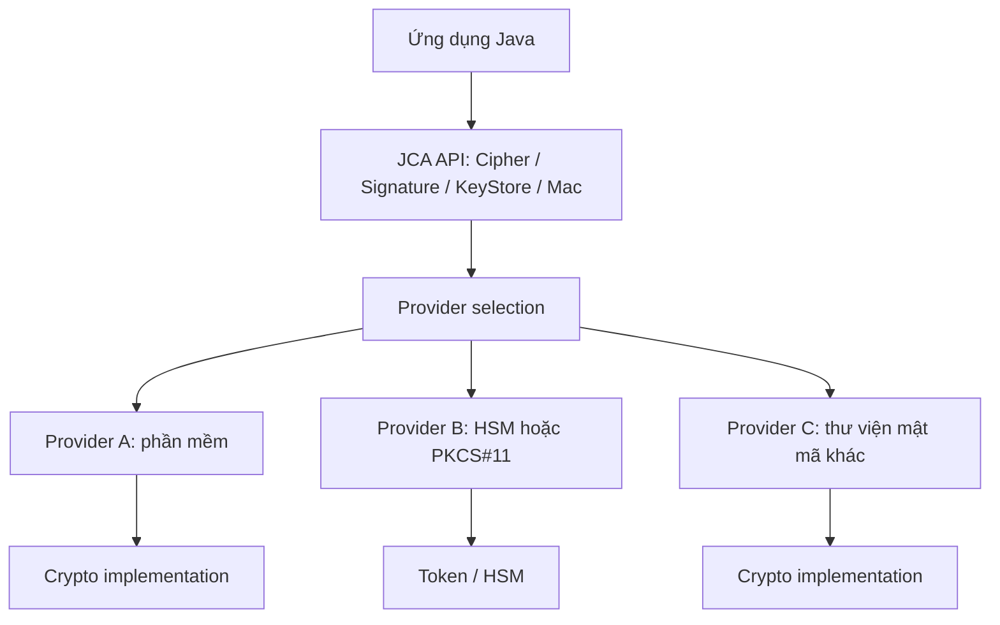

# Provider selection

Trong Java Cryptography Architecture (JCA), **provider** là thành phần cung cấp implementation cho các dịch vụ mật mã như `Cipher`, `Signature`, `MessageDigest`, `Mac`, `KeyAgreement`, `KeyStore` và `SecureRandom`. **Provider selection** là quá trình JCA chọn implementation nào để thực hiện một yêu cầu mật mã cụ thể.

Việc lựa chọn provider ảnh hưởng trực tiếp đến thuật toán thực tế được chạy, cách khóa được lưu và sử dụng, khả năng tận dụng HSM, mức độ tương thích giữa các môi trường và bằng chứng kiểm toán. Một ứng dụng có thể gọi cùng một API JCA nhưng chạy implementation khác nhau tùy JDK, provider đã cài đặt, thứ tự ưu tiên, cấu hình bảo mật và thiết bị phần cứng.

Trong quản lý vòng đời khóa, lựa chọn provider cần gắn với mục đích sử dụng: tạo khóa đối xứng, tạo cặp khóa bất đối xứng, ký số, xác minh chữ ký, lưu khóa trong keystore hoặc thực hiện thao tác bằng khóa không xuất khỏi HSM. Provider phải đáp ứng cả thuật toán lẫn yêu cầu về bảo vệ vật liệu khóa, kiểm soát truy cập và kiểm toán.

## 1. Provider trong kiến trúc JCA

JCA tách API mà ứng dụng gọi khỏi implementation cụ thể. Ứng dụng yêu cầu một dịch vụ theo tên thuật toán; framework tìm provider có khả năng cung cấp dịch vụ đó và trả về đối tượng engine để sử dụng.



Provider triển khai các SPI (Service Provider Interface), chẳng hạn `CipherSpi`, `SignatureSpi`, `MessageDigestSpi`, `KeyStoreSpi`, `MacSpi` và `SecureRandomSpi`. Ứng dụng thường làm việc với lớp engine như `Cipher` hoặc `Signature`; JCA chuyển yêu cầu đến implementation của provider.

Một số provider thường gặp trong JDK:

| Provider | Vai trò thường thấy |
|---|---|
| `SUN` | Một số dịch vụ nền tảng như `MessageDigest`, `SecureRandom` và keystore dạng JKS tùy phiên bản JDK |
| `SunJCE` | Nhiều dịch vụ mật mã như `Cipher`, `Mac`, `SecretKeyFactory` và `KeyGenerator` |
| `SunRsaSign` | Các dịch vụ chữ ký số RSA |
| `SunEC` | Các thuật toán elliptic-curve như ECDSA, ECDH và một số dịch vụ liên quan |
| `SunJSSE` | Các dịch vụ nền tảng cho TLS/JSSE |
| `SunPKCS11` | Cầu nối JCA đến thiết bị hoặc thư viện PKCS#11, thường dùng để tích hợp HSM |

Danh sách, tên, phiên bản và thuật toán hỗ trợ có thể thay đổi theo JDK và cấu hình. Không nên coi bảng này là danh sách đầy đủ hoặc cam kết mọi phiên bản đều cung cấp cùng tính năng. Provider bên thứ ba cũng có thể bổ sung thuật toán, định dạng khóa hoặc tích hợp phần cứng.

## 2. JCA chọn provider như thế nào?

Khi gọi một phương thức `getInstance`, ứng dụng có thể để JCA tự chọn provider hoặc chỉ định provider cụ thể.

```java
Cipher cipher = Cipher.getInstance("AES/GCM/NoPadding");
```

Trong cách gọi này, JCA tìm implementation đáp ứng transformation theo cấu hình và thứ tự ưu tiên provider đang có hiệu lực. Thứ tự thông thường được thiết lập trong cấu hình bảo mật Java, nhưng cấu hình ưu tiên theo dịch vụ và thuật toán của một số runtime cũng có thể ảnh hưởng kết quả. Vì vậy, không nên suy ra provider thực tế chỉ từ tên thuật toán trong mã nguồn.

Sau khi tạo engine, có thể xem provider được chọn:

```java
Cipher cipher = Cipher.getInstance("AES/GCM/NoPadding");
System.out.println("Selected provider: " + cipher.getProvider().getName());
```

Ứng dụng nên ghi nhận tên và phiên bản provider trong chẩn đoán vận hành nếu chính sách cho phép. Không ghi khóa, plaintext, mật khẩu, PIN hoặc dữ liệu nhạy cảm vào log.

**Lưu ý:** provider được chọn ở bước `getInstance` không tự động thay bằng provider khác nếu bước khởi tạo hoặc thao tác sau đó thất bại. Ví dụ, provider có thể tạo được `Cipher` nhưng không chấp nhận loại khóa, tham số hoặc cơ chế phần cứng mà ứng dụng truyền vào. Ứng dụng phải xử lý lỗi theo chính sách đã định; không được âm thầm chuyển sang thuật toán yếu hơn.

## 3. Ba cách chọn provider trong Java

### 3.1. Để JCA tự chọn

Đây là cách đơn giản và thường phù hợp khi ứng dụng cần tính tương thích giữa nhiều môi trường, không có yêu cầu phải dùng một implementation cụ thể.

```java
Cipher cipher = Cipher.getInstance("AES/GCM/NoPadding");
Signature signature = Signature.getInstance("SHA256withRSA");
KeyStore keyStore = KeyStore.getInstance("PKCS12");
```

Ưu điểm là ứng dụng ít phụ thuộc tên provider. Khi triển khai sang môi trường khác, JCA có thể sử dụng provider đã được cấu hình ở môi trường đó. Tuy nhiên, nếu yêu cầu bảo mật bắt buộc dùng HSM hoặc provider đã được đánh giá, cần kiểm tra provider thực tế và chính sách triển khai.

### 3.2. Chỉ định provider bằng tên

Khi provider cụ thể đã được đăng ký, có thể chỉ định tên:

```java
Cipher cipher = Cipher.getInstance("AES/GCM/NoPadding", "SunJCE");
Signature signature = Signature.getInstance("SHA256withRSA", "SunRsaSign");
```

Tên trong ví dụ là tên provider thường gặp ở một số JDK. Chúng có thể không tồn tại hoặc không hỗ trợ thuật toán trên mọi runtime. Nếu tên không được đăng ký, JCA có thể ném `NoSuchProviderException`; nếu provider không cung cấp thuật toán hoặc transformation yêu cầu, có thể nhận `NoSuchAlgorithmException` hoặc `NoSuchPaddingException`.

Chỉ định tên provider giúp kiểm soát implementation, nhưng tạo phụ thuộc vào cấu hình và tên provider trên môi trường chạy. Không nên sao chép tên từ máy phát triển rồi giả định máy chủ sản xuất có cùng provider.

### 3.3. Chỉ định trực tiếp đối tượng Provider

Các API engine hỗ trợ overload nhận đối tượng `Provider`:

```java
import java.security.Provider;
import java.security.Security;
import javax.crypto.Cipher;

Provider provider = Security.getProvider("SunJCE");
if (provider == null) {
    throw new IllegalStateException("Required provider is not installed");
}

Cipher cipher = Cipher.getInstance("AES/GCM/NoPadding", provider);
```

Cách này tránh phải tra cứu provider bằng tên ở mỗi lời gọi và hữu ích khi ứng dụng đã cấu hình, kiểm tra một provider cụ thể. Đối tượng `Provider` phải đến từ nguồn đáng tin cậy và đúng phiên bản đã được phê duyệt. Truyền đối tượng provider không tự xác minh rằng mã provider an toàn hoặc phù hợp chính sách.

## 4. Khám phá provider và kiểm tra năng lực

`Security.getProviders()` trả về các provider đã đăng ký theo thứ tự hiện tại. Có thể duyệt danh sách để kiểm tra provider nào tạo được một transformation cụ thể:

```java
import java.security.Provider;
import java.security.Security;
import java.security.NoSuchAlgorithmException;
import javax.crypto.Cipher;
import javax.crypto.NoSuchPaddingException;

String transformation = "AES/GCM/NoPadding";

for (Provider provider : Security.getProviders()) {
    try {
        Cipher.getInstance(transformation, provider);
        System.out.printf("%s %s supports %s%n",
                provider.getName(), provider.getVersionStr(), transformation);
    } catch (NoSuchAlgorithmException | NoSuchPaddingException unsupported) {
        // Provider không đáp ứng transformation này trong runtime hiện tại.
    }
}
```

Đây là phép kiểm tra khả năng tạo engine. Nó chưa chứng minh provider có thể thực hiện mọi thao tác cần thiết với khóa và tham số thực tế. Cần kiểm tra tiếp `init`, `doFinal`, `sign`, `verify`, `KeyStore.load` hoặc thao tác tương ứng bằng khóa thử nghiệm và môi trường được kiểm soát. `getVersionStr()` có trên các JDK hiện đại; nếu cần tương thích JDK cũ hơn, kiểm tra API phiên bản tương ứng.

Một số API hữu ích:

| API | Mục đích |
|---|---|
| `Security.getProviders()` | Lấy danh sách provider đã đăng ký |
| `Security.getProvider(name)` | Tra cứu provider theo tên |
| `Security.getAlgorithms(service)` | Liệt kê tên thuật toán được đăng ký cho một loại dịch vụ |
| `Provider.getServices()` | Xem các dịch vụ mà provider công bố |
| `Provider.getService(type, algorithm)` | Tra cứu dịch vụ theo loại và tên thuật toán |
| `engine.getProvider()` | Xác định provider thực tế được dùng bởi engine đã tạo |

Danh sách thuật toán được công bố không đảm bảo mọi transformation, padding, đường cong, kích thước khóa hoặc tham số đều được hỗ trợ. Alias và cách đăng ký dịch vụ cũng có thể khác nhau giữa provider. Hãy kiểm tra đúng transformation hoặc thuật toán mà ứng dụng thực sự gọi.

## 5. Chọn provider theo yêu cầu mật mã

Không nên lựa chọn provider chỉ dựa trên tên hoặc tốc độ. Cần xác định yêu cầu trước, sau đó đối chiếu với năng lực và mức bảo đảm của implementation.

| Tiêu chí | Câu hỏi cần trả lời |
|---|---|
| Thuật toán và transformation | Provider có hỗ trợ đúng thuật toán, mode, padding, curve và kích thước khóa cần dùng không? |
| Chất lượng implementation | Provider có nguồn gốc rõ ràng, được duy trì, có lịch sử cập nhật và quy trình xử lý lỗ hổng không? |
| Chính sách và chứng nhận | Có yêu cầu FIPS hoặc đánh giá độc lập không? Phiên bản module và chế độ vận hành có nằm trong phạm vi được xác nhận không? |
| Bảo vệ khóa | Khóa có cần ở trong HSM, không xuất được, hoặc được tạo ngay trong phần cứng không? |
| Kiểm soát truy cập | Provider có tích hợp xác thực người dùng, phân quyền token, PIN, slot và kiểm soát kép theo yêu cầu không? |
| Kiểm toán | Có log về thao tác, danh tính, thời điểm, key handle và kết quả mà không làm lộ vật liệu khóa không? |
| Tương thích | Khóa và dữ liệu có thể được đọc hoặc xác minh trên các môi trường cần hỗ trợ không? |
| Hiệu năng và khả năng mở rộng | Throughput, latency, giới hạn phiên, số slot và khả năng phục hồi có đáp ứng tải không? |
| Vận hành | Có quy trình cài đặt, cấu hình, cập nhật, backup, DR và giám sát provider không? |

Với hệ thống ký số, provider tạo khóa và provider ký phải tương thích với loại private key đang được giữ. Với mã hóa dữ liệu, provider phải hỗ trợ transformation và tham số mà dữ liệu hiện tại yêu cầu. Với keystore, phải kiểm tra cả định dạng, cách bảo vệ mật khẩu và khả năng truy cập khóa riêng.

## 6. Provider phần mềm và provider gắn với HSM

Provider phần mềm thực hiện phép toán mật mã trong tiến trình hoặc thư viện native. Provider gắn với HSM chuyển một số thao tác đến thiết bị bảo vệ khóa. Hai loại có cách lưu khóa, quyền truy cập và đặc tính vận hành khác nhau.

| Khía cạnh | Provider phần mềm | Provider kết nối HSM |
|---|---|---|
| Nơi xử lý | CPU và bộ nhớ của máy chạy ứng dụng | HSM hoặc token qua API/driver, thường là PKCS#11 |
| Nơi giữ khóa | Có thể ở heap, keystore hoặc file được bảo vệ | Có thể giữ dưới dạng đối tượng khóa bên trong thiết bị |
| Khả năng xuất khóa | Phụ thuộc loại khóa và implementation | Thường có thể cấu hình khóa không xuất được; tùy thuộc thuộc tính và thiết bị |
| Hiệu năng | Tránh chi phí giao tiếp thiết bị, phù hợp nhiều tác vụ phần mềm | Có độ trễ giao tiếp và giới hạn thiết bị; có thể tăng khả năng cô lập khóa |
| Kiểm toán | Log thường do ứng dụng và hệ điều hành cung cấp | Có thể kết hợp log ứng dụng với audit log của HSM |
| Phụ thuộc vận hành | JDK, provider, hệ điều hành và cấu hình | Thêm driver, thư viện PKCS#11, token, mạng, slot, PIN và quy trình HSM |

Không phải mọi phép toán đều được HSM hỗ trợ. Có thiết bị hỗ trợ ký RSA nhưng không hỗ trợ một số padding hoặc curve; có thiết bị giới hạn số phiên hoặc loại khóa. Phải kiểm tra năng lực của model, firmware, partition và cấu hình token đang sử dụng.

### 6.1. Tích hợp PKCS#11 qua SunPKCS11

`SunPKCS11` là provider cầu nối giữa JCA và thư viện PKCS#11 của thiết bị. Cấu hình thường chỉ rõ thư viện native, tên token hoặc slot và các tùy chọn phù hợp với thiết bị. Trên các JDK hiện đại, provider có thể được cấu hình bằng API `Provider.configure`, sau đó truyền trực tiếp vào overload `getInstance` nhận `Provider`; chỉ cần đăng ký vào `Security` nếu ứng dụng cần tra cứu provider theo tên.

Ví dụ khái quát về cách lấy provider đã cấu hình và mở keystore PKCS#11:

```java
import java.security.Provider;
import java.security.Security;
import java.security.KeyStore;

Provider base = Security.getProvider("SunPKCS11");
if (base == null) {
    throw new IllegalStateException("SunPKCS11 provider is unavailable");
}

Provider hsmProvider = base.configure("/etc/app/pkcs11.cfg");
KeyStore keyStore = KeyStore.getInstance("PKCS11", hsmProvider);
char[] pin = obtainPinFromApprovedSecretStore();
try {
    keyStore.load(null, pin);
    // Tra cứu alias và sử dụng key handle theo chính sách ứng dụng.
} finally {
    java.util.Arrays.fill(pin, '\0');
}
```

Đường dẫn cấu hình, tên provider sau khi cấu hình, cách chọn slot và quy trình đăng nhập phụ thuộc driver và thiết bị. Ví dụ giả định runtime có hỗ trợ `Provider.configure` và `SunPKCS11`; cần đối chiếu tài liệu JDK đang triển khai. PIN phải lấy từ nguồn bí mật được phê duyệt, không đặt trực tiếp trong mã nguồn, file cấu hình công khai hoặc log.

Đối tượng khóa từ HSM có thể là khóa opaque: ứng dụng giữ handle hoặc tham chiếu đến khóa, còn vật liệu bí mật không được xuất ra. Vì vậy `getEncoded()` có thể trả về `null`. Không viết mã giả định mọi `PrivateKey` hoặc `SecretKey` đều có thể chuyển thành byte. Hãy dùng đối tượng khóa trực tiếp với engine và provider tương thích.

## 7. Đăng ký và thứ tự provider

Provider có thể được đăng ký tĩnh trong tệp cấu hình bảo mật Java, thường là `java.security`, hoặc được thêm lúc chạy bằng API `Security`.

```java
import java.security.Provider;
import java.security.Security;

Provider provider = loadApprovedProvider();
int position = Security.addProvider(provider);
if (position == -1) {
    // Provider cùng tên có thể đã được đăng ký.
}

// Nếu cần vị trí ưu tiên cụ thể, dùng insertProviderAt thay cho addProvider:
// int position = Security.insertProviderAt(provider, 1);
```

`Security.addProvider` thêm provider vào danh sách; `Security.insertProviderAt` chèn vào vị trí ưu tiên được chỉ định. Thay đổi thứ tự có thể tác động đến toàn bộ ứng dụng trong cùng JVM khi mã khác gọi `getInstance` mà không chỉ định provider. Không nên thay đổi thứ tự provider theo từng request hoặc trong thư viện dùng chung.

Nếu provider đã tồn tại, `addProvider` có thể trả về `-1`. Không nên coi điều đó là lỗi chắc chắn hoặc tự động thay provider đang có. Cần kiểm tra provider đã đăng ký có đúng nguồn gốc, phiên bản và cấu hình được phê duyệt không. Việc thêm hoặc gỡ provider là thay đổi cấu hình bảo mật cấp tiến trình và cần được quản lý như một thay đổi vận hành.

## 8. Ràng buộc thuật toán và chính sách bảo mật

Provider có thể hỗ trợ một thuật toán nhưng chính sách bảo mật của runtime hoặc ứng dụng vẫn có thể cấm sử dụng thuật toán đó. Cần phân biệt ba lớp:

1. **Khả năng của provider:** implementation có cung cấp dịch vụ và tham số được yêu cầu không?
2. **Chính sách của JDK/runtime:** thuật toán, key size hoặc cơ chế cụ thể có bị vô hiệu hóa hoặc hạn chế bởi cấu hình bảo mật không?
3. **Chính sách ứng dụng/tổ chức:** hệ thống có cho phép thuật toán, provider, độ dài khóa và mục đích đó không?

Ví dụ, các thuộc tính như `jdk.tls.disabledAlgorithms`, `jdk.certpath.disabledAlgorithms` và `jdk.jar.disabledAlgorithms` áp dụng cho những miền chức năng tương ứng. Không nên giả định một thuộc tính riêng cho TLS tự động kiểm soát mọi lời gọi `Cipher.getInstance` trong ứng dụng. Hệ thống cần có allowlist thuật toán và tham số riêng cho các thao tác nhạy cảm.

Nếu có yêu cầu FIPS, cần xác minh module mật mã, phiên bản, cấu hình, chế độ hoạt động và các thuật toán nằm trong phạm vi xác nhận. Tên provider có chữ “FIPS” hoặc việc dùng một thư viện có chứng nhận ở phiên bản khác không đủ để kết luận ứng dụng đang chạy trong chế độ được xác nhận. Cần tuân theo tài liệu triển khai và quy trình đánh giá áp dụng cho môi trường cụ thể.

## 9. Lựa chọn provider cho từng loại dịch vụ

Provider được lựa chọn theo từng engine và thuật toán. Không nhất thiết một provider duy nhất phải cung cấp tất cả dịch vụ trong ứng dụng.

| Nhu cầu | Engine/API | Điều cần xác minh |
|---|---|---|
| Mã hóa dữ liệu | `Cipher` | Transformation đầy đủ, mode, padding, nonce/IV, tag length, key size và khả năng dùng khóa HSM |
| Ký số | `Signature` | Thuật toán ký, định dạng chữ ký, loại khóa, curve/key size, tham số và khả năng kiểm toán |
| Trao đổi khóa | `KeyAgreement` | Nhóm/curve, tham số public key, cách xử lý secret và KDF sau trao đổi |
| Dẫn xuất khóa | `SecretKeyFactory`, `Mac` | KDF/PRF, tham số cost, salt, output length và hỗ trợ provider |
| Sinh khóa | `KeyPairGenerator`, `KeyGenerator` | Nguồn ngẫu nhiên, thuật toán, kích thước, nơi tạo và thuộc tính exportability |
| Lưu khóa | `KeyStore` | Loại keystore, định dạng, cơ chế bảo vệ, alias, private key handle và khả năng tương thích |
| Băm dữ liệu | `MessageDigest` | Thuật toán được cho phép, hiệu năng và khả năng tương thích dữ liệu đã lưu |

Ví dụ, có thể dùng provider phần mềm cho `MessageDigest` và provider HSM cho `Signature` nếu kiến trúc, chính sách và loại khóa cho phép. Tuy nhiên, khóa riêng tạo trong HSM phải được dùng qua provider có thể truy cập khóa đó; provider phần mềm khác thường không thể sử dụng một handle riêng của HSM.

## 10. Fallback, tính linh hoạt và tránh downgrade

Fallback có thể cần thiết khi môi trường hỗ trợ nhiều provider, nhưng phải được thiết kế rõ. Một cách triển khai an toàn là xác định danh sách provider được phê duyệt khi khởi động, kiểm tra khả năng và chính sách, sau đó cố định lựa chọn cho từng chức năng trong suốt vòng đời của tiến trình.

Không nên viết logic kiểu “provider A thất bại thì thử thuật toán yếu hơn”. Nếu provider bắt buộc dùng HSM không khả dụng, hệ thống có thể phải dừng thao tác nhạy cảm và báo lỗi để người vận hành xử lý. Chỉ cho phép chuyển sang provider dự phòng khi provider đó đã được phê duyệt, đáp ứng cùng yêu cầu thuật toán và mức bảo vệ khóa, và việc chuyển đổi được ghi nhận.

Các nguyên tắc cần giữ:

- Duy trì allowlist provider và thuật toán theo môi trường.
- Không hạ key size, mode, padding hoặc thuật toán chỉ để làm cho thao tác thành công.
- Không tự động xuất khóa khỏi HSM để chuyển sang provider phần mềm khi thiết bị lỗi.
- Ghi nhận provider thực tế và lý do chọn provider dự phòng.
- Kiểm thử failover, phục hồi thiết bị và khả năng tương thích trước khi triển khai.
- Có quy trình quay lại provider chính sau khi sự cố được khắc phục.

Tính linh hoạt của JCA giúp ứng dụng ít phụ thuộc implementation, nhưng chính sách hệ thống vẫn phải biết rõ provider nào được phép xử lý từng loại khóa.

## 11. Kiểm tra và giám sát provider

Kiểm tra provider nên diễn ra trước khi nhận tải nghiệp vụ. Một quy trình startup hoặc health check có thể xác minh:

1. Provider bắt buộc đã được đăng ký, đúng tên và phiên bản.
2. Engine cần thiết có thể được tạo với đúng transformation hoặc thuật toán.
3. Khóa thử nghiệm phù hợp có thể khởi tạo engine và thực hiện thao tác mẫu.
4. Khóa HSM được truy cập bằng handle và không bị xuất ngoài dự kiến.
5. Token, slot, partition và trạng thái đăng nhập đáp ứng yêu cầu.
6. Log audit được tạo và chuyển đến nơi lưu giữ đúng chính sách.
7. Cấu hình thuật toán và key size đáp ứng allowlist của ứng dụng.

Không nên chỉ kiểm tra `Cipher.getInstance` rồi xem hệ thống là khỏe mạnh. Phải thực hiện kiểm tra end-to-end ở môi trường an toàn, dùng khóa thử nghiệm và dữ liệu giả lập. Với HSM, cần có kiểm thử khi token mất kết nối, hết phiên, lỗi PIN, hết quota hoặc chuyển sang thiết bị dự phòng.

Trong giám sát, có thể ghi tên provider, phiên bản, thuật toán, thời gian xử lý, mã lỗi và mã tham chiếu audit. Không ghi vật liệu khóa hoặc dữ liệu nhạy cảm. Cần cảnh báo khi provider bắt buộc biến mất, phiên bản thay đổi ngoài kế hoạch, thuật toán không còn được hỗ trợ hoặc provider dự phòng được dùng bất thường.

## 12. Các lỗi thường gặp

| Lỗi | Hậu quả | Cách kiểm soát |
|---|---|---|
| Cho rằng tên thuật toán xác định provider | Cùng mã có thể chạy implementation khác nhau ở môi trường khác | Kiểm tra `engine.getProvider()` và cấu hình thực tế |
| Dựa vào thứ tự provider ngầm định trong khi cần HSM | Khóa có thể được xử lý bằng phần mềm ngoài dự kiến | Chỉ định provider phù hợp và kiểm tra key handle |
| Chỉ định tên provider không có trên máy chủ | Ứng dụng lỗi khi khởi động hoặc khi gọi engine | Kiểm tra provider trong môi trường triển khai và quản lý phiên bản |
| Chỉ kiểm tra `getInstance` | Engine có thể không khởi tạo được với khóa hoặc tham số thực tế | Kiểm thử cả `init`, thao tác mật mã và đường HSM |
| Tự động fallback sang provider yếu hơn | Tạo đường downgrade và vi phạm chính sách | Fallback chỉ trong allowlist với mức bảo vệ tương đương |
| Đổi thứ tự provider toàn JVM từ thư viện | Làm thay đổi hành vi của thành phần khác | Quản lý đăng ký provider ở điểm khởi động ứng dụng |
| Giả định khóa HSM luôn có `getEncoded()` | Mã lỗi với khóa opaque hoặc vô tình yêu cầu xuất khóa | Dùng handle trực tiếp và chấp nhận khóa không exportable |
| Coi provider có tên FIPS là đã tuân thủ | Kết luận sai về phạm vi chứng nhận | Kiểm tra module, phiên bản, cấu hình và chế độ đã xác nhận |
| Không theo dõi phiên bản provider | Bỏ lỡ bản vá hoặc thay đổi hành vi mật mã | Quản lý inventory, cập nhật và kiểm thử tương thích |

## 13. Checklist lựa chọn provider

Trước khi phát hành ứng dụng, hãy xác nhận:

- [ ] Đã liệt kê engine, thuật toán và transformation thực tế mà ứng dụng sử dụng.
- [ ] Đã xác định dịch vụ nào dùng provider mặc định và dịch vụ nào cần provider tường minh.
- [ ] Provider được phê duyệt theo nguồn gốc, phiên bản, chính sách và yêu cầu chứng nhận.
- [ ] Đã xác minh khả năng với key size, curve, padding, mode và tham số cần thiết.
- [ ] Đã xác minh nơi tạo/lưu khóa, exportability và quyền truy cập.
- [ ] Nếu dùng HSM, đã kiểm tra PKCS#11, token, slot, PIN, quyền và audit log.
- [ ] Đã kiểm tra provider thực tế bằng `engine.getProvider()` trong môi trường triển khai.
- [ ] Đã thử thao tác end-to-end bằng khóa thử nghiệm và dữ liệu giả lập.
- [ ] Fallback không làm giảm thuật toán hoặc mức bảo vệ khóa.
- [ ] Đã có kế hoạch cập nhật, giám sát, phục hồi và kiểm thử tương thích provider.

Provider selection là quyết định kiến trúc và vận hành của hệ thống mật mã Java. Chọn đúng provider giúp ứng dụng dùng đúng implementation, giữ khóa trong miền bảo vệ phù hợp, đáp ứng chính sách thuật toán và tạo được dấu vết kiểm toán. Quyết định đó cần được kiểm tra trên đúng JDK, provider, cấu hình và thiết bị sẽ chạy trong môi trường thực tế.
