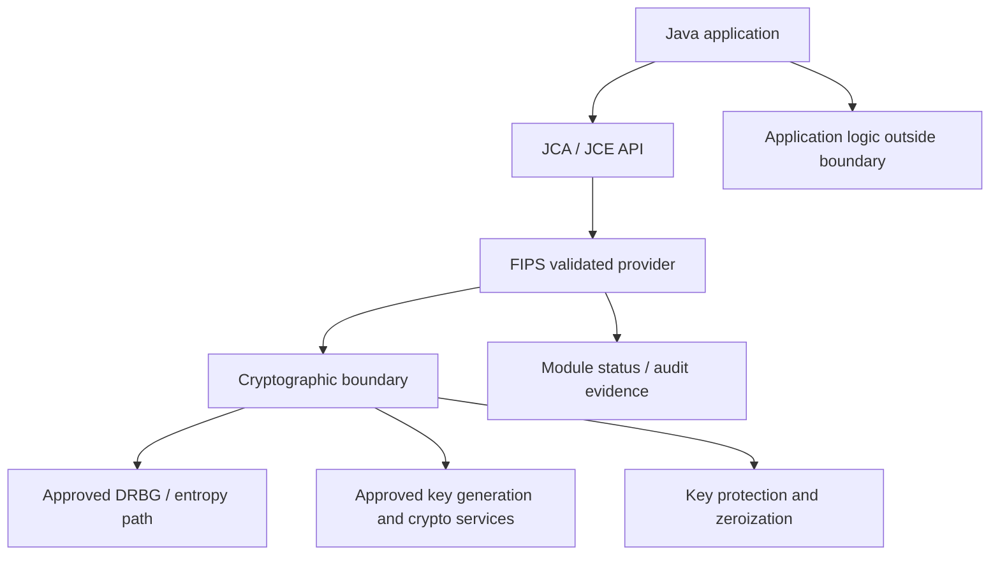

# FIPS mode

## Mục tiêu học tập

Sau bài học này, bạn có thể:

- Giải thích FIPS 140 là tiêu chuẩn đánh giá module mật mã và hiểu ý nghĩa của approved mode trong một triển khai Java.
- Phân biệt FIPS validation của cryptographic module với việc ứng dụng tự tuyên bố “FIPS compliant”.
- Mô tả cách JCA provider, JCE, SecureRandom, JSSE và HSM/PKCS#11 tham gia một kiến trúc Java có yêu cầu FIPS.
- Chọn đúng module, phiên bản, môi trường vận hành và security policy đã được validation.
- Nhận diện algorithm/service được phép, giới hạn key size, tham số và cách dùng trong approved mode.
- Cấu hình KeyGenerator, Cipher và SecureRandom để sử dụng provider được phê duyệt.
- Quản lý key lifecycle, TLS, trust store, backup, audit và kiểm thử mà không vô tình đi ra ngoài cryptographic boundary.
- Xây dựng checklist vận hành và xử lý sự cố khi module không ở approved mode hoặc provider không khả dụng.

## 1. FIPS mode là gì?

FIPS mode là cách gọi phổ biến cho trạng thái vận hành trong đó các thao tác mật mã được thực hiện bằng module đã được đánh giá theo tiêu chuẩn FIPS 140 và chỉ sử dụng các dịch vụ, thuật toán, tham số cùng cấu hình được phép trong approved mode của module đó.

FIPS 140 xác định yêu cầu bảo mật và quy trình đánh giá đối với **cryptographic module**. Module có thể là thiết bị HSM, phần mềm mật mã, thư viện, firmware hoặc một thành phần kết hợp. Module được đánh giá có ranh giới bảo vệ (cryptographic boundary), security policy, phiên bản và môi trường vận hành cụ thể.

Trong ứng dụng Java, FIPS mode thường được triển khai bằng cách cấu hình một JCA/JCE provider hoặc PKCS#11 provider kết nối tới module đã được validation. Ứng dụng phải gọi đúng provider, dùng đúng algorithm và tuân thủ security policy của module. Một số provider có chế độ approved-only riêng; một số triển khai dựa trên HSM hoặc cryptographic service đã được cấu hình ở approved mode.

Không có một lệnh Java chuẩn duy nhất như `System.setFipsMode(true)` có thể biến mọi provider và mọi thao tác trong JVM thành FIPS approved. FIPS mode là thuộc tính của module, cấu hình và đường đi của thao tác mật mã; ứng dụng cần chứng minh rằng các hoạt động thuộc phạm vi yêu cầu đều đi qua module và dịch vụ được phê duyệt.

## 2. FIPS 140 đánh giá điều gì?

FIPS 140 là tiêu chuẩn của Hoa Kỳ dành cho cryptographic modules. Phiên bản hiện hành trong hệ sinh thái validation là FIPS 140-3; các chứng nhận FIPS 140-2 cũ có thể vẫn xuất hiện trong danh sách hoặc hợp đồng tùy trạng thái chuyển tiếp, thời hạn và yêu cầu của chương trình áp dụng.

Đánh giá không chỉ nhìn vào tên thuật toán. Tùy cấp độ và phạm vi, module còn được xem xét về:

- Cryptographic boundary và các thành phần nằm bên trong module.
- Roles, services và authentication.
- Key management, key generation, key storage, key zeroization và key entry/exit.
- Self-tests, integrity tests và xử lý lỗi.
- Physical security hoặc software/firmware security theo loại module.
- Operational environment, cấu hình và hướng dẫn vận hành.
- Bảo vệ dữ liệu nhạy cảm và trạng thái nội bộ của module.
- Quy trình phát triển, kiểm soát thay đổi và tài liệu security policy.

Một module được validation không có nghĩa toàn bộ hệ thống dùng module đó tự động đạt FIPS. Ứng dụng vẫn có thể gọi thuật toán không được phép từ provider khác, lưu key ra ngoài boundary, bỏ qua self-test hoặc dùng cấu hình khác với security policy.

## 3. FIPS validation khác với thuật toán được chuẩn hóa

Một thuật toán có thể được mô tả trong FIPS publication hoặc NIST standard, nhưng điều đó không có nghĩa mọi implementation của thuật toán đều nằm trong module đã được validation.

Ví dụ:

- AES được mô tả trong FIPS 197. Một thư viện tự viết AES vẫn không tự động trở thành FIPS validated module.
- Secure Hash Standard mô tả các hàm băm như SHA-256. Một hàm SHA-256 có trong ứng dụng không chứng minh module chứa implementation đã được validation.
- HMAC được chuẩn hóa, nhưng module vẫn phải cung cấp implementation và dịch vụ được phép trong security policy.
- Một HSM hỗ trợ RSA hoặc AES không đồng nghĩa mọi key size, mode, padding và thao tác trong HSM đều được phép ở approved mode.

Do đó cần phân biệt ba lớp:

| Lớp | Câu hỏi cần trả lời |
|---|---|
| Algorithm standard | Thuật toán và cách dùng được mô tả trong tiêu chuẩn nào? |
| Module validation | Implementation cụ thể có chứng nhận validation nào, phiên bản nào và boundary nào? |
| System configuration | Ứng dụng có thực sự dùng đúng module, đúng service, đúng cấu hình và đúng môi trường không? |

## 4. Approved mode và non-approved service

Module có thể cung cấp nhiều service nhưng không phải service nào cũng được phép trong approved mode. Một số provider có chế độ approved-only, từ chối service ngoài danh sách hoặc cung cấp service indicator để caller biết thao tác có được thực hiện trong approved mode hay không.

Tùy module, có thể gặp các hành vi:

- Từ chối algorithm không được phê duyệt.
- Từ chối key size hoặc parameter không đạt policy.
- Chỉ cho phép service sau khi startup self-tests hoàn tất.
- Chuyển sang error state nếu self-test hoặc integrity check thất bại.
- Cho phép một số service ngoài approved mode nhưng không được tính là thao tác approved.
- Yêu cầu cấu hình riêng để bật approved-only mode.

Không suy ra trạng thái approved chỉ từ việc lệnh mã hóa chạy thành công. Phải kiểm tra trạng thái module, service indicator nếu có, log, cấu hình và security policy của đúng provider.

## 5. Cryptographic boundary

Cryptographic boundary xác định phần cứng, phần mềm, firmware và các thành phần được xem là nằm bên trong module đã được validation. Việc một ứng dụng Java gọi API mật mã không đủ để biết thao tác có nằm trong boundary hay không.



Nếu Java tự sinh key bằng một provider ngoài boundary rồi gửi key sang HSM, cần xác định quy trình import và nguồn key có đáp ứng security policy không. Nếu key được tạo bên trong HSM nhưng export ra JVM dưới dạng plaintext, ranh giới bảo vệ có thể bị phá vỡ đối với yêu cầu non-exportability.

Boundary còn liên quan đến entropy source, DRBG, key wrapping, backup, self-tests và các API dùng để đưa key vào hoặc đưa key ra module. Hãy đọc sơ đồ và security policy trong validation package, không tự suy ra boundary từ sơ đồ triển khai của ứng dụng.

## 6. Vai trò của JCA/JCE provider

Java Cryptography Architecture (JCA) cung cấp API và cơ chế provider. Java Cryptography Extension (JCE) cung cấp các API như `Cipher`, `Mac`, `KeyGenerator` và `SecretKeyFactory`. Provider đăng ký implementation cho các dịch vụ đó.

Một ứng dụng Java có thể dùng:

- `SecureRandom` để sinh randomness.
- `KeyGenerator` để tạo symmetric key.
- `KeyPairGenerator` để tạo public/private key pair.
- `Cipher` để mã hóa và giải mã.
- `Mac` để tạo và xác minh HMAC.
- `Signature` để ký và xác minh chữ ký.
- `MessageDigest` để tính hash.
- `KeyStore` để truy cập key và certificate.
- JSSE provider để thực hiện TLS.

Trong kiến trúc FIPS, cần bảo đảm từng service thuộc phạm vi yêu cầu được cung cấp bởi provider/module phù hợp. Chọn một provider cho `Cipher` nhưng để `SecureRandom`, `Signature`, TLS hoặc key storage dùng implementation ngoài boundary có thể làm hỏng mục tiêu tổng thể.

## 7. Provider order và lựa chọn provider tường minh

JCA có danh sách provider và thứ tự ưu tiên. Khi gọi `getInstance(algorithm)` mà không chỉ định provider, JVM chọn implementation theo thứ tự provider và khả năng hỗ trợ.

Trong môi trường FIPS, dựa vào provider order mặc định có thể tạo ra hành vi không mong muốn nếu một provider thông thường đứng trước provider được phê duyệt.

Có thể chọn provider tường minh:

```java
Provider provider = Security.getProvider(configuredProviderName);
if (provider == null) {
    throw new IllegalStateException("Required crypto provider is unavailable");
}

KeyGenerator generator = KeyGenerator.getInstance("AES", provider);
Cipher cipher = Cipher.getInstance("AES/GCM/NoPadding", provider);
```

`configuredProviderName` phải đến từ cấu hình được kiểm soát và đối chiếu với tài liệu validation. Đoạn code chỉ chọn provider cho hai service; nó không tự chứng minh provider đang ở approved mode hoặc toàn bộ ứng dụng FIPS compliant.

Không tự động fallback sang provider mặc định khi provider được yêu cầu không khả dụng. Với thao tác nhạy cảm, fail closed và báo lỗi vận hành thường an toàn hơn việc âm thầm chuyển sang implementation khác.

## 8. Module validation phải khớp phiên bản và môi trường

Một chứng nhận validation gắn với module cụ thể. Các yếu tố cần đối chiếu gồm:

- Tên module và nhà cung cấp.
- Certificate number và trạng thái validation.
- Phiên bản phần mềm, firmware hoặc hardware revision.
- Operational environment được liệt kê trong certificate.
- Operating system, kiến trúc CPU hoặc HSM model được hỗ trợ.
- Approved mode và security policy.
- Các service, algorithm và parameter được phép.
- Các điều kiện cài đặt, khởi động và vận hành.

Nâng JDK, đổi native library, cập nhật firmware, đổi cấu hình provider hoặc chuyển sang cloud instance khác có thể đưa hệ thống ra ngoài môi trường được validation. Không giả định mọi phiên bản mới đều tự động nằm trong phạm vi chứng nhận cũ.

## 9. Thuật toán và service thường gặp trong approved mode

Danh sách cụ thể phụ thuộc phiên bản tiêu chuẩn, module validation, security policy và mục đích sử dụng. Bảng sau chỉ là định hướng để review; không thay thế danh sách service được phép của module:

| Nhóm | Ví dụ phổ biến | Điều kiện cần kiểm tra |
|---|---|---|
| Symmetric encryption | AES | Key size, mode, IV/nonce, tag, service implementation |
| Key wrapping | AES-KW, AES-KWP | Key size, wrapping context và policy |
| Hash | SHA-256, SHA-384, SHA-512 | Provider, service và mục đích dùng |
| MAC | HMAC với SHA-2 | Key size, hash, truncation và service indicator |
| Asymmetric signature | RSA, ECDSA | Key size, curve, padding, hash và signing parameters |
| Key agreement | ECDH, DH | Domain parameters, key size và protocol profile |
| Random generation | DRBG | Approved construction, entropy source, reseed và module status |
| Password-based functions | PBKDF2 | PRF, iteration count, salt và use case |

Một số thuật toán hoặc mode có thể bị cấm, giới hạn hoặc không được cung cấp trong approved mode, dù Java provider thông thường có hỗ trợ. ChaCha20, RC4, DES hoặc các primitive lỗi thời không nên được chọn chỉ vì provider có tên algorithm tương ứng. Với thuật toán mới hoặc thuật toán có trạng thái tiêu chuẩn thay đổi, phải kiểm tra tài liệu validation hiện hành thay vì dựa vào danh sách nhớ sẵn.

## 10. Key size, parameters và algorithm policy

FIPS mode không chỉ kiểm tra tên algorithm. Một algorithm được chấp nhận vẫn có thể bị dùng sai do key size, padding, curve, nonce, tag length hoặc protocol parameters không đạt yêu cầu.

Ví dụ cần kiểm tra:

- AES key size và mode được module cho phép.
- GCM nonce construction, uniqueness và tag length.
- RSA modulus size, padding scheme và hash function.
- ECDSA curve và hash phù hợp.
- HMAC key size, hash và cách truncate tag.
- DRBG strength, entropy input và reseed requirements.
- TLS version, cipher suite, signature scheme và key exchange group.

Không nên tạo một danh sách allowlist chỉ dựa trên tên transformation. Cần đối chiếu algorithm, parameters và service combination với security policy của module.

## 11. SecureRandom và DRBG trong FIPS mode

Sinh key và nonce phụ thuộc nguồn randomness. Trong kiến trúc FIPS, cần bảo đảm generator và entropy path nằm trong cấu hình đã được đánh giá hoặc được security policy cho phép.

Các điểm cần xác minh:

- DRBG construction có được module cung cấp và phê duyệt không?
- Entropy source có đáp ứng yêu cầu của module không?
- Startup self-tests và health tests có được thực hiện không?
- Reseed và prediction resistance có được cấu hình theo policy không?
- Ứng dụng có vô tình dùng `new SecureRandom()` từ provider khác không?
- Có đường fallback sang PRNG thông thường khi provider lỗi không?

`SecureRandom.getInstanceStrong()` không tự động có nghĩa là FIPS approved. Tên `strong` phản ánh security property của Java runtime, không thay thế validation certificate hoặc approved service indicator.

## 12. Key generation trong approved module

Nếu policy yêu cầu key được tạo bên trong cryptographic boundary, hãy dùng KeyGenerator hoặc KeyPairGenerator từ provider đã được validation và cấu hình đúng. Với HSM, key có thể được tạo trực tiếp trong thiết bị và trả về dưới dạng opaque handle.

Ví dụ JCA:

```java
KeyGenerator generator = KeyGenerator.getInstance("AES", fipsProvider);
generator.init(256, approvedRandom);
SecretKey dataKey = generator.generateKey();
```

Trong ví dụ, `fipsProvider` và `approvedRandom` phải được bootstrap từ cấu hình provider đã phê duyệt. Không thể xác định approved mode chỉ bằng cách đặt biến có tên như vậy. Hãy kiểm tra module status, service indicator và security policy theo cách vendor cung cấp.

Nếu `dataKey.getEncoded()` trả `null`, key có thể là opaque/non-exportable. Đây có thể là hành vi mong muốn với HSM. Không cố export raw key chỉ để kiểm tra độ dài; dùng metadata/API của provider hoặc phép toán thử được phê duyệt.

## 13. AES-GCM trong approved mode

AES-GCM là authenticated encryption mode phổ biến. Việc dùng AES không đủ để khẳng định thao tác đạt policy; cần tuân thủ yêu cầu của module đối với nonce, tag, key size và cách sử dụng.

Ví dụ minh họa sử dụng provider và SecureRandom được cấu hình từ trước:

```java
KeyGenerator keyGenerator = KeyGenerator.getInstance("AES", fipsProvider);
keyGenerator.init(256, approvedRandom);
SecretKey key = keyGenerator.generateKey();

byte[] nonce = new byte[12];
approvedRandom.nextBytes(nonce);

Cipher cipher = Cipher.getInstance("AES/GCM/NoPadding", fipsProvider);
cipher.init(Cipher.ENCRYPT_MODE, key,
        new GCMParameterSpec(128, nonce));
cipher.updateAAD(contextBytes);
byte[] ciphertextAndTag = cipher.doFinal(plaintext);
```

Đây là ví dụ API, không phải cấu hình hoàn chỉnh cho mọi module. `fipsProvider` và `approvedRandom` là đối tượng đã được khởi tạo từ integration được validation; cần kiểm tra cả service indicator sau thao tác nếu provider hỗ trợ.

Nonce GCM phải được quản lý để không lặp lại với cùng key. Khi số lượng bản mã lớn, cần nonce construction và usage limit theo policy. AAD phải được canonicalize và liên kết đúng với tenant, object hoặc purpose. Không dùng lại nonce chỉ vì key đang nằm trong HSM.

## 14. HSM và PKCS#11

HSM thường là lựa chọn khi hệ thống cần bảo vệ key trong phần cứng, non-exportability, role separation, quorum hoặc audit thiết bị. Java có thể truy cập HSM qua PKCS#11 provider hoặc provider riêng của nhà cung cấp.

Các bước tích hợp thường gồm:

1. Xác minh HSM model/firmware và validation certificate.
2. Đọc security policy, xác định approved mode và operational environment.
3. Cài provider và native library đúng phiên bản.
4. Cấu hình slot/token, login role, session và key attributes.
5. Tạo key trong HSM với attributes như sensitive/non-extractable nếu policy yêu cầu.
6. Dùng JCA service được hỗ trợ để thực hiện phép toán.
7. Kiểm tra audit, HA, backup, restore và failover.

Không phải mọi thao tác PKCS#11 đều được phép trong approved mode. Một HSM có certificate FIPS nhưng chạy sai mode, firmware hoặc cấu hình có thể không đáp ứng yêu cầu.

## 15. KeyStore và FIPS mode

`KeyStore` là abstraction lưu trữ key và certificate. Tên type như JKS, PKCS12, JCEKS hoặc PKCS11 không tự nói lên rằng thao tác lưu/đọc nằm trong FIPS validated boundary.

Cần kiểm tra:

- KeyStore implementation do provider nào cung cấp?
- File protection và key wrapping có dùng service được phê duyệt không?
- Key material có rời khỏi boundary ở dạng plaintext không?
- Password protection có đạt policy không?
- HSM object có được tham chiếu bằng handle hay export ra file?
- Backup và restore có nằm trong security policy không?

Một file PKCS12 được mã hóa bằng thuật toán phù hợp vẫn không tự làm cho toàn bộ quy trình FIPS validated. Nếu policy yêu cầu key non-exportable, file KeyStore software thường không đáp ứng mục tiêu đó.

## 16. TLS và JSSE

Ứng dụng Java có thể dùng `Cipher` từ provider FIPS nhưng vẫn sử dụng JSSE provider mặc định cho TLS. Khi đó, handshake có thể đi qua implementation khác với module được phê duyệt.

Với yêu cầu FIPS cho TLS, cần xác minh:

- JSSE provider có nằm trong phạm vi validation không?
- TLS implementation dùng đúng cryptographic provider không?
- Protocol version và cipher suites có được security policy cho phép không?
- Certificate path validation, signature scheme và key exchange dùng service nào?
- SecureRandom trong TLS handshake có đến từ nguồn được phê duyệt không?
- Private key TLS có được giữ và sử dụng trong HSM theo yêu cầu không?
- Session resumption, ticket key và key derivation có nằm trong cấu hình được phép không?

Chỉ cấu hình `jdk.tls.disabledAlgorithms` hoặc chỉ tắt TLS 1.0/1.1 không biến JSSE thành FIPS validated implementation. Những property đó là một phần của algorithm policy, không phải bằng chứng validation.

## 17. FIPS mode và các Java security properties

Java có nhiều security property để điều chỉnh provider, thuật toán bị vô hiệu hóa, certificate path và TLS. Chúng hữu ích nhưng không thay thế module validation.

Ví dụ:

- `security.provider.N` xác định provider và thứ tự đăng ký.
- `jdk.tls.disabledAlgorithms` giới hạn thuật toán/protocol trong TLS.
- `jdk.certpath.disabledAlgorithms` giới hạn thuật toán trong certificate path validation.
- `crypto.policy` điều chỉnh giới hạn cryptographic strength của JCE trong các JDK liên quan.

Đặt `crypto.policy=unlimited` không bật FIPS mode. Tắt thuật toán yếu cũng không chứng minh module được validation. Các property phải được quản lý cùng cấu hình provider và security policy.

Không chỉnh `java.security` tùy tiện trong runtime production. Thay đổi có thể làm provider order khác đi, khiến một số service chuyển sang implementation ngoài dự kiến hoặc gây lỗi TLS/certificate validation.

## 18. FIPS mode không phải một boolean của toàn ứng dụng

Một ứng dụng có thể dùng nhiều provider và nhiều subsystem. Ví dụ, `Cipher` được gọi từ provider A, `MessageDigest` từ provider B, TLS từ JSSE provider C, còn key storage nằm trong file KeyStore.

Vì vậy, kiểm tra FIPS phải lập inventory theo service:

| Service | Cần xác minh |
|---|---|
| Random generation | DRBG, entropy source, reseed, approved mode |
| Key generation | Provider, algorithm, key size, boundary và exportability |
| Encryption/decryption | Cipher provider, mode, padding, parameters, service indicator |
| MAC/hash/signature | Provider, algorithm, key/curve/hash parameters |
| Key storage/wrapping | Boundary, wrapping algorithm, key attributes, backup path |
| TLS | JSSE provider, protocol, cipher suite, trust validation và session key handling |
| Certificate validation | Path provider, algorithm constraints, revocation và trust store |
| Backup/restore | Approved wrapping, role, quorum, integrity và recovery procedure |

## 19. Khởi tạo provider an toàn

Provider có thể được cài bằng JCA registration, cấu hình JVM, thư viện vendor hoặc PKCS#11 configuration. Quy trình cụ thể phụ thuộc sản phẩm.

Nguyên tắc:

- Cài đúng phiên bản provider và native library theo security policy.
- Kiểm tra provider đã được đăng ký và đúng tên.
- Không tự động thêm provider không được phê duyệt ở runtime.
- Pin provider cho các service nhạy cảm thay vì phụ thuộc thứ tự mặc định.
- Kiểm tra provider order sau startup.
- Lưu cấu hình đã phê duyệt trong configuration management.
- Không log credential, PIN, token hoặc secret dùng để đăng nhập HSM.

## 20. Ví dụ Java: chọn provider tường minh và fail closed

Ví dụ sau cho thấy cách yêu cầu một provider cụ thể cho key generation và encryption. Provider và SecureRandom phải được tạo từ integration đã được validation; phần bootstrap phụ thuộc nhà cung cấp nên được inject vào lớp này.

```java
import java.security.Provider;
import java.security.SecureRandom;
import javax.crypto.Cipher;
import javax.crypto.KeyGenerator;
import javax.crypto.SecretKey;
import javax.crypto.spec.GCMParameterSpec;

public final class ApprovedCryptoOperations {
    private final Provider provider;
    private final SecureRandom approvedRandom;

    public ApprovedCryptoOperations(Provider provider,
                                    SecureRandom approvedRandom) {
        if (provider == null || approvedRandom == null) {
            throw new IllegalArgumentException("Approved crypto dependencies required");
        }
        this.provider = provider;
        this.approvedRandom = approvedRandom;
    }

    public byte[] encrypt(byte[] plaintext, byte[] aad) throws Exception {
        KeyGenerator generator = KeyGenerator.getInstance("AES", provider);
        generator.init(256, approvedRandom);
        SecretKey key = generator.generateKey();

        byte[] nonce = new byte[12];
        approvedRandom.nextBytes(nonce);

        Cipher cipher = Cipher.getInstance("AES/GCM/NoPadding", provider);
        cipher.init(Cipher.ENCRYPT_MODE, key,
                new GCMParameterSpec(128, nonce));
        cipher.updateAAD(aad);
        byte[] ciphertextAndTag = cipher.doFinal(plaintext);

        // Demo framing only: production must persist key reference,
        // nonce, ciphertext/tag, algorithm version and authenticated context.
        byte[] result = new byte[nonce.length + ciphertextAndTag.length];
        System.arraycopy(nonce, 0, result, 0, nonce.length);
        System.arraycopy(ciphertextAndTag, 0, result, nonce.length,
                ciphertextAndTag.length);
        return result;
    }
}
```

Giới hạn của ví dụ:

- Tên provider không tự chứng minh module validation hoặc approved mode.
- `approvedRandom` phải đến từ DRBG/service và entropy path được security policy cho phép.
- Cần kiểm tra service indicator hoặc module status theo API vendor nếu có.
- Key được tạo trong ví dụ chỉ tồn tại trong object; production phải lưu/giữ key theo policy, tốt nhất bằng HSM/KMS khi yêu cầu.
- Không có xử lý nonce allocation cho workload lớn; một key dùng nhiều lần cần nonce uniqueness và usage limits.
- Cần quản lý exception, audit, authorization, key version, backup và rotation.

## 21. Approved mode và key lifecycle

FIPS mode cần được duy trì qua toàn bộ vòng đời khóa, không chỉ ở thời điểm gọi `Cipher`.

### Tạo khóa

Tạo key bằng generator/service được phê duyệt. Nếu yêu cầu key non-exportable, tạo trực tiếp trong HSM và kiểm tra attributes.

### Lưu trữ

Giữ key trong cryptographic boundary phù hợp. Nếu phải export hoặc wrap, chỉ dùng cơ chế và thuật toán được policy cho phép.

### Sử dụng

Gọi đúng provider/service và tham số. Không đưa raw key sang provider ngoài boundary nếu policy không cho phép.

### Rotation

Tạo key version mới trong approved mode, cập nhật writer/reader và giữ key cũ cho tới khi hết dependency. Rewrap hoặc re-encrypt phải dùng dịch vụ được phép.

### Backup và recovery

Dùng secure backup procedure của HSM/KMS, quorum và split knowledge nếu policy yêu cầu. Backup key không được tạo ra một đường export ngoài boundary trái phép.

### Destruction

Hủy key theo provider semantics, xác minh replica/backup và lưu audit evidence. Zeroization và destruction phải theo security policy của module.

## 22. Access control, roles và separation of duties

Module FIPS có thể cung cấp roles hoặc authentication, nhưng ứng dụng và tổ chức vẫn phải kiểm soát ai được yêu cầu từng thao tác.

Các vai trò thường cần tách:

- Security officer: quản lý security policy và trạng thái module.
- Crypto officer/custodian: quản lý key ceremony, token và quorum.
- Application operator: vận hành service nhưng không tự ý export hoặc destroy key.
- Auditor: đọc log và bằng chứng, không có quyền thay đổi key.
- Key owner/data owner: phê duyệt mục đích, retention và tác động dữ liệu.

Áp dụng least privilege, dual control hoặc M-of-N approval cho thao tác nhạy cảm như tạo CA key, backup, restore, import/export và destroy. Không dùng một tài khoản quản trị dùng chung cho mọi người.

## 23. Self-tests và trạng thái lỗi của module

Cryptographic module có thể thực hiện power-up self-tests, conditional self-tests, integrity checks hoặc health tests theo security policy. Nếu self-test thất bại, module có thể chuyển sang error state và từ chối một số hoặc toàn bộ cryptographic services.

Ứng dụng cần:

- Chờ module hoàn tất startup checks trước khi nhận traffic nhạy cảm.
- Kiểm tra module health/status bằng API hoặc công cụ vendor.
- Không bỏ qua lỗi self-test để tiếp tục bằng provider khác.
- Phát cảnh báo và bảo toàn log khi module vào error state.
- Có failover sang module khác chỉ khi module dự phòng cũng đáp ứng validation và cấu hình yêu cầu.
- Diễn tập khôi phục theo runbook, không tự reset module để xóa dấu vết lỗi.

## 24. Entropy và nguồn random trong môi trường ảo hóa

Container, VM, autoscaling và snapshot có thể ảnh hưởng thời điểm khởi tạo hoặc trạng thái RNG. Nếu module dùng entropy source của hệ điều hành hoặc HSM, cần xác minh nguồn đó nằm trong phạm vi security policy.

Không seed generator bằng timestamp, process ID hoặc dữ liệu ứng dụng. Không serialize trạng thái DRBG để clone sang nhiều node. Tuân thủ hướng dẫn reseed và startup của module sau snapshot/restore.

Khi khởi động hàng loạt, theo dõi entropy availability, thời gian khởi tạo, lỗi DRBG và hành vi khi nguồn entropy không sẵn sàng. Không fallback sang `Random` hoặc PRNG không được phê duyệt.

## 25. TLS, certificate và trust store trong hệ thống FIPS

FIPS validation của crypto provider không tự xác minh CA hoặc hostname. Ứng dụng vẫn phải thực hiện PKIX path validation, hostname verification, purpose checking, algorithm constraints và revocation theo policy.

Trust store cần được quản lý riêng: root/intermediate nào được tin cậy, certificate nào được phép dùng, cách cập nhật trust anchor và cách thu hồi. Không thêm root certificate chỉ để làm cho TLS handshake chạy được.

Nếu TLS private key nằm trong HSM, phải kiểm tra JSSE provider có thể gọi key handle trong module và handshake thực sự dùng đúng service. Việc key được import vào HSM không tự động chứng minh TLS stack dùng HSM.

## 26. Logging và audit evidence

Audit cần chứng minh module và ứng dụng đã dùng đúng cấu hình mà không tiết lộ key material.

Nên ghi nhận:

- Provider name/version và module identifier.
- Validation certificate reference và operational environment.
- Approved mode/status tại thời điểm vận hành.
- Algorithm, key size, mode và service được gọi.
- Key ID/version, không phải raw key bytes.
- Actor, role, approval, request ID và timestamp.
- Self-test, integrity check, error state và recovery event.
- Key generation, import/export, wrapping, backup, rotation và destruction.
- Thay đổi provider order, security property và TLS configuration.

Không ghi PIN, password, seed, DRBG state, private key hoặc plaintext secret. Audit log cần đồng bộ thời gian, chống sửa đổi và có retention độc lập với key đang được quản lý.

## 27. Kiểm thử FIPS mode

Kiểm thử cần xác nhận cấu hình thực tế chứ không chỉ xác nhận code chạy được.

| Nhóm test | Kiểm tra |
|---|---|
| Module identity | Đúng certificate, version, firmware và operational environment |
| Startup | Self-tests hoàn tất và module ở trạng thái cho phép |
| Provider | Đúng provider được chọn cho từng JCA service |
| Approved service | Algorithm/parameters nằm trong security policy |
| Negative algorithm | Service không được phép bị từ chối hoặc được nhận diện non-approved |
| Key generation | Key được tạo trong đúng boundary và attributes đúng |
| Random generation | DRBG/entropy path và reseed đáp ứng policy |
| TLS | JSSE, cipher suite, protocol, key exchange và trust validation phù hợp |
| Key lifecycle | Backup, restore, rotation, revocation và destruction được kiểm soát |
| Failure handling | Self-test failure/provider outage không kích hoạt fallback yếu |
| Audit | Có bằng chứng đủ để tái dựng thao tác và cấu hình |

Không tự viết test chỉ kiểm tra `provider.getName()` rồi kết luận FIPS PASS. Provider name là một phần thông tin, không phải bằng chứng validation.

## 28. Các lỗi cấu hình thường gặp

| Lỗi | Vì sao nguy hiểm | Cách xử lý |
|---|---|---|
| Chỉ cài HSM đã có chứng nhận | Ứng dụng có thể không dùng HSM hoặc dùng sai mode | Kiểm tra đường đi thực tế và security policy |
| Dùng provider mặc định | JVM có thể chọn implementation khác | Chọn provider tường minh cho service nhạy cảm |
| Gọi `getInstanceStrong()` rồi tuyên bố FIPS | Strong không đồng nghĩa validated | Xác minh DRBG/provider/module |
| Bật unlimited crypto policy rồi tuyên bố FIPS | Policy chỉ điều chỉnh giới hạn strength | Kiểm tra validation và approved mode riêng |
| Dùng AES nhưng sai mode/nonce | Algorithm đúng nhưng parameters có thể vi phạm policy | Kiểm tra cả service parameters |
| Dùng JSSE mặc định ngoài boundary | TLS có thể dùng crypto implementation khác | Cấu hình JSSE provider phù hợp và kiểm thử handshake |
| Export key từ HSM | Có thể đưa key ra ngoài boundary | Dùng opaque handle hoặc wrapping được phép |
| Fallback provider khi HSM lỗi | Có thể chuyển sang non-approved service | Fail closed và dùng module dự phòng được phê duyệt |
| Nâng firmware/JDK không kiểm tra | Môi trường có thể lệch certificate validation | Quản lý thay đổi và đối chiếu validation package |
| Bỏ qua self-test failure | Module có thể ở error state | Dừng service và xử lý theo runbook |

## 29. Case study: dịch vụ thanh toán Java dùng HSM

Một dịch vụ thanh toán cần mã hóa dữ liệu thẻ và ký một số thông điệp nghiệp vụ. Yêu cầu tổ chức là dùng cryptographic module đã được validation, giữ KEK non-exportable và audit mọi thao tác nhạy cảm.

Nhóm triển khai HSM theo security policy đã được phê duyệt. Java dùng provider PKCS#11 để tạo KEK và thực hiện wrap/unwrap; ứng dụng tạo hoặc yêu cầu tạo DEK theo kiến trúc envelope encryption. TLS dùng JSSE integration đã được kiểm tra để bảo đảm private key và handshake đi qua đúng module. Provider mặc định không được dùng làm fallback cho các thao tác thuộc phạm vi FIPS.

Trước production, nhóm xác minh module certificate, firmware, HSM mode, provider version, operational environment, approved service, DRBG, TLS profile, backup/restore và audit. Họ cũng thử negative case: gọi algorithm không được phép, dùng key size sai, làm provider mất kết nối và mô phỏng self-test failure. Mọi trường hợp phải bị từ chối hoặc xử lý theo runbook đã duyệt.

Khi rotation, key mới được tạo trong HSM, dữ liệu chuyển theo version và key cũ chỉ bị hủy sau khi dependency/backup được xử lý. Audit lưu key ID và operation ID nhưng không lưu raw key.

## 30. Quản lý thay đổi và duy trì validation

FIPS là yêu cầu vận hành liên tục. Cần đánh giá tác động trước khi:

- Nâng JDK hoặc thay vendor distribution.
- Nâng provider, native library hoặc firmware HSM.
- Thay hardware model, VM type hoặc operating system.
- Đổi provider order hoặc security properties.
- Thay algorithm, key size, mode hoặc TLS cipher suite.
- Chuyển key từ software sang HSM hoặc ngược lại.
- Thay backup, restore, HA hoặc DR architecture.

Change record nên chỉ ra module certificate, security policy và phần môi trường bị ảnh hưởng. Nếu thay đổi nằm ngoài operational environment được validation, cần xác minh với vendor hoặc chương trình compliance trước khi tuyên bố tiếp tục đáp ứng yêu cầu.

## 31. Checklist triển khai FIPS mode

- [ ] Xác định tiêu chuẩn và yêu cầu compliance áp dụng.
- [ ] Chọn cryptographic module có validation phù hợp.
- [ ] Đối chiếu certificate number, phiên bản, firmware và operational environment.
- [ ] Đọc security policy và xác định approved mode.
- [ ] Xác định cryptographic boundary và đường đi của từng service.
- [ ] Cài đúng JCA/JCE/JSSE/PKCS#11 provider.
- [ ] Pin provider cho các service nhạy cảm.
- [ ] Xác minh DRBG, entropy source, self-tests và reseed.
- [ ] Kiểm tra algorithm, key size, parameters và service indicator.
- [ ] Bảo vệ key trong boundary; ưu tiên non-exportable khi policy yêu cầu.
- [ ] Kiểm tra KeyStore, wrapping, backup và restore semantics.
- [ ] Kiểm tra TLS/JSSE, trust store, hostname và revocation.
- [ ] Tách roles, dual control và audit.
- [ ] Không có fallback âm thầm sang provider non-approved.
- [ ] Kiểm thử negative case, outage, self-test failure và failover.
- [ ] Lưu bằng chứng validation và cấu hình đã phê duyệt.
- [ ] Đánh giá lại khi thay JDK, provider, HSM hoặc môi trường.

## 32. Câu hỏi tự kiểm tra

**1. FIPS 140 đánh giá điều gì?**

Nó đánh giá cryptographic module theo boundary, services, key management, self-tests, roles và security requirements, không chỉ đánh giá tên thuật toán.

**2. Một thuật toán nằm trong FIPS publication có làm mọi implementation của nó được validation không?**

Không. Implementation cụ thể phải nằm trong cryptographic module đã được validation.

**3. FIPS mode có phải boolean chuẩn của JVM không?**

Không. Nó phụ thuộc module, provider, approved mode, cấu hình và đường đi của thao tác mật mã.

**4. Approved mode có ý nghĩa gì?**

Đó là trạng thái module cung cấp các service được phép theo security policy và validation của module.

**5. Vì sao phải kiểm tra cryptographic boundary?**

Để xác định key, entropy, algorithm và thao tác có thực sự nằm trong phạm vi được bảo vệ/đánh giá hay không.

**6. Chọn provider tường minh có đủ để chứng minh FIPS không?**

Không. Còn phải xác minh module certificate, version, environment, approved mode và service indicator.

**7. `getInstanceStrong()` có đồng nghĩa FIPS approved không?**

Không. Strong là security property của Java runtime, không phải validation certificate.

**8. `crypto.policy=unlimited` có bật FIPS mode không?**

Không. Nó điều chỉnh giới hạn cryptographic strength của JCE, không chứng minh module validation.

**9. Vì sao phải kiểm tra JSSE?**

Vì TLS có thể dùng provider riêng; `Cipher` FIPS không bảo đảm handshake TLS cũng đi qua module được phê duyệt.

**10. HSM có chứng nhận FIPS có đủ không?**

Không. Phải dùng đúng model/firmware/mode/environment và bảo đảm ứng dụng thực sự gọi HSM theo security policy.

**11. Một AES service có thể bị từ chối trong approved mode không?**

Có. Key size, mode, nonce, tag hoặc parameters có thể không đạt policy dù algorithm là AES.

**12. Vì sao không nên fallback sang provider mặc định khi HSM lỗi?**

Provider mặc định có thể nằm ngoài boundary hoặc không được validation; fallback âm thầm làm mất kiểm soát compliance.

**13. KeyStore type PKCS12 có tự động là FIPS không?**

Không. Cần kiểm tra provider, key protection, wrapping và boundary của thao tác lưu/đọc.

**14. Key non-exportable giúp gì?**

Nó hạn chế raw key rời khỏi HSM/module, giảm nguy cơ lộ key material ngoài boundary.

**15. Self-test failure nên được xử lý thế nào?**

Dừng hoặc hạn chế cryptographic service theo policy, bảo toàn audit và xử lý theo runbook; không bỏ qua hoặc chuyển sang provider yếu.

**16. Một module validated có bảo đảm ứng dụng không gọi thuật toán yếu không?**

Không. Ứng dụng có thể gọi provider khác; cần kiểm soát provider selection và kiểm thử toàn bộ service path.

**17. Khi nâng JDK/provider có cần đánh giá lại không?**

Có. Phiên bản và operational environment có thể thay đổi so với phạm vi validation.

**18. FIPS validation có thay thế PKI validation không?**

Không. Certificate path, hostname, revocation và trust policy vẫn phải được kiểm tra riêng.

**19. Audit nên lưu gì khi tạo key?**

Key ID/version, algorithm, provider/module, actor, approval, operation ID và thời điểm; không lưu raw key hoặc seed.

**20. Khi nào có thể tuyên bố hệ thống đáp ứng yêu cầu FIPS?**

Khi module, phiên bản, môi trường, approved mode, các service và cấu hình của hệ thống đã được xác minh theo yêu cầu compliance áp dụng và có bằng chứng audit.

## 33. Kết luận

FIPS mode trong Java là kết quả của việc sử dụng đúng cryptographic module đã được validation, đúng phiên bản và môi trường, đúng approved mode, cùng các service và parameters được security policy cho phép. JCA/JCE provider giúp ứng dụng định tuyến thao tác mật mã, nhưng việc chọn provider không tự tạo ra validation và không bảo đảm toàn bộ JVM nằm trong cryptographic boundary.

Một triển khai vững chắc cần xác minh module certificate, provider, SecureRandom/DRBG, key generation, Cipher, TLS/JSSE, KeyStore/HSM, access control, self-tests, backup, rotation và audit. Khi provider hoặc module không khả dụng, hệ thống phải xử lý theo policy đã duyệt thay vì âm thầm hạ cấp. FIPS validation là thuộc tính cần được duy trì bằng cấu hình và vận hành liên tục, không phải một checkbox bật một lần trong ứng dụng.
