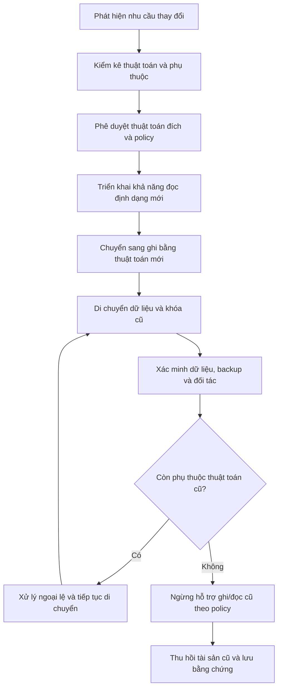

# Algorithm agility

**Algorithm agility** là khả năng thay đổi thuật toán mật mã, kích thước khóa, tham số hoặc implementation khi yêu cầu bảo mật, tiêu chuẩn, nền tảng hay rủi ro thay đổi, mà hệ thống vẫn duy trì được dữ liệu, dịch vụ và khả năng tương tác trong một lộ trình có kiểm soát.

Trong quản lý khóa, thuật toán hiếm khi tồn tại độc lập. Một hệ thống có thể đồng thời dùng AES để mã hóa dữ liệu, RSA hoặc ECDSA để ký, ECDH để thỏa thuận bí mật, HKDF để dẫn xuất khóa, PBKDF2 để xử lý mật khẩu và một provider JCA để thực thi. Khi một thuật toán hoặc provider cần thay thế, hệ thống phải biết khóa nào, dữ liệu nào, giao thức nào và thành phần nào đang phụ thuộc vào nó.

Algorithm agility vì vậy là năng lực kiến trúc và vận hành. Nó cần một danh mục mật mã có thể truy vấn, định danh thuật toán rõ ràng, chính sách cho phép, định dạng dữ liệu có phiên bản, cơ chế chuyển đổi, kiểm thử tương thích và quy trình ngừng hỗ trợ. Mục tiêu là có thể thay đổi có chủ đích khi cần, đồng thời ngăn hệ thống tự hạ xuống lựa chọn yếu hơn.

## 1. Vì sao hệ thống cần algorithm agility?

Một thuật toán được chấp nhận hôm nay có thể không còn phù hợp trong suốt thời gian dữ liệu cần được bảo vệ. Nguyên nhân có thể gồm:

- **Tiến bộ phân tích mật mã:** một thuật toán, mode hoặc cách triển khai xuất hiện điểm yếu mới.
- **Năng lực tính toán thay đổi:** kích thước khóa hoặc tham số cũ không còn đáp ứng mức bảo vệ yêu cầu.
- **Tiêu chuẩn và chính sách thay đổi:** tổ chức, ngành hoặc cơ quan quản lý cập nhật danh sách thuật toán được phép.
- **Lỗ hổng trong implementation:** provider, thư viện, firmware hoặc HSM có lỗi cần thay phiên bản hoặc thay implementation.
- **Yêu cầu tương thích:** hệ thống cần giao tiếp với đối tác, thiết bị hoặc nền tảng mới có bộ thuật toán khác.
- **Thay đổi mô hình đe dọa:** dữ liệu cần bảo mật lâu dài có thể chịu rủi ro từ năng lực tính toán trong tương lai, bao gồm rủi ro liên quan đến máy tính lượng tử.
- **Yêu cầu vận hành:** cần chuyển nhà cung cấp, thay HSM, thay provider hoặc triển khai thuật toán trên nền tảng mới.

Nếu thuật toán bị mã hóa cứng trong mã nguồn, định dạng dữ liệu, cấu hình và giao thức, việc thay đổi có thể cần sửa nhiều dịch vụ cùng lúc. Một hệ thống thiếu metadata cũng có thể không biết ciphertext cũ dùng thuật toán nào hoặc khóa nào để giải mã. Khi đó, tổ chức dễ trì hoãn nâng cấp hoặc phải thực hiện chuyển đổi khẩn cấp với rủi ro mất dữ liệu.

## 2. Phân biệt algorithm agility, crypto agility và provider agility

Các thuật ngữ này liên quan nhưng có phạm vi khác nhau:

| Khái niệm | Phạm vi | Ví dụ |
|---|---|---|
| Algorithm agility | Thay đổi thuật toán, mode, tham số hoặc kích thước khóa | Chuyển từ một cấu hình chữ ký cũ sang thuật toán chữ ký được chính sách mới cho phép |
| Provider agility | Thay implementation hoặc nhà cung cấp dịch vụ mật mã | Chuyển từ provider phần mềm sang provider PKCS#11 kết nối HSM |
| Key agility | Thay khóa, phiên bản khóa, loại khóa hoặc miền quản lý khóa | Tạo DEK mới, rewrap DEK bằng KEK mới hoặc thay cặp khóa ký |
| Crypto agility | Năng lực rộng hơn, kết hợp thay thuật toán, khóa, provider, giao thức và định dạng dữ liệu | Chuyển đổi toàn bộ dịch vụ từ bộ thuật toán cũ sang bộ thuật toán mới theo lộ trình |

Algorithm agility là một phần của crypto agility. Thay provider không nhất thiết thay thuật toán; thay khóa cũng không nhất thiết thay thuật toán. Khi lập kế hoạch, cần chỉ rõ thay đổi thuộc lớp nào để không bỏ sót tác động.

## 3. Các nguyên tắc thiết kế

### 3.1. Tách chính sách khỏi mã nghiệp vụ

Mã nghiệp vụ không nên rải rác các tên transformation hoặc kích thước khóa ở nhiều vị trí. Nên tập trung cấu hình mật mã trong một thành phần có kiểm soát, chẳng hạn crypto policy service hoặc registry nội bộ. Thành phần này ánh xạ một mục đích nghiệp vụ sang bộ tham số được phê duyệt.

Ví dụ, nghiệp vụ có thể yêu cầu “mã hóa dữ liệu lưu trữ phiên bản hiện hành”; cấu hình chính sách xác định transformation, độ dài khóa, provider, tag length và định danh phiên bản. Ứng dụng chỉ nhận cấu hình đã được kiểm tra và không tự cho phép tên thuật toán tùy ý từ request bên ngoài.

### 3.2. Dùng allowlist và từ chối lựa chọn không hợp lệ

Agility không có nghĩa là chấp nhận mọi thuật toán mà runtime hỗ trợ. Hệ thống cần allowlist theo mục đích, môi trường, loại dữ liệu và thời điểm. Ví dụ, thuật toán dùng cho chữ ký số có thể khác thuật toán dùng cho mã hóa dữ liệu; thuật toán còn được phép để xác minh chữ ký cũ có thể không được phép tạo chữ ký mới.

Nếu lựa chọn hiện hành không khả dụng, ứng dụng phải báo lỗi hoặc chuyển sang một lựa chọn dự phòng đã được phê duyệt và có cùng mức bảo vệ. Không được tự động hạ key size, bỏ xác thực, đổi sang mode yếu hoặc chấp nhận thuật toán bị cấm chỉ để tiếp tục xử lý.

### 3.3. Định danh thuật toán rõ ràng và có phiên bản

Không chỉ lưu một chuỗi mơ hồ như `AES` hoặc `RSA`. Cần lưu đủ thông tin để tái tạo đúng cách xử lý: thuật toán, mode, padding, kích thước khóa, tham số đặc thù, định dạng dữ liệu, provider nếu có ràng buộc và phiên bản chính sách.

Định danh nên ổn định và có namespace. Nếu dùng tên chuẩn, OID hoặc identifier của giao thức, cần quy định chính xác cách biểu diễn và ánh xạ đến implementation. Không dùng tên provider làm định danh thuật toán vì cùng thuật toán có thể được cung cấp bởi nhiều provider.

### 3.4. Tương thích ngược có thời hạn

Hệ thống thường phải đọc dữ liệu cũ trong khi ghi dữ liệu mới bằng thuật toán mới. Cần có giai đoạn hỗ trợ cả hai định dạng, nhưng phải đặt thời hạn kết thúc và đo lường số dữ liệu còn tồn tại ở định dạng cũ. Nếu không có lộ trình ngừng hỗ trợ, tương thích ngược có thể biến thành việc duy trì thuật toán yếu vô thời hạn.

### 3.5. Tách biệt khả năng đọc và khả năng ghi

Một thuật toán có thể còn cần thiết để giải mã hoặc xác minh dữ liệu cũ, nhưng không còn được phép dùng để mã hóa hoặc ký dữ liệu mới. Chính sách nên phân biệt:

- `writeAllowed`: có được tạo dữ liệu mới bằng thuật toán này không?
- `readAllowed`: có được đọc hoặc xác minh dữ liệu cũ bằng thuật toán này không?
- `deprecatedAt`: thời điểm bắt đầu ngừng khuyến nghị.
- `disableWriteAt`: thời điểm dừng tạo dữ liệu mới.
- `disableReadAt`: thời điểm ngừng chấp nhận dữ liệu cũ, nếu có thể áp dụng.

Việc tách hai quyền này giúp chuyển đổi theo từng giai đoạn mà không phải giữ khả năng tạo mới bằng thuật toán đã bị loại khỏi chính sách.

## 4. Xây dựng crypto inventory

Không thể thay đổi thứ mà tổ chức không biết đang sử dụng ở đâu. Crypto inventory là danh mục các thành phần mật mã đang tồn tại và các quan hệ phụ thuộc giữa chúng.

Danh mục nên ghi nhận tối thiểu:

| Nhóm thông tin | Trường dữ liệu gợi ý |
|---|---|
| Định danh | Crypto asset ID, hệ thống, dịch vụ, môi trường, chủ sở hữu |
| Mục đích | Mã hóa lưu trữ, mã hóa truyền tải, ký số, xác thực, trao đổi khóa, dẫn xuất khóa |
| Thuật toán | Tên chuẩn, mode, padding, curve, hash, KDF và tham số liên quan |
| Khóa | Key ID, phiên bản, loại khóa, key size, ngày tạo, trạng thái, nơi lưu và exportability |
| Implementation | JDK, provider, phiên bản thư viện, HSM model/firmware hoặc dịch vụ KMS |
| Dữ liệu phụ thuộc | Bảng, bucket, file format, backup, chứng thư, token hoặc giao thức liên quan |
| Vòng đời | Ngày triển khai, ngày hết hạn, trạng thái hỗ trợ, lịch chuyển đổi và ngày ngừng |
| Rủi ro | Mức độ quan trọng, mức phơi lộ, thời gian cần bảo mật và ngoại lệ đã phê duyệt |

Inventory cần được cập nhật tự động khi có thể, kết hợp quét cấu hình, mã nguồn, manifest, keystore, KMS/HSM và log runtime. Quét mã nguồn đơn thuần không phát hiện được mọi khóa hoặc thuật toán được chọn động; kiểm kê thủ công cũng dễ lỗi thời. Cần đối chiếu nhiều nguồn và xác định người chịu trách nhiệm cho từng tài sản.

Không lưu giá trị khóa bí mật vào inventory. Chỉ lưu định danh, metadata và tham chiếu đến hệ thống quản lý khóa có kiểm soát truy cập.

## 5. Thiết kế định dạng dữ liệu có thể chuyển đổi

Ciphertext cần mang theo hoặc liên kết với metadata đủ để biết cách giải mã. Metadata thường bao gồm:

- `formatVersion`: phiên bản định dạng dữ liệu.
- `algorithmId`: định danh thuật toán và cấu hình.
- `keyId` và `keyVersion`: định danh khóa và phiên bản dùng để mã hóa hoặc bọc khóa.
- `nonce` hoặc `iv`: tham số cần thiết của mode mã hóa.
- `tag` hoặc thông tin xác thực: theo định dạng AEAD.
- `kdfId`, `salt` và tham số cost nếu khóa được dẫn xuất từ mật khẩu.
- `wrappedDek` hoặc tham chiếu đến DEK khi dùng envelope encryption.

Ví dụ metadata minh họa:

```json
{
  "formatVersion": 2,
  "algorithmId": "AES-256-GCM",
  "keyReference": {
    "keyId": "kms://records/data-key",
    "keyVersion": "v4"
  },
  "nonce": "base64-encoded-nonce",
  "ciphertext": "base64-encoded-ciphertext-and-tag"
}
```

Các giá trị trên chỉ là ví dụ định dạng, không phải khóa hoặc dữ liệu sản xuất. Metadata điều khiển giải mã phải được xác thực. Với AEAD, có thể đưa header đã chuẩn hóa vào associated data (AAD) để phát hiện việc sửa `algorithmId`, `keyVersion` hoặc trường định dạng. Nếu metadata không được xác thực, kẻ tấn công có thể thay đổi cách hệ thống diễn giải dữ liệu hoặc tạo đường downgrade.

Parser phải kiểm tra phiên bản, thuật toán và tham số với allowlist trước khi cấp tài nguyên hoặc gọi provider. Không dùng trực tiếp `algorithmId` do người dùng gửi để gọi `Cipher.getInstance` mà không xác thực và kiểm tra chính sách.

## 6. Quy trình chuyển đổi thuật toán

Một cuộc chuyển đổi nên diễn ra theo các giai đoạn có thể quan sát và kiểm soát.

1. **Khởi động đánh giá:** xác định lý do thay đổi, hạn cuối, dữ liệu và dịch vụ bị ảnh hưởng, tiêu chuẩn đích và yêu cầu tương thích.
2. **Kiểm kê:** tìm tất cả nơi dùng thuật toán, khóa, provider, định dạng hoặc giao thức liên quan; phân loại dữ liệu theo mức độ quan trọng và thời gian cần bảo vệ.
3. **Chọn đích:** phê duyệt thuật toán, tham số, provider, định dạng metadata và chính sách key management mới.
4. **Chuẩn bị khả năng đọc:** triển khai parser và verifier hỗ trợ định dạng mới, đồng thời duy trì khả năng đọc dữ liệu cũ trong thời hạn chuyển đổi.
5. **Chuyển sang ghi mới:** phát hành dữ liệu mới bằng thuật toán đích; ghi metadata rõ ràng và giám sát tỷ lệ thành công.
6. **Di chuyển dữ liệu cũ:** re-encrypt, rewrap hoặc ký lại theo phương án phù hợp; xử lý theo batch có checkpoint, retry an toàn và đối chiếu số lượng.
7. **Xác minh:** đọc thử dữ liệu sau chuyển đổi, đối chiếu hash/checksum hoặc kiểm tra nghiệp vụ, kiểm tra chữ ký và backup theo phạm vi.
8. **Ngừng ghi cũ:** chặn tạo dữ liệu mới bằng thuật toán cũ; cảnh báo nếu còn thành phần cố sử dụng.
9. **Đóng hỗ trợ cũ:** chỉ khi dữ liệu, bản sao, backup, đối tác và yêu cầu lưu giữ đã đáp ứng điều kiện; thu hồi khóa và provider cũ theo quy trình riêng.
10. **Lưu bằng chứng:** lưu quyết định, phê duyệt, phiên bản policy, thống kê chuyển đổi, ngoại lệ và kết quả kiểm toán.



Không phải mọi tài sản đều cần cùng một kiểu chuyển đổi. Ciphertext thường cần giải mã rồi mã hóa lại; DEK được bọc có thể chỉ cần rewrap; chữ ký số có thể cần ký lại tài liệu hoặc giữ lại cơ chế xác minh lịch sử; chứng thư và giao thức mạng có thể cần triển khai song song theo thời hạn của đối tác.

## 7. Chuyển đổi khóa và thuật toán trong envelope encryption

Envelope encryption giúp tách khóa dữ liệu (DEK) khỏi khóa bảo vệ khóa (KEK). Cách này tạo nhiều lựa chọn chuyển đổi:

| Thay đổi | Thao tác thường cần |
|---|---|
| Chỉ thay KEK | Rewrap DEK bằng KEK mới, xác minh bản ghi và backup, sau đó hủy bản bọc/KEK cũ theo chính sách |
| Thay thuật toán bọc DEK | Unwrap DEK bằng cơ chế cũ rồi wrap bằng cơ chế mới; kiểm soát chặt thời gian DEK xuất hiện trong bộ nhớ |
| Thay thuật toán mã hóa dữ liệu | Giải mã ciphertext cũ bằng DEK/cơ chế cũ rồi mã hóa lại bằng DEK hoặc thuật toán mới |
| Thay cả DEK và KEK | Tạo DEK mới, mã hóa lại dữ liệu, bọc DEK mới bằng KEK hiện hành và xác minh toàn bộ bản sao |

Rewrap chỉ thay lớp bảo vệ DEK; nó không thay đổi thuật toán đã dùng để mã hóa dữ liệu. Nếu thuật toán mã hóa dữ liệu đã yếu hoặc cần thay đổi mode, chỉ rewrap DEK là chưa đủ. Ngược lại, nếu chỉ KEK cần xoay vòng và thuật toán mã hóa dữ liệu vẫn phù hợp, rewrap có thể giảm chi phí chuyển đổi.

Trong mọi trường hợp, không hủy khóa cũ trước khi xác minh dữ liệu, backup, replica và đường khôi phục đã dùng được bằng khóa mới. Khi mục tiêu là crypto-erasure, cần kiểm kê toàn bộ bản sao của khóa cũ và xác nhận không còn đường giải mã khác.

## 8. Chuyển đổi chữ ký số và chứng thư

Chữ ký số có yêu cầu đặc biệt: dữ liệu đã ký có thể cần được xác minh trong nhiều năm sau khi thuật toán ký mới được triển khai. Ngừng tạo chữ ký bằng thuật toán cũ không có nghĩa có thể lập tức xóa khả năng xác minh chữ ký cũ.

Một lộ trình có thể gồm:

- Dừng tạo chữ ký mới bằng thuật toán cũ tại mốc đã công bố.
- Tạo chữ ký mới bằng thuật toán đích; nếu cần, tạo chữ ký kép trong giai đoạn chuyển tiếp theo giao thức được phê duyệt.
- Giữ thông tin thuật toán, chứng thư, chuỗi chứng thực, thời điểm ký và dữ liệu kiểm tra trạng thái chứng thư theo yêu cầu lưu giữ.
- Xác minh chữ ký cũ theo chính sách lịch sử và mô hình tin cậy đã xác định.
- Xem xét ký lại hoặc đóng dấu thời gian lưu trữ khi có yêu cầu chứng minh tính toàn vẹn dài hạn.
- Bảo toàn khóa và tài liệu cần thiết cho xác minh lịch sử trong phạm vi chính sách; xử lý private key cũ theo vòng đời riêng.

Chữ ký kép hoặc nhiều thuật toán chỉ hữu ích khi giao thức xác định rõ cách xác minh và chống downgrade. Không tự động coi một tài liệu là hợp lệ nếu chỉ một trong các chữ ký không bị ràng buộc với cùng nội dung và ngữ cảnh.

## 9. Algorithm negotiation và chống downgrade

Trong giao thức giữa nhiều bên, các bên có thể cần thương lượng bộ thuật toán. Quá trình thương lượng phải có quy tắc rõ ràng:

- Danh sách thuật toán được phép phải được xác định bởi policy của từng bên.
- Kết quả thương lượng phải được xác thực hoặc ràng buộc vào transcript của giao thức.
- Hai bên phải thống nhất cách xử lý khi không có thuật toán giao nhau; lựa chọn an toàn thường là từ chối kết nối.
- Không để kẻ trung gian xóa lựa chọn mạnh hơn rồi ép hai bên dùng thuật toán cũ.
- Cần định nghĩa thời điểm và điều kiện loại bỏ thuật toán cũ để tránh khác biệt cấu hình giữa các node.

Một danh sách ưu tiên do client gửi không phải là policy tin cậy. Server phải áp dụng allowlist của mình, xác thực transcript và từ chối các lựa chọn bị cấm. Khi thay đổi giao thức, cần kiểm thử tương thích với phiên bản cũ và bảo đảm lỗi thương lượng không dẫn đến fallback không an toàn.

## 10. Java: đưa lựa chọn thuật toán vào policy

JCA cho phép lấy engine theo tên transformation. Để dễ thay đổi, ứng dụng có thể ánh xạ một profile đã được phê duyệt sang transformation và provider. Ví dụ dưới đây minh họa allowlist trong mã cấu hình; hệ thống thực tế có thể nạp cấu hình đã ký hoặc registry được kiểm soát.

```java
import java.security.GeneralSecurityException;
import java.security.Provider;
import javax.crypto.Cipher;

enum CryptoProfile {
    STORAGE_V2
}

final class CryptoPolicy {
    private CryptoPolicy() {}

    static Cipher createCipher(CryptoProfile profile, Provider approvedProvider)
            throws GeneralSecurityException {
        if (approvedProvider == null) {
            throw new GeneralSecurityException("Approved provider is unavailable");
        }

        String transformation;
        switch (profile) {
            case STORAGE_V2:
                transformation = "AES/GCM/NoPadding";
                break;
            default:
                throw new GeneralSecurityException("Unsupported crypto profile");
        }
        return Cipher.getInstance(transformation, approvedProvider);
    }
}
```

Ví dụ minh họa việc chọn một profile có tên ổn định, ánh xạ đến transformation và nhận provider đã được khởi tạo, kiểm tra theo policy ở giai đoạn startup. Cách viết dùng `switch` cổ điển để tương thích với các phiên bản Java cũ hơn. Nó chưa bao gồm cấu hình nonce, tag, quản lý khóa, AAD hoặc kiểm tra phiên bản dữ liệu; các phần đó phải được thực hiện theo thiết kế mã hóa hoàn chỉnh. Không nhận `transformation` tùy ý từ client và không dùng `catch` để chuyển sang thuật toán yếu hơn khi provider bị thiếu.

Metadata dữ liệu nên lưu định danh profile hoặc thuật toán cụ thể cùng phiên bản, ví dụ `formatVersion=2` và `algorithmId=AES-256-GCM`. Khi đọc, parser xác thực metadata, tra cứu policy cho phép đọc định dạng đó, rồi mới khởi tạo engine. Tên profile trong ví dụ là tên nội bộ; cần quản lý mapping và vòng đời của nó như một phần của schema dữ liệu.

## 11. Kiểm thử algorithm agility

Một hệ thống chỉ được xem là có agility khi chứng minh được khả năng chuyển đổi, đọc dữ liệu cũ và từ chối lựa chọn không hợp lệ.

Các nhóm kiểm thử cần có:

1. **Kiểm thử thuật toán mới:** tạo khóa, mã hóa, giải mã, ký và xác minh theo profile mới bằng provider trên môi trường đích.
2. **Kiểm thử tương thích:** đọc dữ liệu cũ, kiểm tra định dạng, metadata, alias, chứng thư và giao thức từ các phiên bản còn hỗ trợ.
3. **Kiểm thử migration:** chạy thử batch chuyển đổi, checkpoint, retry, tính idempotent và xử lý lỗi giữa chừng.
4. **Kiểm thử downgrade:** gửi metadata hoặc thông điệp đề nghị thuật toán bị cấm; xác nhận hệ thống từ chối và không tự chuyển sang lựa chọn yếu.
5. **Kiểm thử rollback:** xác định có thể quay lại phiên bản ứng dụng trước hay không sau khi dữ liệu mới đã được ghi; không rollback bằng cách tái kích hoạt thuật toán bị cấm.
6. **Kiểm thử hiệu năng:** đo CPU, bộ nhớ, độ trễ, throughput và tải HSM khi dùng thuật toán mới hoặc chạy song song hai thế hệ.
7. **Kiểm thử khôi phục:** phục hồi backup trong môi trường sạch, xác minh provider và khóa cần thiết vẫn có thể đọc dữ liệu trong thời hạn cho phép.
8. **Kiểm thử kiểm toán:** xác nhận log ghi profile, thuật toán, key version, provider và kết quả mà không ghi vật liệu khóa.

Kiểm thử phải dùng dữ liệu giả lập hoặc bản sao được phê duyệt, không làm hủy khóa sản xuất hay thay đổi dữ liệu thật ngoài kế hoạch migration. Kết quả cần được lưu cùng phiên bản mã, policy, provider và môi trường để có thể tái hiện.

## 12. Quản lý deprecation và ngoại lệ

Quy trình ngừng hỗ trợ cần có người chịu trách nhiệm, mốc thời gian và tiêu chí hoàn tất. Một policy có thể định nghĩa các trạng thái:

| Trạng thái | Ý nghĩa |
|---|---|
| `APPROVED` | Được phép tạo và đọc theo phạm vi chính sách |
| `DEPRECATED` | Vẫn hoạt động nhưng không khuyến nghị cho dữ liệu mới; có kế hoạch thay thế |
| `READ_ONLY` | Không được tạo dữ liệu mới; chỉ đọc/xác minh dữ liệu cũ trong phạm vi cho phép |
| `BLOCKED` | Không được sử dụng; mọi yêu cầu phải bị từ chối |
| `RETIRED` | Đã hoàn tất chuyển đổi và đóng hỗ trợ theo policy |

Tên trạng thái là ví dụ nội bộ; điều quan trọng là ngữ nghĩa được định nghĩa rõ và được thực thi nhất quán. Ngoại lệ phải có chủ sở hữu, lý do, hệ thống bị ảnh hưởng, biện pháp giảm thiểu, ngày hết hạn và người phê duyệt. Không để ngoại lệ vô thời hạn hoặc dùng ngoại lệ để mở lại thuật toán bị cấm trên toàn hệ thống.

## 13. Những lỗi thường gặp

| Lỗi | Hậu quả | Cách kiểm soát |
|---|---|---|
| Hardcode thuật toán ở nhiều module | Thay đổi khó đồng bộ và dễ bỏ sót | Tập trung profile và policy có phiên bản |
| Chỉ lưu `AES` hoặc `RSA` | Không biết mode, padding, tham số hoặc phiên bản đã dùng | Lưu định danh thuật toán đầy đủ và metadata cần thiết |
| Chấp nhận thuật toán do client tự chọn | Có thể bị ép dùng thuật toán yếu hoặc không được phép | Allowlist phía server và xác thực thương lượng |
| Tương thích ngược không có hạn cuối | Thuật toán cũ tiếp tục được dùng vô thời hạn | Có mốc dừng ghi, dừng đọc và tiêu chí retire |
| Chuyển KEK nhưng quên ciphertext | DEK được bọc lại nhưng dữ liệu vẫn dùng thuật toán cũ | Phân biệt rewrap với re-encrypt và lập kế hoạch theo từng lớp |
| Hủy khóa cũ trước khi kiểm tra backup | Mất khả năng khôi phục dữ liệu | Xác minh backup/DR và mọi bản sao trước khi destroy |
| Chuyển đổi dữ liệu không có checkpoint | Lỗi giữa chừng gây dữ liệu thiếu hoặc không nhất quán | Batch có checkpoint, retry idempotent và đối chiếu số lượng |
| Chỉ kiểm thử đường đi mới | Dữ liệu cũ hoặc đối tác cũ có thể không còn tương thích | Kiểm thử cả đọc cũ, ghi mới, downgrade và khôi phục |
| Fallback khi lỗi provider | Có thể làm suy yếu bảo vệ mà không ai nhận biết | Chỉ dùng fallback đã phê duyệt và ghi nhận rõ |
| Không kiểm kê thuật toán đang chạy | Không biết đã chuyển đổi hết hay chưa | Kết hợp inventory, telemetry và báo cáo migration |

## 14. Checklist triển khai

Trước khi đưa một hệ thống vào vận hành, hãy xác nhận:

- [ ] Có inventory thuật toán, khóa, provider, giao thức và dữ liệu phụ thuộc.
- [ ] Mỗi mục đích mật mã có profile và allowlist được phê duyệt.
- [ ] Metadata dữ liệu chứa định danh thuật toán, key ID/version và tham số cần để đọc lại.
- [ ] Metadata quan trọng được xác thực hoặc ràng buộc vào AAD/transcript.
- [ ] Hệ thống tách quyền tạo mới khỏi quyền đọc/xác minh dữ liệu cũ.
- [ ] Có quy trình chuyển đổi, checkpoint, retry, đối chiếu và rollback an toàn.
- [ ] Có kế hoạch riêng cho ciphertext, wrapped DEK, chữ ký, chứng thư và giao thức.
- [ ] Không có fallback hoặc negotiation làm giảm mức bảo vệ ngoài policy.
- [ ] Có mốc deprecation, disable write, disable read và retire rõ ràng.
- [ ] Đã kiểm thử tương thích, downgrade, hiệu năng, backup/DR và kiểm toán.
- [ ] Ngoại lệ có người sở hữu, biện pháp giảm thiểu và ngày hết hạn.

Algorithm agility giúp hệ thống tiếp tục bảo vệ dữ liệu khi thuật toán, provider, tiêu chuẩn hoặc mô hình đe dọa thay đổi. Năng lực này đến từ việc biết rõ tài sản mật mã, định danh và phiên bản hóa lựa chọn, kiểm soát việc đọc/ghi, di chuyển dữ liệu có kiểm chứng và ngừng hỗ trợ cũ theo lộ trình. Một hệ thống có agility phải chứng minh được rằng nó chuyển sang lựa chọn mới đúng cách và từ chối được lựa chọn đã bị loại bỏ.
