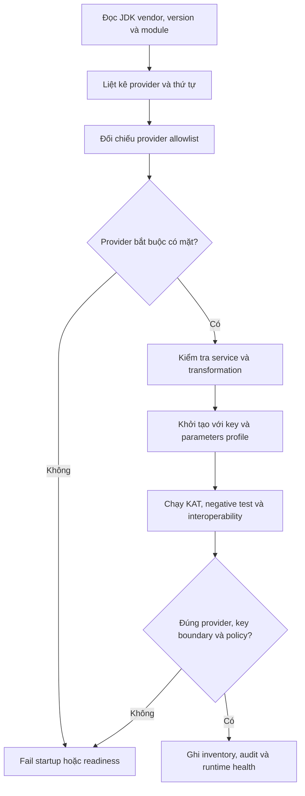

# Kiểm tra provider runtime

Kiểm tra provider runtime là quá trình xác minh môi trường Java đang chạy có đúng các cryptographic provider, dịch vụ, thuật toán, tham số và implementation mà ứng dụng được phép sử dụng hay không. Một thuật toán có trong tài liệu hoặc có trên máy phát triển chưa chắc tồn tại trong JDK production; provider có thể khác theo JDK vendor, phiên bản, module được đóng gói, file `java.security`, thư viện native, cấu hình HSM và thứ tự provider đã đăng ký.

Trong Java Cryptography Architecture (JCA/JCE), provider là implementation cung cấp các dịch vụ như `Cipher`, `Signature`, `Mac`, `MessageDigest`, `KeyPairGenerator`, `KeyStore` và `SecureRandom`. Khi ứng dụng gọi `getInstance`, Java tìm implementation theo provider đã đăng ký nếu không chỉ định provider cụ thể. Vì vậy, kiểm tra runtime phải xác nhận cả **provider nào được chọn** và **thao tác thực tế có chạy đúng với key, parameters và policy hay không**.

Trong quản lý khóa mật mã, kiểm tra provider runtime giúp ngăn việc âm thầm chuyển từ HSM sang software, dùng thuật toán yếu do khác biệt cấu hình, tạo key ở sai security boundary hoặc không thể sử dụng key version đã cấp. Việc kiểm tra cần được thực hiện khi triển khai, khi nâng JDK/provider/firmware và trong vận hành; kết quả phải gắn với key ID/version, algorithm, parameters, provider và môi trường cụ thể.

## 1. Vì sao phải kiểm tra provider ở runtime?

Một ứng dụng Java có thể biên dịch và chạy thành công trên máy developer nhưng thất bại trong production vì:

- JDK production khác vendor hoặc phiên bản, không có cùng provider hay algorithm.
- Runtime image tối giản đã loại module chứa provider cần thiết.
- Provider có mặt nhưng không hỗ trợ transformation hoặc parameter cụ thể.
- Provider được đăng ký nhưng native library, HSM partition hoặc token không khả dụng.
- Thứ tự provider thay đổi khiến JCA chọn implementation khác.
- Key được tạo bởi provider này nhưng provider khác không thể sử dụng key object đó.
- Provider đã được cấu hình nhưng ứng dụng vẫn gọi implementation mặc định.
- HSM không hỗ trợ mechanism cần thiết và ứng dụng tự fallback sang software.
- Security property hoặc policy của JDK chặn thuật toán trong TLS, certificate path hoặc chữ ký JAR.
- Một dependency hoặc application server thay đổi provider list trong quá trình khởi động.

Kiểm tra runtime giúp phát hiện sớm sai lệch trước khi ứng dụng xử lý dữ liệu thật. Nó cũng tạo bằng chứng rằng một thao tác mật mã được thực hiện bởi provider đã phê duyệt, trên đúng key và với đúng tham số.

## 2. Provider cung cấp những dịch vụ nào?

JCA/JCE dùng các lớp engine để truy cập dịch vụ mật mã. Mỗi provider có thể hỗ trợ một tập dịch vụ khác nhau.

| Engine class | Vai trò | Ví dụ thuật toán/dịch vụ |
|---|---|---|
| `Cipher` | Mã hóa, giải mã và một số thao tác wrap/unwrap | `AES/GCM/NoPadding`, `RSA/ECB/OAEPWithSHA-256AndMGF1Padding` |
| `Signature` | Tạo và xác minh chữ ký số | `RSASSA-PSS`, `SHA256withRSA`, `SHA256withECDSA`, `Ed25519` |
| `Mac` | Message Authentication Code | `HmacSHA256`, `HmacSHA384`, `AESCMAC` nếu provider hỗ trợ |
| `MessageDigest` | Tính digest/hash | `SHA-256`, `SHA-384`, `SHA3-256` |
| `KeyGenerator` | Sinh secret key | `AES`, `HmacSHA256` |
| `KeyPairGenerator` | Sinh cặp public/private key | `RSA`, `EC`, `Ed25519`, `X25519` tùy JDK/provider |
| `KeyFactory` | Chuyển đổi key specification và key object | `RSA`, `EC`, `Ed25519` |
| `SecretKeyFactory` | Tạo secret key từ specification | `PBKDF2WithHmacSHA256` |
| `KeyAgreement` | Thỏa thuận shared secret | `ECDH`, `X25519` |
| `KeyStore` | Truy cập key entry và certificate entry | `PKCS12`, `JKS`, `PKCS11` |
| `SecureRandom` | Sinh dữ liệu ngẫu nhiên mật mã | `DRBG`, implementation cụ thể của provider |
| `AlgorithmParameters` | Biểu diễn/tham số hóa thuật toán | `GCM`, `OAEP`, `PSS` tùy provider |

Provider có thể cung cấp một engine nhưng chỉ hỗ trợ một số algorithm, key size hoặc parameter. Ví dụ, provider có thể hỗ trợ `AES/GCM/NoPadding` nhưng giới hạn tag length; hỗ trợ RSA key generation nhưng không hỗ trợ RSA-PSS; hoặc có `KeyStore.PKCS11` nhưng token không có key object cần dùng.

## 3. Phân biệt provider, service, algorithm và transformation

Các khái niệm này liên quan nhưng không thể thay thế nhau:

- **Provider:** implementation được đăng ký trong JVM, ví dụ `SunJCE`, `SunEC`, `SUN`, `SunPKCS11-HSM`.
- **Service type:** engine class mà provider cung cấp, ví dụ `Cipher`, `Signature`, `KeyStore`.
- **Algorithm/service name:** thuật toán hoặc dịch vụ cụ thể, ví dụ `AES`, `RSASSA-PSS`, `PKCS12`.
- **Transformation:** cách gọi `Cipher` gồm algorithm, mode và padding, ví dụ `AES/GCM/NoPadding`.
- **Parameters:** cấu hình chi tiết như nonce, tag length, OAEP hash, MGF1 hash, PSS salt length hoặc curve.
- **Key compatibility:** key type, size, attributes và provider/key object mà service có thể sử dụng.

Ví dụ `Cipher.getInstance("AES/GCM/NoPadding")` chỉ yêu cầu một transformation. Nó chưa chứng minh provider hỗ trợ key size 256 bit, tag 128 bit, AAD, nonce length đang dùng hoặc key handle từ HSM. Những điều kiện đó chỉ được xác nhận sau khi khởi tạo và thực hiện thao tác với đúng parameters/key.

Một provider có thể đăng ký service theo tên algorithm gốc rồi khai báo mode/padding hỗ trợ trong thuộc tính. Vì vậy, việc tìm chính xác chuỗi transformation trong metadata provider chỉ là tín hiệu khám phá, không phải phép kiểm tra tương thích đầy đủ.

## 4. JCA tìm provider như thế nào?

Khi ứng dụng gọi API không chỉ định provider, JCA xét các provider đã đăng ký theo thứ tự ưu tiên và chọn implementation phù hợp. Danh sách provider thường được cấu hình trong security properties của JDK, có thể được bổ sung hoặc thay đổi lúc runtime.

Các nguồn ảnh hưởng provider list gồm:

- File `java.security` đi kèm JDK hoặc runtime image.
- Security properties dạng `security.provider.N`.
- File override được nạp bằng tùy chọn `java.security.properties`.
- Lời gọi `Security.addProvider`, `Security.insertProviderAt` hoặc `Security.removeProvider` trong ứng dụng/dependency.
- Cơ chế cấu hình riêng của provider, ví dụ `SunPKCS11`.
- Application server, framework hoặc agent khởi tạo provider trước ứng dụng.

Thứ tự provider có ý nghĩa. Nếu hai provider cùng cung cấp `Cipher.AES`, lời gọi không chỉ định provider có thể chọn provider đứng trước theo quy tắc JCA. Việc thay đổi thứ tự có thể làm thay đổi implementation mà không cần sửa code gọi `Cipher.getInstance`.

Không nên thay đổi thứ tự provider toàn JVM chỉ để sửa một use case. Cách đó có thể ảnh hưởng thư viện khác, TLS, certificate path, random source và các dịch vụ mật mã không liên quan. Khi policy yêu cầu implementation cụ thể, chỉ định provider tại điểm sử dụng hoặc cấu hình một abstraction có allowlist rõ ràng.

Quy trình kiểm tra nên đi từ runtime tới thao tác thật:



## 5. Liệt kê provider đang hoạt động

`Security.getProviders()` trả về các provider hiện được đăng ký trong JVM theo thứ tự. `Provider` cung cấp tên, version, thông tin mô tả và tập service đã đăng ký.

Ví dụ Java 17:

```java
import java.security.Provider;
import java.security.Security;
import java.util.Set;

public final class ProviderInventory {
    private static final Set<String> IMPORTANT_TYPES = Set.of(
        "Cipher", "Signature", "Mac", "MessageDigest",
        "KeyGenerator", "KeyPairGenerator", "KeyAgreement",
        "KeyStore", "SecureRandom", "AlgorithmParameters"
    );

    private ProviderInventory() {}

    public static void printInventory() {
        Provider[] providers = Security.getProviders();
        for (int index = 0; index < providers.length; index++) {
            Provider provider = providers[index];
            System.out.printf(
                "%d. %s version=%s info=%s%n",
                index + 1,
                provider.getName(),
                provider.getVersionStr(),
                provider.getInfo()
            );

            for (Provider.Service service : provider.getServices()) {
                if (IMPORTANT_TYPES.contains(service.getType())) {
                    System.out.printf(
                        "   %s.%s -> %s%n",
                        service.getType(),
                        service.getAlgorithm(),
                        service.getClassName()
                    );
                }
            }
        }
    }
}
```

Đoạn mã liệt kê metadata service mà provider công bố. Không nên in toàn bộ inventory vào log công khai nếu tên provider, HSM hoặc cấu hình nội bộ được xem là thông tin nhạy cảm. Với Java 8, `Provider.getVersionStr()` chưa có; có thể dùng `getVersion()` nhưng API này đã được thay thế trong các JDK mới hơn.

`Provider.getServices()` không phải phép thử cuối cùng cho mọi transformation. Một số provider đăng ký service theo tên algorithm và công bố mode/padding qua thuộc tính. Sau khi khám phá, cần thử tạo engine bằng API thực tế với transformation và parameter đã duyệt.

## 6. Kiểm tra service và transformation

Có thể dùng `Provider.getService(type, algorithm)` để kiểm tra metadata provider có khai báo service tương ứng hay không. Tuy nhiên, đối với `Cipher`, chuỗi transformation có thể được provider biểu diễn qua service `AES` cùng thuộc tính mode/padding. Vì vậy, không kết luận provider không hỗ trợ chỉ vì `getService("Cipher", "AES/GCM/NoPadding")` trả `null`.

Phép kiểm tra thực tế hơn là gọi `getInstance` với provider được chỉ định:

```java
import java.security.GeneralSecurityException;
import java.security.Provider;
import java.security.Security;
import javax.crypto.Cipher;

public final class CipherCapability {
    private CipherCapability() {}

    public static Cipher requireAesGcm(String providerName)
            throws GeneralSecurityException {
        Provider provider = Security.getProvider(providerName);
        if (provider == null) {
            throw new IllegalStateException(
                "Required provider is not registered: " + providerName
            );
        }

        Cipher cipher = Cipher.getInstance(
            "AES/GCM/NoPadding", provider
        );
        if (!provider.equals(cipher.getProvider())) {
            throw new IllegalStateException(
                "Unexpected provider selected for AES-GCM"
            );
        }
        return cipher;
    }
}
```

`getInstance` chứng minh provider có thể tạo engine cho transformation đó trong runtime hiện tại. Nó chưa chứng minh key/parameters cụ thể sẽ khởi tạo thành công hoặc thao tác mật mã cho kết quả đúng. Cần kiểm tra tiếp `init`, `updateAAD`, `doFinal`, verify/decrypt và các trường hợp lỗi theo profile.

## 7. Chỉ định provider rõ ràng

Khi không truyền provider, JCA chọn implementation theo provider order. Nếu policy yêu cầu một provider cụ thể, truyền provider object hoặc provider name rõ ràng.

```java
Provider provider = Security.getProvider("SunJCE");
if (provider == null) {
    throw new IllegalStateException("Approved provider is missing");
}

Cipher cipher = Cipher.getInstance(
    "AES/GCM/NoPadding", provider
);
```

Tên `SunJCE` chỉ là ví dụ. Trong production, tên provider phải lấy từ allowlist được phê duyệt và được kiểm tra theo JDK/vendor thực tế. Với HSM, provider có thể là tên đã cấu hình như `SunPKCS11-HSM`.

Không chỉ kiểm tra `Security.getProvider(name) != null` rồi coi provider đã sẵn sàng. Provider có thể được đăng ký nhưng native library không load được, token không hiện diện, mechanism không hỗ trợ hoặc user không được login. Cần kiểm tra từng tầng theo mục đích triển khai.

### 7.1. Kiểm tra provider thực sự được dùng

Sau khi tạo engine, có thể lấy provider thực tế từ engine bằng `getProvider()`. Nếu chỉ định provider trực tiếp, kết quả phải khớp provider đó. Nếu không chỉ định, hãy ghi lại provider được chọn sau khi engine đã khởi tạo; một số engine có thể trì hoãn việc chọn provider cho đến khi có key/parameters.

Không ghi nhận provider dự kiến từ cấu hình thay cho provider thực tế. Audit cần lưu tên provider, version, engine type, algorithm/transformation, key reference và kết quả thao tác.

### 7.2. Không dùng fallback ngoài policy

Một pattern nguy hiểm là thử HSM trước rồi bắt mọi exception để dùng software provider:

```java
// Không nên dùng trong production nếu fallback chưa được phê duyệt.
try {
    return signWithHsm(data);
} catch (Exception ignored) {
    return signWithSoftwareKey(data);
}
```

Nếu HSM lỗi, fallback có thể đưa private key ra khỏi security boundary hoặc sử dụng một key khác với certificate đang được công bố. Ứng dụng nên fail rõ ràng hoặc chuyển sang implementation dự phòng đã được đánh giá, có key identity và audit riêng. Không bắt exception tổng quát rồi che giấu nguyên nhân.

## 8. Kiểm tra provider version và môi trường JDK

Provider phụ thuộc JDK vendor, version, module, cấu hình security và native dependency. Một runtime container có thể khác JDK trên máy build dù cùng ghi `Java 21` trong tài liệu triển khai.

Thông tin nên ghi nhận khi startup hoặc trong deployment inventory:

- Java vendor, runtime version và VM version.
- Các module JDK liên quan có mặt hay không.
- Provider name, version, info và thứ tự đăng ký.
- Engine/algorithm/transformation được sử dụng.
- Native library version và firmware HSM nếu có.
- Token/slot/partition reference nếu dùng PKCS#11.
- Security properties liên quan và provider configuration fingerprint.
- Key ID/version, certificate serial/fingerprint và policy profile.

Có thể kiểm tra runtime từ command line:

```bash
java -version
java --list-modules
keytool -list -cacerts
```

`java --list-modules` giúp kiểm tra module runtime, ví dụ `jdk.crypto.cryptoki` khi cần SunPKCS11. Không phải mọi JDK distribution đều đóng gói module này trong runtime tối giản. `keytool -list -cacerts` kiểm tra truststore mặc định của JDK; kết quả đó không chứng minh ứng dụng đang dùng cùng truststore nếu ứng dụng cấu hình riêng.

Trên Java 9 trở lên có thể dùng `Runtime.version()` để ghi nhận version có cấu trúc. Không chỉ dựa vào chuỗi `java.version`; vendor build, patch level và module image cũng có thể ảnh hưởng hành vi.

## 9. Kiểm tra JDK security properties

JDK có security properties và system properties ảnh hưởng tới một số đường xử lý. Ví dụ:

| Property | Phạm vi chính | Ý nghĩa |
|---|---|---|
| `security.provider.N` | Đăng ký provider | Provider list và thứ tự ưu tiên |
| `jdk.tls.disabledAlgorithms` | TLS | Thuật toán/protocol/key constraint bị vô hiệu trong TLS |
| `jdk.certpath.disabledAlgorithms` | PKIX certificate path | Giới hạn thuật toán và tham số khi xây dựng certificate path |
| `jdk.jar.disabledAlgorithms` | JAR signature verification | Thuật toán không được chấp nhận khi kiểm tra chữ ký JAR |
| `crypto.policy` | JCE policy trên một số JDK cũ | Giới hạn cryptographic strength trong các runtime lịch sử |

Các property trên có phạm vi riêng. Ví dụ `jdk.tls.disabledAlgorithms` không phải allowlist toàn cục cho mọi lời gọi `Cipher` trong ứng dụng. Nếu muốn enforce thuật toán cho business operation, cần policy ở application/service layer và kiểm tra provider/key parameters tại điểm sử dụng.

Ví dụ đọc một số property:

```java
import java.security.Security;

public final class SecurityPropertyReport {
    private SecurityPropertyReport() {}

    public static void printSelectedProperties() {
        String[] names = {
            "security.provider.1",
            "security.provider.2",
            "jdk.tls.disabledAlgorithms",
            "jdk.certpath.disabledAlgorithms",
            "jdk.jar.disabledAlgorithms",
            "crypto.policy"
        };

        for (String name : names) {
            System.out.printf(
                "%s=%s%n", name, Security.getProperty(name)
            );
        }
    }
}
```

Giá trị trả về phụ thuộc JDK và file security properties đang được nạp. Một số property có thể được đọc hoặc cache khi component khởi tạo; thay đổi giữa chừng không đảm bảo cập nhật mọi engine đã tồn tại. Nên cấu hình trước khi khởi động và kiểm thử trên đúng runtime image.

## 10. Kiểm tra parameter, không chỉ tên algorithm

Một transformation có thể tồn tại nhưng không chấp nhận parameter của ứng dụng. Ví dụ:

- AES-GCM: key size, nonce length, tag length và AAD.
- RSA-OAEP: digest, MGF1 digest, label và kích thước key.
- RSA-PSS: digest, MGF1 digest, salt length và trailer field.
- ECDSA/ECDH: curve, key parameters và encoding.
- PBKDF2: PRF, salt length và iteration count.
- AES-KW/KWP: key type, key length và mechanism support.

Vì vậy, health check nên dùng đúng `AlgorithmParameterSpec` và key type production sẽ dùng. Chỉ gọi `Cipher.getInstance` không đủ. Cũng không nên kiểm tra mọi tổ hợp parameters ngẫu nhiên trong production; dùng profile đã duyệt và test suite trên build/release pipeline.

## 11. Kiểm thử thực thi bằng known-answer test

Round-trip test (encrypt rồi decrypt bằng cùng implementation) có thể phát hiện lỗi cơ bản nhưng không chứng minh implementation tương thích với chuẩn. Nếu encrypt và decrypt cùng sai theo một cách, round-trip vẫn có thể thành công. Known-answer test (KAT) so sánh kết quả với vector chuẩn đã biết giúp kiểm tra implementation cụ thể.

Ví dụ dưới đây dùng vector AES-128-GCM chuẩn: key và nonce đều là byte zero, plaintext là 16 byte zero, AAD rỗng; ciphertext và tag được so sánh với kết quả đã biết. Đây chỉ là test vector công khai, tuyệt đối không dùng key/nonce này cho dữ liệu thật.

```java
import java.security.MessageDigest;
import java.security.Provider;
import java.security.Security;
import java.util.HexFormat;
import javax.crypto.AEADBadTagException;
import javax.crypto.Cipher;
import javax.crypto.spec.GCMParameterSpec;
import javax.crypto.spec.SecretKeySpec;

public final class AesGcmProviderKat {
    private static final HexFormat HEX = HexFormat.of();

    private AesGcmProviderKat() {}

    public static void verify(String providerName) throws Exception {
        Provider provider = Security.getProvider(providerName);
        if (provider == null) {
            throw new IllegalStateException(
                "Provider is not registered: " + providerName
            );
        }

        byte[] keyBytes = new byte[16];
        byte[] nonce = new byte[12];
        byte[] plaintext = new byte[16];
        byte[] expected = HEX.parseHex(
            "0388dace60b6a392f328c2b971b2fe78"
          + "ab6e47d42cec13bdf53a67b21257bddf"
        );
        SecretKeySpec key = new SecretKeySpec(keyBytes, "AES");

        Cipher encryptor = Cipher.getInstance(
            "AES/GCM/NoPadding", provider
        );
        encryptor.init(Cipher.ENCRYPT_MODE, key,
            new GCMParameterSpec(128, nonce));
        byte[] actual = encryptor.doFinal(plaintext);
        if (!MessageDigest.isEqual(expected, actual)) {
            throw new IllegalStateException("AES-GCM KAT failed");
        }

        Cipher decryptor = Cipher.getInstance(
            "AES/GCM/NoPadding", provider
        );
        decryptor.init(Cipher.DECRYPT_MODE, key,
            new GCMParameterSpec(128, nonce));
        byte[] recovered = decryptor.doFinal(actual);
        if (!MessageDigest.isEqual(plaintext, recovered)) {
            throw new IllegalStateException("AES-GCM decrypt KAT failed");
        }

        byte[] tampered = actual.clone();
        tampered[tampered.length - 1] ^= 1;
        Cipher verifier = Cipher.getInstance(
            "AES/GCM/NoPadding", provider
        );
        verifier.init(Cipher.DECRYPT_MODE, key,
            new GCMParameterSpec(128, nonce));
        try {
            verifier.doFinal(tampered);
            throw new IllegalStateException(
                "Provider accepted a tampered GCM tag"
            );
        } catch (AEADBadTagException expectedFailure) {
            // Expected: authentication must fail.
        }
    }
}
```

Đây là ví dụ chạy trên JDK hỗ trợ `HexFormat` (Java 17 trở lên). KAT kiểm tra một profile cụ thể; nó không chứng minh provider đã được chứng nhận FIPS, không chứng minh mọi key size đều được hỗ trợ và cũng không kiểm tra key management/nonce allocator của ứng dụng. Với HSM, cần xác minh test này thực sự dùng key/token thuộc security boundary yêu cầu; vector key công khai chỉ dùng trong test, không đại diện cho key production non-exportable.

Đoạn mã dùng `SecretKeySpec` chứa key test trong memory, nên phù hợp để kiểm tra provider software có chấp nhận raw AES key. Không dùng nguyên đoạn này làm bằng chứng rằng HSM đã thực hiện thao tác với key non-exportable. Với HSM, tạo test key trong partition thử nghiệm theo quy trình vendor, chạy vector tương đương qua key handle và xác minh HSM audit/operation reference chỉ đúng token đó.

## 12. Kiểm tra chữ ký và key compatibility

Provider có thể tạo `Signature` nhưng không sử dụng được private key cụ thể do key type, parameter hoặc provider ownership. Key object từ HSM có thể là handle chỉ provider tương ứng hiểu; software provider khác không thể dùng nó.

Một kiểm tra signing profile nên xác nhận:

1. Provider được phép có `Signature` algorithm đã định.
2. Key type và public key parameters phù hợp profile.
3. Private key handle thuộc provider/security boundary dự kiến.
4. `initSign` và `setParameter` thành công với đúng scheme.
5. Chữ ký tạo ra được xác minh bằng public key/certificate đã được xác minh độc lập.
6. Chữ ký sai message hoặc sai public key bị từ chối.
7. Audit gắn thao tác với key ID/version và provider thực tế.

Không chỉ kiểm tra `PrivateKey.getAlgorithm()`. Giá trị này có thể chỉ cho biết key type như `RSA` hoặc `EC`, không cho biết key được tạo ở đâu, có exportable không, provider nào quản lý hoặc operation policy ra sao. Với HSM, cần giữ metadata key reference và audit event của thiết bị.

## 13. Kiểm tra SecureRandom

`SecureRandom` cung cấp nguồn ngẫu nhiên mật mã cho key generation, nonce hoặc các tham số cần randomness. Provider và algorithm mặc định có thể khác theo JDK, OS và cấu hình.

Kiểm tra runtime cần xác nhận:

- Có implementation `SecureRandom` được phê duyệt.
- `nextBytes` hoạt động và không phát sinh lỗi khởi tạo.
- Nguồn entropy và DRBG phù hợp policy, runtime và nền tảng.
- Hành vi sau fork/container clone hoặc snapshot được hiểu rõ.
- Không gọi `setSeed` bằng timestamp, PID hoặc giá trị dự đoán được như cách thay thế entropy.
- Provider/version được ghi nhận khi yêu cầu kiểm toán cần thiết.

Không viết test chất lượng ngẫu nhiên bằng cách chỉ kiểm tra một mẫu không có byte trùng. Randomness quality cần được đánh giá theo nguồn entropy, DRBG, cấu hình và kiểm thử chuyên môn; thống kê đơn giản không chứng minh an toàn mật mã.

## 14. Kiểm tra SunPKCS11 và HSM

Với `SunPKCS11`, cần kiểm tra nhiều tầng thay vì chỉ thấy provider trong `Security.getProviders()`:

- JDK có module `jdk.crypto.cryptoki` và provider `SunPKCS11`.
- File cấu hình trỏ đúng native library theo OS và kiến trúc JVM.
- Thư viện native cùng dependency load thành công.
- Slot ID hoặc `slotListIndex` trỏ đúng thiết bị/partition.
- Token hiện diện, đúng label/serial và ở trạng thái sẵn sàng.
- User login thành công qua secret channel; không dùng SO PIN cho ứng dụng.
- Mechanism cần thiết được token hỗ trợ.
- Key object có attribute đúng: sensitive, non-extractable, sign/decrypt/wrap theo purpose.
- Thao tác thực tế đi qua provider/token dự kiến, không fallback sang software.
- HSM audit ghi actor, key reference, operation và kết quả.

Provider có thể được đăng ký thành công trong khi token chưa login hoặc HSM network đang lỗi. Do đó, cần phân biệt `provider registered`, `native module loaded`, `token available`, `authenticated`, `mechanism supported` và `operation successful` thành các trạng thái khác nhau.

## 15. Kiểm tra provider trong ứng dụng Java

Có thể xây dựng một lớp startup validation nhận allowlist provider và các capability profile cần thiết. Mỗi capability nên được kiểm tra rõ ràng thay vì chỉ kiểm tra tên provider.

Ví dụ khái niệm:

```java
import java.security.Provider;
import java.security.Security;
import javax.crypto.Cipher;

public final class CryptoRuntimeGuard {
    private final String requiredProvider;

    public CryptoRuntimeGuard(String requiredProvider) {
        this.requiredProvider = requiredProvider;
    }

    public void validate() throws Exception {
        Provider provider = Security.getProvider(requiredProvider);
        if (provider == null) {
            throw new IllegalStateException(
                "Required crypto provider is missing: " + requiredProvider
            );
        }

        Cipher cipher = Cipher.getInstance(
            "AES/GCM/NoPadding", provider
        );
        if (!requiredProvider.equals(cipher.getProvider().getName())) {
            throw new IllegalStateException(
                "Crypto provider policy violation"
            );
        }

        // Run profile-specific tests with approved test keys/parameters.
        // Do not generate or expose production key material here.
    }
}
```

Đoạn mã chỉ minh họa guard cho một transformation. Production cần kiểm tra nhiều engine và parameter profile, nhưng phải tránh tạo key production hoặc thực hiện thao tác phá hủy trong startup. Với HSM, dùng test key hoặc health operation được nhà cung cấp hỗ trợ; không thực hiện signing tùy tiện bằng CA/root key để kiểm tra sức khỏe.

## 16. Readiness, liveness và health check

Không phải mọi kiểm tra mật mã đều nên chạy trong mọi health probe.

| Loại kiểm tra | Mục tiêu | Ví dụ |
|---|---|---|
| Startup validation | Chặn khởi động khi cấu hình bảo mật sai | Provider bắt buộc thiếu, transformation không có, truststore lỗi |
| Readiness | Xác định instance có thể nhận traffic an toàn | KeyStore load được, certificate hợp lệ, HSM operation cần thiết sẵn sàng |
| Liveness | Phát hiện process bị treo hoặc không thể tiến triển | Deadlock, event loop không hoạt động; tránh phụ thuộc một lần HSM timeout đơn lẻ |
| Periodic health | Theo dõi dependency trong khi chạy | HSM availability, provider operation latency, token status |
| Release qualification | Xác minh trước khi deploy | KAT, signature test, interoperability, negative test và policy checks |

Readiness có thể fail khi HSM là dependency bắt buộc và không có path được duyệt. Liveness không nên restart liên tục một process chỉ vì HSM tạm thời chậm; việc restart có thể làm tăng tải và tạo sự cố dây chuyền. Cần timeout, circuit breaker, bounded retry và trạng thái degraded rõ ràng theo threat model.

Không chạy KAT tốn kém hoặc thao tác HSM nhạy cảm ở mỗi HTTP health request. KAT thường phù hợp hơn ở startup/release qualification; periodic health nên dùng operation nhẹ, an toàn và được provider khuyến nghị.

## 17. Security provider và FIPS validation

Một provider có thể hỗ trợ thuật toán được chuẩn hóa nhưng điều đó không đồng nghĩa implementation hoặc cryptographic module đã được FIPS 140 validated. Khi yêu cầu FIPS, cần kiểm tra:

- Tên và phiên bản cryptographic module chính xác.
- Certificate validation number và trạng thái chứng nhận.
- Module boundary, operating environment và mode được chứng nhận.
- Cấu hình, firmware, provider và cách tích hợp có nằm trong security policy không.
- Key generation, entropy source, self-test và approved mode có được kích hoạt đúng không.
- Việc ứng dụng gọi API có đi qua module được chứng nhận hay rơi sang implementation khác không.

`SunJCE`, `SunPKCS11` hoặc provider bên thứ ba chỉ là tên implementation/API. Một HSM có chứng nhận cũng không tự bảo đảm mọi cách dùng ứng dụng đều nằm trong phạm vi chứng nhận. Đối chiếu certificate và security policy của module cụ thể; không dựa vào tên provider hoặc một log “FIPS enabled”.

## 18. Chẩn đoán lỗi provider runtime

Các lỗi thường gặp và hướng kiểm tra:

| Triệu chứng | Nguyên nhân có thể | Cách xác minh |
|---|---|---|
| `NoSuchAlgorithmException` | Provider không có engine/algorithm hoặc tên không đúng | Liệt kê provider/service; thử `getInstance` với provider cụ thể |
| `NoSuchPaddingException` | Transformation hoặc padding không được hỗ trợ | Kiểm tra mode/padding mapping và provider version |
| `InvalidAlgorithmParameterException` | Parameter không được provider chấp nhận | Đối chiếu nonce/tag/curve/OAEP/PSS parameter với capability |
| `InvalidKeyException` | Key type, size, attributes hoặc provider ownership không tương thích | Kiểm tra key metadata và provider tạo key |
| `ProviderException` | Lỗi nội bộ provider/native/HSM | Kiểm tra cause, native library, token, HSM audit và firmware |
| `UnsatisfiedLinkError` | Native library/dependency/architecture không đúng | Kiểm tra path, loader, OS, 32/64-bit và dependency |
| PKCS#11 slot/token error | Sai slot, token vắng mặt hoặc partition không sẵn sàng | Kiểm tra slot ID/index, serial, label và vendor utility |
| PIN/login failure | Credential sai, hết hạn hoặc token bị lock | Kiểm tra secret channel và audit; không retry vô hạn |
| Signature verification failure | Parameter mismatch, key mismatch, encoding hoặc message canonicalization | Đối chiếu scheme, key version, certificate và test vector |
| TLS handshake failure | Trust, SAN, EKU, protocol, algorithm constraint hoặc provider | Kiểm tra TLS debug có kiểm soát, chain và security properties |

Không log toàn bộ exception context nếu provider có thể đưa key label, token path, PIN source hoặc dữ liệu nhạy cảm vào message. Làm sạch log và giữ correlation ID, engine, algorithm, provider, key reference, error class và operation ID.

## 19. Logging và audit provider

Một audit event cho thao tác mật mã nên trả lời được:

- Ứng dụng/workload identity nào gọi thao tác?
- Provider name/version và engine type nào được dùng?
- Algorithm/transformation và parameters profile nào được yêu cầu?
- Key ID/version hoặc certificate serial/fingerprint nào được sử dụng?
- HSM partition/token reference nào thực hiện nếu có?
- Thao tác bắt đầu/kết thúc khi nào, latency và kết quả ra sao?
- Có fallback, retry, provider change hoặc policy exception không?
- Correlation ID và deployment version nào liên quan?

Không ghi raw key, private key encoding, password, PIN, recovery share hoặc plaintext nhạy cảm. Không ghi nonce/IV như secret vì chúng thường không cần giữ bí mật, nhưng có thể ghi metadata cần thiết để điều tra và tái tạo thao tác. Log cần được bảo vệ integrity, access control và retention theo chính sách.

## 20. Crypto agility và nâng cấp runtime

Provider runtime có thể thay đổi khi nâng JDK, cập nhật native library, đổi HSM firmware hoặc thêm dependency. Một ứng dụng có crypto agility phải xác định rõ provider/algorithm profile và có quy trình chuyển đổi.

Khi nâng cấp, thực hiện các bước:

1. Ghi nhận provider list, version và security properties của runtime hiện tại.
2. So sánh capability giữa JDK/provider cũ và mới.
3. Kiểm tra algorithm, transformation, parameter và key type đang dùng.
4. Chạy KAT, negative test, signature interoperability và HSM operation test.
5. Xác minh provider pinning/fallback vẫn tuân theo policy.
6. Kiểm tra certificate path, TLS constraints, truststore và keystore format.
7. Thử rollback và xác nhận dữ liệu/key version cũ vẫn xử lý được.
8. Cập nhật inventory, SBOM/runtime manifest và audit evidence.

Không nâng JDK hoặc provider chỉ vì phiên bản mới có thêm thuật toán. Đánh giá security fixes, support window, compatibility, HSM certification và thay đổi mặc định. Provider mới có thể thay encoding, parameter handling hoặc thuật toán mặc định; interoperability test phải bao phủ consumer thực tế.

## 21. Ma trận kiểm tra provider runtime

| Lớp | Câu hỏi kiểm tra | Bằng chứng |
|---|---|---|
| Runtime | Đúng JDK vendor/version/module? | Runtime manifest và module list |
| Provider registry | Provider nào được đăng ký, thứ tự ra sao? | Provider inventory |
| Service | Engine/algorithm có được công bố? | Provider service list và `getInstance` result |
| Parameters | Mode, padding, tag, nonce, curve hoặc PSS/OAEP parameters có chạy? | Initialization/operation test |
| Key compatibility | Key type, size, attributes và provider ownership đúng? | Key metadata và test operation |
| Hardware boundary | HSM/token/slot/mechanism đúng? | PKCS#11/HSM audit và operation reference |
| Policy | Security properties và application allowlist có hiệu lực? | Policy snapshot và negative test |
| Fallback | Có đường fallback ngoài ý muốn? | Failure injection và provider audit |
| Interoperability | Provider khác hoặc consumer khác có xác minh được? | Cross-provider test vector |
| Operations | Health, latency, quota và failover đáp ứng? | Metrics, alert và recovery drill |
| Audit | Có actor, key version, algorithm, provider và result? | Audit event đã làm sạch |

## 22. Ví dụ báo cáo provider runtime

Inventory runtime có thể được lưu dưới dạng metadata không chứa bí mật:

```yaml
crypto_runtime:
  application: orders-service
  environment: production
  java:
    vendor: ExampleJDK
    version: "21.0.x"
    modules:
      - java.base
      - java.security.jgss
      - jdk.crypto.cryptoki
  providers:
    - name: SunJCE
      version: "21"
      approved: true
    - name: SunPKCS11-HSM
      version: "21"
      approved: true
      token_reference: orders-signing-partition
  capabilities:
    - engine: Cipher
      algorithm: AES/GCM/NoPadding
      provider: SunJCE
      status: PASS
    - engine: Signature
      algorithm: RSASSA-PSS
      provider: SunPKCS11-HSM
      parameters: SHA-256/MGF1-SHA256/salt-32
      status: PASS
  policy:
    profile: crypto-policy-v3
    automatic_fallback: false
  verified_at: "2026-11-28T04:00:00Z"
```

Các giá trị trên chỉ minh họa định dạng, không phải dữ liệu runtime thực tế. Không ghi PIN, key material, credential, raw token secret hoặc HSM authentication data vào báo cáo. Provider version cần lấy từ runtime thực tế; không tự suy ra từ JDK version.

## 23. Tình huống thực tế: HSM biến mất sau khi nâng runtime

Một dịch vụ ký giao dịch dùng Java và `SunPKCS11-HSM`. Sau khi nâng base image, ứng dụng vẫn khởi động nhưng request ký trả `NoSuchAlgorithmException` hoặc lỗi provider. Trước đây, code chỉ gọi `Signature.getInstance("SHA256withRSA")` không chỉ định provider, nên trên môi trường cũ có thể đã dùng software provider với một key file dự phòng. Trên image mới, file dự phòng không còn và HSM provider cũng chưa được cấu hình đúng.

Nhóm vận hành thu thập JDK vendor/version, module list, provider inventory và security properties. Họ xác nhận module `jdk.crypto.cryptoki` có mặt nhưng native library path trong container trỏ tới thư viện sai kiến trúc. Sau khi sửa image, provider được đăng ký nhưng token vẫn chưa sẵn sàng do partition chưa được mount vào node. Họ kiểm tra slot, token label, User PIN secret reference và mechanism RSA-PSS.

Ứng dụng được sửa để chỉ định provider đã cấu hình cho signing key, kiểm tra key reference và parameters trước khi nhận traffic. Nếu HSM không sẵn sàng, readiness fail và dịch vụ không dùng file private key dự phòng. Release pipeline chạy KAT cho software AES provider, signature interoperability test cho HSM và negative test chứng minh không có fallback ngoài policy. Audit ghi provider, key version và HSM operation ID.

Sau khi triển khai, nhóm theo dõi lỗi ký, latency, HSM session và provider version. Inventory runtime được gắn với deployment version để lần nâng cấp tiếp theo có thể so sánh capability và rollback có căn cứ.

## 24. Lỗi thường gặp khi kiểm tra provider runtime

- **Chỉ kiểm tra provider tồn tại:** provider có thể chưa load native library hoặc token chưa sẵn sàng.
- **Chỉ kiểm tra service metadata:** transformation/parameters có thể vẫn không chạy được.
- **Không pin provider khi policy yêu cầu:** JCA có thể chọn implementation khác do provider order.
- **Chỉ pin tên nhưng không kiểm tra version:** provider mới có thể thay behavior hoặc bỏ hỗ trợ mechanism.
- **Dựa vào JDK version duy nhất:** vendor build, module image và security properties cũng ảnh hưởng.
- **Nhầm `slot` với `slotListIndex`:** PKCS#11 có thể truy cập nhầm token/partition.
- **Không kiểm tra key compatibility:** key handle từ HSM có thể không dùng được ở provider khác.
- **Fallback sang software khi HSM lỗi:** private key có thể rời security boundary.
- **Dùng KAT round-trip duy nhất:** hai chiều cùng sai vẫn có thể cho kết quả khớp.
- **Chạy KAT với key production:** tăng rủi ro và có thể tiêu thụ quota hoặc tạo audit noise.
- **Đồng nhất provider với FIPS validation:** bỏ qua module boundary, version và operational mode.
- **Coi TLS disabled algorithms là policy toàn ứng dụng:** phạm vi các security property khác nhau.
- **Thay provider order global tùy tiện:** có thể ảnh hưởng TLS, signature, random và thư viện khác.
- **Log quá nhiều thông tin:** có thể làm lộ key reference, token topology hoặc credential source.
- **Health check tạo key hoặc ký bằng CA root:** thao tác không cần thiết và tăng rủi ro vận hành.
- **Không kiểm thử failure path:** lỗi HSM hoặc native library có thể kích hoạt fallback ngoài ý muốn.

## 25. Checklist kiểm tra provider runtime

- [ ] JDK vendor, version, runtime image và module list đã được ghi nhận.
- [ ] Provider list, thứ tự, version và info đã được kiểm tra.
- [ ] Provider bắt buộc nằm trong allowlist và có mặt trước khi ứng dụng nhận traffic.
- [ ] Engine/algorithm/transformation được kiểm tra bằng provider cụ thể.
- [ ] Parameters thực tế được khởi tạo và thực hiện thành công.
- [ ] Key type, key size, curve và key/provider compatibility đúng policy.
- [ ] SecureRandom đến từ implementation được duyệt và không bị seed yếu.
- [ ] PKCS#11 native library, slot, token, login và mechanism đã được xác minh nếu dùng HSM.
- [ ] Không có fallback sang software hoặc file key ngoài policy.
- [ ] Security properties được đọc và hiểu theo đúng phạm vi.
- [ ] FIPS requirement được đối chiếu với certificate và security policy của module cụ thể.
- [ ] KAT, negative test, parameter test và interoperability test đã chạy ở release qualification.
- [ ] Startup/readiness/liveness tách biệt và không tạo thao tác HSM nhạy cảm không cần thiết.
- [ ] Audit ghi provider/version, engine, algorithm, key ID/version, actor và kết quả.
- [ ] Nâng JDK/provider/firmware có capability comparison, rollback và cập nhật inventory.
- [ ] Log không chứa raw key, PIN, password, recovery share hoặc plaintext nhạy cảm.

## 26. Câu hỏi tự kiểm tra

1. Provider trong JCA là gì và khác engine class ở điểm nào?
2. Vì sao `Security.getProvider(name)` thành công chưa chứng minh HSM sẵn sàng?
3. Provider order ảnh hưởng thế nào tới `Cipher.getInstance` không chỉ định provider?
4. Phân biệt provider, service, algorithm, transformation và parameters.
5. Vì sao `Provider.getServices()` không phải phép thử cuối cùng cho mọi Cipher transformation?
6. Khi nào cần truyền provider object trực tiếp vào `getInstance`?
7. Vì sao phải ghi provider thực tế sau khi engine được khởi tạo?
8. JDK vendor, version và module image có thể làm thay đổi capability ra sao?
9. `jdk.tls.disabledAlgorithms` và `jdk.certpath.disabledAlgorithms` có phạm vi khác nhau thế nào?
10. Vì sao kiểm tra `Cipher.getInstance` chưa đủ để xác nhận AES-GCM parameters?
11. Round-trip test khác known-answer test như thế nào?
12. KAT cần tránh sử dụng key/nonce production vì lý do gì?
13. Làm sao xác nhận thao tác ký thực sự dùng HSM provider?
14. Vì sao key handle từ HSM không nhất thiết dùng được với software provider?
15. Kiểm tra `SecureRandom` runtime cần dựa trên những bằng chứng nào?
16. FIPS validation cần kiểm tra module/version/boundary nào?
17. Readiness khác liveness như thế nào khi HSM tạm thời mất kết nối?
18. Vì sao fallback sang software có thể vi phạm key management policy?
19. Cần kiểm tra những gì khi nâng JDK hoặc HSM firmware?
20. Một audit event provider runtime cần chứa những trường nào và phải loại bỏ dữ liệu gì?

Kiểm tra provider runtime phải xác minh được implementation thực tế, parameters và key boundary trong môi trường triển khai. Khi provider inventory, capability test, policy enforcement, HSM health và audit được liên kết với deployment cùng key version, tổ chức có thể phát hiện sai lệch trước khi ảnh hưởng dữ liệu, tránh fallback trái phép và duy trì khả năng thay đổi provider an toàn trong suốt vòng đời khóa.
