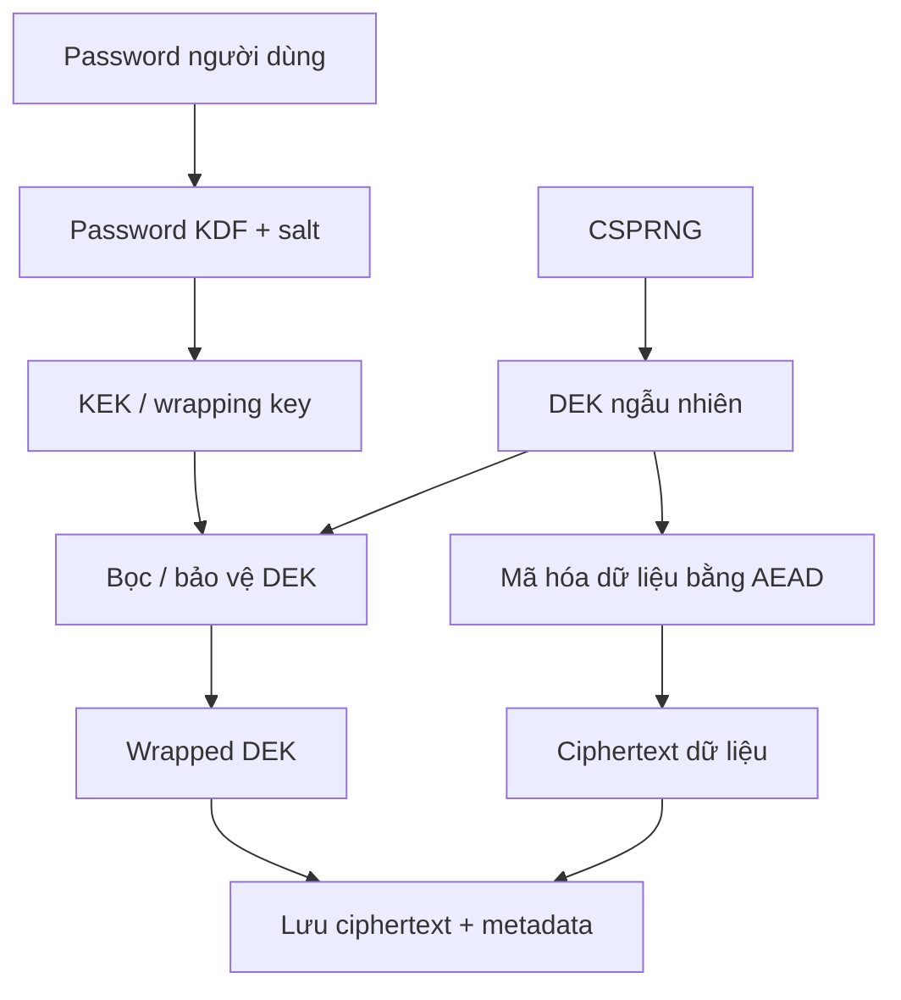

# Password không phải encryption key

Mật khẩu và khóa mã hóa đều là bí mật, nhưng chúng được tạo ra và sử dụng theo những cách khác nhau. **Password** thường do con người chọn hoặc ghi nhớ để chứng minh quyền truy cập. **Encryption key** là dữ liệu mật mã có cấu trúc và độ dài xác định, thường được sinh bằng bộ sinh số ngẫu nhiên mật mã (CSPRNG) hoặc một quy trình dẫn xuất khóa đã được chuẩn hóa.

Không nên lấy chuỗi mật khẩu rồi dùng trực tiếp làm khóa AES. Độ dài ký tự của mật khẩu không bảo đảm entropy, bảng ký tự có thể không đủ lớn và mật khẩu do con người chọn thường có thể đoán được. Khi cần dùng mật khẩu để bảo vệ dữ liệu, hệ thống phải đưa mật khẩu qua **password-based key derivation function (password KDF)** với salt và chi phí tính toán phù hợp để tạo khóa có định dạng, độ dài và tính chất cần thiết.

Trong quản lý khóa mật mã, việc phân biệt này giúp thiết kế đúng hai quy trình thường bị trộn lẫn: xác thực người dùng bằng password verifier và mã hóa dữ liệu bằng encryption key. Chúng có thể cùng bắt đầu từ một bí mật do người dùng nhập, nhưng phải có mục đích, KDF, salt và chính sách lưu trữ riêng.

## 1. Password và encryption key khác nhau thế nào?

| Tiêu chí | Password | Encryption key |
|---|---|---|
| Nguồn tạo | Thường do con người chọn hoặc được hệ thống sinh để người dùng ghi nhớ | Sinh bằng CSPRNG hoặc dẫn xuất bằng KDF đã chuẩn hóa |
| Mục tiêu | Xác thực người dùng hoặc mở quyền truy cập | Điều khiển phép mã hóa, giải mã, ký hoặc xác minh tùy loại khóa |
| Biểu diễn | Chuỗi ký tự hoặc passphrase | Dữ liệu nhị phân có độ dài và thuật toán xác định |
| Entropy | Phụ thuộc cách tạo, độ dài, tính ngẫu nhiên và khả năng đoán | Được thiết kế theo yêu cầu thuật toán và quy trình sinh khóa |
| Cách lưu | Hệ thống đăng nhập lưu verifier bằng password hashing; không lưu password rõ | Khóa riêng cần được bảo vệ; khóa công khai có thể phân phối, còn khóa bí mật cần kiểm soát truy cập |
| Sử dụng | Đưa vào password hashing hoặc password KDF | Đưa vào thuật toán mật mã tương ứng, chẳng hạn AES-GCM hoặc HMAC |

Ví dụ, một chuỗi `Summer2026!` có thể trông phức tạp với người dùng nhưng vẫn có cấu trúc dễ đoán. Nếu dùng trực tiếp các byte UTF-8 của chuỗi đó làm khóa AES, độ dài và entropy có thể không đúng yêu cầu. Việc đệm thêm byte, cắt chuỗi hoặc băm bằng SHA-256 một lần cũng không biến password thành một khóa an toàn trước tấn công đoán ngoại tuyến.

Khóa AES-256 thường là 32 byte được sinh ngẫu nhiên. Người dùng không cần ghi nhớ 32 byte đó. Hệ thống có thể lưu khóa trong KMS/HSM hoặc bảo vệ khóa bằng một KEK được dẫn xuất từ password. Password khi đó là đầu vào để mở khóa, còn dữ liệu mã hóa được bảo vệ bằng encryption key thực sự.

## 2. Vì sao không dùng password trực tiếp làm khóa?

Các thuật toán mã hóa như AES yêu cầu khóa có độ dài xác định và phân bố phù hợp với giả định mật mã. Password do con người chọn không đáp ứng các giả định đó một cách đáng tin cậy:

- Người dùng thường chọn từ ngữ, tên riêng, ngày tháng hoặc mẫu bàn phím.
- Một password dài vẫn có thể có entropy thấp nếu dựa trên cụm từ phổ biến hoặc quy luật dễ đoán.
- Chuỗi ký tự có thể có độ dài byte khác nhau khi mã hóa UTF-8; số ký tự không đồng nghĩa số byte.
- Việc thêm ký tự `0` hoặc cắt chuỗi để đủ 16, 24 hay 32 byte không tạo thêm entropy.
- Dùng SHA-256 một lần chỉ tạo ra đầu ra có độ dài cố định; phép băm nhanh khiến kẻ tấn công thử hàng tỷ password nhanh hơn.

KDF dành cho password xử lý vấn đề này bằng cách làm cho mỗi lần thử password tốn tài nguyên hơn và kết hợp salt ngẫu nhiên. KDF không thể biến một password yếu thành bí mật có entropy cao, nhưng làm chậm đáng kể việc đoán password và bảo đảm đầu ra có độ dài phù hợp.

## 3. Phân biệt password hashing và password-based encryption

Hai quy trình có thể nhận cùng kiểu đầu vào là password, nhưng mục tiêu khác nhau.

| Quy trình | Mục tiêu | Dữ liệu được lưu |
|---|---|---|
| Password hashing (xác thực đăng nhập) | Xác minh người dùng biết password mà không cần lưu password rõ hoặc khóa giải mã password | Salt, tên/phiên bản KDF, tham số chi phí và password verifier |
| Password-based encryption (mã hóa dựa trên password) | Dẫn xuất khóa để mã hóa hoặc mở khóa dữ liệu | Salt, tên/phiên bản KDF, tham số, nonce/metadata và ciphertext |

Khi người dùng đăng nhập, hệ thống tính verifier từ password nhập vào rồi so sánh với verifier đã lưu. Hệ thống không cần khôi phục password ban đầu. Vì vậy, password verifier không thể dùng thay cho encryption key để giải mã dữ liệu.

Khi password dùng để bảo vệ tệp, ứng dụng cần tạo khóa từ password bằng password KDF rồi dùng khóa đó với thuật toán mã hóa. Để giải mã, ứng dụng chạy lại cùng KDF với password, salt và tham số giống nhau để tái tạo khóa.

Không nên dùng cùng một giá trị dẫn xuất cho cả xác thực đăng nhập và mã hóa dữ liệu. Nếu một mục đích bị xâm phạm, khóa của mục đích còn lại cũng có thể bị ảnh hưởng. Hãy dùng salt độc lập và domain separation hoặc các quy trình KDF riêng cho từng mục đích.

## 4. Password hashing cần salt và KDF chậm

Khi lưu password đăng nhập, hệ thống nên dùng thuật toán password hashing chuyên dụng. Các lựa chọn thường gặp gồm:

| KDF / password hashing | Đặc điểm |
|---|---|
| Argon2id | Thiết kế memory-hard, kết hợp khả năng chống tấn công qua side-channel và tấn công song song; thường là lựa chọn ưu tiên khi thư viện được kiểm định hỗ trợ |
| scrypt | Memory-hard, làm tăng chi phí bộ nhớ cho mỗi lần thử password |
| PBKDF2 | Dựa trên HMAC và số vòng lặp; có hỗ trợ rộng trong nền tảng Java và nhiều hệ thống tuân thủ tiêu chuẩn |
| bcrypt | Password hashing lâu đời, có cost factor; cần chú ý giới hạn độ dài password và cách xử lý chuỗi theo implementation |

**Salt** là dữ liệu ngẫu nhiên riêng cho mỗi password record. Salt không cần giữ bí mật và thường được lưu cùng verifier. Salt khiến hai người dùng có cùng password vẫn tạo ra verifier khác nhau, đồng thời ngăn việc dùng lại bảng tra cứu đã tính sẵn cho nhiều tài khoản.

**Pepper** là bí mật bổ sung do hệ thống giữ riêng, thường nằm trong secret manager hoặc HSM. Pepper có thể tăng khả năng chống lại kẻ tấn công chỉ lấy được cơ sở dữ liệu verifier. Pepper không thay thế salt và nếu pepper bị lộ cùng database thì lợi ích bổ sung giảm đáng kể.

Khi lưu password verifier, cần lưu cả thuật toán, phiên bản và tham số chi phí để hệ thống biết cách xác minh và nâng cấp khi người dùng đăng nhập. Có thể tăng cost dần theo năng lực phần cứng, nhưng phải đo tải xác thực và giới hạn tốc độ để tránh biến KDF thành điểm gây cạn kiệt tài nguyên.

## 5. Password-based KDF dùng để tạo encryption key

Password-based KDF nhận password, salt và tham số chi phí để tạo ra khóa có độ dài xác định. Salt nên được sinh ngẫu nhiên bằng CSPRNG và đủ dài để tránh trùng lặp trong thực tế; 16 byte là lựa chọn phổ biến cho nhiều hệ thống.

Các tham số cần được lưu cùng ciphertext hoặc metadata:

- Tên và phiên bản KDF.
- Salt.
- Số vòng lặp hoặc tham số memory/time/parallelism tùy KDF.
- Độ dài khóa đầu ra.
- Phiên bản định dạng dữ liệu và thuật toán mã hóa sử dụng khóa.

Salt và tham số không phải bí mật. Chúng cần được lưu để tái tạo khóa khi giải mã. Password vẫn phải được giữ bí mật; khóa dẫn xuất cũng cần được bảo vệ trong bộ nhớ và không ghi log.

Với Argon2id, tham số thường bao gồm memory cost, time cost và parallelism. Với PBKDF2, tham số chính là salt, số vòng lặp, PRF và độ dài đầu ra. Hãy chọn giá trị theo tiêu chuẩn hiện hành và benchmark trên môi trường thật; không sao chép một con số mà không đánh giá chi phí xác thực và nguy cơ DoS.

## 6. Java: dẫn xuất khóa AES từ password bằng PBKDF2

Java cung cấp `SecretKeyFactory` và `PBEKeySpec` để sử dụng PBKDF2 thông qua JCA. Ví dụ dưới đây tạo khóa AES 256 bit từ password và salt. Số vòng lặp là tham số chính sách; ví dụ dùng giá trị minh họa và cần được benchmark, cấu hình theo tiêu chuẩn hiện hành của hệ thống.

```java
import java.security.GeneralSecurityException;
import java.util.Arrays;
import javax.crypto.SecretKey;
import javax.crypto.SecretKeyFactory;
import javax.crypto.spec.PBEKeySpec;
import javax.crypto.spec.SecretKeySpec;

public final class PasswordKeyDerivation {
    public static SecretKey deriveAesKey(
            char[] password,
            byte[] salt,
            int iterations) throws GeneralSecurityException {

        if (iterations <= 0) {
            throw new IllegalArgumentException("iterations must be positive");
        }

        PBEKeySpec spec = new PBEKeySpec(password, salt, iterations, 256);
        try {
            SecretKeyFactory factory =
                    SecretKeyFactory.getInstance("PBKDF2WithHmacSHA256");
            byte[] keyBytes = factory.generateSecret(spec).getEncoded();
            try {
                return new SecretKeySpec(keyBytes, "AES");
            } finally {
                Arrays.fill(keyBytes, (byte) 0);
            }
        } finally {
            spec.clearPassword();
        }
    }
}
```

Sinh salt bằng nguồn ngẫu nhiên mật mã:

```java
import java.security.SecureRandom;

byte[] salt = new byte[16];
SecureRandom random = new SecureRandom();
random.nextBytes(salt);
```

Lưu salt cùng metadata của ciphertext để lần sau có thể dẫn xuất lại đúng khóa. Không tạo một salt cố định dùng cho mọi người dùng hoặc mọi tệp. Với mỗi đối tượng được bảo vệ, tạo salt mới theo thiết kế định dạng.

`PBEKeySpec.clearPassword()` xóa bản sao password mà `PBEKeySpec` quản lý. Bên gọi cũng nên xóa mảng `char[]` khi không còn cần dùng. `SecretKeySpec` sao chép mảng byte đầu vào, nên có thể xóa mảng tạm sau khi tạo đối tượng. Các thao tác xóa này giảm thời gian bí mật tồn tại trong bộ nhớ do ứng dụng kiểm soát nhưng không bảo đảm xóa mọi bản sao do JVM hoặc provider tạo ra.

PBKDF2 là KDF dựa trên CPU và không memory-hard. Nếu hệ thống có thể dùng thư viện Argon2id hoặc scrypt đã được kiểm định và phù hợp với nền tảng, hãy đánh giá chúng cho password hashing hoặc password-based encryption. Không tự cài đặt Argon2, scrypt hay PBKDF2.

## 7. Dùng khóa dẫn xuất để mã hóa dữ liệu bằng AEAD

Sau khi dẫn xuất được khóa AES, ứng dụng vẫn cần một thuật toán mã hóa có xác thực. AES-GCM vừa mã hóa dữ liệu vừa phát hiện việc sửa ciphertext hoặc AAD.

```java
import java.security.SecureRandom;
import javax.crypto.Cipher;
import javax.crypto.SecretKey;
import javax.crypto.spec.GCMParameterSpec;

byte[] nonce = new byte[12];
new SecureRandom().nextBytes(nonce);

Cipher cipher = Cipher.getInstance("AES/GCM/NoPadding");
cipher.init(
        Cipher.ENCRYPT_MODE,
        derivedKey,
        new GCMParameterSpec(128, nonce));
cipher.updateAAD(metadata);
byte[] ciphertext = cipher.doFinal(plaintext);
```

Để giải mã, dùng đúng password, salt, KDF parameters, nonce và AAD:

```java
Cipher cipher = Cipher.getInstance("AES/GCM/NoPadding");
cipher.init(
        Cipher.DECRYPT_MODE,
        derivedKey,
        new GCMParameterSpec(128, nonce));
cipher.updateAAD(metadata);
byte[] plaintext = cipher.doFinal(ciphertext);
```

Nonce 12 byte là lựa chọn thông dụng cho GCM. Không được tái sử dụng nonce với cùng khóa. Nếu password KDF tạo lại cùng khóa mỗi lần mở tệp, mỗi lần mã hóa mới cần nonce mới và phải lưu nonce đó cùng ciphertext. Khi xác thực GCM thất bại, phải từ chối dữ liệu; không sử dụng plaintext chưa được xác thực.

Ví dụ trên thể hiện password-based encryption trực tiếp. Với dữ liệu lớn hoặc hệ thống cần thay password thường xuyên, nên cân nhắc envelope encryption ở phần tiếp theo.

## 8. Envelope encryption: password bảo vệ KEK, DEK mã hóa dữ liệu

Một thiết kế thường tốt hơn là tạo **DEK (Data Encryption Key)** ngẫu nhiên để mã hóa dữ liệu, sau đó dùng một **KEK (Key Encryption Key)** để bảo vệ DEK. Password đi qua KDF để tạo KEK hoặc khóa dùng để mở KEK; DEK vẫn là khóa ngẫu nhiên độc lập.



Quy trình:

1. Sinh DEK ngẫu nhiên với độ dài phù hợp, ví dụ AES-256.
2. Mã hóa dữ liệu bằng DEK và AEAD; tạo nonce riêng cho dữ liệu.
3. Dẫn xuất KEK từ password bằng password KDF với salt và tham số riêng.
4. Dùng KEK để bọc DEK bằng cơ chế key wrapping được chuẩn hóa hoặc AEAD với nonce và AAD riêng.
5. Lưu ciphertext, wrapped DEK, salt, KDF parameters, nonce, thuật toán, phiên bản định dạng và metadata cần thiết.

Khi mở dữ liệu, hệ thống dẫn xuất lại KEK, mở wrapped DEK, rồi dùng DEK giải mã ciphertext. Password không trực tiếp mã hóa toàn bộ dữ liệu; nó bảo vệ khả năng truy cập vào DEK.

Thiết kế này giúp thay password mà không cần mã hóa lại toàn bộ dữ liệu: dẫn xuất KEK mới từ password mới và bọc lại DEK. Dữ liệu đã mã hóa bằng DEK có thể giữ nguyên. Tuy nhiên, nếu DEK bị lộ thì phải tạo DEK mới và mã hóa lại dữ liệu theo kế hoạch.

## 9. Đổi password, reset password và xoay vòng encryption key

Ba thao tác này có tác động khác nhau:

| Thao tác | Điều thay đổi | Hệ quả với dữ liệu mã hóa |
|---|---|---|
| Đổi password khi biết password cũ | Password verifier hoặc KEK dẫn xuất từ password | Với envelope encryption, có thể bọc lại DEK bằng KEK mới mà không mã hóa lại payload |
| Reset password khi không biết password cũ | Thông tin xác thực mới được thiết lập | Không thể tự suy ra KEK cũ; cần recovery key, escrow hoặc cơ chế khôi phục đã thiết kế trước |
| Xoay vòng DEK | Khóa mã hóa dữ liệu được thay bằng khóa mới | Dữ liệu cần được mã hóa lại hoặc chuyển qua quy trình re-encryption |
| Xoay vòng KEK | Khóa dùng để bọc DEK được thay | Có thể bọc lại DEK bằng KEK mới nếu còn truy cập được DEK |

Đổi password không tự động làm thay đổi encryption key. Ngược lại, thay encryption key không đồng nghĩa password đăng nhập đã thay đổi. Hệ thống cần ghi nhận phiên bản khóa và trạng thái chuyển đổi để có thể đọc dữ liệu cũ trong thời gian chuyển tiếp.

Nếu người dùng quên password và không có recovery key hoặc escrow, hệ thống không thể tái tạo khóa dẫn xuất từ password cũ. Đây là hệ quả của mã hóa đúng cách, không phải lỗi có thể khắc phục bằng cách lưu password rõ. Cần quyết định trước mô hình phục hồi: recovery code, khóa khôi phục riêng, nhiều người phê duyệt hoặc escrow có kiểm soát.

## 10. Password trong Java KeyStore và các kho khóa

Một số API hoặc định dạng kho khóa nhận password để kiểm tra tính toàn vẹn hoặc bảo vệ entry. Ví dụ, `KeyStore.load(input, storePassword)` nạp kho; `getKey(alias, keyPassword)` lấy khóa thuộc entry. Điều đó không có nghĩa password chính là khóa mã hóa được lưu trong entry.

Provider và định dạng có thể dùng password-based encryption để bảo vệ khóa khi lưu, hoặc dùng password để kiểm tra MAC/tính toàn vẹn của kho. Cách xử lý cụ thể phụ thuộc loại keystore và provider. Ứng dụng cần phân biệt:

- Password dùng để nạp/lưu kho.
- Password bảo vệ entry chứa khóa riêng hoặc khóa bí mật.
- Giá trị khóa thực tế được lấy ra để thực hiện thao tác mật mã.
- Khóa wrapping hoặc khóa gốc được quản lý bởi KMS/HSM nếu kiến trúc có sử dụng.

Không nên trích xuất `getEncoded()` rồi log hoặc lưu khóa rõ chỉ vì đã có password bảo vệ keystore. Sau khi nạp, khóa có thể tồn tại trong bộ nhớ của tiến trình; quyền truy cập tiến trình, dump heap, log và mã độc vẫn có thể làm lộ khóa.

## 11. Quản lý password và encryption key theo vòng đời

Password và encryption key cần chính sách riêng, dù có thể liên kết qua KDF hoặc key wrapping.

| Giai đoạn | Password | Encryption key |
|---|---|---|
| Tạo | Người dùng chọn passphrase hoặc hệ thống sinh password ngẫu nhiên | CSPRNG hoặc quy trình sinh khóa chuẩn |
| Cấp phát | Gửi qua kênh xác thực, tránh gửi lại password rõ | Cấp quyền sử dụng theo danh tính dịch vụ hoặc người dùng |
| Lưu trữ | Lưu verifier; nếu dùng để mã hóa thì lưu salt và KDF metadata | Lưu trong KMS/HSM hoặc bảo vệ bằng KEK/DEK hierarchy |
| Sử dụng | Nhập để xác thực hoặc dẫn xuất khóa | Dùng với thuật toán và mục đích được cấp phép |
| Thay đổi | Đổi/reset theo quy trình xác thực và phục hồi | Xoay vòng theo chính sách mật mã và phụ thuộc dữ liệu |
| Thu hồi | Thu hồi session, credential hoặc quyền truy cập | Ngừng sử dụng, thu hồi chứng thư hoặc vô hiệu hóa key theo hệ thống |
| Hủy | Xóa verifier/credential theo chính sách lưu giữ | Xóa mọi bản sao khóa và bản sao lưu theo quy trình key destruction |

Nên ghi nhận chủ sở hữu, mục đích, thời hạn, thuật toán, phiên bản, vị trí lưu, phụ thuộc và trạng thái của từng khóa. Audit nên ghi lại ai hoặc dịch vụ nào đã yêu cầu dẫn xuất, mở khóa, bọc lại, sử dụng hoặc xoay vòng; không ghi password, DEK hay KEK rõ vào log.

## 12. Các sai lầm bảo mật thường gặp

1. **Dùng password trực tiếp làm AES key:** độ dài và entropy không được bảo đảm; hãy dùng password KDF.
2. **Băm password một lần bằng SHA-256:** phép băm nhanh hỗ trợ tấn công đoán ngoại tuyến; dùng password hashing/KDF chuyên dụng.
3. **Dùng chung salt:** làm giảm khả năng chống bảng tra cứu và liên kết verifier; tạo salt ngẫu nhiên riêng cho mỗi record hoặc đối tượng được bảo vệ.
4. **Lưu password rõ cạnh ciphertext:** kẻ lấy được dữ liệu sẽ có cả thông tin mở khóa; với đăng nhập hãy lưu verifier, còn với mã hóa hãy lưu salt/KDF metadata và wrapped DEK cùng cơ chế recovery được kiểm soát.
5. **Dùng cùng đầu ra KDF cho nhiều mục đích:** có thể tạo liên kết giữa xác thực và mã hóa; tách salt, context và domain.
6. **Dùng password verifier để mã hóa dữ liệu:** verifier được thiết kế để so sánh, không phải để phục hồi password; tạo khóa mã hóa theo quy trình riêng.
7. **Đổi password nhưng quên cập nhật wrapped DEK:** người dùng có password mới nhưng không thể mở khóa dữ liệu.
8. **Reset password mà không có recovery:** dữ liệu có thể mất khả năng giải mã; phải thiết kế phục hồi trước khi triển khai.
9. **Không lưu KDF parameters:** ứng dụng không thể tái tạo khóa sau này hoặc không thể nâng cấp định dạng có kiểm soát.
10. **Ghi khóa dẫn xuất vào log hoặc telemetry:** có thể làm mất toàn bộ tính bí mật của dữ liệu được bảo vệ.

## 13. Checklist thiết kế

- Xác định password được dùng để đăng nhập, mở tệp hay bảo vệ khóa.
- Không dùng trực tiếp password làm encryption key.
- Với đăng nhập, lưu verifier bằng password hashing chuyên dụng, salt riêng và tham số chi phí được lưu cùng record.
- Với mã hóa dữ liệu, dùng password KDF có salt ngẫu nhiên và tham số đủ mạnh; cân nhắc Argon2id hoặc scrypt nếu nền tảng hỗ trợ thư viện đã kiểm định.
- Dùng khóa ngẫu nhiên DEK để mã hóa payload bằng AEAD.
- Dùng KEK để bọc DEK; lưu wrapped DEK cùng metadata cần thiết.
- Tách KDF, salt và khóa theo mục đích; không dùng lại password verifier làm encryption key.
- Lưu KDF parameters, salt, nonce, key ID và phiên bản định dạng để có thể mở dữ liệu về sau.
- Định nghĩa quy trình đổi password, reset password, recovery, KEK rotation và DEK rotation riêng biệt.
- Kiểm soát bộ nhớ, quyền tiến trình, secret manager, KMS/HSM và audit; không ghi bí mật vào log.
- Kiểm thử trường hợp password sai, ciphertext bị sửa, metadata bị thay, reset password và khôi phục dữ liệu.

## Tài liệu tham khảo

- [NIST SP 800-132: Recommendation for Password-Based Key Derivation](https://csrc.nist.gov/pubs/sp/800/132/final)
- [RFC 9106: Argon2 Memory-Hard Function for Password Hashing and Proof-of-Work Applications](https://www.rfc-editor.org/rfc/rfc9106)
- [OWASP Password Storage Cheat Sheet](https://cheatsheetseries.owasp.org/cheatsheets/Password_Storage_Cheat_Sheet.html)
- [Java SE API: `PBEKeySpec`](https://docs.oracle.com/en/java/javase/21/docs/api/java.base/javax/crypto/spec/PBEKeySpec.html)
- [Java SE API: `SecretKeyFactory`](https://docs.oracle.com/en/java/javase/21/docs/api/java.base/javax/crypto/SecretKeyFactory.html)
