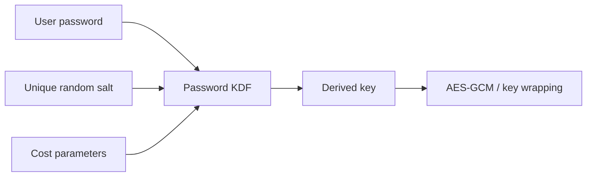
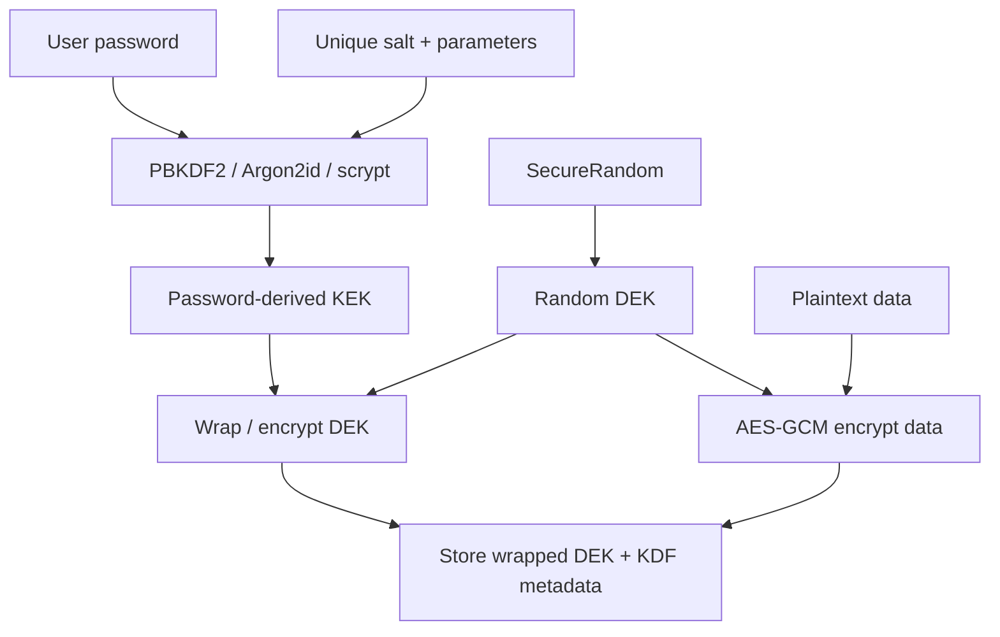

# Password-derived key

## Mục tiêu học tập

Sau bài học này, bạn có thể:

- Giải thích vì sao password không thể dùng trực tiếp làm cryptographic key và vai trò của Key Derivation Function (KDF).
- Phân biệt password hashing để xác minh đăng nhập với password-based key derivation để tạo khóa có thể dùng mã hóa/giải mã.
- Mô tả cách salt, work factor, memory cost, pepper và domain separation ảnh hưởng đến khả năng chống đoán password offline.
- So sánh PBKDF2, scrypt và Argon2id, đồng thời chọn phương án phù hợp với Java và yêu cầu compliance.
- Dùng `SecretKeyFactory` và `PBEKeySpec` trong Java để dẫn xuất key bằng PBKDF2.
- Kết hợp password-derived key với AES-GCM, metadata được xác thực và envelope encryption.
- Thiết kế password change, password reset, recovery, rotation và migration mà không làm mất dữ liệu đã mã hóa.
- Bảo vệ password, KDF parameters, salt, derived key và các bản sao trong suốt vòng đời.

## 1. Password-derived key là gì?

Password-derived key là khóa mật mã được tạo từ password hoặc passphrase thông qua một Key Derivation Function (KDF). KDF biến đầu vào thường có entropy thấp thành key có độ dài phù hợp cho thuật toán mật mã, đồng thời làm cho mỗi lần thử password tốn nhiều tài nguyên hơn.

Người dùng thường chọn password dễ nhớ, có thể chứa từ phổ biến, tên riêng, ngày tháng hoặc mẫu bàn phím. Những giá trị đó có entropy thấp hơn rất nhiều so với một key ngẫu nhiên 128 hoặc 256 bit. Nếu đưa password trực tiếp vào AES, key không có phân bố ngẫu nhiên phù hợp và có thể bị tấn công bằng cách thử danh sách password phổ biến.

KDF xử lý vấn đề này bằng cách nhận password, salt và các tham số chi phí để tạo ra key material. Ví dụ, PBKDF2 lặp lại một hàm pseudorandom như HMAC nhiều lần; scrypt và Argon2id còn sử dụng bộ nhớ để tăng chi phí cho attacker.



KDF không biến password yếu thành bí mật mạnh một cách kỳ diệu. Nếu password dễ đoán, attacker vẫn có thể thử các ứng viên; KDF chỉ làm mỗi lần thử đắt hơn. Password entropy, rate limiting, MFA, salt và cost parameters vẫn rất quan trọng.

## 2. Vì sao không dùng password trực tiếp làm key?

Password của con người thường có những đặc điểm:

- Có thể được chọn từ từ điển hoặc mẫu dễ đoán.
- Được tái sử dụng giữa nhiều dịch vụ.
- Có entropy thấp hơn key được sinh ngẫu nhiên.
- Có thể bị lộ qua phishing, credential stuffing, malware hoặc log.
- Có độ dài và encoding không phù hợp trực tiếp với yêu cầu của thuật toán.

Ví dụ, AES-256 cần key 256 bit. Một password 12 ký tự không tự động có 96 bit entropy; độ dài ký tự không thể thay thế phân bố ngẫu nhiên thực tế. Hash password một lần bằng SHA-256 cũng không đủ: SHA-256 được thiết kế nhanh, nên attacker có thể thử rất nhiều password mỗi giây trên phần cứng chuyên dụng.

KDF password được thiết kế để mỗi lần thử tốn CPU hoặc bộ nhớ. Nó không thay thế password policy, MFA hay bảo vệ endpoint; nó làm giảm tốc độ tấn công offline khi attacker có verifier hoặc ciphertext.

## 3. Password hashing và password-derived encryption key khác nhau

Hai use case thường bị nhầm:

| Tiêu chí | Password hashing / verifier | Password-derived encryption key |
|---|---|---|
| Mục đích | Xác minh password người dùng nhập có khớp không | Tạo key để mã hóa, giải mã hoặc wrap key |
| Kết quả lưu | Salt, KDF parameters và password verifier | Salt, KDF parameters, nonce/metadata và ciphertext hoặc wrapped key |
| Có cần khôi phục password không? | Không | Không; cần password để tái dẫn xuất key |
| Khi password đúng | So sánh verifier | Dẫn xuất cùng key để giải mã hoặc unwrap |
| Khi password mất | Có thể reset credential | Có thể mất khả năng giải mã nếu không có recovery key/escrow |

Password hashing là một chiều theo mục đích sử dụng. Password-derived key có thể được tái tạo từ cùng password, salt và parameters để thực hiện phép giải mã. Không lưu derived encryption key cạnh ciphertext ở dạng plaintext; nếu làm vậy thì password KDF không còn bảo vệ dữ liệu.

Không dùng một password verifier làm encryption key. Nếu cần cả đăng nhập và mã hóa dữ liệu, thiết kế hai luồng riêng, dùng domain separation hoặc KDF độc lập với purpose rõ ràng.

## 4. KDF và các tham số đầu vào

Một password KDF thường nhận:

- **Password:** bí mật do người dùng cung cấp.
- **Salt:** dữ liệu ngẫu nhiên công khai, riêng cho mỗi lần dẫn xuất hoặc mỗi credential.
- **Cost parameters:** số vòng lặp, memory cost, parallelism hoặc tham số tương đương.
- **Output length:** số bit/byte cần tạo ra.
- **Algorithm/version:** tên KDF và phiên bản policy để có thể xác minh và migrate về sau.

Kết quả cần được lưu cùng metadata cần thiết để có thể dẫn xuất lại. Salt không cần giữ bí mật, nhưng phải được lưu chính xác. Cost parameters cũng không phải secret; chúng cần được quản lý để attacker không thể khiến hệ thống hạ thấp policy hoặc bị DoS bằng giá trị bất thường.

## 5. Salt: công khai nhưng phải riêng biệt

Salt là dữ liệu ngẫu nhiên được đưa vào KDF cùng password. Salt giúp:

- Cùng password nhưng salt khác tạo derived key khác nhau.
- Ngăn attacker dùng trước một bảng rainbow table cho tất cả người dùng.
- Làm cho mỗi credential hoặc encrypted object cần được đoán riêng.
- Tránh việc hai người dùng cùng password có verifier hoặc key giống nhau.

Salt không cần bí mật. Nó thường được lưu cạnh verifier hoặc ciphertext metadata. Nhưng salt phải được tạo bằng nguồn ngẫu nhiên an toàn, đủ dài và không tái sử dụng ngoài phạm vi policy.

Với password-derived encryption key, mỗi object hoặc mỗi key envelope nên có salt riêng. Dùng một salt cố định trong source code hoặc một salt chung cho toàn hệ thống làm giảm khả năng cô lập các cuộc tấn công.

Ví dụ tạo salt 16 byte:

```java
byte[] salt = new byte[16];
SecureRandom random = new SecureRandom();
random.nextBytes(salt);
```

Salt không phải nonce AES-GCM. Salt đầu vào KDF giúp phân biệt phép dẫn xuất; nonce đầu vào AEAD bảo đảm yêu cầu của chế độ mã hóa, đặc biệt là không tái sử dụng nonce với cùng key.

## 6. Work factor và chi phí tính toán

Work factor làm cho mỗi lần thử password tốn nhiều tài nguyên hơn. Với PBKDF2, tham số thường thấy là iteration count. Với Argon2id và scrypt, ngoài số vòng còn có memory cost và parallelism.

Work factor phải được benchmark trên phần cứng và workload thật. Nếu quá thấp, attacker đoán password nhanh. Nếu quá cao, đăng nhập hoặc giải mã có thể gây latency lớn, tiêu thụ CPU/memory và tạo điều kiện DoS.

Chính sách nên quy định:

- Giá trị tối thiểu khi tạo verifier/key envelope mới.
- Giá trị tối đa mà service chấp nhận từ metadata đầu vào.
- Thời gian xử lý mục tiêu trên máy production.
- Quy trình tăng cost theo thời gian.
- Cách migrate khi xác minh password thành công hoặc khi người dùng đổi password.

Không tin trực tiếp iteration count hoặc memory cost do client gửi. Server cần validate bounds trước khi chạy KDF. Một metadata record có iteration count cực lớn có thể làm worker thread hoặc memory pool bị cạn.

## 7. PBKDF2

PBKDF2 là password-based KDF được chuẩn hóa trong PKCS #5 và được sử dụng rộng rãi. Nó dùng pseudorandom function, thường là HMAC, kết hợp password, salt và iteration count để tạo key material có độ dài yêu cầu.

PBKDF2 phù hợp khi cần khả năng tương thích rộng hoặc môi trường có yêu cầu FIPS và module được phê duyệt hỗ trợ PBKDF2. PBKDF2 chủ yếu tăng chi phí CPU; nó không memory-hard như Argon2id hoặc scrypt.

Các tham số cần lưu:

- PRF, ví dụ HMAC-SHA-256.
- Salt.
- Iteration count.
- Derived key length.
- Format/version và mục đích sử dụng.

Java có thể dùng `SecretKeyFactory` với algorithm name `PBKDF2WithHmacSHA256` nếu provider hỗ trợ. Khả năng và compliance phụ thuộc provider, JDK và cryptographic module cụ thể.

## 8. Argon2id và scrypt

Argon2id là password hashing/KDF hiện đại có memory cost, time cost và parallelism. Nó được thiết kế để làm tấn công song song trên GPU/ASIC tốn bộ nhớ hơn. scrypt cũng là memory-hard KDF, dùng CPU và memory để tăng chi phí đoán password.

| KDF | Đặc điểm | Khi cân nhắc |
|---|---|---|
| PBKDF2-HMAC-SHA-256 | CPU-hard, hỗ trợ rộng, có thể được triển khai trong module được validation | Hệ thống cần interoperability hoặc có ràng buộc FIPS |
| scrypt | Memory-hard, tham số N/r/p | Hệ thống cần tăng chi phí phần cứng cho offline guessing và có provider phù hợp |
| Argon2id | Memory-hard, kết hợp chống side-channel và GPU trade-off theo thiết kế | Lựa chọn phổ biến cho password storage và một số password-based key derivation mới |

Java SE không bảo đảm mọi JDK/provider đều cung cấp Argon2id hoặc scrypt qua JCA. Có thể cần thư viện chuyên dụng hoặc provider bên thứ ba; phải đánh giá nguồn cung cấp, phiên bản, native code, side-channel và compliance. Không tự cài thuật toán KDF bằng code ứng dụng.

Nếu môi trường yêu cầu FIPS, không tự giả định Argon2id hoặc scrypt được phép trong approved mode. Chọn KDF và provider theo security policy của module đã được validation.

## 9. Pepper: secret bổ sung ngoài salt

Pepper là một secret bổ sung được dùng cùng password trong quy trình hashing/derivation. Khác với salt, pepper phải được giữ bí mật và thường được lưu trong HSM, KMS hoặc secret manager độc lập với database chứa verifier/ciphertext.

Pepper có thể làm tăng khó khăn cho attacker chỉ lấy được database. Tuy nhiên, nếu attacker kiểm soát ứng dụng hoặc lấy được quyền gọi KMS, pepper cũng có thể bị lạm dụng. Pepper tạo thêm dependency vận hành: nếu mất pepper mà không có bản backup/recovery phù hợp, có thể không xác minh được password hoặc dẫn xuất lại key.

Không hardcode pepper trong source code, image hoặc cùng database với salt. Có thể dùng HMAC/secret input theo thiết kế KDF được phê duyệt; không tự nối pepper vào password bằng quy tắc tùy tiện mà không có domain separation và phân tích bảo mật.

## 10. Password encoding và Unicode

Password có thể chứa ký tự Unicode. Hai chuỗi nhìn giống nhau có thể có representation khác nhau, ví dụ ký tự có thể được biểu diễn bằng một code point hoặc một chuỗi ký tự kết hợp.

Client và server phải thống nhất cách xử lý:

- Có normalize Unicode hay không, và dùng normalization form nào.
- Encoding đầu vào KDF.
- Có trim khoảng trắng hoặc thay đổi chữ hoa/thường hay không.
- Cách xử lý ký tự không hợp lệ và password rỗng.
- Phiên bản quy tắc encoding/normalization được áp dụng.

Không tự trim hoặc lowercase password nếu giao thức không quy định. Một thay đổi normalization không tương thích có thể khiến người dùng không thể dẫn xuất lại key cũ. Với Java `PBEKeySpec`, truyền `char[]` và dùng provider có semantics đã được kiểm tra; đừng tự chuyển đổi encoding bằng một cách khác ở encrypt và decrypt.

## 11. PBKDF2 trong Java với PBEKeySpec

Java cung cấp `PBEKeySpec` để mô tả password, salt, iteration count và độ dài output. `SecretKeyFactory` thực hiện PBKDF2 nếu provider hỗ trợ.

```java
char[] password = ...;
byte[] salt = ...;
PBEKeySpec spec = new PBEKeySpec(password, salt, iterations, 256);
try {
    SecretKeyFactory factory =
            SecretKeyFactory.getInstance("PBKDF2WithHmacSHA256");
    SecretKey derived = factory.generateSecret(spec);
} finally {
    spec.clearPassword();
    Arrays.fill(password, '\0');
}
```

`PBEKeySpec` giữ password dạng `char[]` và có method `clearPassword()`. Ứng dụng cũng nên xóa buffer password sau khi sử dụng. Tuy nhiên, JVM, provider hoặc các API khác có thể tạo bản sao nội bộ; việc ghi đè một array không bảo đảm mọi bản sao biến mất khỏi memory.

Không dùng `String` cho password nếu có thể tránh, vì String immutable và không thể chủ động ghi đè nội dung. Cũng không log password, PBEKeySpec, derived key hoặc salt cùng password trong debug output.

## 12. Chọn iteration count cho PBKDF2

Iteration count là một phần của security policy. Không có một con số phù hợp cho mọi ứng dụng, vì tốc độ phụ thuộc CPU, provider, số lượng request đồng thời và mục tiêu latency.

Khi chọn iteration count:

1. Chọn baseline từ tiêu chuẩn hoặc guidance hiện hành phù hợp use case.
2. Benchmark trên máy production và provider thực tế.
3. Đo latency p50/p95/p99 và khả năng chịu tải khi nhiều người đăng nhập đồng thời.
4. Đặt giới hạn trên để metadata không thể gây DoS.
5. Lưu iteration count trong record để có thể verify và migrate.
6. Tăng cost theo policy và nâng dần khi người dùng xác thực hoặc đổi password.

Trong ví dụ Java phía sau, iteration count được đặt là giá trị minh họa. Trước production, phải thay bằng policy đã benchmark và kiểm tra với provider/compliance của tổ chức.

## 13. Output length và key separation

KDF có thể tạo output dài hơn key cần thiết, nhưng không nên dùng một output tùy tiện cho nhiều mục đích. Nếu cần nhiều key từ một password, cần thiết kế domain separation bằng các context/label khác nhau hoặc dẫn xuất một root key rồi dùng KDF chuẩn như HKDF để tạo subkey.

Ví dụ các mục đích khác nhau:

- Key dùng để wrap DEK.
- Key dùng để xác minh password.
- Key dùng để xác thực metadata.
- Key dùng cho một tenant hoặc một loại dữ liệu.

Không tái sử dụng cùng derived key cho AES encryption, HMAC và password verifier. Tách purpose giúp tránh cross-protocol interaction và cho phép rotate/revoke độc lập.

## 14. Password-derived key và AES-GCM

Một ứng dụng có thể dẫn xuất AES key từ password rồi dùng AES-GCM để mã hóa dữ liệu. Record lưu cần có ít nhất:

- KDF algorithm và version.
- Salt.
- Cost parameters.
- Cipher algorithm/version.
- Nonce.
- Ciphertext và authentication tag.
- Context cần thiết để xác minh object, tenant hoặc purpose.

Metadata nên được canonicalize và đưa vào Additional Authenticated Data (AAD) cùng với salt/nonce hoặc định danh object phù hợp. Nhờ vậy, thay đổi metadata quan trọng có thể làm authentication thất bại.

Salt và nonce có vai trò khác nhau. Salt tạo key riêng từ password; nonce đáp ứng yêu cầu của AES-GCM. Cả hai thường được lưu công khai nhưng phải được bảo toàn chính xác.

## 15. Vì sao nên dùng envelope encryption?

Với dữ liệu lớn hoặc cần đổi password thường xuyên, không nên nhất thiết dùng password-derived key trực tiếp để mã hóa toàn bộ dữ liệu. Một thiết kế linh hoạt hơn là:

1. Sinh một DEK ngẫu nhiên bằng CSPRNG.
2. Dùng DEK mã hóa dữ liệu bằng AEAD như AES-GCM.
3. Dùng password-derived KEK để wrap DEK bằng một cơ chế được phê duyệt.
4. Lưu wrapped DEK, salt, KDF parameters, nonce, ciphertext và metadata.



Khi password thay đổi, có thể dẫn xuất KEK mới và rewrap DEK mà không phải mã hóa lại toàn bộ dữ liệu, nếu cơ chế wrapping và metadata được thiết kế đúng. Nếu dùng password-derived key trực tiếp để mã hóa data, đổi password thường đòi hỏi giải mã rồi mã hóa lại toàn bộ dữ liệu.

## 16. Password change và password reset

Password change khi người dùng biết password cũ có thể thực hiện:

1. Xác thực password cũ và dẫn xuất key cũ.
2. Unwrap DEK hoặc giải mã dữ liệu cần thiết.
3. Nhận password mới, tạo salt mới và dẫn xuất key mới.
4. Rewrap DEK bằng key mới hoặc mã hóa lại dữ liệu theo thiết kế.
5. Lưu metadata mới một cách transaction-safe.
6. Xác minh có thể mở dữ liệu bằng password mới trước khi retire metadata cũ.

Password reset khi người dùng quên password là tình huống khác. Nếu dữ liệu chỉ được mã hóa bằng key dẫn xuất từ password cũ và không có recovery path, hệ thống không thể tái tạo key từ password mới. Việc reset login password không tự khôi phục dữ liệu đã mã hóa.

Các lựa chọn recovery cần được quyết định trước:

- Recovery key riêng do người dùng hoặc tổ chức quản lý.
- Recovery envelope được wrap bằng KEK trong KMS/HSM.
- Thiết bị tin cậy khác giữ một bản key được bảo vệ.
- Quy trình escrow có dual control và audit.
- Chấp nhận mất dữ liệu khi password mất, nếu đó là thuộc tính sản phẩm đã công bố.

Không thêm một master password ẩn hoặc backdoor không được quản trị. Recovery phải có threat model, quyền truy cập và kiểm toán rõ ràng.

## 17. Password-derived key cho password storage

Với xác minh đăng nhập, server thường lưu password verifier được tạo bởi KDF, không lưu password và không cần lưu encryption key có thể giải mã.

Khi người dùng đăng nhập:

1. Đọc salt và KDF parameters từ record.
2. Dẫn xuất verifier từ password nhập vào.
3. So sánh với verifier đã lưu bằng phép so sánh constant-time phù hợp.
4. Nếu thành công và parameters cũ, nâng cost và cập nhật verifier.
5. Xóa buffer password và verifier tạm theo khả năng.

Không dùng một lần PBKDF2 nhanh để thay thế password hashing policy. Nếu có Argon2id hoặc scrypt phù hợp, ưu tiên theo guidance hiện hành. Nếu cần FIPS, chọn PBKDF2 implementation trong module được validation và cấu hình đúng.

Password verifier không phải password-derived encryption key. Nếu cùng một password phục vụ cả đăng nhập và mở dữ liệu, hãy tách domain, salt, purpose và lifecycle; không lưu chung một output rồi dùng cho mọi thao tác.

## 18. Pepper và KMS/HSM

Pepper hoặc secret phụ trợ có thể được giữ trong KMS/HSM để không nằm cùng database với verifier. Ứng dụng cần quyền gọi đúng operation và giới hạn theo tenant/service.

KMS/HSM có thể hỗ trợ:

- Lưu pepper hoặc key dùng để wrap một derived key.
- Wrap/unwrap DEK mà không export KEK.
- Audit ai đã yêu cầu operation và khi nào.
- Rotate key dùng cho recovery hoặc wrapping.
- Enforce IAM, key policy và separation of duties.

Nếu KMS giữ một KEK ngẫu nhiên và password-derived key chỉ dùng để wrap DEK, cần ghi rõ hai lớp key và recovery path. Không để mất password làm mất luôn bản duy nhất của DEK nếu sản phẩm yêu cầu recovery.

## 19. Metadata format và chống downgrade

Một encrypted object dùng password-derived key cần lưu metadata đủ để đọc lại trong tương lai. Ví dụ:

```json
{
  "format": "pbe-envelope-v1",
  "kdf": "PBKDF2WithHmacSHA256",
  "iterations": 600000,
  "salt": "base64-encoded-random-salt",
  "cipher": "AES-256-GCM",
  "nonce": "base64-encoded-96-bit-nonce",
  "ciphertext": "base64-encoded-ciphertext-and-tag",
  "keyVersion": "user-data-v3"
}
```

Giá trị iteration ở đây chỉ minh họa format, không phải khuyến nghị cố định cho mọi môi trường. Production phải dùng policy hiện hành và benchmark.

Metadata cần được canonicalize và xác thực. Có thể đưa format version, KDF algorithm, parameters, salt, nonce, tenant ID, object ID và key version vào AAD của AEAD hoặc một manifest được xác thực độc lập.

Đặt bounds cho metadata trước khi chạy KDF: giới hạn iteration count, salt length, output length, algorithm allowlist và kích thước ciphertext. Nếu không, attacker có thể sửa metadata để tạo DoS bằng cost quá lớn hoặc ép client dùng algorithm không được phép.

## 20. Password entropy và offline dictionary attack

Khi attacker có salt, KDF parameters và password verifier/ciphertext, họ có thể thử password offline mà không cần tương tác với server. Salt ngăn precomputation dùng chung nhưng không ngăn đoán password.

KDF cost làm mỗi lần thử đắt hơn, còn password entropy quyết định attacker cần thử bao nhiêu ứng viên. Passphrase dài, duy nhất và được tạo từ nguồn ngẫu nhiên có thể chống đoán tốt hơn password ngắn theo mẫu.

Phòng thủ nên kết hợp:

- Khuyến khích passphrase dài và password manager.
- Chặn password phổ biến hoặc đã bị lộ.
- Dùng KDF và cost parameters phù hợp.
- Rate limit và phát hiện brute force online.
- MFA cho đăng nhập.
- Bảo vệ database/verifier/ciphertext khỏi truy cập trái phép.
- Không log password hoặc derived key.

Rate limiting không ngăn offline attack sau khi database bị đánh cắp; KDF và password entropy vẫn cần thiết.

## 21. Unicode, migration và tương thích lâu dài

Khi thay KDF hoặc password encoding policy, hệ thống phải giữ khả năng xác minh record cũ. Mỗi record cần có version và algorithm rõ ràng.

Migration có thể thực hiện khi người dùng đăng nhập thành công:

1. Đọc algorithm/version cũ.
2. Dẫn xuất verifier hoặc key theo policy cũ.
3. Xác minh password.
4. Nếu hợp lệ, dẫn xuất lại theo policy mới với salt mới.
5. Cập nhật record bằng transaction/CAS.
6. Giữ recovery path nếu đây là encryption key và dữ liệu chưa được rewrap.

Không thay đổi normalization hoặc encoding mà không có migration. Với dữ liệu mã hóa, không thể chỉ tính lại verifier mới nếu password cũ không còn; cần quy trình mở dữ liệu và rewrap/re-encrypt.

## 22. Password rotation khác cryptographic key rotation

Password change và key rotation có thể liên quan nhưng không đồng nhất:

- Đổi password có thể tạo derived KEK mới từ password mới.
- Rewrap DEK thay đổi lớp bảo vệ DEK, giữ nguyên DEK và ciphertext dữ liệu.
- Rekey tạo DEK mới, thường yêu cầu re-encrypt dữ liệu.
- Rotate pepper thay đổi secret bổ sung; cần migration verifier hoặc key envelope.
- Rotate KMS KEK có thể dùng KMS re-encryption/rewrap mà không cần người dùng nhập password.

Không ghi đè salt hoặc KDF parameters cũ trước khi dữ liệu đã được chuyển đổi và kiểm tra. Lưu version để reader biết cách tái tạo key phù hợp.

## 23. Java 17: dẫn xuất AES key bằng PBKDF2 và AES-GCM

Ví dụ sau minh họa mã hóa và giải mã một payload bằng password-derived AES key. Nó tạo salt và nonce riêng, dùng PBKDF2-HMAC-SHA-256, và xác thực metadata bằng AAD.

```java
import java.nio.charset.StandardCharsets;
import java.security.SecureRandom;
import java.util.Arrays;
import java.util.Base64;
import javax.crypto.AEADBadTagException;
import javax.crypto.Cipher;
import javax.crypto.SecretKey;
import javax.crypto.SecretKeyFactory;
import javax.crypto.spec.GCMParameterSpec;
import javax.crypto.spec.PBEKeySpec;
import javax.crypto.spec.SecretKeySpec;

public final class PasswordDerivedKeyDemo {
    private static final int ITERATIONS = 600_000; // Example only; benchmark and set by policy.
    private static final int KEY_BITS = 256;
    private static final int SALT_BYTES = 16;
    private static final int NONCE_BYTES = 12;
    private static final SecureRandom RANDOM = new SecureRandom();

    private PasswordDerivedKeyDemo() {}

    public record EncryptedPayload(
            int iterations, byte[] salt, byte[] nonce, byte[] ciphertextAndTag) {}

    public static EncryptedPayload encrypt(char[] password, byte[] plaintext)
            throws Exception {
        byte[] salt = new byte[SALT_BYTES];
        byte[] nonce = new byte[NONCE_BYTES];
        RANDOM.nextBytes(salt);
        RANDOM.nextBytes(nonce);

        SecretKey key = deriveAesKey(password, salt, ITERATIONS);
        Cipher cipher = Cipher.getInstance("AES/GCM/NoPadding");
        cipher.init(Cipher.ENCRYPT_MODE, key,
                new GCMParameterSpec(128, nonce));
        cipher.updateAAD(aad(ITERATIONS, salt, nonce));
        byte[] ciphertextAndTag = cipher.doFinal(plaintext);

        return new EncryptedPayload(ITERATIONS, salt, nonce, ciphertextAndTag);
    }

    public static byte[] decrypt(char[] password, EncryptedPayload payload)
            throws Exception {
        validateMetadata(payload);
        SecretKey key = deriveAesKey(
                password, payload.salt(), payload.iterations());

        Cipher cipher = Cipher.getInstance("AES/GCM/NoPadding");
        cipher.init(Cipher.DECRYPT_MODE, key,
                new GCMParameterSpec(128, payload.nonce()));
        cipher.updateAAD(aad(
                payload.iterations(), payload.salt(), payload.nonce()));
        return cipher.doFinal(payload.ciphertextAndTag());
    }

    private static SecretKey deriveAesKey(char[] password, byte[] salt,
                                         int iterations) throws Exception {
        PBEKeySpec spec = new PBEKeySpec(
                password, salt, iterations, KEY_BITS);
        byte[] encoded = null;
        try {
            SecretKeyFactory factory =
                    SecretKeyFactory.getInstance("PBKDF2WithHmacSHA256");
            encoded = factory.generateSecret(spec).getEncoded();
            return new SecretKeySpec(encoded, "AES");
        } finally {
            spec.clearPassword();
            if (encoded != null) {
                Arrays.fill(encoded, (byte) 0);
            }
        }
    }

    private static byte[] aad(int iterations, byte[] salt, byte[] nonce) {
        String metadata = "format=pbe-v1;kdf=PBKDF2WithHmacSHA256"
                + ";iterations=" + iterations
                + ";cipher=AES-256-GCM"
                + ";salt=" + Base64.getEncoder().encodeToString(salt)
                + ";nonce=" + Base64.getEncoder().encodeToString(nonce);
        return metadata.getBytes(StandardCharsets.UTF_8);
    }

    private static void validateMetadata(EncryptedPayload payload) {
        if (payload == null
                || payload.iterations() < 100_000
                || payload.iterations() > 2_000_000
                || payload.salt() == null
                || payload.salt().length != SALT_BYTES
                || payload.nonce() == null
                || payload.nonce().length != NONCE_BYTES
                || payload.ciphertextAndTag() == null
                || payload.ciphertextAndTag().length < 16) {
            throw new IllegalArgumentException("Invalid encrypted payload metadata");
        }
    }
}
```

Lưu ý:

- `600_000` chỉ là giá trị minh họa trong sample. Benchmark và chọn cost theo policy hiện hành, provider và tải production; bounds trong `validateMetadata` cũng phải được đồng bộ với policy thực tế.
- Mỗi lần mã hóa cần salt mới và nonce GCM mới. Không tái sử dụng nonce với cùng derived key.
- Record thực tế cần lưu format version, KDF, parameters, salt, cipher, nonce, ciphertext/tag và key purpose.
- AAD phải được serialize ổn định; ví dụ dùng chuỗi canonical đơn giản để minh họa.
- Sai password hoặc dữ liệu bị sửa sẽ dẫn tới `AEADBadTagException`. Không tiết lộ cho client liệu lỗi do password, nonce hay ciphertext; tránh tạo oracle.
- `SecretKeySpec` giữ bản sao key bytes nội bộ. Ghi đè mảng `encoded` chỉ là best effort, không bảo đảm xóa mọi bản sao trong JVM/provider.
- Production cần authorization, rate limiting, audit, recovery, rotation, giới hạn kích thước input và xử lý exception phù hợp.
- Nếu cần FIPS, phải dùng PBKDF2 và AES-GCM qua provider/module được validation và xác minh approved service; code dùng provider mặc định không tự chứng minh compliance.

## 24. Java 17: đổi password bằng cách rewrap DEK

Với envelope encryption, DEK ngẫu nhiên mã hóa dữ liệu; password-derived KEK chỉ wrap DEK. Khi người dùng đổi password, quy trình có thể:

```text
old password + old salt + old KDF parameters
                  |
                  v
             old KEK
                  |
                  v
             unwrap DEK
                  |
new password + new salt + new KDF parameters
                  |
                  v
             new KEK
                  |
                  v
              wrap DEK
                  |
                  v
      persist new envelope atomically
```

Ciphertext dữ liệu không đổi vì DEK không đổi. Chỉ wrapped DEK và password KDF metadata thay đổi. Điều này giảm chi phí với dữ liệu lớn và cho phép đổi password mà không re-encrypt mọi object.

Quy trình phải transaction-safe: lưu bản envelope mới, kiểm tra có thể unwrap bằng password mới, cập nhật version bằng compare-and-swap, rồi mới retire envelope cũ. Không xóa bản cũ trước khi commit và xác minh thành công.

## 25. Quản lý lỗi và chống DoS

Password KDF có chi phí cao theo thiết kế. Nếu endpoint cho phép request không giới hạn, attacker có thể gửi nhiều yêu cầu để tiêu thụ CPU hoặc memory.

Các kiểm soát cần có:

- Rate limit theo account, IP, device và risk signal.
- Giới hạn concurrency của KDF worker pool.
- Validate iteration/memory/parallelism bounds trước khi chạy KDF.
- Giới hạn độ dài password, salt và ciphertext theo policy.
- Timeout/cancellation phù hợp nhưng không làm lộ thông tin xác thực.
- Generic error response cho sai password hoặc authentication tag.
- Audit thất bại với dữ liệu không nhạy cảm.
- Không chạy KDF trên event loop hoặc thread phục vụ latency thấp nếu cost lớn.

Đừng giảm cost động xuống mức yếu khi hệ thống quá tải. Hãy kiểm soát admission và tải, đồng thời giữ policy mật mã nhất quán.

## 26. Backup, recovery và mất password

Nếu password-derived key là đường duy nhất để giải mã, mất password có thể đồng nghĩa mất dữ liệu. Trước khi phát hành tính năng, cần quyết định rõ:

- Có recovery key hay không?
- Ai có thể dùng recovery và cần phê duyệt nào?
- Recovery key nằm trong KMS/HSM hay do người dùng tự giữ?
- Có backup wrapped DEK và metadata không?
- Khi người dùng nghỉ việc hoặc mất thiết bị, ai chịu trách nhiệm recovery?
- Nếu pepper hoặc KMS key bị mất, có thể phục hồi từ backup không?
- Khi xóa tài khoản, key và backup được retire/destroy theo retention nào?

Backup phải giữ nguyên salt, KDF parameters, nonce, ciphertext, wrapped DEK, format version và dependency. Chỉ backup ciphertext mà không backup khả năng khôi phục key có thể làm dữ liệu không thể đọc.

## 27. Những lỗi thường gặp

| Lỗi | Hậu quả | Cách khắc phục |
|---|---|---|
| Dùng password trực tiếp làm AES key | Entropy thấp, key không chuẩn hóa | Dùng password KDF |
| Hash password một lần bằng SHA-256 | Attacker thử password rất nhanh | Dùng PBKDF2/Argon2id/scrypt theo policy |
| Dùng salt cố định | Cùng password có thể tạo cùng derived key | Tạo salt ngẫu nhiên riêng |
| Nhầm salt với nonce | Vi phạm yêu cầu nonce của AEAD | Quản lý salt và nonce riêng |
| Iteration count quá thấp | Offline guessing rẻ | Benchmark và tăng cost theo policy |
| Tin cost parameters từ client | DoS hoặc downgrade | Validate bounds và authenticate metadata |
| Dùng chung output cho login và encryption | Lẫn purpose, tăng blast radius | Domain separation và key separation |
| Lưu derived key plaintext | KDF không còn bảo vệ dữ liệu | Chỉ lưu wrapped key/ciphertext |
| Không có recovery path | Mất password có thể mất dữ liệu | Thiết kế recovery/escrow trước |
| Thay normalization tùy tiện | Không dẫn xuất lại được key cũ | Version hóa và migration |
| Log password hoặc key | Lộ bí mật | Log metadata không nhạy cảm |
| Dùng Argon2id trong FIPS mode mà không kiểm tra | Có thể dùng service ngoài approved mode | Kiểm tra module/provider validation |

## 28. Case study: mã hóa dữ liệu cá nhân bằng password người dùng

Một ứng dụng lưu tài liệu cá nhân mà nhà cung cấp không muốn có khả năng đọc plaintext. Người dùng nhập passphrase để mở kho dữ liệu.

Ứng dụng sinh DEK ngẫu nhiên để mã hóa tài liệu bằng AES-GCM. Passphrase đi qua Argon2id hoặc PBKDF2 theo nền tảng được hỗ trợ để tạo KEK. KEK wrap DEK; server chỉ lưu wrapped DEK, salt, KDF parameters và ciphertext. Password verifier đăng nhập được lưu riêng, không dùng lại làm KEK.

Khi người dùng đổi passphrase, ứng dụng mở DEK bằng passphrase cũ và wrap lại bằng KEK mới. Ciphertext tài liệu không đổi. Khi người dùng quên passphrase, ứng dụng chỉ có thể khôi phục nếu trước đó đã thiết lập recovery key hoặc recovery envelope. Nếu không có recovery, dữ liệu có thể mất vĩnh viễn; điều này cần được giải thích rõ trong sản phẩm.

## 29. Case study: dịch vụ doanh nghiệp cần FIPS

Một dịch vụ doanh nghiệp cần lưu dữ liệu được mã hóa và có yêu cầu FIPS. Nhóm chọn PBKDF2-HMAC-SHA-256 qua provider/module đã được validation, benchmark iteration count trên production hardware và lưu KDF metadata theo version.

DEK được tạo bằng nguồn random được phê duyệt, còn password-derived key chỉ dùng để wrap DEK. Với dữ liệu có thể phục hồi theo tổ chức, một recovery KEK trong HSM bảo vệ thêm envelope. Access control tách người vận hành ứng dụng, key custodian và auditor. Khi đổi password, service rewrap DEK; khi rotate recovery KEK, dùng quy trình KMS/HSM phù hợp.

Nhóm kiểm thử sai password, tag tampering, salt alteration, iteration bounds, provider outage, recovery và restore. Họ không tuyên bố FIPS chỉ dựa vào việc algorithm là PBKDF2; bằng chứng phải bao gồm module certificate, version, environment, approved mode và service path.

## 30. Checklist triển khai

- [ ] Password không được dùng trực tiếp làm cryptographic key.
- [ ] Chọn KDF theo threat model, platform và compliance.
- [ ] Salt ngẫu nhiên, đủ dài và riêng cho từng credential/envelope.
- [ ] Work factor được benchmark trên production hardware.
- [ ] Metadata có algorithm, version, salt, parameters và output length.
- [ ] Server validate bounds trước khi chạy KDF.
- [ ] Password encoding/Unicode normalization được quy định và version hóa.
- [ ] Pepper nếu có được lưu độc lập trong KMS/HSM/secret manager.
- [ ] Password verifier và encryption key derivation tách biệt.
- [ ] Derived key chỉ tồn tại trong memory cần thiết; không log hoặc persist plaintext.
- [ ] AES-GCM nonce không lặp lại với cùng key; AAD ràng buộc context.
- [ ] Cân nhắc envelope encryption để password change chỉ cần rewrap DEK.
- [ ] Có recovery plan trước khi phát hành tính năng mã hóa phụ thuộc password.
- [ ] Có migration khi tăng KDF cost hoặc đổi algorithm/encoding.
- [ ] Có rate limit và giới hạn concurrency để chống KDF DoS.
- [ ] Có backup/restore test cho ciphertext, wrapped key và metadata.
- [ ] Có rotation, audit, access control và destruction policy.
- [ ] Nếu yêu cầu FIPS, xác minh KDF/provider/module và approved service thực tế.

## 31. Câu hỏi tự kiểm tra

**1. Password-derived key là gì?**

Là key được dẫn xuất từ password thông qua KDF có salt và cost parameters.

**2. Vì sao không dùng password trực tiếp làm AES key?**

Password thường có entropy thấp và không có phân bố key ngẫu nhiên phù hợp; attacker có thể đoán theo từ điển.

**3. KDF khác hash nhanh như SHA-256 thế nào?**

KDF password có cost parameters để làm mỗi lần thử tốn tài nguyên hơn; hash nhanh được thiết kế cho throughput cao.

**4. Salt có cần bí mật không?**

Không. Salt thường được lưu công khai nhưng phải ngẫu nhiên, đủ dài và riêng biệt.

**5. Salt khác nonce AES-GCM thế nào?**

Salt phân biệt phép dẫn xuất key; nonce đáp ứng yêu cầu của AEAD và phải không lặp lại với cùng key.

**6. Work factor có vai trò gì?**

Nó tăng chi phí tính toán/bộ nhớ cho mỗi lần đoán password.

**7. PBKDF2 khác Argon2id thế nào?**

PBKDF2 chủ yếu tăng chi phí CPU; Argon2id còn dùng memory cost để tăng chi phí cho phần cứng song song.

**8. Khi nào PBKDF2 có thể phù hợp hơn?**

Khi cần interoperability rộng hoặc môi trường FIPS có module được validation hỗ trợ PBKDF2.

**9. Pepper khác salt thế nào?**

Salt công khai và lưu cùng record; pepper là secret phải lưu tách biệt.

**10. Password hashing khác password-derived encryption key thế nào?**

Password hashing tạo verifier để xác minh; password-derived key tạo key có thể tái dẫn xuất để giải mã hoặc unwrap.

**11. Vì sao không dùng cùng derived key cho login và encryption?**

Hai purpose có lifecycle và threat model khác nhau; cần domain separation và key separation.

**12. `PBEKeySpec.clearPassword()` làm gì?**

Nó yêu cầu xóa password buffer nội bộ của PBEKeySpec; không bảo đảm xóa mọi bản sao trong JVM/provider.

**13. Vì sao cần lưu KDF parameters?**

Để tái dẫn xuất đúng key và hỗ trợ migration khi policy thay đổi.

**14. Có nên tin iteration count từ client không?**

Không. Server cần validate bounds để tránh DoS và kiểm soát policy.

**15. Envelope encryption giúp password change thế nào?**

Password-derived KEK chỉ wrap DEK; đổi password có thể rewrap DEK mà không mã hóa lại toàn bộ dữ liệu.

**16. Nếu người dùng quên password và không có recovery key thì sao?**

Không thể tái tạo derived key; dữ liệu mã hóa có thể không khôi phục được.

**17. Password change khác password reset thế nào?**

Change có password cũ để mở/rewrap key; reset có thể không có password cũ nên cần recovery path.

**18. Vì sao phải version hóa KDF metadata?**

Để reader biết algorithm, parameters và encoding cần dùng, đồng thời hỗ trợ nâng cost/algorithm.

**19. KDF có ngăn brute force online không?**

Không hoàn toàn. Cần rate limiting, MFA và phát hiện lạm dụng; KDF chủ yếu làm offline guessing đắt hơn.

**20. KDF PBKDF2 có tự động đáp ứng FIPS không?**

Không. Phải dùng implementation trong cryptographic module được validation, đúng phiên bản, môi trường và approved mode.

## 32. Kết luận

Password-derived key cho phép dùng password của con người làm đầu vào để tạo key mật mã, nhưng mức an toàn phụ thuộc password entropy, KDF, salt, cost parameters, encoding và cách bảo vệ kết quả. PBKDF2 có khả năng tương thích rộng và có thể phù hợp với môi trường FIPS khi module được validation hỗ trợ; Argon2id và scrypt cung cấp memory-hard design khi nền tảng cho phép.

Với dữ liệu cần lưu lâu dài, envelope encryption thường giúp tách DEK ngẫu nhiên khỏi password-derived KEK, làm password change và key rotation dễ quản lý hơn. Cần version hóa metadata, xác thực AAD, giới hạn KDF parameters, có recovery path, bảo vệ pepper, kiểm thử backup/restore và giữ password hashing tách khỏi encryption key derivation. KDF làm cho việc đoán password đắt hơn; nó không thay thế password entropy, MFA, access control hay quản trị vòng đời khóa.
