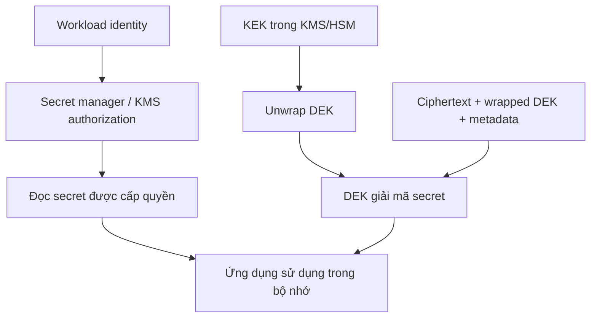

# Credential storage

Credential là thông tin mà người dùng, ứng dụng hoặc dịch vụ dùng để chứng minh danh tính hay quyền truy cập. Ví dụ gồm password, API token, client secret, mật khẩu cơ sở dữ liệu, SSH key, chứng thư TLS và khóa mật mã. **Credential storage** là cách hệ thống tạo, lưu, cấp phát, sử dụng, xoay vòng và thu hồi những thông tin này.

Không phải credential nào cũng nên được lưu theo cùng một cách. Password đăng nhập cần được lưu dưới dạng password verifier để hệ thống xác minh mà không phải khôi phục password gốc. API token có entropy cao thường chỉ cần lưu hash để kiểm tra token. Một client secret mà dịch vụ phải đọc lại cần được lưu trong secret manager hoặc được mã hóa bằng cơ chế quản lý khóa phù hợp. Khóa riêng và khóa mã hóa có giá trị cao nên được quản lý trong keystore được bảo vệ, KMS hoặc HSM theo yêu cầu.

Trong quản lý vòng đời khóa mật mã, credential storage là lớp kiểm soát để bảo đảm bí mật chỉ được cấp cho đúng danh tính, đúng mục đích, trong đúng thời gian; mọi lần truy cập và thay đổi đều có thể kiểm toán.

## 1. Credential là gì và cần lưu loại nào?

Credential là khái niệm rộng. Trước khi chọn cách lưu trữ, cần xác định credential được dùng để làm gì và hệ thống có cần khôi phục giá trị gốc hay không.

| Loại credential | Ví dụ | Cách lưu phù hợp |
|---|---|---|
| Password người dùng | Password đăng nhập web hoặc ứng dụng | Password hashing/KDF chuyên dụng; lưu verifier, salt và tham số |
| API token hoặc personal access token | Bearer token do hệ thống phát hành | Sinh ngẫu nhiên đủ mạnh; lưu hash và metadata nếu chỉ cần xác minh |
| Service secret có thể khôi phục | Database password, OAuth client secret, credential của dịch vụ bên thứ ba | Secret manager hoặc kho bí mật được mã hóa và kiểm soát quyền truy cập |
| Khóa riêng | TLS private key, SSH private key, signing key | Keystore được bảo vệ, KMS hoặc HSM; hạn chế xuất khóa |
| Khóa đối xứng | AES key, HMAC key | KMS/HSM hoặc hệ thống quản lý khóa; có thể dùng envelope encryption |
| Chứng thư và khóa công khai | X.509 certificate, public key | Có thể lưu và phân phối công khai, nhưng phải xác minh nguồn gốc và tính toàn vẹn |

Hai câu hỏi quyết định thiết kế là: **hệ thống chỉ cần xác minh credential hay cần lấy lại giá trị gốc?** và **credential có phải khóa mật mã cần thực hiện thao tác mật mã trực tiếp hay không?** Trả lời đúng hai câu hỏi này giúp tránh lưu password rõ, tránh mã hóa không cần thiết các verifier và tránh đưa khóa quan trọng vào cơ sở dữ liệu ứng dụng.

## 2. Nguyên tắc thiết kế credential storage

Một hệ thống lưu credential an toàn nên tuân theo các nguyên tắc sau:

- **Lưu ít nhất có thể:** chỉ lưu credential cần cho nghiệp vụ; không thu thập hoặc nhân bản bí mật không cần thiết.
- **Chọn cách lưu theo mục đích:** password dùng verifier một chiều; secret cần khôi phục dùng secret manager hoặc mã hóa; khóa mật mã dùng hệ thống quản lý khóa.
- **Mặc định từ chối truy cập:** chỉ danh tính đã được xác thực và cấp quyền mới đọc hoặc sử dụng credential.
- **Phân quyền tối thiểu:** mỗi dịch vụ chỉ được truy cập đúng secret, đúng thao tác và đúng môi trường cần thiết.
- **Giảm thời gian tồn tại:** ưu tiên credential ngắn hạn, token có thời hạn và cơ chế tự động làm mới.
- **Tách bí mật khỏi mã nguồn và dữ liệu thường:** không nhúng secret vào source code, repository, image, log hoặc tài liệu triển khai.
- **Kiểm toán và truy vết:** ghi nhận ai hoặc dịch vụ nào tạo, đọc, thay đổi, xoay vòng hay thu hồi credential.
- **Có kế hoạch phục hồi:** bảo vệ backup, kiểm thử khôi phục và định nghĩa cách xử lý khi secret bị mất hoặc lộ.

Mã hóa ổ đĩa hoặc cơ sở dữ liệu là một lớp bảo vệ hữu ích, nhưng không đủ nếu cùng một tiến trình có thể đọc cả ciphertext lẫn khóa giải mã. Phải tách quyền truy cập, bảo vệ khóa mã hóa và giới hạn danh tính có thể yêu cầu giải mã.

## 3. Lưu password người dùng bằng password verifier

Với password đăng nhập, ứng dụng không cần khôi phục password gốc. Khi đăng ký hoặc đổi password, hệ thống tính password verifier bằng thuật toán chuyên dụng và lưu verifier cùng salt, thuật toán, phiên bản và tham số chi phí.

Khi đăng nhập, ứng dụng chạy cùng thuật toán với password người dùng nhập vào rồi xác minh kết quả theo định dạng verifier đã lưu. Nếu hợp lệ, ứng dụng cấp session hoặc token có thời hạn; không cần lưu lại password rõ.

Các lựa chọn phổ biến gồm:

| Thuật toán | Đặc điểm vận hành |
|---|---|
| Argon2id | Memory-hard; thường là lựa chọn ưu tiên cho password hashing khi có thư viện đã được kiểm định và được nền tảng hỗ trợ |
| scrypt | Memory-hard, làm tăng chi phí bộ nhớ cho mỗi lần thử password |
| bcrypt | Có cost factor; cần xử lý đúng giới hạn độ dài và quy tắc encoding của implementation |
| PBKDF2 | Dựa trên HMAC và số vòng lặp; được hỗ trợ rộng, hữu ích trong một số môi trường Java và yêu cầu tương thích |

Mỗi password record cần salt riêng. Salt không phải bí mật và có thể lưu cùng verifier. Có thể dùng pepper như một bí mật bổ sung lưu tách khỏi cơ sở dữ liệu, chẳng hạn trong secret manager hoặc HSM. Pepper không thay thế salt và cần có kế hoạch xoay vòng, phục hồi.

Không lưu password rõ, password đã mã hóa có thể giải ngược hoặc hash nhanh một lần như SHA-256 để xác thực đăng nhập. Hash nhanh khiến việc đoán password ngoại tuyến rẻ hơn nhiều. Không dùng encryption key của người dùng hoặc API token làm password verifier.

## 4. Lưu API token và bearer credential

API token thường là chuỗi ngẫu nhiên do hệ thống sinh và người dùng hoặc dịch vụ gửi trong mỗi request. Nếu token có entropy đủ cao, hệ thống chỉ cần xác minh token thì có thể lưu hash thay vì token gốc.

Một cách triển khai thường dùng:

1. Sinh token bằng CSPRNG với độ dài ngẫu nhiên đủ lớn, ví dụ 32 byte.
2. Mã hóa token thành chuỗi Base64 URL-safe để thuận tiện truyền trong HTTP header.
3. Trả token cho người dùng hoặc dịch vụ đúng một lần; không ghi token rõ vào log.
4. Lưu một prefix hoặc public identifier để tìm record và lưu hash của token để xác minh.
5. Khi nhận request, dùng prefix tìm record, băm token được gửi lên và so sánh an toàn với hash đã lưu.
6. Kiểm tra trạng thái, thời hạn, scope, audience và quyền của token trước khi thực hiện nghiệp vụ.

Ví dụ sinh token và lưu hash bằng Java:

```java
import java.nio.charset.StandardCharsets;
import java.security.MessageDigest;
import java.security.SecureRandom;
import java.util.Base64;

public final class ApiTokenSupport {
    private static final SecureRandom RANDOM = new SecureRandom();

    public record IssuedToken(String value, String prefix, byte[] hash) {}

    public static IssuedToken issue() throws Exception {
        byte[] randomBytes = new byte[32];
        RANDOM.nextBytes(randomBytes);

        String token = Base64.getUrlEncoder()
                .withoutPadding()
                .encodeToString(randomBytes);
        String prefix = token.substring(0, 8);
        byte[] hash = MessageDigest.getInstance("SHA-256")
                .digest(token.getBytes(StandardCharsets.US_ASCII));

        java.util.Arrays.fill(randomBytes, (byte) 0);
        return new IssuedToken(token, prefix, hash);
    }

    public static boolean verify(String presented, byte[] storedHash)
            throws Exception {
        byte[] candidate = MessageDigest.getInstance("SHA-256")
                .digest(presented.getBytes(StandardCharsets.US_ASCII));
        return MessageDigest.isEqual(candidate, storedHash);
    }
}
```

Trong ví dụ, `value` chỉ được trả về một lần; cơ sở dữ liệu chỉ lưu `prefix` và `hash`. Token được sinh ngẫu nhiên 256 bit nên hash SHA-256 không có đặc tính yếu như hash password do con người chọn. Nếu token có entropy thấp hoặc do người dùng tự đặt, cần password hashing/KDF thích hợp hoặc thay đổi thiết kế để token được sinh ngẫu nhiên.

Trong hệ thống lớn, có thể dùng HMAC với pepper được giữ riêng để tăng khả năng chống lại tình huống kẻ tấn công chỉ lấy được cơ sở dữ liệu token hash. So sánh hash bằng phương thức constant-time phù hợp; không so sánh chuỗi bí mật bằng logic có thể dừng ngay tại byte khác đầu tiên. Không lưu token trong log HTTP, trace, analytics, exception hoặc hệ thống hỗ trợ.

## 5. Lưu service secret có thể khôi phục

Một số credential phải được đọc lại để ứng dụng kết nối tới dịch vụ khác, ví dụ database password, OAuth client secret, SMTP credential hoặc khóa truy cập API của nhà cung cấp. Với loại này, hash một chiều không phù hợp vì ứng dụng cần lấy giá trị để xác thực.

Ưu tiên lưu các secret này trong secret manager chuyên dụng. Ứng dụng xác thực với secret manager bằng workload identity, service identity hoặc credential ngắn hạn; sau đó chỉ lấy secret mà nó được phép dùng. Không nên lưu một master password duy nhất trong cấu hình để tất cả dịch vụ cùng mở toàn bộ kho secret.

Nếu buộc phải lưu secret trong cơ sở dữ liệu hoặc kho tệp, cần mã hóa bằng envelope encryption:

1. Sinh DEK ngẫu nhiên để mã hóa secret bằng AEAD.
2. Dùng KEK được quản lý trong KMS/HSM để bọc DEK.
3. Lưu ciphertext, wrapped DEK, nonce, tag, key ID, phiên bản thuật toán và metadata.
4. Chỉ cấp quyền decrypt hoặc unwrap cho đúng workload cần secret.
5. Ghi audit thao tác unwrap/decrypt, nhưng không ghi giá trị secret.



Nếu secret manager đã cung cấp mã hóa, phân quyền, audit và rotation, nên sử dụng các cơ chế tích hợp đó thay vì tự xây dựng một lớp mã hóa riêng. Việc mã hóa bằng KMS cũng không bảo vệ được secret khỏi tiến trình đã có quyền decrypt; cần bảo vệ runtime và giới hạn quyền của workload.

## 6. Lưu private key và cryptographic key

Khóa riêng TLS, khóa ký số, khóa AES và HMAC key cần được quản lý theo vai trò mật mã. Không lưu khóa rõ trong bảng nghiệp vụ hoặc tệp cấu hình thông thường.

| Loại khóa | Cách quản lý thường phù hợp |
|---|---|
| TLS private key | Keystore được bảo vệ hoặc HSM; giới hạn quyền đọc và ký/bắt tay |
| Signing private key | HSM/KMS nếu cần bảo vệ cao; cấp quyền ký theo danh tính và mục đích |
| AES/DEK | KMS/HSM hoặc envelope encryption; không ghi giá trị khóa vào log |
| KEK/master key | KMS/HSM, quyền quản trị tách biệt, backup và recovery được kiểm soát |
| Public key/certificate | Có thể lưu trong kho dữ liệu hoặc repository phân phối, nhưng phải xác minh chữ ký và chuỗi tin cậy |

Java KeyStore có thể lưu `PrivateKeyEntry`, `SecretKeyEntry` và `TrustedCertificateEntry`. Password của keystore bảo vệ việc nạp kho hoặc entry tùy định dạng/provider; nó không biến tệp thành HSM và không bảo vệ khóa khỏi tiến trình đã được cấp quyền đọc và giải mã.

Với khóa có yêu cầu chống trích xuất, hãy cân nhắc tạo và giữ khóa trong HSM hoặc dịch vụ KMS có nền tảng HSM. Ứng dụng gọi thao tác ký, giải mã hoặc unwrap qua API/provider mà không cần lấy khóa riêng ra khỏi ranh giới bảo vệ, nếu dịch vụ và thuật toán hỗ trợ.

## 7. Schema lưu metadata credential

Cơ sở dữ liệu thường cần lưu metadata để quản lý quyền, thời hạn và trạng thái. Với password verifier hoặc API token, bảng có thể lưu giá trị verifier/hash. Với secret cần khôi phục, bảng chỉ nên giữ tham chiếu tới secret manager hoặc ciphertext đã được mã hóa theo thiết kế.

Ví dụ cấu trúc khái niệm:

```sql
CREATE TABLE credential_record (
    credential_id      VARCHAR(64) PRIMARY KEY,
    owner_id           VARCHAR(128) NOT NULL,
    credential_type    VARCHAR(32) NOT NULL,
    public_prefix      VARCHAR(16),
    verifier_or_hash   VARCHAR(512),
    secret_reference   VARCHAR(512),
    key_id             VARCHAR(128),
    scopes             VARCHAR(2048),
    created_at         TIMESTAMP NOT NULL,
    expires_at         TIMESTAMP,
    last_used_at       TIMESTAMP,
    revoked_at         TIMESTAMP,
    version            INTEGER NOT NULL
);
```

Đây là schema minh họa; kiểu dữ liệu và cách lưu scope cần điều chỉnh theo hệ quản trị cơ sở dữ liệu. Không đặt tên cột `verifier_or_hash` rồi lưu secret rõ vào đó. Với secret cần khôi phục, `secret_reference` nên trỏ tới một secret manager; nếu lưu ciphertext trong database, cần có cột/metadata riêng cho ciphertext, nonce, wrapped DEK và key version.

Các metadata quan trọng gồm chủ sở hữu, loại credential, mục đích, scope, thời gian tạo/hết hạn, lần sử dụng gần nhất, trạng thái thu hồi và phiên bản. Không lưu giá trị credential rõ trong metadata hoặc audit record.

## 8. Phân quyền truy cập và danh tính workload

Credential storage phải xác minh danh tính của bên yêu cầu trước khi cấp secret. Với ứng dụng chạy trên cloud hoặc nền tảng container, ưu tiên workload identity hoặc cơ chế danh tính của nền tảng thay vì nhúng một access key dài hạn vào image.

Phân quyền cần giới hạn theo:

- **Danh tính:** service account hoặc workload nào được truy cập.
- **Tài nguyên:** secret hoặc key cụ thể nào được phép đọc.
- **Thao tác:** chỉ đọc, tạo phiên bản mới, rotate, unwrap, decrypt hay ký.
- **Môi trường:** development, staging và production phải tách biệt.
- **Thời gian:** quyền và credential có thời hạn, có thể thu hồi.
- **Ngữ cảnh:** workload, namespace, project, network hoặc điều kiện khác theo nền tảng.

Không cấp quyền quản trị secret manager cho mọi ứng dụng chỉ vì chúng cần một secret. Tách vai trò người tạo secret, người phê duyệt, người vận hành và workload sử dụng khi mức độ nhạy cảm yêu cầu. Với thao tác xuất khóa hoặc phục hồi master key, có thể cần dual control hoặc nhiều người phê duyệt.

## 9. Đưa credential vào ứng dụng Java an toàn

Ứng dụng cần lấy credential tại runtime từ secret manager hoặc cơ chế cấp phát bí mật do nền tảng cung cấp. Cách tích hợp cụ thể tùy nhà cung cấp, nhưng quy trình nên có các bước:

1. Xác thực workload bằng danh tính của nền tảng.
2. Yêu cầu đúng secret theo tên hoặc version đã được cấp quyền.
3. Kiểm tra secret có tồn tại, đúng version và còn hiệu lực.
4. Chuyển secret vào thành phần cần dùng, hạn chế sao chép và thời gian tồn tại trong bộ nhớ.
5. Xóa mảng `char[]` hoặc buffer do ứng dụng sở hữu khi không còn cần.
6. Không ghi secret vào log, exception, metric label, trace hoặc crash report.

Ví dụ mô hình hóa một interface để tách ứng dụng khỏi nhà cung cấp secret manager:

```java
import java.util.Optional;

public interface SecretProvider {
    Optional<char[]> readSecret(String secretName, String version);
}
```

Lớp triển khai `SecretProvider` sẽ dùng SDK hoặc provider chính thức của nền tảng để xác thực workload và đọc secret. Không nên tự viết giao thức mã hóa, xác thực hoặc rotation của secret manager nếu đã có SDK được hỗ trợ.

Khi truyền secret vào thư viện JDBC hoặc HTTP client, kiểm tra xem thư viện có giữ lại bản sao credential hay không và có hỗ trợ thay credential mà không khởi động lại ứng dụng không. Với secret được luân chuyển định kỳ, cần thiết kế pool/connection refresh để kết nối mới dùng credential mới và kết nối cũ được đóng theo kế hoạch.

## 10. Tránh rò rỉ credential trong pipeline và runtime

Credential có thể bị lộ ở nhiều nơi ngoài cơ sở dữ liệu:

- Source code, Git commit, pull request, issue và file `.env` được commit nhầm.
- Container image, build artifact, package, layer hoặc cache của CI.
- Biến môi trường, tham số dòng lệnh và thông tin process có thể bị đọc bởi tiến trình hoặc người có quyền phù hợp.
- Log ứng dụng, access log HTTP, trace, metric label, exception và telemetry.
- Heap dump, core dump, crash report, debug endpoint và session recording.
- Backup, snapshot, bản sao database, tệp tạm và máy phát triển.

Không nhúng secret vào Dockerfile, source code hoặc image. Tránh truyền secret qua tham số command line vì tham số có thể xuất hiện trong process listing hoặc log. Biến môi trường không phải lúc nào cũng bị lộ, nhưng có thể xuất hiện trong diagnostics, crash dump, process inspection hoặc được truyền sang tiến trình con; chỉ dùng khi nền tảng bảo vệ phù hợp và không có cơ chế tốt hơn.

Ưu tiên workload identity kết hợp secret manager để lấy credential ngắn hạn khi chạy. Nếu cần file injection, dùng mount được bảo vệ với quyền filesystem tối thiểu và nơi lưu tạm phù hợp. Secret trong bộ nhớ tiến trình vẫn có thể bị lấy bởi mã độc hoặc người có quyền debug; cần giới hạn quyền tiến trình và bảo vệ host/container.

Trong CI/CD, ưu tiên federation hoặc OIDC để pipeline nhận credential ngắn hạn. Không dùng một access key production dài hạn chung cho mọi job. Che giá trị secret trong log không thay thế việc tránh in secret ngay từ đầu.

## 11. Rotation, expiration và revocation

Credential cần có chủ sở hữu, thời hạn và quy trình thay thế. Rotation giảm thời gian một bí mật bị lộ có thể được sử dụng, nhưng nếu triển khai sai có thể gây gián đoạn dịch vụ.

Một quy trình rotation an toàn thường gồm:

1. Tạo credential hoặc key version mới.
2. Cấp quyền cho workload và cập nhật secret manager.
3. Cho phép giai đoạn chuyển tiếp có kiểm soát nếu cần hỗ trợ credential cũ và mới cùng lúc.
4. Cập nhật ứng dụng, connection pool, client hoặc dịch vụ phụ thuộc.
5. Xác minh request mới hoạt động bằng credential mới.
6. Thu hồi credential cũ sau khi xác nhận không còn workload sử dụng.
7. Ghi audit và đóng các phiên/kết nối cũ theo chính sách.

Với API token, có thể phát hành token mới, cho phép cả hai token hoạt động trong một khoảng thời gian ngắn, yêu cầu client chuyển đổi rồi thu hồi token cũ. Với password database, cần phối hợp cập nhật credential ở database và ứng dụng để tránh khoảng thời gian ứng dụng không kết nối được. Với private key ký số, cần xem xét chứng thư, key ID, chữ ký đã tạo và dữ liệu cần xác minh lâu dài.

Revocation phải có hiệu lực đủ nhanh. Nếu credential bị lộ, thu hồi ngay theo khả năng của hệ thống, vô hiệu hóa session hoặc token liên quan, kiểm tra log truy cập và đánh giá liệu khóa dữ liệu có cần xoay vòng hay không. Không đợi đến ngày hết hạn nếu đã có dấu hiệu xâm phạm.

## 12. Backup, recovery và incident response

Backup credential có thể cần thiết để khôi phục dịch vụ, nhưng bản sao cũng là tài sản nhạy cảm. Backup phải có mã hóa, phân quyền, kiểm soát phiên bản, audit và thời hạn lưu giữ. Nếu backup chứa ciphertext, cần bảo đảm KEK và metadata phục hồi còn sẵn sàng theo chính sách.

Kiểm thử phục hồi định kỳ nên xác minh:

- Có thể lấy lại đúng secret hoặc key version cần thiết.
- Danh tính khôi phục có quyền tối thiểu và có phê duyệt phù hợp.
- Ứng dụng có thể dùng credential sau khi khôi phục.
- Audit ghi nhận thao tác khôi phục và người thực hiện.
- Các bản sao cũ được xử lý theo chính sách lưu giữ và hủy.

Khi credential bị lộ, cần xác định loại credential, chủ sở hữu, phạm vi quyền, thời gian phơi nhiễm và hệ thống phụ thuộc. Sau đó thu hồi hoặc xoay vòng, vô hiệu hóa session, rà soát log, kiểm tra truy cập bất thường và đánh giá tác động tới dữ liệu được bảo vệ. Nếu khóa mã hóa bị lộ, cần xác định dữ liệu nào được mã hóa bằng khóa đó và lập kế hoạch re-encryption hoặc xử lý rủi ro theo chính sách.

Không chỉ xóa secret khỏi repository hiện tại rồi xem sự cố đã kết thúc. Secret có thể còn trong lịch sử Git, fork, cache, artifact, image, backup và log. Cần thu hồi credential trước, sau đó xử lý bản sao theo quy trình ứng phó.

## 13. Checklist đánh giá Credential storage

- Phân loại credential: password, API token, service secret, private key, symmetric key hay public certificate.
- Xác định hệ thống cần verifier/hash hay cần khôi phục giá trị secret.
- Password được lưu bằng password hashing chuyên dụng với salt riêng và tham số có thể nâng cấp.
- API token có entropy cao; chỉ lưu hash/prefix nếu không cần đọc lại token.
- Service secret được lưu trong secret manager hoặc ciphertext được mã hóa bằng envelope encryption với KEK tách biệt.
- Khóa mật mã được quản lý trong keystore được bảo vệ, KMS hoặc HSM theo mức độ nhạy cảm.
- Workload identity và least privilege được áp dụng cho từng secret, thao tác và môi trường.
- Không có credential trong source code, Git, image, log, trace, command line hoặc artifact.
- Có owner, scope, version, thời hạn, last-used, rotation và revocation.
- Backup được bảo vệ và quy trình recovery được kiểm thử.
- Có audit truy cập và cảnh báo truy cập bất thường; log không chứa giá trị bí mật.
- Có playbook xử lý khi password, token, service secret hoặc cryptographic key bị lộ.

Credential storage không chỉ là việc đặt một chuỗi bí mật vào nơi được mã hóa. Thiết kế đúng bắt đầu từ phân loại credential và mục đích sử dụng, chọn verifier hoặc kho secret phù hợp, giới hạn danh tính được truy cập, rồi duy trì rotation, audit, backup và thu hồi trong suốt vòng đời. Với khóa mật mã có giá trị cao, cần kết nối credential storage với KMS/HSM và chính sách quản lý khóa tổng thể.

## Tài liệu tham khảo

- [OWASP Secrets Management Cheat Sheet](https://cheatsheetseries.owasp.org/cheatsheets/Secrets_Management_Cheat_Sheet.html)
- [OWASP Password Storage Cheat Sheet](https://cheatsheetseries.owasp.org/cheatsheets/Password_Storage_Cheat_Sheet.html)
- [NIST SP 800-57 Part 1 Rev. 5: Recommendation for Key Management](https://csrc.nist.gov/pubs/sp/800/57/pt1/r5/final)
- [NIST SP 800-63B-4: Authentication and Authenticator Management](https://csrc.nist.gov/pubs/sp/800/63/b/4/final)
- [Java SE API: `KeyStore`](https://docs.oracle.com/en/java/javase/21/docs/api/java.base/java/security/KeyStore.html)
