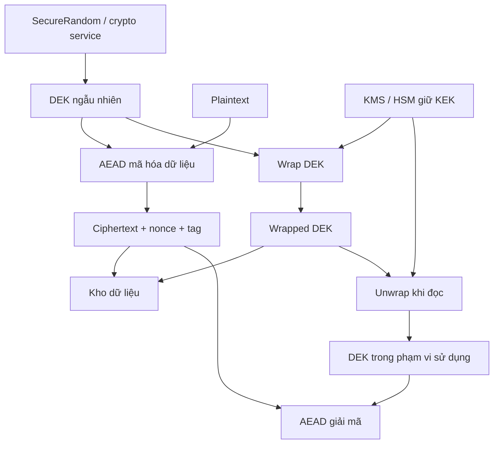

# Encryption key storage

**Encryption key storage** là cách tổ chức lưu giữ, bảo vệ, cấp quyền sử dụng, sao lưu và thu hồi khóa dùng để mã hóa hoặc giải mã dữ liệu. Mục tiêu là để đúng thành phần có thể sử dụng đúng khóa vào đúng thời điểm, đồng thời hạn chế khả năng đọc, sao chép, xuất hoặc khôi phục khóa trái phép.

Khóa mã hóa là tài sản nhạy cảm. Nếu attacker lấy được ciphertext nhưng không có khóa, dữ liệu có thể vẫn được bảo vệ. Nếu attacker lấy được cả khóa và ciphertext, lớp mã hóa có thể mất tác dụng. Vì vậy, độ mạnh của AES hay RSA không bù được một thiết kế lưu khóa yếu như đặt khóa trong source code, lưu cùng dữ liệu đã mã hóa hoặc cho mọi tiến trình quyền đọc file khóa.

Trong mô-đun **SECURITY_KEY_MANAGEMENT_FUNDAMENTALS**, lưu trữ khóa kết nối với vòng đời khóa, mật mã đối xứng và bất đối xứng, chữ ký số, KMS/HSM, envelope encryption, kiểm soát truy cập, backup, rotation và kiểm toán. Bài học tập trung vào cách chọn nơi lưu và cách vận hành để bảo vệ khóa trong suốt thời gian hệ thống cần sử dụng chúng.

## 1. Phân biệt mật khẩu và khóa mật mã

Mật khẩu và khóa mật mã đều là bí mật nhưng có vai trò khác nhau:

| Thuộc tính | Mật khẩu (password) | Khóa mật mã (cryptographic key) |
|---|---|---|
| Nguồn tạo | Thường do người dùng chọn hoặc hệ thống cấp | Sinh bằng bộ sinh ngẫu nhiên mật mã, thuật toán thỏa thuận khóa hoặc KDF phù hợp |
| Entropy | Thường thấp và có thể đoán được | Được thiết kế với độ dài và entropy theo thuật toán |
| Mục đích | Xác thực người dùng hoặc làm đầu vào cho cơ chế dẫn xuất | Mã hóa, giải mã, ký, xác minh, trao đổi hoặc dẫn xuất khóa |
| Cách lưu | Lưu password hash có salt và cost; không lưu mật khẩu dạng rõ | Lưu trong keystore, KMS, HSM hoặc dưới dạng đã được bọc bằng khóa khác |
| Khả năng sử dụng | Cần xác minh hoặc dẫn xuất khóa | Được đưa vào API mật mã hoặc dùng qua key handle |

Không lưu mật khẩu người dùng bằng cách mã hóa có thể giải ngược để xác minh đăng nhập. Hãy dùng password KDF chuyên dụng như Argon2id, scrypt hoặc PBKDF2 với salt riêng và tham số cost phù hợp. Mật khẩu dùng để mở một keystore hoặc bảo vệ bản sao khóa là một trường hợp khác: hệ thống có thể cần mật khẩu đó để giải mã vật liệu khóa, nên phải bảo vệ bí mật mở khóa trong secret manager hoặc cơ chế tương đương.

Không dùng trực tiếp một mật khẩu làm khóa AES. Nếu cần dẫn xuất khóa từ mật khẩu, dùng password KDF. Nếu cần khóa mã hóa dữ liệu có độ mạnh cao, ưu tiên sinh DEK ngẫu nhiên rồi bảo vệ DEK bằng KEK.

## 2. Nguyên tắc thiết kế lưu trữ khóa

Một thiết kế lưu trữ khóa tốt nên tuân theo các nguyên tắc sau:

1. **Tách khóa khỏi dữ liệu:** không lưu khóa dạng rõ trong cùng database, bucket hoặc thư mục với ciphertext mà khóa bảo vệ.
2. **Tối thiểu hóa khả năng xuất:** nếu ứng dụng chỉ cần ký hoặc giải mã, ưu tiên key handle và thao tác trong KMS/HSM thay vì xuất raw key bytes.
3. **Phân quyền theo mục đích:** chỉ service account hoặc workload thực sự cần mới được gọi thao tác tương ứng; quyền `Decrypt` không mặc nhiên đi cùng quyền `Encrypt`, `Export` hoặc `Delete`.
4. **Phân tách nhiệm vụ:** người quản trị hạ tầng, người phê duyệt thao tác nhạy cảm và người sử dụng khóa nên có quyền riêng biệt.
5. **Giới hạn thời gian tồn tại:** chỉ nạp khóa vào bộ nhớ khi cần, giảm số bản sao và xóa vùng đệm khi kết thúc công việc.
6. **Có thể kiểm toán:** ghi nhận ai dùng khóa nào, cho mục đích gì, vào thời điểm nào và kết quả ra sao mà không ghi giá trị khóa.
7. **Có kế hoạch phục hồi:** xác định cách backup và khôi phục khóa, đồng thời kiểm tra rằng backup được bảo vệ độc lập.
8. **Quản lý vòng đời:** mỗi khóa có owner, mục đích, trạng thái, thời hạn, phiên bản, chính sách rotation và điều kiện hủy.

Mức bảo vệ phải phù hợp với giá trị dữ liệu, thời gian cần bảo mật, threat model và khả năng vận hành. Một khóa dùng cho dữ liệu thử nghiệm không nhất thiết cần cùng hạ tầng với khóa gốc của CA hoặc khóa mã hóa dữ liệu thanh toán.

## 3. Các mô hình lưu trữ khóa

Không có một nơi lưu duy nhất phù hợp cho mọi loại khóa. Các lựa chọn phổ biến gồm:

| Mô hình | Cách hoạt động | Phù hợp khi | Rủi ro cần kiểm soát |
|---|---|---|---|
| File keystore được bảo vệ | Khóa nằm trong tệp keystore có cơ chế bảo vệ bằng mật khẩu hoặc cơ chế provider | Ứng dụng nhỏ, triển khai on-premises hoặc cần tính di động | File bị sao chép, mật khẩu yếu, quyền file rộng, backup không an toàn |
| OS keystore / credential store | Hệ điều hành quản lý bí mật và kiểm soát truy cập theo user/process | Ứng dụng chạy trên máy chủ hoặc workstation có OS security boundary phù hợp | Quyền tài khoản, quyền quản trị máy, backup và migration OS |
| Secret manager | Lưu mật khẩu, token và cấu hình bí mật; có thể cấp bí mật cho workload | Quản lý credential và bootstrap secret tập trung | Secret manager bị lạm quyền, secret bị lộ qua log hoặc environment |
| KMS | Quản lý key object, policy, version, audit và thao tác mật mã qua API | Hệ thống phân tán hoặc cloud cần quản lý khóa tập trung | IAM policy sai, quyền gọi API quá rộng, phụ thuộc dịch vụ và region |
| HSM | Giữ khóa trong thiết bị hoặc miền bảo vệ phần cứng; thao tác qua key handle | Khóa có giá trị cao, CA, signing key, KEK hoặc yêu cầu bảo vệ phần cứng | Vận hành phức tạp, backup/HA, token, partition, firmware và quy trình phục hồi |
| Hardware-backed OS keystore | Khóa gắn với phần cứng bảo mật của thiết bị | Mobile, endpoint hoặc thiết bị chuyên dụng | Phụ thuộc phần cứng, khả năng backup/di chuyển và API nền tảng |

Secret manager và KMS không phải lúc nào cũng là cùng một dịch vụ. Secret manager thường lưu các bí mật mà ứng dụng cần nhận, như database password hoặc API token. KMS tập trung quản lý key object và cung cấp thao tác mật mã. Một hệ thống có thể dùng secret manager để giữ credential truy cập KMS, trong khi khóa mã hóa dữ liệu vẫn ở KMS/HSM.

## 4. File keystore trong Java

Java `KeyStore` là API chuẩn để lưu và truy xuất private key, secret key và certificate theo loại keystore/provider. Một keystore thường có alias để định danh entry. Tùy loại keystore, provider và phiên bản JDK, cơ chế bảo vệ, định dạng và khả năng tương thích có thể khác nhau.

Các loại thường gặp:

| Loại | Đặc điểm | Ghi chú |
|---|---|---|
| `PKCS12` | Định dạng trao đổi phổ biến cho private key và certificate | Thường là lựa chọn mặc định tốt cho ứng dụng Java hiện đại; cần kiểm tra provider và cách bảo vệ entry |
| `JKS` | Định dạng keystore truyền thống của Java | Chủ yếu gặp trong hệ thống cũ; cần kế hoạch chuyển đổi khi phù hợp |
| `JCEKS` | Keystore cũ có hỗ trợ secret key entry trong một số triển khai JDK | Có giới hạn tương thích và không nên chọn mặc định cho thiết kế mới nếu nền tảng cung cấp lựa chọn tốt hơn |
| `PKCS11` | Keystore view của token/HSM qua provider PKCS#11 | Thường giữ khóa dưới dạng handle; vật liệu bí mật có thể không xuất được |
| `Windows-MY`, `KeychainStore` | Truy cập kho chứng thư/khóa do hệ điều hành quản lý trên nền tảng tương ứng | Tên và khả năng phụ thuộc OS/JDK/provider |

Không nên giả định `KeyStore` luôn mã hóa mọi entry theo cùng một cách hoặc mọi provider hỗ trợ mọi loại key entry. Hãy đọc tài liệu provider, kiểm tra định dạng và thử load/store trên đúng runtime sẽ triển khai.

### 4.1. Nạp private key từ PKCS12

Ví dụ sau mở một tệp PKCS12 từ đường dẫn cấu hình, lấy private key theo alias và xóa mảng mật khẩu sau khi dùng:

```java
import java.io.InputStream;
import java.nio.file.Files;
import java.nio.file.Path;
import java.security.Key;
import java.security.KeyStore;
import java.security.PrivateKey;
import java.util.Arrays;

public final class Pkcs12KeyLoader {
    private Pkcs12KeyLoader() {}

    public static PrivateKey loadPrivateKey(
            Path keyStorePath,
            String alias,
            char[] storePassword,
            char[] entryPassword) throws Exception {

        KeyStore keyStore = KeyStore.getInstance("PKCS12");
        try (InputStream input = Files.newInputStream(keyStorePath)) {
            keyStore.load(input, storePassword);
        } finally {
            if (storePassword != null) {
                Arrays.fill(storePassword, '\0');
            }
        }

        try {
            Key key = keyStore.getKey(alias, entryPassword);
            if (!(key instanceof PrivateKey privateKey)) {
                throw new IllegalStateException(
                        "Alias does not contain a private key");
            }
            return privateKey;
        } finally {
            if (entryPassword != null) {
                Arrays.fill(entryPassword, '\0');
            }
        }
    }
}
```

Ví dụ minh họa API, không phải một kho khóa hoàn chỉnh cho mọi môi trường. `storePassword` và `entryPassword` phải được cấp từ secret manager hoặc nguồn bí mật được phê duyệt; không hardcode trong source code, commit vào repository hoặc ghi log. Cần bảo đảm caller không còn cần các mảng mật khẩu trước khi phương thức xóa chúng. Nếu provider trả về private key có thể xuất, đối tượng đó vẫn tồn tại trong bộ nhớ sau khi load; hãy giới hạn thời gian sống và quyền truy cập của nó.

Trong Java mới, pattern matching `instanceof` trong ví dụ yêu cầu Java 16 trở lên. Nếu dự án dùng Java 8 hoặc 11, thay bằng kiểm tra kiểu và ép kiểu truyền thống. Việc xóa mảng `char[]` là biện pháp giảm thời gian tồn tại của bản sao trong ứng dụng; JVM/provider có thể đã tạo bản sao nội bộ, nên đây không phải bằng chứng zeroization tuyệt đối.

Khả năng dùng mật khẩu riêng cho từng entry phụ thuộc định dạng và provider. Một số triển khai PKCS12 yêu cầu mật khẩu entry trùng với mật khẩu keystore hoặc áp dụng quy tắc bảo vệ riêng. Hãy kiểm tra trên đúng JDK/provider và tránh truyền cùng một mảng `char[]` cho cả hai tham số nếu phương thức sẽ xóa mảng thứ nhất trước khi dùng tham số thứ hai.

### 4.2. Bảo vệ file keystore trên hệ điều hành

Nếu phải lưu keystore trên filesystem:

- Đặt file trong thư mục chuyên dụng, không nằm trong web root, thư mục upload hoặc source repository.
- Cấp quyền đọc cho đúng service account; người dùng và process khác không có quyền đọc.
- Giới hạn quyền ghi/xóa để attacker không thể thay file hoặc thay symlink.
- Dùng owner/group và ACL phù hợp; kiểm tra quyền thư mục cha vì quyền truy cập có thể kế thừa từ đường dẫn.
- Mã hóa volume hoặc filesystem theo yêu cầu, nhưng không coi disk encryption là thay thế cho bảo vệ keystore và mật khẩu mở khóa.
- Không đưa keystore vào container image hoặc artifact build. Mount hoặc cấp qua cơ chế secret volume được kiểm soát.
- Kiểm soát snapshot, backup, crash dump và công cụ chẩn đoán có thể sao chép file hoặc nội dung bộ nhớ.
- Theo dõi quyền truy cập, thay đổi file và việc sử dụng alias quan trọng.

Mật khẩu keystore đặt trong cùng file cấu hình với keystore làm giảm đáng kể lợi ích bảo vệ. Nếu cả hai bị sao chép cùng lúc, attacker có thể mở khóa. Nên phân tách nơi lưu và quyền truy cập của file keystore với bí mật dùng để mở nó.

## 5. Lưu khóa trong KMS và HSM

### 5.1. KMS

Key Management Service (KMS) quản lý key object và cung cấp API để tạo, mã hóa, giải mã, ký, xác minh, bọc hoặc hủy khóa tùy dịch vụ. Ứng dụng thường nhận key ID hoặc key handle và gọi API theo quyền được cấp. Vật liệu khóa có thể được giữ trong miền bảo vệ của nhà cung cấp.

Ưu điểm thường thấy:

- Tập trung chính sách và phân quyền theo workload, service account, môi trường hoặc key purpose.
- Có audit log cho thao tác mật mã và thay đổi cấu hình.
- Hỗ trợ phiên bản khóa, rotation, disable, schedule deletion và replication theo dịch vụ.
- Giảm nhu cầu lưu raw key bytes trong ứng dụng.
- Hỗ trợ envelope encryption cho lượng dữ liệu lớn.

KMS không tự động làm hệ thống an toàn. Nếu IAM cho phép mọi workload gọi `Decrypt` trên mọi key, hoặc một service account bị chiếm quyền, attacker vẫn có thể yêu cầu KMS giải mã dữ liệu. Cần giới hạn key policy, resource policy, identity policy, condition theo context và phạm vi dữ liệu.

### 5.2. HSM

Hardware Security Module (HSM) là thiết bị hoặc dịch vụ bảo vệ vật liệu khóa trong một boundary phần cứng hoặc môi trường được kiểm soát. Ứng dụng thường làm việc qua API như PKCS#11 hoặc provider JCA tương ứng. Với khóa không exportable, ứng dụng chỉ giữ đối tượng/handle đại diện và yêu cầu HSM thực hiện phép toán.

HSM phù hợp với khóa gốc, khóa ký CA, khóa ký code, khóa bảo vệ khóa hoặc các trường hợp cần mức bảo vệ cao. Cần xem xét:

- Ai có quyền đăng nhập token, partition hoặc security domain?
- Khóa được tạo bên trong HSM hay import từ bên ngoài?
- Thuộc tính exportable/non-exportable được đặt và xác minh thế nào?
- Có cần M-of-N hoặc dual control cho thao tác quản trị không?
- Backup HSM được tạo, lưu và khôi phục theo quy trình nào?
- HA/replication có giữ cùng policy và audit không?
- Firmware, driver, PKCS#11 library và provider được cập nhật ra sao?

HSM bảo vệ vật liệu khóa ở một boundary; nó không ngăn ứng dụng có quyền hợp lệ yêu cầu ký hoặc giải mã dữ liệu tùy tiện. Cần kết hợp HSM với IAM, giới hạn mục đích, rate limit, xác thực yêu cầu và giám sát hành vi.

## 6. Envelope encryption: cách lưu khóa cho dữ liệu lớn

Envelope encryption tách khóa mã hóa dữ liệu (DEK) khỏi khóa bảo vệ khóa (KEK):

1. Ứng dụng hoặc dịch vụ mã hóa sinh DEK ngẫu nhiên.
2. DEK mã hóa dữ liệu bằng thuật toán AEAD như AES-GCM theo policy.
3. KMS/HSM dùng KEK để wrap DEK.
4. Hệ thống lưu ciphertext, nonce/tag, wrapped DEK và key reference.
5. Khi cần đọc, workload có quyền yêu cầu KMS/HSM unwrap DEK, sau đó dùng DEK giải mã dữ liệu.



Ứng dụng lưu wrapped DEK thay vì lưu DEK dạng rõ. Wrapped DEK vẫn là dữ liệu nhạy cảm và phải được bảo vệ khỏi thay đổi, xóa hoặc tráo đổi. Có thể ràng buộc metadata như tenant, record ID, purpose và format version vào encryption context hoặc AAD theo thiết kế dịch vụ để ngăn ciphertext bị chuyển sang ngữ cảnh khác.

**Không nhầm rewrap với re-encrypt:** rewrap thay KEK bảo vệ DEK nhưng không thay thuật toán hoặc DEK đã mã hóa dữ liệu. Re-encrypt giải mã dữ liệu cũ rồi mã hóa lại bằng DEK/thuật toán mới. Nếu chỉ thay KEK, rewrap thường giảm chi phí; nếu thuật toán mã hóa dữ liệu hoặc DEK cần thay, phải có kế hoạch re-encrypt.

## 7. Lưu trữ khóa đối xứng và bất đối xứng

Khóa đối xứng và bất đối xứng có cách lưu và rủi ro khác nhau:

| Loại khóa | Ví dụ | Yêu cầu lưu trữ |
|---|---|---|
| DEK đối xứng | AES-256 dùng mã hóa file hoặc record | Sinh ngẫu nhiên, giới hạn phạm vi sử dụng, thường bọc bằng KEK; tránh lưu raw DEK lâu dài |
| KEK đối xứng | AES key hoặc key object trong KMS/HSM | Bảo vệ ở KMS/HSM, giới hạn quyền wrap/unwrap, có backup/rotation và audit |
| Private key ký | RSA/ECDSA/EdDSA private key | Bảo vệ trong HSM/keystore, hạn chế export, giới hạn quyền ký và ghi audit |
| Private key giải mã | RSA hoặc key agreement private key theo giao thức | Hạn chế quyền decrypt/derive, bảo vệ backup và thời gian sống |
| Public key | Public key của đối tác hoặc certificate | Có thể phân phối công khai nhưng phải xác thực nguồn gốc, fingerprint, certificate path và mục đích |

Public key không cần giữ bí mật nhưng cần bảo đảm tính toàn vẹn và nguồn gốc. Thay public key bằng key giả có thể khiến ứng dụng mã hóa cho attacker hoặc xác minh chữ ký sai. Vì vậy, public key nên được phân phối qua certificate/PKI, pinning có quản lý hoặc một kênh tin cậy khác.

Private key cần được gắn với identity, purpose, algorithm, key usage và thời hạn. Không dùng một private key cho TLS, ký tài liệu và mã hóa dữ liệu chỉ vì nó đã có sẵn. Tách mục đích giúp giới hạn hậu quả khi key bị lộ và đơn giản hóa rotation.

## 8. Kiểm soát truy cập và phân tách nhiệm vụ

Lưu khóa an toàn đòi hỏi kiểm soát cả quyền truy cập trực tiếp và quyền gọi thao tác mật mã.

| Vai trò | Quyền nên có | Quyền cần hạn chế |
|---|---|---|
| Workload mã hóa | `Encrypt` hoặc `GenerateDataKey` trong phạm vi dữ liệu của nó | `Export`, `Delete`, quản trị key policy |
| Workload giải mã | `Decrypt`/`Unwrap` cho đúng key và context cần thiết | Tạo/xóa key, thay policy, export KEK |
| Key administrator | Quản lý metadata, policy, rotation theo quy trình | Tự ý sử dụng khóa để đọc dữ liệu nghiệp vụ |
| Security approver | Phê duyệt thao tác nhạy cảm hoặc ngoại lệ | Tự thực hiện và tự phê duyệt cùng một thao tác nếu yêu cầu dual control |
| Auditor | Đọc log và bằng chứng | Đọc raw key material hoặc thay đổi log |
| Backup operator | Thực hiện backup/restore theo quy trình | Sử dụng khóa cho nghiệp vụ thường ngày |

Các nguyên tắc cần áp dụng:

- Dùng workload identity hoặc service account riêng cho từng ứng dụng và môi trường.
- Không chia sẻ một credential quản trị giữa nhiều dịch vụ.
- Giới hạn quyền theo key ID, operation, tenant, resource tag hoặc encryption context khi nền tảng hỗ trợ.
- Dùng short-lived credentials và xác thực workload khi phù hợp.
- Tách quyền tạo key, dùng key, thay policy, export và destroy.
- Dùng phê duyệt kép cho thao tác có thể làm mất khả năng giải mã hoặc ảnh hưởng nhiều hệ thống.
- Rà soát quyền định kỳ và thu hồi quyền không còn cần thiết.

Không cấp quyền `Decrypt` rộng chỉ để giảm lỗi vận hành. Nếu workload chỉ cần giải mã một loại dữ liệu, policy cần ràng buộc được key, context và phạm vi dữ liệu tương ứng.

## 9. Bảo vệ khóa trong bộ nhớ ứng dụng

Ngay cả khi khóa được lưu an toàn trong KMS hoặc keystore, một số thao tác có thể đưa key material vào bộ nhớ tiến trình. Cần giảm thời gian và phạm vi tồn tại:

- Ưu tiên thao tác mật mã trong KMS/HSM nếu ứng dụng không cần raw key bytes.
- Chỉ tải khóa vào bộ nhớ khi cần; tránh cache vô thời hạn.
- Hạn chế sao chép mảng byte và đối tượng khóa.
- Không chuyển khóa hoặc mật khẩu thành `String` vì chuỗi bất biến và khó chủ động xóa.
- Xóa mảng byte/char do ứng dụng sở hữu trong `finally` sau khi hoàn thành công việc.
- Hạn chế heap dump, core dump, swap, hibernation và telemetry có thể chứa bí mật.
- Không ghi khóa, password, PIN, wrapped/unwrapped secret hoặc plaintext nhạy cảm vào log.

Ví dụ xóa một buffer do ứng dụng sở hữu:

```java
import java.util.Arrays;

byte[] keyMaterial = obtainKeyMaterialForShortOperation();
try {
    performOperation(keyMaterial);
} finally {
    Arrays.fill(keyMaterial, (byte) 0);
}
```

Đoạn mã chỉ ghi đè mảng `keyMaterial` mà biến đang tham chiếu. Provider, JVM, thư viện native hoặc garbage collector có thể đã tạo bản sao khác. Không coi `Arrays.fill` là bảo đảm zeroization tuyệt đối; hãy ưu tiên key handle và API bảo vệ bộ nhớ khi phù hợp.

## 10. Backup và phục hồi khóa

Mất khóa có thể làm dữ liệu không thể giải mã; backup khóa vì vậy quan trọng nhưng cũng tạo thêm bản sao cần bảo vệ. Chính sách backup cần xác định:

- Khóa nào được backup và khóa nào không được phép export.
- Backup chứa raw key, wrapped key, key metadata hay HSM backup object.
- Mã hóa backup bằng khóa độc lập và quản lý khóa bảo vệ backup ra sao.
- Ai có quyền tạo, truy cập, vận chuyển và khôi phục backup.
- Backup nằm ở region/site nào, có offline/immutable copy hay không.
- Thời hạn lưu, cách xử lý bản cũ và quy trình destruction.
- RTO/RPO và cách xác minh backup có thể khôi phục.

Với HSM, backup thường phải theo cơ chế được nhà sản xuất hoặc dịch vụ hỗ trợ, có thể dùng backup device, security domain, quorum hoặc wrapping key riêng. Không tự sao chép file nội bộ của HSM hoặc export key nếu chính sách thiết bị cấm.

Một backup chỉ có giá trị khi có thể phục hồi trong điều kiện thực tế. Hãy diễn tập restore định kỳ trong môi trường tách biệt, xác minh key ID/version, quyền, audit và khả năng giải mã dữ liệu mẫu. Không thử restore đè lên key production đang hoạt động.

## 11. Rotation, versioning và thu hồi

Khóa cần được xoay vòng theo thời hạn, lượng dữ liệu đã xử lý, thay đổi nhân sự/quyền, nghi ngờ lộ khóa hoặc yêu cầu chính sách. Rotation có thể có nhiều mức:

| Hành động | Điều thay đổi | Ảnh hưởng |
|---|---|---|
| Tạo key version mới | Có phiên bản mới cho key logical ID | Ứng dụng cần biết version nào dùng cho encrypt và version nào dùng để decrypt dữ liệu cũ |
| Rewrap DEK | Thay KEK bọc DEK | Không cần mã hóa lại ciphertext nếu DEK và thuật toán dữ liệu vẫn phù hợp |
| Re-encrypt | Mã hóa lại dữ liệu bằng DEK/thuật toán mới | Tốn tài nguyên và cần migration có checkpoint |
| Disable key | Chặn thao tác sử dụng mới theo semantics dịch vụ | Dữ liệu cũ có thể không đọc được trong thời gian disable |
| Revoke/destroy key | Thu hồi hoặc hủy vật liệu khóa | Có thể mất khả năng giải mã vĩnh viễn nếu không còn bản thay thế |

Quy trình rotation an toàn thường là:

1. Tạo phiên bản khóa mới theo policy.
2. Cấp quyền và kiểm tra workload có thể dùng key mới.
3. Chuyển thao tác mã hóa/ghi mới sang key mới.
4. Giữ quyền giải mã bằng key cũ trong giai đoạn chuyển tiếp có thời hạn.
5. Rewrap hoặc re-encrypt dữ liệu cũ nếu yêu cầu.
6. Xác minh dữ liệu, backup, replica và ứng dụng phụ thuộc.
7. Thu hồi quyền sử dụng key cũ rồi mới disable/destroy theo chính sách.
8. Lưu bằng chứng và cập nhật inventory.

Không xóa key cũ ngay sau khi tạo key mới. Dữ liệu đã mã hóa, backup và bản sao ngoại tuyến có thể vẫn phụ thuộc vào key cũ. Với khóa bị compromise, cần incident response khẩn cấp: ngăn sử dụng trái phép, thay khóa, đánh giá dữ liệu đã bị truy cập và xác định bản sao bị ảnh hưởng.

## 12. Lưu khóa trong container và hệ thống phân tán

Container image, pod và máy ảo thường được tạo lại, di chuyển hoặc snapshot. Lưu key material trong image hoặc filesystem layer có thể làm bí mật lan sang registry, cache build và bản sao triển khai.

Các nguyên tắc triển khai:

- Không bake keystore, private key, password hoặc cloud credential vào image.
- Cấp secret lúc runtime qua secret volume, workload identity hoặc agent được phê duyệt.
- Hạn chế quyền mount và chỉ đưa secret đến container cần dùng.
- Dùng read-only mount nếu ứng dụng không cần ghi keystore.
- Hạn chế shell/debug/exec vào container production và kiểm soát ephemeral storage.
- Xử lý pod termination, node replacement và cache key theo vòng đời workload.
- Với nhiều region, quản lý key replication, key version và policy đồng nhất nhưng giữ ranh giới truy cập phù hợp.
- Kiểm tra snapshot, backup volume và crash dump có chứa keystore hoặc key cache không.

Trong hệ thống phân tán, không chia sẻ một file private key cho hàng trăm service nếu có thể dùng identity hoặc key riêng theo workload. Một khóa dùng chung làm tăng blast radius và khiến việc thu hồi một service trở nên khó khăn.

## 13. Lỗi thường gặp khi lưu trữ khóa

| Lỗi | Hậu quả | Cách kiểm soát |
|---|---|---|
| Hardcode khóa trong source code | Khóa lan vào Git history, build artifact và log | Dùng KMS/HSM hoặc secret injection; rà soát và rotate nếu đã lộ |
| Lưu khóa cùng ciphertext | Attacker lấy một nơi có thể lấy cả hai | Tách miền lưu trữ và quyền truy cập |
| Đặt keystore password cạnh keystore | Một lần đọc file có thể mở được khóa | Tách secret, quyền và kênh cấp phát |
| Dùng password trực tiếp làm AES key | Khóa có entropy thấp, dễ bị đoán | Dùng password KDF hoặc DEK ngẫu nhiên |
| Cho mọi service quyền Decrypt | Một workload bị chiếm quyền có thể giải mã dữ liệu diện rộng | Scope quyền theo key, operation, context và tenant |
| Export raw key không cần thiết | Tăng số bản sao và bề mặt rò rỉ | Dùng non-exportable key và handle |
| Backup không được mã hóa hoặc kiểm soát | Backup trở thành bản sao khóa dễ lấy | Mã hóa backup bằng key độc lập, ACL và audit |
| Không diễn tập restore | Phát hiện backup hỏng khi có sự cố | Restore test định kỳ và kiểm tra dữ liệu mẫu |
| Rotation không giữ khả năng đọc cũ | Dữ liệu cũ mất khả năng giải mã | Version key và migration theo giai đoạn |
| Đưa keystore vào container image | Bí mật tồn tại trong registry và image cache | Cấp secret lúc runtime |
| Log object hoặc exception chứa key material | Bí mật lan sang hệ thống log | Redact, metadata-only logging và kiểm soát dump |
| Không thu hồi quyền sau khi service ngừng | Tài khoản cũ tiếp tục dùng khóa | Tự động hóa deprovisioning và access review |

## 14. Checklist lựa chọn và vận hành nơi lưu khóa

Trước khi triển khai, hãy xác nhận:

- [ ] Đã xác định loại khóa, mục đích, owner, mức độ quan trọng và thời gian cần bảo vệ.
- [ ] Đã phân biệt password, password hash, secret dùng bootstrap và key material.
- [ ] Đã chọn file keystore, OS keystore, KMS hoặc HSM theo threat model.
- [ ] Khóa được tách khỏi ciphertext và backup dữ liệu thông thường.
- [ ] Mật khẩu mở keystore/credential được lưu và cấp phát độc lập.
- [ ] Quyền đọc, sử dụng, export, rotate và destroy được phân tách.
- [ ] Workload identity và policy giới hạn đúng key, operation và context.
- [ ] Khóa không exportable nếu ứng dụng không cần raw key bytes.
- [ ] Key material trong bộ nhớ có thời gian sống ngắn và không bị log.
- [ ] Backup được bảo vệ độc lập và đã diễn tập restore.
- [ ] Có key version, rotation schedule, migration và quy trình xử lý compromise.
- [ ] Snapshot, container image, dump, swap và replica đã được đưa vào phạm vi kiểm soát.
- [ ] Audit log ghi đủ ai, khóa nào, thao tác nào và thời điểm nào mà không lộ bí mật.
- [ ] Có owner, incident contact và quy trình hủy khóa được phê duyệt.

Lưu trữ khóa mã hóa là một phần của kiến trúc bảo vệ dữ liệu. File keystore có thể phù hợp với ứng dụng đơn giản; KMS/HSM phù hợp khi cần phân quyền tập trung, audit và giữ khóa trong boundary chuyên dụng. Dù chọn mô hình nào, tổ chức vẫn phải tách khóa khỏi dữ liệu, kiểm soát quyền sử dụng, bảo vệ backup, quản lý phiên bản và xác minh khả năng phục hồi trước khi hủy khóa cũ.
