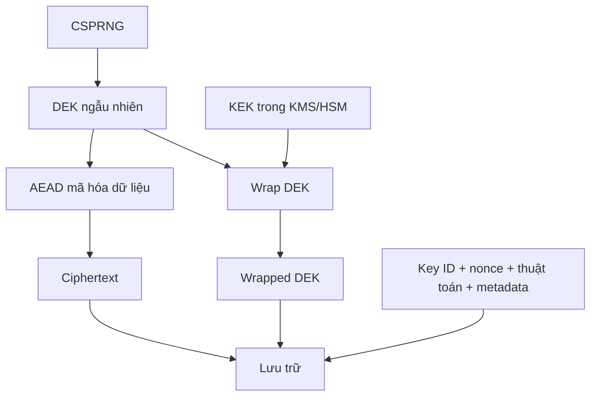

# Encryption key

**Encryption key (khóa mã hóa)** là giá trị mật mã được thuật toán sử dụng để biến đổi bản rõ thành ciphertext hoặc khôi phục bản rõ từ ciphertext. Khóa là một thành phần cốt lõi của bảo mật dữ liệu: cùng một thuật toán có thể bảo vệ dữ liệu tốt khi dùng khóa được sinh và quản lý đúng, nhưng có thể mất hoàn toàn tính bí mật nếu khóa bị lộ, bị dùng sai mục đích hoặc không được xoay vòng khi cần.

Trong quản lý khóa mật mã, encryption key không chỉ là một chuỗi byte. Mỗi khóa cần có thuật toán, độ dài, mục đích, chủ sở hữu, trạng thái, thời hạn sử dụng, vị trí lưu trữ và chính sách truy cập. Các thuộc tính đó quyết định khóa được tạo, phân phối, sử dụng, sao lưu, xoay vòng, thu hồi và hủy như thế nào.

## 1. Encryption key là gì?

Encryption key là đầu vào bí mật hoặc một phần của cặp khóa mà thuật toán mã hóa cần để thực hiện phép biến đổi mật mã. Với mã hóa đối xứng, cùng một khóa bí mật được dùng ở cả hai phía (hoặc các khóa tương đương được dẫn xuất theo quy tắc thuật toán). Với mã hóa bất đối xứng, khóa công khai và khóa riêng tạo thành một cặp có quan hệ toán học: bên gửi dùng khóa công khai để mã hóa hoặc thiết lập bí mật, còn bên nhận dùng khóa riêng tương ứng để giải mã hoặc hoàn tất quy trình.

Ví dụ:

- AES-256 dùng khóa đối xứng có độ dài 256 bit, tương đương 32 byte.
- ChaCha20 dùng khóa 256 bit.
- RSA dùng cặp khóa công khai/riêng; độ dài modulus thường được biểu diễn bằng bit, chẳng hạn 3072 bit.
- ECIES hoặc các giao thức mã hóa lai dùng khóa elliptic-curve để thiết lập bí mật rồi dẫn xuất khóa đối xứng.

Độ dài khóa là một thuộc tính của thuật toán và bộ tham số. Không thể so sánh trực tiếp số bit của AES với số bit của RSA để kết luận mức an toàn tương đương; mỗi họ thuật toán có cấu trúc và mức bảo mật riêng.

## 2. Encryption key khác gì password, secret và key material?

Các khái niệm này liên quan nhưng không đồng nghĩa:

| Khái niệm | Ý nghĩa | Ví dụ |
|---|---|---|
| Password | Bí mật thường do con người chọn để xác thực hoặc mở quyền truy cập | Password đăng nhập |
| Secret | Thuật ngữ rộng cho dữ liệu bí mật cần được bảo vệ | API token, database password, client secret |
| Encryption key | Khóa có định dạng và thuộc tính mật mã cụ thể, được thuật toán dùng để mã hóa/giải mã | AES key, RSA private key dùng giải mã |
| Key material | Giá trị mật mã thực tế tạo nên khóa | 32 byte của khóa AES hoặc thành phần bí mật của khóa riêng |
| Key metadata | Thông tin mô tả và quản trị khóa | Key ID, thuật toán, phiên bản, trạng thái, owner, thời hạn |

Một encryption key cũng là một secret cần được bảo vệ, nhưng không phải mọi secret đều là encryption key. API token có thể chỉ dùng để xác thực request, không phải đầu vào của thuật toán mã hóa. Password có thể được đưa qua password KDF để tạo khóa, nhưng password gốc vẫn không trở thành khóa AES chỉ vì được dùng trong quy trình đó.

Key material cần được bảo vệ nghiêm ngặt. Metadata thường không cần giữ bí mật, nhưng phải được bảo vệ tính toàn vẹn để tránh việc thay key ID, thuật toán hoặc trạng thái khiến ứng dụng sử dụng nhầm khóa.

## 3. Khóa đối xứng và khóa bất đối xứng

### Khóa đối xứng

Mã hóa đối xứng dùng cùng một khóa bí mật để mã hóa và giải mã. AES-GCM là lựa chọn phổ biến vì cung cấp cả tính bí mật và xác thực dữ liệu. ChaCha20-Poly1305 là một AEAD khác phù hợp với nhiều nền tảng.

Ưu điểm của khóa đối xứng là hiệu năng cao và phù hợp để mã hóa lượng dữ liệu lớn. Thách thức chính là phân phối và bảo vệ khóa: bên gửi và bên nhận phải có quyền sử dụng cùng khóa bí mật mà không để lộ khóa cho bên thứ ba.

### Khóa bất đối xứng

Mật mã bất đối xứng sử dụng một cặp khóa có quan hệ toán học. Với các cơ chế mã hóa khóa công khai, khóa công khai có thể được phân phối; khóa riêng phải được giữ bí mật. Một số hệ thống không mã hóa dữ liệu trực tiếp bằng khóa công khai mà dùng nó để thiết lập bí mật hoặc bảo vệ một khóa đối xứng.

Khóa bất đối xứng cũng có thể phục vụ chữ ký số. Trong trường hợp đó, khóa riêng dùng để ký và khóa công khai dùng để xác minh; đây là mục đích khác với mã hóa/giải mã. Không được dùng một khóa cho nhiều mục đích chỉ vì thuật toán hoặc thư viện cho phép.

| Tiêu chí | Đối xứng | Bất đối xứng |
|---|---|---|
| Khóa | Một bí mật dùng chung | Cặp khóa công khai và riêng |
| Hiệu năng | Nhanh, phù hợp dữ liệu lớn | Thường tốn tài nguyên hơn |
| Phân phối | Phải thiết lập kênh chia sẻ khóa an toàn | Có thể phân phối khóa công khai, nhưng cần xác thực nguồn gốc |
| Ví dụ | AES-GCM, ChaCha20-Poly1305 | RSA-OAEP, ECIES hoặc cơ chế KEM phù hợp |
| Vai trò phổ biến | Mã hóa payload và dữ liệu lưu trữ | Thiết lập khóa, mã hóa khóa nhỏ hoặc ký số tùy thuật toán |

## 4. Khóa mã hóa dữ liệu và envelope encryption

Với dữ liệu lớn, hệ thống thường không mã hóa trực tiếp toàn bộ dữ liệu bằng khóa bất đối xứng. Thay vào đó, nó dùng **envelope encryption**:

- **DEK (Data Encryption Key):** khóa đối xứng dùng để mã hóa dữ liệu thực tế.
- **KEK (Key Encryption Key):** khóa dùng để bọc (wrap) hoặc bảo vệ DEK.
- **KMS/HSM:** hệ thống có thể quản lý KEK và thực hiện thao tác wrap/unwrap trong ranh giới bảo vệ.



Quy trình mã hóa thường gồm:

1. Sinh DEK ngẫu nhiên bằng CSPRNG.
2. Mã hóa dữ liệu bằng DEK với AEAD như AES-GCM.
3. Dùng KEK trong KMS/HSM để wrap DEK.
4. Lưu ciphertext, wrapped DEK, nonce, tag, key ID và metadata cần thiết.

Khi giải mã, ứng dụng yêu cầu KMS/HSM unwrap DEK theo quyền được cấp, rồi dùng DEK giải mã ciphertext. Nếu KMS hỗ trợ thao tác mã hóa/giải mã trực tiếp, ứng dụng có thể không cần nhận key material của KEK.

Envelope encryption giúp xoay vòng KEK mà không cần mã hóa lại toàn bộ payload: có thể unwrap DEK rồi wrap lại bằng KEK mới. Nếu DEK bị lộ, cần tạo DEK mới và mã hóa lại dữ liệu liên quan.

## 5. Sinh encryption key an toàn

Khóa cần được sinh bằng nguồn ngẫu nhiên mật mã đáng tin cậy, không dùng timestamp, UUID không phù hợp, bộ sinh giả ngẫu nhiên thông thường hoặc giá trị do người dùng tự chọn làm key material.

Trong Java, `KeyGenerator` và `SecureRandom` là các API thường dùng để tạo khóa đối xứng:

```java
import java.security.NoSuchAlgorithmException;
import java.security.SecureRandom;
import javax.crypto.KeyGenerator;
import javax.crypto.SecretKey;

public final class EncryptionKeyGeneration {
    public static SecretKey newAes256Key() throws NoSuchAlgorithmException {
        KeyGenerator generator = KeyGenerator.getInstance("AES");
        generator.init(256, new SecureRandom());
        return generator.generateKey();
    }
}
```

Độ dài khóa được chọn theo thuật toán và chính sách bảo mật. Nếu provider hoặc môi trường Java không hỗ trợ độ dài yêu cầu, ứng dụng cần phát hiện lỗi thay vì âm thầm giảm độ dài. Không ghi `key.getEncoded()` vào log hoặc cấu hình để “lưu tạm”.

Với khóa bất đối xứng, dùng `KeyPairGenerator` và tham số được khuyến nghị cho thuật toán. Ví dụ RSA cần chọn modulus phù hợp với chính sách hiện hành; EC cần chọn curve được chấp thuận. Không tự tạo khóa bằng cách ghép byte hoặc chỉnh sửa tham số toán học.

## 6. Dùng encryption key với AEAD

Khóa chỉ là một phần của cấu hình mã hóa. Một triển khai cần chọn đúng thuật toán, mode, nonce/IV, tag và cách xác thực metadata. Với AES-GCM, nonce không được tái sử dụng với cùng khóa.

Ví dụ Java mã hóa dữ liệu bằng AES-GCM:

```java
import java.security.SecureRandom;
import javax.crypto.Cipher;
import javax.crypto.SecretKey;
import javax.crypto.spec.GCMParameterSpec;

public final class AesGcmEncryption {
    public record Encrypted(byte[] nonce, byte[] ciphertext) {}

    public static Encrypted encrypt(
            SecretKey key,
            byte[] plaintext,
            byte[] associatedData) throws Exception {

        byte[] nonce = new byte[12];
        new SecureRandom().nextBytes(nonce);

        Cipher cipher = Cipher.getInstance("AES/GCM/NoPadding");
        cipher.init(
                Cipher.ENCRYPT_MODE,
                key,
                new GCMParameterSpec(128, nonce));
        cipher.updateAAD(associatedData);
        byte[] ciphertext = cipher.doFinal(plaintext);
        return new Encrypted(nonce, ciphertext);
    }
}
```

Khi giải mã, ứng dụng cần dùng đúng khóa, nonce và AAD ban đầu. Nếu xác thực tag thất bại, phải từ chối bản tin; không sử dụng dữ liệu chưa xác thực. Nonce không cần giữ bí mật nhưng phải được lưu cùng ciphertext và được bảo đảm không trùng với cùng khóa theo yêu cầu của GCM.

Với dữ liệu lớn hoặc nhiều luồng mã hóa, cần thiết kế quản lý nonce rõ ràng, theo dõi số lần sử dụng khóa và giới hạn lượng dữ liệu trên mỗi khóa theo khuyến nghị của thuật toán. Không giả định việc gọi `SecureRandom` riêng cho từng request tự động giải quyết mọi rủi ro trùng nonce ở quy mô rất lớn.

## 7. Phân tách khóa theo mục đích

Một khóa nên được tạo cho một mục đích mật mã xác định. Không dùng cùng một khóa AES cho cả mã hóa dữ liệu, MAC, wrapping và các giao thức độc lập nếu thiết kế không quy định rõ việc dùng chung.

Phân tách khóa giúp:

- Giới hạn hậu quả khi một khóa bị lộ.
- Dễ áp dụng quyền khác nhau cho từng thao tác.
- Xoay vòng một mục đích mà không làm thay đổi các mục đích còn lại.
- Giảm nguy cơ dùng sai thuật toán hoặc cấu hình.
- Dễ kiểm toán và gắn trách nhiệm với chủ sở hữu nghiệp vụ.

Nếu cần nhiều khóa từ cùng một bí mật gốc, dùng KDF chuẩn với context/domain separation để tạo khóa độc lập. Không tự cắt hoặc nối byte tùy ý để tạo nhiều khóa.

## 8. Key ID, version và metadata

Ứng dụng thường không nên định danh khóa bằng chính key material. Thay vào đó, dùng **key ID** hoặc alias ổn định để tham chiếu khóa trong KMS, HSM hoặc kho khóa.

Metadata nên bao gồm:

- Key ID và phiên bản khóa.
- Thuật toán, độ dài khóa và tham số.
- Mục đích sử dụng: encrypt/decrypt, wrap/unwrap, sign/verify hoặc key agreement.
- Chủ sở hữu, ứng dụng và môi trường sử dụng.
- Thời điểm tạo, kích hoạt, hết hạn, xoay vòng và thu hồi.
- Trạng thái: pending, active, disabled, compromised, retired hoặc destroyed theo mô hình quản trị.
- Vị trí lưu trữ và provider/KMS/HSM quản lý.
- Chính sách backup, recovery, export và destruction.

Key ID và metadata không nhất thiết là bí mật, nhưng cần xác thực và bảo vệ tính toàn vẹn. Nếu attacker có thể thay key ID trong bản ghi ciphertext, ứng dụng có thể unwrap bằng nhầm khóa hoặc chuyển dữ liệu sang một miền tin cậy khác. Vì vậy, metadata quan trọng nên được ràng buộc bằng AAD hoặc chữ ký theo thiết kế giao thức.

## 9. Phân phối và kiểm soát quyền sử dụng khóa

Với khóa đối xứng, các bên cần quyền truy cập vào cùng một khóa hoặc dịch vụ có thể thực hiện thao tác thay mặt họ. Không gửi khóa rõ qua email, chat, ticket, biến cấu hình công khai hoặc kênh không xác thực.

Với khóa bất đối xứng, khóa công khai có thể được phân phối rộng, nhưng người nhận phải xác minh khóa đó thuộc về đúng danh tính. Có thể dùng chứng thư X.509, PKI, pinning hoặc kênh phân phối khóa được xác thực theo mô hình hệ thống.

Quyền sử dụng khóa cần giới hạn theo:

- Danh tính người dùng hoặc workload.
- Key ID và phiên bản cụ thể.
- Thao tác được phép: encrypt, decrypt, wrap, unwrap, sign hoặc verify.
- Môi trường và phạm vi dữ liệu.
- Thời gian, hạn mức và điều kiện nghiệp vụ.

Tách quyền quản trị khóa khỏi quyền sử dụng khóa khi có thể. Một dịch vụ chỉ cần mã hóa dữ liệu có thể không cần quyền export key material hoặc xóa khóa. Các thao tác nhạy cảm như thay KEK gốc, phục hồi hoặc hủy khóa có thể yêu cầu dual control và phê duyệt nhiều bên.

## 10. Lưu trữ encryption key: phần mềm, KMS và HSM

Nơi lưu khóa ảnh hưởng lớn đến mức bảo vệ thực tế:

| Mô hình | Đặc điểm | Khi phù hợp |
|---|---|---|
| Tệp/Java KeyStore | Lưu khóa trong tệp được bảo vệ bằng mật khẩu và quyền filesystem | Ứng dụng nhỏ hoặc môi trường cần tương thích; phải bảo vệ file, password và backup |
| Secret manager | Lưu và cấp phát secret có thể khôi phục, có phân quyền và audit | Database password, API secret, credential dịch vụ |
| KMS | Quản lý key ID, policy, version, audit và thao tác mật mã qua API | Nhiều ứng dụng cần quản lý khóa tập trung |
| HSM | Thiết bị phần cứng thực hiện thao tác mật mã và bảo vệ key material trong ranh giới phần cứng | Khóa có giá trị cao, yêu cầu chống trích xuất hoặc yêu cầu tuân thủ |

KMS có thể dựa trên HSM để bảo vệ khóa gốc. Ứng dụng cần xác thực với KMS và được cấp quyền thao tác; điều đó không đồng nghĩa ứng dụng được phép lấy key material của khóa gốc.

Mã hóa tệp keystore bằng password không tạo ra mức bảo vệ tương đương HSM. Khi tiến trình đã có quyền đọc tệp và password, khóa có thể được nạp vào bộ nhớ. HSM có thể giảm khả năng trích xuất key material, nhưng không ngăn được một workload được cấp quyền lạm dụng thao tác ký hoặc giải mã; phân quyền và giám sát vẫn cần thiết.

## 11. Cryptoperiod và xoay vòng khóa

**Cryptoperiod** là khoảng thời gian một khóa được phép sử dụng cho một mục đích mật mã. Thời hạn phù hợp phụ thuộc loại khóa, thuật toán, lượng dữ liệu được xử lý, tần suất sử dụng, mức độ nhạy cảm và chính sách tổ chức.

Xoay vòng khóa có thể được kích hoạt bởi:

- Đến cuối cryptoperiod hoặc lịch rotation định kỳ.
- Khóa hoặc hệ thống lưu trữ có dấu hiệu bị xâm phạm.
- Nhân sự hoặc workload có quyền truy cập không còn được phép.
- Thay đổi thuật toán, độ dài khóa hoặc yêu cầu tuân thủ.
- Thay đổi kiến trúc, nhà cung cấp KMS/HSM hoặc môi trường triển khai.

Quy trình xoay vòng khóa mã hóa dữ liệu thường gồm:

1. Tạo khóa mới và ghi metadata/version.
2. Cấp quyền cho workload sử dụng khóa mới.
3. Chuyển dữ liệu mới sang khóa mới.
4. Với dữ liệu cũ, giải mã và mã hóa lại hoặc re-wrap DEK tùy kiến trúc.
5. Xác minh khả năng đọc cả dữ liệu cũ và mới trong giai đoạn chuyển tiếp.
6. Ngừng mã hóa bằng khóa cũ; chỉ giữ quyền giải mã nếu còn dữ liệu phụ thuộc.
7. Thu hồi và hủy khóa cũ khi không còn nghĩa vụ sử dụng hoặc lưu giữ.

Xoay vòng không phải lúc nào cũng có nghĩa xóa ngay khóa cũ. Nếu dữ liệu cũ vẫn cần giải mã, khóa cũ có thể chuyển sang trạng thái decrypt-only hoặc archived theo chính sách. Cần kiểm soát quyền và thời gian lưu giữ để tránh khóa cũ tiếp tục được dùng mã hóa dữ liệu mới.

## 12. Backup, recovery, compromise và destruction

Khóa có thể cần backup để tránh mất khả năng giải mã dữ liệu. Tuy nhiên, backup key material tạo thêm bản sao bí mật và cần mức bảo vệ tương đương hoặc cao hơn khóa đang hoạt động.

Chính sách backup/recovery nên xác định:

- Khóa nào được phép backup và khóa nào không được xuất khỏi HSM.
- Ai có quyền tạo, truy cập và khôi phục bản sao.
- Mã hóa và phân tách bản sao lưu.
- Quy trình kiểm tra tính toàn vẹn và diễn tập khôi phục.
- Điều kiện dual control hoặc quorum cho khóa gốc.
- Thời hạn lưu giữ và cách hủy bản sao hết hạn.

Khi khóa bị lộ, cần xác định phạm vi dữ liệu và hoạt động có thể bị ảnh hưởng. Khóa dùng mã hóa dữ liệu có thể yêu cầu tạo khóa mới, re-encryption hoặc đánh giá nguy cơ dữ liệu cũ bị giải mã. Khóa ký bị lộ cần quy trình thu hồi chứng thư, thay khóa và đánh giá chữ ký được tạo trong khoảng thời gian rủi ro. Thu hồi quyền sử dụng không tự động làm dữ liệu đã mã hóa trở nên an toàn nếu attacker đã sao chép key material.

Hủy khóa cần xử lý cả bản sao trong bộ nhớ, tệp, backup, snapshot, replica, log hoặc hệ thống phục hồi theo khả năng kỹ thuật và chính sách lưu giữ. Xóa alias khỏi Java KeyStore hoặc xóa một bản ghi metadata không chứng minh key material đã bị hủy ở mọi nơi.

## 13. Lỗi thường gặp khi quản lý encryption key

1. **Dùng password làm khóa trực tiếp:** password thường có entropy thấp; cần password KDF hoặc khóa ngẫu nhiên.
2. **Sinh khóa bằng nguồn ngẫu nhiên yếu:** khóa có thể dự đoán được; dùng CSPRNG và provider được phê duyệt.
3. **Dùng lại khóa cho nhiều mục đích:** mở rộng phạm vi ảnh hưởng; tách khóa hoặc dẫn xuất bằng KDF chuẩn.
4. **Lưu key material trong source code hoặc log:** làm lộ khóa cho người không được phép; dùng KMS/HSM hoặc kho bảo vệ phù hợp.
5. **Chỉ mã hóa database mà không bảo vệ KEK:** kẻ có quyền đọc cả dữ liệu lẫn khóa có thể giải mã.
6. **Không quản lý nonce của AEAD:** tái sử dụng nonce với cùng khóa có thể phá vỡ bảo mật; thiết kế nonce lifecycle rõ ràng.
7. **Xoay vòng nhưng xóa khóa cũ quá sớm:** dữ liệu cũ không thể giải mã; duy trì chính sách decrypt-only trong thời gian cần thiết.
8. **Không lưu key ID/version:** không xác định được khóa cần dùng để giải mã dữ liệu cũ.
9. **Không kiểm toán thao tác:** khó phát hiện lạm dụng hoặc điều tra khi có sự cố.
10. **Cho rằng HSM loại bỏ mọi rủi ro:** quyền gọi thao tác mật mã vẫn có thể bị lạm dụng; cần IAM, audit và giám sát.

## 14. Checklist thiết kế encryption key

- Xác định rõ mục đích của khóa và thuật toán tương ứng.
- Chọn loại khóa đối xứng hay bất đối xứng theo mô hình dữ liệu và giao thức.
- Sinh key material bằng CSPRNG hoặc quy trình tạo khóa được chuẩn hóa.
- Chọn độ dài và tham số theo tiêu chuẩn hiện hành; không tự đặt thuật toán.
- Tách khóa theo mục đích và môi trường.
- Dùng AEAD cho mã hóa dữ liệu khi phù hợp; quản lý nonce và AAD đúng cách.
- Dùng envelope encryption để bảo vệ DEK bằng KEK khi kiến trúc cần.
- Lưu khóa trong KeyStore, KMS hoặc HSM với quyền truy cập tối thiểu.
- Quản lý key ID, version, owner, trạng thái và cryptoperiod.
- Có quy trình phân phối khóa công khai và xác thực nguồn gốc.
- Có rotation, decrypt-only, backup, recovery, revocation và destruction.
- Ghi audit thao tác nhưng không ghi key material hoặc bí mật xác thực.
- Kiểm thử phục hồi dữ liệu và xử lý sự cố khi khóa bị lộ.

Encryption key là tài sản mật mã có vòng đời và phạm vi sử dụng cụ thể. Để bảo vệ dữ liệu bền vững, hệ thống cần tạo khóa đủ ngẫu nhiên, gắn khóa với đúng thuật toán và mục đích, lưu trong ranh giới được kiểm soát, giới hạn quyền sử dụng và duy trì quy trình xoay vòng, phục hồi, thu hồi và hủy. KMS/HSM hỗ trợ bảo vệ và vận hành khóa ở quy mô lớn, nhưng hiệu quả cuối cùng vẫn phụ thuộc vào chính sách, kiến trúc ứng dụng và kiểm soát truy cập.

## Tài liệu tham khảo

- [NIST SP 800-57 Part 1 Rev. 5: Recommendation for Key Management](https://csrc.nist.gov/pubs/sp/800/57/pt1/r5/final)
- [NIST SP 800-131A Rev. 2: Transitioning the Use of Cryptographic Algorithms and Key Lengths](https://csrc.nist.gov/pubs/sp/800/131/a/r2/final)
- [NIST SP 800-38D: Recommendation for Block Cipher Modes of Operation: GCM and GMAC](https://csrc.nist.gov/pubs/sp/800/38/d/final)
- [Java SE API: `KeyGenerator`](https://docs.oracle.com/en/java/javase/21/docs/api/java.base/javax/crypto/KeyGenerator.html)
- [Java SE API: `SecureRandom`](https://docs.oracle.com/en/java/javase/21/docs/api/java.base/java/security/SecureRandom.html)
