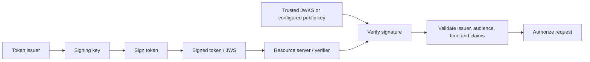

# Token signing key

## Mục tiêu học tập

Sau bài học này, bạn có thể:

- Giải thích token signing key bảo vệ tính toàn vẹn và nguồn phát hành của token như thế nào.
- Phân biệt ký token bằng HMAC với ký bằng private key bất đối xứng.
- Phân biệt signed token (JWS) với encrypted token (JWE), đồng thời hiểu chữ ký không che giấu payload.
- Chọn thuật toán, key size, key type và ranh giới tin cậy phù hợp cho issuer và verifier.
- Quản lý `kid`, JWKS, private key, public key, HSM/KMS và quyền ký.
- Xác minh chữ ký cùng issuer, audience, thời hạn và các claim quan trọng trước khi chấp nhận token.
- Thiết kế rotation, overlap, retirement, revocation và emergency response khi signing key bị lộ.
- Tích hợp signing key với Java JCA, KeyStore, HSM/KMS và quy trình audit.

## 1. Token signing key là gì?

Token signing key là khóa mật mã được dùng để tạo chữ ký số hoặc message authentication code (MAC) trên token. Bên nhận kiểm tra chữ ký/MAC để xác định token không bị sửa đổi và được tạo bởi một bên nắm giữ key tương ứng.

Trong hệ thống OAuth 2.0/OpenID Connect, access token hoặc ID token thường được biểu diễn dưới dạng JWT. Một JWT được ký theo JSON Web Signature (JWS) có thể được kiểm tra bởi resource server, API gateway hoặc relying party. Token signing key là một phần của trust relationship giữa issuer và verifier.

Chữ ký không mã hóa payload. Người có token thường có thể đọc header và payload của compact JWS vì chúng chỉ được Base64URL-encode. Chữ ký bảo vệ tính toàn vẹn và xác thực nguồn phát hành theo key; nó không cung cấp tính bí mật. Nếu payload chứa dữ liệu cần giữ kín, phải dùng cơ chế bảo vệ confidentiality phù hợp, chẳng hạn JWE hoặc mã hóa dữ liệu ở tầng ứng dụng.

## 2. Token signing key nằm ở đâu trong trust model?

Issuer tạo token và ký bằng signing key. Verifier nhận token, lấy key được phép tương ứng với issuer và xác minh chữ ký trước khi tin claim.



Signing key không tự quyết định người dùng được phép làm gì. Token có chữ ký hợp lệ vẫn có thể hết hạn, sai audience, sai issuer, bị thu hồi theo policy hoặc chứa scope không phù hợp. Verifier phải kiểm tra cả chữ ký lẫn ngữ cảnh token.

## 3. Token signing key khác token encryption key

Signing và encryption giải quyết hai mục tiêu khác nhau:

| Thuộc tính | Signing key | Encryption key |
|---|---|---|
| Mục tiêu | Integrity và issuer authenticity | Confidentiality; với AEAD còn có integrity |
| Asymmetric model | Private key ký, public key xác minh | Public key mã hóa, private key giải mã |
| Symmetric model | Secret key tạo và xác minh MAC | Secret key mã hóa và giải mã |
| Bên cần giữ bí mật | Private signing key hoặc HMAC secret | Encryption/decryption key theo mô hình |
| Phân phối | Public verification key có thể công bố | Decryption key phải giữ trong phạm vi được phép |
| Token format thường gặp | JWS | JWE |

Không dùng cùng một key cho ký token và mã hóa dữ liệu. Tách purpose giúp giảm blast radius, đơn giản hóa quyền truy cập và cho phép rotation độc lập.

## 4. JWS, JWT và JWE

JWT là một định dạng biểu diễn claims. JWT có thể được bảo vệ bằng JWS hoặc JWE:

- **JWS:** ký hoặc MAC trên dữ liệu token. Compact JWS thường có ba phần: protected header, payload và signature/MAC.
- **JWE:** mã hóa nội dung token, có thể kèm authentication tag và thông tin quản lý key. Compact JWE thường có năm phần.
- **Nested JWT:** một token có thể được ký rồi mã hóa, hoặc mã hóa một nội dung đã ký, theo profile được quy định.

JWS compact có cấu trúc:

```text
BASE64URL(protected-header)
.
BASE64URL(payload)
.
BASE64URL(signature-or-mac)
```

Signing input là hai phần Base64URL đầu nối bằng dấu chấm. Verifier phải xác minh đúng bytes theo JWS serialization, không parse JSON rồi serialize lại theo cách riêng trước khi kiểm tra chữ ký.

## 5. HMAC signing key

HMAC dùng một secret key chung giữa issuer và verifier. Issuer tính MAC trên signing input; verifier dùng cùng key để tính lại và so sánh.

Ví dụ thuật toán JWS:

- `HS256`: HMAC với SHA-256.
- `HS384`: HMAC với SHA-384.
- `HS512`: HMAC với SHA-512.

Ưu điểm của HMAC là đơn giản và hiệu quả. Nhược điểm về trust boundary rất quan trọng: bất kỳ verifier nào có secret key đều có thể tạo token hợp lệ. Nếu nhiều API service cùng giữ một HMAC secret, mỗi service đều có năng lực phát hành token như issuer.

HMAC phù hợp khi issuer và verifier thuộc cùng một trust domain nhỏ, có quản trị secret chặt chẽ và chấp nhận rằng mọi bên giữ secret đều có quyền ký. Với nhiều verifier độc lập, hệ thống đối tác hoặc microservice có quyền hạn khác nhau, asymmetric signing thường dễ giới hạn quyền hơn.

## 6. Asymmetric signing key

Với chữ ký bất đối xứng, issuer giữ private key để ký. Verifier chỉ cần public key để xác minh.

Một số thuật toán JWS phổ biến:

| JWS algorithm | Cặp khóa | Ghi chú |
|---|---|---|
| `RS256` | RSA private/public | RSA PKCS#1 v1.5 với SHA-256; hỗ trợ rộng |
| `PS256` | RSA private/public | RSA-PSS với SHA-256; cần provider và profile tương thích |
| `ES256` | EC P-256 private/public | ECDSA với SHA-256; signature JWS có encoding riêng |
| `EdDSA` | Ed25519 hoặc Ed448 tùy profile | Cần kiểm tra thư viện, provider và profile hỗ trợ |

Public key có thể phân phối qua JWKS hoặc cấu hình trust được xác thực. Verifier không thể tạo chữ ký mới nếu chỉ có public key. Vì vậy asymmetric signing phù hợp khi nhiều resource server cần xác minh nhưng chỉ một hoặc một số ít issuer được quyền ký.

## 7. Chọn HMAC hay asymmetric signing

| Tiêu chí | HMAC | Asymmetric |
|---|---|---|
| Key material ở verifier | Phải có shared secret | Chỉ cần public key |
| Ai có thể phát hành token? | Mọi bên có shared secret | Bên giữ private key |
| Phân phối key | Phải bảo vệ secret tới mọi verifier | Có thể công bố public key qua kênh tin cậy |
| Chi phí tính toán | Thường thấp | Tùy RSA/EC/EdDSA; thường cao hơn HMAC |
| Tác động khi verifier bị compromise | Verifier có shared secret cũng có thể mint token; thường phải rotate secret trên toàn trust domain | Verifier chỉ có public key nên không có quyền ký; cần xử lý quyền và dữ liệu của verifier bị lộ |
| Phù hợp | Một trust domain nhỏ | Nhiều verifier hoặc nhiều tổ chức |

Quyết định cần dựa trên số lượng verifier, mức độ độc lập của các team, khả năng bảo vệ private key và yêu cầu phân quyền. Không chọn HMAC chỉ vì dễ cấu hình nếu điều đó khiến mọi API service có quyền mint token.

## 8. Thuật toán và key strength

Thuật toán phải nằm trong allowlist của issuer và verifier. Không để token tự quyết định thuật toán mà verifier sẽ thực thi.

Một số hướng dẫn tổng quát:

- HMAC: dùng key sinh ngẫu nhiên với entropy cao; với HS256, key nên có ít nhất 256 bit entropy.
- RSA: dùng modulus size đáp ứng security baseline hiện hành; không dùng RSA 1024 bit cho hệ thống mới.
- ECDSA: dùng curve được profile cho phép, ví dụ P-256 cho ES256.
- EdDSA: xác minh hỗ trợ trên thư viện/provider và hệ thống tiêu thụ token.
- Từ chối `none` trong endpoint yêu cầu chữ ký; tránh thuật toán chữ ký lỗi thời như RSA với SHA-1. Không nhầm `RSA1_5` (thuật toán quản lý khóa của JWE) với thuật toán ký JWS.

Các yêu cầu FIPS hoặc compliance có thể giới hạn thuật toán, provider, key size và operational environment. Tên thuật toán có trong chuẩn không tự chứng minh implementation được validation.

## 9. Signing key và verification key

Với asymmetric signing:

- Private key phải được bảo vệ nghiêm ngặt, chỉ issuer hoặc signing service được quyền sử dụng.
- Public key có thể phân phối cho verifier nhưng cần xác thực nguồn và gắn với issuer/key ID rõ ràng.
- Public key không cần bí mật, nhưng integrity và provenance của key phải được bảo đảm.

Với HMAC:

- Secret phải được bảo vệ ở cả issuer và verifier.
- Mỗi verifier có secret nghĩa là verifier đó có thể ký token.
- Nếu một verifier bị compromise, cần đánh giá phạm vi toàn bộ trust domain dùng chung secret.

Không lưu private signing key trong source code, container image, repository hoặc file cấu hình không được bảo vệ. Hạn chế export key; ưu tiên HSM/KMS khi cần bảo vệ tập trung hoặc non-exportability.

## 10. `kid`: định danh key trong token header

JWS protected header có thể chứa `kid` (Key ID) để verifier chọn key phù hợp trong key set đã tin cậy.

Ví dụ header:

```json
{
  "alg": "RS256",
  "typ": "JWT",
  "kid": "issuer-signing-2026-02"
}
```

`kid` chỉ là định danh, không phải bằng chứng key đáng tin cậy. Verifier phải tra `kid` trong key set được cấu hình cho issuer đã xác thực. Không dùng `kid` để truy cập file path tùy ý, query database không giới hạn hoặc tải public key từ URL do token cung cấp.

Nếu `kid` không tồn tại, bị trùng hoặc ánh xạ tới key không đúng issuer/algorithm, verifier phải từ chối token. Không fallback sang key bất kỳ chỉ để chữ ký có thể xác minh.

## 11. JWKS và phân phối public key

JSON Web Key Set (JWKS) là tập hợp các public key được biểu diễn dưới dạng JWK. Issuer có thể công bố JWKS tại endpoint được cấu hình trong metadata tin cậy, chẳng hạn OpenID Provider Configuration.

Verifier thường:

1. Xác định issuer từ cấu hình hoặc trust relationship đã thiết lập.
2. Lấy JWKS từ endpoint được cấu hình tin cậy qua TLS.
3. Cache key theo policy và `kid`.
4. Chọn key có `use`, `key_ops`, `kty`, `alg` và `kid` phù hợp.
5. Khi gặp `kid` mới, refresh JWKS theo giới hạn để hỗ trợ rotation.

Không tin `jku`, `x5u` hoặc URL tùy ý nằm trong token header nếu ứng dụng chưa có policy allowlist và xác thực nguồn. Nếu attacker điều khiển URL lấy key, họ có thể cung cấp key của chính mình để verifier chấp nhận token giả.

## 12. Claims cần xác minh sau chữ ký

Chữ ký hợp lệ chỉ chứng minh token khớp với key. Verifier còn phải kiểm tra claims theo giao thức và use case.

| Claim | Kiểm tra |
|---|---|
| `iss` | Issuer đúng với issuer được cấu hình tin cậy |
| `aud` | Audience chứa service/client hiện tại |
| `exp` | Token chưa hết hạn, có xét clock skew nhỏ theo policy |
| `nbf` | Token đã đến thời điểm được phép sử dụng |
| `iat` | Thời điểm phát hành hợp lý, không quá xa trong tương lai |
| `sub` | Subject hợp lệ và được ánh xạ đúng identity |
| `scope` / `roles` | Chỉ cấp quyền được resource server cho phép |
| `jti` | Có thể dùng để chống replay/denylist nếu hệ thống hỗ trợ |

Không chấp nhận token chỉ vì signature verify thành công. Authorization vẫn phải kiểm tra resource, tenant, action và policy của request hiện tại.

## 13. Algorithm confusion và header validation

Verifier phải có allowlist thuật toán được cấu hình theo issuer/use case. Không đọc `alg` rồi chấp nhận mọi thuật toán mà thư viện hỗ trợ.

Các lỗi nguy hiểm:

- Chấp nhận `alg: none` hoặc token không có chữ ký trong endpoint yêu cầu signed token.
- Nhầm asymmetric algorithm với HMAC và dùng public key bytes như HMAC secret.
- Cho phép token chọn thuật toán yếu hơn hoặc khác policy.
- Chọn key không kiểm tra `kty`, `use`, `key_ops`, `alg` hoặc issuer.
- Tin `jku`, `x5u`, `jwk` trong header mà không có trust policy.
- Bỏ qua header critical hoặc xử lý extension không hiểu.
- Parse token không giới hạn kích thước, tạo điều kiện DoS.

Algorithm, key type, curve, key size và token type phải được ràng buộc bởi cấu hình server. Nếu token không khớp profile, từ chối.

## 14. JWT không được mã hóa mặc định

JWS compact chỉ Base64URL-encode header và payload. Base64URL không phải encryption. Bất kỳ ai có token đều có thể giải mã hai phần này.

Không đặt password, private data, secret, API credential hoặc dữ liệu cá nhân không cần thiết vào JWT. Chỉ đưa claims tối thiểu cần cho verifier. Nếu cần confidentiality, dùng JWE hoặc token reference/opaque token với introspection.

Không nhầm chữ ký với mã hóa: chữ ký bảo vệ tính toàn vẹn và nguồn phát hành; mã hóa bảo vệ nội dung khỏi người không có key giải mã.

## 15. HMAC key management

HMAC signing secret là symmetric key. Cần:

- Sinh từ CSPRNG, đủ entropy; không dùng password hoặc UUID làm secret.
- Lưu trong secret manager/KMS/HSM, không commit vào source.
- Giới hạn service có thể đọc hoặc gọi HMAC operation.
- Tách secret theo issuer, environment và purpose.
- Không dùng chung secret giữa development, staging và production.
- Version hóa secret và chuẩn bị overlap khi rotate.
- Theo dõi mọi bản sao ở verifier, cache, backup và deployment config.

Nếu có nhiều resource server, cân nhắc asymmetric signing để không phải phân phối quyền ký cho từng verifier.

## 16. Private signing key trong KeyStore/HSM/KMS

Private signing key có thể được lưu trong:

- Java KeyStore như PKCS12 hoặc provider-specific store.
- PKCS#11 token/HSM với key handle không exportable.
- KMS cung cấp API ký từ xa.
- Signing service chuyên biệt đứng trước HSM/KMS và áp dụng authorization.

Không phải mọi KeyStore type/provider đều hỗ trợ mọi key type hoặc mức bảo vệ. Cần xác minh private key có export được không, certificate chain có khớp không và provider có thực hiện ký bên trong boundary bảo vệ hay không.

Khi dùng KMS remote signing, ứng dụng gửi signing input hoặc digest theo API và nhận signature. Cần hiểu rõ API yêu cầu ký message hay digest, digest algorithm, padding, encoding và giới hạn kích thước. Không tự hash hai lần hoặc ký sai representation.

## 17. Tách quyền phát hành token khỏi quyền xác minh

Asymmetric signing cho phép thiết kế quyền như sau:

- Issuer/signing service có quyền gọi private key sign.
- Resource server chỉ nhận public key và verify.
- Key administrator quản lý lifecycle nhưng không nhất thiết có quyền mint token.
- Auditor đọc log, không có quyền ký hoặc export key.

Áp dụng least privilege, service identity riêng, network policy và approval cho thay đổi key. Không để API gateway có quyền ký nếu nó chỉ cần xác minh token.

Với HMAC, verifier giữ secret có quyền tạo MAC. Nếu cần phân biệt issuer/verifier, HMAC không tạo ra sự tách quyền mật mã; phải dùng asymmetric key hoặc một signing service trung gian.

## 18. Rotation signing key

Rotation cần phối hợp issuer và verifier để không làm gián đoạn xác minh token hợp lệ.

Quy trình asymmetric điển hình:

1. Tạo key pair mới trong HSM/KMS hoặc boundary phù hợp.
2. Gán `kid` mới và ghi inventory.
3. Công bố public key mới trong JWKS trước khi bắt đầu ký bằng private key mới.
4. Chờ verifier refresh/cache key set và xác minh key mới đã sẵn sàng.
5. Chuyển issuer sang ký token mới bằng key mới.
6. Giữ public key cũ trong JWKS để xác minh token đã phát hành trước đó.
7. Chờ token cũ hết hạn cộng clock skew và cache propagation window.
8. Loại public key cũ khỏi JWKS sau khi không còn token hợp lệ phụ thuộc vào nó.
9. Disable/retire private key cũ theo policy và giữ audit evidence.

```mermaid
sequenceDiagram
    participant K as KMS/HSM
    participant I as Issuer
    participant J as JWKS endpoint
    participant V as Verifier
    K->>K: Generate key pair v2
    K-->>J: Publish public key v2
    J-->>V: JWKS includes v1 and v2
    V->>V: Refresh and cache both keys
    I->>I: Switch signing to private key v2
    I-->>V: Issue tokens with kid=v2
    V->>V: Verify v2; retain v1 for old tokens
    Note over J,V: Remove v1 after token expiry and cache window
```

Không xóa public key cũ ngay khi chuyển issuer sang key mới. Verifier vẫn cần key cũ để xác minh token chưa hết hạn.

## 19. HMAC secret rotation

Với HMAC, issuer và mọi verifier phải đồng bộ secret. Rotation có thể dùng key version hoặc `kid` trong protected header:

1. Tạo secret mới bằng CSPRNG/KMS.
2. Phân phối secret mới tới issuer và verifier qua secret management channel.
3. Cấu hình verifier chấp nhận cả secret cũ và mới trong overlap.
4. Chuyển issuer sang secret mới.
5. Theo dõi token và verifier adoption.
6. Chờ token cũ hết hạn và loại secret cũ khỏi mọi service.
7. Xác minh cache, backup, CI/CD và bản sao cấu hình đã được cập nhật.

Nếu một verifier bị compromise, secret cũ phải được coi là có thể bị lộ. Cần đánh giá việc revoke toàn bộ token ký bằng secret đó và rotate nhanh hơn lịch bình thường.

## 20. Token lifetime và signing key lifetime

Token lifetime và signing key lifetime là hai khái niệm khác nhau:

- Token lifetime quy định token được chấp nhận trong khoảng thời gian nào.
- Signing key lifetime quy định khoảng thời gian key được dùng để ký, xác minh hoặc giữ lại để xác minh token lịch sử.

Private key có thể ngừng ký nhưng public key vẫn cần tồn tại để verify token cũ. Không retire verification key quá sớm. Ngược lại, giữ key cũ trong JWKS vô thời hạn làm tăng bề mặt tin cậy và gây khó khăn khi key compromise.

Đặt token lifetime ngắn giúp giới hạn tác động khi token bị đánh cắp, nhưng không thay thế key rotation hoặc revocation. Access token và refresh token thường có chính sách lifetime khác nhau.

## 21. Revocation và xử lý token đã phát hành

JWT signed thường được xác minh offline; resource server không cần hỏi issuer mỗi lần. Đổi lại, việc thu hồi một token cụ thể khó hơn opaque token.

Các cách giảm thời gian token còn hiệu lực:

- Access token lifetime ngắn.
- Denylist theo `jti` hoặc token hash cho token cần revoke.
- Introspection hoặc centralized session check.
- User/session version hoặc security stamp được kiểm tra tại verifier.
- Rotate signing key khi key compromise, đồng thời reject `kid` cũ.
- Thu hồi refresh token và yêu cầu re-authentication.

Rotate signing key không tự động làm mọi verifier từ chối token cũ nếu public key cũ vẫn còn trong JWKS. Muốn chặn token do key bị compromise, phải loại hoặc đánh dấu key bị thu hồi theo policy, buộc verifier refresh/reject cache và có kế hoạch xử lý token đã phát hành.

## 22. Compromise private signing key

Nếu private signing key bị lộ, attacker có thể tạo token có chữ ký hợp lệ. Tác động phụ thuộc issuer, audience, scope, token lifetime và cách verifier kiểm tra claims.

Quy trình phản ứng:

1. Xác định `kid`, key ID, issuer, thời điểm và phạm vi nghi ngờ compromise.
2. Dừng signing bằng key bị ảnh hưởng và disable key theo semantics KMS/HSM.
3. Tạo key pair mới trong boundary tin cậy.
4. Cập nhật JWKS/trust configuration để verifier nhận key mới.
5. Reject key cũ theo chính sách khẩn cấp; không giữ nó chỉ vì token chưa hết hạn nếu key đã bị lộ.
6. Revoke refresh token/session và yêu cầu re-authentication theo risk.
7. Kiểm tra log signing operation, KMS audit, access policy và hệ thống build/deploy.
8. Thông báo các relying party bị ảnh hưởng qua kênh đã phê duyệt.
9. Xác minh backup, cache, replica và bản sao private key.
10. Ghi nhận incident timeline, root cause và corrective action.

Nếu cần giữ availability, hãy dùng key dự phòng đã được provision và public key đã phân phối trước. Không tiếp tục tin key bị compromise chỉ để tránh lỗi xác minh.

## 23. `kid` và JWKS cache trong sự cố

Verifier có thể cache JWKS trong một khoảng thời gian. Khi key bị thu hồi khẩn cấp, cache cũ có thể tiếp tục chấp nhận token.

Cần xác định:

- Cache TTL và cách refresh khi `kid` không tìm thấy.
- Cơ chế purge cache khẩn cấp.
- Có thể đẩy invalidation event hay phải đợi TTL?
- JWKS endpoint có CDN/proxy cache không?
- Verifier offline hoặc không kết nối được issuer xử lý ra sao?
- Có allowlist `kid` bị compromise để từ chối ngay cả khi JWKS cache cũ không?

Không refresh JWKS vô hạn mỗi khi nhận `kid` lạ; attacker có thể gây request storm. Dùng rate limit, single-flight refresh và cache negative lookup theo policy.

## 24. Token signing key và TLS certificate key

TLS certificate private key dùng để xác thực endpoint trong handshake TLS. Token signing key dùng để ký token ở tầng ứng dụng. Hai key có lifecycle và trust domain khác nhau.

Không mặc định dùng cùng private key cho TLS và JWT signing. Tách key giúp:

- Giảm blast radius khi một service hoặc protocol bị compromise.
- Có cryptoperiod, rotation và quyền sử dụng độc lập.
- Dễ audit và phân biệt mục đích ký.
- Tránh dùng certificate/key có policy hoặc algorithm không phù hợp cho token signing.

Certificate có thể chứa public key dùng để xác minh chữ ký, nhưng verifier vẫn cần xác minh chain, EKU/key usage và trust policy phù hợp nếu profile dựa trên X.509. Không tin certificate chỉ vì nó xuất hiện trong token header.

## 25. Java JCA: ký và xác minh dữ liệu bằng RSA

Java JCA cung cấp `Signature` để ký và xác minh. Ví dụ dưới đây dùng RSA với SHA-256 để minh họa thao tác; production phải chọn thuật toán theo profile token, security baseline và provider.

```java
import java.nio.charset.StandardCharsets;
import java.security.PrivateKey;
import java.security.PublicKey;
import java.security.Signature;
import java.util.Base64;

public final class TokenSignatureDemo {
    private TokenSignatureDemo() {}

    public static String sign(byte[] signingInput, PrivateKey privateKey)
            throws Exception {
        Signature signer = Signature.getInstance("SHA256withRSA");
        signer.initSign(privateKey);
        signer.update(signingInput);
        byte[] signature = signer.sign();
        return Base64.getUrlEncoder().withoutPadding()
                .encodeToString(signature);
    }

    public static boolean verify(byte[] signingInput, String encodedSignature,
                                 PublicKey publicKey) throws Exception {
        byte[] signature = Base64.getUrlDecoder().decode(encodedSignature);
        Signature verifier = Signature.getInstance("SHA256withRSA");
        verifier.initVerify(publicKey);
        verifier.update(signingInput);
        return verifier.verify(signature);
    }

    public static void main(String[] args) throws Exception {
        // Load keys from a protected KeyStore/HSM integration in real systems.
        PrivateKey privateKey = loadIssuerPrivateKey();
        PublicKey publicKey = loadTrustedVerificationKey();

        String protectedHeader = "eyJhbGciOiJSUzI1NiIsInR5cCI6IkpXVCIsImtpZCI6ImsxIn0";
        String payload = "eyJpc3MiOiJodHRwczovL2lkLmV4YW1wbGUiLCJhdWQiOiJhcGkiLCJleHAiOjE5MDAwMDAwMDB9";
        byte[] signingInput = (protectedHeader + "." + payload)
                .getBytes(StandardCharsets.US_ASCII);

        String signature = sign(signingInput, privateKey);
        if (!verify(signingInput, signature, publicKey)) {
            throw new SecurityException("Signature verification failed");
        }
        System.out.println("JWS signing input verified");
    }

    private static PrivateKey loadIssuerPrivateKey() {
        throw new UnsupportedOperationException("Integrate with KeyStore/HSM/KMS");
    }

    private static PublicKey loadTrustedVerificationKey() {
        throw new UnsupportedOperationException("Load from trusted issuer key set");
    }
}
```

Đây là ví dụ về thao tác JCA `Signature`, không phải JWT library hoàn chỉnh. Các method `load...` là điểm tích hợp cần triển khai theo KeyStore/HSM/KMS. Production phải dùng thư viện JOSE/JWT được duy trì để parse compact serialization, enforce algorithm allowlist, kiểm tra header/claims và xử lý key selection. Không tự xây parser JWT bằng cách split chuỗi rồi tin payload.

`SHA256withRSA` thường tương ứng với JWS `RS256` khi signature representation và encoding được xử lý đúng. Nếu dùng `PS256`, phải cấu hình RSA-PSS parameters theo JOSE profile; không thay tên algorithm một cách máy móc.

## 26. Java: HMAC signing và giới hạn trust domain

Ví dụ sau minh họa HMAC-SHA-256 trên signing input. Trong production, key phải được sinh ngẫu nhiên với entropy cao và lấy từ secret manager/KMS/HSM. Mọi verifier giữ secret này đều có thể tạo MAC hợp lệ.

```java
import java.nio.charset.StandardCharsets;
import java.util.Base64;
import javax.crypto.Mac;
import javax.crypto.SecretKey;

public final class HmacTokenDemo {
    private HmacTokenDemo() {}

    public static byte[] sign(byte[] signingInput, SecretKey secret)
            throws Exception {
        Mac mac = Mac.getInstance("HmacSHA256");
        mac.init(secret);
        return mac.doFinal(signingInput);
    }

    public static boolean verify(byte[] signingInput, byte[] suppliedMac,
                                 SecretKey secret) throws Exception {
        byte[] expected = sign(signingInput, secret);
        return java.security.MessageDigest.isEqual(expected, suppliedMac);
    }
}
```

Trong JWS `HS256`, MAC được Base64URL-encode trong phần signature. Dùng so sánh constant-time phù hợp để tránh timing leak. Không so sánh chuỗi bằng `String.equals` nếu nó làm lộ thông tin về vị trí byte sai.

## 27. Key inventory cho token signing

Một inventory signing key nên lưu:

| Trường | Mục đích |
|---|---|
| Key ID / `kid` | Định danh ổn định và duy nhất |
| Issuer | Token issuer được phép dùng key |
| Algorithm | JWS algorithm được phép |
| Key type/curve/size | RSA, EC, OKP hoặc octet/HMAC và tham số |
| Key reference | HSM/KMS key ID, KeyStore alias hoặc secret reference |
| Status | Planned, active-sign, verify-only, retired, revoked, destroyed |
| Validity window | Khoảng thời gian ký và xác minh được phép |
| JWKS publication | Thời điểm công bố/loại public key |
| Token max lifetime | Thời gian cần giữ verification key sau khi ngừng ký |
| Owner/approver | Bên chịu trách nhiệm và phê duyệt |
| Backup/recovery | Quy trình khôi phục theo policy |
| Audit reference | Ceremony, rotation và incident record |

Không lưu raw private key trong inventory. Key reference phải trỏ tới hệ thống quản lý key được bảo vệ.

## 28. Audit signing operations

Signing key có quyền phát hành identity và authorization claims; vì vậy signing operation cần được audit.

Nên ghi nhận:

- Issuer/service identity đã yêu cầu ký.
- Key ID và version.
- Algorithm và signing operation ID.
- Thời điểm, môi trường và request correlation ID.
- Approval hoặc policy decision nếu có.
- Kết quả thành công/thất bại và mã lỗi không nhạy cảm.
- Thay đổi key state, JWKS, provider, KMS policy và role.

Không ghi private key, HMAC secret, access token đầy đủ hoặc payload nhạy cảm vào log. Nếu cần correlation token, dùng `jti` hoặc fingerprint được tính theo policy và tránh biến log thành kho bearer token.

## 29. Những anti-pattern cần tránh

1. **Dùng một HMAC secret cho nhiều verifier độc lập.** Mỗi verifier đều có quyền mint token.
2. **Dùng chung TLS private key và token signing key.** Hai protocol có trust boundary và lifecycle khác nhau.
3. **Tin `alg` từ token.** Attacker có thể ép verifier dùng thuật toán ngoài policy.
4. **Chấp nhận `alg: none`.** Token không còn được xác thực bằng chữ ký.
5. **Tin `kid` hoặc `jku` không kiểm soát.** Có thể chọn key của attacker hoặc gây SSRF.
6. **Chỉ verify signature mà bỏ qua `iss`, `aud`, `exp`, `nbf`.** Token hợp lệ về chữ ký vẫn có thể không dành cho service hiện tại.
7. **Đưa dữ liệu nhạy cảm vào JWS payload.** Base64URL không phải mã hóa.
8. **Xóa public key cũ ngay khi rotation.** Token còn hạn sẽ không xác minh được.
9. **Giữ public key bị compromise trong JWKS.** Token giả vẫn có thể được chấp nhận.
10. **Không giới hạn JWKS refresh.** `kid` ngẫu nhiên có thể gây request storm.
11. **Lưu private key trong source hoặc image.** Mọi bản build/backup có thể trở thành bản sao key.
12. **Không tách issuer và verifier.** Quyền ký lan rộng ngoài nhu cầu.
13. **Không có emergency rotation.** Incident làm mất khả năng tin cậy token trong thời gian dài.
14. **Tự viết JWT parser/signature format cho production.** Dễ sai serialization, algorithm policy và claim validation.

## 30. Case study: issuer phát hành access token cho nhiều API

Một nền tảng có identity service phát hành access token cho nhiều API độc lập. Ban đầu, tất cả API cùng giữ HMAC secret. Khi một API bị compromise, attacker lấy secret và có thể tự tạo token với scope bất kỳ mà verifier chấp nhận.

Nhóm chuyển sang asymmetric signing. Identity service giữ RSA private key trong KMS/HSM; các API chỉ tải public key từ JWKS endpoint được cấu hình trong issuer metadata tin cậy. Token có `kid`, `iss`, `aud`, `exp`, `nbf`, `sub` và scope. Mỗi API chỉ chấp nhận issuer và audience được cấu hình, đồng thời áp dụng authorization theo resource.

Khi rotation, nhóm công bố public key mới trước khi issuer chuyển sang ký bằng key mới. API refresh JWKS, giữ key cũ để xác minh access token còn hạn rồi loại key cũ sau overlap. Khi phát hiện private key cũ bị compromise, nhóm reject `kid` cũ, revoke refresh token/session liên quan và buộc người dùng xác thực lại theo risk policy.

## 31. Checklist triển khai

- [ ] Xác định token format và profile: JWS, JWE, JWT hoặc opaque token.
- [ ] Chọn HMAC hay asymmetric dựa trên trust boundary và số lượng verifier.
- [ ] Thuật toán được allowlist ở cả issuer và verifier.
- [ ] Signing key tách khỏi TLS key, encryption key và CA key.
- [ ] Private key/HMAC secret được giữ trong KMS/HSM/secret manager phù hợp.
- [ ] `kid` duy nhất, có inventory và không được dùng như trust anchor.
- [ ] JWKS endpoint được cấu hình tin cậy, TLS bảo vệ và cache policy rõ.
- [ ] Không tin `jku`, `x5u`, `jwk` hoặc URL do token tùy ý cung cấp.
- [ ] Verifier kiểm tra signature, issuer, audience, thời hạn và claims cần thiết.
- [ ] Authorization kiểm tra scope/role/resource/tenant riêng.
- [ ] Payload JWS không chứa secret hoặc dữ liệu cần confidentiality.
- [ ] Rotation có publish-before-use, overlap và retirement criteria.
- [ ] Có emergency reject/revoke khi signing key compromise.
- [ ] JWKS cache refresh có giới hạn, single-flight và purge procedure.
- [ ] Audit signing operation và key lifecycle không log key/token nhạy cảm.
- [ ] Có kiểm thử negative case: alg mismatch, kid lạ, issuer/audience sai, expired, tampered.
- [ ] Có recovery, backup và destruction policy cho key.

## 32. Câu hỏi tự kiểm tra

**1. Token signing key dùng để làm gì?**

Nó tạo chữ ký hoặc MAC trên token để bảo vệ tính toàn vẹn và xác thực nguồn phát hành theo key.

**2. Chữ ký JWS có mã hóa payload không?**

Không. Header và payload được Base64URL-encode; người có token có thể đọc chúng.

**3. JWS khác JWE thế nào?**

JWS ký/MAC để bảo vệ integrity và authenticity; JWE mã hóa nội dung để bảo vệ confidentiality.

**4. HMAC signing có nhược điểm trust nào?**

Mọi verifier giữ shared secret đều có khả năng tạo token hợp lệ.

**5. Vì sao asymmetric signing phù hợp nhiều verifier?**

Verifier chỉ cần public key, còn private key ký được giữ ở issuer.

**6. `kid` có phải bằng chứng key đáng tin cậy không?**

Không. Nó chỉ là định danh để tra trong key set đã được tin cậy.

**7. JWKS dùng để làm gì?**

JWKS phân phối tập public key để verifier xác minh chữ ký, thường hỗ trợ rotation bằng nhiều key.

**8. Vì sao không tin `jku` trong token header?**

Attacker có thể trỏ verifier tới key set do họ kiểm soát hoặc URL gây SSRF.

**9. Verifier cần kiểm tra gì ngoài signature?**

Issuer, audience, exp, nbf, iat, subject, scope/roles và policy liên quan.

**10. Vì sao phải allowlist algorithm?**

Để token không thể ép verifier dùng thuật toán yếu hoặc thuật toán không đúng key type.

**11. Khi nào có thể xóa public key cũ khỏi JWKS?**

Sau khi token hợp lệ cuối cùng được ký bằng key đó đã hết hạn và cache/clock-skew window đã qua, trừ sự cố compromise cần reject sớm.

**12. `RS256` khác `PS256` thế nào?**

RS256 dùng RSA PKCS#1 v1.5 với SHA-256; PS256 dùng RSA-PSS với SHA-256.

**13. Token lifetime có giống key lifetime không?**

Không. Key có thể ngừng ký nhưng public key vẫn phải được giữ để verify token cũ.

**14. Nếu private signing key bị lộ thì sao?**

Attacker có thể mint token hợp lệ; cần dừng ký, reject key cũ, rotate, xử lý token/session và điều tra audit.

**15. Rotate signing key có tự thu hồi mọi JWT cũ không?**

Không. Verifier vẫn chấp nhận token cũ nếu public key cũ còn được tin cậy và token chưa hết hạn.

**16. Vì sao không dùng chung TLS key và JWT signing key?**

Hai protocol có purpose, trust boundary và rotation khác nhau; dùng chung làm tăng blast radius.

**17. HSM/KMS hỗ trợ token signing thế nào?**

Giữ private key trong boundary được bảo vệ và thực hiện ký qua API/provider mà không cần export raw key.

**18. Vì sao không nên tự viết JWT parser production?**

JWS serialization, algorithm policy, key selection và claim validation dễ sai; nên dùng thư viện JOSE/JWT được duy trì.

**19. HMAC verifier bị compromise có ảnh hưởng gì?**

Nếu verifier giữ shared secret, attacker có thể dùng secret để tạo token giả trong cùng trust domain.

**20. Token có chữ ký hợp lệ có đồng nghĩa request được phép không?**

Không. Resource server vẫn phải kiểm tra audience, scope, tenant, resource và authorization policy.

## 33. Kết luận

Token signing key là nền tảng để issuer phát hành token có thể được verifier xác minh. HMAC đơn giản nhưng trao quyền ký cho mọi bên giữ shared secret; asymmetric signing tách private signing key khỏi public verification key và thường phù hợp hơn với nhiều verifier độc lập. JWS bảo vệ tính toàn vẹn và nguồn phát hành, không che giấu payload.

Một triển khai an toàn cần allowlist thuật toán, ràng buộc key với issuer và `kid`, kiểm tra signature cùng claims, bảo vệ private key trong KeyStore/HSM/KMS, phân phối JWKS qua trust channel, và phối hợp rotation với token lifetime/cache. Khi key compromise, phải có khả năng reject key và xử lý token/session đã phát hành. Signing key chỉ hoàn thành vai trò khi được quản trị như một tài sản mật mã có owner, purpose, access policy, audit và lifecycle rõ ràng.
