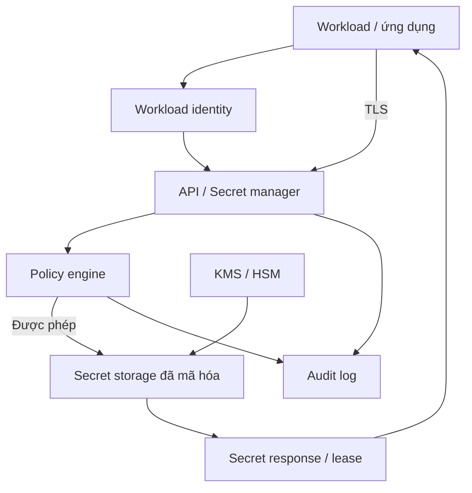
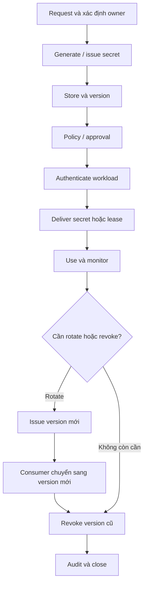

# Secret manager

**Secret manager** là dịch vụ hoặc hệ thống chuyên quản lý vòng đời của các bí mật mà ứng dụng và con người cần dùng để xác thực hoặc truy cập tài nguyên. Bí mật có thể là mật khẩu cơ sở dữ liệu, API token, credential của service account, private key, certificate bundle, webhook signing secret hoặc thông tin bootstrap để kết nối tới hệ thống khác.

Secret manager tập trung việc lưu giữ, cấp phát, kiểm soát truy cập, versioning, rotation, thu hồi và kiểm toán các bí mật. Ứng dụng lấy bí mật từ một nguồn được kiểm soát khi cần thay vì nhúng giá trị vào source code, file cấu hình hoặc container image. Điều này giảm số bản sao khó quản lý và giúp tổ chức thay đổi credential mà không phải sửa mã nguồn hay phát hành lại mọi ứng dụng.

Trong mô-đun **SECURITY_KEY_MANAGEMENT_FUNDAMENTALS**, secret manager cần được hiểu cùng KMS/HSM và quản lý khóa mật mã. Secret manager quản lý nhiều loại secret có thể dùng để xác thực; KMS quản lý key object và cung cấp thao tác mật mã; HSM bảo vệ vật liệu khóa trong một boundary chuyên dụng. Các dịch vụ có thể tích hợp với nhau nhưng giải quyết những trách nhiệm khác nhau.

## 1. Secret manager giải quyết vấn đề gì?

Trong một hệ thống không có quản lý bí mật tập trung, credential thường xuất hiện ở nhiều nơi:

- Mật khẩu database nằm trong file `application.properties`.
- API token được hardcode trong source code hoặc script triển khai.
- Private key được sao chép vào container image.
- Credential production được chia sẻ qua chat hoặc email.
- Cùng một mật khẩu được dùng cho nhiều service và nhiều môi trường.
- Khi nhân sự rời nhóm hoặc token bị lộ, không biết bản sao nào cần thay thế.

Những cách làm này khiến việc kiểm soát và thu hồi rất khó. Một bí mật có thể tồn tại trong Git history, build artifact, log, backup, image registry, máy developer và nhiều bản triển khai. Xóa một file cấu hình hiện tại không loại bỏ các bản sao trước đó.

Secret manager tạo một điểm quản lý có kiểm soát để:

1. Lưu secret được mã hóa khi nghỉ (at rest) và bảo vệ đường truyền khi cấp phát.
2. Xác thực workload hoặc người dùng trước khi cho đọc secret.
3. Cấp quyền theo secret, môi trường, ứng dụng và thao tác.
4. Quản lý version, rotation, expiry và thu hồi.
5. Ghi audit event để biết ai hoặc workload nào đã truy cập secret.
6. Giảm việc truyền secret qua các kênh thủ công và cấu hình tĩnh.
7. Hỗ trợ secret động có thời hạn, ví dụ database credential được tạo riêng cho một workload.

Secret manager không làm cho secret an toàn tuyệt đối. Nếu một workload được phép đọc secret bị chiếm quyền, attacker có thể lấy hoặc sử dụng secret đó. Vì vậy, phải kiểm soát cả danh tính workload, quyền truy cập, thời gian tồn tại của secret trong bộ nhớ và hành động mà credential cho phép.

## 2. Secret, cryptographic key và KMS khác nhau thế nào?

Secret là khái niệm rộng: bất kỳ dữ liệu bí mật nào mà hệ thống cần giữ kín. Cryptographic key là một loại secret có cấu trúc và mục đích mật mã cụ thể. KMS tập trung quản lý key object và có thể thực hiện phép toán mà không cần trả vật liệu khóa về ứng dụng.

| Đối tượng | Ví dụ | Cách quản lý thường phù hợp |
|---|---|---|
| Password | Mật khẩu database hoặc tài khoản dịch vụ | Secret manager; database nên hỗ trợ credential riêng và rotation |
| API token | Token gọi dịch vụ bên ngoài | Secret manager với scope, expiry và quy trình revoke |
| OAuth client secret | Bí mật xác thực ứng dụng với authorization server | Secret manager; kết hợp rotation và client authentication policy |
| Webhook signing secret | Bí mật HMAC xác minh webhook | Secret manager; version overlap khi đổi secret |
| Private key | Khóa riêng TLS, ký tài liệu hoặc ký workload | Ưu tiên KMS/HSM hoặc keystore phù hợp; secret manager có thể giữ file/bundle khi cần |
| DEK/KEK | Khóa mã hóa dữ liệu hoặc khóa bảo vệ khóa | KMS/HSM và envelope encryption; hạn chế xuất raw key |
| Certificate công khai | X.509 certificate | Có thể phân phối qua trust store/config; cần bảo đảm nguồn gốc và tính toàn vẹn |

| Hệ thống | Trách nhiệm chính | Ứng dụng thường nhận gì? |
|---|---|---|
| Secret manager | Lưu, cấp phát, version, rotation và audit secret | Giá trị secret hoặc tham chiếu/lease |
| KMS | Quản lý key object, policy và thao tác encrypt/decrypt/sign/wrap | Key ID, ciphertext, wrapped key hoặc kết quả phép toán |
| HSM | Bảo vệ và sử dụng vật liệu khóa trong boundary phần cứng | Key handle và kết quả thao tác; khóa có thể không exportable |

Một kiến trúc có thể dùng secret manager để lưu database password và token; dùng KMS để mã hóa secret store hoặc wrap DEK; dùng HSM để bảo vệ key gốc của KMS hoặc khóa ký có giá trị cao. Cần xác định rõ nơi nào là nguồn sự thật cho từng loại bí mật để tránh tạo nhiều bản sao và quy trình rotation không đồng bộ.

## 3. Những loại secret thường gặp

Secret manager có thể quản lý nhiều nhóm dữ liệu:

| Nhóm | Ví dụ | Đặc điểm cần lưu ý |
|---|---|---|
| Credential truy cập dữ liệu | Database username/password, cache password | Nên tạo identity riêng cho từng service, giới hạn quyền và có rotation |
| API credential | API key, bearer token, OAuth client secret | Thường có scope, audience, expiry và khả năng revoke tại hệ thống phát hành |
| Credential hạ tầng | Cloud access key, SSH credential, deployment token | Ưu tiên workload identity hoặc short-lived credential để giảm secret tĩnh |
| Bí mật ứng dụng | HMAC secret, encryption passphrase, license secret | Gắn với mục đích và version; không dùng lại giữa các môi trường |
| TLS material | Private key, certificate chain, keystore password | Private key cần bảo vệ nghiêm ngặt; certificate công khai không cần giữ bí mật |
| Bí mật bootstrap | Token đầu tiên để workload xác thực với secret manager | Có rủi ro cao vì quyền này mở đường đến các secret khác; cần thời hạn và scope nhỏ |
| Secret động | Database user/password cấp theo lease | Có TTL, renewal và revoke; ứng dụng phải xử lý hết hạn |

Không nên đưa mọi loại dữ liệu nhạy cảm vào một kho secret chỉ vì kho đó tiện dụng. Dữ liệu cá nhân, hồ sơ nghiệp vụ hoặc dữ liệu mã hóa lớn cần hệ thống lưu trữ và kiểm soát phù hợp. Secret manager dành cho những giá trị bí mật cần được cấp phát như credential hoặc key material, không phải một database tổng quát cho mọi dữ liệu nhạy cảm.

## 4. Kiến trúc cơ bản của secret manager

Một kiến trúc điển hình gồm workload, lớp xác thực, policy engine, kho lưu trữ được mã hóa, cơ chế audit và KMS/HSM bảo vệ khóa mã hóa kho.



Các thành phần có trách nhiệm khác nhau:

- **Workload identity:** xác định ứng dụng hoặc process đang yêu cầu secret, ví dụ cloud role, service account, certificate hoặc machine identity.
- **API endpoint:** nhận yêu cầu qua kênh được xác thực và mã hóa.
- **Authentication:** kiểm tra danh tính và tính hợp lệ của credential dùng để đăng nhập.
- **Policy engine:** quyết định identity có được đọc secret path, version hoặc thao tác cụ thể không.
- **Secret storage:** lưu secret, metadata, version và trạng thái; dữ liệu được bảo vệ khi nghỉ.
- **KMS/HSM:** bảo vệ khóa dùng mã hóa storage hoặc thực hiện thao tác bảo vệ khóa theo kiến trúc.
- **Audit pipeline:** ghi sự kiện truy cập, thay đổi policy, tạo version, rotation và revoke.
- **Lease/rotation controller:** quản lý thời hạn của secret động hoặc quy trình thay thế secret tĩnh.

Secret manager nên được triển khai như một control plane có tính sẵn sàng cao. Khi dịch vụ không khả dụng, ứng dụng cần có hành vi đã định trước: từ chối khởi động, tiếp tục dùng secret đã cache trong thời hạn ngắn, hoặc chuyển sang một endpoint dự phòng đã được phê duyệt. Không nên tự tạo một secret mặc định để ứng dụng tiếp tục chạy.

## 5. Xác thực và cấp quyền truy cập

Secret manager phải xác định hai điều: **ai đang yêu cầu** và **được phép làm gì**. Xác thực thành công không đồng nghĩa được đọc mọi secret.

### 5.1. Ưu tiên workload identity

Workload identity giúp ứng dụng chứng minh danh tính mà không phải giữ một credential dài hạn để đăng nhập vào secret manager. Tùy nền tảng, có thể dùng:

- Cloud workload role hoặc managed identity.
- Kubernetes service account token được ràng buộc với workload.
- Certificate-based machine identity hoặc mTLS.
- Identity federation từ hệ thống định danh doanh nghiệp.
- Agent hoặc node identity được bootstrap và giới hạn quyền.

Nếu bắt buộc dùng token bootstrap, token cần có TTL ngắn, audience và scope rõ, chỉ đủ quyền lấy credential tiếp theo. Không dùng một token quản trị chung cho mọi pod hoặc mọi môi trường.

### 5.2. Least privilege và policy theo secret

Policy nên giới hạn theo:

- Secret path hoặc resource ID.
- Môi trường như development, staging và production.
- Workload identity, namespace, service hoặc tenant.
- Thao tác: read, create, update, delete, rotate hoặc administer.
- Version được phép đọc, nếu nền tảng hỗ trợ.
- Context như audience, region, resource tag hoặc thời gian.

Ví dụ, `billing-api` chỉ được đọc credential của database billing production; nó không cần quyền đọc secret của payroll, signing key hoặc credential của môi trường staging. Quyền đọc secret và quyền thay đổi policy nên được tách biệt.

### 5.3. Tách vai trò vận hành

| Vai trò | Trách nhiệm | Quyền cần giới hạn |
|---|---|---|
| Workload owner | Khai báo secret cần dùng và lý do | Không tự cấp quyền quản trị kho |
| Secret administrator | Tạo path, metadata và policy theo quy trình | Không mặc nhiên được dùng credential nghiệp vụ |
| Workload runtime | Đọc secret được cấp cho identity | Không tạo, xóa hoặc thay policy |
| Security approver | Phê duyệt thay đổi nhạy cảm và ngoại lệ | Không tự phê duyệt thay đổi do chính mình thực hiện khi cần dual control |
| Auditor | Kiểm tra audit và policy | Không đọc secret value nếu không có yêu cầu được phê duyệt |
| Platform operator | Vận hành cluster, backup và HA | Quyền đọc secret value phải được hạn chế và kiểm soát |

Quyền quản trị hạ tầng có thể gián tiếp tạo đường truy cập secret. Vì vậy, cần bảo vệ cả quyền quản trị node, control plane, snapshot, backup, audit pipeline và KMS/HSM.

## 6. Cách cấp secret cho ứng dụng

Có nhiều cách đưa secret từ secret manager đến workload. Cần chọn cách phù hợp với runtime và khả năng kiểm soát bản sao.

| Phương pháp | Cách hoạt động | Ưu điểm | Rủi ro/đánh đổi |
|---|---|---|---|
| API trực tiếp | Ứng dụng gọi API và giữ secret trong bộ nhớ | Kiểm soát thời điểm lấy, dễ tích hợp rotation | Cần SDK, retry, cache và xử lý token/lease |
| Agent sidecar | Agent xác thực và ghi secret vào file hoặc local endpoint | Tách logic lấy secret khỏi mã nghiệp vụ | Thêm thành phần vận hành; file vẫn cần bảo vệ |
| CSI/secret volume | Nền tảng mount secret vào filesystem của workload | Ứng dụng có thể đọc như file, hỗ trợ cập nhật theo driver | Quyền mount, symlink, file permissions và refresh semantics |
| Environment variable | Runtime inject secret vào môi trường process | Tích hợp đơn giản với ứng dụng cũ | Có thể lộ qua process inspection, crash dump, diagnostics hoặc child process |
| Init container | Lấy secret trước khi container ứng dụng khởi động | Hữu ích khi ứng dụng cần file cấu hình lúc startup | Secret có thể nằm trong shared volume và không tự refresh |

Không có phương pháp nào tự động loại bỏ mọi rủi ro. API trực tiếp thường cho phép kiểm soát vòng đời tốt hơn nếu ứng dụng xử lý đúng; file mount phù hợp khi ứng dụng chỉ hỗ trợ đọc file; environment variable nên được cân nhắc kỹ vì có thể lan sang tiến trình con và công cụ chẩn đoán.

### 6.1. Không log secret khi đọc

Ứng dụng chỉ nên đưa secret vào đúng đối tượng cần sử dụng. Không in response API, object cấu hình hoặc exception chứa giá trị bí mật. Khi cần chẩn đoán, log secret ID, version, thời điểm, kết quả và correlation ID; không log secret value, token hoặc mật khẩu.

### 6.2. Giới hạn bản sao trong bộ nhớ

Giữ secret trong phạm vi ngắn nhất có thể. Tránh chuyển byte array thành `String` nếu cần chủ động xóa; không lưu secret vào static global cache vô thời hạn; hạn chế heap dump và core dump. Nếu API trả về immutable string, ứng dụng khó ghi đè nội dung; cần xem xét thiết kế client và cơ chế cấp phát phù hợp.

## 7. Vòng đời secret

Secret có vòng đời từ lúc yêu cầu đến khi thu hồi. Mỗi giai đoạn cần owner và bằng chứng tương ứng.

1. **Yêu cầu:** xác định secret phục vụ mục đích gì, workload nào cần, phạm vi quyền và thời hạn.
2. **Tạo hoặc tiếp nhận:** sinh secret bằng CSPRNG hoặc nhận từ hệ thống phát hành đáng tin cậy; không dùng giá trị mặc định.
3. **Lưu trữ:** ghi vào secret manager qua kênh được xác thực; bật mã hóa khi nghỉ và metadata owner/version.
4. **Phê duyệt và policy:** gắn secret với identity và quyền tối thiểu.
5. **Cấp phát:** workload xác thực rồi đọc đúng secret hoặc nhận lease.
6. **Sử dụng:** giữ secret trong bộ nhớ hoặc file mount có kiểm soát; tránh log và sao chép ngoài ý muốn.
7. **Rotation/renewal:** thay secret trước khi hết hạn hoặc khi có dấu hiệu rủi ro; phối hợp với hệ thống đích.
8. **Thu hồi:** revoke token, disable credential hoặc xóa quyền truy cập khi không còn cần.
9. **Hủy và lưu hồ sơ:** xử lý version cũ, backup, cache và log theo retention policy; lưu bằng chứng hoàn tất.



Secret manager chỉ lưu version mới không có nghĩa hệ thống đích đã chuyển sang credential mới. Rotation phải đồng bộ hai phía: secret manager và database/API/đối tác chấp nhận credential. Cần có giai đoạn overlap nếu hệ thống hỗ trợ hai credential đồng thời.

## 8. Rotation secret tĩnh

Secret tĩnh như database password hoặc API token có thể tồn tại lâu và thường phải thay theo lịch hoặc khi có sự cố. Một quy trình rotation an toàn cần phối hợp với hệ thống phát hành credential.

Ví dụ database hỗ trợ hai tài khoản ứng dụng:

1. Tạo credential mới với quyền tương đương hoặc hẹp hơn credential hiện tại.
2. Lưu credential mới thành version mới trong secret manager.
3. Cấp quyền cho workload đọc version mới.
4. Cập nhật một nhóm instance canary và xác nhận kết nối thành công.
5. Chuyển toàn bộ workload sang credential mới.
6. Theo dõi lỗi xác thực, connection pool và request đang chạy.
7. Revoke credential cũ ở database.
8. Đánh dấu version cũ không còn dùng, xử lý cache và lưu audit evidence.

Nếu database chỉ cho phép một password cho một user, có thể cần user thứ hai hoặc một cơ chế chuyển đổi khác để tránh downtime. Không thay password trong secret manager trước khi biết ứng dụng và database sẽ đồng bộ như thế nào.

### 8.1. Rotation API token

Với API token do bên thứ ba cấp, quy trình phải xem xét giới hạn số token hoạt động, thời gian overlap, rate limit, audience và quy trình revoke. Một token mới có thể được lưu thành version mới, nhưng token cũ vẫn có thể tiếp tục hoạt động cho đến khi nhà cung cấp revoke. Cần kiểm tra trực tiếp trạng thái ở hệ thống phát hành.

### 8.2. Versioning và rollback

Mỗi version nên có metadata như `createdAt`, `createdBy`, owner, purpose, expiry, trạng thái và ticket tham chiếu. Rollback chỉ nên là khả năng tạm thời trong một cửa sổ đã định; nếu version cũ bị lộ hoặc bị thu hồi, không được khôi phục nó chỉ để xử lý lỗi triển khai.

Không xóa version cũ ngay khi tạo version mới. Giữ lại theo retention policy nếu cần điều tra hoặc xử lý workload chưa cập nhật, nhưng chặn việc sử dụng ngoài phạm vi được phê duyệt.

## 9. Dynamic secrets và lease

Dynamic secret là credential được tạo theo yêu cầu và thường có thời hạn ngắn, ví dụ một database user riêng cho mỗi workload hoặc một credential cloud có TTL. Khi lease hết hạn hoặc bị revoke, secret manager hoặc hệ thống tích hợp sẽ thu hồi credential tương ứng.

Dynamic secret giảm nhu cầu chia sẻ một password tĩnh lâu dài. Mỗi workload có thể có credential riêng, giúp truy vết và thu hồi chính xác hơn.

### 9.1. Lease lifecycle

| Thành phần | Ý nghĩa |
|---|---|
| Lease ID | Định danh lần cấp credential |
| TTL | Thời gian credential được phép tồn tại |
| Renewal | Gia hạn lease nếu policy và hệ thống đích cho phép |
| Revoke | Thu hồi credential trước khi hết hạn |
| Expiry | Thời điểm lease hết hạn; cần xác nhận hệ thống đích thực sự vô hiệu hóa credential |
| Consumer | Workload chịu trách nhiệm dùng và dừng dùng credential đúng hạn |

Ứng dụng phải xử lý trường hợp lease hết hạn khi connection pool vẫn còn kết nối. Cần đóng hoặc làm mới connection, lấy credential mới và retry có kiểm soát. Không nên giả định database tự ngắt mọi session ngay khi password hoặc user bị revoke.

### 9.2. Khi nào dynamic secret không phù hợp?

Không phải hệ thống đích nào cũng hỗ trợ tạo user/token ngắn hạn. Một số giao thức hoặc nhà cung cấp chỉ cấp credential dài hạn. Khi đó, có thể dùng secret tĩnh với rotation định kỳ, scope hẹp, monitoring và quy trình revoke. Không giả lập dynamic secret bằng cách thay password thường xuyên nếu hệ thống không hỗ trợ chuyển đổi an toàn.

## 10. Secret manager và Java application

Ứng dụng Java nên truy cập secret qua một abstraction để mã nghiệp vụ không phụ thuộc trực tiếp vào nhà cung cấp. Implementation cụ thể có thể dùng SDK của secret manager, workload identity hoặc agent local.

Ví dụ về một interface nội bộ:

```java
import java.time.Instant;

public interface SecretProvider {
    SecretValue read(String secretId);

    record SecretValue(
            char[] value,
            String version,
            Instant expiresAt) implements AutoCloseable {

        public SecretValue {
            value = value.clone();
        }

        @Override
        public void close() {
            java.util.Arrays.fill(value, '\0');
        }
    }
}
```

Caller có thể giới hạn thời gian sử dụng secret bằng `try-with-resources`:

```java
try (SecretProvider.SecretValue secret =
        secretProvider.read("prod/billing/db-password")) {
    dataSource.configurePassword(secret.value());
    // Không log secret.value() hoặc toàn bộ SecretValue.
}
```

Đây là abstraction minh họa, không phải SDK của một nhà cung cấp cụ thể. Compact constructor clone mảng đầu vào để `SecretValue` sở hữu bản sao riêng; caller không nên tiếp tục dùng mảng đầu vào sau khi tạo đối tượng. `dataSource.configurePassword` là lời gọi minh họa cho API cấu hình của ứng dụng, không phải phương thức chuẩn của JDBC `DataSource`; implementation thực tế phải tránh giữ bản sao ngoài ý muốn và có cơ chế cập nhật connection pool khi secret đổi.

Trong Java, record yêu cầu Java 16 trở lên. Nếu dùng Java 8 hoặc 11, có thể triển khai một lớp `AutoCloseable` thông thường. Việc ghi đè mảng chỉ giảm thời gian tồn tại của bản sao do ứng dụng quản lý; provider, driver JDBC, JVM hoặc thư viện có thể đã tạo bản sao nội bộ.

### 10.1. Cache secret

Đọc secret manager cho mọi request có thể tăng latency và tải hệ thống. Cache có thể hữu ích nhưng cần quy định:

- TTL ngắn theo mức độ nhạy cảm và thời hạn secret.
- Cơ chế invalidate khi rotation hoặc revoke.
- Không dùng stale secret vô thời hạn khi secret manager mất kết nối.
- Giới hạn số bản sao và quyền truy cập cache.
- Không chia sẻ cache giữa tenant hoặc môi trường nếu policy không cho phép.
- Có metric về cache hit, refresh failure, secret age và version đang dùng.

Cache làm tăng thời gian secret còn có thể được dùng sau khi thu hồi. Với credential bị compromise, cần có đường invalidation khẩn cấp hoặc khả năng restart/refresh workload để loại bỏ bản sao đang giữ.

## 11. Bootstrap và danh tính của secret manager

Một workload phải có cách xác thực ban đầu trước khi lấy secret đầu tiên. Đây là bài toán bootstrap: credential dùng để truy cập secret manager cũng cần được bảo vệ.

Các mô hình thường dùng:

- **Workload identity:** nền tảng cấp identity ngắn hạn dựa trên node, pod, VM hoặc service account.
- **Certificate bootstrap:** workload có certificate client được cấp và quản lý theo PKI.
- **Identity federation:** secret manager tin một identity provider và xác minh token theo audience/issuer.
- **Agent injection:** agent xác thực workload rồi cấp secret qua file hoặc local socket.
- **Bootstrap token:** token giới hạn quyền và thời hạn, được cấp qua kênh quản trị hoặc hệ thống provisioning.

Không nhúng root token hoặc administrator credential vào image để mọi workload dùng chung. Root credential nên được giữ cho quy trình break-glass có phê duyệt, thời gian sử dụng ngắn, kiểm soát kép và audit đầy đủ.

Bootstrap identity cần được rotate/revoke độc lập với secret mà nó lấy. Khi workload bị xóa, identity và các lease/token liên quan phải được thu hồi để tránh credential mồ côi.

## 12. Bảo vệ secret manager và dữ liệu lưu trữ

Secret manager là một mục tiêu có giá trị cao vì nó có thể mở đường tới nhiều hệ thống khác. Các lớp bảo vệ cần bao gồm:

- **Mã hóa khi nghỉ:** mã hóa storage bằng khóa được quản lý phù hợp; bảo vệ key encryption key bằng KMS/HSM khi kiến trúc hỗ trợ.
- **Mã hóa khi truyền:** yêu cầu TLS và xác minh certificate/hostname của endpoint; dùng mTLS khi cần xác thực hai chiều.
- **Authentication:** workload identity, token ngắn hạn hoặc certificate; không dùng credential quản trị chung.
- **Authorization:** policy theo path, identity, operation, namespace và môi trường.
- **Network boundary:** giới hạn endpoint, private connectivity, egress và quyền truy cập control plane.
- **Hardening:** cập nhật phiên bản, vá lỗ hổng, giới hạn plugin và quyền hệ điều hành.
- **Audit:** gửi log ra kho riêng có kiểm soát quyền sửa/xóa.
- **Backup:** mã hóa, phân tách quyền, lưu ngoài failure domain và diễn tập restore.
- **Availability:** cluster, replication, health check, rate limit và kế hoạch DR.

Mã hóa storage chỉ bảo vệ dữ liệu khi nghỉ trong một số tình huống. Nếu attacker chiếm được quyền quản trị secret manager hoặc workload có quyền đọc, dịch vụ có thể giải mã secret theo chức năng hợp lệ. Do đó, policy, identity và audit quan trọng không kém mã hóa.

## 13. Audit, monitoring và phát hiện lạm dụng

Audit log cần cho phép trả lời: identity nào đã truy cập secret nào, phiên bản nào, vào lúc nào, qua thao tác gì và kết quả ra sao.

| Sự kiện | Metadata nên ghi | Không ghi |
|---|---|---|
| Secret read | Identity, secret ID, version, timestamp, request ID, result | Secret value, password, token |
| Secret create/update | Actor, secret ID, version mới, approval/ticket, timestamp | Nội dung secret |
| Policy change | Actor, policy resource, diff đã lọc, approval, timestamp | Credential dùng để xác thực |
| Rotation | Secret ID, version cũ/mới, trạng thái consumer, kết quả | Secret cũ và mới |
| Lease create/renew/revoke | Lease ID, owner, TTL, target system, result | Credential động dạng rõ |
| Authentication failure | Identity reference, source, reason category, timestamp | Token đầy đủ hoặc private key |
| Admin action | Actor, action, scope, session/correlation ID | Root token hoặc session secret |

Các tín hiệu cần giám sát:

- Một workload đọc secret ngoài phạm vi hoặc ngoài giờ hoạt động bình thường.
- Số lượng secret read tăng đột biến hoặc một identity liệt kê nhiều path.
- Thay đổi policy, tạo token quản trị hoặc sử dụng break-glass bất thường.
- Secret version mới được tạo nhưng consumer không chuyển đổi.
- Lease hết hạn nhưng credential ở hệ thống đích vẫn còn hoạt động.
- Audit log ngừng gửi, bị trễ hoặc có khoảng trống.
- Nhiều lần authentication failure, truy cập từ network/source lạ hoặc thử path không được phép.

Audit log nên được chuyển tới hệ thống độc lập với secret manager, bảo vệ tính toàn vẹn và giới hạn quyền xóa. Không cho secret manager administrator toàn quyền sửa cả audit evidence mà không có kiểm soát bổ sung.

## 14. HA, backup và disaster recovery

Nếu secret manager ngừng hoạt động, ứng dụng có thể không khởi động, không kết nối database hoặc không lấy được credential mới. Thiết kế cần xác định:

- RTO/RPO cho secret metadata, version và policy.
- Replication đồng bộ hay bất đồng bộ và consistency khi rotation.
- Backup storage, metadata, audit và cấu hình; phần nào phải được backup cùng nhau.
- Khóa bảo vệ backup và cách khôi phục KMS/HSM dependency.
- Quyền break-glass khi identity provider hoặc secret manager không khả dụng.
- Endpoint dự phòng và cách client xác minh endpoint đó.
- Cách ứng dụng xử lý secret cache trong thời gian outage.
- Quy trình failover/failback và kiểm tra consumer sau phục hồi.

Backup secret store mà không có khóa giải mã hoặc không có cách khôi phục identity/policy có thể không dùng được. Ngược lại, backup cả secret và khóa bảo vệ mà không phân tách quyền có thể tạo một bản sao có giá trị cao cho attacker. Phải diễn tập khôi phục trong môi trường cô lập và ghi nhận kết quả.

Không nên cho ứng dụng fallback sang secret hardcode khi secret manager không khả dụng. Hành vi an toàn hơn có thể là dùng secret đã cache trong TTL được phê duyệt, chuyển endpoint dự phòng hoặc fail closed tùy mục đích và mức độ quan trọng.

## 15. Xử lý sự cố khi secret bị lộ

Khi nghi ngờ secret bị lộ, cần xử lý cả nguồn phát hành, secret manager, consumer và hệ thống đích.

1. **Xác định phạm vi:** secret ID, version, loại credential, owner, consumer, môi trường và thời gian phơi lộ.
2. **Contain:** ngăn identity hoặc workload bị chiếm quyền tiếp tục đọc secret; hạn chế quyền truy cập và bảo toàn audit evidence.
3. **Rotate hoặc revoke:** tạo credential mới hoặc vô hiệu hóa credential cũ tại hệ thống phát hành; không chỉ xóa giá trị trong secret manager.
4. **Cập nhật consumer:** chuyển workload sang version mới, restart hoặc refresh cache/connection pool khi cần.
5. **Kiểm tra sử dụng trái phép:** rà soát log secret manager, database, API provider, cloud IAM và KMS.
6. **Xử lý bản sao:** tìm secret trong Git history, image, log, backup, file mount và dump; xử lý theo quy trình incident.
7. **Thu hồi identity liên quan:** revoke token bootstrap, session, lease và workload credential bị ảnh hưởng.
8. **Xác minh:** thử credential cũ bị từ chối, credential mới hoạt động đúng scope và không còn consumer dùng version cũ.
9. **Lưu hồ sơ:** ghi thời điểm phát hiện, rotate, revoke, consumer update và effective rejection; lưu owner và ngoại lệ.

Xóa secret khỏi kho không tự thu hồi credential ở database hoặc API provider. Nếu attacker đã sao chép password, token hoặc private key, họ có thể tiếp tục dùng bản sao cho đến khi hệ thống đích vô hiệu hóa nó. Phải xác minh trạng thái tại nơi credential được chấp nhận.

## 16. Những lỗi thường gặp

| Lỗi | Hậu quả | Cách kiểm soát |
|---|---|---|
| Hardcode secret trong source code | Bí mật lan vào Git history, artifact và fork | Secret manager, secret scanning và rotation khi lộ |
| Dùng root token cho mọi workload | Một workload bị chiếm quyền có thể truy cập toàn kho | Workload identity và policy least privilege |
| Dùng chung secret giữa môi trường | Rò rỉ staging có thể ảnh hưởng production | Tách namespace, credential và policy |
| Chỉ cập nhật secret manager mà không đổi hệ thống đích | Credential cũ vẫn hoạt động | Rotation hai phía và xác minh revoke |
| Inject secret qua environment mà không đánh giá | Lộ qua process inspection, dump hoặc child process | Ưu tiên identity/API/file mount phù hợp và giảm exposure |
| Cache secret vô thời hạn | Secret đã revoke vẫn được workload sử dụng | TTL, invalidation và refresh policy |
| Không quản lý lease | Credential động tồn tại sau khi workload kết thúc | TTL, revoke hook và reconciliation |
| Log toàn bộ response | Secret value xuất hiện trong log/observability | Metadata-only logging và redaction |
| Backup không kèm kế hoạch phục hồi khóa | Không thể khôi phục secret store | Restore drill và bảo vệ dependency KMS/HSM |
| Secret manager outage thì dùng secret mặc định | Tạo đường bypass control plane | Cache có TTL, failover được phê duyệt hoặc fail closed |
| Không thu hồi bootstrap identity | Workload cũ vẫn lấy được secret | Deprovision identity, token và lease khi workload kết thúc |

## 17. Checklist triển khai secret manager

Trước khi đưa secret manager vào production, hãy xác nhận:

- [ ] Đã phân loại secret và xác định owner, purpose, consumer và môi trường.
- [ ] Đã xác định secret nào thuộc secret manager, key nào thuộc KMS/HSM.
- [ ] Workload xác thực bằng identity riêng; không dùng root/admin token chung.
- [ ] Policy giới hạn theo secret path, identity, operation và context.
- [ ] Secret được mã hóa khi nghỉ và truyền qua TLS được xác minh.
- [ ] Có versioning, expiry, rotation và quy trình revoke tại hệ thống đích.
- [ ] Có cơ chế cấp phát phù hợp: API, agent, volume hoặc phương pháp khác.
- [ ] Cache có TTL và cơ chế invalidation khi rotate/revoke.
- [ ] Secret không xuất hiện trong source, image, log, exception hoặc telemetry.
- [ ] Dynamic secret có lease owner, renewal, expiry và revoke handling.
- [ ] Audit log được gửi tới kho độc lập và có cảnh báo hành vi bất thường.
- [ ] Backup, HA và DR đã được diễn tập, bao gồm dependency KMS/HSM và identity.
- [ ] Có quy trình break-glass được phê duyệt và kiểm toán.
- [ ] Có runbook xử lý secret exposure và xác minh credential cũ bị từ chối.

Secret manager giúp kiểm soát tập trung những bí mật mà ứng dụng cần dùng, nhưng hiệu quả phụ thuộc vào identity, policy, cách cấp phát, rotation hai phía và kiểm toán. Khi thiết kế đúng, workload chỉ nhận secret cần thiết trong thời gian cần thiết; KMS/HSM bảo vệ các khóa mật mã nền tảng; còn quy trình vận hành bảo đảm credential được thay thế và thu hồi thực sự tại hệ thống đích.
