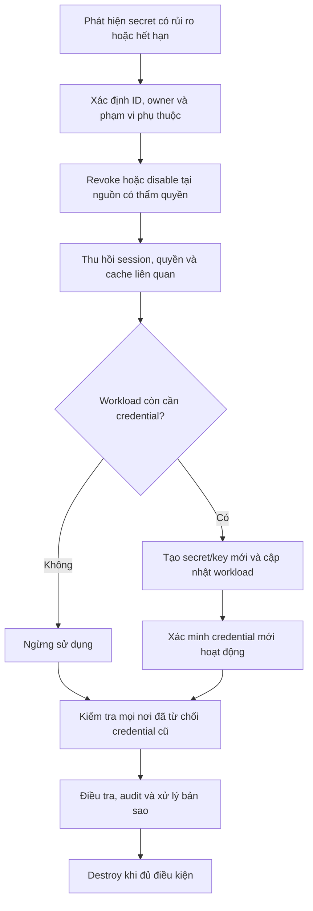

# Secret revocation

**Secret revocation (thu hồi bí mật)** là quá trình làm cho một credential hoặc khóa không còn được chấp nhận hay sử dụng theo chính sách. Việc thu hồi thường được kích hoạt khi bí mật hết hạn, không còn cần thiết, người sở hữu mất quyền, hệ thống thay đổi hoặc có dấu hiệu bị lộ.

Thu hồi là một phần quan trọng của vòng đời quản lý khóa mật mã. Một hệ thống an toàn cần biết bí mật nào đang được dùng, dịch vụ nào phụ thuộc vào nó, ai có quyền thu hồi và cách xác nhận việc thu hồi đã có hiệu lực trên toàn hệ thống. Chỉ đánh dấu một bản ghi là revoked trong một cơ sở dữ liệu không đủ nếu các dịch vụ khác vẫn chấp nhận bản sao credential, cache trạng thái cũ hoặc tiếp tục dùng khóa đã bị xâm phạm.

Thu hồi có thể ngăn các lần sử dụng trong tương lai. Nó không thể làm cho một bản sao bí mật đã bị đánh cắp biến mất, thu hồi dữ liệu đã bị giải mã hoặc bảo đảm ciphertext cũ không thể bị giải mã nếu kẻ tấn công đã lấy được khóa. Khi có dấu hiệu lộ lọt, thu hồi cần đi cùng rotation, điều tra phạm vi ảnh hưởng và xử lý dữ liệu phụ thuộc.

## 1. Vì sao cần thu hồi secret?

Credential và khóa có thể cần thu hồi trong nhiều tình huống:

- Nhân viên, nhà cung cấp hoặc workload không còn quyền truy cập.
- API token, refresh token hoặc client secret bị lộ trong source code, log, ticket, image hay thiết bị.
- Password bị lộ, bị tái sử dụng hoặc có dấu hiệu bị chiếm đoạt.
- Khóa riêng bị xâm phạm hoặc chứng thư được cấp sai.
- Một khóa hoặc secret đã hết thời hạn, được thay thế hoặc không còn phục vụ nghiệp vụ.
- Hệ thống phát hiện hoạt động bất thường, truy cập vượt phạm vi hoặc vi phạm chính sách.
- Thuật toán, provider hoặc nền tảng lưu trữ không còn được chấp thuận.

Thu hồi giúp giảm thời gian một bí mật bị lạm dụng. Tốc độ thu hồi đặc biệt quan trọng với bearer token và service credential vì bên giữ bản sao có thể tiếp tục dùng chúng cho đến khi hệ thống xác minh trạng thái mới.

## 2. Phân biệt revoke, disable, expire, rotate và destroy

Các thuật ngữ này thường xuất hiện cùng nhau nhưng mô tả những hành động khác nhau.

| Hành động | Ý nghĩa | Ví dụ |
|---|---|---|
| **Revoke** | Đánh dấu credential hoặc chứng thư không còn được chấp nhận theo chính sách | Thu hồi API token, refresh token hoặc chứng thư X.509 |
| **Disable** | Tạm ngừng cho phép sử dụng một secret/key version hoặc thao tác | Vô hiệu hóa một phiên bản khóa trong KMS để ngăn encrypt/decrypt |
| **Expire** | Credential tự hết hiệu lực theo thời hạn đã định | Access token hết hạn sau 15 phút |
| **Rotate** | Tạo credential hoặc khóa mới và chuyển workload sang dùng giá trị mới | Phát hành API token mới rồi thu hồi token cũ |
| **Destroy** | Hủy key material hoặc bí mật theo quy trình để không thể tiếp tục sử dụng | Xóa khóa đã hết thời gian lưu giữ trong HSM/KMS |

Revoke và disable thường là thay đổi trạng thái hoặc chính sách sử dụng. Rotate thay thế bí mật cũ bằng bí mật mới. Destroy là bước cuối của vòng đời và có thể không thể đảo ngược. Không nên gọi một secret là “đã hủy” chỉ vì ứng dụng đã ngừng dùng nó hoặc một bản ghi đã bị xóa.

Với khóa mã hóa dữ liệu, disable hoặc revoke không tự làm ciphertext trở nên vô dụng. Nếu khóa vẫn còn trong backup hoặc một bản sao khác, bên có quyền truy cập bản sao đó vẫn có thể sử dụng khóa. Nếu mục tiêu là chấm dứt khả năng giải mã, cần xác định và xử lý mọi bản sao key material, wrapped key, backup và quyền truy cập có liên quan.

## 3. Xác định loại secret trước khi thu hồi

Quy trình phù hợp phụ thuộc loại bí mật và cách hệ thống kiểm tra nó.

| Loại | Nơi quyết định chấp nhận | Hành động thu hồi thường gặp |
|---|---|---|
| Password người dùng | Password verifier trong hệ thống xác thực | Thay verifier, yêu cầu reset password, vô hiệu hóa session và refresh token |
| API token opaque | Kho token hoặc dịch vụ introspection | Đánh dấu token revoked, từ chối mọi request mới dùng token đó |
| JWT access token | Resource server, issuer hoặc dịch vụ kiểm tra trạng thái | Chờ hết hạn ngắn, denylist `jti`, introspection hoặc cơ chế thu hồi theo phiên |
| Refresh token | Authorization server | Thu hồi token và có thể thu hồi toàn bộ token family liên quan |
| Service secret | Secret manager và dịch vụ đích đang xác thực secret | Tạo secret mới, cập nhật workload, xác minh rồi vô hiệu hóa secret cũ |
| Chứng thư số | CA và relying party kiểm tra CRL/OCSP hoặc trust policy | CA ghi nhận thu hồi, phát hành trạng thái mới và cập nhật bên xác minh |
| Encryption key | KMS/HSM, keystore hoặc ứng dụng sử dụng khóa | Disable, chuyển sang decrypt-only, rewrap/re-encrypt hoặc destroy theo tình huống |

Trước khi thao tác, hãy xác định owner, key ID/credential ID, phiên bản, scope, dịch vụ phụ thuộc, vị trí lưu, thời hạn và cách các bên xác minh trạng thái. Nếu không xác định được nơi quyết định chấp nhận credential, tổ chức khó chứng minh việc thu hồi đã có hiệu lực.

## 4. Quy trình thu hồi tổng quát

Một quy trình thu hồi có thể được tổ chức thành các bước sau:

1. **Phát hiện và xác nhận:** xác định bí mật nào bị ảnh hưởng, thời điểm, nguồn phát hiện và mức độ tin cậy của bằng chứng.
2. **Đánh giá phạm vi:** tìm owner, workload, API, dữ liệu, khóa dẫn xuất, session và backup phụ thuộc vào bí mật.
3. **Phê duyệt theo mức độ:** sự cố đang diễn ra có thể cần hành động khẩn cấp theo playbook; thu hồi định kỳ cần đúng quyền và kiểm soát thay đổi.
4. **Ngăn sử dụng mới:** đánh dấu revoked/disabled tại hệ thống có thẩm quyền, cập nhật policy và từ chối request mới.
5. **Vô hiệu hóa quyền liên quan:** thu hồi session, refresh token, quyền IAM, certificate hoặc quyền gọi KMS tương ứng.
6. **Thay thế:** tạo secret/key mới và cập nhật workload nếu nghiệp vụ cần tiếp tục hoạt động.
7. **Xác minh lan truyền:** kiểm tra mọi resource server, replica, cache, gateway và ứng dụng phụ thuộc đã nhận trạng thái mới.
8. **Điều tra và khắc phục:** rà soát log, truy cập bất thường, dữ liệu có thể bị đọc và bản sao bí mật đã bị lộ.
9. **Hủy theo chính sách:** chỉ destroy key material và bản sao khi không còn yêu cầu giải mã, lưu giữ hoặc phục hồi.
10. **Ghi nhận và đóng sự cố:** lưu người thực hiện, lý do, thời điểm, kết quả, hệ thống đã xác minh và rủi ro còn lại.



Với sự cố đang diễn ra, thứ tự ưu tiên có thể thay đổi để chặn hành vi lạm dụng ngay lập tức. Ví dụ, có thể revoke token trước khi hoàn tất kiểm kê toàn bộ workload. Tuy nhiên, cần tiếp tục xác định phụ thuộc và khôi phục dịch vụ bằng credential mới sau khi đã cô lập nguy cơ.

## 5. Thu hồi password và phiên đăng nhập

Password thường không được lưu dưới dạng bản rõ. Khi người dùng đổi hoặc reset password, hệ thống tạo verifier mới bằng password hashing/KDF và thay verifier cũ. Từ thời điểm cập nhật có hiệu lực, password cũ không còn được chấp nhận cho lần xác thực mới.

Chỉ thay password verifier có thể chưa đủ. Kẻ tấn công có thể đã có session cookie, access token hoặc refresh token được cấp trước khi password bị reset. Quy trình thu hồi cần xem xét:

- Vô hiệu hóa các session hiện tại hoặc tăng `sessionVersion`/credential version để session cũ không còn hợp lệ.
- Thu hồi refresh token và token family liên quan.
- Yêu cầu xác thực lại trên thiết bị hoặc phiên có rủi ro.
- Thu hồi hoặc thay recovery code, app password và credential phụ nếu chúng có thể bị lộ.
- Kiểm tra thay đổi email, số điện thoại, MFA factor và phương thức khôi phục tài khoản.
- Gửi thông báo bảo mật theo kênh đã xác minh và ghi audit sự kiện reset.

Không nên tự động xóa mọi phương thức MFA trong mọi lần reset password; chỉ xử lý factor có dấu hiệu bị xâm phạm hoặc theo chính sách phục hồi tài khoản. Việc reset password cũng không thu hồi được thông tin đăng nhập đã bị sao chép khỏi thiết bị khác nếu session và token tương ứng vẫn còn hiệu lực.

## 6. Thu hồi API token, access token và refresh token

### Opaque token

Opaque token thường là chuỗi ngẫu nhiên không chứa thông tin có thể tự xác minh. Resource server tra cứu token qua kho dữ liệu hoặc dịch vụ introspection. Thu hồi có thể được thực hiện bằng cách đánh dấu record là revoked, đặt `revoked_at` hoặc xóa trạng thái active theo mô hình dữ liệu.

Mọi lần xác thực cần kiểm tra trạng thái hiện tại hoặc dùng cache có giới hạn thời gian rõ ràng. Nếu gateway cache kết quả token hợp lệ quá lâu, token đã thu hồi vẫn có thể được chấp nhận cho đến khi cache hết hạn.

### JWT access token

JWT thường được xác minh cục bộ bằng chữ ký và các claim như `exp`, `iss`, `aud`. Nếu resource server không hỏi issuer mỗi request, việc thu hồi tức thời khó hơn vì token đã phát hành vẫn có chữ ký hợp lệ cho đến khi hết hạn.

Các lựa chọn phổ biến gồm:

- Dùng access token có thời hạn ngắn để giới hạn cửa sổ rủi ro.
- Kiểm tra denylist theo `jti` hoặc token identifier khi cần thu hồi từng token.
- Dùng introspection hoặc trạng thái phiên tập trung cho hệ thống yêu cầu thu hồi gần tức thời.
- Dùng credential/session version để từ chối toàn bộ token được phát hành trước một mốc, nếu kiến trúc hỗ trợ.
- Thu hồi refresh token để ngăn phát hành access token mới.

Xoay vòng signing key có thể làm nhiều token cùng ký bằng khóa cũ không còn xác minh được, nhưng tác động rất rộng và có thể làm gián đoạn nhiều người dùng. Chỉ nên dùng cách này khi cần xử lý sự cố khóa ký hoặc theo chính sách key rollover; không xem đây là cách thu hồi mặc định cho một token đơn lẻ.

### Refresh token family

Với refresh token rotation, mỗi lần refresh thành công phát hành token mới và vô hiệu hóa token cũ. Nếu hệ thống phát hiện token cũ được dùng lại, có thể coi đó là dấu hiệu token bị sao chép và thu hồi cả family/session liên quan. Việc thu hồi family giúp ngăn attacker tiếp tục dùng một nhánh token đã bị lộ.

## 7. Thu hồi service secret và credential hệ thống

Service secret như database password, OAuth client secret hoặc credential truy cập dịch vụ bên thứ ba thường phải được đọc lại để workload xác thực. Vì vậy, hash một chiều không phù hợp; secret cần được quản lý trong secret manager hoặc kho mã hóa có kiểm soát.

Một quy trình rotation kèm revocation thường gồm:

1. Tạo credential mới tại dịch vụ đích hoặc secret issuer.
2. Lưu phiên bản mới vào secret manager với quyền truy cập phù hợp.
3. Cấp workload quyền đọc phiên bản mới; cập nhật ứng dụng, connection pool và client.
4. Kiểm tra kết nối mới hoạt động và request được xác thực bằng credential mới.
5. Theo dõi việc sử dụng credential cũ; xác nhận không còn workload hợp lệ phụ thuộc.
6. Thu hồi credential cũ tại dịch vụ đích, không chỉ xóa phiên bản khỏi secret manager.
7. Vô hiệu hóa cache, restart hoặc refresh client theo thiết kế; xác minh request dùng credential cũ bị từ chối.

Với database hỗ trợ nhiều credential hoặc nhiều user, có thể tạo user/credential mới, chuyển ứng dụng sang dùng nó rồi disable user cũ. Nếu dịch vụ chỉ cho phép một password tại một thời điểm, cần phối hợp thứ tự thay đổi và có kế hoạch rollback để tránh gián đoạn.

Xóa secret khỏi secret manager không tự thu hồi credential tại hệ thống đích. Nếu database vẫn chấp nhận password cũ, attacker vẫn có thể đăng nhập bằng bản sao password đã lấy. Thu hồi phải diễn ra tại nơi xác thực credential hoặc tại lớp policy được tất cả bên sử dụng kiểm tra.

## 8. Thu hồi chứng thư và khóa ký

Khi chứng thư X.509 không còn đáng tin cậy, CA phát hành có thể đánh dấu chứng thư bị thu hồi và công bố trạng thái qua CRL hoặc OCSP. Relying party cần kiểm tra trạng thái theo chính sách PKI của mình.

Các bước thường gặp:

- Xác định serial number, issuer, chủ sở hữu, thời điểm phát hiện và lý do thu hồi.
- Gửi yêu cầu thu hồi tới CA theo quyền và quy trình đã thiết lập.
- CA ghi nhận trạng thái và phát hành CRL/OCSP response cập nhật.
- Cập nhật hệ thống sử dụng chứng thư, trust store, gateway và thiết bị liên quan theo yêu cầu.
- Xác minh các relying party thực sự kiểm tra trạng thái mới và không dùng cache cũ quá thời hạn cho phép.
- Phát hành cặp khóa/chứng thư mới nếu danh tính hoặc dịch vụ vẫn cần hoạt động.

Thu hồi chứng thư không tự xóa khóa riêng đã bị sao chép. Nếu private key bị lộ, cần tạo key pair mới, cấp chứng thư mới, thu hồi chứng thư cũ và đánh giá mọi dữ liệu/chữ ký có thể bị ảnh hưởng. Nếu khóa CA hoặc trust anchor bị xâm phạm, phạm vi xử lý có thể rộng hơn nhiều vì các chứng thư được ký bởi CA đó có thể cần đánh giá lại.

CRL và OCSP có độ trễ phát hành, phân phối và cache. Nếu client không truy cập được nguồn trạng thái, cách xử lý soft-fail hoặc hard-fail phụ thuộc chính sách và loại hệ thống. Không được giả định mọi client đều từ chối chứng thư ngay khi CA ghi nhận thu hồi.

## 9. Thu hồi encryption key: disable, decrypt-only và destroy

Khóa mã hóa dữ liệu có vòng đời khác password hoặc API token. Một ciphertext đã được tạo vẫn tồn tại sau khi khóa bị disable. Nếu hệ thống cần đọc dữ liệu đó, nó vẫn cần khóa cũ hoặc một bản sao hợp lệ.

Các trạng thái thường dùng trong KMS/HSM:

| Trạng thái/chế độ | Ý nghĩa vận hành |
|---|---|
| Enabled/active | Cho phép các thao tác đã được policy cấp quyền, có thể gồm encrypt và decrypt |
| Disabled | Chặn một số hoặc toàn bộ thao tác dùng khóa theo semantics của KMS/provider |
| Decrypt-only/retired | Ngừng mã hóa dữ liệu mới nhưng vẫn cho phép giải mã dữ liệu cũ trong thời gian chuyển tiếp |
| Scheduled for deletion | Đã lên lịch hủy; có thể còn giai đoạn chờ để phục hồi tùy KMS |
| Destroyed | Key material đã bị hủy theo cơ chế dịch vụ; không thể tiếp tục sử dụng khóa đó |

Tên trạng thái và ý nghĩa chính xác khác nhau theo KMS/HSM. Cần kiểm tra tài liệu provider và xác minh thao tác cụ thể thay vì giả định mọi hệ thống có cùng state machine.

Khi khóa cũ không bị xâm phạm nhưng cần thay thế định kỳ, có thể tạo khóa mới, chuyển mã hóa mới sang khóa mới và giữ khóa cũ ở chế độ decrypt-only cho dữ liệu cũ. Với envelope encryption, có thể unwrap DEK rồi wrap lại bằng KEK mới mà không mã hóa lại payload.

Nếu DEK bị lộ, cần tạo DEK mới và mã hóa lại dữ liệu cần bảo vệ. Nếu KEK bị lộ, phải đánh giá các DEK đã được wrap bằng KEK đó và mọi bản sao ciphertext/wrapped DEK có thể bị attacker lấy. Rewrap bằng KEK mới giúp vận hành về sau, nhưng không thể thu hồi bản sao cũ mà attacker đã có; cần đánh giá mức phơi nhiễm và re-encrypt dữ liệu khi rủi ro yêu cầu.

Không destroy khóa cũ trước khi xác minh dữ liệu, backup, archive và nghĩa vụ lưu giữ không còn phụ thuộc vào khóa. Ngược lại, không giữ khóa bị xâm phạm hoạt động lâu hơn cần thiết chỉ để tiện giải mã; có thể cần cô lập quy trình phục hồi trong môi trường kiểm soát chặt và thực hiện re-encryption khẩn cấp.

## 10. Propagation, cache và cửa sổ thu hồi

Một hệ thống phân tán có thể lưu trạng thái credential ở nhiều nơi: secret manager, database replica, API gateway, service cache, token validator, process memory, connection pool và thiết bị người dùng. Việc cập nhật tại nguồn không đồng nghĩa mọi thành phần đã nhận thay đổi.

Các yếu tố ảnh hưởng thời gian thu hồi:

- Thời gian đồng bộ replica và event bus.
- TTL của cache và thời gian giữ kết quả introspection.
- Thời hạn access token và certificate status response.
- Chu kỳ refresh secret của ứng dụng và connection pool.
- Session đã phát hành và kết nối đang mở.
- Thành phần offline hoặc không kiểm tra trạng thái trực tuyến.

Nên xác định **revocation latency** mục tiêu cho từng loại credential: thời gian tối đa từ khi quyết định thu hồi đến khi mọi điểm kiểm tra có liên quan từ chối credential. Mục tiêu này phải được đo bằng kiểm thử, không chỉ dựa vào cấu hình TTL.

Với hệ thống yêu cầu thu hồi nhanh, có thể dùng push invalidation, event-driven cache purge, introspection tập trung hoặc danh sách denylist. Cần có cơ chế retry, giám sát consumer bị lỗi và kiểm tra định kỳ để tránh một node bỏ lỡ sự kiện thu hồi.

## 11. Mô hình dữ liệu và audit cho revocation

Một bản ghi credential nên có định danh ổn định và trạng thái đủ để ứng dụng kiểm tra. Ví dụ schema khái niệm:

```sql
CREATE TABLE credential_status (
    credential_id   VARCHAR(128) PRIMARY KEY,
    credential_type VARCHAR(32) NOT NULL,
    owner_id        VARCHAR(128) NOT NULL,
    version         INTEGER NOT NULL,
    status          VARCHAR(24) NOT NULL,
    issued_at       TIMESTAMP,
    expires_at      TIMESTAMP,
    revoked_at      TIMESTAMP,
    revoke_reason   VARCHAR(64),
    revoked_by      VARCHAR(128),
    updated_at      TIMESTAMP NOT NULL
);
```

Schema thực tế cần ràng buộc trạng thái hợp lệ, kiểm soát quyền ghi, xử lý concurrency và lưu lịch sử thay đổi. Không nên chỉ ghi đè một cột status nếu cần điều tra ai đã thu hồi, khi nào, vì lý do gì và trạng thái trước đó ra sao.

Audit event nên chứa:

- Credential ID, loại, version và owner; tránh chứa giá trị bí mật.
- Hành động: revoke, disable, rotate, re-enable hoặc destroy.
- Người hoặc workload khởi tạo và người phê duyệt nếu có.
- Thời điểm yêu cầu, thời điểm hoàn tất và hệ thống xác nhận.
- Lý do, ticket/incident reference và phạm vi ảnh hưởng.
- Kết quả propagation, lỗi và thành phần chưa xác nhận.

Audit log cần chống sửa đổi trái phép, giới hạn quyền đọc và đồng bộ thời gian. Không ghi password, token, key material, private key, wrapped secret có thể khôi phục ngoài chính sách hoặc payload nhạy cảm vào log.

## 12. Ví dụ Java: thu hồi opaque API token

Ví dụ sau mô tả cách service cập nhật trạng thái token trong kho dữ liệu. Ứng dụng cần kiểm tra trạng thái token ở mỗi lần xác thực hoặc dùng cache có TTL được giới hạn theo mục tiêu revocation latency.

```java
import java.time.Clock;
import java.time.Instant;

public interface ApiTokenRepository {
    RevokeResult revokeIfActive(String tokenId, Instant revokedAt, String reason);
}

public enum RevokeResult { REVOKED, ALREADY_REVOKED, NOT_FOUND }

public interface TokenRevocationAuthorizer {
    void requireCanRevoke(String actorId, String tokenId);
}

public final class ApiTokenRevocationService {
    private final ApiTokenRepository repository;
    private final TokenRevocationAuthorizer authorizer;
    private final Clock clock;

    public ApiTokenRevocationService(
            ApiTokenRepository repository,
            TokenRevocationAuthorizer authorizer,
            Clock clock) {
        this.repository = repository;
        this.authorizer = authorizer;
        this.clock = clock;
    }

    public RevokeResult revoke(String tokenId, String actorId, String reason) {
        authorizer.requireCanRevoke(actorId, tokenId);
        RevokeResult result = repository.revokeIfActive(
                tokenId, clock.instant(), reason);
        if (result == RevokeResult.NOT_FOUND) {
            throw new IllegalArgumentException("Unknown token");
        }
        return result; // A repeated request returns ALREADY_REVOKED.
    }
}
```

Đây là ví dụ khái niệm. `revokeIfActive()` cần cập nhật nguyên tử, chẳng hạn bằng câu lệnh `UPDATE ... WHERE revoked_at IS NULL`, để tránh hai request đồng thời ghi đè thời điểm hoặc lý do thu hồi. `TokenRevocationAuthorizer` kiểm tra quyền của người yêu cầu trước khi thay đổi trạng thái. Trong môi trường nhiều node, cần phát sự kiện invalidation sau commit và xác minh các validator đã nhận trạng thái mới.

Khi xác thực request, service phải tìm token bằng identifier, xác minh hash của token được trình bày, kiểm tra trạng thái revoked/expired và kiểm tra scope/audience. Không chỉ kiểm tra chữ ký hoặc hash token mà bỏ qua trạng thái thu hồi.

## 13. Ứng phó khi secret bị lộ

Khi phát hiện secret có thể bị lộ, cần ưu tiên ngăn attacker tiếp tục sử dụng rồi mới xử lý đầy đủ các bản sao và nguyên nhân gốc.

Một playbook điển hình:

1. Ghi nhận thời điểm, nguồn phát hiện, credential ID và hệ thống liên quan; bảo toàn log cần điều tra.
2. Xác định quyền mà credential cấp: đọc dữ liệu, ghi dữ liệu, deploy, ký, giải mã hay quản trị.
3. Revoke/disable tại issuer hoặc hệ thống xác thực có thẩm quyền; thu hồi session và quyền liên quan.
4. Nếu dịch vụ cần tiếp tục hoạt động, tạo credential mới trong kênh tin cậy và cập nhật workload.
5. Xác minh credential cũ bị từ chối tại các điểm truy cập, bao gồm replica, gateway và cache.
6. Tìm nơi bí mật bị lộ: repository history, CI logs, image, backup, endpoint hoặc thiết bị.
7. Đánh giá dữ liệu đã bị đọc/giải mã và thao tác có thể đã được thực hiện bằng credential.
8. Xoay vòng các secret/key có quan hệ phụ thuộc, thu hồi chứng thư hoặc re-encrypt dữ liệu khi cần.
9. Xử lý bản sao, sửa nguyên nhân gốc, cập nhật alert và diễn tập lại quy trình.
10. Đóng sự cố sau khi owner xác nhận trạng thái, bằng chứng và rủi ro còn lại.

Không chỉ xóa secret khỏi source code hoặc đổi password tại một nơi rồi kết luận sự cố đã kết thúc. Credential có thể còn trong lịch sử Git, artifact, cache, backup, process memory và hệ thống bên thứ ba.

## 14. Các sai lầm thường gặp

1. **Chỉ xóa secret khỏi database:** bản sao credential vẫn có thể được chấp nhận ở hệ thống đích.
2. **Không thu hồi session/refresh token:** attacker tiếp tục truy cập bằng session đã cấp trước đó.
3. **Dựa vào JWT signature mà không có chiến lược revoke:** token bị lộ vẫn hợp lệ cho đến khi hết hạn hoặc bị kiểm tra trạng thái.
4. **Xoay signing key cho một token đơn lẻ:** có thể vô hiệu hóa hàng loạt token và gây gián đoạn không cần thiết.
5. **Chỉ xóa secret version khỏi manager:** dịch vụ đích vẫn có thể chấp nhận credential cũ.
6. **Giả định CRL/OCSP cập nhật tức thời:** client có thể cache trạng thái hoặc không kiểm tra trạng thái theo chính sách.
7. **Disable encryption key rồi xóa luôn:** dữ liệu cũ và backup có thể không còn giải mã được.
8. **Rewrap rồi cho rằng key compromise đã được khắc phục:** attacker có thể đã sao chép wrapped DEK và ciphertext trước khi thu hồi.
9. **Destroy quá sớm:** dữ liệu lưu trữ, archive hoặc backup vẫn cần khóa cũ.
10. **Không đo revocation latency:** một node hoặc cache có thể tiếp tục chấp nhận credential cũ mà không được phát hiện.
11. **Log giá trị secret trong audit:** hệ thống kiểm toán trở thành nơi tập trung bí mật.

## 15. Checklist triển khai Secret revocation

- Phân loại credential và xác định nơi có thẩm quyền chấp nhận hoặc từ chối nó.
- Có owner, ID, version, scope, expiry và dependency inventory cho từng credential/key.
- Định nghĩa ai được yêu cầu, phê duyệt và thực hiện revoke/disable/destroy.
- Xác định rõ khác biệt giữa revoke, disable, expire, rotate và destroy.
- Có cách vô hiệu hóa session, refresh token, cache và connection đang hoạt động.
- Với opaque token, kiểm tra trạng thái revoked tại mỗi lần xác thực hoặc theo TTL có kiểm soát.
- Với JWT, xác định chính sách short TTL, denylist, introspection hoặc credential version.
- Với service secret, thu hồi tại hệ thống đích sau khi workload chuyển sang credential mới.
- Với certificate, cập nhật trạng thái CA và kiểm tra hành vi CRL/OCSP của relying party.
- Với encryption key, xác định dữ liệu phụ thuộc, chế độ decrypt-only, rewrap/re-encrypt và thời điểm destroy.
- Đo propagation time và revocation latency trên mọi node, replica, gateway và cache.
- Ghi audit đầy đủ nhưng không ghi giá trị bí mật.
- Bảo toàn log và thực hiện incident response khi có dấu hiệu compromise.
- Kiểm thử backup/recovery trước khi destroy khóa có dữ liệu phụ thuộc.

Thu hồi secret hiệu quả đòi hỏi phối hợp giữa nơi lưu bí mật, nơi xác thực, workload sử dụng và các bản sao phân tán. Với password và token, trọng tâm là ngăn xác thực mới và vô hiệu hóa session liên quan. Với service secret, phải thu hồi tại dịch vụ đích. Với chứng thư, cần trạng thái thu hồi mà relying party thực sự kiểm tra. Với encryption key, cần bảo vệ dữ liệu cũ trong khi thay thế khóa và chỉ hủy khi đã xử lý xong mọi phụ thuộc. Quy trình cần có audit và bằng chứng xác minh để tổ chức biết credential cũ thực sự không còn được chấp nhận.

## Tài liệu tham khảo

- [NIST SP 800-57 Part 1 Rev. 5: Recommendation for Key Management](https://csrc.nist.gov/pubs/sp/800/57/pt1/r5/final)
- [RFC 5280: Internet X.509 Public Key Infrastructure Certificate and CRL Profile](https://www.rfc-editor.org/rfc/rfc5280)
- [RFC 7009: OAuth 2.0 Token Revocation](https://www.rfc-editor.org/rfc/rfc7009)
- [RFC 7662: OAuth 2.0 Token Introspection](https://www.rfc-editor.org/rfc/rfc7662)
- [RFC 7519: JSON Web Token (JWT)](https://www.rfc-editor.org/rfc/rfc7519)
- [OWASP Secrets Management Cheat Sheet](https://cheatsheetseries.owasp.org/cheatsheets/Secrets_Management_Cheat_Sheet.html)
