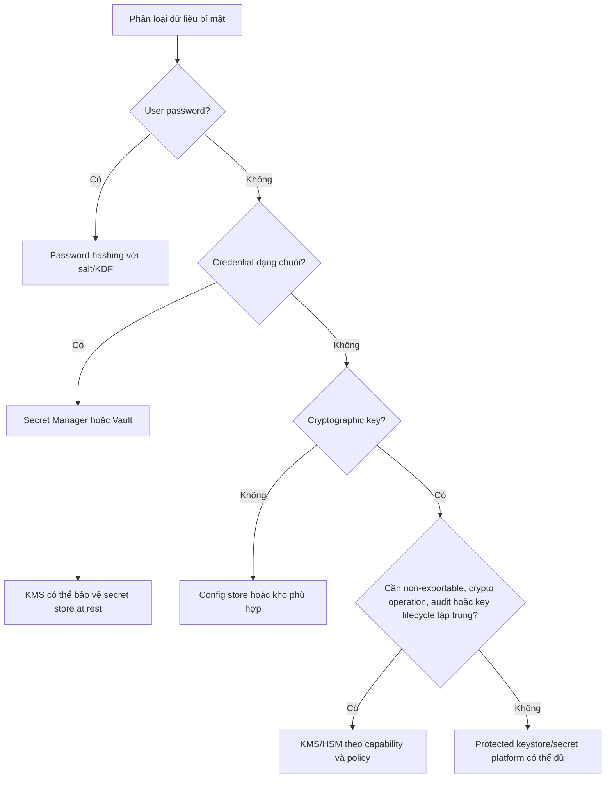
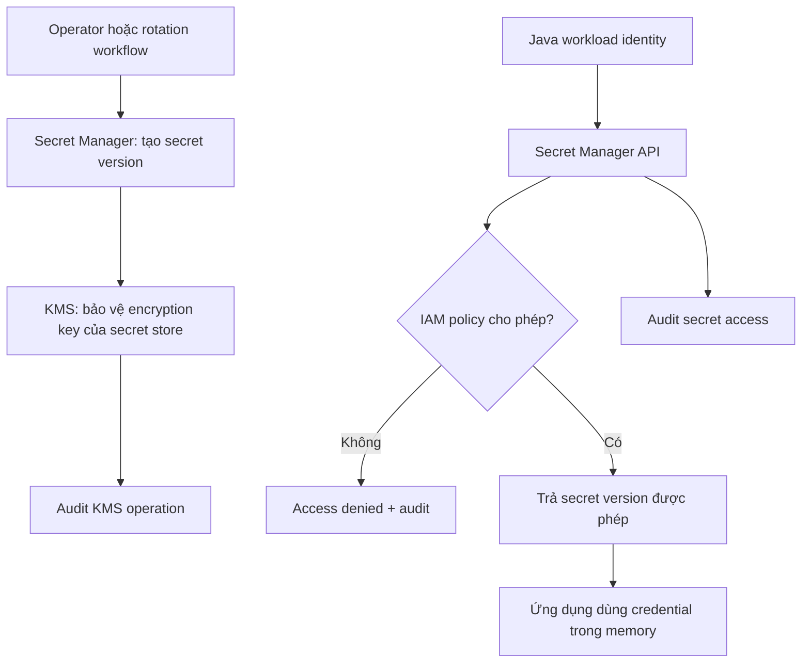
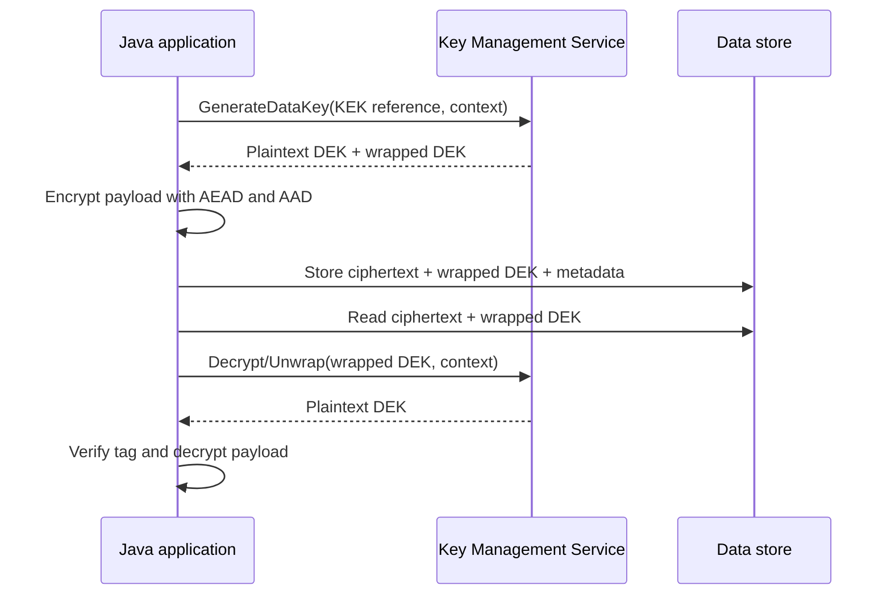
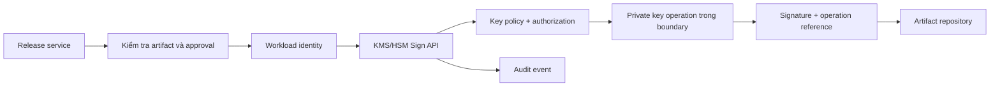

# Khi nào chuyển secret sang KMS

Chuyển secret sang Key Management Service (KMS) là quyết định đưa việc bảo vệ và sử dụng một phần bí mật vào một dịch vụ quản lý khóa có kiểm soát tập trung. Quyết định này phù hợp nhất khi secret thực chất là cryptographic key, khi ứng dụng cần thao tác mã hóa/ký mà không được trực tiếp nắm key material, hoặc khi tổ chức cần quản lý vòng đời khóa, phân quyền và audit ở cấp nền tảng.

Không phải mọi secret đều nên được lưu trực tiếp trong KMS. Password database, API token, OAuth client secret và credential ứng dụng thường cần một Secret Manager hoặc Vault để lưu trữ, phân phối và version hóa. KMS có thể bảo vệ encryption key dùng để mã hóa các secret đó khi lưu trữ, nhưng hai dịch vụ giải quyết hai bài toán khác nhau. Password người dùng lại cần password hashing; mã hóa password rồi lưu vào KMS không thay thế được thiết kế xác thực đúng.

Trong module quản lý khóa mật mã, câu hỏi quan trọng là secret nào cần KMS, secret nào cần Secret Manager, khi nào cần HSM và cách kết hợp chúng. Bài học này đưa ra tiêu chí quyết định, kiến trúc tham chiếu, quy trình migration, ví dụ Java, rủi ro vận hành và checklist để chuyển đổi mà vẫn giữ được tính sẵn sàng, khả năng khôi phục và kiểm soát quyền.

## 1. Secret, cryptographic key và credential khác nhau thế nào?

Các thuật ngữ thường bị dùng thay thế nhau nhưng có yêu cầu quản lý khác nhau.

| Loại | Ví dụ | Cách sử dụng | Nơi quản lý thường phù hợp |
|---|---|---|---|
| Credential | Database password, API token, OAuth client secret | Xác thực một principal hoặc workload với dịch vụ khác | Secret Manager/Vault; có thể được mã hóa at rest bằng KMS |
| User password | Password người dùng đăng nhập | Xác minh người dùng biết một bí mật | Password hashing database với salt và KDF phù hợp; không lưu plaintext hoặc reversible encryption |
| Cryptographic key | AES key, HMAC key, RSA/EC private key | Mã hóa, giải mã, ký, xác minh, MAC, key agreement hoặc wrap key | KMS/HSM hoặc key store được kiểm soát theo purpose |
| DEK | Data Encryption Key | Mã hóa dữ liệu bằng AEAD hoặc scheme phù hợp | Sinh tại ứng dụng/KMS; được bảo vệ bằng KEK và lưu dạng wrapped nếu cần |
| KEK | Key Encryption Key | Wrap/unwrap DEK hoặc key khác | KMS/HSM với policy chặt và lifecycle riêng |
| Recovery material | HSM backup share, recovery phrase, bootstrap token | Khôi phục quyền truy cập hoặc key | Quy trình recovery chuyên biệt, kho secret có kiểm soát và separation of duties |
| Configuration | Hostname, feature flag, non-sensitive setting | Điều khiển hành vi ứng dụng | Config store; không cần KMS nếu không mang bí mật hoặc integrity requirement đặc biệt |

Một secret có thể là key, nhưng không phải secret nào cũng là key. KMS thường quản lý key object và cung cấp cryptographic operation; Secret Manager thường quản lý giá trị secret tùy ý và phân phối chúng tới workload. Việc chọn sai dịch vụ có thể tạo thêm độ phức tạp mà không cải thiện đáng kể mức bảo vệ.

## 2. KMS, Secret Manager, Vault và HSM giải quyết việc gì?

Các sản phẩm có thể tích hợp hoặc gộp một số tính năng, nhưng nên phân biệt vai trò kiến trúc.

| Thành phần | Trách nhiệm chính | Ví dụ chức năng |
|---|---|---|
| KMS | Quản lý cryptographic key và kiểm soát thao tác mật mã | Create/import key, encrypt/decrypt, sign/verify, wrap/unwrap, rotation, disable, audit |
| Secret Manager | Lưu trữ, version hóa và phân phối secret dạng chuỗi/bytes | Lưu DB password, API token, certificate bundle, lấy secret bằng workload identity |
| Vault/secrets platform | Quản lý secret tập trung, có thể cấp credential động và cung cấp encryption service | Dynamic database credential, lease/renew/revoke, policy, secret rotation, transit encryption |
| HSM | Security boundary phần cứng để tạo/lưu/sử dụng key và thực hiện operation | Non-exportable private key, key ceremony, crypto operation, backup domain |
| IAM/workload identity | Xác định ai hoặc workload nào được phép yêu cầu secret/key operation | Role, policy, service identity, federation, short-lived credential |

KMS có thể dùng HSM ở tầng lưu trữ key tùy dịch vụ và cấu hình. HSM là nền tảng phần cứng; KMS là dịch vụ quản lý và policy ở mức cao hơn. Không phải mọi KMS đều cung cấp cùng mức kiểm soát, không phải mọi KMS key đều non-exportable theo cùng semantics, và không phải mọi HSM đều tự cung cấp secret distribution cho ứng dụng.

### 2.1. Hai mô hình kết hợp thường gặp

**Secret Manager dùng KMS để mã hóa at rest:** Secret Manager lưu DB password hoặc API token theo version. KMS bảo vệ encryption key nội bộ của Secret Manager. Ứng dụng lấy plaintext secret qua API sau khi được IAM cho phép. Ứng dụng không cần gọi KMS trực tiếp cho từng lần lấy credential.

**Ứng dụng dùng KMS trực tiếp cho cryptographic key:** Ứng dụng gọi KMS để tạo data key, mã hóa dữ liệu hoặc yêu cầu ký bằng key handle. Secret/key reference được quản lý theo policy; raw key có thể không rời security boundary nếu dịch vụ hỗ trợ operation đó.

Hai mô hình có thể cùng xuất hiện trong một hệ thống. Ví dụ, Secret Manager lưu database password và tham chiếu KMS key dùng để mã hóa secret at rest; ứng dụng đồng thời gọi KMS để wrap DEK cho dữ liệu giao dịch.

## 3. Khi nào nên chuyển một secret hoặc key sang KMS?

KMS đáng cân nhắc khi một hoặc nhiều điều kiện sau xuất hiện và lợi ích lớn hơn chi phí tích hợp.

### 3.1. Bí mật là cryptographic key có giá trị cao

Ví dụ AES KEK, HMAC key dùng xác thực message quan trọng, private key ký artifact, CA signing key hoặc private key dùng xác thực workload đặc quyền. Những key này có thể ảnh hưởng tới nhiều dữ liệu hoặc danh tính nếu bị lộ. KMS/HSM có thể giảm việc phân phối raw key, giới hạn operation và tạo audit tập trung.

### 3.2. Cần non-exportable key hoặc crypto operation từ xa

Nếu private key không được phép xuất khỏi security boundary, ứng dụng nên dùng key handle và gọi `Sign`, `Decrypt`, `WrapKey` hoặc operation tương ứng qua KMS/HSM. Mô hình này đặc biệt hữu ích với code signing, CA, signing service và một số workload TLS/mTLS có tích hợp HSM.

Non-exportable không có nghĩa key không thể bị lạm dụng. Attacker chiếm workload có quyền `Sign` vẫn có thể yêu cầu ký dữ liệu độc hại. Do đó cần giới hạn principal, purpose, message context, rate và approval; đồng thời audit từng operation.

### 3.3. Cần lifecycle và rotation có quản trị

Khi key cần owner, version, cryptoperiod, trạng thái active/decrypt-only/disabled, lịch rotation và destruction có bằng chứng, KMS giúp chuẩn hóa việc quản lý. Điều này đặc biệt quan trọng nếu key đang được copy thủ công qua nhiều server, file, CI variable hoặc container image.

### 3.4. Cần phân tách quyền và separation of duties

Một nhóm có thể được phép deploy ứng dụng nhưng không được export hoặc xóa key. Nhóm security có thể quản lý policy nhưng không tự dùng key để giải mã dữ liệu nghiệp vụ. KMS hỗ trợ tách quyền quản trị key, quyền sử dụng key, quyền xem audit và quyền backup/recovery nếu dịch vụ cung cấp đủ policy model.

### 3.5. Cần audit tập trung và khả năng điều tra

Nếu cần trả lời principal nào đã decrypt/sign, dùng key version nào, từ service nào, vào thời điểm nào và kết quả ra sao, audit event từ KMS có thể cung cấp bằng chứng nhất quán hơn log tự xây ở từng ứng dụng. Cần xác minh event có actor identity, key ID, operation, timestamp, result và request ID.

### 3.6. Cần envelope encryption ở quy mô lớn

Khi dữ liệu lớn hoặc có nhiều tenant, thường không muốn dùng một KMS key để encrypt từng byte của payload. KMS quản lý KEK; ứng dụng hoặc dịch vụ mã hóa dữ liệu bằng DEK; DEK được wrap bằng KEK. Đây là mô hình phù hợp khi cần bảo vệ nhiều DEK, rotation lớp KEK và tách phạm vi dữ liệu.

### 3.7. Yêu cầu tuân thủ hoặc hợp đồng đòi hỏi

Một số chuẩn/ngành/hợp đồng yêu cầu kiểm soát key custody, separation of duties, audit, HSM hoặc cryptographic module được chứng nhận. Khi đó KMS/HSM có thể là một phần của thiết kế bắt buộc. Phải kiểm tra đúng module, phiên bản, region, operational mode và phạm vi chứng nhận; việc “dùng KMS” tự nó không chứng minh tuân thủ.

## 4. Khi nào chưa cần chuyển secret sang KMS?

Không phải mọi secret đều cần một KMS key riêng hoặc một thao tác KMS trực tiếp.

- Secret có rủi ro thấp, phạm vi nhỏ và đã được quản lý an toàn bằng Secret Manager có thể chưa cần thêm một lớp KMS do ứng dụng tự gọi.
- Database password hoặc API token cần được phân phối/version hóa; Secret Manager thường phù hợp hơn để lưu giá trị và cấp cho workload.
- User password phải được hash bằng KDF password hashing. Không đưa password người dùng vào KMS để mã hóa rồi lưu có thể giải mã.
- Secret cần đọc thường xuyên với latency rất thấp có thể không phù hợp nếu ứng dụng gọi KMS cho từng request; dùng cache có TTL và policy hoặc Secret Manager tùy threat model.
- Một ứng dụng đơn giản chưa có owner, inventory, IAM hoặc recovery plan có thể không hưởng lợi từ việc thêm KMS trước khi xử lý các nền tảng quản trị cơ bản.
- Nếu KMS không hỗ trợ algorithm, key type, region, throughput hoặc integration bắt buộc, cần chọn kiến trúc khác đã được phê duyệt thay vì ép dùng.

Không chuyển một secret chỉ vì “KMS an toàn hơn”. Hãy xác định rủi ro cụ thể đang được giảm: raw key exposure, quyền truy cập quá rộng, thiếu audit, rotation thủ công, key reuse hay yêu cầu non-exportable. Nếu không chỉ ra được rủi ro và kiểm soát mới, migration có thể chỉ làm tăng chi phí và điểm lỗi.

Có thể dùng cây quyết định ban đầu sau; đây là bước phân loại, sau đó vẫn cần đánh giá threat model, IAM, availability và recovery:



## 5. Ma trận quyết định theo loại secret

| Loại dữ liệu | Lựa chọn thường phù hợp | Vai trò KMS |
|---|---|---|
| Password đăng nhập của người dùng | Password hashing database với Argon2id/scrypt/PBKDF2 theo policy | Có thể giữ pepper trong KMS/HSM nếu thiết kế cần và dịch vụ hỗ trợ HMAC; ứng dụng không lấy raw pepper ra. Không lưu password có thể giải mã trong KMS |
| Database password của ứng dụng | Secret Manager/Vault hoặc dynamic credential service | Mã hóa secret at rest hoặc bảo vệ credential bootstrap; KMS không thay thế việc cấp/rotate DB user |
| API key/token của đối tác | Secret Manager/Vault, quyền theo workload | Có thể bảo vệ encryption key của kho secret; KMS không tự phân phối token |
| OAuth client secret | Secret Manager và workload identity | Có thể mã hóa at rest; rotation phải đồng bộ với authorization server |
| AES DEK dùng cho dữ liệu | GenerateDataKey hoặc tạo tại service được kiểm soát; lưu wrapped DEK | KMS wrap/unwrap hoặc encrypt/decrypt theo envelope encryption |
| AES KEK | KMS/HSM | Quản lý key, policy, rotation, disable và audit |
| HMAC key | KMS/HSM nếu cần custody, audit hoặc operation tập trung | Có thể MAC trực tiếp nếu hỗ trợ; hoặc quản lý key trong boundary phù hợp |
| Private key ký artifact | KMS/HSM với sign operation, non-exportable nếu yêu cầu | Ký từ xa, phân quyền và audit |
| TLS private key | HSM/KMS khi TLS stack/load balancer hỗ trợ; nếu không, secret manager + protected keystore | Bảo vệ key custody hoặc thực hiện signing; cần đánh giá latency và TLS integration |
| CA root/intermediate private key | HSM và PKI ceremony theo policy | Bảo vệ key signing, quorum, audit và lifecycle |
| SSH deploy key | Secret Manager hoặc SSH CA/certificate-based access; cân nhắc HSM cho signing CA | KMS có thể bảo vệ key của SSH CA nếu có integration |
| Non-sensitive config | Config service/repository phù hợp | Thường không cần KMS |

Ma trận là hướng dẫn, không phải luật tuyệt đối. Sản phẩm có thể kết hợp KMS và Secret Manager; lựa chọn phụ thuộc API, IAM, key custody, latency, backup, recovery và yêu cầu tương thích.

## 6. Dấu hiệu cho thấy mô hình hiện tại cần thay đổi

Các dấu hiệu thường xuất hiện trước khi quyết định migration:

- Cùng một private key hoặc symmetric key được copy tới nhiều host, repository hoặc pipeline.
- Password/credential được chia sẻ qua chat, ticket, email hoặc file cấu hình.
- Không xác định được owner, mục đích, key version, thời điểm tạo hoặc thời điểm cần rotation.
- Không biết workload nào đang sử dụng key; xóa/rotate có thể gây outage bất ngờ.
- Nhóm vận hành có thể đọc raw key dù chỉ cần yêu cầu ký hoặc giải mã.
- Audit không thể phân biệt ai dùng key và service nào gọi operation.
- Một key dùng cho nhiều tenant, environment hoặc purpose.
- Backup chứa key không có kiểm soát, không kiểm thử restore hoặc không biết ai có recovery share.
- Khi nhân sự nghỉ việc hoặc workload bị compromise, không thể revoke quyền sử dụng ngay.
- Compliance yêu cầu key custody hoặc HSM mà kiến trúc file-based không đáp ứng.

Những dấu hiệu này cho thấy cần cải thiện key governance. KMS là một lựa chọn nếu nó giải quyết đúng nguyên nhân; với credential dạng chuỗi, Secret Manager/Vault có thể là bước phù hợp hơn.

## 7. Kiến trúc tham chiếu: Secret Manager được KMS bảo vệ

Với database password hoặc API token, một mô hình thường gặp là Secret Manager lưu secret theo version và dùng KMS key để mã hóa dữ liệu khi lưu. Workload xác thực bằng identity riêng, sau đó lấy secret được phép.



Trong mô hình này, ứng dụng thường không cần quyền decrypt KMS key nội bộ của Secret Manager. Nếu cấp thêm quyền đó, workload có thể vượt qua lớp policy của Secret Manager và tự giải mã dữ liệu nếu truy cập được ciphertext. Cần giữ quyền KMS ở đúng service principal theo kiến trúc nhà cung cấp.

Khi rotate database password, rotation workflow phải cập nhật database credential và Secret Manager version theo một quy trình nhất quán. Chỉ tạo secret version mới trong kho mà không đổi password ở database sẽ làm ứng dụng không đăng nhập được.

## 8. Kiến trúc tham chiếu: KMS quản lý KEK cho envelope encryption

Với dữ liệu ứng dụng, KMS thường quản lý KEK còn DEK dùng để mã hóa payload. KMS có thể trả plaintext DEK cùng wrapped DEK từ thao tác GenerateDataKey; ứng dụng dùng plaintext DEK trong thời gian ngắn, lưu ciphertext và wrapped DEK. Khi đọc, ứng dụng yêu cầu unwrap/decrypt DEK theo quyền.



Ứng dụng phải xóa plaintext DEK trong memory theo best-effort sau thao tác, không log DEK và không lưu plaintext DEK trong database/cache. Nonce, tag, algorithm ID, key ID/version và AAD schema cần được lưu cùng ciphertext để giải mã đúng. AAD nên ràng buộc tenant, record ID hoặc purpose để ngăn ciphertext bị chuyển sang context khác.

Nếu KMS trả plaintext DEK, KMS không làm cho DEK luôn non-exportable. Nó bảo vệ KEK và quá trình wrap/unwrap; plaintext DEK vẫn đi qua memory ứng dụng. Nếu yêu cầu dữ liệu không bao giờ được giải mã trong process, cần kiến trúc xử lý dữ liệu bên trong security boundary phù hợp, điều mà không phải KMS nào cũng hỗ trợ.

## 9. Kiến trúc tham chiếu: ký bằng private key trong KMS/HSM

Với code signing, document signing hoặc ký event quan trọng, ứng dụng có thể giữ key reference và gọi KMS/HSM để ký. Private key không cần được tải về application process nếu dịch vụ hỗ trợ asymmetric signing.



Quyền `Sign` cần giới hạn theo key ID, algorithm, principal, environment và loại artifact nếu dịch vụ hỗ trợ context policy. Không cấp `GetPrivateKey`/export cho workload nếu nó chỉ cần ký. Hãy xác minh certificate và public key tương ứng; một chữ ký hợp lệ bằng key không đúng identity vẫn có thể gây rủi ro.

## 10. Tiêu chí đánh giá trước khi migration

Trước khi chuyển, lập bảng đánh giá theo từng secret/key thay vì quyết định theo tên hệ thống.

| Tiêu chí | Câu hỏi | Dấu hiệu nên dùng KMS |
|---|---|---|
| Sensitivity/impact | Nếu bị lộ, attacker có thể làm gì? | Có thể giải mã dữ liệu lớn, giả mạo danh tính, ký artifact hoặc truy cập hệ thống quan trọng |
| Key purpose | Đây có phải cryptographic key? | Cần encrypt/decrypt/sign/MAC/wrap hoặc key agreement |
| Exportability | Key có được phép rời boundary? | Policy yêu cầu non-exportable hoặc operation từ xa |
| Access control | Có cần tách quyền quản trị và sử dụng? | Cần IAM/policy ở cấp key và separation of duties |
| Audit | Có cần bằng chứng operation theo key? | Cần actor, key version, operation, timestamp và outcome |
| Rotation | Rotation hiện tại có rủi ro hoặc không kiểm soát? | Cần version, state transition, disable và audit tập trung |
| Scale | Có nhiều ứng dụng/tenant/region sử dụng? | Cần policy và key hierarchy nhất quán |
| Compliance | Có yêu cầu KMS/HSM hoặc chứng nhận cụ thể? | Có yêu cầu được xác định trong standard/contract |
| Performance | Latency/throughput có đáp ứng? | Có thể dùng remote operation hoặc envelope/cache phù hợp |
| Availability | KMS outage ảnh hưởng tới dịch vụ ra sao? | Có HA, quota, retry, cache và recovery được thiết kế |
| Recovery | Ai có thể phục hồi key và backup? | Có quorum, backup domain và restore test phù hợp |
| Cost/complexity | Lợi ích có vượt chi phí và lock-in? | Có owner, budget, runbook và integration support |

Không cần cho điểm số giả chính xác nếu chưa có dữ liệu. Có thể đánh giá High/Medium/Low, ghi bằng chứng và xác định owner chịu trách nhiệm chấp nhận rủi ro.

## 11. Quy trình migration từ file secret sang nền tảng quản lý

Migration phải quản lý cả secret value, quyền, consumer, version và cutover. Trình tự khuyến nghị:

1. **Discover:** tìm secret/key đang tồn tại trong file, environment, CI variable, keystore, database, container image và backup.
2. **Classify:** xác định loại secret, purpose, owner, sensitivity, consumer, environment và hậu quả khi lộ.
3. **Choose service:** chọn Secret Manager, KMS, HSM hoặc kết hợp; nêu rõ lý do và capability cần có.
4. **Design policy:** định nghĩa workload identity, least privilege, key purpose, encryption context, version, rotation, audit và recovery.
5. **Provision:** tạo key hoặc secret store mới; cấu hình IAM và network boundary trước khi nạp secret.
6. **Migrate securely:** chuyển secret qua kênh bảo vệ, không in ra log/terminal; hạn chế số bản sao và thời gian tồn tại.
7. **Integrate:** cập nhật ứng dụng để lấy secret hoặc gọi key operation bằng reference, không hardcode value.
8. **Validate:** kiểm tra quyền đúng/sai, operation, latency, audit, backup/restore và failure behavior.
9. **Canary rollout:** chuyển một workload hoặc nhóm nhỏ; so sánh error rate, latency và key version.
10. **Complete cutover:** chuyển consumer còn lại, xác minh mọi instance dùng secret/key version mới.
11. **Revoke old path:** thu hồi credential cũ, loại key khỏi nơi không còn được phép dùng và xử lý bản sao.
12. **Close migration:** cập nhật inventory, owner, runbook, evidence và trạng thái retirement/destruction.

Không xóa secret cũ trước khi xác nhận consumer đã chuyển và có rollback được phê duyệt. Với key compromise, rollback về key cũ có thể không an toàn; incident response phải ưu tiên containment thay vì availability thông thường.

## 12. Xử lý secret đang hoạt động mà không làm lộ thêm

Quá trình migration tự nó có thể tạo thêm bản sao secret. Cần tránh:

- In secret ra terminal để copy/paste vào console KMS.
- Đưa giá trị secret vào command-line argument, shell history hoặc environment dump.
- Lưu file tạm trong thư mục chung hoặc workspace không được mã hóa.
- Gửi secret qua chat, email, ticket hoặc clipboard history.
- Dùng log debug để xác nhận secret đã được nạp.
- Đưa secret vào migration script nằm trong repository.
- Cho phép pipeline build tải toàn bộ secret dù chỉ cần reference.

Ưu tiên API-to-API transfer hoặc secret import channel được nhà cung cấp hỗ trợ. Nếu phải dùng file tạm, giới hạn quyền, thời gian tồn tại, vị trí, backup/snapshot và xóa theo quy trình. Việc xóa file không đảm bảo mọi bản sao đã biến mất; nếu secret từng nằm trong nơi không tin cậy, cân nhắc rotate thay vì chỉ xóa.

## 13. IAM và policy khi dùng KMS

Policy cần tách quyền quản trị key và quyền sử dụng key. Các quyền thường cần phân biệt:

| Quyền | Ví dụ | Ai thường nắm |
|---|---|---|
| Create/manage key | Tạo key, cấu hình policy, alias, tags | Key administrator/security platform |
| Use key | Encrypt/decrypt/sign/wrap/unwrap | Workload identity được duyệt |
| Grant/delegate | Cấp quyền tạm thời hoặc cho service khác | Administrator theo quy trình |
| Disable/enable | Tạm dừng hoặc khôi phục key | Security/key operations theo approval |
| Schedule deletion | Đặt lịch xóa key | Quyền đặc biệt, có dual control nếu cần |
| Backup/restore | Tạo hoặc phục hồi bản sao | Custodian/recovery role tách biệt |
| Audit/read events | Xem event sử dụng và thay đổi policy | Auditor/SOC |

Tránh policy `*` cho mọi key hoặc mọi operation. Workload chỉ cần `Decrypt` không nên có `ScheduleDeletion`; ứng dụng chỉ cần `Sign` không nên có `GetPrivateKey`/export. Admin quản lý key không nhất thiết được phép sử dụng key để giải mã dữ liệu nghiệp vụ.

Nếu KMS hỗ trợ encryption context hoặc grant constraint, dùng context để ràng buộc tenant, application, environment hoặc resource. Context thường không phải bí mật; nó giúp xác thực dữ liệu được dùng trong đúng ngữ cảnh. Không đưa PII hoặc secret vào context nếu không cần.

## 14. Rotation: KMS không tự xoay mọi credential

Rotation của key trong KMS và rotation của password/API token là hai quy trình khác nhau.

- **KMS key rotation:** thay material hoặc version nội bộ theo cơ chế dịch vụ. Cần hiểu ciphertext cũ được giải mã bằng version nào và key ID có thay đổi không.
- **Secret rotation:** thay password/token thực tế ở hệ thống đích, tạo secret version mới và cập nhật consumer.
- **Key rewrapping:** dùng KEK mới để wrap lại DEK; payload ciphertext có thể giữ nguyên nếu DEK vẫn an toàn.
- **Data re-encryption:** tạo DEK mới và mã hóa lại payload; cần khi DEK compromise hoặc thuật toán/mode/format phải thay.
- **Asymmetric key rotation:** tạo key pair mới, phát hành certificate hoặc public key mới, cập nhật verifier và xử lý key cũ theo dependency.

Nếu KMS có automatic rotation, điều đó không nhất thiết đổi database password, API token hoặc certificate đang được hệ thống khác dùng. Phải xác minh semantics của dịch vụ và cập nhật secret/consumer riêng.

## 15. Availability, latency và quota

KMS là dependency bên ngoài process. Nếu ứng dụng gọi KMS trên mỗi request, latency, quota hoặc outage có thể ảnh hưởng trực tiếp tới service. Cần quyết định operation nào phải online, operation nào có thể cache hoặc batch, và dữ liệu nào có thể tiếp tục phục vụ khi KMS tạm thời unavailable.

Các kiểm soát vận hành:

- Chọn region/endpoint, HA và failover theo yêu cầu dữ liệu.
- Dùng timeout ngắn hợp lý, bounded retry với backoff và jitter.
- Có circuit breaker và queue/backpressure cho operation có thể trì hoãn.
- Theo dõi request quota, throttling, latency percentile và error code.
- Cân nhắc cache plaintext secret hoặc DEK trong memory với TTL, scope và threat model rõ ràng; cache giảm dependency nhưng làm tăng thời gian secret tồn tại trong process.
- Không cache key admin credential hoặc raw private key nếu policy yêu cầu non-exportable.
- Thiết kế startup/readiness và degraded mode theo mức độ KMS bắt buộc.
- Kiểm thử outage, region failover, network partition và token expiration.

Không retry vô hạn thao tác `GenerateKey`, `CreateKey` hoặc `ScheduleDeletion` khi response bị timeout; request đầu có thể đã thành công. Dùng idempotency token/request ID nếu dịch vụ hỗ trợ và kiểm tra trạng thái trước khi lặp lại.

## 16. Chi phí và vendor lock-in

KMS có thể tính phí theo key, operation, request volume, HSM capacity hoặc region. Chi phí tăng theo số lượng key version, decrypt/sign throughput, cross-region replication và audit volume. Cần đo tải thật và dự báo rotation/recovery workload.

Vendor lock-in có thể xuất hiện ở:

- Key material được tạo trong HSM và không export được.
- API, policy, encryption context, grant và key state riêng của nhà cung cấp.
- Ciphertext/wrapped DEK phụ thuộc key ID hoặc wrapping format cụ thể.
- Audit schema và automation gắn với một nền tảng.
- Region, residency, recovery và backup domain riêng.

Không phải lúc nào cũng nên export key để tránh lock-in; export có thể vi phạm mục tiêu bảo vệ. Hãy thiết kế portability ở lớp ứng dụng: algorithm ID, ciphertext format, metadata version, abstraction API và migration plan. Chấp nhận rằng một số key không thể di chuyển; khi đổi nền tảng có thể cần decrypt/rewrap/re-encrypt có kiểm soát.

## 17. Backup và recovery trước khi chuyển

Trước khi đưa key quan trọng vào KMS, xác định cách khôi phục nếu key bị disable, xóa nhầm, region mất hoặc account bị khóa.

- Có cơ chế backup/replication nào và ai kiểm soát?
- KMS key có thể khôi phục sau deletion schedule không; grace period bao lâu?
- Key material import có backup riêng không?
- HSM cluster có security domain, quorum hoặc backup appliance nào?
- Multi-region key có semantics đồng bộ và failover ra sao?
- Wrapped DEK và ciphertext cũ có thể giải mã sau rotation không?
- Ai có quyền restore và ai phê duyệt?
- Recovery test gần nhất chứng minh điều gì?

Backup key không chỉ là sao chép file. Một số KMS không cho export key material; recovery phụ thuộc replication, provider-managed durability hoặc HSM backup procedure. Đừng migration production key trước khi hiểu rõ khả năng phục hồi và giới hạn trách nhiệm của nhà cung cấp.

## 18. Java integration: lấy credential từ Secret Manager

Với database password hoặc API token, Java application thường gọi một Secret Manager client bằng workload identity. API dưới đây là abstraction minh họa, không phải SDK cụ thể của một cloud provider.

```java
public interface SecretStore {
    SecretVersion read(String secretRef, String version)
        throws SecretAccessException;
}

public record SecretVersion(
    String versionId,
    char[] value,
    java.time.Instant createdAt
) implements AutoCloseable {
    public SecretVersion {
        if (value == null) {
            throw new IllegalArgumentException("Secret value is required");
        }
    }

    @Override
    public void close() {
        java.util.Arrays.fill(value, '\0');
    }
}

public final class DatabaseCredentialLoader {
    private final SecretStore secretStore;

    public DatabaseCredentialLoader(SecretStore secretStore) {
        this.secretStore = secretStore;
    }

    public SecretVersion load() throws SecretAccessException {
        return secretStore.read(
            "prod/orders/database-password", "current"
        );
    }
}
```

Đây là contract khái niệm. Trong production, `SecretStore` cần dùng workload identity, TLS, timeout, bounded retry, audit và kiểm tra secret version. `SecretVersion.close()` xóa mảng mà object sở hữu; caller phải chuyển quyền sở hữu mảng cho object và không được dùng lại sau khi đóng. Record không tự clone mảng đầu vào hoặc che accessor, vì vậy implementation production nên dùng class đóng gói, kiểm soát bản sao và chỉ trả bản sao tạm cho caller để caller xóa sau khi dùng. Nếu SDK trả `String`, không thể xóa nội dung String một cách đáng tin cậy; hạn chế bản sao và thời gian tồn tại.

Ứng dụng không cần quyền KMS decrypt nội bộ nếu Secret Manager đã thực hiện giải mã và trả secret theo IAM policy. Chỉ cấp thêm quyền KMS khi kiến trúc yêu cầu rõ và security review chấp thuận.

## 19. Java integration: envelope encryption với KMS

Ví dụ sau mô tả interface trừu tượng cho KMS tạo data key và unwrap. API cụ thể khác nhau giữa nhà cung cấp; không dùng đoạn mã này như SDK có thể biên dịch trực tiếp.

```java
public interface DataKeyService {
    DataKey generate(String kekId, Map<String, String> context)
        throws KeyServiceException;

    byte[] decrypt(byte[] wrappedDek, Map<String, String> context)
        throws KeyServiceException;
}

public record DataKey(byte[] plaintext, byte[] wrapped) implements AutoCloseable {
    @Override
    public void close() {
        java.util.Arrays.fill(plaintext, (byte) 0);
    }
}

public record EncryptedRecord(
    String algorithm,
    String kekId,
    String keyVersion,
    byte[] nonce,
    byte[] ciphertextAndTag,
    byte[] wrappedDek,
    Map<String, String> context
) {}
```

Khi dùng thật, `DataKeyService.generate` phải trả plaintext DEK trong memory và wrapped DEK để lưu. Ứng dụng mã hóa payload bằng AEAD, đóng `DataKey` trong `try-with-resources` để xóa plaintext DEK theo best-effort, rồi lưu ciphertext, nonce, tag, wrapped DEK, key reference và metadata. Khi đọc, ứng dụng gửi wrapped DEK cùng context tới KMS, nhận plaintext DEK và giải mã sau khi xác minh tag.

Không log `DataKey.plaintext`, `wrappedDek` hoặc payload. `context` phải được canonicalize và kiểm tra; nếu context không khớp, KMS hoặc lớp ứng dụng phải từ chối unwrap. Trong code production, record chứa `byte[]` cần kiểm soát quyền truy cập và sao chép; record không tự xóa mảng khi object bị garbage collect.

## 20. Java integration: ký bằng KMS thay vì tải private key

Với signing key được quản lý trong KMS/HSM, ứng dụng chỉ cần key reference và API ký. Ví dụ interface:

```java
public interface SigningService {
    SignatureResult sign(
        String keyId,
        String algorithm,
        byte[] messageDigest,
        String requestId
    ) throws KeyServiceException;
}

public record SignatureResult(
    byte[] signature,
    String keyVersion,
    String operationId
) {}
```

Tên API và việc dịch vụ nhận raw message hay digest phụ thuộc scheme/provider. Không tự hash dữ liệu trước khi gọi KMS nếu API mong nhận raw message; cũng không gửi digest nếu dịch vụ sẽ hash lần nữa. Phải đối chiếu đúng signature algorithm, pre-hash behavior, PSS parameters, encoding và certificate profile.

Ứng dụng cần kiểm tra authorization nghiệp vụ trước khi ký, gắn request ID, xác minh key ID/version và lưu operation ID. Không cấp quyền export private key cho workload chỉ cần `Sign`. Chữ ký đầu ra cần được xác minh bằng public key/certificate đúng trust chain trong release qualification.

## 21. Migration theo từng loại: ba ví dụ

### 21.1. Database password

Hiện trạng: password nằm trong `application-prod.yml` và được copy vào container image. Hướng chuyển đổi: đưa password vào Secret Manager, cấp quyền đọc cho workload identity của service, mount hoặc lấy qua API khi khởi động, hỗ trợ secret version và thiết kế rotation cập nhật cả database lẫn consumer. KMS có thể bảo vệ secret at rest trong Secret Manager. Không cần biến password database thành KMS key.

### 21.2. Private key ký artifact

Hiện trạng: file PKCS12 và password được lưu trong CI variable; nhiều runner có thể tải file. Hướng chuyển đổi: tạo signing key trong KMS/HSM, cấp certificate tương ứng, giới hạn `Sign` cho release workload identity, yêu cầu approval cho release và ghi audit operation. CI chỉ gửi digest/message theo API đúng scheme; private key không được export.

### 21.3. AES key mã hóa dữ liệu tenant

Hiện trạng: một AES key được đặt trong environment variable của nhiều instance. Hướng chuyển đổi: KMS quản lý KEK theo tenant hoặc domain; ứng dụng dùng DEK để AEAD encrypt payload; wrapped DEK và metadata được lưu cùng ciphertext. Thiết kế cần quyết định tenant isolation, context binding, cache DEK, quota và cách rewrap khi KEK rotation.

## 22. Những câu hỏi phải trả lời trước khi chọn KMS

- KMS quản lý raw key hay chỉ bảo vệ encryption key của Secret Manager?
- Workload cần lấy plaintext secret, dùng key handle hay yêu cầu remote cryptographic operation?
- Có yêu cầu non-exportable thực sự hay chỉ cần mã hóa at rest?
- Ai có quyền `Create`, `Use`, `Decrypt`, `Sign`, `Disable`, `Delete`, `Backup` và `Restore`?
- Key có tách theo environment, tenant, region và purpose không?
- KMS có hỗ trợ đúng algorithm, parameters, key size, throughput và API không?
- Secret version được consumer nạp và reload thế nào?
- Rotation có thay key material, secret value, certificate hay chỉ rewrap DEK?
- KMS outage ảnh hưởng request đang chạy và startup ra sao?
- Backup, recovery, deletion window và account recovery được thiết kế thế nào?
- Audit event có đủ actor, key ID/version, operation, result và request ID không?
- Có thể migrate hoặc re-encrypt khi đổi provider không?
- Chi phí operation, key, HSM, replication và log được dự báo chưa?
- Ai là owner vận hành, ai trực sự cố và ai phê duyệt exception?

## 23. Lỗi thường gặp khi chuyển secret sang KMS

- **Coi KMS là Secret Manager:** cố lưu mọi chuỗi credential như key object, làm mất versioning/distribution phù hợp.
- **Chuyển user password vào KMS để mã hóa:** thay thế sai cho password hashing.
- **Cấp quyền decrypt rộng:** workload có thể giải mã mọi ciphertext thuộc key thay vì chỉ dùng secret được phép.
- **Cấp quyền quản trị key cho ứng dụng:** workload có thể disable, rotate hoặc xóa key.
- **Nghĩ non-exportable là không thể lạm dụng:** attacker vẫn có thể gọi operation nếu chiếm identity.
- **Gọi KMS mỗi request không có cache/HA:** tăng latency, quota pressure và phụ thuộc mạng.
- **Cache secret vô thời hạn:** làm mất hiệu quả revoke/rotation và kéo dài thời gian exposure.
- **Nhầm automatic key rotation với secret rotation:** database password hoặc API token ở hệ thống đích không tự đổi.
- **Không gắn encryption context:** wrapped DEK có thể bị dùng sai tenant/resource nếu lớp ứng dụng không ràng buộc.
- **Không kiểm thử restore:** key mới được tạo nhưng backup/recovery path không hoạt động.
- **Không có migration inventory:** không biết consumer nào còn dùng key cũ.
- **Xóa key cũ quá sớm:** dữ liệu lịch sử không thể decrypt hoặc chữ ký không thể verify.
- **Không dự báo quota/chi phí:** workload bị throttling hoặc phát sinh chi phí ngoài dự kiến.
- **Không xử lý vendor lock-in:** ciphertext/backup phụ thuộc key không thể di chuyển.
- **Tin dùng KMS là tự động tuân thủ:** bỏ qua module validation, policy, evidence và operational mode.

## 24. Checklist quyết định và triển khai

- [ ] Đã phân loại dữ liệu là user password, credential, cryptographic key, DEK, KEK, recovery material hay config.
- [ ] Đã xác định threat model, impact, owner, consumer và environment.
- [ ] Đã chọn đúng vai trò: KMS, Secret Manager/Vault, HSM hoặc kết hợp.
- [ ] User password được hash bằng password hashing function; không lưu reversible secret.
- [ ] Credential dạng chuỗi có versioning/distribution qua Secret Manager phù hợp.
- [ ] Cryptographic key có purpose, algorithm, key size, owner và cryptoperiod rõ.
- [ ] Non-exportable/remote operation được yêu cầu khi có lý do cụ thể.
- [ ] IAM tách key administration, key usage, audit và recovery.
- [ ] Workload identity least privilege; không dùng credential tĩnh rộng quyền nếu có thể.
- [ ] Encryption context ràng buộc tenant/resource/purpose khi cần.
- [ ] Envelope encryption xác định DEK, KEK, nonce, AAD, wrapped key và format version.
- [ ] Rotation semantics được phân biệt giữa key, secret, certificate, rewrap và re-encryption.
- [ ] Latency, quota, availability, cache TTL và outage behavior đã được kiểm thử.
- [ ] Backup, restore, deletion window, quorum và recovery owner đã được xác định.
- [ ] Migration transfer không đưa secret vào log, shell history, ticket hoặc file tạm không bảo vệ.
- [ ] Canary rollout, rollback và revoke old credential có kế hoạch.
- [ ] Audit có actor, key ID/version, operation, provider, result và request ID.
- [ ] Cost, region, compliance, vendor lock-in và exit plan được đánh giá.
- [ ] Inventory xác nhận mọi consumer đã chuyển trước khi retire/destroy secret/key cũ.
- [ ] Runbook và owner trực vận hành đã sẵn sàng.

## 25. Câu hỏi tự kiểm tra

1. Secret khác cryptographic key như thế nào? Vì sao không phải secret nào cũng nên lưu trực tiếp trong KMS?
2. KMS và Secret Manager có trách nhiệm khác nhau ở điểm nào?
3. HSM khác KMS như thế nào trong kiến trúc key custody?
4. Khi nào cần non-exportable key và khi nào remote cryptographic operation có ích?
5. Vì sao non-exportable không ngăn được attacker lạm dụng quyền `Sign`?
6. Vì sao user password phải được hash thay vì mã hóa bằng KMS?
7. Database password nên được cấp và rotation qua thành phần nào?
8. KMS có thể bảo vệ Secret Manager at rest mà không cần workload có quyền decrypt như thế nào?
9. DEK và KEK có vai trò gì trong envelope encryption?
10. Khi rotate KEK, vì sao có thể chỉ cần rewrap DEK?
11. Khi nào cần re-encrypt payload bằng DEK mới?
12. Những quyền nào cần tách giữa key administrator, workload và auditor?
13. Encryption context giúp ràng buộc ciphertext với tenant/resource ra sao?
14. Vì sao KMS call trên mỗi request có thể gây vấn đề latency và quota?
15. Cache secret/DEK giảm outage nhưng làm tăng rủi ro nào?
16. Automatic KMS key rotation khác rotation database password/API token thế nào?
17. Trước migration cần inventory những consumer và dependency nào?
18. Vì sao cần backup/restore test trước khi đưa key quan trọng vào KMS?
19. Vendor lock-in có thể xuất hiện ở key material, ciphertext và policy ra sao?
20. Những điều kiện nào phải đạt trước khi retire hoặc destroy secret/key cũ?

Chuyển secret sang KMS là quyết định kiến trúc dựa trên loại bí mật và rủi ro cần giảm. KMS phù hợp để quản lý cryptographic key và thực hiện operation có kiểm soát; Secret Manager/Vault phù hợp để lưu và phân phối credential dạng chuỗi; HSM cung cấp security boundary phần cứng khi yêu cầu. Khi phân loại đúng, thiết kế IAM/lifecycle/recovery đầy đủ và migration theo từng consumer, tổ chức có thể giảm việc phân phối raw key, tăng audit và rotation mà vẫn duy trì khả năng vận hành và khôi phục dữ liệu.
