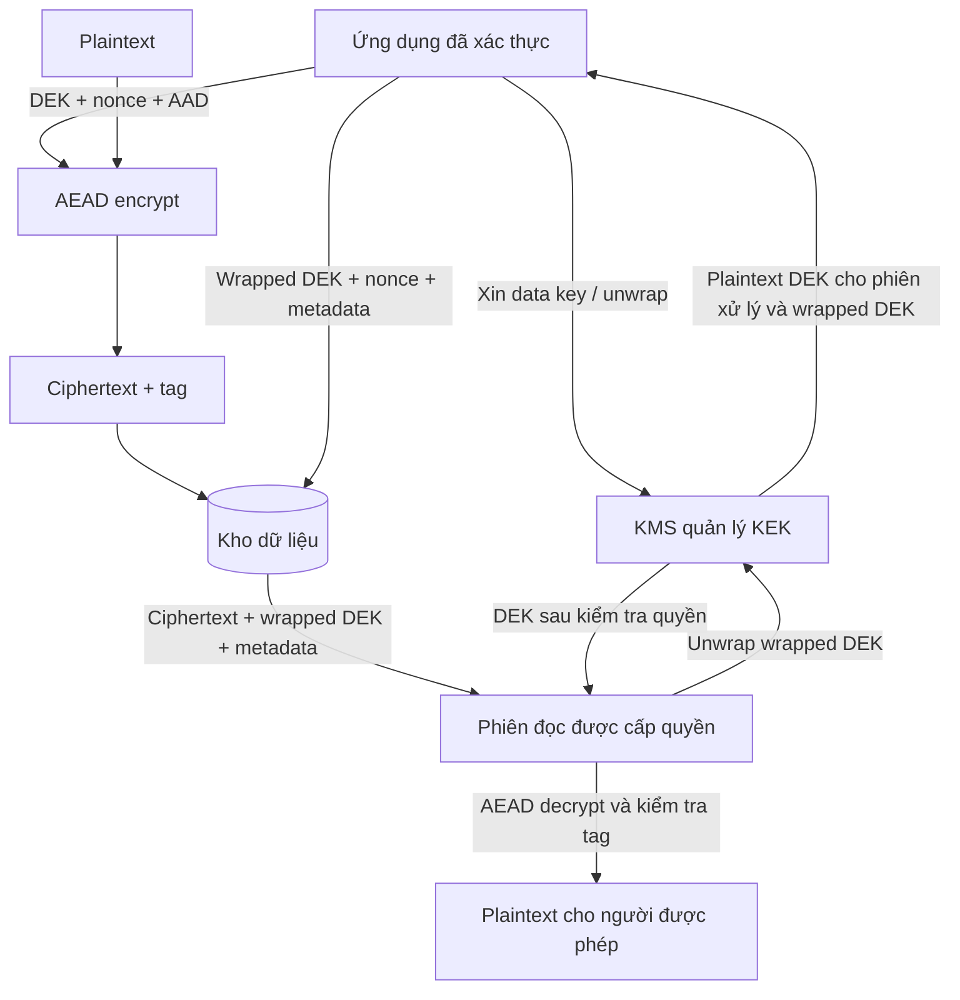

# Data Encryption Key (DEK)

> **Chương:** Phân loại key  
> **Module:** SECURITY_KEY_MANAGEMENT_FUNDAMENTALS — quản lý toàn bộ vòng đời khóa mật mã từ tạo, cấp phát, lưu trữ, sử dụng, xoay vòng đến thu hồi và hủy; kết nối mật mã đối xứng, bất đối xứng, chữ ký số, KMS/HSM, envelope encryption, kiểm soát truy cập và kiểm toán.

## 1. Mục tiêu học tập

Sau bài học, bạn có thể:

1. Giải thích **Data Encryption Key (DEK)** là gì, được dùng ở đâu và khác **Key Encryption Key (KEK)** như thế nào.
2. Lựa chọn phạm vi DEK phù hợp với dữ liệu: theo bản ghi, đối tượng, tenant, tập dữ liệu hoặc ổ đĩa.
3. Mô tả luồng **envelope encryption** với KMS/HSM, gồm tạo DEK, mã hóa dữ liệu, bọc DEK, lưu metadata và giải mã.
4. Hiểu các điều kiện an toàn khi dùng AES-GCM: tính ngẫu nhiên của khóa, tính duy nhất của nonce, kiểm tra authentication tag và sử dụng AAD.
5. Thiết kế vòng đời, xoay vòng, thu hồi, sao lưu, khôi phục và hủy DEK; phân biệt thay KEK, bọc lại DEK và mã hóa lại dữ liệu.
6. Phát hiện các lỗi thường gặp như lưu DEK dạng rõ trong cơ sở dữ liệu, tái sử dụng nonce, để lộ khóa qua log hoặc cấp quyền giải bọc quá rộng.

## 2. Data Encryption Key là gì?

**Data Encryption Key (DEK)** là khóa mật mã được dùng **trực tiếp để mã hóa và giải mã dữ liệu**. Trong phần lớn hệ thống lưu trữ dữ liệu hiện đại, DEK là **khóa đối xứng**: cùng một khóa được dùng cho cả hai thao tác mã hóa và giải mã.

Ví dụ: ứng dụng có thông tin địa chỉ giao hàng của khách hàng. Trước khi ghi xuống cơ sở dữ liệu, ứng dụng dùng một DEK và thuật toán mã hóa có xác thực để chuyển dữ liệu gốc (**plaintext**) thành dữ liệu đã mã hóa (**ciphertext**). Khi có yêu cầu đọc hợp lệ, ứng dụng lấy lại DEK qua cơ chế quản lý khóa, giải mã ciphertext và chỉ trả plaintext cho thành phần được phép.

Công thức ở mức khái niệm:

```text
plaintext + DEK + nonce + AAD
             |
             v
     Authenticated Encryption
             |
             v
     ciphertext + authentication tag

ciphertext + tag + DEK + nonce + cùng AAD
             |
             v
     Authenticated Decryption
             |
             v
      plaintext hoặc lỗi xác thực
```

Điểm quan trọng: **DEK bảo vệ dữ liệu, còn DEK cũng là một bí mật cần được bảo vệ**. Nếu hệ thống giữ DEK ngay cạnh ciphertext dưới dạng rõ, kẻ tấn công đọc được nơi lưu trữ sẽ có cả dữ liệu mã hóa lẫn khóa giải mã; mục tiêu bảo mật gần như thất bại.

### 2.1. Phân biệt DEK, KEK và các khóa khác

| Loại khóa | Mục đích chính | Ví dụ sử dụng | Điểm cần chú ý |
| --- | --- | --- | --- |
| **DEK — Data Encryption Key** | Mã hóa/giải mã dữ liệu trực tiếp | Mã hóa file, bản ghi, object, trường dữ liệu, block trên ổ đĩa | Cần bảo vệ plaintext DEK và quản lý nonce/mode mã hóa |
| **KEK — Key Encryption Key** | Bọc/mở bọc một khóa khác, thường là DEK | Khóa do KMS quản lý để bảo vệ các DEK | Đổi KEK không mặc định đổi DEK hoặc mã hóa lại dữ liệu |
| **Khóa gốc / master key** | Bảo vệ một hoặc nhiều tầng khóa phía dưới theo kiến trúc | Khóa gốc bên trong HSM hoặc hệ thống phân cấp khóa | Mức độ bảo vệ và quyền quản trị thường nghiêm ngặt |
| **Khóa riêng ký số** | Tạo chữ ký số | Ký tài liệu, phần mềm, giao dịch | Không dùng như một DEK đối xứng |
| **Khóa công khai** | Xác minh chữ ký, mã hóa/thiết lập bí mật theo sơ đồ phù hợp | Xác minh chữ ký, trao đổi khóa | Có thể dùng trong sơ đồ hybrid để bảo vệ DEK, nhưng không phải DEK |

Vì vậy, **DEK và KEK là các vai trò mật mã**, không nhất thiết là các tên thuật toán. Một hệ thống có thể dùng AES-256 cho cả DEK lẫn KEK nhưng hai khóa vẫn có mục đích, quyền truy cập và vòng đời khác nhau.

Trong sơ đồ hybrid encryption, DEK đối xứng có thể được bọc bằng cơ chế khóa công khai của người nhận thay vì một KEK đối xứng. Điểm cốt lõi vẫn là **khóa trực tiếp mã hóa dữ liệu phải được bảo vệ bằng cơ chế tách biệt**.

### 2.2. DEK không phải những thứ sau

- **Ciphertext:** kết quả đã được mã hóa; biết ciphertext không đồng nghĩa biết DEK.
- **Nonce/IV:** dữ liệu đầu vào dùng cùng DEK cho mỗi phép mã hóa. Với nhiều chế độ, nonce có thể lưu công khai nhưng **phải đáp ứng quy tắc không tái sử dụng**.
- **Authentication tag:** giá trị kiểm tra tính toàn vẹn và xác thực của ciphertext trong AEAD; không phải bí mật cần quản lý như DEK.
- **Key ID hoặc alias KMS:** mã tham chiếu tới khóa/tài nguyên. Biết key ID không có nghĩa sở hữu byte của khóa.
- **Wrapped DEK:** DEK đã được bọc/mã hóa; có thể lưu cùng dữ liệu nhưng chỉ mở được nhờ KEK/cơ chế bọc tương ứng và quyền hợp lệ.
- **Mật khẩu người dùng:** không phải một DEK ngẫu nhiên chất lượng mật mã. Nếu có thiết kế dẫn xuất khóa từ mật khẩu, phải dùng KDF dành cho mật khẩu và tham số được thẩm định.

## 3. Chọn phạm vi và mức độ chia nhỏ DEK

Một câu hỏi kiến trúc quan trọng là **một DEK sẽ mã hóa bao nhiêu dữ liệu**. Phạm vi khóa ảnh hưởng đến hiệu năng, chi phí, khả năng khôi phục và **blast radius** — lượng dữ liệu có nguy cơ bị ảnh hưởng nếu một DEK bị lộ.

| Mô hình | Cách dùng | Lợi ích | Đánh đổi và rủi ro |
| --- | --- | --- | --- |
| **Per-field / per-record** | DEK riêng cho một trường hoặc bản ghi | Cô lập dữ liệu tốt, thay khóa theo đối tượng nhỏ | Tăng số metadata/wrapped DEK và thao tác quản trị |
| **Per-object / per-file** | DEK riêng cho một file hoặc object | Hạn chế phạm vi lộ khóa, phù hợp object storage | Cần tạo/giải bọc DEK cho từng object hoặc nhóm tác vụ |
| **Per-tenant** | Một DEK hoặc tập DEK thuộc tenant | Tách quyền và vòng đời giữa khách hàng | Một DEK lộ có thể ảnh hưởng nhiều dữ liệu trong tenant |
| **Per-dataset / per-partition** | DEK dùng cho một tập dữ liệu hoặc phân vùng | Giảm overhead, thuận tiện cho xử lý theo lô | Phạm vi dữ liệu bị ảnh hưởng lớn hơn |
| **Per-volume / per-disk** | DEK mã hóa khối lưu trữ hoặc database TDE | Trong suốt đối với ứng dụng, hiệu quả vận hành | Không thay thế kiểm soát truy cập ở lớp ứng dụng; dữ liệu có thể được giải mã khi hệ thống hoạt động |

**Không có quy tắc “càng nhiều DEK càng tốt” cho mọi hệ thống.** Mỗi lựa chọn cần cân bằng mức nhạy cảm dữ liệu, tốc độ truy cập, chi phí thao tác KMS, lượng metadata cần lưu, yêu cầu cô lập tenant và khả năng khôi phục.

Ví dụ: một hệ thống lưu trữ tài liệu mật có thể tạo DEK riêng cho từng tài liệu; hệ thống mã hóa ổ đĩa thường để lớp lưu trữ quản lý khóa theo volume hoặc cấu trúc nội bộ. Một ứng dụng có 100 triệu bản ghi cần cân nhắc chi phí quản lý 100 triệu wrapped DEK trước khi chọn per-record DEK.

### 3.1. Khóa tách biệt theo mục đích và môi trường

Không sử dụng cùng một DEK cho dev, staging và production. Không dùng một DEK cho những mục đích mật mã không tương thích, chẳng hạn vừa mã hóa dữ liệu vừa làm khóa MAC ngoài thiết kế được thẩm định.

Nếu triển khai đa tenant, cân nhắc **phân cách khóa hoặc quyền truy cập theo tenant** và ràng buộc tenant ID trong metadata/AAD. Một hệ thống phải ngăn workload của tenant A dùng quyền giải bọc DEK thuộc tenant B.

### 3.2. Khi nào có thể tái sử dụng DEK?

Tái sử dụng một DEK cho nhiều phép mã hóa có thể được phép nếu thuật toán, cách quản lý nonce, giới hạn sử dụng khóa và mô hình đe dọa đều đáp ứng yêu cầu. Tuy nhiên nó tăng trách nhiệm đảm bảo nonce không trùng lặp và tăng phạm vi ảnh hưởng khi khóa lộ.

Một mô hình dễ kiểm soát là **mỗi object có DEK ngẫu nhiên riêng**; khi object thay đổi, có thể sinh DEK mới theo thiết kế. Với một DEK dùng cho nhiều object, hệ thống cần cơ chế cấp nonce/IV đáng tin cậy trên nhiều tiến trình, máy chủ và lần khởi động lại, cùng giới hạn số phép mã hóa mỗi khóa.

## 4. DEK được bảo vệ bằng envelope encryption

**Envelope encryption** là cách mã hóa dữ liệu bằng DEK, sau đó bảo vệ DEK bằng một khóa/cơ chế quản lý khác, thường là KEK trong **KMS (Key Management Service)** hoặc cơ sở hạ tầng sử dụng **HSM (Hardware Security Module)**.

Điều này tách hai vấn đề:

- DEK thực hiện mã hóa một lượng dữ liệu tùy ý bằng thuật toán đối xứng hiệu quả.
- KMS/HSM bảo vệ khóa ở tầng trên và kiểm soát **ai có thể tạo, mở bọc, sử dụng hoặc quản trị** khóa.

KMS là dịch vụ quản lý khóa, chính sách và API; HSM là mô-đun phần cứng bảo vệ vật liệu khóa và thao tác mật mã theo ranh giới an toàn của thiết bị. Một KMS có thể được hỗ trợ bởi HSM nhưng không có nghĩa plaintext DEK **luôn luôn** nằm trong HSM: nhiều API trả plaintext DEK cho ứng dụng để ứng dụng mã hóa dữ liệu.

### 4.1. Luồng mã hóa

Giả sử ứng dụng `OrderService` cần lưu một object bí mật:

1. Ứng dụng xác thực với KMS bằng **workload identity** có quyền trên KEK dành cho dịch vụ và môi trường tương ứng.
2. Ứng dụng yêu cầu tạo DEK mới. Một API KMS điển hình có thể trả **plaintext DEK** và **wrapped DEK** (bản đã được bọc dưới KEK).
3. Ứng dụng mã hóa plaintext bằng DEK, sử dụng thuật toán AEAD được phê duyệt, nonce phù hợp và AAD gắn với ngữ cảnh dữ liệu.
4. Ứng dụng lưu **ciphertext, authentication tag, nonce, wrapped DEK và metadata** cần thiết. Không lưu plaintext DEK.
5. Ứng dụng hạn chế thời gian tồn tại plaintext DEK trong bộ nhớ và dọn các buffer có thể dọn được khi không cần.

### 4.2. Luồng giải mã

1. Ứng dụng xác thực người dùng và kiểm tra quyền truy cập **đối với object** ở lớp nghiệp vụ.
2. Ứng dụng đọc ciphertext, wrapped DEK và metadata đi kèm.
3. Ứng dụng được phép gọi KMS để **unwrap/decrypt wrapped DEK**, kèm ngữ cảnh đúng như khi bọc nếu cơ chế KMS yêu cầu.
4. KMS kiểm tra quyền và trạng thái khóa; nếu hợp lệ, trả DEK theo giao diện được sử dụng.
5. Ứng dụng giải mã bằng đúng thuật toán, nonce, tag và AAD; nếu kiểm tra xác thực thất bại, **không trả plaintext**.
6. Ứng dụng kiểm soát việc DEK và plaintext còn tồn tại trong bộ nhớ, cache, log và crash dump.



Sơ đồ cho thấy **KMS bảo vệ khả năng sử dụng DEK**, nhưng bước mã hóa dữ liệu có thể diễn ra trong ứng dụng. Vì vậy phải kiểm soát cả quyền KMS **và** những nơi plaintext DEK xuất hiện.

### 4.3. Cần lưu những metadata nào?

Một object mã hóa có thể được biểu diễn như sau (mọi giá trị chuỗi là ví dụ minh họa, không phải bí mật thật):

```json
{
  "formatVersion": 1,
  "algorithm": "AES-256-GCM",
  "keyScope": "object",
  "kekReference": "kms://prod/orders/kek-v3",
  "wrappedDek": "<base64-cua-DEK-da-boc>",
  "nonce": "<base64-cua-nonce-12-byte>",
  "ciphertextAndTag": "<base64-cua-ciphertext-va-tag>",
  "aadSchema": "order-v1",
  "objectId": "order-4821",
  "tenantId": "tenant-27"
}
```

Giải thích:

- `algorithm` và `formatVersion` giúp phần mềm biết **cách giải mã đúng**, tránh tự đoán tham số.
- `kekReference` và `wrappedDek` giúp tìm đúng khóa/cơ chế để mở bọc DEK.
- `nonce` là đầu vào cần thiết cho phép giải mã; với AES-GCM, thường được lưu công khai.
- `ciphertextAndTag` có thể là ciphertext nối authentication tag, tùy định dạng và thư viện.
- `aadSchema`, `tenantId` và `objectId` cần có quy tắc chuyển sang **chuỗi byte AAD chuẩn hóa**, ổn định giữa thời điểm mã hóa và giải mã.

**Metadata không được tin tưởng mù quáng.** Ứng dụng phải lấy identity/tenant được xác thực từ phiên yêu cầu, kiểm tra quyền đọc object và liên kết dữ liệu với đúng ngữ cảnh. Nếu chỉ nhận `tenantId` từ JSON do client sửa được thì AAD không tự tạo ra cơ chế phân quyền.

### 4.4. Encryption context và AAD có giống nhau không?

Chúng có thể cùng chứa những thông tin như tenant ID, object ID, mục đích khóa, nhưng áp dụng ở **hai lớp khác nhau**:

- **KMS encryption context / authenticated metadata:** thông tin có thể được KMS gắn vào thao tác bọc/mở bọc DEK và chính sách cấp quyền, tùy API/nhà cung cấp.
- **AEAD AAD (Additional Authenticated Data):** dữ liệu không bị mã hóa nhưng được xác thực **cùng ciphertext** trong phép mã hóa dữ liệu.

Nếu KMS sử dụng context khi bọc DEK, ứng dụng thường phải cung cấp **đúng context** khi mở bọc. Nếu AES-GCM sử dụng AAD, ứng dụng phải cung cấp **đúng byte AAD** khi giải mã. Một lớp không tự thay cho lớp còn lại.

Ví dụ, AAD có thể chứa `tenantId + objectId + schemaVersion` trong một định dạng byte cố định. Đổi thứ tự trường, kiểu mã hóa ký tự hay giá trị mutable có thể làm dữ liệu không giải mã được. Do đó phải **version hóa cách tạo AAD**.

## 5. Những điều kiện mật mã mà DEK phải đáp ứng

### 5.1. Nguồn sinh khóa và độ dài khóa

Một DEK cần có độ ngẫu nhiên đủ mạnh, được sinh bằng **CSPRNG** (cryptographically secure pseudorandom number generator) hoặc chức năng tạo khóa tin cậy của KMS/HSM. Không tạo DEK bằng `Math.random()`, timestamp, UUID chưa qua đánh giá mật mã, chuỗi cố định hoặc mật khẩu do người dùng nhớ.

Đối với AES, độ dài khóa hợp lệ là **128, 192 hoặc 256 bit**. Một lựa chọn phổ biến là **AES-256-GCM** với DEK 32 byte và authentication tag 128 bit; giá trị cụ thể vẫn phải tuân theo chuẩn, thư viện, chính sách và mô hình đe dọa của hệ thống.

**Chú ý:** tạo DEK có độ ngẫu nhiên cao khác với **dẫn xuất** khóa từ một bí mật khác. Nếu kiến trúc dùng KDF như HKDF, cần thiết kế rõ nguồn key material, salt/info, phân tách mục đích và cách xoay nguồn. Không tự tạo cơ chế dẫn xuất khóa từ phép nối chuỗi/hàm băm tùy ý.

### 5.2. Dùng mã hóa có xác thực (AEAD)

**Authenticated Encryption with Associated Data (AEAD)** vừa bảo vệ tính bí mật của plaintext, vừa phát hiện việc ciphertext hoặc AAD bị sửa trái phép. AES-GCM và ChaCha20-Poly1305 là các ví dụ AEAD phổ biến trong bối cảnh phù hợp.

Với **AES-GCM**:

- Cần quản lý đúng **nonce/IV**; ví dụ phổ biến là nonce 96 bit (12 byte).
- **Tuyệt đối không tái sử dụng cùng nonce với cùng DEK**. Đây là sai sót nghiêm trọng, có thể làm mất tính bí mật và khả năng xác thực.
- Nonce không nhất thiết phải bí mật nhưng cần được lưu và khôi phục chính xác.
- Authentication tag cần được thư viện **kiểm tra thành công trước khi chấp nhận plaintext**.
- Nếu tag hoặc AAD sai, thao tác giải mã phải thất bại; không bỏ qua lỗi hoặc trả dữ liệu “giải mã được một phần”.

Dùng nonce ngẫu nhiên 96 bit làm giảm khả năng trùng trong phạm vi sử dụng nhất định, nhưng **không bảo đảm tính duy nhất tuyệt đối** khi mã hóa nhiều lần dưới cùng DEK. Hệ thống phải giới hạn số lần dùng khóa theo thiết kế/tiêu chuẩn áp dụng và có chiến lược sinh nonce tránh trùng trên nhiều máy. Với dữ liệu mới có DEK riêng theo object, việc quản lý nonce thường dễ hơn.

Không dùng **AES-ECB** để bảo vệ dữ liệu nhạy cảm vì chế độ này tiết lộ cấu trúc lặp. Cũng không tự ghép AES-CBC với một MAC mà thiếu thiết kế và triển khai đã được thẩm định.

### 5.3. Quy trình cấp quyền trước khi sử dụng DEK

Chỉ có quyền gọi KMS không đồng nghĩa có quyền đọc tất cả dữ liệu. Ứng dụng vẫn cần kiểm tra quyền truy cập bản ghi/object của người dùng. Tương tự, quyền đọc ciphertext trong DB không được mặc định mang lại quyền unwrap DEK.

Một chính sách điển hình phân tách:

- **Key administrator:** quản lý cấu hình tài nguyên KMS, quyền, lịch thay và trạng thái.
- **Workload identity:** chỉ được gọi các thao tác cần thiết như tạo data key hoặc mở bọc trong phạm vi prod/tenant được cấp.
- **Data owner / application authorization:** quyết định người dùng nào được xem object nào.
- **Auditor:** đọc log và cấu hình phục vụ kiểm tra mà không có quyền giải mã dữ liệu.

Khóa KEK **không xuất được** vẫn có thể bị lạm dụng nếu kẻ tấn công có danh tính được phép gọi API unwrap/decrypt tùy ý. Bảo vệ DEK đòi hỏi giới hạn quyền, giám sát và phản ứng khi danh tính bị xâm nhập.

## 6. Ví dụ Java: mã hóa nội dung bằng một DEK đã có

Đoạn mã sau minh họa **phần mã hóa dữ liệu bằng DEK**, sử dụng Java Cryptography Architecture (JCA) với AES-256-GCM. Giả định mỗi object có **DEK mới do KMS/cơ chế cấp khóa được phê duyệt sinh ra**; mã **không triển khai KMS**, không tự lưu DEK và không thay thế thiết kế xác thực/phân quyền. Đây là ví dụ tối giản để hiểu luồng dữ liệu.

```java
import java.security.GeneralSecurityException;
import java.security.InvalidKeyException;
import java.security.SecureRandom;
import java.util.Objects;
import javax.crypto.Cipher;
import javax.crypto.spec.GCMParameterSpec;
import javax.crypto.spec.SecretKeySpec;

public final class DekAesGcm {
    private static final int DEK_BYTES = 32;      // AES-256
    private static final int NONCE_BYTES = 12;    // 96-bit nonce
    private static final int TAG_BITS = 128;
    private static final SecureRandom RANDOM = new SecureRandom();

    private DekAesGcm() {}

    // Bản ghi minh họa; khi dùng trong sản phẩm nên sao chép phòng vệ mảng byte.
    public record Payload(byte[] nonce, byte[] ciphertextAndTag) {}

    public static Payload encrypt(byte[] dek, byte[] plaintext, byte[] aad)
            throws GeneralSecurityException {
        validateKey(dek);
        Objects.requireNonNull(plaintext);
        Objects.requireNonNull(aad);

        byte[] nonce = new byte[NONCE_BYTES];
        RANDOM.nextBytes(nonce);

        Cipher cipher = Cipher.getInstance("AES/GCM/NoPadding");
        cipher.init(
                Cipher.ENCRYPT_MODE,
                new SecretKeySpec(dek, "AES"),
                new GCMParameterSpec(TAG_BITS, nonce));
        cipher.updateAAD(aad);

        // JCA trả ciphertext và tag cùng một mảng byte.
        return new Payload(nonce, cipher.doFinal(plaintext));
    }

    public static byte[] decrypt(byte[] dek, Payload payload, byte[] aad)
            throws GeneralSecurityException {
        validateKey(dek);
        Objects.requireNonNull(payload);
        Objects.requireNonNull(aad);
        if (payload.nonce() == null || payload.nonce().length != NONCE_BYTES) {
            throw new IllegalArgumentException("Nonce không hợp lệ");
        }

        Cipher cipher = Cipher.getInstance("AES/GCM/NoPadding");
        cipher.init(
                Cipher.DECRYPT_MODE,
                new SecretKeySpec(dek, "AES"),
                new GCMParameterSpec(TAG_BITS, payload.nonce()));
        cipher.updateAAD(aad);

        // Sai khóa, nonce, AAD, ciphertext hoặc tag => thất bại xác thực.
        return cipher.doFinal(payload.ciphertextAndTag());
    }

    private static void validateKey(byte[] dek) throws InvalidKeyException {
        if (dek == null || dek.length != DEK_BYTES) {
            throw new InvalidKeyException("Ví dụ này yêu cầu DEK AES-256 (32 byte)");
        }
    }
}
```

Ví dụ gọi ở tầng dịch vụ (giả mã):

```text
# Bước 1: Xác thực workload và kiểm tra quyền ghi object.
# Bước 2: KMS cấp plaintext DEK + wrapped DEK cho KEK được chỉ định.
aad = encodeCanonical(tenantId, objectId, aadSchemaVersion)
payload = DekAesGcm.encrypt(plaintextDek, plaintextObject, aad)

store(
  ciphertextAndTag = payload.ciphertextAndTag,
  nonce = payload.nonce,
  wrappedDek = kmsResult.wrappedDek,
  keyReference = selectedKek,
  aadSchemaVersion = aadSchemaVersion
)

# Bước 3: Hạn chế vòng đời plaintext DEK trong bộ nhớ.
# Khi đọc: authorize -> fetch metadata -> KMS unwrap -> decrypt -> trả dữ liệu.
```

**Giới hạn của ví dụ:**

1. `SecureRandom` tạo nonce ngẫu nhiên; chương trình thật phải kiểm soát số lần sử dụng cùng DEK và rủi ro va chạm nonce. Ví dụ giả định **mỗi object có DEK riêng**, tránh dùng một khóa vô hạn.
2. `Payload` chứa các mảng mutable để code ngắn gọn; mô hình API production cần kiểm soát sao chép, sửa đổi và phân quyền truy cập tới các mảng này.
3. Byte của plaintext DEK có thể được xóa khỏi buffer do ứng dụng quản lý khi xong việc (ví dụ `Arrays.fill`), nhưng **không thể bảo đảm xóa toàn bộ bản sao** do JVM, JCA, thư viện native hoặc hệ điều hành tạo ra. Không lưu DEK vào `String`, log hoặc đối tượng sống lâu.
4. Bản thân JCA **không** xử lý IAM, token, KMS policy, audit, key inventory, lưu trữ wrapped DEK, backup và phục hồi. Những phần đó phải được thiết kế ở mức hệ thống.
5. Dữ liệu AAD phải có quy tắc mã hóa nhất quán, chẳng hạn định dạng xác định độ dài hoặc cấu trúc chuẩn hóa, tránh phép nối chuỗi mơ hồ giữa các trường.
6. **Không** hiển thị key, plaintext hay buffer nội bộ trong exception/log khi gặp lỗi xác thực.

## 7. Vòng đời của DEK

DEK không chỉ có trạng thái “đang được dùng”. Cần quản lý đầy đủ các thời điểm tạo, kích hoạt, cấp phát, lưu trữ, thay thế, thu hồi và hủy.

| Giai đoạn | Cách vận hành an toàn | Bằng chứng cần giữ |
| --- | --- | --- |
| **Tạo (generate)** | Sinh DEK bằng nguồn ngẫu nhiên mật mã hoặc chức năng KMS/HSM được phê duyệt; gắn purpose và key scope | Cấu hình sinh khóa, log cấp khóa |
| **Cấp phát (provision)** | Gắn DEK với object/tenant và KEK tương ứng; chỉ đưa plaintext DEK đến workload cần thiết | Danh mục khóa hoặc metadata object, log yêu cầu |
| **Sử dụng (use)** | AEAD với nonce/AAD hợp lệ; giới hạn quyền gọi decrypt và thời gian tồn tại plaintext DEK | Log truy cập, kiểm thử phân quyền |
| **Lưu trữ (store)** | Chỉ lưu wrapped DEK hoặc hình thức được bảo vệ tương đương, tách quyền DB và KMS | Schema dữ liệu, KMS policy, kiểm tra backup |
| **Xoay vòng (rotate)** | Sinh DEK mới cho dữ liệu mới hoặc mã hóa lại dữ liệu hiện hữu khi chính sách/rủi ro yêu cầu | Kế hoạch migration, kết quả kiểm tra giải mã |
| **Tạm ngừng/thu hồi** | Ngăn workload lấy DEK hoặc dùng khóa mới; đánh giá những bản DEK dạng rõ đã có | Log khóa quyền, sự kiện disable/revoke |
| **Lưu giữ/khôi phục** | Giữ khả năng đọc dữ liệu hợp lệ còn thời hạn, gồm backup/snapshot; diễn tập restore | Hồ sơ retention, test DR |
| **Hủy (destroy)** | Xác nhận không còn dữ liệu cần giải mã, bản sao hay nghĩa vụ lưu giữ; xóa/bất hoạt vật liệu khóa theo cơ chế được hỗ trợ | Phiếu phê duyệt, log hủy, xác nhận phụ thuộc |

### 7.1. Cryptoperiod của DEK

**Cryptoperiod** là khoảng thời gian khóa được phép dùng cho những thao tác mật mã nhất định. Cần phân biệt:

- **Thời gian encrypt-active:** được phép dùng DEK để mã hóa dữ liệu mới.
- **Thời gian decrypt-only:** không mã hóa dữ liệu mới nhưng có thể cần DEK cũ để đọc ciphertext lịch sử.
- **Thời gian lưu giữ:** còn giữ bản khóa được bảo vệ hoặc khả năng khôi phục theo retention, dù không cho ứng dụng nghiệp vụ dùng thông thường.

Không có một số ngày xoay DEK bắt buộc cho mọi hệ thống. Chu kỳ thích hợp phụ thuộc phạm vi DEK, mức độ nhạy cảm, số phép mã hóa, rủi ro lộ khóa, loại thuật toán, yêu cầu hợp đồng và khả năng re-encrypt.

Với DEK riêng cho mỗi object, có thể tạo khóa **một lần khi ghi object** và không bao giờ dùng nó để mã hóa object mới khác. Khi object cần viết lại hoặc có sự cố, ứng dụng có thể sinh DEK mới và mã hóa lại object tương ứng.

### 7.2. Phân biệt ba thao tác thường bị nhầm

| Thao tác | Thay đổi điều gì? | Dữ liệu cũ có được mã hóa lại không? | Khi nào dùng? |
| --- | --- | --- | --- |
| **Xoay KEK** | Chuyển sang KEK hoặc phiên bản KEK mới để bọc DEK trong tương lai | **Không tự động** | Chu kỳ quản lý KEK, thay key hierarchy |
| **Rewrap DEK** | Giữ nguyên DEK, thay lớp bọc từ KEK cũ sang KEK mới | **Không** | Di chuyển KEK, thay chính sách bọc, thay nhà cung cấp KMS |
| **Đổi DEK và re-encrypt** | Sinh DEK mới và mã hóa lại plaintext hoặc dữ liệu hiện hữu | **Có** | Nghi DEK lộ, thay thuật toán, thay phạm vi cô lập dữ liệu |

Nếu attacker đã lấy được **plaintext DEK**, rewrap chính DEK đó dưới KEK mới **không vô hiệu hóa** bản sao DEK mà attacker đang giữ. Cần đánh giá re-encrypt bằng DEK mới và các bản ciphertext/backup liên quan.

Nếu attacker chỉ lấy được **wrapped DEK** nhưng không có quyền unwrap/không có KEK, mức rủi ro khác; vẫn phải đánh giá cấu hình, quyền IAM và khả năng lạm dụng API KMS.

### 7.3. Thu hồi DEK khác với thu hồi quyền KMS

Một số hệ thống không quản lý DEK như một tài nguyên riêng mà chỉ lưu **wrapped DEK**. Khi đó “thu hồi DEK” có thể là tập hợp hành động:

- Thu hồi quyền unwrap trên KEK hoặc khóa credential của workload bị xâm nhập.
- Ngừng sử dụng ciphertext/wrapped DEK liên quan hoặc chuyển object sang DEK mới.
- Xóa các bản DEK có thể xóa trong bộ nhớ/cache và kết thúc phiên dịch vụ đang giữ chúng.
- Đánh giá log về những lần DEK đã được giải bọc trước khi khóa quyền.
- Xác định sự phụ thuộc của dữ liệu cũ, backup và quy định khôi phục.

**Vô hiệu KEK không thể xóa từ xa plaintext DEK đã bị sao chép khỏi KMS.** Việc “hủy bằng mật mã” (cryptographic erasure) cần chứng minh không còn bản khóa hữu dụng nào ngoài phạm vi hủy và dữ liệu liên quan thật sự chỉ có thể giải mã bằng khóa đó.

## 8. Sao lưu, phục hồi và khả năng sẵn sàng của DEK

Mất DEK có thể làm mất dữ liệu vĩnh viễn, dù ciphertext và ổ đĩa vẫn nguyên vẹn. Vì vậy mục tiêu bảo mật cần được cân bằng với khả năng khôi phục có kiểm soát.

### 8.1. Điều gì phải được giữ cùng ciphertext?

Để giải mã dữ liệu trong tương lai, hệ thống thường cần:

- Ciphertext và authentication tag đầy đủ, không bị sửa đổi.
- Nonce/IV, thuật toán, phiên bản schema và AAD hoặc cách tái tạo AAD chính xác.
- Wrapped DEK cùng cách xác định KEK/cơ chế mở bọc.
- Quyền và hạ tầng KMS/HSM vẫn hoạt động hoặc có phương án khôi phục được thử nghiệm.
- Metadata về owner/tenant/object để ràng buộc giải mã với yêu cầu được phép.

Ví dụ: backup cơ sở dữ liệu có ciphertext và wrapped DEK nhưng **mất KEK không thể phục hồi**, backup có thể trở nên vô dụng. Ngược lại, nếu backup chứa cả plaintext DEK, nguy cơ lộ dữ liệu tăng mạnh. Cần thiết kế backup và DR cho **cả dữ liệu lẫn khả năng sử dụng khóa**, theo phương án của KMS/HSM.

### 8.2. Lưu ý về multi-region và migration

Mỗi dịch vụ KMS có cơ chế khóa đa vùng, sao chép hoặc phục hồi riêng. Không mặc định rằng wrapped DEK tại region A có thể mở được bằng KEK cùng alias ở region B. **Alias giống nhau không chứng minh vật liệu khóa giống nhau**; phải kiểm tra khả năng tương thích theo kiến trúc và nhà cung cấp.

Khi đổi KEK hoặc di chuyển cloud/provider, nên có quy trình:

1. Kiểm kê object, wrapped DEK, phiên bản, key reference và các bản backup.
2. Chuẩn bị KEK mới, quyền gọi API và phương án rollback.
3. Chạy thử rewrap với dữ liệu mẫu; xác minh decrypt bằng hệ thống đích.
4. Chuyển đổi theo từng lô có checkpoint; ghi trạng thái, không ghi DEK dạng rõ.
5. Kiểm tra đọc dữ liệu lịch sử, dữ liệu mới và DR trước khi tắt quyền dùng KEK cũ.
6. Chỉ hủy KEK cũ khi không còn wrapped DEK hoặc backup phụ thuộc mà tổ chức phải đọc.

Nếu chuyển vùng hoặc nhà cung cấp bằng thao tác **giải bọc thành plaintext DEK rồi bọc lại**, điểm trung gian phải thuộc phạm vi tin cậy, được bảo vệ và audit rõ ràng.

## 9. Rủi ro điển hình và biện pháp kiểm soát

| Sai sót | Điều gì có thể xảy ra? | Cách giảm rủi ro |
| --- | --- | --- |
| **Lưu plaintext DEK trong DB, cấu hình hoặc source code** | Ai đọc được kho dữ liệu có thể giải mã dữ liệu | Dùng wrapped DEK; tách quyền DB và KMS; không hardcode bí mật |
| **Tái sử dụng nonce AES-GCM với cùng DEK** | Có thể phá vỡ tính bí mật và xác thực | Thiết kế tạo nonce duy nhất, giới hạn số phép mã hóa/DEK, ưu tiên phân tách khóa theo object khi phù hợp |
| **Dùng khóa ngẫu nhiên yếu** | Kẻ tấn công có thể đoán hoặc suy ra khóa | CSPRNG/KMS được phê duyệt, tránh timestamp/password trực tiếp |
| **Bỏ qua lỗi authentication tag** | Có nguy cơ xử lý dữ liệu bị sửa hoặc dữ liệu sai | Fail closed; chỉ dùng plaintext sau khi AEAD xác thực thành công |
| **Cấp quyền unwrap quá rộng** | Kẻ tấn công có credential hợp lệ có thể giải mã hàng loạt | Workload identity riêng, least privilege, context và giám sát |
| **Giữ DEK trong cache quá lâu** | Rò rỉ memory dump hoặc xâm nhập tiến trình làm lộ thêm dữ liệu | Giới hạn thời gian/đối tượng cache, bảo vệ bộ nhớ và secret, kiểm tra khi sự cố |
| **Ghi log DEK, plaintext, request KMS nhạy cảm** | Log trở thành nơi lộ bí mật trên diện rộng | Chỉ log key ID, action, caller, kết quả và mã tương quan phù hợp |
| **Đổi KEK rồi tưởng đã đổi DEK** | DEK đã lộ vẫn giải mã được dữ liệu cũ | Phân biệt rewrap với re-encrypt, xử lý đúng loại khóa bị lộ |
| **Xóa KEK/DEK trước khi kiểm kê backup** | Mất khả năng phục hồi dữ liệu hợp lệ | Kiểm tra dependency và diễn tập restore trước khi hủy |
| **Dùng chung DEK nhiều tenant** | Một sự cố có thể lan sang dữ liệu nhiều khách hàng | Tách phạm vi DEK/KEK, phân quyền và AAD theo tenant |
| **Đặt tenant ID trong AAD nhưng không kiểm tra quyền** | Attacker có thể truy cập object trái phép qua API hợp lệ | Authorization nghiệp vụ độc lập với kiểm tra toàn vẹn mật mã |
| **Không version hóa thuật toán và AAD schema** | Sau nâng cấp phần mềm, dữ liệu cũ không còn giải mã được | Lưu formatVersion/algorithm/aadSchema; kiểm thử tương thích |

### 9.1. Rủi ro lớn nhất nằm ở đâu trong thực tế?

Không phải mọi sự cố DEK đều bắt đầu bằng việc hacker lấy được byte của KEK trong HSM. Những con đường phổ biến hơn cần được phân tích bao gồm:

- Workload bị chiếm quyền, từ đó gọi KMS unwrap theo quyền của ứng dụng.
- IAM/KMS policy cấp nhầm quyền cho tài khoản quản trị hoặc môi trường phát triển.
- Plaintext DEK bị ghi vào debug log, exception, crash dump hoặc telemetry.
- Dịch vụ lưu cache DEK vô thời hạn, tăng thời gian và phạm vi có thể khai thác.
- Mã hóa dùng nonce sai, xử lý AAD không nhất quán hoặc bỏ qua lỗi xác thực.
- Backup/replica giữ các bản khóa cũ không được kiểm kê.
- API cung cấp quyền đọc ciphertext và decrypt quá rộng, không kiểm tra tenant/object.

Một hệ thống được quảng bá “dùng HSM” **không tự động giải quyết** những đường tấn công này. Phải phân tích **toàn bộ đường đi của DEK** từ thời điểm được sinh ra đến khi dữ liệu được dùng và khóa được hủy.

## 10. Ví dụ thiết kế: mã hóa file hóa đơn

Giả sử một dịch vụ SaaS lưu file hóa đơn của nhiều khách hàng. Mỗi file thuộc một tenant, chứa thông tin cần bảo vệ; ứng dụng lưu file trong object storage và dùng KMS để quản lý KEK production.

**Yêu cầu minh họa:**

- Tenant A không được giải mã file của tenant B.
- Nếu DEK một file bị lộ, không ảnh hưởng trực tiếp đến toàn bộ các file khác.
- Hệ thống cần phục hồi file từ backup sau khi thay đổi KEK.
- Vận hành phải xác định được ai và khi nào đã sử dụng khả năng unwrap.

### 10.1. Phương án được chọn

1. **Mỗi file mới có DEK AES-256 riêng**, sinh bằng cơ chế KMS được phê duyệt.
2. Dùng **AES-GCM** với nonce mới cho phép mã hóa file; authentication tag được lưu cùng ciphertext.
3. KMS bọc DEK dưới KEK theo tenant hoặc nhóm tenant, với phân quyền cụ thể tùy mô hình quản lý khóa.
4. Lưu ciphertext ở object storage; lưu wrapped DEK, nonce, tag, thuật toán, key reference và AAD schema trong metadata được bảo vệ toàn vẹn.
5. Dùng AAD ràng buộc `tenantId`, `fileId` và phiên bản định dạng. Khi đọc, API xác thực người dùng và kiểm tra quyền file theo dữ liệu tin cậy phía server.
6. Quyền gọi KMS chỉ dành cho danh tính workload đúng môi trường; tài khoản đọc object storage không mặc nhiên có quyền unwrap.
7. Log thao tác KMS, thay chính sách và quyền truy cập file ở mức metadata, tuyệt đối không log DEK/byte plaintext.
8. Khi cần đổi KEK, rewrap các DEK phụ thuộc và kiểm tra dữ liệu lịch sử. Khi nghi **một DEK lộ**, sinh DEK mới và re-encrypt file tương ứng, đồng thời đánh giá các bản sao lưu.

### 10.2. Ba sự cố cần xử lý khác nhau

**Sự cố A — DB/object storage bị đọc trộm, không có quyền KMS:** đối tượng tấn công có ciphertext và wrapped DEK nhưng chưa có quyền mở bọc. Cần đánh giá rò rỉ metadata, bảo đảm KMS policy vẫn bảo vệ tốt, điều tra các đường truy cập khác và xử lý dữ liệu bị ảnh hưởng theo mức rủi ro.

**Sự cố B — Workload credential bị lộ:** người tấn công có thể gọi KMS theo quyền workload và giải mã các file mà workload được phép truy cập. Cần vô hiệu credential, khóa quyền, đối chiếu log KMS/object access, xác định phạm vi exfiltration và đánh giá thay DEK/KEK, hạn chế API.

**Sự cố C — Plaintext DEK của một file xuất hiện trong log:** wrapped DEK hay việc KEK còn an toàn không loại bỏ rủi ro này. Cần xóa/kiểm soát bản log, đánh giá người đã đọc log và file liên quan, sinh DEK mới để mã hóa lại nội dung file, xem xét snapshot/backup và ngăn phát sinh log tương tự.

### 10.3. Kiểm tra thiết kế trước khi đưa lên production

| Câu hỏi kiểm tra | Dấu hiệu đạt yêu cầu |
| --- | --- |
| DEK được sinh ở đâu? | CSPRNG/KMS được phê duyệt; không sinh từ timestamp hay hardcode |
| DEK tồn tại dạng rõ ở đâu? | Chỉ tại thành phần cần xử lý, có giới hạn vòng đời và phân quyền |
| DEK mã hóa dữ liệu nào? | Phạm vi rõ ràng; biết hậu quả nếu một DEK lộ |
| Ciphertext cần metadata gì? | Đủ nonce, tag, format, key reference, wrapped DEK và AAD schema |
| Nonce được quản lý thế nào? | Không tái sử dụng cùng DEK, có giới hạn số lần sử dụng |
| Ai có quyền unwrap? | Identity đúng workload, đúng môi trường, đúng phạm vi |
| Đọc object có kiểm tra tenant và quyền không? | Có authorization phía server, không chỉ dựa vào metadata client gửi |
| Xoay KEK có ảnh hưởng dữ liệu cũ không? | Có quy trình rewrap/kiểm thử và quyền decrypt-only khi cần |
| Nghi DEK lộ thì làm gì? | Có runbook đổi DEK, re-encrypt, điều tra log và bản sao |
| Có khôi phục được dữ liệu không? | Đã thử backup/restore cùng cơ chế mở bọc DEK |
| Có phát hiện truy cập bất thường không? | Audit KMS, log nghiệp vụ và cảnh báo được kiểm thử |

## 11. Bài tập tự kiểm tra

**Câu 1.** Một ứng dụng lưu trong cùng bảng: `ciphertext`, `nonce`, `wrappedDek` và `kekReference`. Đây có phải là thiết kế sai chỉ vì mọi thành phần nằm cạnh nhau?

**Gợi ý:** Không nhất thiết. Nonce và wrapped DEK có thể được lưu cùng ciphertext nếu cơ chế bọc DEK an toàn, key reference không cấp quyền, KMS phân quyền đúng và metadata được kiểm tra toàn vẹn/phân quyền. Nguy hiểm là lưu **plaintext DEK** hoặc cấp quyền unwrap quá rộng.

**Câu 2.** Một DEK AES-GCM được dùng để mã hóa 50 triệu bản ghi trên nhiều instance. Mỗi instance tự sinh nonce ngẫu nhiên 12 byte. Có thể kết luận hệ thống chắc chắn không lặp nonce?

**Gợi ý:** Không. Nonce ngẫu nhiên có xác suất va chạm; số lượng phép mã hóa và cách tạo/đếm nonce phải được đánh giá và giới hạn. Có thể thiết kế cấp nonce duy nhất theo nhiều instance hoặc giảm phạm vi dùng chung khóa bằng DEK riêng cho object/nhóm nhỏ.

**Câu 3.** Nhóm vận hành thay KEK mới và bọc lại toàn bộ DEK cũ. Một bản plaintext DEK trước đó đã bị lộ. Rủi ro đã hết chưa?

**Gợi ý:** Chưa. DEK bị lộ vẫn giải mã được ciphertext tạo bằng nó. Cần đánh giá thay DEK và mã hóa lại dữ liệu, xử lý backup/log và điều tra phạm vi sự cố.

**Câu 4.** Để “tăng bảo mật”, đội phát triển xóa tất cả KEK phiên bản cũ ngay khi triển khai KEK mới, nhưng không thử restore dữ liệu lịch sử. Vấn đề là gì?

**Gợi ý:** Những wrapped DEK cũ hoặc backup phụ thuộc KEK cũ có thể không giải bọc được, dẫn đến mất dữ liệu. Phải kiểm kê phụ thuộc, rewrap phù hợp, kiểm thử giải mã và phê duyệt hủy.

**Câu 5.** API cho phép user chỉ định `tenantId`, rồi ứng dụng đưa giá trị đó vào AES-GCM AAD và giải mã thành công. Điều đó có đủ chứng minh user được quyền xem dữ liệu tenant ấy không?

**Gợi ý:** Không. AAD bảo vệ ràng buộc và toàn vẹn ngữ cảnh, không thay thế xác thực và phân quyền nghiệp vụ. Server phải xác định tenant và quyền file/object từ danh tính đã xác thực cùng nguồn dữ liệu đáng tin.

## 12. Ghi nhớ

- **DEK là khóa mã hóa dữ liệu trực tiếp**; thường là khóa đối xứng. **KEK bảo vệ DEK** trong envelope encryption, còn KMS/HSM hỗ trợ quản lý quyền và vòng đời khóa.
- **Plaintext DEK là tài sản nhạy cảm.** Giới hạn thời gian hiện diện trong bộ nhớ, không lưu cùng ciphertext dưới dạng rõ, không đưa vào log và không cấp quyền unwrap rộng hơn nhu cầu.
- **AES-GCM yêu cầu nonce không trùng với cùng DEK** và phải kiểm tra authentication tag. AAD phải được tạo và tái tạo chính xác, đồng thời authorization phải do ứng dụng thực thi.
- **Phạm vi DEK quyết định phạm vi thiệt hại khi lộ khóa:** per-object giảm ảnh hưởng chéo nhưng tăng số metadata và thao tác quản lý.
- **Xoay KEK, rewrap DEK và re-encrypt bằng DEK mới là ba việc khác nhau.** Đặc biệt, rewrap không cứu được dữ liệu nếu plaintext DEK đã lộ.
- **Khả năng khôi phục là một phần của an toàn khóa:** phải giữ metadata, wrapped DEK và khả năng mở bọc tương ứng cho dữ liệu còn thời hạn lưu giữ; kiểm thử trước khi hủy.
- **Kiểm soát truy cập và kiểm toán quan trọng ngang mật mã:** không có thiết kế DEK an toàn nếu workload bị xâm nhập có thể giải bọc tất cả khóa mà không bị giới hạn hoặc phát hiện.

### Tài liệu tham khảo để đào sâu

- **NIST SP 800-57 Part 1:** các nguyên tắc quản lý khóa mật mã, vai trò khóa, cryptoperiod và vòng đời khóa.
- **NIST SP 800-38D:** chế độ mã hóa có xác thực Galois/Counter Mode (GCM), bao gồm yêu cầu về IV/nonce.
- **NIST SP 800-130:** khung thiết kế hệ thống quản lý khóa mật mã.
- **OWASP Cryptographic Storage Cheat Sheet:** những thực hành mã hóa dữ liệu, quản lý khóa và giảm rủi ro khi triển khai ứng dụng.

Các tham chiếu trên hỗ trợ lựa chọn và đánh giá thực hành; triển khai cụ thể vẫn cần dựa trên khả năng của KMS, mô hình đe dọa, tiêu chuẩn và chính sách mà hệ thống áp dụng.
