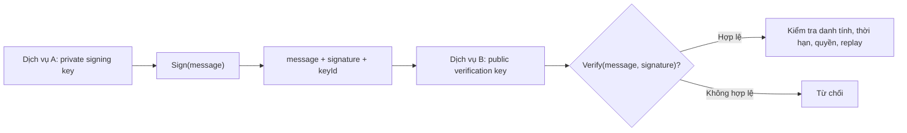
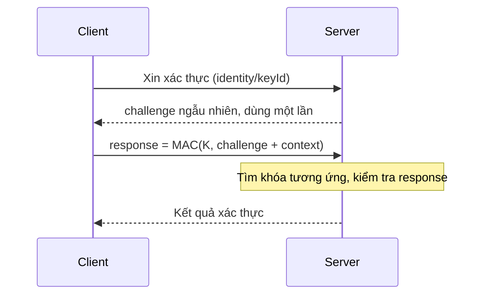
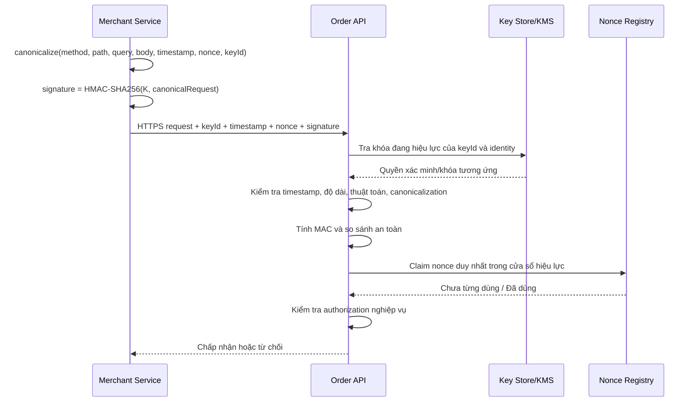
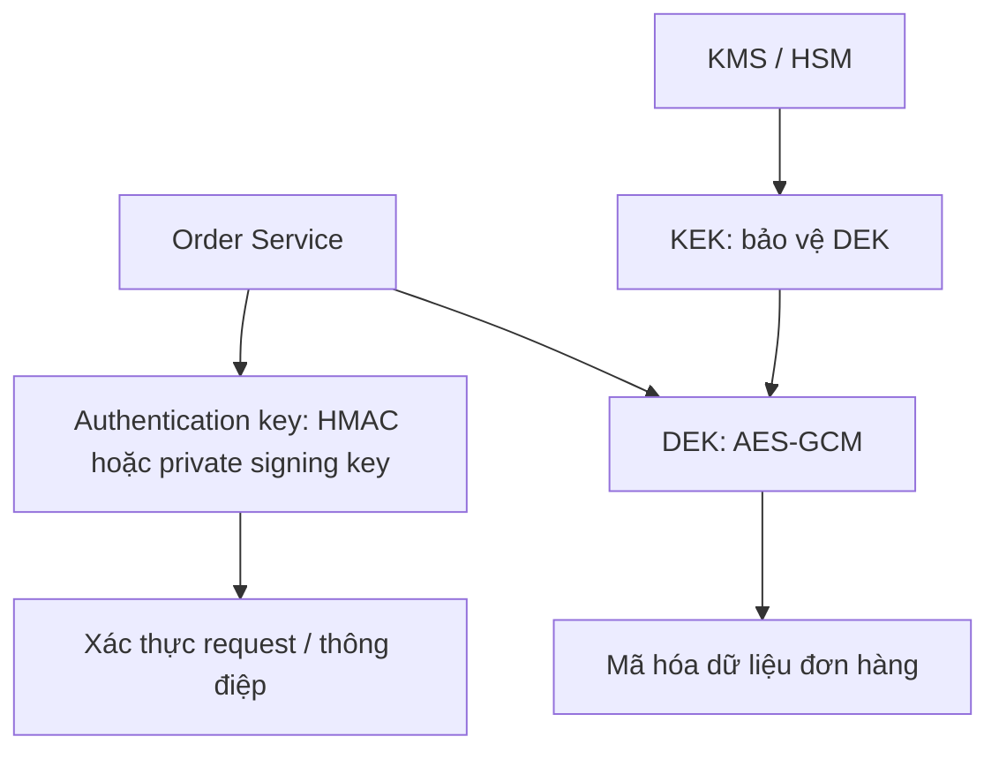

# Authentication key: Khóa dùng để xác thực

> **Chương:** Phân loại key  
> **Bài học:** Authentication key  
> **Module:** SECURITY_KEY_MANAGEMENT_FUNDAMENTALS — hiểu vòng đời khóa mật mã từ tạo, cấp phát, lưu trữ, sử dụng, xoay vòng đến thu hồi và hủy; liên hệ mật mã đối xứng, bất đối xứng, chữ ký số, KMS/HSM, envelope encryption, kiểm soát truy cập và kiểm toán.

## 1. Authentication key là gì?

**Authentication key** là khóa mật mã được sử dụng trong một cơ chế **xác thực**: tạo hoặc kiểm tra bằng chứng rằng một thông điệp xuất phát từ bên nắm khóa phù hợp, hoặc một bên đang tham gia giao thức thực sự sở hữu bí mật/khóa riêng được gắn với danh tính được kỳ vọng.

Tùy giao thức, khóa xác thực có thể là:

- **Khóa đối xứng bí mật** dùng cho HMAC hoặc một cơ chế mã xác thực thông điệp (MAC).
- **Khóa riêng bất đối xứng** dùng để tạo chữ ký số; khóa công khai tương ứng dùng để kiểm tra.
- **Khóa phiên** được dẫn xuất bởi một giao thức xác thực và thiết lập kênh bảo mật, dùng để xác thực các thông điệp sau bắt tay.
- **Khóa chuyên dụng trong KMS/HSM** phục vụ thao tác `Sign`, `Verify` hoặc `GenerateMac`/`VerifyMac`, tùy khả năng dịch vụ.

Đây là **cách phân loại theo mục đích sử dụng**; thuật ngữ “authentication key” không tự quy định một thuật toán, độ dài hay định dạng byte duy nhất. Một giao thức có thể định nghĩa chặt ý nghĩa của nó hơn.

Ví dụ: dịch vụ `payment-gateway` gửi yêu cầu có chữ ký HMAC đến `order-service`. Cả hai cùng biết một khóa HMAC bí mật. `order-service` kiểm tra MAC trước khi chấp nhận thông điệp. Nếu MAC hợp lệ, bên kiểm tra có bằng chứng rằng thông điệp do **một bên biết khóa chung** tạo ra và nội dung được MAC bảo vệ chưa bị thay đổi. Kết luận này chỉ gắn với danh tính cụ thể nếu **việc cấp phát khóa và ánh xạ khóa–danh tính** được thực hiện đúng.

### Mục tiêu bài học

Sau khi học, bạn cần có khả năng:

1. Phân biệt **entity authentication**, **message authentication**, **authorization**, **confidentiality** và **integrity**.
2. Nhận diện authentication key trong HMAC, chữ ký số, giao thức challenge–response, TLS và ký request API.
3. Phân biệt authentication key với password, API key, bearer token, encryption key và key ID.
4. Thiết kế cách tạo, cấp phát, sử dụng, xoay vòng, thu hồi, hủy và kiểm toán khóa xác thực.
5. Viết và đánh giá ví dụ Java dùng HMAC-SHA-256, có kiểm tra chữ ký an toàn và cơ chế chống phát lại ở tầng giao thức.

## 2. “Xác thực” ở đây xác thực điều gì?

Từ *authentication* có hai phạm vi thường xuất hiện trong mật mã:

| Khái niệm | Câu hỏi được trả lời | Cơ chế điển hình |
|---|---|---|
| **Entity authentication** (xác thực thực thể) | Bên đang giao tiếp có chứng minh được mình là danh tính mong đợi và đang tham gia phiên hiện tại không? | Challenge–response, chứng thư và bắt tay TLS có xác thực, chứng minh sở hữu khóa riêng. |
| **Message authentication** (xác thực thông điệp) | Thông điệp có đúng do một bên nắm khóa hợp lệ tạo ra và không bị chỉnh sửa trong phạm vi đã bảo vệ không? | HMAC, GMAC, chữ ký số, AEAD authentication tag. |
| **Authorization** (phân quyền) | Danh tính đã được xác thực có được phép thực hiện hành động này trên tài nguyên này không? | RBAC/ABAC, IAM, kiểm tra sở hữu bản ghi và policy nghiệp vụ. |
| **Confidentiality** (bí mật) | Người không có quyền có đọc được nội dung thông điệp không? | AES-GCM, ChaCha20-Poly1305, các cơ chế mã hóa thích hợp. |
| **Integrity** (toàn vẹn) | Dữ liệu có bị sửa mà không được phát hiện không? | MAC, chữ ký số, AEAD; hash đơn thuần chỉ phát hiện thay đổi khi giá trị hash đáng tin cậy. |

**Điểm quan trọng:** HMAC hợp lệ chứng minh người tạo MAC biết khóa chung, nhưng không tự chứng minh rằng người dùng cuối đã được phép chuyển tiền. Một thông điệp được ký đúng vẫn có thể là yêu cầu sai nghiệp vụ, yêu cầu bị phát lại hoặc yêu cầu mà người ký không còn quyền thực hiện.

Ví dụ:

```text
"Request có HMAC hợp lệ"          -> bằng chứng mật mã về khóa chung và nội dung
"Service A là bên giữ khóa đó"    -> phụ thuộc quy trình cấp phát khóa và ánh xạ ID
"Service A được hoàn tiền đơn X" -> cần chính sách authorization riêng
"Request này chưa từng xử lý"    -> cần nonce, timestamp/idempotency/replay guard
```

### Authentication key có phải encryption key không?

Cả hai đều là **khóa mật mã**, nhưng **mục đích khác nhau**:

- **Encryption key:** dùng mã hóa/giải mã để bảo vệ tính bí mật; với AEAD còn kiểm tra tính toàn vẹn của dữ liệu mã hóa.
- **Authentication/MAC key:** dùng tạo/kiểm tra MAC hoặc bằng chứng sở hữu khóa; không mặc nhiên mã hóa hay che giấu nội dung.
- **Signing private key:** tạo chữ ký; public key kiểm tra chữ ký. Chữ ký không tự tạo tính bí mật.
- **KEK (Key Encryption Key):** dùng bảo vệ khóa khác, ví dụ wrap DEK trong envelope encryption.

Không nên tái sử dụng cùng byte khóa cho AES, HMAC và các mục đích giao thức khác. Khi cần các khóa liên quan, sử dụng **KDF chuẩn có domain separation**, tức dẫn xuất khóa khác nhau bằng nhãn ngữ cảnh khác nhau.

## 3. Các dạng authentication key phổ biến

### 3.1. Khóa đối xứng dùng cho MAC

Với mô hình **shared secret**, hai hay nhiều bên biết cùng một khóa bí mật `K`.

```text
Bên gửi                                 Bên nhận
  K                                        K
  |                                        |
  +--> HMAC(K, message) --> tag            |
                |                          |
         message + tag ------------------> HMAC(K, message)
                                           |
                                    So sánh tag
```

Bên nhận tạo lại MAC của **chính chuỗi byte được bảo vệ** rồi so sánh với MAC nhận được. Nếu khớp, thông điệp đã được xác thực dưới khóa chung và thuật toán đã chọn.

**HMAC-SHA-256** là ví dụ thông dụng:

```text
tag = HMAC-SHA256(secretKey, canonicalMessage)
verify = constantTimeEquals(tag, receivedTag)
```

HMAC có thể bảo vệ request API, thông báo webhook, thông điệp giữa các dịch vụ, token được thiết kế có MAC và một số bước của giao thức xác thực.

Ưu điểm:

- Hiệu năng tốt, dễ triển khai trên nhiều nền tảng và có hỗ trợ trong Java/JCA.
- Không cần hạ tầng chứng thư công khai cho quá trình xác minh.
- Phù hợp với hai bên đã có kênh phân phối khóa bí mật an toàn.

Giới hạn:

- Bên kiểm tra cũng biết khóa, nên **cũng có khả năng tạo MAC hợp lệ**. Không thể từ riêng HMAC suy ra ai trong hai bên đã tạo thông điệp.
- Mọi nơi giữ bản rõ của khóa chung đều là điểm có thể lộ khóa.
- Nhiều bên cùng biết một khóa khiến khả năng quy trách nhiệm và thu hồi riêng từng bên khó khăn.
- Cần cơ chế chống phát lại và ánh xạ `keyId` với danh tính/đặc quyền.

Trong hệ thống nhiều đối tác, nên dùng **khóa riêng cho mỗi đối tác/môi trường** thay vì một HMAC key chung cho mọi khách hàng.

### 3.2. Khóa bất đối xứng dùng cho chữ ký số

Mô hình này gồm:

- **Private signing key:** khóa riêng dùng ký, phải giữ kín và kiểm soát quyền `Sign`.
- **Public verification key:** khóa công khai dùng `Verify`, có thể phân phối rộng nhưng cần xác thực đúng danh tính và phiên bản khóa.



Ví dụ thuật toán: Ed25519, ECDSA với cấu hình phù hợp hoặc RSA-PSS. Cần chọn thuật toán được hệ thống/KMS và giao thức đích hỗ trợ, đồng thời áp dụng quy tắc xác minh đúng với thuật toán đó.

**Ưu điểm:** bên xác minh có thể chỉ cần public key, không cần sở hữu bí mật có khả năng tạo chữ ký. Điều này thuận lợi khi nhiều hệ thống cùng cần xác minh.

**Giới hạn:** nếu public key không được gắn với đúng danh tính, kẻ tấn công có thể thay bằng khóa của họ rồi tự ký. Do đó, cần chứng thư/chuỗi tin cậy, key pinning hoặc cơ chế phân phối public key có xác thực. Chữ ký số giúp xác minh nguồn và tính toàn vẹn; khả năng quy trách nhiệm pháp lý hoặc *non-repudiation* còn phụ thuộc quy trình quản lý khóa, người có quyền ký và bằng chứng vận hành.

### 3.3. Authentication key cho challenge–response

Một giao thức **challenge–response** yêu cầu bên xác thực chứng minh quyền sở hữu khóa thông qua thử thách mới thay vì gửi khóa trực tiếp.



Trong biến thể chữ ký số, client dùng private key để ký challenge, server kiểm tra bằng public key đã được xác thực.

Điều kiện để cơ chế đúng:

- Challenge **khó dự đoán**, có thời hạn và không được sử dụng lại cho nhiều phiên.
- Response phải ràng buộc đúng giao thức, bên gửi/nhận và ngữ cảnh phiên nếu thiết kế yêu cầu.
- Server phải gắn key ID với danh tính, khóa/phiên bản đang hoạt động và quyền tương ứng.
- Một thông điệp response hợp lệ trong phiên A không được tự động được chấp nhận ở phiên B.

Không chỉ gửi `HMAC(K, "login")` cố định: một response tĩnh bị bắt lại có thể được phát lại để đăng nhập lần khác.

### 3.4. Khóa xác thực phiên

Một giao thức bảo mật có thể thiết lập **session/traffic keys** từ một shared secret thông qua KDF. Những khóa này bảo vệ việc xác thực tính toàn vẹn của thông điệp trong phiên, thường kết hợp với mã hóa trong AEAD.

Ví dụ TLS 1.3 có cơ chế bắt tay xác thực bên tham gia và dẫn xuất các khóa traffic; các khóa được sử dụng theo mục đích và chiều truyền nhất định. Không được coi một giá trị `TLS session key` là khóa HMAC tĩnh có thể tái sử dụng tùy ý ngoài giao thức.

## 4. Khác biệt giữa authentication key, password, API key và token

Trong tên biến hoặc sản phẩm, “authentication key” đôi khi được dùng lỏng để chỉ bất kỳ thứ gì giúp đăng nhập. Về mặt kỹ thuật, cần tách:

| Đối tượng | Thực chất | Bên kiểm tra thường làm gì? | Rủi ro chính |
|---|---|---|---|
| **HMAC authentication key** | Khóa đối xứng bí mật dùng tạo/xác minh MAC. | Tính và kiểm tra MAC của message. | Lộ khóa cho phép tạo MAC giả. |
| **Private signing key** | Khóa riêng bất đối xứng. | Kiểm tra chữ ký bằng public key. | Lộ khóa riêng cho phép ký giả. |
| **Password** | Bí mật thường do con người chọn, entropy có thể thấp. | Kiểm tra qua cơ chế xác thực mật khẩu thích hợp. | Phishing, dùng lại, đoán ngoại tuyến. |
| **API key** | Thường là chuỗi bí mật dùng làm credential của ứng dụng/đối tác. | Tra cứu/đối chiếu giá trị hoặc bằng chứng tương ứng. | Bị đánh cắp có thể dùng ngay như credential. |
| **Bearer token** | Quyền truy cập dựa trên việc **sở hữu token**. | Kiểm tra token, phạm vi, hạn và chính sách. | Ai giữ token có thể dùng trong phạm vi được cấp. |
| **Key ID / alias** | Định danh khóa. | Tìm khóa hoặc phiên bản cần dùng. | Tráo định danh nếu ánh xạ/kiểm tra yếu; bản thân ID không phải secret. |
| **Public verification key** | Khóa công khai dùng kiểm tra chữ ký. | Xác minh chữ ký và danh tính sở hữu khóa. | Tráo public key, ánh xạ sai bên ký. |

Ví dụ hai API cùng mang header `X-API-Key` có thể khác nhau hoàn toàn:

- API A gửi chuỗi bí mật `X-API-Key: <credential>`; ai biết giá trị đó có thể dùng nó (tương tự bearer credential).
- API B gửi `X-Key-Id`, timestamp, nonce và `X-Signature` là HMAC của request; bên nhận xác thực **bằng chứng sở hữu khóa** mà không cần gửi raw HMAC key qua từng request.

Cả hai cần TLS, kiểm soát quyền, thời hạn và cơ chế thu hồi. Phương án ký request còn cần chống replay, canonicalization nhất quán và gắn đúng ngữ cảnh.

**JWT/JWS cũng là ví dụ cần phân biệt:** một JWS có thể dùng HMAC (`HS256`) hoặc chữ ký bất đối xứng (`RS256`, `ES256`, `EdDSA` tùy hỗ trợ). Tên thuật toán trong header không được tự quyết định thuật toán tin cậy; verifier phải chốt thuật toán và key được phép theo cấu hình đáng tin cậy. Không chấp nhận chuyển từ asymmetric signing sang HMAC bằng cùng vật liệu public key vì dễ dẫn tới lỗi nhầm thuật toán.

## 5. Các thuộc tính bảo mật cần thiết của authentication key

Một authentication key tốt không chỉ là chuỗi byte đủ dài.

### 5.1. Bí mật và entropy

Với khóa HMAC bí mật:

- Sinh bằng **CSPRNG** hoặc API của KMS/HSM; không dùng timestamp, `Math.random()`, chuỗi dễ đoán hoặc mật khẩu làm khóa trực tiếp.
- Chọn độ dài phù hợp chính sách và thuật toán; HMAC-SHA-256 với khóa ngẫu nhiên 256 bit là lựa chọn thường gặp.
- Bảo vệ bản rõ trong lưu trữ, phân phối và bộ nhớ khi dùng.
- Hạn chế số nơi giữ khóa; một đối tác hoặc workload nên có khóa và quyền độc lập khi cần cách ly.

Với khóa riêng chữ ký số: phải được tạo bằng thuật toán đúng chuẩn và lưu trong vùng bảo vệ thích hợp; khóa công khai không cần giấu nhưng **cần xác thực nguồn**.

### 5.2. Tách mục đích sử dụng (*key separation*)

Không dùng một khóa cho nhiều vai trò chỉ vì đều có tên `secretKey`.

```text
Không nên:
  sharedSecret -> HMAC request API
               -> AES dữ liệu khách hàng
               -> ký token admin
               -> bảo vệ backup

Nên:
  KDF(nguyên liệu gốc, "orders/request-mac/v1") -> K_request_mac
  KDF(nguyên liệu gốc, "orders/data-enc/v1")    -> K_data_enc
  KDF(nguyên liệu gốc, "orders/token-mac/v1")   -> K_token_mac
```

Sơ đồ chỉ minh họa **domain separation**. Dẫn xuất thực tế phải theo KDF được chuẩn hóa như HKDF khi đầu vào phù hợp. Nếu mỗi khóa có thể sinh độc lập từ CSPRNG/KMS thì không bắt buộc tạo chung một gốc.

### 5.3. Gắn khóa với danh tính và quyền

Cần biết chính xác:

- `keyId` thuộc tổ chức, đối tác, tenant, môi trường và dịch vụ nào?
- Khóa được dùng cho thuật toán và mục đích gì?
- Ai có quyền tạo MAC, ai có quyền xác minh, ai có quyền rotate/revoke?
- Có thể dùng khóa `staging` để ký request tới `production` không?
- Public key có được xác thực đúng chủ sở hữu không?
- Khi quyền của người dùng/đối tác bị thu hồi, những request ký trước đó còn hiệu lực trong bao lâu?

Nếu nhiều người cùng dùng một symmetric key, MAC không chứng minh được **cá nhân cụ thể** đã ký. Muốn quy trách nhiệm ở mức cá nhân cần kiến trúc định danh, khóa riêng, kiểm toán hoặc biện pháp bổ sung phù hợp.

### 5.4. Giới hạn thời gian và chống phát lại

Chữ ký/MAC đúng chỉ nói về nội dung **đã được bảo vệ**, không tự nói đó là một request **mới**.

Một request API thường nên gắn:

- `timestamp` theo UTC và một cửa sổ thời gian được phép.
- `nonce` ngẫu nhiên hoặc request ID duy nhất, có bộ nhớ trạng thái nhận diện đã dùng.
- HTTP method, đường dẫn, query, body hash, một số header cần ràng buộc.
- Định danh người gửi và đối tượng nhận, key ID, phiên bản giao thức.
- Giới hạn phạm vi sử dụng, ví dụ tenant, endpoint, mục đích.

Cần có **kho lưu nonce đã chấp nhận** dùng chung giữa các instance nếu dịch vụ xử lý phân tán. Timestamp **không thay thế** lưu nonce trong cửa sổ cho phép; một request có timestamp hợp lệ vẫn có thể bị phát lại nhiều lần. Với nghiệp vụ thanh toán, dùng thêm **idempotency key** và kiểm tra trạng thái giao dịch ở tầng nghiệp vụ.

## 6. Thiết kế giao thức HMAC cho request API

Giả sử `merchant-service` gửi lệnh cập nhật đơn sang `order-service`. Hai bên chia sẻ khóa HMAC 256 bit riêng cho merchant và môi trường sản xuất.

### 6.1. Luồng tổng thể



**Lưu ý về khóa:** Nếu `order-service` tự tính HMAC, nó cần truy cập raw HMAC key trong ranh giới ứng dụng, hoặc một API KMS/HSM hỗ trợ `GenerateMac`/`VerifyMac`. Nếu dùng dịch vụ hỗ trợ `VerifyMac`, bên xác minh có thể yêu cầu kiểm tra mà không nhận raw key. Cơ chế cụ thể phụ thuộc nhà cung cấp.

### 6.2. Những trường cần ký

Ví dụ thông điệp chuẩn hóa có dạng logic:

```text
protocolVersion = "request-hmac-v1"
keyId           = "merchant-42-v3"
timestamp       = 1730000000
nonce           = "<random-unique-value>"
method          = "POST"
path            = "/v1/orders/1024/confirm"
query           = ""
bodyDigest      = SHA-256(exactBodyBytes)
```

Một định dạng chuẩn hóa cần **không nhập nhằng**. Có thể dùng field có độ dài tiền tố, định dạng binary có version, hoặc định dạng văn bản với quy tắc escape/encoding được hai bên thống nhất.

**Không ký bằng phép nối tùy tiện** như `method + path + body` vì các trường có thể nhập nhằng, bị khác nhau sau Unicode normalization, URL decoding, sắp xếp query, thêm header hoặc chuyển đổi JSON.

Đặc biệt chú ý:

1. Thống nhất canonicalization cho method, authority/host nếu cần, đường dẫn, query và header.
2. Ký hash của **chính body bytes mà server xử lý**; các proxy/middleware không được âm thầm làm khác đi ý nghĩa request.
3. Chỉ tin những trường đã được xác thực; không cho client tự khai `role=admin` rồi coi đó là quyền hợp lệ.
4. Dùng key ID làm chỉ mục **có kiểm soát**, không cho nó dẫn tới một khóa không thuộc danh tính được xác thực.
5. Trả lỗi chung khi xác minh thất bại, tránh tiết lộ khóa nào tồn tại hoặc tiết lộ chi tiết MAC.

### 6.3. Chống phát lại và xử lý đồng thời

Một cơ chế chặn replay cơ bản:

```text
verify HMAC + thời hạn
      |
      v
claim(keyId, nonce) tại kho trạng thái dùng chung
      |
      +-- chưa tồn tại -> ghi nguyên tử với TTL -> tiếp tục authorization
      |
      +-- đã tồn tại  -> từ chối replay
```

Thao tác `claim` phải **nguyên tử** giữa các instance. Nếu chỉ `GET` rồi `SET` tách rời, hai request đồng thời có thể vượt qua. TTL phải bao phủ cửa sổ timestamp cho phép cùng sai lệch đồng hồ hợp lý; chính sách xử lý yêu cầu được gửi lại do lỗi mạng cần được thiết kế với idempotency thay vì đơn giản cho qua nonce trùng.

Chỉ lưu nonce sau khi MAC hợp lệ giúp tránh bị một bên không biết khóa chiếm trước nonce ngẫu nhiên; tuy nhiên vẫn cần rate limit các request có MAC sai và giới hạn bộ nhớ/kho nonce.

## 7. Ví dụ Java 17: tạo và kiểm tra HMAC-SHA-256

Ví dụ sau dùng JCA có sẵn của Java 17. Nó minh họa tạo khóa bí mật, chuẩn hóa các trường bằng **độ dài tiền tố**, tính HMAC, so sánh MAC an toàn, kiểm tra thời gian và gọi bộ lưu nonce. Đây là thành phần minh họa; các lớp lưu khóa, HTTP, authorization và triển khai `NonceStore` phân tán phải được xây dựng riêng cho hệ thống thật.

```java
import java.io.ByteArrayOutputStream;
import java.io.DataOutputStream;
import java.io.IOException;
import java.nio.charset.StandardCharsets;
import java.security.MessageDigest;
import java.security.SecureRandom;
import java.time.Instant;
import java.util.Base64;

import javax.crypto.KeyGenerator;
import javax.crypto.Mac;
import javax.crypto.SecretKey;
import javax.crypto.spec.SecretKeySpec;

public final class HmacRequestAuth {
    private static final long MAX_SKEW_SECONDS = 300;
    private static final SecureRandom RANDOM = new SecureRandom();

    public record SignedRequest(
            String keyId,
            String method,
            String pathAndQuery,
            byte[] body,
            long timestampSeconds,
            byte[] nonce,
            byte[] tag) {}

    // Production: triển khai atomic claim bằng kho chia sẻ với TTL.
    public interface NonceStore {
        boolean claimOnce(String keyId, String nonceBase64, long ttlSeconds);
    }

    private HmacRequestAuth() {}

    public static SecretKey newHmacKey() throws Exception {
        KeyGenerator generator = KeyGenerator.getInstance("HmacSHA256");
        generator.init(256);
        return generator.generateKey();
    }

    public static SignedRequest sign(
            String keyId,
            String method,
            String pathAndQuery,
            byte[] body,
            SecretKey key) throws Exception {
        long now = Instant.now().getEpochSecond();
        byte[] nonce = new byte[16];
        RANDOM.nextBytes(nonce);

        byte[] canonical = encode(
                keyId, method, pathAndQuery, body, now, nonce);
        byte[] tag = hmac(key, canonical);
        return new SignedRequest(
                keyId, method, pathAndQuery,
                body.clone(), now, nonce, tag);
    }

    public static boolean verify(
            SignedRequest request,
            SecretKey expectedKey,
            String expectedKeyId,
            NonceStore nonceStore) throws Exception {
        if (!expectedKeyId.equals(request.keyId())) {
            return false;
        }
        if (request.nonce().length != 16 || request.tag().length != 32) {
            return false;
        }

        long now = Instant.now().getEpochSecond();
        if (request.timestampSeconds() < now - MAX_SKEW_SECONDS
                || request.timestampSeconds() > now + MAX_SKEW_SECONDS) {
            return false;
        }

        byte[] canonical = encode(
                request.keyId(),
                request.method(),
                request.pathAndQuery(),
                request.body(),
                request.timestampSeconds(),
                request.nonce());
        byte[] expectedTag = hmac(expectedKey, canonical);

        // So sánh byte của MAC mà không dùng String.equals hay Arrays.equals.
        if (!MessageDigest.isEqual(expectedTag, request.tag())) {
            return false;
        }

        String nonceBase64 =
                Base64.getEncoder().encodeToString(request.nonce());
        // Claim atomic, chia sẻ giữa instance, TTL bao phủ cửa sổ thời gian.
        return nonceStore.claimOnce(
                expectedKeyId, nonceBase64, 2 * MAX_SKEW_SECONDS + 60);
    }

    private static byte[] hmac(SecretKey key, byte[] input)
            throws Exception {
        Mac mac = Mac.getInstance("HmacSHA256");
        mac.init(key);
        return mac.doFinal(input);
    }

    private static byte[] encode(
            String keyId,
            String method,
            String pathAndQuery,
            byte[] body,
            long timestampSeconds,
            byte[] nonce) throws IOException {
        // DataOutputStream ghi độ dài byte + dữ liệu: không nhập nhằng.
        ByteArrayOutputStream bytes = new ByteArrayOutputStream();
        DataOutputStream out = new DataOutputStream(bytes);
        writeField(out, "hmac-request-v1".getBytes(StandardCharsets.UTF_8));
        writeField(out, keyId.getBytes(StandardCharsets.UTF_8));
        writeField(out, method.getBytes(StandardCharsets.UTF_8));
        writeField(out, pathAndQuery.getBytes(StandardCharsets.UTF_8));
        writeField(out, body);
        out.writeLong(timestampSeconds);
        writeField(out, nonce);
        out.flush();
        return bytes.toByteArray();
    }

    private static void writeField(DataOutputStream out, byte[] value)
            throws IOException {
        out.writeInt(value.length);
        out.write(value);
    }
}
```

### Cách sử dụng và đọc đúng ví dụ

Ở phía client:

```java
SecretKey key = HmacRequestAuth.newHmacKey(); // demo tạo khóa
HmacRequestAuth.SignedRequest request = HmacRequestAuth.sign(
        "merchant-42-v3",
        "POST",
        "/v1/orders/1024/confirm",
        "{\"confirm\":true}".getBytes(java.nio.charset.StandardCharsets.UTF_8),
        key
);
// Trên thực tế chỉ truyền keyId, timestamp, nonce, tag và request.
// KHÔNG gửi key cùng request.
```

Ở phía server, `expectedKey` là khóa được tìm từ **kho khóa tin cậy** thông qua `keyId` đã xác thực và trạng thái khóa; `nonceStore` là thành phần hỗ trợ claim nguyên tử. Ví dụ không cung cấp `NonceStore` cụ thể để tránh gây hiểu nhầm rằng map trong bộ nhớ một JVM đủ chống replay cho hệ thống nhiều instance.

**Các giới hạn cố ý của ví dụ:**

- `pathAndQuery` phải được chuẩn hóa bằng quy tắc HTTP mà hai bên đã thống nhất; đoạn mã không triển khai đầy đủ canonicalization cho URL/proxy.
- `request.body()` là mảng byte đã được giao cho code; thành phần HTTP phải bảo đảm chính các byte này được xử lý. Cần có giới hạn kích thước request để tránh cạn tài nguyên.
- `keyId`, thuật toán và quan hệ `merchant → quyền` phải được lấy từ cấu hình tin cậy; mã kiểm tra chỉ so `keyId` mong đợi.
- Đồng hồ hai bên phải được đồng bộ và thời gian lệch cho phép được đánh giá theo yêu cầu vận hành.
- `MessageDigest.isEqual` là lựa chọn phù hợp để giảm rủi ro so sánh MAC theo thời gian; không nên tự viết phép so sánh trả về ngay khi gặp byte khác.
- `verify()` thành công **không tự thực hiện authorization** và **không giải quyết idempotency** của thao tác tài chính.
- Khóa do `newHmacKey()` sinh trong ví dụ chỉ tồn tại trong tiến trình; triển khai thực tế dùng KMS/HSM hoặc kho khóa được bảo vệ, có rotation và phân quyền.

### Một số mẫu sai nên nhận ra

```java
// Sai: SHA-256(key || message) tự chế không thay HMAC.
byte[] naive = java.security.MessageDigest.getInstance("SHA-256")
        .digest(("secret" + "message").getBytes(
                java.nio.charset.StandardCharsets.UTF_8));

// Sai: so sánh chuỗi chữ ký theo String.equals dễ lộ timing.
boolean incorrectComparison = "receivedMac".equals("expectedMac");

// Sai: chỉ MAC body mà không bảo vệ method, path, thời gian và ngữ cảnh.
// POST /payments/refund và POST /payments/preview có thể dùng cùng body.
```

Cần chọn **cấu trúc thông điệp được ký** trước khi chọn thư viện tạo MAC. Thư viện mật mã đúng không cứu được giao thức ký thiếu trường quan trọng.

## 8. Ví dụ Java 17: khóa riêng để ký, khóa công khai để xác minh

Java 17 hỗ trợ Ed25519 qua các API JCA chuẩn. Ví dụ này tạo cặp khóa trong tiến trình **để minh họa**, ký một thông điệp và xác minh bằng public key.

```java
import java.nio.charset.StandardCharsets;
import java.security.KeyPair;
import java.security.KeyPairGenerator;
import java.security.Signature;

public class Ed25519AuthenticationDemo {
    public static void main(String[] args) throws Exception {
        KeyPairGenerator generator = KeyPairGenerator.getInstance("Ed25519");
        KeyPair pair = generator.generateKeyPair();

        byte[] message = "orderId=1024;action=confirm"
                .getBytes(StandardCharsets.UTF_8);

        Signature signer = Signature.getInstance("Ed25519");
        signer.initSign(pair.getPrivate());
        signer.update(message);
        byte[] signature = signer.sign();

        Signature verifier = Signature.getInstance("Ed25519");
        verifier.initVerify(pair.getPublic());
        verifier.update(message);
        boolean valid = verifier.verify(signature);

        System.out.println("Signature valid: " + valid);
    }
}
```

Khác biệt so với HMAC:

- Bên ký phải kiểm soát **private key**; bên xác minh chỉ cần **public key đúng nguồn**.
- Không dùng public key để tạo chữ ký hợp lệ.
- Có thể phân phối public key cho nhiều dịch vụ xác minh mà không mở rộng số nơi giữ bí mật ký.
- Khi dùng KMS/HSM thực tế, private key có thể **không cho xuất**, và dịch vụ chỉ gọi `Sign` theo chính sách.
- Cần kiểm tra phiên bản public key, hạn hiệu lực, chính sách thu hồi và tính đúng đắn của thông điệp được ký.

Ví dụ chưa có chứng thư, PKI, `keyId`, timestamp, nonce hay kiểm soát quyền ký. Nó **không phải** giao thức xác thực API sản xuất hoàn chỉnh.

## 9. Authentication key trong hệ thống TLS, JWT và chữ ký API

### 9.1. TLS và mTLS

Khi một client kết nối HTTPS, server thường dùng khóa riêng gắn với chứng thư để tham gia chứng minh danh tính trong bắt tay TLS theo bộ thuật toán được hỗ trợ. Client kiểm tra chứng thư, tên máy chủ và chuỗi tin cậy.

Với **mutual TLS (mTLS)**, client cũng trình chứng thư và chứng minh sở hữu khóa riêng phù hợp; server xác minh danh tính phía client. Sau đó, ứng dụng vẫn cần ánh xạ chứng thư với quyền nghiệp vụ.

Không dùng trực tiếp TLS private key làm khóa HMAC cho webhook hoặc JWT: mục đích và vòng đời khác nhau. Dù mTLS thành công, cần giới hạn endpoint và dữ liệu mà danh tính certificate được phép truy cập.

### 9.2. JWT/JWS

Một token tự chứa có chữ ký hoặc MAC cần có:

- `iss`, `aud`, thời hạn `exp`, điều kiện `nbf` nếu cần, và các claim phù hợp.
- Thuật toán và khóa xác minh **được cố định theo cấu hình tin cậy**.
- Kiểm tra mọi trường ảnh hưởng quyết định authorization; không tin claim chỉ vì đã parse được JSON.
- Cơ chế khóa theo `kid` có danh sách cho phép, phiên bản và thu hồi; không tin URL hoặc key do token tự chỉ định nếu không có chính sách kiểm soát.

Một JWT được ký hợp lệ có thể vẫn bị phát lại cho tới khi hết hạn. Với thao tác nhạy cảm cần cân nhắc thời hạn ngắn, xác thực phiên, ràng buộc token hoặc cơ chế thu hồi phù hợp.

### 9.3. Request signing/webhook

Nhiều nền tảng ký payload webhook bằng HMAC. Những điểm thiết kế thường sai:

- Xác thực trên JSON đã parse/serialize lại thay vì byte gốc được định nghĩa trong giao thức.
- Không kiểm tra timestamp hoặc replay.
- Không ràng buộc event ID, endpoint hoặc bên gửi khi giao thức yêu cầu.
- Dùng một secret webhook cho mọi môi trường/đối tác.
- Cho rằng webhook hợp lệ được phép thực thi mọi thay đổi nghiệp vụ.

Nên xác minh chính xác **chuỗi byte mà nhà cung cấp quy định được ký**, kiểm tra nguồn/khóa, rồi mới đánh giá tính hợp lệ của event theo trạng thái nghiệp vụ.

## 10. KMS/HSM hỗ trợ khóa xác thực như thế nào?

KMS/HSM có thể bảo vệ authentication keys bằng cơ chế vận hành và hạn chế quyền sử dụng.

| Cơ chế | Vai trò với authentication key | Điểm cần kiểm tra |
|---|---|---|
| **Generate/Import key** | Tạo hoặc nhập khóa HMAC/khóa ký với thuật toán và nguồn ngẫu nhiên được kiểm soát. | Khả năng hỗ trợ thuật toán, nhập khóa, loại khóa không xuất được. |
| **Sign/Verify** | Dùng private key được bảo vệ để ký; xác minh bằng public key hoặc API tương ứng. | Quyền `Sign` riêng; nội dung hoặc digest được ký theo API. |
| **GenerateMac/VerifyMac** | Tính hoặc kiểm tra MAC bằng khóa trong KMS khi nền tảng hỗ trợ. | API và thuật toán được hỗ trợ; hạn chế request size/quota/latency. |
| **Policy/IAM/grant** | Xác định danh tính nào có thể ký/tạo MAC/xác minh hoặc quản trị khóa. | Phân tách quyền sử dụng với quyền sửa policy/disable/delete. |
| **Key rotation/version** | Đưa khóa mới vào dùng, vẫn xác minh request/token cũ trong khoảng chuyển tiếp có kiểm soát. | Lưu key ID/version; quy tắc dừng chấp nhận phiên bản cũ. |
| **Audit/monitoring** | Ghi ai yêu cầu ký/xác minh, khóa nào và kết quả ra sao. | Không log plaintext secret hoặc dữ liệu nhạy cảm. |

Không phải KMS nào cũng hỗ trợ HMAC, Ed25519 hoặc mọi API được nêu. Cần xác minh theo nhà cung cấp và loại khóa cụ thể. Một HSM cung cấp ranh giới bảo mật cho khóa nhưng không tự biết nghiệp vụ “hoàn tiền này có hợp lệ hay không”.

**Rủi ro quan trọng:** ngay cả khi raw private key không thể xuất khỏi HSM, dịch vụ bị chiếm quyền có `Sign` rộng vẫn có thể yêu cầu HSM ký thông điệp độc hại. Phải quản lý **quyền thực hiện phép toán** và điều kiện nội dung ngoài việc bảo vệ byte khóa.

### Authentication key khác KEK/DEK trong envelope encryption

Một thiết kế có thể dùng đồng thời:



Khóa xác thực bảo vệ nguồn gốc/tính toàn vẹn của thông điệp hoặc quyền sở hữu khóa, trong khi DEK bảo vệ dữ liệu lưu trữ và KEK bảo vệ DEK. Chúng có thể cùng tồn tại trong KMS nhưng cần chính sách, quyền và vòng đời riêng.

## 11. Vòng đời của authentication key

### 11.1. Tạo khóa

Xác định **mục đích** trước khi tạo:

- HMAC-SHA-256 để xác thực webhook.
- Ed25519 hoặc thuật toán chữ ký được hỗ trợ để ký sự kiện.
- Khóa chứng thư mTLS để xác thực workload.
- Khóa phiên được dẫn xuất trong giao thức, không phải khóa HMAC tĩnh.

Dùng CSPRNG/KMS/HSM, chọn thông số bảo mật phù hợp, lưu metadata như owner, `keyId`, thuật toán, môi trường, ngày tạo và trạng thái. Không lấy token/chuỗi bí mật đang dùng cho việc khác để tái sử dụng làm authentication key.

### 11.2. Cấp phát và kích hoạt

Với shared HMAC key, **cả bên gửi và bên nhận** cần biết cùng bí mật hoặc bên nhận có cơ chế xác minh MAC an toàn qua KMS/HSM. Cấp phát qua kênh đã được xác thực và bảo mật; không gửi secret qua email, ticket, chat hoặc commit vào Git.

Với asymmetric key, cấp **private key** cho hệ thống có nhiệm vụ ký; cấp **public key đã xác thực** cho bên xác minh. Chỉ public key không đủ nếu không biết nó thuộc danh tính nào.

Nếu nền tảng dùng role/workload identity, ưu tiên credential ngắn hạn để gọi KMS. Việc cấp quyền `Sign` không nên kéo theo quyền tạo, xóa hoặc sửa chính sách của mọi khóa.

### 11.3. Sử dụng

Khi tạo MAC/chữ ký:

1. Xác định đúng giao thức, thuật toán và `keyId`.
2. Chuẩn hóa chính xác byte đầu vào.
3. Ràng buộc dữ liệu quan trọng: phương thức, đường dẫn, ngữ cảnh, timestamp, nonce, payload.
4. Tính MAC/ký bằng khóa đang hoạt động và đúng quyền.
5. Không ghi raw key, private key hoặc secret vào log.

Khi xác minh:

1. Giới hạn kích thước/định dạng và kiểm tra dữ liệu đầu vào.
2. Lấy khóa **qua ánh xạ key ID đáng tin cậy**.
3. Kiểm tra tính hợp lệ của thuật toán/khóa và trạng thái.
4. Kiểm tra MAC/chữ ký theo đặc tả; so sánh MAC theo cách hạn chế timing leak.
5. Kiểm tra timestamp, nonce, audience, quyền và trạng thái nghiệp vụ.
6. Chỉ thực hiện hành động sau khi tất cả điều kiện đều đạt.

### 11.4. Xoay vòng và hết hạn

Với symmetric key, hai phía phải phối hợp thời điểm chuyển. Một kế hoạch đơn giản:

```text
T0: K1 đang ký và xác minh
T1: Phát hành K2; server chấp nhận K1 và K2
T2: Client chuyển sang ký bằng K2
T3: Sau thời gian chuyển tiếp, server dừng chấp nhận K1
T4: Thu hồi/hủy K1 theo quy trình, xem xét bản sao và backup
```

Lưu `keyId`/phiên bản trong request được ký để verifier chọn đúng khóa. Giai đoạn chấp nhận hai khóa cần **giới hạn thời gian**, gắn với thời gian tồn tại tối đa của request/token và chính sách an ninh; không để phiên bản cũ được chấp nhận mãi mãi.

Với asymmetric key, signer chuyển sang private key mới, verifier cần public key mới và vẫn có thể tạm chấp nhận public key cũ trong thời gian hợp lệ. Phải xử lý cache JWKS/certificate và token/request đã phát hành.

### 11.5. Thu hồi, vô hiệu hóa, hủy

| Hành động | Mục đích | Giới hạn cần nhớ |
|---|---|---|
| **Revoke access** | Chặn danh tính gọi API `Sign`/`GenerateMac` hoặc lấy bí mật mới. | Không lấy lại secret đã bị sao chép hoặc token đã phát hành. |
| **Disable key** | KMS/HSM từ chối thao tác với khóa theo trạng thái. | Verifier đang giữ public key/secret cache vẫn có thể chấp nhận chữ ký cũ nếu chính sách chưa cập nhật. |
| **Dừng xác minh key ID** | Verifier từ chối chữ ký/MAC mới/cũ từ khóa đó theo chính sách. | Có thể làm các thông điệp đã phát hành trước đó mất hiệu lực; cần đánh giá nghiệp vụ. |
| **Destroy key** | Xóa vật liệu bí mật theo quy trình. | Có thể làm mất khả năng tạo MAC/ký mới; tác động xác minh dữ liệu cũ phụ thuộc loại khóa và lưu giữ public key/khóa xác minh. |

**Khác biệt quan trọng:** hủy private signing key không nhất thiết làm mất khả năng **xác minh chữ ký cũ**, vì public key vẫn có thể được lưu phục vụ kiểm toán. Ngược lại, hủy khóa HMAC có thể làm mất khả năng xác minh MAC cũ nếu không còn khóa hoặc bản sao hợp lệ. Bảo quản chứng cứ phải thiết kế riêng, cân nhắc thời hạn lưu và nghĩa vụ bảo vệ khóa.

## 12. Phân quyền, kiểm toán và rủi ro vận hành

### 12.1. Phân quyền theo nhiệm vụ

| Vai trò | Quyền nên có | Quyền nên tránh |
|---|---|---|
| Service tạo webhook | Tạo MAC bằng đúng khóa webhook của mình. | Sửa key policy, ký thay tenant khác. |
| Service nhận webhook | Verify MAC đúng khóa nguồn hoặc gọi API VerifyMac. | Truy cập mọi khóa của các đối tác không liên quan. |
| Service ký sự kiện | `Sign` với một private key được chỉ định. | Xuất private key, đổi policy, xóa khóa. |
| Service xác minh sự kiện | Đọc public key đáng tin cậy/Verify. | Quyền `Sign` nếu không cần. |
| Key administrator | Tạo/rotate/revoke theo quy trình. | Quyền thực hiện nghiệp vụ được xác thực bằng khóa. |
| Security auditor | Xem metadata, sự kiện và policy. | Đọc raw secret hoặc sửa audit log. |

Ngoài IAM tại KMS/HSM, vẫn phải có authorization ở API: một chữ ký hợp lệ không thay thế kiểm tra quyền truy cập tenant, đối tượng và trạng thái giao dịch.

### 12.2. Cần ghi log những gì?

Nên ghi:

- `keyId`, loại thao tác (`Sign`, `Verify`, `GenerateMac`, `VerifyMac`).
- Danh tính workload/người gọi, môi trường và thời gian.
- Kết quả cho phép/từ chối, mã nguyên nhân ở mức phù hợp.
- Correlation ID, sự kiện rotation/revocation và thay đổi policy.
- Số lượng thao tác bất thường, thất bại liên tiếp hoặc khóa cũ vẫn được dùng sau hạn chuyển tiếp.

Không ghi raw HMAC key, private key, shared secret, bearer token, payload nhạy cảm hoặc chữ ký kèm toàn bộ dữ liệu nhạy cảm nếu không cần. Audit log cần bảo vệ trước sửa/xóa và có thời hạn lưu theo yêu cầu vận hành.

### 12.3. Bốn tình huống sự cố

**Tình huống A — lộ HMAC key của merchant.** Kẻ tấn công có thể tạo MAC hợp lệ. Cần vô hiệu hóa khóa, cấp khóa mới, dừng chấp nhận phiên bản cũ và truy lại những request ký bất thường trong khoảng phơi lộ.

**Tình huống B — bị chiếm quyền service có quyền Sign trong HSM.** Không nhất thiết lộ private key, nhưng kẻ tấn công vẫn có thể yêu cầu chữ ký hợp lệ. Cần thu hồi danh tính/quyền, kiểm tra log ký và các thông điệp đã tạo; tùy mức độ sự cố, cân nhắc rotation và thông báo bên xác minh.

**Tình huống C — public key bị tráo.** Verifier có thể chấp nhận chữ ký giả nếu lấy public key từ nguồn không đáng tin. Cần bảo vệ kênh phân phối public key, ràng buộc danh tính và kiểm tra chuỗi tin cậy/pinning nếu phù hợp.

**Tình huống D — request có MAC hợp lệ bị phát lại.** MAC không đổi nên vẫn hợp lệ. Cần timestamp, nonce store dùng chung, hạn hiệu lực, idempotency và xác nhận trạng thái nghiệp vụ.

## 13. Ví dụ thiết kế: xác thực giao tiếp giữa Order Service và Payment Service

Một hệ thống Java có `order-service` và `payment-service`, cần đảm bảo yêu cầu xác nhận thanh toán đến đúng từ payment service và không bị thay đổi.

**Giả thiết:** hai dịch vụ có danh tính workload riêng; KMS/HSM hỗ trợ bảo vệ authentication key phù hợp; các API trao đổi qua TLS.

### Lựa chọn A — HMAC riêng theo cặp dịch vụ

- Tạo HMAC key riêng cho `payment-prod -> orders-prod`, không dùng chung với staging hoặc dịch vụ khác.
- Payment service dùng key để ký thông điệp chuẩn hóa.
- Order service kiểm tra `keyId`, timestamp, nonce, MAC, sau đó kiểm tra quyền và trạng thái đơn.
- Kế hoạch rotation phải xử lý đồng thời hai bên và các request chưa xử lý.
- Nếu key bị lộ ở một trong hai phía, cả hai đều bị ảnh hưởng bởi vì giữ cùng secret.

### Lựa chọn B — chữ ký bất đối xứng

- Payment service giữ private signing key trong KMS/HSM và chỉ được phép `Sign`.
- Order service giữ public verification key đúng nguồn và `keyId`/phiên bản tin cậy.
- Không cần đưa private signing key cho order service.
- Cần cơ chế phân phối public key tin cậy và xử lý rotation/caching.
- Xác minh chữ ký vẫn phải đi kèm chống replay và authorization.

| Tiêu chí | HMAC | Chữ ký bất đối xứng |
|---|---|---|
| Bí mật cần chia sẻ với bên xác minh | Có, trừ khi bên nhận gọi dịch vụ VerifyMac mà không lấy raw key. | Không; public key dùng xác minh. |
| Ai có thể tạo bằng chứng hợp lệ? | Bất kỳ bên nào có shared secret. | Bên có quyền sử dụng private key. |
| Hiệu năng | Thường rất nhanh. | Thường tốn chi phí phép toán hơn; phụ thuộc thuật toán/hạ tầng. |
| Phân phối cho nhiều verifier | Khó hơn vì có thêm nơi giữ secret. | Thuận lợi hơn vì public key không bí mật. |
| Quản lý khóa | Đồng bộ key giữa các phía. | Bảo vệ private key; quản lý niềm tin và phiên bản public key. |
| Phù hợp khi | Số bên chia sẻ bí mật ít, quan hệ tin cậy rõ ràng. | Nhiều bên cần xác minh mà không nên được cấp khả năng ký. |

Hai lựa chọn đều cần bảo vệ TLS, chuẩn hóa thông điệp đúng, giảm quyền, giám sát và quy trình thu hồi. Không có lựa chọn nào tự giải quyết kiểm tra quyền hoàn tiền hoặc chống xử lý lặp.

## 14. Những lỗi thiết kế thường gặp

| Sai lầm | Hệ quả | Hướng xử lý |
|---|---|---|
| Dùng password/`Math.random()` sinh HMAC key. | Khóa dễ đoán, có thể giả mạo MAC. | Sinh bằng CSPRNG/KMS/HSM, đúng độ dài và entropy. |
| Dùng HMAC nhưng cho mọi tenant cùng một key. | Một tenant bị lộ ảnh hưởng nhiều tenant. | Tách key theo ranh giới quyền/rủi ro. |
| Nghĩ `SHA256(message)` là message authentication. | Người sửa nội dung có thể tính lại hash. | Dùng HMAC/chữ ký trên thông điệp đúng định dạng. |
| Tái sử dụng AES data key cho HMAC API. | Mở rộng phạm vi lộ khóa, vi phạm tách mục đích. | Dùng khóa riêng hoặc KDF với domain separation. |
| Ký body nhưng bỏ method/path/tenant. | Có thể chuyển request sang hành động/ngữ cảnh khác. | Ký đầy đủ các trường quyết định ý nghĩa request. |
| Chỉ dựa vào timestamp, không lưu nonce. | Request có thể bị phát lại trong cửa sổ hợp lệ. | Nonce store dùng chung, idempotency. |
| Dùng string compare thường cho MAC. | Có thể tạo khác biệt thời gian tùy môi trường. | So sánh MAC bằng primitive phù hợp. |
| Tin public key không xác thực nguồn. | Kẻ tấn công tráo key rồi ký giả. | Xác thực key với danh tính/chứng thư/nguồn tin cậy. |
| Tin thuật toán `alg` do token tự khai. | Có thể lỗi nhầm thuật toán hoặc key. | Pin thuật toán và kiểu khóa được phép. |
| Cho ứng dụng quyền `Sign` mọi key. | Workload bị chiếm có thể ký thay nhiều dịch vụ. | IAM ít quyền nhất, key policy cụ thể. |
| Xóa key cũ trước khi tất cả verifier chuyển sang key mới. | Request/token hợp lệ bị từ chối ngoài dự kiến. | Rotation có thời gian chuyển, key ID và kiểm thử. |
| Tin HSM chống được mọi lạm dụng chữ ký. | Request độc hại vẫn được ký bằng quyền hợp lệ. | Phân quyền nghiệp vụ, giám sát và phê duyệt thao tác nhạy cảm. |
| Chỉ kiểm tra chữ ký mà bỏ authorization. | Bên đã xác thực có thể truy cập sai tenant/quyền. | Kiểm tra quyền tài nguyên và trạng thái nghiệp vụ riêng. |

## 15. Checklist khi đưa authentication key vào production

**Mật mã và giao thức**

- [ ] Đã xác định xác thực thực thể, thông điệp hay cả hai; chọn thuật toán và mô hình key phù hợp.
- [ ] Chọn HMAC hoặc chữ ký số theo số lượng verifier và nhu cầu phân tách quyền.
- [ ] Authentication key độc lập với DEK/KEK và các key mục đích khác.
- [ ] Khóa bí mật được sinh bằng nguồn ngẫu nhiên an toàn, dùng đúng thuật toán/độ dài.
- [ ] Chuẩn hóa byte được ký/MAC có version, tránh nhập nhằng và bảo vệ đầy đủ ngữ cảnh.
- [ ] Kiểm tra MAC/chữ ký bằng thư viện chuẩn và đúng khóa/thuật toán đã tin cậy.
- [ ] Có timestamp, nonce, cửa sổ hiệu lực và cơ chế chống replay ở nơi cần thiết.
- [ ] Có idempotency và authorization nghiệp vụ cho thao tác thay đổi trạng thái.

**Vận hành khóa**

- [ ] Quản lý `keyId`, owner, tenant, mục đích, trạng thái và phiên bản.
- [ ] Bảo vệ HMAC secret/private key trong KMS/HSM hoặc kho thích hợp, không log raw key.
- [ ] Cấp quyền `Sign`/`GenerateMac`/`Verify` theo ít quyền nhất và tách môi trường.
- [ ] Có kế hoạch phân phối và xác thực public key cho mọi verifier.
- [ ] Rotation có khoảng chuyển tiếp được giới hạn và mốc dừng dùng key cũ.
- [ ] Có quy trình phản ứng khi lộ key hoặc lộ danh tính workload có quyền sử dụng key.
- [ ] Audit thay đổi chính sách, cấp quyền, bất thường trong tạo MAC/ký và kết quả xác minh.
- [ ] Kiểm thử clock skew, replay, key hết hạn, key bị thu hồi, message sửa đổi và fail closed.

## 16. Câu hỏi tự kiểm tra

**Câu 1.** HMAC hợp lệ có chứng minh chắc chắn một request được gửi bởi đúng người dùng cuối không?

Không. HMAC chứng minh bên tạo tag biết khóa bí mật tương ứng. Danh tính người dùng cuối và quyền truy cập phải được gắn với khóa, phiên và kiểm tra nghiệp vụ ở tầng phù hợp.

**Câu 2.** Vì sao không nên cấp raw HMAC key cho tất cả các dịch vụ xác minh?

Mỗi nơi giữ shared secret cũng có khả năng tạo MAC giả nếu bị chiếm quyền. Dùng public verification key của chữ ký số hoặc API `VerifyMac` phù hợp có thể giảm số nơi nắm khả năng tạo bằng chứng xác thực.

**Câu 3.** Một request đã ký có timestamp hợp lệ, nhưng bị gửi lại 10 lần trong hai giây. Kiểm tra timestamp có đủ không?

Không. Cần nonce/idempotency hoặc cơ chế chống phát lại theo giao thức và trạng thái nghiệp vụ.

**Câu 4.** Trong hệ thống ký hóa đơn, HSM giữ private key nhưng dịch vụ bị lộ IAM role có quyền `Sign`. Khóa có còn an toàn không?

Vật liệu private key có thể vẫn chưa bị xuất ra, nhưng chức năng ký đã bị lạm dụng. Cần thu hồi quyền, kiểm tra log/đầu ra ký và cân nhắc rotate cùng các bước phản ứng khác.

**Câu 5.** Khi hủy private signing key, chữ ký cũ có còn xác minh được không?

Có thể, nếu public key đáng tin cậy và các bằng chứng cần thiết vẫn được lưu, đồng thời chính sách nghiệp vụ cho phép. Với HMAC, nếu xóa mọi bản sao khóa dùng kiểm tra thì MAC cũ có thể không xác minh lại được.

## 17. Ghi nhớ cốt lõi

**Authentication key** là một loại khóa được phân loại theo chức năng **xác thực thực thể hoặc nguồn gốc/tính toàn vẹn thông điệp**. Khóa HMAC là bí mật dùng chung; khóa riêng chữ ký số phải được giữ kín, còn khóa công khai cần xác thực đúng nguồn. Đây không phải tên khác của mọi API token, mật khẩu hay encryption key.

Thiết kế an toàn cần kết hợp **bằng chứng mật mã**, **ánh xạ khóa với danh tính**, **kiểm tra quyền**, **chống replay**, **quản lý vòng đời** và **kiểm toán**. KMS/HSM giúp bảo vệ và kiểm soát thao tác với khóa; authorization nghiệp vụ và quản trị request vẫn phải do hệ thống thực hiện. Một khóa có thuật toán mạnh nhưng được cấp quyền rộng, lưu lộ hoặc dùng trong giao thức thiếu ngữ cảnh vẫn có thể gây giả mạo nghiêm trọng.

### Tài liệu nền nên tham khảo

- **NIST SP 800-57 Part 1**, *Recommendation for Key Management*: phân loại mục đích khóa, cryptoperiod, vòng đời và chính sách bảo vệ khóa.
- **RFC 2104**, *HMAC: Keyed-Hashing for Message Authentication*: thiết kế HMAC và phạm vi sử dụng.
- **FIPS 198-1**, *The Keyed-Hash Message Authentication Code (HMAC)*: đặc tả HMAC.
- **RFC 8032**, *Edwards-Curve Digital Signature Algorithm (EdDSA)*: Ed25519 và các biến thể EdDSA.
- **RFC 7515**, *JSON Web Signature (JWS)*: mô hình ký/MAC thông điệp JSON.
- **RFC 8446**, *The Transport Layer Security (TLS) Protocol Version 1.3*: xác thực bắt tay, thiết lập khóa và khóa traffic.
- **OWASP Cryptographic Storage Cheat Sheet** và **Key Management Cheat Sheet**: lựa chọn thuật toán, quản lý và bảo vệ vật liệu khóa trong ứng dụng.
