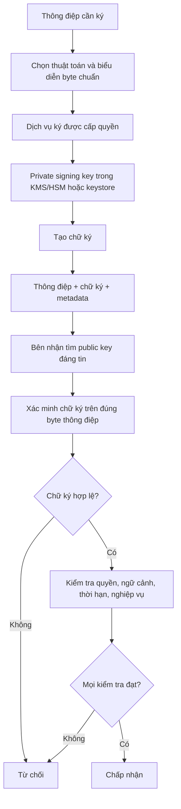
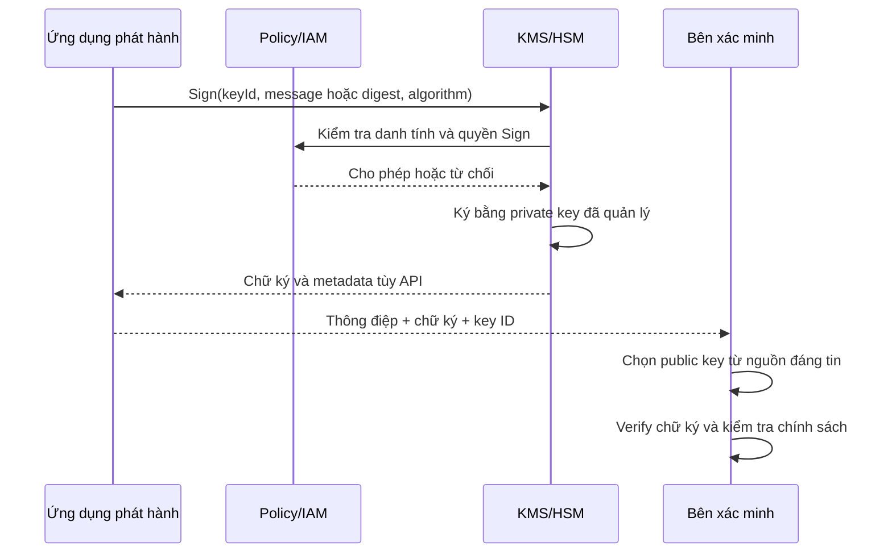

# Signing key (Khóa ký)

Trong chương **Phân loại key** của module **SECURITY_KEY_MANAGEMENT_FUNDAMENTALS**, **signing key** là khóa được dùng để **tạo chữ ký mật mã** nhằm bảo vệ tính toàn vẹn và hỗ trợ xác thực nguồn gốc của thông điệp, tài liệu hoặc phần mềm. Ở ngữ cảnh **chữ ký số bất đối xứng**, signing key thường là **khóa riêng (private key)**; khóa công khai tương ứng được dùng để xác minh chữ ký. Signing key khác với **encryption key** dùng để giữ bí mật nội dung.

Quản lý signing key là một phần đặc biệt nhạy cảm của vòng đời khóa mật mã: nếu khóa ký bị đánh cắp hoặc bị một workload có quyền ký lạm dụng, kẻ tấn công có thể tạo ra nội dung *trông như được ký hợp lệ*. Bài học liên kết mật mã bất đối xứng, chữ ký số, KMS/HSM, quản lý phiên bản, kiểm soát quyền, kiểm toán, xoay vòng, thu hồi và hủy khóa để thiết kế hệ thống bảo vệ khóa ký.

## 1. Mục tiêu học tập

Sau bài học, bạn có thể:

- Giải thích signing key, verification key, cặp khóa ký, chữ ký số và vai trò của thuật toán băm trong quá trình ký/xác minh.
- Phân biệt **chữ ký số bất đối xứng** với **MAC/HMAC đối xứng** và với **mã hóa**.
- Chọn và sử dụng các họ thuật toán phổ biến như RSA-PSS, ECDSA và Ed25519 theo giao thức và chính sách tương ứng.
- Giải thích cách quản lý signing key bằng **KMS/HSM**, IAM, certificate/JWKS, định danh khóa, kiểm toán và kiểm soát thao tác ký.
- Thiết kế quy trình xoay vòng, ngừng ký, thu hồi và duy trì khả năng xác minh chữ ký cũ.

## 2. Signing key là gì?

Với chữ ký số bất đối xứng, hệ thống tạo một cặp khóa liên hệ toán học:

| Thành phần | Vai trò | Nguyên tắc quản lý |
| --- | --- | --- |
| **Private signing key** | Tạo chữ ký trên thông điệp hoặc đại diện được chuẩn hóa của thông điệp. | Giữ bí mật, chỉ cấp quyền cho chủ thể ký; ưu tiên giữ trong KMS/HSM hoặc thiết bị bảo mật thích hợp. |
| **Public verification key** | Kiểm tra một chữ ký có tương ứng với thông điệp và private key hay không. | Có thể công bố, nhưng cần xác thực khóa này thuộc về danh tính/issuer nào và có còn đáng tin hay không. |
| **Digital signature** | Bằng chứng mật mã được tạo từ thông điệp và private key. | Cần lưu/truyền kèm metadata phù hợp (thuật toán, key ID, ngữ cảnh, định dạng), kiểm tra bằng public key đáng tin cậy. |

Ví dụ, dịch vụ phát hành token đăng nhập dùng private key để ký token; API nhận token dùng public key tương ứng để xác minh. API **không cần giữ private key** và chỉ nên chấp nhận public key từ nhà phát hành đã cấu hình tin cậy.

Signing key có thể ký các đối tượng khác nhau: JWT, bản phát hành phần mềm, tài liệu điện tử, yêu cầu giao dịch, sự kiện kiểm toán hoặc thông điệp giữa các dịch vụ. Tuy nhiên **một chữ ký hợp lệ không tự chứng minh rằng nội dung đúng sự thật, hành động đã được người dùng đồng ý, hay người ký được phép thực hiện hành động**. Ứng dụng vẫn cần xác thực danh tính, ngữ cảnh và chính sách nghiệp vụ.

### 2.1. Chữ ký số bảo vệ những gì?

Chữ ký số được thiết kế để cung cấp:

1. **Tính toàn vẹn:** thay đổi thông điệp đã ký sẽ khiến phép xác minh chữ ký thất bại, trong giới hạn bảo đảm của thuật toán.
2. **Xác thực nguồn gốc theo khóa:** phép xác minh cho thấy chữ ký phù hợp với private key tương ứng public key được dùng để kiểm tra.
3. **Cơ sở cho trách nhiệm giải trình:** nếu có cơ chế liên kết khóa với danh tính, phê duyệt thao tác ký, dấu thời gian và nhật ký đáng tin cậy, chữ ký có thể hỗ trợ truy nguyên sự kiện.

“Chống chối bỏ” (*non-repudiation*) thường được nhắc tới trong lý thuyết chữ ký số, nhưng việc chứng minh pháp lý hoặc quy trách nhiệm thực tế còn phụ thuộc kiểm soát private key, thủ tục cấp chứng chỉ, thời điểm ký, bối cảnh giao dịch và quy định áp dụng. Một signing key được nhiều người hoặc dịch vụ dùng chung khó chứng minh ai đã trực tiếp yêu cầu một chữ ký.

Chữ ký số **không mã hóa nội dung**. Người có token hoặc tài liệu đã ký vẫn có thể đọc dữ liệu nếu nội dung không được mã hóa riêng. Khi cần bảo mật nội dung, kết hợp cơ chế mã hóa thích hợp; không dùng thao tác ký như một cách “mã hóa bằng private key”.

## 3. Phân biệt signing key, encryption key và HMAC key

Đây là ba mục đích mật mã thường dễ bị lẫn:

| Loại khóa | Thao tác chính | Ai nắm bí mật? | Bảo đảm chủ yếu |
| --- | --- | --- | --- |
| **Asymmetric signing key** | Private key ký; public key xác minh. | Chỉ phía ký nắm private key. | Toàn vẹn và khả năng xác thực nguồn gốc theo public key tin cậy. |
| **Encryption key** | Mã hóa/giải mã dữ liệu; có thể đối xứng hoặc bất đối xứng. | Tùy mô hình mã hóa. | Bí mật dữ liệu; một số chế độ như AEAD còn cung cấp xác thực bản mã. |
| **MAC/HMAC key** | Cùng khóa bí mật tạo và kiểm tra mã xác thực thông điệp. | Cả bên tạo và bên kiểm tra MAC phải nắm hoặc có quyền sử dụng bí mật chung. | Toàn vẹn và xác thực đối với các bên chia sẻ khóa, **không phân biệt được bên nào đã tạo MAC**. |

Một số tài liệu hoặc API gọi khóa HMAC là “signing secret”, chẳng hạn “webhook signing secret”. Cách gọi này phổ biến nhưng **không biến HMAC thành chữ ký số bất đối xứng**. Nếu yêu cầu bên nhận có thể xác minh **mà không có khả năng tự tạo chữ ký mới**, chữ ký bất đối xứng phù hợp hơn.

Các loại khóa nên có **mục đích và quyền riêng**. Không dùng private key ký làm khóa AES; không lấy DEK dùng mã hóa dữ liệu đưa vào HMAC cho một giao thức khác chỉ vì nó là “secret”; không lạm dụng cặp khóa ký để thực hiện giải mã nếu thuật toán/giao thức không được thiết kế cho việc đó.

## 4. Chữ ký được tạo và xác minh như thế nào?

Luồng khái niệm:



Về bản chất, nhiều thuật toán chữ ký sử dụng một giá trị băm mật mã của thông điệp trong thiết kế. Nhưng **không nên tự băm rồi lại gọi API tự băm** nếu hợp đồng API không yêu cầu; có API ký toàn bộ message, có API yêu cầu digest đã tính trước. Chọn sai chế độ *message* so với *digest* có thể dẫn đến chữ ký không xác minh được hoặc không đúng giao thức.

Đối với dữ liệu có cấu trúc, phải thống nhất **các byte chính xác được ký**. Hai JSON biểu diễn cùng ý nghĩa nhưng khác khoảng trắng hoặc thứ tự thuộc tính có thể tạo ra chữ ký khác nhau nếu ký trực tiếp chuỗi byte. Giao thức có thể định nghĩa riêng quá trình tạo signing input (ví dụ JWS), hoặc cần chuẩn hóa dữ liệu (*canonicalization*) và quy ước mã hóa ký tự trước khi ký.

Một rủi ro khác là **cross-protocol misuse**: cùng một khóa ký được dùng cho hai loại thông điệp, khiến chữ ký hợp lệ ở bối cảnh này bị diễn giải ở bối cảnh khác. Có thể hạn chế bằng cách tách khóa theo mục đích và gắn *domain separation* (ví dụ phiên bản giao thức, loại thông điệp, danh tính dịch vụ) vào các byte được ký, theo định dạng được thiết kế nhất quán.

## 5. Các thuật toán signing key phổ biến

| Họ thuật toán | Cặp khóa và cách ký | Ưu điểm, lưu ý |
| --- | --- | --- |
| **RSA-PSS** | Private RSA ký, public RSA xác minh với cơ chế đệm PSS và hàm băm. | Được dùng trong nhiều hệ thống doanh nghiệp; cần chọn độ dài khóa và tham số PSS theo chính sách/giao thức, bảo đảm cấu hình phía ký và xác minh khớp nhau. |
| **RSA PKCS#1 v1.5 signature** | Ví dụ RS256 trong JWS dùng RSA PKCS#1 v1.5 với SHA-256. | Thường gặp để tương thích hệ thống cũ; không đồng nhất với RSA-PSS và không tự chuyển đổi thuật toán trong token. |
| **ECDSA** | Private key đường cong elliptic ký, public key xác minh; ví dụ P-256 với SHA-256. | Khóa và chữ ký tương đối gọn; việc tạo nonce ký ECDSA phải an toàn, không được tái sử dụng hay làm lộ. |
| **Ed25519 (EdDSA)** | Thuật toán chữ ký trên đường cong Edwards 25519. | Giao diện thường đơn giản, chữ ký gọn, thiết kế ký theo cơ chế xác định; vẫn cần thư viện chuẩn, key lifecycle và kiểm soát quyền. |

Không có thuật toán nào tự giải quyết được vấn đề phân quyền hoặc bảo vệ private key. Lựa chọn phụ thuộc chuẩn giao thức, mức bảo mật, năng lực KMS/HSM, hệ sinh thái xác minh, tuân thủ và vòng đời phần mềm.

**Lưu ý đặc biệt với ECDSA:** nếu nonce riêng của mỗi chữ ký bị lặp hoặc có thể đoán được, private key có nguy cơ bị khôi phục. Dùng triển khai đã được đánh giá, nguồn ngẫu nhiên thích hợp hoặc phương án ký xác định được chuẩn hỗ trợ; không tự lập trình ECDSA. Với Ed25519, không suy diễn rằng có thể dùng cùng vật liệu khóa cho X25519 hay mục đích trao đổi khóa; các mục đích và phép biến đổi phải được đánh giá riêng.

### 5.1. Ví dụ Java JCA: ký và xác minh với Ed25519

Ví dụ Java 17 sau chỉ minh họa nguyên lý: sinh cặp khóa tạm thời trong bộ nhớ, ký một chuỗi UTF-8 và xác minh. Trong production, private key cần được quản lý qua keystore, KMS/HSM hoặc cơ chế tương ứng, thay vì mỗi lần chạy ứng dụng lại sinh một khóa để dùng lâu dài.

```java
import java.nio.charset.StandardCharsets;
import java.security.KeyPair;
import java.security.KeyPairGenerator;
import java.security.Signature;
import java.util.Arrays;

public class SigningKeyDemo {
    public static void main(String[] args) throws Exception {
        KeyPairGenerator generator = KeyPairGenerator.getInstance("Ed25519");
        KeyPair keyPair = generator.generateKeyPair();

        byte[] message = "transfer=123;amount=1000".getBytes(StandardCharsets.UTF_8);

        Signature signer = Signature.getInstance("Ed25519");
        signer.initSign(keyPair.getPrivate());
        signer.update(message);
        byte[] signature = signer.sign();

        Signature verifier = Signature.getInstance("Ed25519");
        verifier.initVerify(keyPair.getPublic());
        verifier.update(message);

        System.out.println("Valid signature: " + verifier.verify(signature));

        // Thay đổi thông điệp sau khi ký phải làm verification thất bại.
        byte[] changed = "transfer=123;amount=9000".getBytes(StandardCharsets.UTF_8);
        verifier.initVerify(keyPair.getPublic());
        verifier.update(changed);
        System.out.println("Valid after change: " + verifier.verify(signature));

        // Không ghi private key hoặc các byte nhạy cảm vào log.
        Arrays.fill(message, (byte) 0);
        Arrays.fill(changed, (byte) 0);
    }
}
```

Kết quả dự kiến là `true` cho thông điệp gốc và `false` cho thông điệp đã thay đổi. Đây là **ví dụ chức năng**, không phải luồng giao dịch hoàn chỉnh: một hệ thống thật phải chuẩn hóa thông điệp, xác định người ký có quyền gì, ngăn phát lại thông điệp, kiểm tra chứng chỉ/độ tin cậy, quản lý lịch sử khóa và ghi audit.

Khi ứng dụng gọi **KMS Sign** để tạo chữ ký, có thể KMS yêu cầu message hoặc digest, một key ID và thuật toán ký được cho phép. Chính xác tham số và thuật toán hỗ trợ phụ thuộc nhà cung cấp. Dùng SDK của KMS/HSM theo tài liệu tương ứng; không giả định Java `Signature` luôn nhận được một đối tượng `PrivateKey` có thể xuất từ KMS.

## 6. Nơi lưu trữ signing key: KMS, HSM và hệ thống khóa

### 6.1. Giữ private key trong KMS/HSM khi phù hợp

Đối với signing key quan trọng, kiến trúc thường cấp cho ứng dụng **quyền yêu cầu thao tác ký**, trong khi vật liệu khóa riêng vẫn ở dưới quyền kiểm soát của KMS/HSM.



Các kiểm soát cần có:

- **Non-exportable** nếu KMS/HSM hỗ trợ và chính sách yêu cầu: private key được tạo/lưu trong vùng bảo vệ, API không cho tải vật liệu khóa ra ngoài.
- **Least privilege:** dịch vụ phát hành chỉ có quyền `Sign` trên khóa cần thiết; nhóm quản trị chính sách, nhóm vận hành xoay khóa và dịch vụ xác minh có quyền riêng.
- **Phân tách nhiệm vụ:** quyền tạo khóa, thay policy, ký, tắt/xóa khóa và khôi phục không mặc định cấp cho cùng một danh tính.
- **Giới hạn ngữ cảnh:** tách khóa theo môi trường, tenant hoặc mục đích; cân nhắc kiểm soát trước khi gọi `Sign` theo loại tài liệu, người yêu cầu, giao dịch và hạn mức.
- **Audit và cảnh báo:** log danh tính workload, key ID, thuật toán, thời điểm, số yêu cầu, kết quả và request ID; cảnh báo ký tăng đột biến hoặc thay đổi policy bất thường.

KMS/HSM bảo vệ **private key material** nhưng không tự chứng minh nội dung cần ký hợp lệ. Nếu workload được cấp quyền ký bị xâm nhập, kẻ tấn công có thể gọi API `Sign` tạo chữ ký thật mà không lấy được private key. Vì vậy cần kiểm soát cả **đầu vào ký, bước phê duyệt nghiệp vụ và danh tính workload**.

### 6.2. Phân phối public key và kiểm tra độ tin cậy

Public key có thể truyền trực tiếp, qua JWKS, chứng chỉ X.509 hoặc hệ thống danh mục khóa. Điều quan trọng là phía xác minh biết **vì sao** khóa ấy được tin: cấu hình sẵn public key/fingerprint đáng tin cậy, kiểm tra issuer/chứng chỉ và chuỗi tin cậy, hoặc một cơ chế phân phối có xác thực phù hợp.

**Key ID (`kid`) là gợi ý chọn khóa, không phải bằng chứng danh tính.** Bên xác minh không được mở URL/tệp bất kỳ do `kid` của dữ liệu chưa tin cậy cung cấp. Với JWS/JWT, chỉ tra trong JWKS đã ràng buộc với issuer được phép và kiểm tra thuật toán, `iss`, `aud`, `exp`, `nbf` cùng chính sách nghiệp vụ. Tránh để header `alg` do đối tượng chưa tin cậy chọn tự quyết định thuật toán/loại khóa được chấp nhận.

## 7. Vòng đời của signing key

Signing key cần theo dõi các giai đoạn **tạo, cấp phát, lưu trữ, sử dụng, xoay vòng, thu hồi và hủy**, nhưng có một điểm khác với khóa mã hóa: **dữ liệu lịch sử có thể cần xác minh chữ ký sau khi private key đã ngừng hoạt động**.

| Giai đoạn | Hoạt động | Kiểm soát chính |
| --- | --- | --- |
| **Lập chính sách** | Chọn mục đích ký, thuật toán, owner, phạm vi người ký và thời hạn sử dụng. | Không dùng chung khóa giữa các mục đích nhạy cảm; quy định ai được ký và phê duyệt. |
| **Sinh khóa** | Tạo cặp khóa bằng CSPRNG/thuật toán được hỗ trợ hoặc trong KMS/HSM. | Bảo vệ private key; đăng ký key ID, metadata, chính sách xuất khóa. |
| **Kích hoạt/cấp phát** | Cấp danh tính workload quyền gọi `Sign`; công bố public key qua kênh đáng tin. | Phân tách quyền ký với quyền quản trị/xóa; liên kết public key với issuer. |
| **Sử dụng** | Xác định byte được ký, kiểm soát nội dung ký, tạo chữ ký, ghi audit. | Kiểm tra policy và ngữ cảnh trước khi ký; bảo vệ chống phát lại nếu giao thức cần. |
| **Xoay vòng** | Tạo private/public key mới, chuyển hoạt động ký mới sang khóa mới. | Duy trì xác minh chữ ký cũ trong thời gian cần thiết; cập nhật `kid`/chứng chỉ/JWKS. |
| **Ngừng ký/đình chỉ** | Cấm ký mới bằng khóa cũ, có thể duy trì public key để xác minh. | Đảm bảo signer không còn quyền `Sign` trên khóa cũ; áp dụng hiệu lực theo chính sách. |
| **Thu hồi/sự cố** | Khi nghi ngờ lộ hoặc lạm dụng khóa: ngừng ký, điều tra, thay khóa và thông báo bên xác minh. | Xác định chữ ký có thể bị giả mạo; thu hồi chứng chỉ nếu có PKI, cập nhật danh sách tin cậy. |
| **Lưu trữ/hủy** | Loại bỏ private key theo chính sách khi không còn cần; lưu bằng chứng và public key phục vụ xác minh nếu cần. | Cân nhắc chứng thư, dấu thời gian, bản ghi audit và chứng cứ dài hạn. |

### 7.1. Rotation không phải là đổi tên khóa

Một ví dụ xoay khóa JWT:

```text
Ngày 1:
  keyId = "auth-sign-2026-01"
  private key cũ -> ký token mới
  public key cũ  -> kiểm tra token

Ngày 2, bắt đầu rotation:
  keyId = "auth-sign-2026-06"
  private key mới -> ký token mới
  public key mới + public key cũ -> kiểm tra token theo kid

Sau khi token cũ hết hạn và qua thời gian lệch đồng hồ/caching phù hợp:
  public key cũ có thể được ngừng công bố theo chính sách
  private key cũ vẫn không được phép ký lại
```

Thời gian giữ public key cũ phụ thuộc **thời hạn token/đối tượng ký, cache của bên xác minh, clock skew và yêu cầu tra cứu lịch sử**. Với tài liệu pháp lý hoặc chữ ký lưu lâu, việc xác minh lịch sử cần thêm bằng chứng như trạng thái chứng chỉ và dấu thời gian đáng tin; không thể chỉ dựa vào public key mới nhất.

Nếu khóa riêng đã lộ, **không đợi token cũ hết hạn mới xử lý**: phải cân nhắc vô hiệu hóa phiên đăng nhập, từ chối token/claim chịu ảnh hưởng, thu hồi chứng chỉ hoặc cập nhật cơ chế tin cậy phù hợp, và đánh giá tác động đến hoạt động đã ký. Không thể “thu hồi” những chữ ký đã phát tán chỉ bằng cách xóa private key khỏi máy chủ.

### 7.2. Thu hồi khóa ký khác hủy khóa

- **Disable/retire:** ngừng quyền ký mới với private key cũ; nhiều hệ thống vẫn có thể xác minh chữ ký đã phát hành.
- **Certificate revocation:** thông báo chứng chỉ không còn đáng tin qua cơ chế của PKI (chẳng hạn CRL/OCSP khi được sử dụng).
- **Key destruction:** loại bỏ vật liệu private key và bản sao được kiểm soát để ngăn tiếp tục ký; có thể ảnh hưởng khả năng khôi phục hệ thống ký nếu làm quá sớm.
- **Historical verification:** yêu cầu giữ public key/chứng chỉ, bằng chứng thời điểm ký và thông tin trạng thái tin cậy thích hợp cho đến hết thời hạn lưu.

Key ID, phiên bản, trạng thái và thông tin chứng chỉ liên quan cần được ghi nhận để điều tra được chữ ký được tạo bởi khóa nào và vào thời điểm nào.

## 8. Tình huống thực tế: ký bản phát hành phần mềm

Một nhóm phát triển Java xây dựng tệp `application.jar`, tạo bản phát hành và ký **manifest chứa hash của artifact** bằng signing key riêng cho môi trường production. Nhóm triển khai xác minh chữ ký và kiểm tra hash trước khi cho phép chạy.

```text
Build pipeline được phê duyệt
    -> tạo artifact và manifest chuẩn hóa
    -> tính SHA-256 của artifact
    -> kiểm tra quyền phát hành / phê duyệt
    -> yêu cầu KMS/HSM ký manifest
    -> phát hành (artifact, manifest, signature, keyId)
                                      |
Deploy pipeline                          v
    -> lấy public key từ danh mục tin cậy
    -> xác minh chữ ký manifest
    -> kiểm tra hash của artifact thực tế
    -> kiểm tra policy: publisher, version, môi trường, chống rollback
    -> chỉ triển khai nếu mọi điều kiện hợp lệ
```

Cần phân biệt **chữ ký hợp lệ** với **artifact đáng triển khai**. Một pipeline đã bị chiếm quyền có thể ký một artifact độc hại bằng key hợp lệ nếu hệ thống không kiểm soát các bước build, review, provenance và phê duyệt phát hành. Chữ ký giúp đảm bảo artifact/manifest không bị thay sau khi ký và xác định khóa đã ký, nhưng không tự chứng minh mã nguồn an toàn.

Một cách thiết kế quyền:

| Thành phần | Quyền cần thiết | Quyền không nên có |
| --- | --- | --- |
| Pipeline release được phê duyệt | Gọi `Sign` với key production theo policy. | Xuất private key, đổi key policy, xóa khóa. |
| Máy triển khai | Đọc public key được xác thực, xác minh chữ ký và hash. | Gọi `Sign` hoặc quản lý private key. |
| Nhóm vận hành KMS | Tạo/xoay/vô hiệu hóa theo quy trình xét duyệt. | Tự ý phát hành artifact ngoài pipeline. |
| Nhóm kiểm toán | Xem metadata và sự kiện ký, thay đổi policy, rotation. | Lấy private key hoặc ký thay ứng dụng. |

Nếu signing key production bị lộ, cần ngừng dùng khóa để ký mới, phát hành khóa thay thế và cập nhật trust store, điều tra các artifact có thể đã bị ký trái phép, thiết lập quy trình thu hồi/chặn phiên bản độc hại theo mô hình phân phối. Chỉ tạo một `keyId` khác mà vẫn dùng private key cũ **không xử lý được sự cố**.

## 9. Những sai lầm cần tránh

| Sai lầm | Nguy cơ | Hướng xử lý |
| --- | --- | --- |
| Lưu private signing key trong Git, file `.env` đính kèm image, log hoặc crash dump. | Bị sao chép và sử dụng để ký giả. | KMS/HSM hoặc kho khóa phù hợp; không xuất khóa khi không cần, giám sát rò rỉ và luân chuyển khóa nếu đã lộ. |
| Cho ứng dụng và tài khoản quản trị cùng quyền ký, xóa và đổi policy. | Khó giới hạn tác động và khó kiểm toán. | IAM tối thiểu, phân tách nhiệm vụ và phê duyệt thay đổi. |
| Dùng chung private key cho JWT, tài liệu và release artifact. | Sự cố một hệ thống ảnh hưởng nhiều giao thức. | Tách key theo mục đích, môi trường hoặc tenant phù hợp. |
| Tin `kid` hoặc `alg` trong token mà không ràng buộc issuer/thuật toán. | Chọn sai khóa, chấp nhận token giả hoặc nhầm thuật toán. | Tra JWKS đáng tin, cố định thuật toán/issuer, kiểm tra claim và chữ ký. |
| Tự xử lý nonce của ECDSA không an toàn. | Có thể suy ra private key từ nhiều chữ ký. | Dùng thư viện đã được đánh giá; không tự viết phép ký. |
| Ký JSON không chuẩn hóa trong khi bên xác minh dùng biểu diễn byte khác. | Xác minh thất bại hoặc kiểm tra sai ngữ cảnh. | Định nghĩa rõ signing input, canonicalization và encoding. |
| Xác minh chữ ký nhưng bỏ qua quyền, thời hạn hoặc chống replay. | Yêu cầu cũ hoặc ngoài phạm vi vẫn được chấp nhận. | Kiểm tra claim, nonce/timestamp, audience, quyền nghiệp vụ và trạng thái. |
| Xoay private key xong xóa ngay public key cũ. | Token cũ hoặc tài liệu lịch sử không còn xác minh được. | Giữ thông tin xác minh cũ trong khoảng cần thiết theo chính sách. |
| Dùng thuật ngữ HMAC signature để kết luận có non-repudiation. | Bên nào nắm secret chung cũng tạo được MAC. | Phân biệt MAC đối xứng với chữ ký số bất đối xứng. |
| Cho rằng private key trong HSM thì API ký không thể bị lạm dụng. | Workload hợp lệ nhưng bị chiếm quyền vẫn ký dữ liệu tùy ý. | Kiểm soát input, chính sách nghiệp vụ, audit, hạn mức và cảnh báo. |

## 10. Checklist trước khi triển khai signing key

1. **Mục đích:** signing key được dùng để ký loại đối tượng nào? Có tách khóa cho JWT, release, tài liệu và môi trường không?
2. **Thuật toán:** chữ ký, độ dài khóa, phiên bản giao thức và cách xử lý message/digest đã tương thích với bên xác minh chưa?
3. **Sinh và bảo vệ:** private key tạo ở đâu, có xuất được không, có chính sách sao lưu/khôi phục phù hợp không?
4. **Phân quyền:** ai được gọi `Sign`, ai được quản trị khóa, ai được kiểm toán? Có kiểm soát cả yêu cầu ký và nội dung ký?
5. **Định danh:** key ID, version, certificate/JWKS được phân phối và gắn với issuer đáng tin thế nào?
6. **Chống lạm dụng:** có kiểm tra schema, signing input, audience, domain separation, chống replay và phê duyệt nghiệp vụ khi cần?
7. **Rotation:** có thể chuyển ký mới sang khóa mới mà vẫn xác minh chữ ký cũ trong thời gian phù hợp không?
8. **Sự cố:** có cách tạm ngừng ký, thay khóa, thu hồi chứng chỉ/trust, xác định chữ ký bị ảnh hưởng và thông báo bên xác minh?
9. **Audit:** có log hoạt động ký và thay đổi quyền/key policy, nhưng không lộ khóa riêng, secret hoặc nội dung nhạy cảm?
10. **Hủy:** đã kiểm tra phụ thuộc xác minh lịch sử, bản sao private key và chính sách lưu bằng chứng trước khi hủy?

## 11. Câu hỏi tự kiểm tra

1. Vì sao API xác minh JWT chỉ cần public key, trong khi API phát hành token phải bảo vệ private key? Điều gì xảy ra nếu private key bị lộ?
2. HMAC và chữ ký số bất đối xứng cùng giúp kiểm tra tính toàn vẹn; tại sao HMAC không chứng minh riêng bên nào đã tạo thông điệp?
3. Vì sao chữ ký Ed25519 hoặc RSA-PSS hợp lệ vẫn chưa đủ để chấp nhận một giao dịch chuyển tiền?
4. Nếu hệ thống xoay signing key hôm nay, những token hoặc tài liệu được ký hôm qua cần thông tin gì để tiếp tục xác minh?
5. KMS/HSM ngăn xuất private key nhưng workload có quyền `Sign` bị chiếm quyền. Bạn sẽ thiết kế những lớp bảo vệ nào để hạn chế chữ ký trái phép?
6. Thu hồi chứng chỉ khác việc hủy private key như thế nào, và bên xác minh cần làm gì khi nhận được thông tin thu hồi?

**Ghi nhớ:** signing key là tài sản quyền lực vì nó cho phép tạo chữ ký được các hệ thống khác tin cậy. Bảo vệ đúng signing key đòi hỏi kiểm soát **khóa riêng, quyền yêu cầu ký, nội dung được ký, độ tin cậy của khóa công khai và toàn bộ vòng đời**; độ mạnh của thuật toán chỉ là một phần của thiết kế an toàn.
