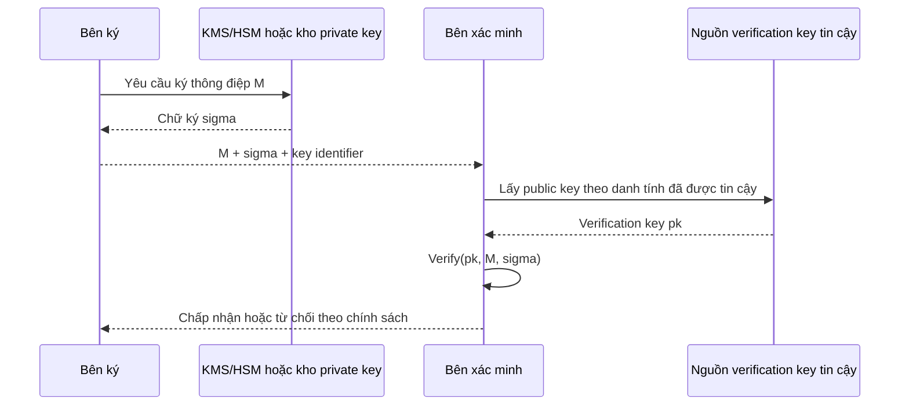
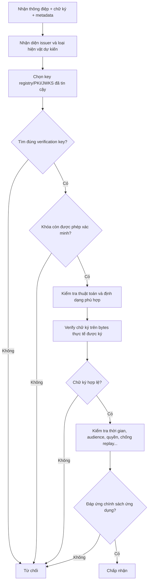
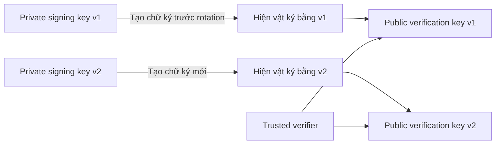
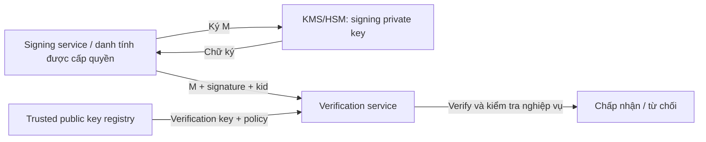

# Verification key

## 1. Verification key là gì?

**Verification key (khóa xác minh)** là khóa được dùng để kiểm tra xem một **chữ ký số** có hợp lệ với thông điệp và thuật toán đã chỉ định hay không. Trong các sơ đồ chữ ký số bất đối xứng thông dụng, verification key chính là **khóa công khai (public key)** tương ứng với **khóa riêng dùng ký (signing private key)**.

Giả sử dịch vụ phát hành hóa đơn ký một tài liệu bằng private key. Dịch vụ nhận hóa đơn không cần biết private key; nó sử dụng verification key đáng tin cậy để kiểm tra rằng chữ ký khớp với nội dung hóa đơn và cặp khóa được công nhận. Nếu hóa đơn thay đổi sau khi được ký, kiểm tra chữ ký phải thất bại.

Khái niệm này thuộc chương **Phân loại key** trong module `SECURITY_KEY_MANAGEMENT_FUNDAMENTALS`. Hiểu verification key giúp kết nối mật mã bất đối xứng, chữ ký số, phân phối khóa, chứng chỉ, KMS/HSM, vòng đời khóa, xoay vòng, kiểm soát truy cập và kiểm toán. Verification key thường **không cần giữ bí mật**, nhưng nhất thiết phải **xác minh tính xác thực, tính toàn vẹn và phạm vi tin cậy** trước khi sử dụng.

Sau bài học, bạn có thể:

- Phân biệt verification key với signing key, encryption key, authentication secret và chứng chỉ.
- Giải thích quy trình `sign` và `verify` cùng giới hạn của kết quả xác minh chữ ký.
- Chọn và quản lý verification key từ key registry, chứng chỉ X.509 hoặc JWKS đáng tin cậy.
- Thiết kế chuyển tiếp khóa khi hệ thống xoay signing key mà vẫn cần xác minh chữ ký cũ.
- Triển khai kiểm tra Ed25519 bằng Java và nhận diện các lỗi phổ biến khi xác minh JWT/JWS.
- Xác định các kiểm soát quản trị, kiểm toán và ứng phó khi verification key bị tráo đổi hoặc signing key bị lộ.

## 2. Verification key hoạt động như thế nào?

Với sơ đồ chữ ký số bất đối xứng, quá trình thường có ba bước:

1. **Key generation:** tạo cặp khóa gồm private key `sk` và public/verification key `pk` bằng cơ chế mật mã được phê duyệt.
2. **Signing:** bên phát hành dùng `sk` và thông điệp `M` để tạo chữ ký `σ`.
3. **Verification:** bên nhận dùng `pk`, `M` và `σ` để trả về kết quả đúng hoặc sai.

Có thể biểu diễn khái quát:

\[
(pk,sk) \leftarrow \operatorname{KeyGen}()
\]

\[
\sigma \leftarrow \operatorname{Sign}(sk,M)
\]

\[
\operatorname{Verify}(pk,M,\sigma) =
\begin{cases}
\text{true} & \text{nếu chữ ký hợp lệ}\\
\text{false} & \text{nếu chữ ký không hợp lệ}
\end{cases}
\]

Trong thiết kế thực tế, việc ký và xác minh còn cần thống nhất **thuật toán**, cách mã hóa thông điệp, miền ngữ cảnh (*domain separation*) nếu sơ đồ sử dụng, và định dạng chữ ký. Không phải mọi thuật toán ký đều yêu cầu ứng dụng tự tính hash; ví dụ, API Ed25519 thường nhận trực tiếp bytes thông điệp để thực hiện phép toán theo đặc tả.



Đường xác minh không cần truy cập private key. Private key có thể được giữ bên trong KMS/HSM và không cho xuất vật liệu. Public key có thể được sao chép và phân phối rộng hơn, miễn là bên nhận kiểm chứng được nó thực sự thuộc chủ thể mà hệ thống định tin cậy.

### 2.1. Kết quả verify = true chứng minh điều gì?

Kết quả **hợp lệ về mặt mật mã** cho thấy chữ ký phù hợp với thông điệp, thuật toán và verification key đã chọn. Trong các giả định bảo mật của sơ đồ chữ ký, điều này cung cấp bằng chứng về **tính toàn vẹn** và việc chữ ký được tạo bởi chủ thể có quyền sử dụng signing private key tương ứng.

Tuy nhiên, `verify == true` **chưa tự chứng minh**:

- Public key đã chọn thực sự thuộc người hoặc dịch vụ mà ứng dụng kỳ vọng.
- Người đang giữ private key nhất thiết là chủ sở hữu hợp pháp; private key có thể đã bị đánh cắp.
- Người ký được **ủy quyền** thực hiện hành vi kinh doanh hoặc phát hành loại dữ liệu này.
- Chứng chỉ, token hoặc quyền còn hiệu lực tại thời điểm sử dụng.
- Thông điệp là mới, không bị phát lại (*replay*), không hết hạn hoặc không bị thu hồi.
- Nội dung mang ý nghĩa nghiệp vụ đúng; chữ ký hợp lệ vẫn có thể ký một thông tin sai sự thật.

Do đó, quy trình thực tế phải gồm cả **xác minh chữ ký**, **xác minh danh tính/chuỗi tin cậy**, **đối chiếu chính sách** và **kiểm tra nghiệp vụ**.

## 3. Verification key khác các loại khóa nào?

| Đối tượng | Dùng để làm gì? | Có cần giữ bí mật? | Ai cần sử dụng? |
| --- | --- | --- | --- |
| **Signing private key** | Tạo chữ ký số | **Có**; cần bảo vệ nghiêm ngặt | Bên ký hoặc dịch vụ ký có thẩm quyền |
| **Verification public key** | Kiểm tra chữ ký số | Thường **không** | Bên nhận, bộ xác minh |
| **Public encryption key** | Mã hóa dữ liệu cho bên giữ private key giải mã | Thường **không** | Bên gửi dữ liệu |
| **Private decryption key** | Giải mã dữ liệu mã hóa bằng khóa công khai tương ứng | **Có** | Bên nhận được ủy quyền |
| **HMAC key** | Tạo và kiểm tra mã xác thực thông điệp MAC bằng cùng shared secret | **Có** | Các bên được chia sẻ bí mật |
| **KEK** | Bao bọc hoặc bảo vệ khóa dữ liệu DEK | **Có** | KMS/HSM và dịch vụ được cấp quyền |
| **DEK** | Trực tiếp mã hóa/giải mã dữ liệu đối xứng | **Có** | Thành phần xử lý dữ liệu được ủy quyền |

Từ *verification* đôi khi được dùng rộng để chỉ phép kiểm tra **MAC/HMAC**. Khi đó “khóa xác minh” là **shared secret**, không phải public key. Bài học này chủ yếu nói về **verification key của chữ ký số bất đối xứng**; cần nhận diện rõ loại cơ chế đang sử dụng để tránh áp dụng sai chính sách.

### 3.1. Chữ ký số và HMAC không tương đương

- Với **chữ ký số bất đối xứng**, bên xác minh có thể giữ public key mà không sở hữu khả năng ký. Điều này phù hợp khi nhiều bên cần xác minh một nhà phát hành.
- Với **HMAC**, mọi bên có shared secret để kiểm tra MAC cũng có thể tạo MAC hợp lệ. HMAC phù hợp cho xác thực thông điệp giữa các bên có chung bí mật, nhưng không cung cấp sự tách biệt giữa quyền ký và quyền xác minh như chữ ký bất đối xứng.

Ví dụ, một dịch vụ phát hành bản cập nhật phần mềm có thể cho hàng triệu thiết bị kiểm tra chữ ký bằng public key được nhúng hoặc phân phối qua kênh tin cậy. Không nên phát hành cùng một secret HMAC cho toàn bộ thiết bị nếu mục tiêu là chỉ nhà sản xuất có quyền ký: bất kỳ thiết bị nào làm lộ shared secret sẽ đe dọa toàn hệ thống.

### 3.2. Verification key, certificate và trust anchor

**Verification key** là vật liệu public key dùng cho phép toán mật mã. **Chứng chỉ X.509** là cấu trúc dữ liệu có thể chứa public key, danh tính chủ thể, thời hạn, mục đích sử dụng và chữ ký của tổ chức phát hành chứng chỉ.

**Trust anchor** (điểm neo tin cậy) là khóa hoặc chứng chỉ được hệ thống tin cậy theo cấu hình/chính sách. Một public key lấy từ chứng chỉ chỉ được xem là đáng tin cậy sau khi hệ thống đánh giá đường tin cậy và các điều kiện liên quan. Nếu tải một chứng chỉ ngẫu nhiên rồi lấy public key để xác minh một chữ ký đi kèm, việc `verify` thành công vẫn **không xác nhận** danh tính người gửi.

Cần phân biệt:

```text
Verification key: public key bytes + thuật toán/cách diễn giải phù hợp
Certificate:      public key + thông tin chủ thể + thời hạn + chữ ký CA + extensions
Trust anchor:     khóa/chứng chỉ được cấu hình để kết thúc chuỗi tin cậy
Key identifier:   nhãn phục vụ tìm khóa (ví dụ kid); không tự chứng minh tin cậy
```

## 4. Các thuật toán verification key thường gặp

| Sơ đồ chữ ký | Verification key | Điều cần chú ý |
| --- | --- | --- |
| **RSA-PSS** | RSA public key | Khớp hash, MGF1, salt length và các tham số đã phê duyệt; không nhầm với RSA encryption. |
| **ECDSA** | Elliptic-curve public key | Khớp đường cong, hash và encoding chữ ký; không hoán đổi bừa giữa DER và raw `r || s`. |
| **Ed25519** | Ed25519 public key | Cần thư viện/API hỗ trợ Ed25519 và đúng định dạng public key; không coi Ed25519 là ECDSA. |
| **Ed448** | Ed448 public key | Khả năng hỗ trợ và mức phù hợp tùy hệ sinh thái, thư viện và yêu cầu nghiệp vụ. |

Lựa chọn thuật toán cần theo **danh mục mật mã được phê duyệt**, yêu cầu tương thích, mức bảo mật, môi trường và khả năng quản trị. Không có quy tắc chung cho mọi hệ thống rằng một thuật toán luôn là lựa chọn duy nhất.

Một số lưu ý đặc biệt:

- **RSA-PSS** khác RSA PKCS#1 v1.5 signature về padding và cấu hình xác minh; không chấp nhận hai cơ chế chỉ vì cùng là RSA public key.
- **ECDSA** đòi hỏi chữ ký dùng đúng định dạng mà bên xác minh kỳ vọng. Ví dụ, JWS `ES256` và một số API Java có thể biểu diễn chữ ký khác nhau.
- **Ed25519** và **Ed25519ph** không được đánh đồng. Không tự băm nội dung rồi đưa hash vào API Ed25519 thuần nếu giao thức yêu cầu ký thông điệp gốc.
- **Thuật toán và mục đích khóa** phải được quyết định bởi cấu hình/chính sách tin cậy; không để metadata do bên gửi kiểm soát tự động bật thuật toán yếu hoặc không mong muốn.

## 5. Verification key được phân phối và thiết lập lòng tin như thế nào?

Vì verification key là public key, **tính bí mật** thường không phải mục tiêu bảo vệ chính. Mục tiêu chính là ngăn người tấn công **thay thế** khóa công khai hợp lệ bằng khóa do họ kiểm soát.

Giả sử một API nhận:

```json
{
  "message": "pay:1000000:account-123",
  "signature": "<signature>",
  "publicKey": "<any-public-key-supplied-by-caller>"
}
```

Nếu API lấy luôn `publicKey` của request làm cơ sở xác minh và coi `verify == true` là bằng chứng đã được công ty ký, kẻ tấn công có thể tự tạo cặp khóa, ký thông điệp tùy ý rồi gửi cả public key của mình. Phép toán mật mã vẫn cho kết quả hợp lệ, nhưng **mô hình tin cậy đã sai**.

### 5.1. Các cách triển khai nguồn verification key

| Phương án | Trường hợp phù hợp | Yêu cầu quản lý |
| --- | --- | --- |
| **Pin public key** trong cấu hình/bản phát hành đáng tin cậy | Một số hệ thống có ít bên ký, thiết bị, cấu hình ổn định | Bảo vệ kênh cập nhật; có lộ trình rotation và key rollover. |
| **Trusted key registry** | Nhiều phiên bản, dịch vụ, tenant hoặc issuer | Gắn khóa với danh tính, thuật toán, mục đích, trạng thái và quyền quản trị. |
| **Chứng chỉ X.509 + PKI** | TLS, ký tài liệu, tổ chức có chuỗi chứng chỉ | Kiểm tra đường chứng chỉ, thời hạn, tên/chủ thể, mục đích và thu hồi theo chính sách. |
| **JWKS** | Hệ thống JWT/JWS, OpenID Connect hoặc nhiều bên xác minh | Khóa được tải từ endpoint do issuer đáng tin cậy công bố; kiểm soát cache, key rollover và `kid`. |
| **Metadata API của KMS/HSM** | Hệ thống dùng dịch vụ quản lý khóa để ký | Phải xác thực API, kiểm tra nguồn và mapping khóa–mục đích. |

**TLS bảo vệ kênh truyền**, nhưng một endpoint HTTPS bất kỳ không tự trở thành nguồn khóa đáng tin cậy. Danh sách issuer, trust anchor, địa chỉ JWKS, public key được pin hoặc key registry cần được thiết lập bởi người có thẩm quyền và cập nhật qua quy trình kiểm soát.

### 5.2. Tính xác thực và tính toàn vẹn của public key

Có thể lưu verification key trong cơ sở dữ liệu hoặc file cấu hình, nhưng phải:

1. Bảo vệ **quyền ghi/thay khóa** bằng IAM và quy trình phê duyệt.
2. Ràng buộc khóa với **issuer/tenant**, mục đích, thuật toán và thời điểm hiệu lực.
3. Ghi nhận **phiên bản** hoặc fingerprint để truy vết.
4. Kiểm tra khóa được tải từ nguồn tin cậy và chưa bị thay thế trái phép.
5. Có cơ chế xoay đồng bộ giữa bên ký và các bên xác minh.

Fingerprint chỉ có ý nghĩa nếu fingerprint chuẩn ban đầu được lấy từ một **nguồn tin cậy**. Hash một public key do kẻ tấn công đưa tới vẫn chỉ xác nhận lại chính khóa của họ.

## 6. Quy trình xác minh chữ ký an toàn

Luồng xác minh tổng quát cho thông điệp hoặc hiện vật đã ký:



Các bước chính:

**Bước 1 — Xác định ai có quyền ký.** Ví dụ: đơn đặt hàng chỉ được chấp nhận nếu do `orders-issuer-prod` ký, không phải bất kỳ public key nào xác minh được chữ ký.

**Bước 2 — Chọn nguồn khóa tin cậy.** Lấy public key từ key registry, JWKS issuer đã cấu hình hoặc chuỗi chứng chỉ đã được xác thực. Metadata `kid` chỉ giúp chọn khóa trong phạm vi tin cậy này.

**Bước 3 — Đối chiếu mục đích khóa và thuật toán.** Một khóa dùng cho TLS không đương nhiên là khóa được phê duyệt cho chữ ký giao dịch. Bắt buộc khớp thuật toán, cấu trúc và cách diễn giải chữ ký với giao thức.

**Bước 4 — Xác minh chính xác bytes đã được ký.** Đối với thông điệp JSON, khác biệt khoảng trắng, thứ tự trường, dấu tiếng Việt, Unicode normalization hoặc serialization có thể làm thay đổi bytes. Giao thức phải quy định rõ canonicalization hoặc cách tạo phần ký; đừng tự tái tạo nội dung theo một cách khác.

**Bước 5 — Kiểm tra ngữ cảnh.** Chữ ký hợp lệ không thay thế kiểm tra `issuer`, `audience`, `expiration`, tenant, quyền thực hiện thao tác, transaction ID hoặc chống phát lại.

**Bước 6 — Ghi kết quả và xử lý lỗi an toàn.** Phân biệt lỗi định dạng, khóa không rõ, khóa không còn được cho phép, chữ ký sai và claim không đạt chính sách. Khi trả lỗi ra ngoài, tránh để lộ thông tin nhạy cảm; lưu metadata cần thiết cho kiểm toán mà không log private key hoặc payload bí mật.

### 6.1. Verify chữ ký không giống verify người dùng

Một tài liệu được ký hợp lệ bởi khóa của tổ chức A chứng minh rằng chữ ký liên hệ với khóa của A theo nguồn tin cậy và giả định private key được kiểm soát. Nó **không tự xác nhận** người đang gửi tài liệu thuộc A, rằng thao tác gửi này được cho phép, hay dữ liệu vẫn còn hiệu lực.

Trong API giao dịch, có thể cần xác thực người gọi bằng TLS/mTLS/OAuth hoặc cơ chế khác, đồng thời xác minh chữ ký payload để kiểm tra tính toàn vẹn và nguồn phát hành. Hai tầng kiểm tra đáp ứng những đe dọa khác nhau.

### 6.2. Chứng chỉ X.509: xác minh chữ ký là một phần của công việc

Nếu verification key lấy từ một chứng chỉ, hệ thống có thể phải kiểm tra:

- Đường chứng chỉ kết thúc tại trust anchor được tin cậy.
- Chữ ký trên các chứng chỉ trong chuỗi và ràng buộc CA/basic constraints.
- Thời hạn chứng chỉ theo chính sách và thời điểm cần đánh giá.
- Danh tính hoặc tên chủ thể đúng với mục đích giao thức.
- `KeyUsage` / `ExtendedKeyUsage` nếu giao thức và chứng chỉ áp dụng.
- CRL, OCSP hoặc cơ chế thu hồi khác khi chính sách yêu cầu.
- Định dạng và mục đích chữ ký phù hợp, gồm xử lý bằng chứng thời gian cho chữ ký dài hạn.

Không nên suy ra “chứng chỉ còn hạn” là đủ cho mọi loại chữ ký. Ngược lại, không áp dụng một bộ quy tắc TLS chung một cách máy móc cho mọi định dạng chữ ký tài liệu; tiêu chuẩn của từng giao thức quyết định các bước bắt buộc.

## 7. Verification key trong JWT/JWS

JWT ký theo JWS thường mang một phần header như sau:

```json
{
  "alg": "RS256",
  "typ": "JWT",
  "kid": "issuer-signing-v3"
}
```

`kid` là **key identifier** để bộ xác minh chọn verification key. Nó không phải bằng chứng danh tính và bản thân nó **chưa được tin cậy trước khi chữ ký hợp lệ**. Header JWS chỉ được phép ảnh hưởng đến bước **tra cứu trong tập khóa và thuật toán đã cho phép**, không thể tự mở rộng danh sách nguồn hoặc điều kiện tin cậy.

Quy trình JWT an toàn:

1. Ứng dụng xác định **issuer dự kiến** từ cấu hình hoặc ngữ cảnh giao thức, không tin một URL tùy ý từ token.
2. Chọn đúng **JWKS endpoint** hoặc key registry đã gắn với issuer đáng tin cậy.
3. Chỉ dùng thuật toán được cấu hình cho issuer đó; từ chối `alg=none` hoặc những thuật toán không nằm trong allowlist.
4. Tra cứu `kid` trong tập khóa tin cậy; không dùng nó trực tiếp như đường dẫn file, câu SQL hoặc URL.
5. Xác minh chữ ký theo đúng đặc tả JWS, gồm dữ liệu ký và định dạng chữ ký.
6. Kiểm tra `iss`, `aud`, `exp`, `nbf`, loại token, scope/role, tenant và những điều kiện cần thiết của ứng dụng.
7. Có chính sách cache JWKS và rollover để vẫn xác minh token cũ hợp lệ trong khoảng chuyển tiếp.

### 7.1. Ví dụ tấn công tráo thuật toán

Giả sử hệ thống dùng RSA public key để xác minh token `RS256` nhưng cấu hình thư viện cho phép chuyển sang cơ chế HMAC chỉ vì header của token khai báo một thuật toán khác. Trong một thiết kế verifier bị lỗi, kẻ tấn công có thể lợi dụng việc **dùng sai loại khóa cho thuật toán** để tạo token mà hệ thống chấp nhận.

Biện pháp quan trọng là **ràng buộc issuer → tập thuật toán được phép → loại key phù hợp**, cấu hình thư viện xác minh ở chế độ chặt chẽ và kiểm thử các token với thuật toán không được phê duyệt. Không để token tự quyết định cơ chế bảo mật mà verifier sẽ dùng.

### 7.2. Public key trong JWKS không phải quyền tin cậy tự động

JWKS có thể công bố nhiều public key (ví dụ `v2`, `v3`) để phục vụ rotation. Tuy nhiên, **JWKS phải thuộc issuer đáng tin cậy** và được tải qua kênh/cấu hình đã phê duyệt. Không nên chấp nhận trường `jku`, `x5u` hoặc vị trí tải khóa tùy ý từ token làm nguồn tin cậy, vì điều đó có thể cho phép truy cập endpoint ngoài ý muốn hoặc thay khóa công khai.

Nếu token gắn `kid` không tồn tại, verifier phải xử lý theo chính sách rõ ràng: có thể làm mới key cache từ nguồn tin cậy với giới hạn tần suất rồi từ chối nếu vẫn không tìm được. Tránh thử mọi khóa vô hạn hoặc biến việc thiếu `kid` thành quyền bỏ qua chữ ký.

## 8. Xoay vòng signing key và vòng đời verification key

Verification key thường gắn với một phiên bản cụ thể của signing key bất đối xứng. Khi private key `sign-v1` được thay bằng `sign-v2`, bên xác minh cần có public key `verify-v2`, đồng thời có thể vẫn cần `verify-v1` để xác minh các hiện vật đã ký trước đó.



Bảng trạng thái khái niệm:

| Trạng thái phiên bản | Private key: được ký mới? | Public key: được xác minh? | Ghi chú |
| --- | --- | --- | --- |
| **PREPARED** | Chưa | Có thể được phân phối để chuẩn bị | Cho phép verifier lấy khóa mới trước khi bên ký chuyển phiên bản. |
| **ACTIVE** | Có | Có | Thời kỳ tạo chữ ký mới bằng private key tương ứng. |
| **VERIFY_ONLY** | Không | Có | Khóa ký cũ không dùng ký mới, nhưng chữ ký/token trước đây còn hợp lệ. |
| **REVOKED / DISTRUSTED** | Không | Bị từ chối theo chính sách | Nếu private key bị lộ, cần đánh giá phạm vi chữ ký bị ảnh hưởng. |
| **RETIRED** | Không | Không còn sử dụng cho luồng đang hoạt động | Có thể giữ bằng chứng xác minh dài hạn theo nghĩa vụ lưu trữ. |

Tên trạng thái do sản phẩm và chính sách quyết định; không phải mọi KMS/HSM đều cung cấp lựa chọn *verify-only* ở cấp phiên bản. Có thể cần quản lý trạng thái này trong **key registry** hoặc tầng xác minh của ứng dụng.

### 8.1. Quy trình rotation không gián đoạn

1. **Chuẩn bị cặp khóa mới:** tạo private key trong KMS/HSM hoặc môi trường bảo vệ phù hợp, gán version mới.
2. **Phân phối public key mới:** đưa verification key mới vào registry/JWKS đã tin cậy. Chưa nhất thiết chuyển sang ký mới ngay.
3. **Kiểm tra verifier:** xác nhận các bộ xác minh đã nhận key mới, chấp nhận thuật toán đúng và không làm mất khả năng xác minh chữ ký cũ.
4. **Chuyển signing key:** bắt đầu ký hiện vật mới bằng private key mới; gắn `kid`/version khi giao thức sử dụng.
5. **Giữ cửa sổ chồng lấn:** cả verification key cũ và mới cùng tồn tại trong tập tin cậy nếu vẫn có chữ ký hợp lệ cần đọc.
6. **Ngừng ký bằng private key cũ:** thu hồi quyền ký mới và ngừng vận hành khóa cũ theo chính sách.
7. **Kết thúc hỗ trợ version cũ:** khi token/chữ ký và yêu cầu lưu trữ cho phép, ngừng chấp nhận version cũ ở luồng xác minh hoạt động, đồng thời lưu các bằng chứng bắt buộc cho kiểm chứng dài hạn.

Ví dụ với access token sống 15 phút, việc thay signing key không buộc tất cả token vừa phát hành trở nên vô hiệu ngay. Verifier có thể tạm giữ public key cũ trong thời gian an toàn tương ứng, có xét độ lệch đồng hồ, bộ nhớ đệm và chính sách thu hồi. Với tài liệu ký số phải kiểm chứng 10 năm, cách lưu public key, chứng chỉ, timestamp và bằng chứng thu hồi phải được thiết kế riêng.

### 8.2. Khi private signing key bị lộ

Nếu private key bị lộ, việc còn giữ public verification key **không gây thêm lộ bí mật**, vì public key vốn có thể được công bố. Rủi ro chính là kẻ tấn công có thể **tạo chữ ký giả** có vẻ hợp lệ với khóa đó.

Kế hoạch ứng cứu cần:

- Ngăn sử dụng private key/định danh bị xâm nhập để ký mới.
- Đổi phiên bản và phân phối verification key mới qua đường đáng tin cậy.
- Thu hồi token, chứng chỉ hoặc hiện vật chịu ảnh hưởng theo cơ chế thích hợp.
- Đánh giá thời điểm bắt đầu lộ khóa, bản ghi ký và khả năng phân biệt chữ ký hợp lệ cũ với chữ ký giả.
- Cập nhật registry, cache, key status và hệ thống xác minh theo chính sách.
- Lưu bằng chứng kiểm toán và yêu cầu thông báo sự cố khi áp dụng.

**Rotation không thể bảo đảm rằng chữ ký cũ có thể tiếp tục được tin cậy như trước khi khóa bị lộ.** Việc có nên từ chối toàn bộ chữ ký cũ, giữ lại chữ ký có timestamp/bằng chứng tin cậy trước sự cố hay đánh giá từng loại hiện vật phụ thuộc mô hình tin cậy và nghĩa vụ nghiệp vụ.

## 9. Ví dụ Java: xác minh chữ ký Ed25519

Java cung cấp API `Signature` trong Java Cryptography Architecture (JCA). Ví dụ dưới đây minh họa cách kiểm tra chữ ký Ed25519 với **verification key có nguồn tin cậy**, sử dụng JDK có hỗ trợ Ed25519 (ví dụ Java 17 trở lên). Ed25519 trong ví dụ là thuật toán minh họa; hệ thống thật phải theo tiêu chuẩn mật mã và yêu cầu tương thích của tổ chức.

### 9.1. Kiểm thử nguyên lý bằng một cặp khóa tạm

```java
import java.nio.charset.StandardCharsets;
import java.security.KeyPair;
import java.security.KeyPairGenerator;
import java.security.Signature;

public class VerificationKeyDemo {
    public static void main(String[] args) throws Exception {
        // Chỉ tạo key pair tại chỗ để minh họa.
        // Hệ thống thật nên bảo vệ signing private key bằng KMS/HSM phù hợp.
        KeyPairGenerator generator = KeyPairGenerator.getInstance("Ed25519");
        KeyPair pair = generator.generateKeyPair();

        byte[] payload = "invoice:2026-001:amount=100".getBytes(
            StandardCharsets.UTF_8
        );

        Signature signer = Signature.getInstance("Ed25519");
        signer.initSign(pair.getPrivate());
        signer.update(payload);
        byte[] signature = signer.sign();

        // Bên xác minh dùng PUBLIC KEY tương ứng.
        Signature verifier = Signature.getInstance("Ed25519");
        verifier.initVerify(pair.getPublic());
        verifier.update(payload);
        System.out.println("Valid: " + verifier.verify(signature)); // true

        // Đổi đúng một byte dữ liệu cũng phải làm xác minh thất bại.
        byte[] changed = "invoice:2026-001:amount=900".getBytes(
            StandardCharsets.UTF_8
        );

        verifier.initVerify(pair.getPublic());
        verifier.update(changed);
        System.out.println("Tampered: " + verifier.verify(signature)); // false
    }
}
```

Đây là bài thử tính đúng của phép toán ký/xác minh; **chưa chứng minh danh tính** vì cặp khóa được tạo trong cùng chương trình. Trong vận hành, bên xác minh phải lấy public key từ **nguồn đã cấu hình và tin cậy**, không lấy trực tiếp từ request chứa chữ ký.

### 9.2. Xác minh với registry khóa tin cậy

Ví dụ định nghĩa một lớp chỉ chấp nhận Ed25519 và các key ID đã có trong registry được quản trị:

```java
import java.security.GeneralSecurityException;
import java.security.PublicKey;
import java.security.Signature;
import java.util.Map;

record TrustedVerificationKey(
    PublicKey publicKey,
    boolean enabledForVerification
) {}

public final class TrustedSignatureVerifier {
    private final Map<String, TrustedVerificationKey> registry;

    // Registry phải được nạp từ cấu hình hoặc nguồn đáng tin cậy.
    public TrustedSignatureVerifier(
        Map<String, TrustedVerificationKey> registry
    ) {
        this.registry = Map.copyOf(registry);
    }

    public boolean verify(
        String keyId,
        byte[] exactSignedBytes,
        byte[] signatureBytes
    ) throws GeneralSecurityException {
        if (keyId == null || exactSignedBytes == null
                || signatureBytes == null) {
            return false;
        }

        TrustedVerificationKey entry = registry.get(keyId);
        if (entry == null || !entry.enabledForVerification()
                || entry.publicKey() == null) {
            return false;
        }

        // Chỉ dùng thuật toán đã được quyết định bởi chính sách.
        Signature verifier = Signature.getInstance("Ed25519");
        verifier.initVerify(entry.publicKey());
        verifier.update(exactSignedBytes);
        return verifier.verify(signatureBytes);
    }
}
```

Điều kiện thực tế cần bổ sung:

- **Registry an toàn:** không được tự thêm public key chỉ vì client gửi `kid` hoặc public key; map chỉ chứa các khóa đã được gắn với issuer, purpose, môi trường và trạng thái tin cậy.
- **Kiểm soát thuật toán:** ví dụ cố định Ed25519; nếu hỗ trợ nhiều thuật toán, cần quản lý `alg` trong metadata registry, kiểm tra loại khóa và whitelist được phê duyệt.
- **Bytes và serialization:** đối với JWT/JWS, dữ liệu ký là cấu trúc theo giao thức, không đơn giản là chuỗi JSON được parse rồi serialize lại. Nên dùng thư viện JWT/JWS đã được đánh giá để kiểm tra toàn bộ contract.
- **Nguồn dữ liệu:** kiểm tra giới hạn kích thước, định dạng chữ ký, độ dài payload, lỗi xử lý và tài nguyên theo threat model.
- **Policy:** dù `verify()` trả `true`, tầng nghiệp vụ vẫn phải kiểm tra issuer, audience, thời gian, phạm vi quyền và chống replay.
- **Kiểm toán:** ghi key ID, loại thao tác, kết quả và correlation ID phù hợp; không ghi dữ liệu nhạy cảm vào log.

### 9.3. Public key được lưu dưới dạng nào?

Public key có thể được lưu ở định dạng `SubjectPublicKeyInfo` DER (thường thấy trong PEM `BEGIN PUBLIC KEY`) và đọc trong Java bằng `X509EncodedKeySpec`, hoặc được biểu diễn theo JWK khi dùng JWT. Hai cách biểu diễn không hoán đổi trực tiếp byte cho byte.

Ví dụ nếu đã có **bytes DER từ kho tin cậy**:

```java
import java.security.KeyFactory;
import java.security.PublicKey;
import java.security.spec.X509EncodedKeySpec;

publicKey = KeyFactory.getInstance("Ed25519")
    .generatePublic(new X509EncodedKeySpec(trustedSpkiDerBytes));
```

Đoạn mã trên chỉ minh họa bước **parse key**; `trustedSpkiDerBytes` phải được lấy qua đường quản trị tin cậy. Parse thành công không đồng nghĩa khóa đã được xác thực về nguồn gốc hoặc được cấp quyền cho một mục đích.

## 10. Verification key trong KMS/HSM và envelope encryption

Verification key liên quan chặt chẽ đến **signing key**, nhưng có vai trò khác với các khóa mã hóa dữ liệu.

### 10.1. KMS/HSM và chữ ký số

Một hệ thống có thể giữ signing private key bên trong HSM hoặc KMS. Dịch vụ ký chỉ được cấp quyền gọi `sign` cho các tài nguyên và mục đích phù hợp; dịch vụ xác minh chỉ cần verification public key đã được phân phối an toàn. Đối với một số công nghệ, thao tác `verify` có thể được cung cấp qua KMS/HSM, nhưng điều đó **không bắt buộc** với chữ ký công khai: xác minh ngoài KMS bằng thư viện mật mã đúng chuẩn thường khả thi.

Mô hình đề xuất:



Kể cả private key **không thể xuất**, kẻ tấn công chiếm được một danh tính được cấp phép ký quá rộng vẫn có thể gọi API `sign` để tạo chữ ký giả. Vì thế, cần bảo vệ quyền IAM, quy trình phê duyệt, giới hạn mục đích và log của phép toán ký.

### 10.2. Envelope encryption không dùng verification key làm KEK

Trong envelope encryption, **DEK** dùng mã hóa dữ liệu và **KEK** dùng bao bọc DEK. Verification key **không giải mã dữ liệu** và không thay thế KEK. Nó có thể được dùng để **kiểm tra chữ ký** trên metadata, cấu hình phân phối khóa hoặc một artifact khác, nhưng đây là chức năng độc lập với mã hóa.

Ví dụ một gói phần mềm có thể vừa được **mã hóa** bằng cơ chế đối xứng để bảo vệ bí mật, vừa được **ký số** bằng private signing key để bảo vệ tính toàn vẹn và nguồn phát hành. Bên nhận sẽ xử lý các cơ chế theo thứ tự giao thức thiết kế, dùng đúng khóa cho từng mục đích.

Không được suy luận rằng vì gói dữ liệu có chữ ký hợp lệ nên ciphertext đã được tạo với thuật toán an toàn; cũng không được kết luận rằng vì dữ liệu giải mã thành công nên nó có chữ ký số hợp lệ.

## 11. Chính sách quản lý vòng đời verification key

Một verification key có thể công khai nhưng vẫn cần được quản lý như **tài sản mật mã**. Chính sách phải xác định ai có quyền **công bố, thay thế, thu hồi sự tin cậy** đối với nó.

| Giai đoạn | Quy tắc quản trị | Bằng chứng nên có |
| --- | --- | --- |
| **Tạo** | Cặp khóa được sinh bằng cơ chế mật mã được phê duyệt; public key được xuất/đăng ký từ nguồn tương ứng | ID khóa, thuật toán, owner, thời điểm tạo |
| **Đăng ký** | Xác minh nguồn public key, gắn đúng issuer/tenant/mục đích | Ticket phê duyệt, fingerprint, chữ ký của keyset nếu dùng |
| **Phân phối** | Phân phối qua registry/JWKS/PKI đáng tin cậy, có kiểm soát cập nhật | Lịch sử publish, log cấu hình, kiểm tra TLS/chuỗi tin cậy |
| **Sử dụng** | Chỉ verify khi key đang được chấp nhận và thuật toán đúng | Nhật ký xác minh, tỷ lệ lỗi, key ID |
| **Rotation** | Public key mới được công bố trước chuyển sang ký mới; giữ key cũ khi có hiện vật còn hợp lệ | Kế hoạch rollover, thử nghiệm tương thích |
| **Thu hồi lòng tin** | Ngừng chấp nhận key/issuer bị compromise hoặc không còn được phê duyệt | Quyết định sự cố, danh sách thu hồi, thay đổi cấu hình |
| **Lưu trữ lâu dài** | Giữ khóa công khai và bằng chứng xác minh nếu cần chứng minh tài liệu/chữ ký lịch sử | Lưu trữ chứng chỉ, timestamp và biên bản retention |
| **Ngừng sử dụng** | Xóa khỏi hệ thống verify hoạt động khi không còn hiện vật hợp lệ phụ thuộc | Kiểm kê token/chữ ký cũ, phê duyệt thay đổi |

**Thu hồi public key** trong ngữ cảnh này có nghĩa là **thu hồi sự tin cậy hoặc quyền sử dụng để xác minh**, không phải xóa một bí mật. Nếu khóa công khai từng được công bố, về mặt kỹ thuật nó có thể vẫn tồn tại trong cache hoặc bản sao công khai. Chính sách phải kiểm soát **quyết định tin cậy** tại verifier, không thể dựa vào việc “xóa public key khỏi Internet”.

### 11.1. Phân quyền người quản trị và người xác minh

Nên phân tách các quyền:

- **Key owner/security owner:** phê duyệt nguồn khóa, thuật toán, mục đích, thời hạn và thu hồi.
- **Signing service identity:** chỉ được gọi `sign` trên private key cho mục đích được phép.
- **Verification service identity:** được đọc tập public key tin cậy để xác minh, không được tự thêm issuer/khóa mới.
- **Registry administrator:** có quyền công bố/thay đổi trạng thái public key theo quy trình xét duyệt.
- **Auditor:** được đọc lịch sử thay đổi và báo cáo, không mặc nhiên được phép thay key registry.

Trong kiến trúc nhiều tenant, ánh xạ `tenant → issuer → verification key` phải được ràng buộc. Một `kid` trùng chuỗi ở hai tenant khác nhau không cho phép ứng dụng kiểm tra chữ ký bằng khóa của tenant không liên quan.

### 11.2. Kiểm toán và giám sát

Nhật ký nên ghi **thời điểm, issuer/tenant, key ID, version, thuật toán, loại hiện vật, kết quả kiểm tra và correlation ID**, tùy mức độ nhạy cảm và yêu cầu lưu trữ. Các thay đổi nguồn JWKS, trust anchor, danh sách thuật toán hoặc trạng thái verification key là sự kiện quản trị quan trọng.

Các cảnh báo hữu ích:

- Tỷ lệ `unknown kid`, `invalid signature` hoặc `untrusted issuer` tăng bất thường.
- Key registry bị cập nhật ngoài quy trình hoặc bởi danh tính không mong đợi.
- Một verification key đã hết thời gian cho phép nhưng vẫn được sử dụng.
- Các bộ xác minh dùng các bản cache keyset không thống nhất sau rotation.
- Chứng chỉ sắp hết hạn, đã thu hồi hoặc đường tin cậy bị lỗi.
- Public key mới xuất hiện mà không có thay đổi signing key được phê duyệt.

Không ghi private key, secret HMAC, nội dung nhạy cảm hoặc toàn bộ token có dữ liệu bí mật vào log chỉ để tiện điều tra.

## 12. Các lỗi thường gặp và hậu quả

| Lỗi | Hậu quả | Cách khắc phục |
| --- | --- | --- |
| Dùng public key do request gửi kèm làm nguồn tin cậy | Kẻ tấn công ký bằng khóa của mình rồi qua mặt kiểm tra | Chọn khóa từ registry/PKI/JWKS đã thiết lập tin cậy |
| Coi `kid` hoặc `alg` trong JWT là cấu hình bắt buộc tuân theo | Có nguy cơ key substitution, algorithm confusion | Giới hạn issuer, khóa và thuật toán theo chính sách |
| Chỉ kiểm tra chữ ký, bỏ qua `exp`, `aud`, `iss` | Token hợp lệ cho hệ thống khác hoặc hết hạn vẫn được chấp nhận | Kiểm tra đủ claims và quyền nghiệp vụ |
| Xóa public key cũ ngay khi đổi private key | Token hoặc chữ ký cũ hợp lệ không xác minh được | Công bố key mới trước, giữ khoảng chồng lấn và retention |
| Dùng nhầm định dạng ECDSA DER và raw `r || s` | Chữ ký hợp lệ bị từ chối, hoặc xử lý sai giao thức | Chuẩn hóa encoding theo giao thức cụ thể |
| Thay đổi JSON/Unicode trước khi verify | Chữ ký sai vì bytes không còn khớp | Xác minh đúng phần bytes được ký theo đặc tả |
| Kiểm tra crypto thành công rồi bỏ qua quyền phát hành | Chấp nhận chữ ký từ người có khóa nhưng không có quyền nghiệp vụ | Gắn khóa với danh tính/mục đích và kiểm tra ủy quyền |
| Private signing key bị lộ nhưng vẫn tin mọi chữ ký tương ứng | Có thể chấp nhận chữ ký giả | Kích hoạt incident response, rotation, revoke và đánh giá hiện vật lịch sử |
| Chỉ cập nhật JWKS ở phía server ký | Verifier có cache cũ, từ chối token mới | Đồng bộ công bố key, cache TTL và cutover |
| Coi certificate hợp lệ là đủ cho mọi chữ ký | Bỏ qua mục đích, danh tính và chính sách thu hồi | Xác minh PKI, key usage và ngữ cảnh đúng loại hiện vật |

## 13. Case study: xác minh gói cập nhật phần mềm

Giả sử nhà phát triển phát hành một tệp `agent-update.bin`. Nhà phát triển dùng private signing key được bảo vệ trong HSM để tạo chữ ký của tệp; ứng dụng cài đặt tại khách hàng có verification public key đáng tin cậy tích hợp trong phần mềm.

```text
Nhà phát hành:
  update.bin ──Sign(private-key-v2)──> update.sig
  Công bố: update.bin, update.sig, metadata key-version=v2

Thiết bị nhận:
  Tải tệp và chữ ký
  Chọn verification-key-v2 từ kho khóa tin cậy
  Verify(update.bin, update.sig)
  Kiểm tra version, nguồn phát hành, chống rollback/replay
  Chỉ cài nếu tất cả điều kiện đạt
```

Nếu kẻ tấn công thay `update.bin` nhưng không có private key, kiểm tra chữ ký sẽ thất bại. Nếu kẻ tấn công thay cả tệp lẫn public key trong bản tin tải về, thiết bị vẫn phải **bác bỏ public key không thuộc nguồn tin cậy**. Nếu kẻ tấn công phát lại một bản cập nhật cũ có chữ ký hợp lệ nhưng chứa lỗ hổng đã biết, cơ chế chống rollback phải từ chối dù `Verify` trả `true`.

Khi nhà phát hành chuyển từ `v2` sang `v3`, cần phân phối verification key v3 theo cơ chế cập nhật tin cậy và xác minh khả năng tương thích trước khi ký các gói mới. Một chiến lược an toàn có thể yêu cầu phiên bản v2 ký thông điệp chuyển tiếp cho v3 hoặc dùng root trust anchor riêng, nhưng thiết kế cụ thể phụ thuộc mô hình cập nhật và chính sách quản trị.

### 13.1. Tình huống lộ signing private key

Nếu private key v2 bị lộ, thiết bị chỉ kiểm tra chữ ký bằng verification key v2 sẽ không phân biệt được tệp do nhà phát hành ký với tệp giả do kẻ tấn công ký sau sự cố. Nhà phát hành cần sử dụng kênh tin cậy có thể tiếp tục hoạt động để phân phối trạng thái thu hồi v2, verification key v3 và chính sách chống rollback. Nếu không có cơ chế thay đổi trust anchor hoặc root of trust an toàn, việc khôi phục lòng tin có thể rất khó khăn. Đây là lý do cần thiết kế **key recovery và key rollover** ngay từ đầu.

## 14. Bộ kiểm thử nên có cho verification key

Một kiểm thử đơn lẻ chỉ xác minh chữ ký hợp lệ chưa đủ. Ma trận dưới đây là điểm bắt đầu:

| Nhóm | Trường hợp | Kết quả kỳ vọng |
| --- | --- | --- |
| Happy path | Chữ ký được tạo đúng với private key, thông điệp và public key đã tin cậy | **Pass** |
| Integrity | Thay một byte thông điệp nhưng giữ chữ ký | **Fail** |
| Key mismatch | Chữ ký bằng private key A, xác minh bằng public key B | **Fail** |
| Unknown key | `kid` không tồn tại trong registry/JWKS tin cậy | **Fail** hoặc refresh nguồn tin cậy có giới hạn rồi fail |
| Cross-tenant | `kid` trùng nhưng issuer/tenant không khớp | **Fail** |
| Unsupported algorithm | `alg` không nằm trong allowlist | **Fail** |
| Untrusted source | Client tự gửi public key để thay tập khóa tin cậy | **Fail** |
| Expiration | Chữ ký JWT đúng nhưng token hết hạn | **Fail** |
| Wrong audience | Token có chữ ký đúng nhưng không dành cho ứng dụng hiện tại | **Fail** |
| Replay | Yêu cầu giao dịch có chữ ký đúng nhưng nonce/id đã sử dụng | **Fail** theo chính sách chống replay |
| Rotation overlap | Chữ ký cũ hợp lệ được verify bởi key cũ, chữ ký mới bởi key mới trong giai đoạn cho phép | **Pass** |
| Revocation | Signing key bị thu hồi/không còn được chấp nhận | **Fail** theo chính sách thu hồi |
| Encoding | Dữ liệu hoặc chữ ký sai định dạng | **Fail**, không xử lý lỏng lẻo |
| Registry compromise | Thay keyset trái phép | Thay đổi phải **bị chặn hoặc phát hiện** và có audit |

### 14.1. Checklist khi đưa vào production

- Public verification key xuất phát từ **nguồn tin cậy được phê duyệt**?
- Có mapping rõ giữa **issuer/tenant → key ID/version → thuật toán → mục đích**?
- Private signing key được bảo vệ trong KMS/HSM hoặc môi trường kiểm soát phù hợp; quyền `sign` được cấp tối thiểu?
- Có xác minh chính xác bytes/định dạng chữ ký, cấu hình thuật toán và thư viện đúng chuẩn?
- Có kiểm tra nội dung nghiệp vụ, thời gian hiệu lực, quyền, chống replay và yêu cầu PKI nếu sử dụng chứng chỉ?
- Có kế hoạch công bố key mới, giai đoạn chồng lấn, cache, thu hồi và kiểm chứng chữ ký dài hạn?
- Có bảo vệ quyền thay đổi key registry/JWKS, log sự kiện quản trị và cảnh báo bất thường?
- Có kịch bản ứng phó **private key bị lộ** và khả năng khôi phục trust root?

**Ghi nhớ:** **Verification key** là chìa khóa công khai để xác minh chữ ký số bất đối xứng, còn **signing private key** mới là bí mật tạo chữ ký. Độ an toàn không nằm ở việc giấu verification key, mà ở **đảm bảo nó thuộc đúng chủ thể, được phép dùng đúng mục đích, có vòng đời rõ ràng và luôn được kiểm tra trong ngữ cảnh nghiệp vụ phù hợp**.
