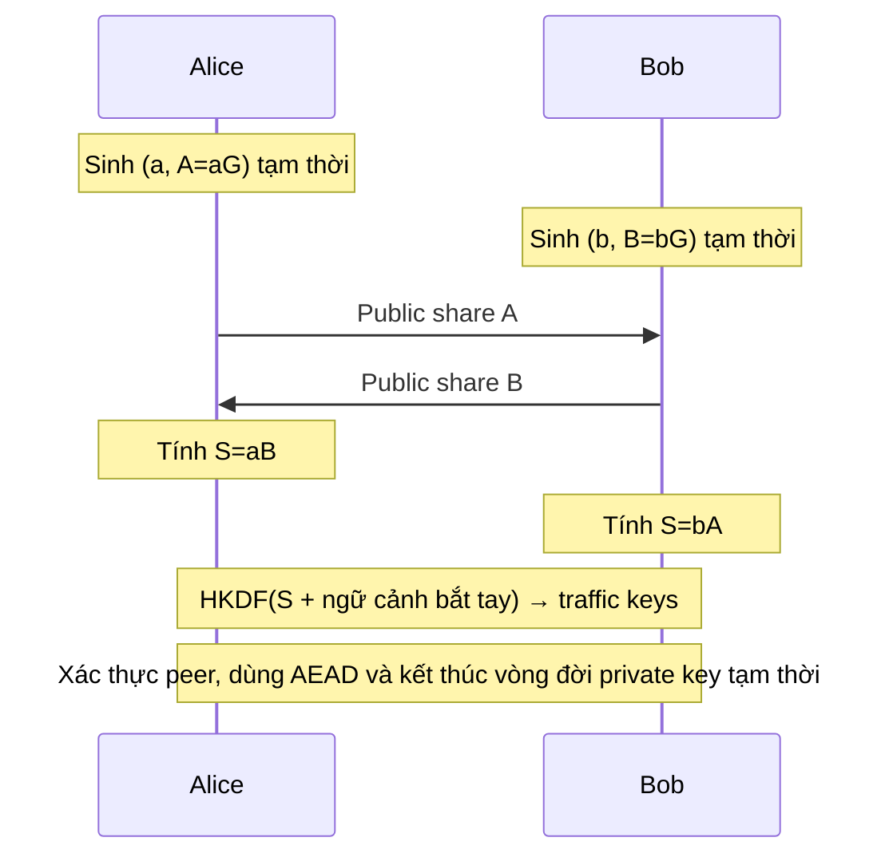
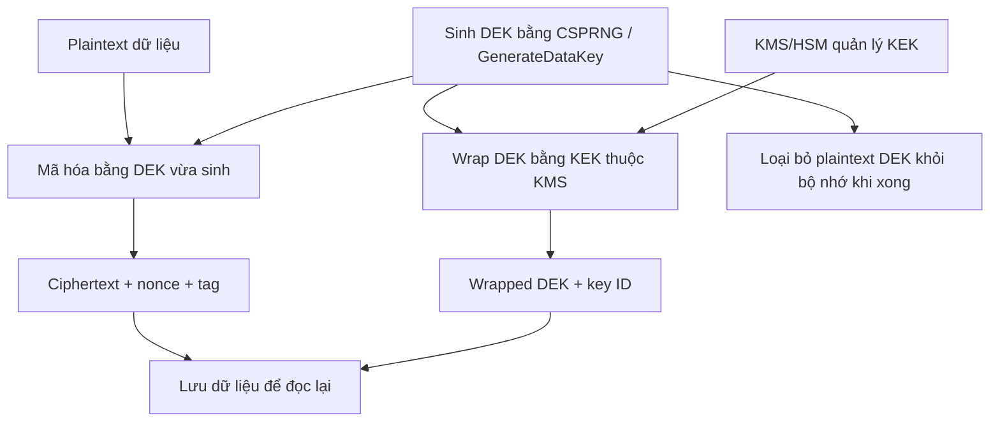

# Ephemeral key: khóa tạm thời và vai trò trong quản lý khóa mật mã

> **Chương:** Phân loại key  
> **Module:** SECURITY_KEY_MANAGEMENT_FUNDAMENTALS

**Ephemeral key (khóa tạm thời)** là khóa mật mã được tạo để dùng trong **một phiên, một lần trao đổi, một giao dịch hoặc một khoảng thời gian ngắn được xác định**, thay vì dùng lâu dài cho nhiều mục đích. Khóa thường được tạo mới theo từng phạm vi sử dụng và vật liệu bí mật của khóa được loại bỏ khi không còn cần thiết. Ví dụ tiêu biểu là cặp khóa Diffie–Hellman tạm thời trong một phiên TLS dùng (EC)DHE, hoặc khóa mã hóa phiên được dẫn xuất từ quá trình bắt tay.

“Ephemeral” mô tả **vòng đời và phạm vi sử dụng**, không chỉ độ dài hay loại thuật toán: khóa tạm thời có thể là **khóa đối xứng** hoặc **khóa riêng trong cặp khóa bất đối xứng**. Không có quy tắc rằng cứ dùng AES là khóa dài hạn, hay cứ dùng elliptic curve là khóa tạm thời.

Bài học này giúp bạn:

- Nhận diện ephemeral key và phân biệt với **long-term key**, **session key**, **one-time key**, **nonce**, **DEK/KEK**.
- Hiểu cách cặp khóa (EC)DHE tạm thời góp phần tạo **forward secrecy**, và giới hạn thực tế của thuộc tính đó.
- Theo dõi vòng đời tạo, trao đổi, sử dụng, xoay vòng, vô hiệu hóa và hủy vật liệu khóa tạm thời.
- Hiểu cách kết hợp ephemeral key với **mật mã đối xứng, bất đối xứng, chữ ký số, KMS/HSM, envelope encryption, IAM và kiểm toán**.
- Xác định các lỗi triển khai làm mất lợi ích của khóa tạm thời như tái sử dụng khóa, lộ bộ nhớ, bỏ qua xác thực peer và dùng nonce sai cách.

## 1. “Ephemeral” thực sự có nghĩa gì?

Một khóa được xem là *ephemeral* khi kiến trúc gắn nó với một **ngữ cảnh ngắn hạn** và có chính sách kết thúc đời sống vật liệu bí mật của khóa. Ba đặc điểm thường gặp:

1. **Tạo mới theo phạm vi:** mỗi phiên hoặc nhóm thao tác có một khóa riêng, giảm việc dùng một khóa chung cho lượng dữ liệu quá lớn.
2. **Thời gian tồn tại có giới hạn:** vật liệu khóa chỉ cần khả dụng trong khoảng xử lý phiên/giao dịch. Việc giữ khóa lại lâu hơn phải có lý do rõ ràng.
3. **Giảm phụ thuộc vào bí mật dài hạn:** ví dụ khóa bắt tay ECDHE được sinh độc lập với private key dùng để xác thực server; việc lộ khóa xác thực về sau có thể không đủ để tính lại khóa phiên cũ.

Không có một TTL cố định như “dưới 5 phút” để phân loại mọi ephemeral key. Một phiên có thể kéo dài giây, phút hoặc lâu hơn; tiêu chí quyết định là **phạm vi sử dụng và quy tắc kết thúc/không tái sử dụng** của giao thức, kèm các yêu cầu cryptoperiod và key update thích hợp.

**Chú ý:** ephemeral **không có nghĩa** “không quan trọng vì sống ngắn”. Nếu kẻ tấn công chiếm được khóa phiên đang hoạt động, nội dung giao tiếp thuộc phiên đó có thể bị lộ hoặc bị giả mạo. Khóa tồn tại ngắn vẫn phải được sinh, sử dụng và bảo vệ đúng cách.

### 1.1. Phân loại theo mục đích, không theo tên

| Đối tượng | Ephemeral trong trường hợp nào? | Lưu ý quản lý |
|---|---|---|
| **Ephemeral ECDH private key** | Sinh mới cho một lần bắt tay/trao đổi, xóa sau khi dẫn xuất bí mật phiên | Public key tương ứng có thể gửi công khai; private key phải được bảo vệ |
| **Session traffic key** (khóa đối xứng mã hóa phiên) | Dẫn xuất hoặc tạo cho một phiên/epoch giao tiếp, thay khi rekey hoặc kết thúc phiên | Cần quản lý nonce/sequence, hướng truyền và giới hạn lượng dữ liệu |
| **One-time key** | Thiết kế để dùng một lần cho đúng một thao tác | “One-time” mô tả mức hạn chế sử dụng; có thể là ephemeral nhưng không phải khái niệm đồng nghĩa |
| **DEK cho một yêu cầu xử lý** | Sinh và dùng trong bộ nhớ cho một tác vụ ngắn, sau đó bỏ, khi không cần giải mã lại | Có thể gọi là khóa dữ liệu tạm thời nếu không lưu bản phục hồi |
| **DEK được wrap và lưu cùng ciphertext** | Plaintext DEK trong bộ nhớ có thể chỉ tồn tại ngắn hạn; **khả năng khôi phục DEK** vẫn phải tồn tại để đọc dữ liệu sau này | Không nên gọi toàn bộ vòng đời DEK này là “chỉ dùng một lần rồi biến mất” |
| **KEK/master key của KMS** | Thường **không ephemeral** vì phải phục vụ lâu dài và/hoặc giải mã dữ liệu lịch sử | Quản lý phiên bản, quyền sử dụng, rotation và hủy có kiểm soát |
| **Private key ký certificate/JWT** | Thường có thời hạn quản trị dài hơn một phiên; dùng để xác thực hoặc ký | Tách khỏi khóa bắt tay tạm thời; không xuất private key nếu dùng KMS/HSM được |
| **Nonce/IV** | Có thể là giá trị công khai, chỉ dùng một lần theo quy tắc của thuật toán | **Không phải khóa**, không thay thế ephemeral key hay độ ngẫu nhiên của khóa |
| **API key / access token** | Dù token sống rất ngắn, về chức năng nó thường là **credential** | Thuộc secrets/credential management; tên gọi “key” không biến nó thành khóa mật mã |

Khái niệm **session key** thường gần với ephemeral key nhưng không hoàn toàn trùng: session key cho biết **mục đích sử dụng trong phiên**; ephemeral cho biết **vòng đời ngắn hạn**. Một giao thức có thể dẫn xuất **nhiều session traffic key** từ một bí mật chung, ví dụ khóa client-to-server và server-to-client riêng biệt.

## 2. Ephemeral key trong mật mã bất đối xứng: (EC)DHE

Ứng dụng nổi bật nhất của ephemeral key là **ephemeral Diffie–Hellman key exchange**. Hai bên trao đổi public key tạm thời, tính cùng một shared secret mà không cần gửi shared secret qua mạng.

Với biểu diễn toán học ECDH đơn giản trên một nhóm elliptic curve:

- Alice sinh **private scalar tạm thời** \(a\) và public key \(A=aG\).
- Bob sinh **private scalar tạm thời** \(b\) và public key \(B=bG\).
- Alice tính \(S=aB\); Bob tính \(S=bA\). Hai kết quả cùng là \(abG\).
- Hai bên đưa secret chung qua **KDF** phù hợp (ví dụ HKDF), kết hợp ngữ cảnh bắt tay và thông tin cần ràng buộc để sinh traffic keys.

Đây là mô hình để hiểu (EC)DHE; triển khai như X25519 có quy tắc tính toán và kiểm tra riêng, không nên tự viết phép toán điểm elliptic curve. **Shared secret thô chưa phải khóa AES cuối cùng**: giao thức cần key derivation đúng cách và thường phải dẫn xuất riêng các khóa theo hướng truyền và mục đích.



**Public share không cần giữ bí mật.** Điều phải giữ bí mật là private scalar/private key và kết quả dẫn xuất nhạy cảm. Việc thay một public share trên đường truyền có thể tạo cuộc tấn công **man-in-the-middle (MITM)** nếu giao thức không xác thực đối tác và ràng buộc các giá trị bắt tay với danh tính/khóa xác thực.

### 2.1. Phân biệt ECDH tĩnh và ECDHE

| Đặc điểm | Static ECDH (khóa dài hạn) | ECDHE (khóa tạm thời) |
|---|---|---|
| Private key dùng cho key agreement | Có thể tái sử dụng cho nhiều phiên | Sinh mới theo phiên/lượt trao đổi theo giao thức |
| Vòng đời private key | Dài hơn, cần chính sách lưu trữ và rotation | Ngắn, không cần lưu để tái tạo phiên cũ sau khi hoàn tất |
| Nếu private key bị lộ trong tương lai | Có thể ảnh hưởng tới các phiên cũ, tùy thiết kế | Khi ephemeral secret cũ đã bị xóa và giao thức bảo đảm forward secrecy, lộ **khóa xác thực dài hạn** về sau không đủ để giải mã phiên cũ |
| Chi phí | Có thể bớt thao tác sinh khóa | Phải tạo/xử lý khóa tạm thời cho các phiên |

Thuật ngữ **DHE** thường nói đến Diffie–Hellman ephemeral trên nhóm hữu hạn, còn **ECDHE** là biến thể elliptic curve. Trong các giao thức hiện đại, **X25519** là một lựa chọn phổ biến để thỏa thuận bí mật tạm thời; thông số và tính hợp lệ của key share phải được xử lý bằng thư viện/giao thức được kiểm chứng.

## 3. Vì sao ephemeral key có thể mang lại forward secrecy?

**Forward secrecy (FS)** là thuộc tính bảo vệ **bí mật của các phiên đã kết thúc** trước việc một số bí mật dài hạn bị lộ về sau. Một ví dụ:

1. Hôm nay Alice kết nối server. Hai bên dùng ECDHE và xác thực server bằng certificate/chữ ký; ephemeral private keys và các secret phiên liên quan được loại bỏ khi không còn cần.
2. Kẻ tấn công chỉ **ghi lại ciphertext của phiên hôm nay**.
3. Nhiều tháng sau, kẻ tấn công lấy được **private key dài hạn dùng để xác thực server**.
4. Nếu giao thức dùng ECDHE được triển khai đúng, ephemeral secrets của phiên cũ không bị lưu/lộ và các điều kiện an toàn khác được đáp ứng, private key xác thực vừa bị lộ **không đủ để tái tính traffic key cũ** từ bản ghi bắt tay.

Đây là lợi ích của việc tách **khóa xác thực dài hạn** khỏi **khóa trao đổi bí mật tạm thời**, không phải một tính năng có được chỉ vì đổi tên biến thành `ephemeralKey`.

### 3.1. Forward secrecy không bảo vệ mọi trường hợp

- Nếu attacker chiếm máy và **đọc ephemeral private key, shared secret hoặc traffic key khi phiên còn hoạt động**, dữ liệu thuộc phiên đó vẫn có nguy cơ.
- Nếu plaintext đã xuất hiện trong log, cache, memory dump, telemetry hoặc máy đích bị xâm nhập, việc dùng ECDHE không xóa những bản sao đó.
- Nếu một “ephemeral private key” thực tế bị **tái sử dụng, backup hoặc lưu vĩnh viễn**, giả định về việc hủy secret phiên không còn đúng.
- Nếu giao thức **không xác thực public share và đối tác**, attacker có thể MITM ngay lúc bắt tay; forward secrecy không thay cho authentication.
- Nếu cấu hình giao thức cho phép **không dùng trao đổi DH mới** ở một số phiên, không được tự suy luận mọi phiên đều có mức FS giống nhau.
- FS cho phiên trước không tự đồng nghĩa với **post-compromise security**: khả năng phục hồi bảo mật cho **các phiên tương lai** sau một lần xâm phạm là mục tiêu riêng, cần cơ chế cập nhật key/ratchet và khôi phục danh tính phù hợp.

Ví dụ trong **TLS 1.3**, các chế độ bắt tay dùng (EC)DHE cung cấp cơ sở để bảo vệ bí mật lưu lượng ứng dụng đã kết thúc. Khi có **PSK resumption**, cần phân biệt PSK-only với PSK+DHE; ngoài ra **0-RTT early data** không có forward secrecy theo cùng nghĩa như lưu lượng thông thường được bảo vệ bởi (EC)DHE. Vì vậy, khi đánh giá FS phải xem **chế độ bắt tay thực tế**, không chỉ tên phiên bản TLS.

### 3.2. Ký số và khóa tạm thời làm hai việc khác nhau

Trong TLS dùng certificate, **private key ký lâu dài** chứng minh server có quyền đối với danh tính được tin cậy; **ephemeral DH key** tham gia dẫn xuất bí mật phiên. Chữ ký/ràng buộc bản transcript khiến kẻ khác khó thay public share mà vẫn qua xác thực.

Điểm cần ghi nhớ: **ECDHE không tự xác thực danh tính**, và **chữ ký số không tự tạo forward secrecy**. Một giao thức an toàn cần cả trao đổi khóa, xác thực, KDF, mã hóa có xác thực và kiểm tra transcript được phối hợp đúng.

## 4. Dòng thời gian của một phiên dùng ephemeral key

Giả sử client mở kết nối HTTPS đến API:

```text
t0  Client, server tạo ephemeral (EC)DH key pair cho handshake
t1  Hai bên trao đổi public shares, xác thực handshake/peer
t2  Dẫn xuất handshake/traffic secrets và khóa mã hóa cho các hướng truyền
t3  Dùng traffic keys với AEAD bảo vệ bản ghi trong phiên
t4  Có thể cập nhật traffic keys theo quy tắc giao thức
t5  Kết thúc phiên và bỏ ephemeral private key, traffic keys/secret không cần nữa
```

Các bước trên là **mô hình khái niệm**, không đại diện chính xác mọi thông điệp/trạng thái của TLS. Trong triển khai thật, có những secret được dẫn xuất và loại bỏ ở từng giai đoạn, không nhất thiết mọi key tồn tại từ đầu đến cuối. Ticket/PSK phục vụ resumption (nếu dùng) có vòng đời riêng.

### 4.1. Private key tạm thời, shared secret và traffic key không đồng nghĩa

| Giá trị | Chức năng | Có được gửi qua mạng? | Đời sống mong muốn |
|---|---|---|---|
| **Ephemeral private key** | Tính key agreement | Không | Cho một lần bắt tay/phiên theo thiết kế |
| **Ephemeral public key/share** | Gửi cho peer để họ tính shared secret | Có | Có thể xuất hiện trong bản ghi bắt tay |
| **ECDH shared secret** | Đầu vào bí mật của KDF | Không | Giữ đến khi dẫn xuất xong các secret cần thiết |
| **Handshake/traffic secret** | Đầu vào dẫn xuất các khóa cụ thể | Không | Theo state machine của giao thức |
| **Traffic key** | Mã hóa/kiểm tra bản ghi với AEAD | Không | Theo phiên hoặc epoch cho đến rekey/kết thúc |
| **Nonce/IV** | Làm tham số riêng cho phép toán AEAD | Có thể được suy ra/truyền công khai | Theo từng bản ghi, tuân thủ quy tắc duy nhất của thuật toán |

Không lấy trực tiếp byte của ECDH shared secret rồi mặc nhiên dùng làm AES key. KDF phải ràng buộc ngữ cảnh, độ dài và các khóa riêng cho mục đích khác nhau; **AES-GCM** cần bảo đảm nonce không được tái sử dụng với cùng khóa. Cùng một traffic key chỉ nên dùng trong giới hạn bản ghi/lượng dữ liệu cho phép của giao thức.

## 5. Minh họa bằng Java: tạo cặp khóa X25519 tạm thời

Java có thể cung cấp các thuật toán key agreement thông qua **JCA/JCE**. Ví dụ Java 17 sau minh họa **hai bên tự tạo private key tạm thời** và tính ra cùng một shared secret. Đây chỉ là demo nguyên lý của X25519, **không phải một giao thức truyền thông an toàn hoàn chỉnh**:

```java
import java.security.KeyPair;
import java.security.KeyPairGenerator;
import java.security.MessageDigest;
import java.util.Arrays;
import javax.crypto.KeyAgreement;

public final class EphemeralX25519Demo {
    private static byte[] agree(KeyPair self, KeyPair peer)
            throws Exception {
        KeyAgreement agreement = KeyAgreement.getInstance("X25519");
        agreement.init(self.getPrivate());
        agreement.doPhase(peer.getPublic(), true);
        return agreement.generateSecret();
    }

    public static void main(String[] args) throws Exception {
        KeyPairGenerator generator =
                KeyPairGenerator.getInstance("X25519");

        // Mỗi bên sinh cặp khóa mới cho lần trao đổi này.
        KeyPair alice = generator.generateKeyPair();
        KeyPair bob = generator.generateKeyPair();

        byte[] aliceSecret = agree(alice, bob);
        byte[] bobSecret = agree(bob, alice);

        if (!MessageDigest.isEqual(aliceSecret, bobSecret)) {
            throw new IllegalStateException("Key agreement failed");
        }

        System.out.println("Hai bên tính được cùng shared secret.");
        // Dùng giao thức và KDF được kiểm chứng để dẫn xuất
        // khóa riêng theo hướng truyền/ngữ cảnh trước khi mã hóa.
        // Không log hoặc dùng trực tiếp shared secret làm khóa AES.

        // Chỉ xóa được những mảng byte mà ứng dụng kiểm soát.
        Arrays.fill(aliceSecret, (byte) 0);
        Arrays.fill(bobSecret, (byte) 0);
    }
}
```

**Điểm cần hiểu từ đoạn code:**

1. Mỗi bên gọi `generateKeyPair()` để tạo **cặp mới**; public key có thể gửi cho peer, private key phải giữ kín.
2. `KeyAgreement` tạo shared secret giống nhau nếu public/private key thuộc đúng một lần trao đổi. Với kênh thật, **phải xác thực peer/public share và transcript**; chương trình trên **chưa làm** việc này nên sẽ không chống được MITM khi đặt qua mạng.
3. Để có khóa phiên an toàn, cần **KDF chuẩn** (chẳng hạn HKDF) và thiết kế transcript/key schedule đầy đủ, sau đó dùng **AEAD** và bảo vệ nonce. Nên dùng **TLS/JSSE hoặc thư viện giao thức đã được kiểm chứng** thay vì tự dựng một giao thức mới chỉ từ API JCA.
4. `Arrays.fill(...)` chỉ là biện pháp tốt nhất có thể với mảng byte đang nắm giữ; Java/JVM và nhà cung cấp JCA có thể lưu **những bản sao khác** của vật liệu nhạy cảm. Không thể khẳng định đã xóa sạch private key nội bộ, bộ nhớ native hay heap dump chỉ bằng thao tác này.
5. Trong một giao thức thật, cả phía client và server phải xử lý private key, secret trung gian, session key và hủy state theo cơ chế của thư viện. Không dùng demo để truyền dữ liệu thật hoặc thay thế TLS.

## 6. Ephemeral key trong mật mã đối xứng và xử lý dữ liệu

Một **ephemeral symmetric key** có thể là khóa AES được sinh riêng cho một phiên trao đổi hoặc một lần xử lý dữ liệu. Ưu điểm là **cô lập phạm vi**: lộ khóa của phiên A không nhất thiết cho phép giải mã phiên B, miễn các khóa độc lập và không có secret chung khác bị xâm phạm.

Ví dụ ứng dụng nhận một tệp nhạy cảm, xử lý trong bộ nhớ và truyền nội dung qua kênh được mã hóa bằng khóa tạm thời; khi phiên kết thúc, không cần giải mã tệp lại, nên có thể loại bỏ khóa. Đây là trường hợp ephemeral rõ ràng.

Tuy nhiên với **dữ liệu mã hóa at rest**, thường cần đọc lại sau vài ngày hoặc vài năm. Khi đó, dùng một DEK mới cho từng đối tượng rồi **wrap DEK bằng KEK** bảo vệ khóa trong quá trình lưu trữ, nhưng wrapped DEK sẽ được lưu để còn giải mã lại. Bản plaintext DEK có thể chỉ tồn tại rất ngắn trong bộ nhớ của request, còn **vòng đời logic của DEK và ciphertext được bảo vệ bởi nó** dài hơn nhiều.

### 6.1. Ephemeral plaintext DEK không đồng nghĩa DEK đã biến mất



Khi người dùng đọc dữ liệu về sau, hệ thống **unwrap wrapped DEK** theo chính sách KMS, dùng DEK để giải mã rồi lại loại bỏ plaintext DEK khỏi bộ nhớ. Vì vậy:

- **Plaintext DEK trong một lần xử lý** là ngắn hạn.
- **Wrapped DEK** có thể tồn tại lâu cùng ciphertext để hỗ trợ giải mã.
- **KEK** thường có tuổi thọ và trách nhiệm khác, được KMS/HSM kiểm soát.
- **Rotation KEK** không tự biến DEK cũ thành “ephemeral” hoặc khiến ciphertext cũ được mã hóa lại; nếu cần thay DEK phải reencrypt dữ liệu có liên quan.

Không nên gọi một khóa là “an toàn vì ephemeral” nếu giá trị đó thực tế được export, backup hoặc lưu trong ciphertext có thể khôi phục trong nhiều năm. Hãy ghi rõ **cái gì đã xóa**, **cái gì còn khôi phục được** và **ai có quyền khôi phục**.

## 7. Vòng đời quản lý ephemeral key

Khóa tạm thời vẫn đi qua các bước cốt lõi của **key management**, chỉ khác về quy mô và nhịp độ:

| Giai đoạn | Yêu cầu kỹ thuật | Ví dụ |
|---|---|---|
| **Tạo khóa** | CSPRNG/thuật toán an toàn; tạo mới theo phiên; chọn đúng loại và độ dài khóa | X25519 ephemeral key pair, symmetric traffic key dẫn xuất từ HKDF |
| **Cấp phát/trao đổi** | Public share được truyền theo giao thức; xác thực peer và ràng buộc transcript; không gửi private key | Handshake (EC)DHE |
| **Lưu trữ** | Ưu tiên bộ nhớ của tiến trình trong thời gian cần; tránh ghi disk/log/snapshot; giới hạn bản sao | Ephemeral private scalar, ECDH shared secret |
| **Sử dụng** | Đúng phép toán/mục đích; KDF tách khóa; AEAD/nonce đúng quy tắc; hạn chế số bản ghi/lượng dữ liệu | Traffic keys client→server và server→client |
| **Cập nhật/xoay vòng** | Sinh key share mới cho phiên mới; thực hiện protocol rekey/key update khi đạt ngưỡng hoặc chính sách | TLS key update; bắt tay mới khi tạo kết nối mới |
| **Thu hồi/vô hiệu hóa** | Ngắt phiên, từ chối identity/session bị chiếm, thay key state theo giao thức | Đóng TLS session bị nghi lộ, buộc bắt tay lại |
| **Hủy** | Loại bỏ secret khi không còn dùng, xóa các buffer có thể, ngăn heap/core dump và snapshot không cần thiết | Bỏ ECDH private key sau handshake, bỏ traffic secret khi hết phiên |

### 7.1. Khác biệt với rotation của khóa dài hạn

Với một **KEK dài hạn** trong KMS, người vận hành thường quản lý ID, phiên bản, trạng thái, lịch rotation, khả năng decrypt dữ liệu cũ và thời gian chờ xóa. Với **ephemeral key**, vòng đời có thể diễn ra trong từng phiên mà không có một bản ghi inventory trung tâm cho từng key:

- Khóa được **sinh trực tiếp trong giao thức** với tiêu chí an toàn và ngẫu nhiên rõ ràng.
- Chính sách bảo mật thường dựa trên **version/algorithm/cipher suite của giao thức**, thời lượng phiên, key update và thực thi xóa secret trong thư viện.
- Kiểm toán thường ghi lại **metadata phiên, danh tính peer, phiên bản giao thức, kết quả xác thực, sự kiện rekey và lỗi**, thay vì quản lý một alias cho mỗi private key thoáng qua.

Điều này **không có nghĩa ephemeral key nằm ngoài phạm vi kiểm toán**. Mục tiêu là quan sát được sử dụng và cấu hình sai mà không tạo ra nhật ký chứa key material.

### 7.2. “Xóa khóa” trong bộ nhớ không phải thao tác hoàn hảo

Trong ngôn ngữ và môi trường runtime quản lý bộ nhớ, việc bảo đảm xóa mọi bản sao key material là rất khó. Một biến `byte[]` có thể được ghi đè, nhưng dữ liệu có thể từng được sao chép sang vùng nhớ của thư viện, buffer native, heap dump, swap hoặc crash report. Với `PrivateKey` trong Java, không phải mọi provider đều cho phép chủ động xóa sạch vật liệu đang lưu.

Do đó cần **defense in depth**: giảm thời gian tồn tại secret, hạn chế process access, không xuất secret ra log, quản lý heap dump/core dump, cô lập máy chạy và dùng implementation mật mã đã được kiểm chứng. “Ephemeral” là **quyết định thiết kế** và **mục tiêu vòng đời**, không phải lời hứa rằng byte khóa không thể còn sót ở bất kỳ đâu.

## 8. KMS/HSM và ephemeral key: phần nào nên đặt ở đâu?

**KMS (Key Management Service)** thường đặc biệt hữu ích cho **khóa gốc/KEK hoặc private key dài hạn**: giữ khóa trong ranh giới an toàn, cấp quyền `Sign`, `Decrypt`, `GenerateDataKey` hoặc wrap/unwrap, quản lý policy, rotation và audit. **HSM** có thể tạo/lưu khóa và thực thi phép toán nhạy cảm trong phần cứng. Khả năng hỗ trợ ephemeral key, thuật toán key agreement, export và hiệu năng phụ thuộc sản phẩm.

Không phải mọi private key tạm thời đều cần được lưu trong KMS. Với trao đổi ECDHE tần suất cao, TLS stack có thể sinh ephemeral key pair ngay trong tiến trình và xóa theo state machine; KMS/HSM có thể bảo vệ **private key dài hạn dùng xác thực**. Một số môi trường có yêu cầu phần cứng cao hơn sẽ dùng cơ chế key agreement được HSM hỗ trợ, nhưng cần kiểm tra tính năng thực tế và mô hình đe dọa.

### 8.1. So sánh trách nhiệm

| Thành phần | Vai trò hợp lý | Không nên giả định |
|---|---|---|
| **TLS/crypto library** | Sinh key share tạm thời, key agreement, KDF, traffic keys, AEAD, key update | Mọi phiên TLS đều có FS bất kể cấu hình |
| **KMS/HSM** | Bảo vệ khóa xác thực dài hạn hoặc KEK, kiểm soát phép toán và audit | Tự động xóa mọi plaintext traffic key mà ứng dụng đã tạo |
| **Secrets manager** | Phân phối certificate credential/secret vận hành khi thiết kế cần; quản lý rotation secret | Access token ngắn hạn là ephemeral cryptographic key |
| **IAM/workload identity** | Giới hạn ai được ký bằng private key dài hạn, unwrap DEK hoặc dùng dịch vụ | Không có lộ key material thì quyền lạm dụng KMS sẽ vô hại |
| **Audit/observability** | Ghi handshake metadata, KMS action, thay policy, tình trạng rekey và bất thường | Được ghi private scalar, shared secret, DEK hay traffic key để “debug” |

Một thiết kế tốt thường **tách ranh giới khóa**: private key ký chứng thư hoặc KEK ở trong KMS/HSM, ephemeral key của từng phiên ở TLS stack, và session traffic keys chỉ tồn tại trong thời gian cần mã hóa kênh.

## 9. Rủi ro thường gặp khi dùng ephemeral key

### 9.1. Tái sử dụng khóa tạm thời

Nếu cùng một ephemeral key pair được dùng cho nhiều phiên trái với thiết kế giao thức, giới hạn ảnh hưởng và tiền đề an toàn có thể suy yếu. Cần kiểm tra giao thức có cho phép reuse hay không; đừng tự tối ưu “cache private key để giảm CPU” mà không đánh giá bảo mật.

### 9.2. Lộ private key hoặc traffic secret trong lúc phiên đang chạy

Ephemeral key không chống được kẻ có quyền đọc bộ nhớ của tiến trình trong thời điểm bí mật còn hiện diện. Attackers có thể lấy session traffic key hoặc plaintext từ endpoint. Hạn chế RCE, debug API, heap/core dump và quyền truy cập runtime là việc thiết yếu.

### 9.3. Không xác thực đối tác trong key exchange

Key agreement tự thân chỉ cho phép hai bên tạo secret theo public shares họ nhận được. Nếu không có authentication và transcript binding, attacker có thể dựng hai khóa phiên độc lập với Alice và Bob, đọc/sửa dữ liệu giữa hai kênh. Đây là lỗi MITM, **không khắc phục được bằng cách tạo ephemeral key thường xuyên hơn**.

### 9.4. Dùng shared secret sai cách

Truyền raw ECDH secret trực tiếp cho AES hoặc dùng cùng một khóa cho cả ký MAC, mã hóa và hai hướng truyền mà không qua KDF đúng cách có thể gây lỗi phân tách mục đích. Dùng HKDF/key schedule theo đặc tả giao thức với ngữ cảnh, transcript và độ dài hợp lệ.

### 9.5. Lặp nonce với cùng khóa AEAD

Một khóa phiên dùng AES-GCM sống rất ngắn vẫn có thể mất tính bảo mật khi nonce bị lặp cho hai bản tin với cùng khóa. Số đếm/nonce phải được tạo và quản lý đúng giao thức; key update khi đạt giới hạn được quy định.

### 9.6. Nhầm “ngắn hạn” với “đã thu hồi”

Nếu attacker giữ session key đang hiệu lực, việc chờ TTL hết có thể cho phép tiếp tục khai thác. Cần **đóng phiên, rút quyền, ngừng chấp nhận credential liên quan và buộc key agreement mới** theo cách được giao thức hỗ trợ. Không thể “thu hồi” một bản sao khóa đối xứng đã lộ chỉ bằng cách xóa biến cục bộ.

### 9.7. Nhầm ephemeral DEK với dữ liệu không cần truy cập lại

Với envelope encryption, nếu xóa toàn bộ DEK và không lưu được wrapped DEK hoặc đường khôi phục, ciphertext có thể trở nên **không thể giải mã**. Đặt vòng đời DEK theo yêu cầu lưu dữ liệu; chỉ loại bỏ **plaintext key trong bộ nhớ** khi không còn cần cho request.

## 10. Nếu ephemeral key bị compromise thì làm gì?

Phân biệt **lộ vật liệu khóa** với **lạm dụng quyền KMS** và **lộ private key xác thực dài hạn**. Cách phản ứng khác nhau:

| Sự cố | Ảnh hưởng chính | Hướng xử lý |
|---|---|---|
| **Ephemeral private key của phiên đang chạy bị lộ** | Có nguy cơ lộ secret/traffic keys của phiên đó nếu có thêm ngữ cảnh cần thiết | Chấm dứt phiên, loại bỏ state, thiết lập phiên mới trên endpoint đã được kiểm tra; đánh giá dữ liệu phiên đã bị đọc/sửa |
| **Traffic key đối xứng bị lộ** | Có thể giải mã/giả mạo trong phạm vi bản ghi, hướng truyền và epoch dùng key đó | Đóng hoặc rekey phiên theo giao thức, khoanh vùng log, xử lý endpoint và payload bị ảnh hưởng |
| **Private key xác thực server dài hạn bị lộ** | Nguy cơ giả mạo server; có thể ảnh hưởng các phiên không có FS | Thu hồi/thay certificate/key, sửa trust, đánh giá chế độ giao thức và thời điểm ảnh hưởng |
| **KMS grant/credential bị chiếm** | Kẻ tấn công có thể gọi `Sign`, `Decrypt` hoặc unwrap với quyền tương ứng | Rút grant/phiên, kiểm toán thao tác, giới hạn IAM, xác định dữ liệu/khóa phải thay |
| **DEK được wrap dùng lâu dài bị lộ plaintext** | Dữ liệu at rest dưới DEK bị đe dọa | Sinh DEK mới, mã hóa lại dữ liệu và xử lý bản backup/phạm vi liên quan |

**Forward secrecy có giới hạn thời gian:** nó hướng đến việc bảo vệ các phiên đã kết thúc khi **bí mật dài hạn bị lộ về sau**, trong điều kiện ephemeral secrets không bị lộ. Nó không hồi phục bí mật đã bị lấy trong một phiên đang hoạt động. Sau sự cố, vẫn phải phân tích log, dữ liệu đã xử lý và quyền bị lạm dụng.

## 11. Checklist thiết kế và vận hành

Khi lựa chọn ephemeral key cho ứng dụng, hãy kiểm tra lần lượt:

1. **Khóa này phục vụ phạm vi nào?** Một handshake, một phiên, một hướng truyền, một giao dịch hay một bản ghi? Có lý do chính đáng để tái sử dụng không?
2. **Ai sinh khóa?** Có dùng CSPRNG, thuật toán và tham số được giao thức/thư viện hỗ trợ? Có sinh mới cho từng phiên yêu cầu không?
3. **Đối tác được xác thực bằng cách nào?** Certificate, chữ ký số hoặc cơ chế chứng thực được giao thức quy định có gắn với key share và transcript không?
4. **Khóa được dẫn xuất thế nào?** Có KDF chuẩn, domain separation, khóa riêng theo vai trò/hướng truyền, và nonce/sequence đúng yêu cầu AEAD không?
5. **Khóa ở đâu và tồn tại bao lâu?** Có tránh log, disk, crash dump, debug endpoint và bản sao ngoài dự kiến không? Khi nào secret được giải phóng?
6. **Nếu phiên dài thì rekey ra sao?** Có giới hạn lượng dữ liệu và xử lý key update/renegotiation theo giao thức không?
7. **Có yêu cầu forward secrecy không?** Đã xác nhận chế độ bắt tay thực tế và cách xử lý PSK/0-RTT nếu liên quan chưa?
8. **Vai trò KMS/HSM là gì?** Chúng bảo vệ KEK/private key dài hạn hay thực hiện key agreement? Ai được cấp `Sign/Decrypt/GenerateDataKey`?
9. **Có cần đọc lại dữ liệu sau này không?** Nếu có, phải thiết kế lưu wrapped DEK và metadata; không được xóa mất khả năng giải mã hợp lệ.
10. **Ứng phó khi compromise thế nào?** Có thể kết thúc session, vô hiệu hóa identity, thay khóa/trust, kiểm tra log và phục hồi dịch vụ không?

## 12. Câu hỏi tự kiểm tra

**1. Ephemeral key có bắt buộc là public/private key pair không?**  
Không. Khóa AES phiên hoặc key đối xứng dùng một lần cũng có thể là ephemeral. ECDHE sử dụng ephemeral private/public key pair là trường hợp điển hình của mật mã bất đối xứng.

**2. Có thể gửi ephemeral public key qua mạng không?**  
Có. Public share được thiết kế để trao đổi. Cần xác thực peer và ràng buộc transcript, bởi attacker có thể **thay thế public share** trong giao thức không có authentication.

**3. Vì sao ECDHE hỗ trợ forward secrecy?**  
Vì shared secret của phiên phụ thuộc private keys tạm thời độc lập với private key xác thực dài hạn. Khi ephemeral secrets cũ đã được loại bỏ và giao thức đúng, lộ private key xác thực sau này không đủ để tái tính traffic keys của phiên đã kết thúc.

**4. Một DEK được wrap và lưu 5 năm có phải biến mất sau request không?**  
Chỉ **bản plaintext DEK trong memory** có thể được xóa sau request. Wrapped DEK vẫn còn để có thể unwrap và giải mã dữ liệu trong tương lai; đó là một vòng đời dữ liệu dài hạn.

**5. HMAC key hoặc token có TTL ngắn có tự bảo đảm forward secrecy không?**  
Không. TTL ngắn không tự sinh ra thuộc tính FS. Cần xem cách dẫn xuất khóa, xác thực, giao thức trao đổi và việc xóa bí mật phiên. Token trước hết là credential.

**6. Xóa mảng byte trong Java đã đủ bảo đảm ephemeral private key bị hủy hoàn toàn chưa?**  
Chưa. Thư viện/provider, bản sao khác trong bộ nhớ hoặc dump có thể chứa vật liệu nhạy cảm. Phải giảm nơi và thời gian tồn tại key material, dùng thư viện chuẩn và quản lý quyền truy cập runtime.

## 13. Ghi nhớ

**Ephemeral key là khóa có vòng đời được ràng buộc chặt vào một phiên hoặc một tác vụ**, được tạo mới và loại bỏ khi hết nhu cầu, nhằm giảm thời gian tồn tại và phạm vi ảnh hưởng của việc lộ khóa. Trong (EC)DHE, ephemeral private key giúp tạo shared secret để dẫn xuất traffic keys; kết hợp với **xác thực và key schedule đúng**, nó đóng vai trò quan trọng đối với **forward secrecy**.

Ephemeral key vẫn cần **tạo an toàn → cấp phát/trao đổi đúng giao thức → bảo vệ khi lưu trong bộ nhớ → sử dụng đúng mục đích → cập nhật/xoay vòng khi cần → vô hiệu hóa phiên bị nghi lộ → hủy khi hết nhu cầu**. Khi thiết kế cùng KMS/HSM và envelope encryption, phải phân biệt **khóa ngắn hạn trong bộ nhớ** với **khóa dữ liệu cần tồn tại dưới dạng được bảo vệ để giải mã lại**. Cách phân loại chính xác giúp hệ thống vừa giữ được tính bí mật của phiên, vừa không mất dữ liệu vì quản lý sai vòng đời khóa.
