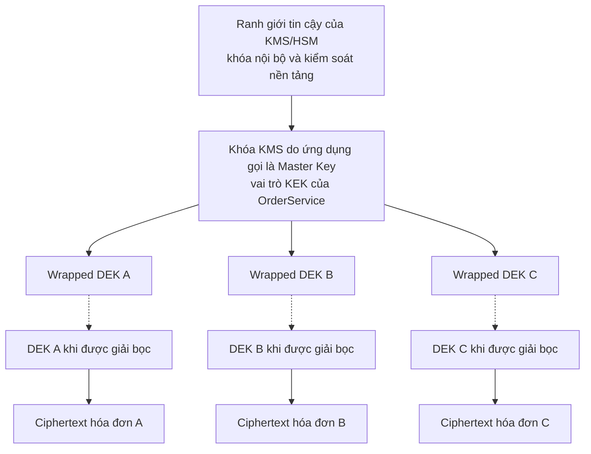
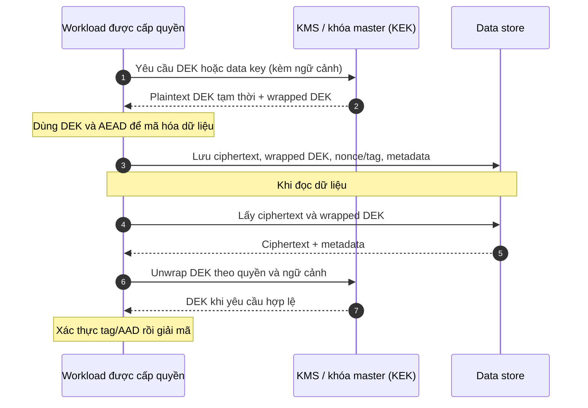
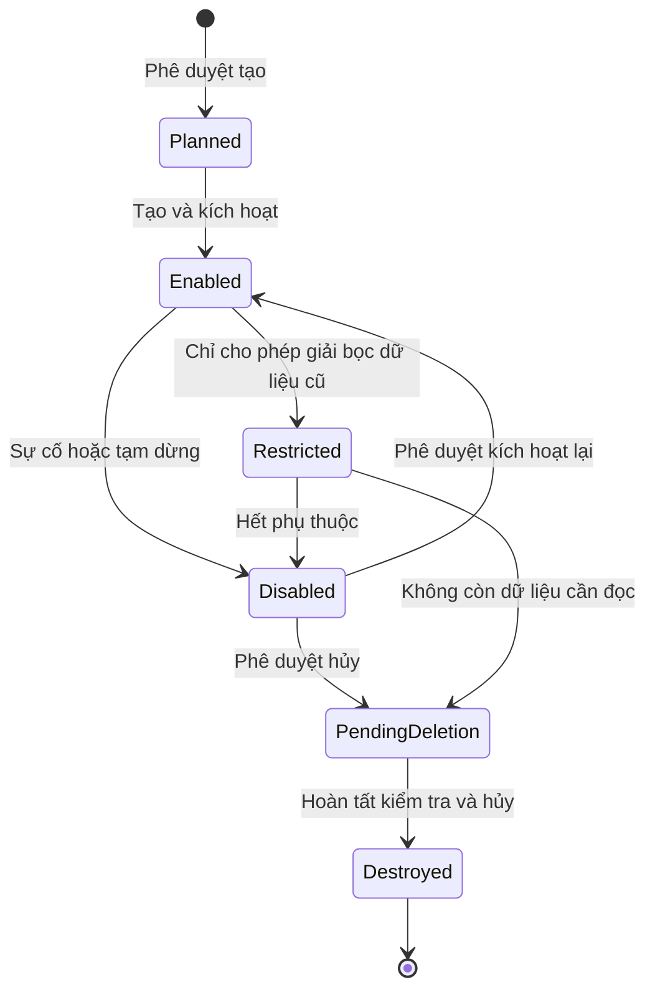
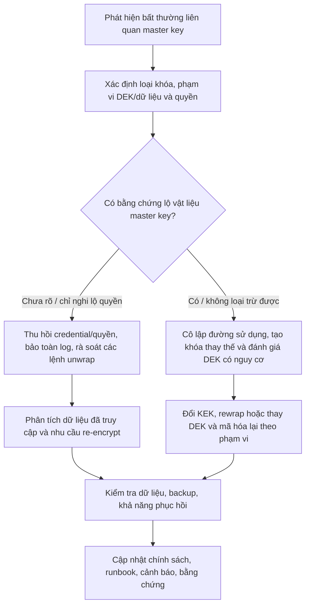

# Master key

> **Chương:** Phân loại key  
> **Module:** SECURITY_KEY_MANAGEMENT_FUNDAMENTALS — tìm hiểu vòng đời khóa mật mã từ tạo, cấp phát, lưu trữ, sử dụng, xoay vòng đến thu hồi và hủy; liên hệ mật mã đối xứng, bất đối xứng, chữ ký số, KMS/HSM, envelope encryption, kiểm soát truy cập và kiểm toán.

## 1. Mục tiêu học tập

Sau bài học, bạn có thể:

1. Giải thích **master key** là gì và nhận ra thuật ngữ này có thể mang nghĩa khác nhau tùy hệ thống.
2. Phân biệt **master key**, **root key**, **key-encryption key (KEK)**, **data-encryption key (DEK)**, khóa ký số và khóa khôi phục.
3. Mô tả cách master key tham gia **phân cấp khóa** và **envelope encryption** mà không trực tiếp mã hóa toàn bộ dữ liệu nghiệp vụ.
4. Lựa chọn phạm vi master key, cơ chế bảo vệ KMS/HSM, phân quyền và kiểm toán theo mức độ rủi ro.
5. Phân tích vòng đời master key, đặc biệt là **rotation**, **rewrap**, khôi phục khóa cũ, thu hồi quyền và hủy khóa.
6. Nhận diện những sự cố có ảnh hưởng lớn như lộ master key, lạm dụng API unwrap, xóa nhầm khóa gốc hoặc phụ thuộc chéo giữa tenant/môi trường.

## 2. Master key là gì?

**Master key** (khóa chủ) là tên thường dùng cho một khóa **ở tầng cao trong một hệ thống phân cấp khóa**, được dùng để **bảo vệ, dẫn xuất hoặc quản lý các khóa ở tầng dưới**, thay vì trực tiếp xử lý mọi bản ghi dữ liệu.

Trong một hệ thống envelope encryption, khóa được ứng dụng gọi là *master key* có thể đóng vai trò **KEK**, bảo vệ nhiều DEK. Mỗi DEK lại mã hóa một object, một file, một nhóm bản ghi hoặc một vùng dữ liệu. Khi đó, master key là điểm kiểm soát quan trọng: mất nó hoặc mất quyền sử dụng nó có thể khiến nhiều DEK không thể giải bọc; lộ nó hoặc bị lạm dụng quyền giải bọc có thể khiến nhiều đối tượng dữ liệu bị ảnh hưởng.

Tuy nhiên, **master key không phải một loại thuật toán mật mã được định nghĩa thống nhất trong mọi sản phẩm**. Tên gọi thay đổi theo bối cảnh:

- Trong ứng dụng, *application master key* có thể là KEK cấp cao bảo vệ các DEK.
- Trong hệ thống KMS, một tài nguyên *master key* hoặc *KMS key* có thể đại diện cho cấu hình, chính sách, vật liệu khóa và các phiên bản được quản lý bởi dịch vụ. Các thuật ngữ sản phẩm có thể thay đổi theo nhà cung cấp.
- Trong HSM, một khóa gốc của hệ thống phân cấp có thể bảo vệ những khóa nội bộ khác; cơ chế cụ thể phụ thuộc thiết bị và kiến trúc.
- Trong mã hóa ổ đĩa, thuật ngữ *volume master key* có thể chỉ khóa bảo vệ khóa mã hóa volume; cấu trúc chi tiết phụ thuộc nền tảng.
- Trong trình quản lý mật khẩu, *master password* là bí mật do người dùng cung cấp, **không tự động đồng nhất** với một master key ngẫu nhiên: hệ thống có thể dẫn xuất khóa từ mật khẩu bằng KDF phù hợp.

Vì thế, khi đọc tài liệu hoặc API có chữ “master key”, cần luôn hỏi:

> **Khóa này nằm ở tầng nào, bảo vệ khóa nào, được dùng cho thao tác nào, do ai quản lý và bị lộ thì ảnh hưởng đến những dữ liệu nào?**

### 2.1. Một ví dụ trực quan

Giả sử dịch vụ đặt hàng có 10.000 file hóa đơn, mỗi file có một **DEK** riêng để mã hóa nội dung. Dịch vụ sử dụng một khóa KMS được tổ chức gọi là **master key của OrderService** để bọc các DEK.

- File A mã hóa bằng DEK-A.
- File B mã hóa bằng DEK-B.
- Cả DEK-A và DEK-B đều được lưu **dưới dạng đã bọc** bằng khóa KMS của OrderService.
- Database hoặc object storage lưu ciphertext, wrapped DEK và metadata; không lưu master key hay plaintext DEK.
- Workload có quyền hợp lệ gọi KMS để giải bọc DEK khi cần đọc file.

Mô hình này tạo ra lợi ích: thay đổi cách bảo vệ các DEK có thể được quản lý tập trung, còn dữ liệu lớn được mã hóa bằng khóa đối xứng hiệu quả. Mặt khác, **master key bảo vệ nhiều DEK là tài sản có ảnh hưởng lớn**, vì vậy phải kiểm soát quyền dùng khóa, log, backup và khả năng khôi phục.

## 3. Phân biệt các cấp và vai trò khóa

Không được giả định rằng cứ gọi “master” thì đó là khóa cao nhất trong toàn bộ hạ tầng. Một hệ thống có thể có nhiều tầng khóa, mỗi tầng phục vụ mục đích và ranh giới quản trị khác nhau.

| Thuật ngữ | Vai trò điển hình | Ví dụ | Điều cần nhớ |
| --- | --- | --- | --- |
| **Root key / root of key hierarchy** | Khóa ở đỉnh một phân cấp cụ thể, dùng bảo vệ hoặc tạo khóa cấp dưới | Khóa nền của một HSM hoặc phân cấp nội bộ | Không phải mọi khóa ứng dụng gọi là “master” đều là root key vật lý |
| **Master key** | Khóa cấp cao theo quy ước của sản phẩm/ứng dụng | Khóa KMS bảo vệ DEK của dịch vụ | Cần xác định chính xác scope và API cho phép |
| **KEK (Key-Encryption Key)** | Bọc hoặc mở bọc một khóa khác | KEK bọc DEK | KEK là **vai trò sử dụng**; một master key có thể là KEK |
| **DEK (Data-Encryption Key)** | Mã hóa và giải mã plaintext dữ liệu trực tiếp | DEK riêng cho file hóa đơn | Có thể xuất hiện dạng rõ trong bộ nhớ ứng dụng khi xử lý |
| **Key-derivation key** | Đầu vào bí mật cho cơ chế dẫn xuất khóa | Khóa nền cho HKDF với domain separation | Chỉ sử dụng với KDF được thẩm định và ngữ cảnh tách biệt |
| **Khóa ký riêng** | Tạo chữ ký số | Khóa ký bản phát hành ứng dụng | Không tự ý sử dụng cùng khóa cho cả ký và bọc DEK |
| **Recovery key / recovery material** | Cho phép khôi phục quyền hoặc khả năng giải mã theo thiết kế | Thành phần khôi phục trong quy trình escrow | Không phải lúc nào cũng là bản sao plaintext master key |

### 3.1. Master key, KEK và root key có thể trùng nhau không?

**Có thể trùng về chức năng trong một thiết kế**, nhưng không nên đồng nhất ba thuật ngữ khi chưa xem kiến trúc.

Ví dụ trong KMS do cloud quản lý, ứng dụng có thể chỉ nhìn thấy một tài nguyên khóa với tên `orders-prod-master`. Bên trong dịch vụ, nhà cung cấp có thể có các khóa nội bộ và cơ chế HSM để bảo vệ vật liệu khóa của tài nguyên đó. Vì vậy:

- Ở **góc nhìn ứng dụng**, `orders-prod-master` có thể chính là KEK dùng để bọc DEK.
- Ở **góc nhìn dịch vụ KMS**, tài nguyên khóa còn bao gồm policy, trạng thái, key material/version và metadata.
- Ở **góc nhìn HSM**, khóa gốc bảo vệ các khóa nội bộ có thể là một đối tượng khác, không được ứng dụng trực tiếp quản lý.

Không suy luận “KMS key = root key của HSM” hoặc “master key = một byte array có thể export”. Các cơ chế này phụ thuộc kiến trúc và khả năng sản phẩm.

### 3.2. Master key thường **không** trực tiếp mã hóa toàn bộ dữ liệu

Về mặt toán học, một khóa đối xứng cấp cao có thể được dùng như khóa mã hóa dữ liệu nếu thuật toán cho phép. Tuy vậy, **thiết kế phân cấp khóa thường chủ động tách vai trò** để tránh dùng cùng một bí mật cho quá nhiều dữ liệu, quá nhiều thao tác và quá nhiều dịch vụ.

Việc mã hóa file lớn bằng DEK có thể giúp:

1. Giới hạn phạm vi tác động khi chỉ một DEK bị lộ.
2. Cho phép tạo và dùng DEK gần nơi xử lý dữ liệu, hạn chế round-trip KMS cho từng khối dữ liệu.
3. Quản lý quyền, chủ sở hữu và lưu giữ theo đối tượng hoặc tenant.
4. Thay lớp bảo vệ DEK khi KEK thay đổi mà không nhất thiết mã hóa lại toàn bộ file.
5. Giữ master key trong ranh giới quản lý nghiêm ngặt, giảm nhu cầu đưa khóa cấp cao vào bộ nhớ ứng dụng.

Một **master key dùng để bọc DEK** và một **master key dùng để dẫn xuất khóa** là hai lựa chọn thiết kế khác nhau; không nên trộn lẫn API hoặc quy trình xoay vòng của chúng.

## 4. Master key trong sơ đồ phân cấp khóa

Phân cấp khóa giúp tổ chức xác định **khóa nào bảo vệ khóa nào**, điểm nào chứa vật liệu khóa dạng rõ và khi khóa cấp trên gặp sự cố thì phần nào của hệ thống bị ảnh hưởng.



**Chú ý khi đọc sơ đồ:** các mũi tên thể hiện **quan hệ bảo vệ khóa và sử dụng khóa** ở mức khái niệm. Chúng không chứng minh một nhà cung cấp KMS triển khai chính xác cây vật liệu khóa vật lý như vậy. Trong thực tế, mỗi hệ thống có thể có thêm tầng wrapping, phiên bản khóa, khóa phục hồi hoặc kỹ thuật bảo vệ khác.

### 4.1. Thiết kế master key theo phạm vi

Lựa chọn phạm vi một master key là quyết định quan trọng:

| Phạm vi master key | Ưu điểm | Rủi ro/đánh đổi |
| --- | --- | --- |
| **Toàn tổ chức** | Ít khóa cấp cao, ít cấu hình | Một lỗi quyền/khóa ảnh hưởng rất rộng; khó tách trách nhiệm |
| **Theo môi trường** | Tách dev/staging/prod | Nếu vẫn chung cho nhiều dịch vụ, mức ảnh hưởng còn lớn |
| **Theo ứng dụng/hệ thống** | Dễ gắn owner, IAM và chính sách riêng | Tăng số khóa, phiên bản và lịch kiểm tra |
| **Theo tenant** | Cô lập khách hàng và quy trình thu hồi theo tenant | Tốn tài nguyên quản lý; khó di chuyển/khôi phục hàng loạt nếu thiết kế kém |
| **Theo mục đích/dữ liệu nhạy cảm** | Phân tách khóa thanh toán, định danh, log, backup | Cần inventory và kiểm soát phạm vi chặt chẽ |

Thông thường nên **tách khóa production khỏi môi trường thử nghiệm**, và tách các hệ thống có mức rủi ro khác nhau. Cần đánh giá liệu một master key chung cho nhiều tenant có làm tăng **blast radius** và rủi ro lạm dụng quyền hay không.

Không có mô hình duy nhất phù hợp cho mọi hệ thống. Quyết định nên căn cứ vào mức độ nhạy cảm, yêu cầu cô lập dữ liệu, số lượng DEK, giới hạn/chi phí KMS, độ phức tạp vận hành và khả năng DR.

### 4.2. Vì sao cần catalog các khóa cấp cao?

Với mỗi master key ứng dụng, một **key inventory** nên ghi:

- Mã tham chiếu tài nguyên khóa (không chứa vật liệu bí mật), owner, ứng dụng và môi trường.
- Mục đích sử dụng: wrap/unwrap, key derivation hoặc tác vụ khác được phê duyệt.
- Phạm vi DEK/dữ liệu/tenant được bảo vệ, các dịch vụ được phép gọi.
- Hệ thống KMS/HSM, vùng triển khai, loại khóa, thuộc tính export/import nếu liên quan.
- Chính sách quyền sử dụng, phê duyệt thay đổi và giám sát.
- Phiên bản/trạng thái khóa, lịch rotation, cách xử lý ciphertext hoặc wrapped DEK cũ.
- Phụ thuộc backup, restore, thời gian lưu giữ và điều kiện hủy.
- Runbook, hồ sơ phê duyệt, dấu vết kiểm toán và liên hệ khi có sự cố.

**Không lưu raw master key, plaintext DEK, seed, secret hay credential trong inventory.**

## 5. Master key và envelope encryption

**Envelope encryption** là cách thông dụng để dùng master key trong quản lý dữ liệu:

- Ứng dụng dùng một **DEK** để mã hóa dữ liệu.
- KMS dùng master key/KEK để **bọc (wrap)** DEK.
- Hệ thống lưu **ciphertext + wrapped DEK + metadata**.
- Khi cần giải mã, workload hợp lệ gọi KMS để **mở bọc (unwrap)** DEK.

Một luồng điển hình:



Trong một số kiến trúc, plaintext DEK được tạo và giữ bên trong thành phần tin cậy khác, hoặc ứng dụng dùng KMS để mã hóa trực tiếp lượng dữ liệu nhỏ. Sơ đồ trên là **một lựa chọn phổ biến**, không phải giao diện bắt buộc của mọi KMS.

### 5.1. Vì sao chỉ lưu wrapped DEK?

Wrapped DEK là DEK đã được bảo vệ bằng KEK hoặc cơ chế tương đương. Việc lưu wrapped DEK cùng ciphertext thường là khả thi vì người đọc dữ liệu chưa thể giải mã nếu thiếu quyền/cơ chế mở bọc.

Tuy nhiên, wrapped DEK **không có nghĩa dữ liệu an toàn trong mọi trường hợp**:

- Nếu một workload bị chiếm quyền và vẫn có quyền unwrap, kẻ tấn công có thể gọi KMS theo quyền đó.
- Nếu chính sách khóa bị sửa để mở rộng quyền, nhiều object có thể bị giải mã.
- Nếu ứng dụng từng ghi plaintext DEK vào log, việc lưu bản wrapped ở DB không loại bỏ rủi ro.
- Nếu metadata định danh tenant/object bị thay mà không có kiểm tra toàn vẹn và authorization, hệ thống có thể trở thành đường giải mã chéo tenant.

**Master key không xuất được** vẫn có thể bị lạm dụng như một **decryption/unwrap oracle**: attacker không cần trích xuất byte của master key nếu họ có thể yêu cầu dịch vụ dùng khóa để giải bọc DEK.

### 5.2. Metadata cần lưu

Để hệ thống có thể đọc lại dữ liệu sau nhiều lần thay khóa, đối tượng mã hóa nên có các trường tương ứng:

```json
{
  "formatVersion": 1,
  "dataAlgorithm": "AES-256-GCM",
  "objectId": "invoice-6028",
  "tenantId": "tenant-42",
  "kekReference": "kms://prod/billing/master-key",
  "keyMaterialVersionRef": "<theo-kha-nang-cua-KMS>",
  "wrappedDek": "<base64-encrypted-dek>",
  "nonce": "<base64-nonce>",
  "ciphertextAndTag": "<base64-ciphertext-and-tag>",
  "aadSchema": "invoice-v1"
}
```

Các giá trị trên chỉ để minh họa; **không phải dữ liệu khóa thật**.

- `kekReference` phải xác định được khóa có khả năng giải bọc DEK tương ứng.
- `keyMaterialVersionRef` chỉ cần nếu mô hình KMS yêu cầu hoặc cho phép lưu phiên bản chính xác; nhiều KMS tự quản lý phiên bản nội bộ. Không được tự đoán version từ alias.
- `aadSchema` giúp tái tạo **chính xác byte AAD** dùng khi mã hóa dữ liệu.
- `nonce` và `ciphertextAndTag` cần cho phép AEAD xác thực và giải mã.
- `tenantId`, `objectId` không thay thế kiểm tra quyền; phải xác minh từ danh tính và nguồn dữ liệu tin cậy.

Tránh ghi tên khóa theo alias có thể chuyển trỏ rồi mặc định alias đó luôn tham chiếu cùng vật liệu khóa. Phải kiểm thử khả năng mở bọc khóa lịch sử theo đặc điểm dịch vụ KMS cụ thể.

## 6. Master key dùng để dẫn xuất khóa: một mô hình khác

Một số hệ thống dùng master key làm **key-derivation key** để dẫn xuất khóa cấp dưới theo các giá trị ngữ cảnh, ví dụ khóa theo tenant, dịch vụ hoặc phiên làm việc. Mô hình này **khác envelope encryption với DEK ngẫu nhiên được bọc**.

Một sơ đồ dẫn xuất khái niệm:

```text
master key ngẫu nhiên, được bảo vệ
                 |
                 v
          KDF chuẩn hóa
    + tham số và ngữ cảnh phân tách
                 |
      +----------+----------+
      |                     |
      v                     v
 key tenant A          key tenant B
      |                     |
      v                     v
 mục đích mã hóa      mục đích mã hóa
```

Với nguồn key material chất lượng phù hợp, một KDF được thẩm định như HKDF có thể được dùng **theo thiết kế đã đánh giá**. Các thành phần `salt` và `info`/context phải có ý nghĩa rõ ràng; cần **domain separation** để đầu ra dùng cho nhiều tenant/mục đích không vô tình trùng hoặc bị dùng chéo.

Các điều kiện quan trọng:

1. Không tự “dẫn xuất” khóa bằng `hash(masterKey + tenantId)` rồi coi đó là cơ chế mật mã chuẩn.
2. Không dùng lại cùng đầu ra dẫn xuất cho nhiều mục đích không tương thích (ví dụ vừa mã hóa vừa ký/MAC), trừ khi cấu trúc dẫn xuất có phân tách được thiết kế đúng.
3. Không dùng một master password yếu trực tiếp làm đầu vào thay thế cho master key ngẫu nhiên. Nếu nguồn là mật khẩu, cần KDF dành cho mật khẩu và phân tích khả năng đoán ngoại tuyến.
4. Phải lưu/khôi phục chính xác **phiên bản master key, tham số và context** cần để dẫn xuất lại khóa cũ.
5. Nếu master key dẫn xuất bị lộ, attacker có thể tái tạo **nhiều khóa cấp dưới** theo phạm vi thuật toán cho phép; không thể khắc phục chỉ bằng thay alias hay quyền gọi KMS.
6. Nếu master key chỉ tồn tại trong HSM có API derivation, việc dẫn xuất có thể thực hiện bên trong ranh giới HSM; không mặc định ứng dụng có quyền lấy raw master key.

**Khi nào nên dùng derivation?** Chỉ khi yêu cầu và giải pháp mật mã hỗ trợ rõ ràng, ví dụ phân cấp khóa theo ngữ cảnh và quy trình version hóa/rotation/khôi phục. Với ứng dụng phổ thông, mẫu **DEK ngẫu nhiên + KMS bảo vệ DEK** thường dễ lý giải, kiểm toán và giới hạn phạm vi ảnh hưởng hơn.

## 7. Bảo vệ master key bằng KMS và HSM

Master key có giá trị cao nên cần được bảo vệ ở **cả nơi lưu giữ vật liệu** và **nơi hệ thống cho phép sử dụng chức năng của khóa**.

### 7.1. Vai trò của KMS

KMS thường hỗ trợ tạo và quản lý tài nguyên khóa, phân quyền, vô hiệu, thay phiên bản, lịch hủy, audit và API mật mã. Một KMS có thể cung cấp khả năng:

- Tạo khóa với loại, mục đích và cấu hình được phê duyệt.
- Chỉ cho phép workload cụ thể thực hiện các thao tác như encrypt/decrypt/wrap/unwrap.
- Ghi nhận việc tạo, dùng và thay policy qua log có thể kiểm toán.
- Quản lý trạng thái, phiên bản, rotation và điều kiện xóa theo khả năng dịch vụ.
- Hỗ trợ dự phòng/khôi phục theo phạm vi được mô tả trong sản phẩm.

Cần tìm hiểu **giao diện và giới hạn thực tế**. Không phải mọi KMS đều cho phép xuất key material, mọi API đều phát log chi tiết như nhau, hoặc mọi cấu hình rotation đều tự mã hóa lại dữ liệu cũ.

### 7.2. Vai trò của HSM

**Hardware Security Module (HSM)** là mô-đun phần cứng thiết kế để giữ và sử dụng vật liệu khóa dưới một ranh giới bảo mật cụ thể. Tùy sản phẩm, HSM có thể:

- Sinh và giữ khóa trong phần cứng, hạn chế khả năng xuất plaintext key.
- Thực hiện các thao tác mật mã mà ứng dụng chỉ nhận kết quả, không nhận byte khóa.
- Áp dụng cơ chế xác thực, phân quyền và chống can thiệp.
- Hỗ trợ khôi phục hoặc phân cụm theo quy trình của thiết bị.

Dùng HSM **không tự động bảo đảm an toàn toàn bộ hệ thống**. IAM quá rộng, ứng dụng bị xâm nhập, API unwrap bị lạm dụng, plaintext DEK bị log hoặc thiếu cơ chế khôi phục vẫn có thể khiến dữ liệu gặp rủi ro.

### 7.3. Non-exportable không đồng nghĩa “không thể bị lạm dụng”

**Non-exportable** có nghĩa hệ thống không cho phép xuất vật liệu khóa theo giao diện/chính sách liên quan. Nó không đảm bảo:

- Không ai có thể yêu cầu hệ thống **sử dụng** khóa.
- Một ứng dụng đã được cấp quyền không thể giải bọc DEK rồi làm lộ DEK.
- Không có đường khôi phục được nhà cung cấp/thiết bị hỗ trợ trong phạm vi riêng.
- Khóa không bao giờ bị lộ bởi lỗi triển khai, firmware hoặc chuỗi cung ứng.

Vì vậy phải đánh giá đồng thời **khả năng xuất**, **quyền thực hiện thao tác**, **nhật ký**, **quy trình thay quyền**, **khả năng khôi phục** và **rủi ro của workload**.

### 7.4. Quản lý và sử dụng khóa phải được phân quyền

| Vai trò | Quyền cần có trong phạm vi công việc | Điều nên tách biệt |
| --- | --- | --- |
| **Key owner / Data owner** | Phê duyệt mục đích, phạm vi và vòng đời khóa | Không mặc nhiên được đọc plaintext DEK |
| **KMS/HSM administrator** | Cấu hình, lifecycle, quyền tài nguyên theo phê duyệt | Không mặc nhiên có quyền giải mã mọi dữ liệu nghiệp vụ |
| **Application/workload identity** | API wrap/unwrap hoặc generate data key cần thiết | Không có quyền sửa key policy hoặc hủy khóa |
| **Security approver** | Phê duyệt quyền rủi ro cao, rotation, ngoại lệ, hủy | Không tự ý vô hiệu kiểm toán |
| **Auditor/SOC** | Đọc log, cấu hình, cảnh báo | Không cần quyền sử dụng khóa để giải mã |
| **Incident responder** | Quyền khẩn cấp đúng phạm vi, có thời hạn | Không được có đường ẩn xóa dấu vết |

**Least privilege** và **separation of duties** giúp giảm khả năng một tài khoản vừa cấp quyền cho chính nó, vừa giải mã dữ liệu, vừa xóa bằng chứng.

Với master key cấp cao, tổ chức có thể yêu cầu **dual control** (hai chủ thể phê duyệt/tham gia thao tác) hoặc **split knowledge** (nhiều người giữ các phần bí mật để không ai nắm toàn bộ). Hai cơ chế này không đồng nghĩa nhau. Nếu HSM hỗ trợ nghi thức **M-of-N** để kích hoạt/khôi phục khóa, phải ghi rõ thành phần nào được chia, ngưỡng, quy trình chứng kiến, quy tắc cất giữ, thu hồi và diễn tập.

Đường **break-glass** chỉ được dùng trong sự cố thật, giới hạn thời gian, có nhật ký độc lập và phải hậu kiểm.

## 8. Vòng đời master key

### 8.1. Tạo và cấp phát

Master key phải có chủ sở hữu rõ ràng, mục đích dùng khóa, phạm vi hệ thống/tenant và lựa chọn thuật toán hoặc cơ chế bọc/dẫn xuất được phê duyệt.

Quy trình điển hình:

1. Xác định **loại master key**: KEK cho DEK, key-derivation key, khóa gốc của phân cấp hay khóa ứng dụng khác.
2. Đánh giá dữ liệu và những khóa cấp dưới sẽ phụ thuộc vào nó.
3. Chọn nơi tạo và lưu: KMS/HSM hoặc giải pháp mật mã được phê duyệt; đánh giá yêu cầu non-exportable/imported key.
4. Gán key owner, quản trị viên, workload được phép sử dụng, địa bàn/vùng triển khai và mức giám sát.
5. Sinh khóa bằng nguồn ngẫu nhiên và mô-đun mật mã phù hợp; không lấy key từ mật khẩu/thời gian/ID không qua cơ chế an toàn.
6. Lưu tham chiếu tài nguyên và metadata trong inventory; xác minh quyền trước khi kích hoạt cho sản xuất.
7. Ghi bằng chứng phê duyệt, cấu hình, kiểm thử use-case hợp lệ/bị từ chối và phương án khôi phục.

Không đưa raw master key vào repository, CI variables dễ đọc, cấu hình ứng dụng hoặc cơ sở dữ liệu chỉ vì muốn dễ triển khai.

### 8.2. Sử dụng đúng mục đích

Đối với master key có vai trò KEK:

- Cho phép wrap/unwrap/generate data key theo quyền của workload và ngữ cảnh dữ liệu.
- Hạn chế gọi API đến đúng application, environment, tenant hoặc account khi dịch vụ hỗ trợ.
- Không cấp quyền xóa hoặc quản trị policy cho application runtime.
- Không dùng master key trực tiếp mã hóa từng record nếu kiến trúc đã thiết kế envelope encryption bằng DEK.
- Nếu dùng cùng KEK cho nhiều loại dữ liệu, đánh giá ảnh hưởng lan rộng và nhu cầu chia tách.

Đối với master key được dùng để dẫn xuất:

- Ghi rõ KDF chuẩn hóa và key usage.
- Phân tách mục đích, môi trường, tenant và version trong context.
- Hạn chế ai có thể gọi API derive hoặc tiếp cận key material.
- Có chính sách xử lý version cũ để giải mã dữ liệu lịch sử.

### 8.3. Theo dõi trạng thái

Trạng thái vòng đời phổ biến có thể mô hình hóa ở mức khái niệm:



**Đây là mô hình học thuật, không phải state machine API giống hệt mọi KMS.** Một số dịch vụ không hỗ trợ trạng thái “decrypt-only” như một thuộc tính khóa và phải thực thi bằng chính sách quyền, key version hoặc luồng ứng dụng. Cũng có hệ thống yêu cầu thời gian chờ trước khi hủy và cơ chế khôi phục lịch sử khác nhau.

### 8.4. Cryptoperiod và thời gian lưu giữ

**Cryptoperiod** là khoảng thời gian một khóa được phép dùng cho những hoạt động mật mã xác định. Không nên đánh đồng:

- **Thời gian dùng cho dữ liệu/DEK mới:** dùng master key để bọc các DEK mới.
- **Thời gian duy trì khả năng giải bọc DEK cũ:** cần đọc dữ liệu đã tồn tại.
- **Thời gian giữ lại để khôi phục:** phụ thuộc backup, lưu trữ pháp lý, DR hoặc bằng chứng lịch sử.

Với master key dạng KEK, có thể ngừng sử dụng cho dữ liệu mới nhưng vẫn cần **mở bọc DEK cũ**. Lịch retention của dữ liệu và backup thường quyết định thời điểm an toàn để hủy hoàn toàn khóa hoặc phiên bản cũ.

Không có “master key phải đổi mỗi 30/90/365 ngày” áp dụng cho mọi hệ thống. Thời hạn phụ thuộc rủi ro, thuật toán, chính sách, tiêu chuẩn áp dụng, lượng dữ liệu được bảo vệ, khả năng rewrap và yêu cầu tuân thủ.

## 9. Rotation: thay master key khác gì thay DEK?

Đây là điểm dễ nhầm và có thể gây mất dữ liệu nếu triển khai sai.

| Hành động | Điều gì đổi? | Điều gì **không** tự đổi? | Ứng dụng thực tế |
| --- | --- | --- | --- |
| **Rotation key material của một KMS key** | Dịch vụ có thể chuyển sang vật liệu/phiên bản mới cho thao tác mã hóa/bọc tiếp theo | Các ciphertext/wrapped DEK cũ **không mặc định** được ứng dụng tự mã hóa lại | Rotation theo khả năng quản lý phiên bản của KMS |
| **Tạo master key/KEK mới** | Có một tài nguyên/khóa KEK khác | DEK cũ và ciphertext dữ liệu vẫn giữ nguyên nếu chưa di chuyển | Thay kiến trúc, tách phạm vi, đổi provider |
| **Rewrap DEK** | Bọc cùng DEK dưới KEK mới, thay lớp bảo vệ khóa | **Plaintext DEK và dữ liệu mã hóa bằng DEK ấy vẫn như cũ** | Di chuyển KEK, tách key scope |
| **Đổi DEK + re-encrypt** | Sinh DEK mới, mã hóa lại dữ liệu liên quan | Việc đó không tự cấp lại quyền KMS hay sửa policy yếu | Nghi plaintext DEK lộ hoặc thay thuật toán/phạm vi |
| **Thu hồi quyền sử dụng** | Ai được gọi API wrap/unwrap/derive | Không “xóa từ xa” plaintext DEK đã bị sao chép | Credential lộ, workload bị xâm nhập |
| **Hủy master key** | Mất khả năng dùng khóa đó theo cơ chế được hỗ trợ | Ciphertext không tự biến mất; dữ liệu có thể trở nên không thể giải mã | Hết hạn lưu giữ, hủy dữ liệu có kiểm soát |

### 9.1. Rotation nội bộ không nhất thiết là migration dữ liệu

Một số KMS hỗ trợ **rotation vật liệu khóa** dưới cùng tài nguyên khóa; KMS có thể giữ phiên bản cũ để giải mã các kết quả đã mã hóa trước đó. Tuy nhiên **chi tiết này khác nhau theo loại khóa và nhà cung cấp**. Không được tự giả định rằng mọi KMS đều giữ đầy đủ version, hoặc mọi ciphertext đều tự được cập nhật.

Nếu doanh nghiệp muốn **chuyển dữ liệu cũ sang KEK mới**, cần một quá trình rewrap rõ ràng và có kiểm thử. Nếu master key từng bị **lộ vật liệu**, phạm vi biện pháp còn phụ thuộc tình huống: rewrap DEK có thể không đủ nếu kẻ tấn công đã có DEK dạng rõ hoặc có thể lấy DEK qua bản wrapped đã bị lộ cùng KEK.

### 9.2. Quy trình chuyển master key có kiểm soát

Ví dụ cần chuyển wrapped DEK từ `master-v1` sang `master-v2`:

1. **Kiểm kê phụ thuộc:** object, tenant, wrapped DEK, metadata, backup, các hệ thống đọc dữ liệu cũ.
2. **Tạo KEK đích:** cấu hình quyền, owner, audit và vùng lưu trữ; kiểm tra người phê duyệt và cơ chế rollback.
3. **Thử trên dữ liệu mẫu:** được phép giải bọc DEK dưới KEK cũ; sau đó bọc lại dưới KEK mới trong ranh giới an toàn và xác nhận có thể giải mã ciphertext gốc.
4. **Di chuyển theo lô:** cập nhật wrapped DEK và key reference nhất quán; lưu trạng thái/checkpoint để tiếp tục khi lỗi. Không log plaintext DEK.
5. **Chuyển luồng ghi mới:** các object mới bắt đầu sử dụng `master-v2`; hạn chế phát sinh thêm wrapped DEK dưới KEK cũ.
6. **Kiểm tra đọc lại:** dữ liệu mới, dữ liệu cũ, snapshot, backup và luồng DR; xác nhận không còn tham chiếu bắt buộc tới KEK cũ.
7. **Ngừng dùng KEK cũ:** hạn chế quyền unwrap sau khi đã xác minh an toàn; chỉ phê duyệt hủy khi retention và mọi phụ thuộc được giải quyết.

**Không hủy khóa nguồn ngay khi một batch rewrap kết thúc.** Các bản backup/snapshot chưa chuyển đổi có thể vẫn cần khóa cũ để giải mã.

### 9.3. Rotation khi nghi lộ master key

Giả sử master key bảo vệ các DEK của 50.000 object và có dấu hiệu attacker đã có **vật liệu master key**:

- **Chặn ngay các đường dùng khóa và credential liên quan**, bảo toàn bằng chứng.
- Xác định phạm vi các wrapped DEK mà attacker có thể đọc hoặc đã sao chép.
- Đánh giá attacker có thể mở bọc các DEK đã thu thập không; việc đổi KEK không thể làm họ “quên” khóa cũ.
- Đánh giá **re-encrypt bằng DEK mới** cho những dữ liệu bị ảnh hưởng khi cần, thay vì chỉ rewrap DEK cũ.
- Xử lý bản sao dữ liệu, backup, cache, tài khoản có đặc quyền và hệ thống ghi log.
- Tạo master key mới trong ranh giới tin cậy, rà soát quyền và giám sát trước khi đưa vào dùng.
- Chỉ kết luận phạm vi rủi ro sau khi có bằng chứng; không coi “rotation success” là đồng nghĩa sự cố đã kết thúc.

Nếu sự cố **chỉ là lộ workload credential được phép gọi KMS**, chưa chứng minh raw master key bị lộ, ứng phó có thể khác: thu hồi credential/quyền, kiểm tra log unwrap và dữ liệu bị truy cập, đánh giá nhu cầu thay DEK/KEK dựa trên phạm vi sự cố.

## 10. Backup, phục hồi và hủy master key

### 10.1. Vì sao mất master key nguy hiểm?

Nếu nhiều DEK chỉ tồn tại dưới dạng được bọc bằng một KEK, **mất khả năng mở bọc KEK có thể khiến toàn bộ dữ liệu phụ thuộc không thể giải mã**, ngay cả khi backup database và ciphertext còn nguyên.

Vì vậy kế hoạch DR phải bao gồm **khả năng sử dụng khóa**, không chỉ backup dữ liệu. Đối với khóa non-exportable, khả năng khôi phục có thể phụ thuộc dịch vụ KMS/HSM, chính sách nhân bản, vùng dự phòng, chính sách tài khoản và cam kết vận hành của nhà cung cấp. **Không tự xuất plaintext key** ra ngoài chỉ để “có bản backup” nếu điều đó đi ngược mô hình bảo mật.

### 10.2. Những câu hỏi cần trả lời trước sự cố

- Khi KMS/HSM hoặc toàn bộ vùng cloud ngừng hoạt động, hệ thống có đường truy cập khóa hợp lệ tại vùng khôi phục hay không?
- Backup ciphertext có đi kèm wrapped DEK, key reference, nonce, tag và thông tin thuật toán/AAD không?
- Khóa tại vùng dự phòng có **thực sự** giải bọc được wrapped DEK của vùng nguồn không, hay chỉ có alias cùng tên?
- Ai phê duyệt sử dụng khóa khôi phục? Cơ chế phân tách nhiệm vụ, quorum hoặc break-glass nào áp dụng?
- Khi tài khoản quản trị mất quyền hoặc nhân sự rời tổ chức, ai còn có thể khôi phục mà không phá vỡ least privilege?
- Đã thử khôi phục bản ghi cũ được mã hóa bằng **key version lịch sử** chưa?
- Nhật ký và bằng chứng phục hồi được lưu ở đâu, có chống sửa/xóa trái phép không?

### 10.3. Hủy khóa và cryptographic erasure

**Cryptographic erasure** là cách làm dữ liệu mã hóa mất khả năng giải mã bằng cách hủy khóa cần thiết, **nhưng chỉ có hiệu lực trong phạm vi đã xác minh**.

Ví dụ, hủy một master key chỉ tạo ra hiệu ứng mong muốn nếu:

1. Các wrapped DEK liên quan không còn được giải bọc bằng bản sao master key hoặc cơ chế khôi phục nào khác.
2. Không còn DEK plaintext bị lưu trong cache, log, snapshot hoặc nơi sao chép có thể dùng lại.
3. Không còn ciphertext đã được giải mã và lưu thành plaintext ở nơi khác.
4. Retention, nghĩa vụ khôi phục và yêu cầu pháp lý đã cho phép hủy.
5. Nhà cung cấp KMS/HSM xác nhận trạng thái, điều kiện chờ và bằng chứng xóa theo khả năng thực tế.

**Không coi thao tác “schedule deletion” là bằng chứng dữ liệu lập tức bị hủy.** Nhiều hệ thống áp dụng thời gian chờ hoặc điều kiện đặc biệt. Cần phân biệt thời điểm lên lịch, trạng thái vô hiệu và thời điểm hủy thực tế.

### 10.4. Tính sẵn sàng và tính bí mật có thể xung đột

- Nếu khóa **quá dễ sao chép**, nguy cơ lộ và khó xác định số bản sao tăng lên.
- Nếu khóa **chỉ tồn tại một nơi, không thể khôi phục**, sự cố thiết bị hoặc quyền truy cập có thể gây mất dữ liệu.
- Nếu tài khoản khẩn cấp **quá rộng quyền**, nó có thể trở thành cửa hậu thường trực.
- Nếu không giữ khóa cũ, dữ liệu lịch sử không thể đọc; nếu giữ không kiểm soát, bề mặt tấn công tăng lên.

Thiết kế cần cân bằng bằng **dự phòng theo ranh giới tin cậy, kiểm soát quyền, lưu giữ có hạn, diễn tập khôi phục và bằng chứng kiểm toán**.

## 11. Master key và hệ thống dùng chữ ký số

Trong hệ thống **mã hóa dữ liệu**, master key thường bảo vệ DEK/KEK. Trong hệ thống **chữ ký số**, phân cấp tin cậy có thể dựa vào **khóa ký riêng của CA, khóa gốc PKI và chứng thư**. Không nên dùng hai mô hình này như thể chúng hoàn toàn giống nhau.

Ví dụ:

- **Root CA private key** là khóa ký đặc biệt quan trọng để ký chứng thư CA cấp dưới; nó **không phải** KEK tự động giải mã các bản ghi dữ liệu.
- **Khóa ký bản phát hành ứng dụng** dùng tạo chữ ký, có chính sách sử dụng, bảo vệ HSM và thu hồi riêng.
- **Khóa công khai** cho phép xác minh chữ ký; không cần biết khóa ký riêng để xác minh trong sơ đồ chữ ký thông thường.
- **Thu hồi chứng thư** hoặc ngừng sử dụng khóa ký mới không đồng nghĩa xóa ngay khả năng kiểm chứng chữ ký lịch sử; cần chính sách lưu bằng chứng, trạng thái chứng thư và thời điểm ký.
- **Thay khóa ký riêng** không tương đương rewrap DEK. Hệ quả liên quan tới niềm tin vào chữ ký và chứng thư, không trực tiếp tới việc đổi khóa mã hóa dữ liệu.

Trong TLS, tên gọi như **master secret** trong một số phiên bản giao thức chỉ bí mật được dẫn xuất trong quá trình thiết lập phiên, **không phải master key KMS dùng bảo vệ DEK**. Không áp dụng quy trình rotation của khóa KMS máy chủ cho bí mật phiên TLS chỉ dựa trên tên giống nhau.

## 12. Kiểm soát truy cập, audit và phản ứng sự cố

### 12.1. Những sự kiện cần quan sát

Bản quản lý master key nên xác định hệ thống ghi log và khả năng truy vấn cho các sự kiện:

- Tạo/import tài nguyên khóa, thay trạng thái, rotate hoặc lịch hủy.
- Thay key policy, grants, IAM, vai trò dịch vụ và quyền sử dụng.
- Yêu cầu encrypt/decrypt/wrap/unwrap/derive/generate data key khi API hỗ trợ log.
- Hoạt động quản trị, export/import nếu giải pháp cho phép, thao tác khôi phục.
- Gọi API từ workload/vùng bất thường, tần suất sử dụng tăng mạnh, bị từ chối nhiều lần.
- Truy cập break-glass, thay đổi cấu hình audit và khoảng trống bất thường của log.

Các trường nên có khi khả dụng: **thời gian, danh tính, tài nguyên khóa, hành động, kết quả, địa chỉ/nguồn gọi, correlation ID và tham chiếu phê duyệt**.

**Không ghi raw master key, plaintext DEK, plaintext dữ liệu, credential, seed hoặc thông tin xác thực vào audit log.** Nhật ký phải được bảo vệ trước thay đổi/xóa trái phép và có retention rõ ràng.

Lưu ý: nhà cung cấp KMS khác nhau về loại event có thể ghi và độ chi tiết. Nếu một lớp không quan sát được, phải mô tả **khoảng trống giám sát** và biện pháp bù trừ, không khẳng định “mọi lần sử dụng khóa đều được ghi” khi thực tế không có bằng chứng.

### 12.2. Các điều kiện cảnh báo có giá trị

| Tình huống | Nguy cơ | Phản ứng bước đầu |
| --- | --- | --- |
| Workload dev gọi khóa prod | Lẫn môi trường hoặc credential bị lộ | Chặn quyền và đối chiếu log/thay đổi IAM |
| Tài khoản admin bất ngờ được thêm quyền decrypt | Mất phân tách nhiệm vụ | Thu hồi quyền, kiểm tra phê duyệt và các lần gọi API |
| Số lần unwrap tăng đột biến | Lạm dụng đường giải mã | Giới hạn tác nhân, xác định object/tenant bị truy cập |
| Đề xuất xóa master key không có kế hoạch DR | Nguy cơ mất khả năng giải mã dữ liệu | Dừng quy trình hủy, kiểm kê phụ thuộc |
| Key policy bị mở quá rộng | Nhiều workload có thể truy cập dữ liệu | Khôi phục policy, rà soát quyền, kiểm tra lịch sử |
| KMS không phát log như kỳ vọng | Mất khả năng điều tra | Sửa pipeline, tạo cảnh báo cho mất log, audit bù ở ứng dụng |

### 12.3. Ứng phó sự cố theo phạm vi lộ khóa



Trong lúc xử lý, **disable master key có thể làm ứng dụng không giải mã được dữ liệu hợp lệ**. Cần phối hợp Incident Commander, Security và owner dữ liệu để cô lập đúng mức, tránh kéo dài sự cố do không có phương án phục hồi.

## 13. Ví dụ hệ thống OrderService: một master key bảo vệ nhiều DEK

Giả sử hệ thống **OrderService** lưu hóa đơn PDF và một số trường dữ liệu nhạy cảm. Mỗi file được mã hóa bằng DEK riêng; một khóa KMS của môi trường production được nhóm vận hành gọi là **OrderService master key**, có vai trò KEK.

### 13.1. Thiết kế minh họa

| Thành phần | Cách triển khai | Kiểm soát chính |
| --- | --- | --- |
| **Master key** | Tài nguyên KMS cho `orders-prod`; dùng để bảo vệ DEK | Owner rõ ràng; giới hạn scope theo hệ thống và môi trường |
| **DEK** | Khóa ngẫu nhiên mới cho mỗi file | Không lưu plaintext DEK trong DB/log |
| **Dữ liệu** | File mã hóa bằng thuật toán AEAD được phê duyệt | Nonce riêng đúng quy tắc, tag và AAD được xác thực |
| **Metadata** | Wrapped DEK, key reference, thuật toán, nonce, tag, schema/version | Lưu nhất quán, tránh alias mơ hồ |
| **Runtime** | Workload identity riêng cho môi trường production | Chỉ có quyền cần thiết để tạo/unwrap DEK |
| **Quản trị KMS** | Nhóm quản trị cấu hình khóa và quyền | Quyền thay policy tách khỏi quyền ứng dụng giải mã |
| **Khôi phục** | Backup dữ liệu kèm metadata và đường sử dụng KEK được kiểm thử | Không chỉ backup ciphertext |
| **Kiểm toán** | Log KMS, thay quyền và truy cập dữ liệu | Phát hiện gọi unwrap bất thường |

### 13.2. Pseudocode minh họa

Đoạn sau thể hiện **ý tưởng luồng**, không phải SDK cụ thể hay chương trình có thể chạy ngay. Các API và thuộc tính phụ thuộc KMS được sử dụng:

```text
# Ghi một file hóa đơn:
authorizeWrite(user, invoiceId)

context = canonicalEncode(service="orders", env="prod", invoiceId, tenantId)
keyBundle = kms.generateDataKey(masterKeyRef, context)
# keyBundle = { plaintextDek, wrappedDek }

cipherResult = aeadEncrypt(
    key=keyBundle.plaintextDek,
    plaintext=invoiceBytes,
    nonce=generateNonceForThisDek(),
    aad=context
)
persist(
    invoiceId,
    cipherResult.ciphertext,
    cipherResult.tag,
    cipherResult.nonce,
    keyBundle.wrappedDek,
    masterKeyRef,
    algorithmVersion,
    aadSchemaVersion
)
clearOwnedBufferIfPossible(keyBundle.plaintextDek)

# Đọc file:
authorizeRead(user, invoiceId)
entry = loadEncryptedInvoice(invoiceId)
context = canonicalEncodeFromTrustedMetadata(entry)

plaintextDek = kms.unwrap(
    keyRef=entry.masterKeyRef,
    wrappedDek=entry.wrappedDek,
    context=context
)
invoiceBytes = aeadDecryptAndVerify(
    plaintextDek, entry.ciphertext, entry.tag, entry.nonce, context
)
clearOwnedBufferIfPossible(plaintextDek)
return invoiceBytes
```

Ở đây **không có bước mang plaintext master key vào ứng dụng**. Ứng dụng sử dụng tài nguyên KMS qua API và nhận plaintext DEK theo giao diện đã được cấp quyền. Nếu API/kiến trúc cho phép giữ DEK bên trong mô-đun tin cậy thì luồng dữ liệu dạng rõ sẽ khác.

Để giảm khả năng lộ DEK cần chú ý: thời gian tồn tại của buffer, log, tracing, crash dump, kiểm soát lifecycle và quyền truy cập. Xóa một mảng byte do ứng dụng giữ có ích nhưng **không bảo đảm xóa mọi bản sao mà runtime/JVM/thư viện native đã tạo**.

### 13.3. Hai bài toán vận hành

**Tình huống 1 — thay master key theo kế hoạch.** Nhóm vận hành tạo `orders-prod-master-v2` và muốn dừng `v1`. Cần chuyển luồng ghi mới sang `v2`, rewrap các DEK còn phụ thuộc `v1` nếu muốn ngừng dùng hoàn toàn, kiểm thử đọc file cũ và khôi phục từ backup. Chỉ sau khi xác nhận không còn phụ thuộc mới cân nhắc hủy `v1`.

**Tình huống 2 — workload prod bị lộ credential.** Master key có thuộc tính non-exportable, nhưng workload bị chiếm quyền vẫn có thể gọi KMS unwrap. Cần thu hồi credential, xem log KMS và quyền truy cập file, xác định lượng dữ liệu có khả năng bị đọc, đánh giá việc thay DEK/mã hóa lại những object bị ảnh hưởng. Chỉ đổi alias của master key sẽ không giải quyết lịch sử truy cập.

### 13.4. Mẫu policy/inventory cấp mô tả

Đây là bản YAML **minh họa tài liệu thiết kế**, không phải cấu hình cloud/KMS áp dụng trực tiếp và không chứa bí mật:

```yaml
id: orders-prod-master
keyRole: "KEK; được nhóm ứng dụng gọi là master key"
owner: "Security Engineering + Order Data Owner"
environment: production
scope:
  service: OrderService
  purpose: "Bọc và mở bọc DEK cho file hóa đơn"
  dataClasses: ["hóa đơn", "thông tin giao dịch"]
  forbiddenEnvironments: [development, staging]
access:
  allowedWorkload: "orders-prod workload identity"
  allowedOperations: ["generate-data-key", "unwrap"]
  keyPolicyChange: "yêu cầu thay đổi được phê duyệt"
  deleteApproval: "Security + Data Owner"
logging:
  controlPlane: enabled
  keyUsageEvents: "theo khả năng audit của KMS"
  sensitiveValuesLogged: false
lifecycle:
  rotation: "theo chính sách và sự kiện rủi ro"
  historicalData: "kiểm thử đọc dữ liệu cũ trước khi hủy khóa"
  disasterRecovery: "phương án khôi phục được diễn tập"
  destruction: "chỉ sau khi kiểm kê dữ liệu/backup còn phụ thuộc"
```

Trong tài liệu production, cần bổ sung tham chiếu tài nguyên/phiên bản KMS cụ thể, thuật toán, hạn và người phê duyệt, bằng chứng audit, hướng dẫn rollback và biên bản diễn tập. Không để các cụm “theo chính sách” trở thành chỗ trống không có tham chiếu.

## 14. Lỗi thường gặp và cách tránh

| Sai lầm | Hậu quả | Cách sửa |
| --- | --- | --- |
| **Gọi bất kỳ khóa nào là “master key”** | Nhầm root key, KEK, DEK và khóa ký số | Ghi rõ vai trò mật mã, cấp trong hierarchy và dữ liệu phụ thuộc |
| **Dùng một master key cho mọi ứng dụng và tenant** | Một lỗi cấu hình/khóa có ảnh hưởng rất rộng | Tách theo scope hợp lý, môi trường, mục đích và owner |
| **Đưa raw master key vào source/config/CI** | Mở rộng khả năng đánh cắp khóa cấp cao | Dùng KMS/HSM, workload identity và API trong ranh giới được cấp quyền |
| **Cấp cho admin cả quyền sửa policy và decrypt** | Dễ lạm dụng và khó kiểm toán | Least privilege, separation of duties, phê duyệt và audit |
| **Tin rằng non-exportable là bảo đảm an toàn tuyệt đối** | Bỏ qua API unwrap oracle và workload bị xâm nhập | Giới hạn quyền sử dụng, context, log và detection |
| **Cho rằng rotation tự mã hóa lại mọi dữ liệu** | DEK/ciphertext lịch sử còn phụ thuộc khóa cũ | Phân biệt rotation, rewrap và re-encrypt; kiểm thử đọc cũ |
| **Xóa master key ngay sau khi tạo khóa mới** | Backup và wrapped DEK cũ có thể không giải mã được | Inventory, migration, restore test, approval trước khi hủy |
| **Lưu master password thô như master key** | Nguy cơ đoán mật khẩu/đánh cắp bí mật | Áp dụng KDF dành cho mật khẩu và thiết kế khóa theo sản phẩm |
| **Lưu key alias nhưng không lưu metadata cần giải mã** | Không tìm đúng khóa/thuật toán/phiên bản để đọc dữ liệu cũ | Lưu key reference ổn định, format, AAD schema và kiểm thử |
| **Không có kịch bản mất KMS hoặc mất quyền IAM** | Dữ liệu vẫn còn nhưng ứng dụng không thể phục hồi | Thiết kế DR cho cả dữ liệu và khả năng dùng khóa |
| **Không xem xét chữ ký số và mã hóa là hai miền khác nhau** | Dùng sai quyền, sai mô hình rotation/revocation | Tách key usage và lifecycle theo loại khóa |

## 15. Bài tập tự kiểm tra

**Câu 1.** Một hệ thống có 100.000 DEK, tất cả đều được bọc bằng một KMS key tên `company-master`. Nếu người tấn công chỉ biết **ID** của KMS key, họ có thể giải mã mọi dữ liệu không?

**Gợi ý:** Không. ID/alias không phải vật liệu khóa hoặc quyền sử dụng. Tuy nhiên, phạm vi KEK quá rộng khiến lỗi IAM hoặc việc vật liệu khóa bị lộ có thể ảnh hưởng lớn; cần xem xét chia scope và giới hạn API unwrap.

**Câu 2.** Một kỹ sư nói: “Master key đã được đánh dấu non-exportable nên dù workload bị lộ credential, dữ liệu vẫn an toàn.” Nhận xét này đúng không?

**Gợi ý:** Không. Workload có thể gọi API decrypt/unwrap bằng quyền hiện có. Cần thu hồi credential, rà soát log và dữ liệu đã truy cập, phân tách quyền.

**Câu 3.** Nhóm vận hành tạo master key mới và đã rewrap tất cả DEK, nhưng một DEK dạng rõ đã bị lộ tuần trước. Dữ liệu mã hóa bằng DEK ấy đã an toàn chưa?

**Gợi ý:** Chưa. Rewrap không đổi DEK. Cần đánh giá và có thể phải thay DEK, mã hóa lại dữ liệu cũng như xử lý backup và bản sao liên quan.

**Câu 4.** Ứng dụng có backup ciphertext và wrapped DEK đầy đủ, nhưng tài khoản KMS đã bị xóa và không có đường khôi phục master key. Điều gì có thể xảy ra?

**Gợi ý:** Dữ liệu có thể không thể giải mã, dù file backup còn nguyên. Phải thử khôi phục **dữ liệu cùng khả năng mở bọc DEK** trước khi tin vào chiến lược backup.

**Câu 5.** Tổ chức dùng một “master key” để dẫn xuất khóa theo tenant bằng `SHA256(masterKey || tenantId)` và cho rằng như vậy an toàn vì có hash. Có nên chấp nhận ngay không?

**Gợi ý:** Không. Phải dùng KDF được thẩm định, context/domain separation phù hợp, quản lý version, nguồn khóa và đánh giá phạm vi ảnh hưởng khi khóa nguồn lộ. Không tự ghép hash thay KDF.

**Câu 6.** Một đội muốn xóa master key cũ ngay sau khi kích hoạt auto rotation; backup vẫn chứa wrapped DEK từ hai năm trước. Bạn sẽ yêu cầu kiểm tra gì?

**Gợi ý:** Cơ chế version/key material của KMS, khả năng mở bọc DEK lịch sử, retention backup, thử restore và phê duyệt hủy. Auto rotation không đồng nghĩa mọi wrapped DEK cũ đã được thay lớp bảo vệ.

**Câu 7.** Một root CA private key trong PKI có nên được dùng làm KEK bọc DEK của ứng dụng thương mại điện tử chỉ vì tên gọi “root” quan trọng hơn “master” không?

**Gợi ý:** Không. Khóa ký CA và KEK có mục đích mật mã, chính sách, rủi ro và vòng đời khác nhau. Không dùng chéo key usage chỉ vì vị trí trong hệ thống phân cấp.

## 16. Ghi nhớ

1. **Master key là tên gọi theo bối cảnh cho khóa ở tầng cao**, không phải thuật toán hay một loại khóa thống nhất. Cần xác định rõ quan hệ giữa root key, KEK, DEK và các tầng vật liệu khóa của KMS/HSM.
2. **Master key làm KEK thường bảo vệ DEK, còn DEK mã hóa dữ liệu**. Envelope encryption giảm nhu cầu đưa khóa cấp cao vào ứng dụng và hỗ trợ quản lý tập trung.
3. **Phạm vi master key quyết định phạm vi rủi ro**. Cần giới hạn theo môi trường, hệ thống, tenant và mục đích phù hợp với quy mô, yêu cầu cô lập và khả năng quản trị.
4. **Non-exportable không vô hiệu hóa khả năng lạm dụng API**. Cần IAM tối thiểu, workload identity, phân tách nhiệm vụ, audit và giám sát hành vi bất thường.
5. **Rotation master key, rewrap DEK và re-encrypt bằng DEK mới là các thao tác khác nhau**. Khóa bị lộ cần xử lý theo phạm vi DEK và dữ liệu có nguy cơ, không chỉ cập nhật alias.
6. **Không có khả năng khôi phục khóa thì backup ciphertext có thể trở nên vô dụng**. Kiểm kê dữ liệu lịch sử và backup, diễn tập restore trước khi hủy master key.
7. **Master key cho chữ ký số, bí mật phiên TLS hay master password không thể dùng chung một cách hiểu máy móc**. Luôn đặt thuật ngữ trong thuật toán, API, ranh giới tin cậy và vòng đời cụ thể.

### Tài liệu tham khảo để đào sâu

- **NIST SP 800-57 Part 1:** vai trò khóa, key management, cryptoperiod và nguyên tắc vòng đời.
- **NIST SP 800-57 Part 2:** chính sách và thực hành quản lý khóa trong tổ chức.
- **NIST SP 800-130:** khung thiết kế một hệ thống quản lý khóa mật mã.
- **NIST SP 800-56C:** cơ chế dẫn xuất khóa dựa trên shared secret trong phạm vi áp dụng của tài liệu.
- **RFC 5869:** HKDF (HMAC-based Extract-and-Expand Key Derivation Function) và ngữ cảnh sử dụng.
- **OWASP Cryptographic Storage Cheat Sheet:** cách mã hóa dữ liệu và quản lý khóa an toàn trong ứng dụng.

Các tài liệu này là nguồn tham khảo nguyên tắc. Khi triển khai thật, cần kiểm tra thêm tài liệu KMS/HSM cụ thể, yêu cầu tuân thủ, mô hình đe dọa và chính sách quản lý khóa của tổ chức.
