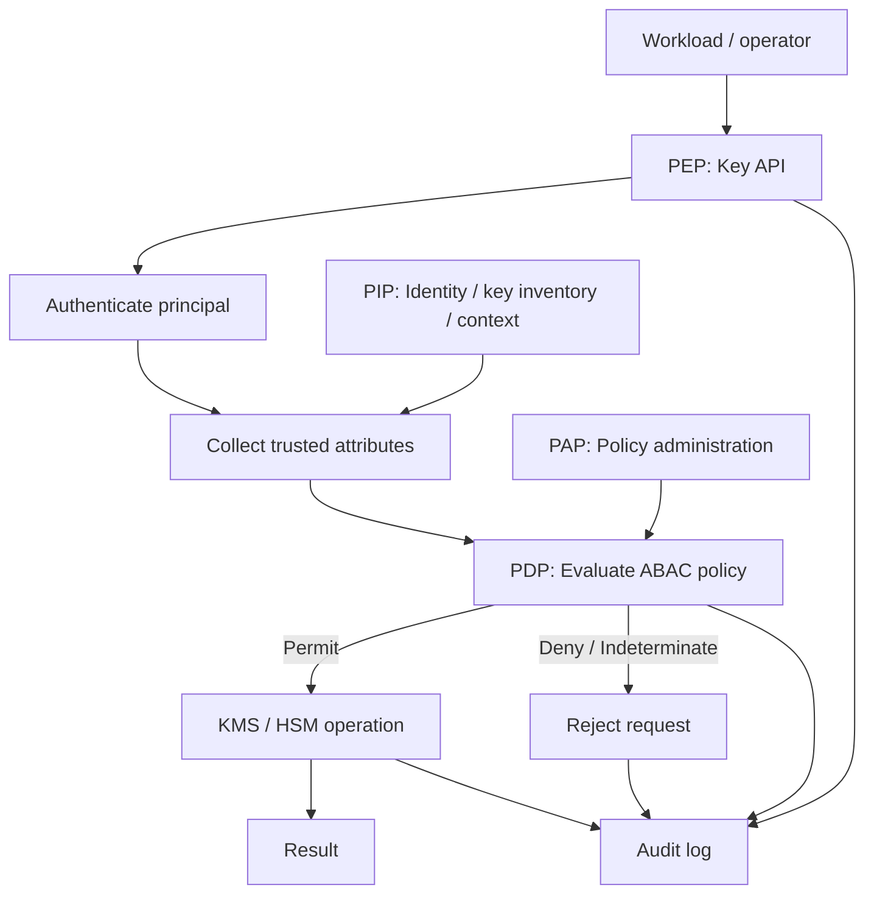

# Attribute-based key access

**Attribute-based access control (ABAC) cho khóa** là mô hình quyết định quyền sử dụng khóa mật mã dựa trên các thuộc tính của danh tính yêu cầu, khóa được truy cập, thao tác được yêu cầu và ngữ cảnh tại thời điểm truy cập. Thay vì chỉ hỏi một tài khoản có thuộc role nào, ABAC đánh giá một tập điều kiện như workload thuộc tenant nào, khóa có mục đích gì, dữ liệu có mức phân loại nào, thao tác là `Decrypt` hay `Sign`, request đến từ môi trường nào và các điều kiện đó có còn hợp lệ không.

Trong quản lý khóa, ABAC giúp giới hạn việc dùng khóa theo ngữ cảnh nghiệp vụ. Ví dụ, service `billing-api` có thể giải mã dữ liệu thanh toán thuộc tenant của nó bằng khóa có purpose `payment-data`, nhưng không được dùng cùng khóa để ký tài liệu hoặc giải mã dữ liệu nhân sự. Một administrator có thể quản lý metadata của khóa mà không có quyền sử dụng khóa để đọc dữ liệu. Một yêu cầu ngoài mạng tin cậy hoặc từ workload chưa được xác thực có thể bị từ chối dù danh tính đó thường được phép gọi dịch vụ.

ABAC là một phần của access control cho key trong phạm vi **SECURITY_KEY_MANAGEMENT_FUNDAMENTALS**. Mô hình này kết hợp với xác thực danh tính, least privilege, separation of duties, KMS/HSM, key lifecycle và audit. ABAC không thay thế việc bảo vệ vật liệu khóa; nó quyết định ai được thực hiện thao tác nào, trên khóa nào và trong điều kiện nào.

## 1. Vì sao cần ABAC cho khóa?

Một policy chỉ dựa trên role thường phát triển thành nhiều role theo service, tenant, môi trường và loại dữ liệu. Ví dụ, nếu có 20 service, 5 tenant và 3 môi trường, việc tạo role riêng cho mọi tổ hợp có thể làm policy phình to và khó rà soát.

ABAC biểu diễn các điều kiện bằng thuộc tính, cho phép một policy dùng lại trên nhiều khóa và workload:

- Chỉ workload có `service=billing-api` mới được đọc khóa có `purpose=payment-data`.
- Chỉ workload thuộc `tenant=tenant-42` mới được giải mã dữ liệu có cùng tenant context.
- Chỉ cho phép `Decrypt` khi `key.status=ENABLED`, dữ liệu có `classification` phù hợp và request đến từ môi trường production đã được xác thực.
- Chỉ người giữ vai trò quản trị khóa và có ticket được phê duyệt mới được yêu cầu rotation; quyền destroy cần điều kiện và phê duyệt riêng.
- Chỉ cho phép `Sign` bằng khóa có `purpose=document-signing`, không cho dùng khóa TLS hoặc encryption key để ký tài liệu.

Những điều kiện này giảm quyền quá rộng và làm policy gần với ranh giới dữ liệu, workload và mục đích sử dụng hơn.

## 2. RBAC và ABAC khác nhau thế nào?

Role-based access control (RBAC) quyết định quyền chủ yếu dựa trên role được gán cho subject. ABAC đánh giá nhiều thuộc tính và điều kiện, có thể bao gồm role như một thuộc tính trong biểu thức.

| Tiêu chí | RBAC | ABAC |
|---|---|---|
| Cơ sở quyết định | Role và quyền gắn với role | Thuộc tính subject, object, action và environment |
| Ví dụ | `billing-decryptor` được phép decrypt | Workload billing chỉ decrypt key thuộc tenant của nó, đúng purpose và trong production |
| Mức chi tiết | Dễ hiểu khi số vai trò ít | Diễn tả được nhiều ngữ cảnh mà không cần tạo role cho mọi tổ hợp |
| Quản lý | Quản lý thành viên role và quyền | Quản lý nguồn thuộc tính, chất lượng dữ liệu và policy |
| Rủi ro chính | Role tích lũy quyền hoặc gán nhầm | Thuộc tính sai/cũ hoặc policy phức tạp có thể cấp quyền sai |

RBAC và ABAC có thể dùng cùng nhau. Role giúp biểu diễn chức năng nền như `key-operator`; ABAC tiếp tục giới hạn operator đó theo key purpose, môi trường, trạng thái ticket, mức độ nhạy cảm và thao tác. Không nên xem ABAC là lý do bỏ qua role hoặc quy trình quản trị danh tính.

## 3. Bốn nhóm thuộc tính trong ABAC

Mô hình ABAC thường phân loại thuộc tính thành bốn nhóm: subject, object, action và environment.

| Nhóm | Ý nghĩa | Ví dụ trong quản lý khóa |
|---|---|---|
| Subject attributes | Thuộc tính của người hoặc workload yêu cầu | `principalId`, `service`, `tenant`, `role`, `environment`, `authenticationStrength`, `workloadAttested` |
| Object attributes | Thuộc tính của khóa hoặc tài nguyên được truy cập | `keyId`, `purpose`, `owner`, `tenant`, `classification`, `region`, `status`, `exportable` |
| Action attributes | Thao tác được yêu cầu | `Encrypt`, `Decrypt`, `Sign`, `Verify`, `Wrap`, `Unwrap`, `Export`, `Rotate`, `Disable`, `Destroy` |
| Environment attributes | Điều kiện của request tại thời điểm đánh giá | `timestamp`, `sourceNetwork`, `devicePosture`, `requestRisk`, `changeWindow`, `ticketApproved`, `region` |

Policy kết hợp các nhóm này để đưa ra quyết định. Chẳng hạn, `Decrypt` chỉ được cho phép khi subject thuộc đúng tenant của key, key có purpose phù hợp, trạng thái key đang hoạt động và request được gửi từ workload đã attestation.

Không phải thuộc tính nào cũng nên được dùng cho mọi thao tác. Một policy đọc khóa để `Verify` chữ ký có thể khác policy cho `Sign`; policy `Rotate` hoặc `Destroy` cần kiểm soát quản trị riêng và không nên kế thừa quyền của workload mã hóa.

## 4. Kiến trúc đánh giá policy

Một hệ thống ABAC thường có các thành phần sau:

- **Policy Enforcement Point (PEP):** điểm chặn request và buộc thực thi quyết định. PEP có thể nằm trong API gateway, ứng dụng, KMS hoặc lớp dịch vụ.
- **Policy Decision Point (PDP):** đánh giá policy với các thuộc tính đã thu thập và trả về `Permit`, `Deny` hoặc trạng thái không thể quyết định.
- **Policy Administration Point (PAP):** nơi tạo, phê duyệt, kiểm thử, phát hành và quản lý phiên bản policy.
- **Policy Information Point (PIP):** cung cấp thuộc tính từ identity provider, inventory khóa, CMDB, workload attestation, ticket/change system và nguồn ngữ cảnh tin cậy.
- **Audit service:** ghi lại request, policy version, thuộc tính đã dùng ở mức phù hợp, quyết định và kết quả thực thi.



PEP phải thực thi quyết định tại ranh giới tin cậy. Nếu ứng dụng chỉ kiểm tra policy rồi gọi KMS bằng một credential quản trị có quyền rộng, kẻ tấn công có thể bỏ qua ứng dụng và gọi KMS trực tiếp. Khi có thể, hãy thực thi policy trong KMS hoặc lớp dịch vụ mà mọi đường truy cập bắt buộc phải đi qua; nếu cần policy ở ứng dụng, quyền KMS phía sau phải được giới hạn để không thể bypass.

## 5. Thiết kế thuộc tính subject

Subject là danh tính thực sự thực hiện request. Trong hệ thống hiện đại, subject thường là workload identity hoặc service principal thay vì một người dùng cuối trực tiếp.

Các thuộc tính có thể gồm:

| Thuộc tính | Mục đích | Nguồn tin cậy gợi ý |
|---|---|---|
| `principalId` | Định danh duy nhất của caller | Identity provider hoặc workload platform |
| `service` | Tên workload/service | Identity claim được issuer tin cậy ký |
| `tenant` | Phân vùng dữ liệu hoặc khách hàng | Token/claim đã xác thực, ánh xạ phía server |
| `environment` | `dev`, `staging`, `production` | Deployment identity hoặc cấu hình control plane được bảo vệ |
| `role` | Chức năng nền như `key-operator` | IAM/identity governance |
| `authenticationStrength` | Mức xác thực hoặc assurance | Identity provider |
| `workloadAttested` | Workload có đáp ứng posture/attestation không | Runtime attestation service |
| `employmentStatus` | Trạng thái nhân sự với thao tác quản trị | HR/identity lifecycle system, nếu cần cho human operator |

Không tin thuộc tính do client tự gửi như `tenant=trusted`, `role=admin` hoặc `environment=production`. PIP phải lấy hoặc xác minh thuộc tính từ issuer có thẩm quyền. Nếu token chứa claim, cần kiểm tra chữ ký, issuer, audience, thời hạn và các ràng buộc tương ứng.

Với workload, ưu tiên identity ngắn hạn và ràng buộc vào workload cụ thể. Tránh dùng một service account chung cho nhiều ứng dụng vì khi đó ABAC không phân biệt được caller thực sự.

## 6. Thiết kế thuộc tính object cho khóa

Object là key object hoặc tài nguyên khóa được yêu cầu sử dụng. Metadata khóa phải đủ rõ để policy có thể đánh giá đúng mục đích và phạm vi.

Các thuộc tính quan trọng:

- `keyId` và `keyVersion`: định danh key và phiên bản cụ thể.
- `purpose`: `payment-data`, `database-backup`, `document-signing`, `tls`, `token-signing` hoặc mục đích đã định nghĩa.
- `owner` và `tenant`: chủ sở hữu nghiệp vụ và phân vùng dữ liệu.
- `classification`: mức phân loại dữ liệu khóa bảo vệ.
- `keyType` và `algorithm`: symmetric/asymmetric, AES, RSA, EC hoặc thuật toán được phép.
- `status`: `ENABLED`, `DISABLED`, `PENDING_DELETION` hoặc trạng thái tương đương theo hệ thống.
- `region` hoặc `residency`: phạm vi địa lý và yêu cầu lưu trú dữ liệu.
- `exportable`: khóa có cho phép xuất vật liệu hay không.
- `createdAt`, `expiresAt` và `rotationDueAt`: dữ liệu phục vụ policy vòng đời.

Metadata cần được quản lý bởi control plane có thẩm quyền. Không cho workload tự sửa `purpose`, `tenant`, `classification` hoặc `owner` để làm cho request của chính nó được phép. Thay đổi thuộc tính ảnh hưởng đến quyền cần quy trình phê duyệt, audit và có thể cần hai người kiểm soát.

Tên alias không phải nguồn thuộc tính đáng tin cậy. Ví dụ, alias `prod-payment-key` có thể bị đổi tên hoặc được tạo sai; policy nên dựa vào metadata có cấu trúc và được quản trị.

## 7. Thiết kế thuộc tính action và environment

Action mô tả thao tác mà caller muốn thực hiện. Phải phân biệt các thao tác vì tác động bảo mật của chúng khác nhau.

| Action | Rủi ro và điều kiện thường cần |
|---|---|
| `Encrypt` | Kiểm tra purpose, tenant, thuật toán và quyền tạo dữ liệu mới |
| `Decrypt` | Kiểm tra ownership/context dữ liệu, tenant, classification và key state |
| `Sign` | Kiểm tra identity ký, purpose, tài liệu/đối tượng được phép và approval nếu cần |
| `Verify` | Có thể cho phép rộng hơn `Sign`, nhưng phải xác thực nguồn public key và algorithm policy |
| `Wrap` / `Unwrap` | Kiểm tra quan hệ DEK/KEK, key purpose và encryption context |
| `Export` | Rất nhạy cảm; thường bị cấm hoặc yêu cầu kiểm soát kép và điều kiện đặc biệt |
| `Rotate` | Yêu cầu key owner, change ticket, cửa sổ thay đổi và kế hoạch migration |
| `Disable` / `Destroy` | Có thể làm gián đoạn hoặc mất dữ liệu; cần phê duyệt và xác minh phụ thuộc |

Environment attributes có thể gồm thời gian, mạng nguồn, posture thiết bị, vùng triển khai, mức rủi ro, trạng thái change window, ticket và kết quả attestation. Các thuộc tính này phải đến từ nguồn tin cậy, có thời điểm hiệu lực và thời hạn sử dụng rõ.

Ví dụ, điều kiện `sourceNetwork=corporate` chỉ đáng tin nếu PEP lấy địa chỉ mạng từ kết nối thực tế hoặc proxy tin cậy, không nhận giá trị do client khai báo. Điều kiện `ticketApproved=true` phải được đối chiếu với ticket đã phê duyệt, đúng resource, đúng action và chưa hết hiệu lực.

## 8. Viết policy ABAC cho key

Policy nên mô tả rõ subject, object, action, environment và kết quả. Ví dụ dưới đây là biểu diễn JSON minh họa, không phải cú pháp của một KMS hoặc policy engine cụ thể:

```json
{
  "policyId": "billing-decrypt-v3",
  "effect": "PERMIT",
  "actions": ["Decrypt"],
  "subject": {
    "service": "billing-api",
    "environment": "production"
  },
  "object": {
    "purpose": "payment-data",
    "status": "ENABLED"
  },
  "conditions": [
    "subject.tenant == object.tenant",
    "subject.workloadAttested == true",
    "request.tenant == subject.tenant",
    "request.sourceNetwork in trustedNetworks"
  ]
}
```

Policy này chỉ cho phép `Decrypt` khi workload billing production đã attestation, key đang bật, purpose phù hợp và tenant của subject, key cùng request khớp nhau. Một policy thực tế cần xác định cách xử lý khi thiếu thuộc tính, policy conflict, version cũ, thời gian hết hạn và nguồn dữ liệu không khả dụng.

Các nguyên tắc viết policy:

1. Mặc định từ chối (default deny); chỉ permit khi mọi điều kiện bắt buộc được thỏa mãn.
2. Tách policy theo action và purpose; không gộp `Decrypt`, `Export` và `Destroy` trong cùng một quyền rộng.
3. Dùng so khớp chính xác cho tenant, key ID và environment; tránh wildcard nếu không có lý do rõ ràng.
4. Định nghĩa rõ precedence của deny và permit. Explicit deny nên thắng permit trong mô hình policy được chọn.
5. Xử lý `Indeterminate` như từ chối đối với thao tác nhạy cảm nếu không thể xác minh thuộc tính.
6. Có owner, version, thời hạn, phê duyệt và test case cho mỗi policy.
7. Kiểm thử policy trước khi publish và theo dõi tác động sau khi triển khai.

## 9. Ràng buộc encryption context và AAD

Khi dùng KMS hoặc envelope encryption, request có thể mang encryption context gồm các cặp key-value như `tenant`, `recordType`, `purpose` hoặc `environment`. Context có thể được dùng để ràng buộc thao tác encrypt/decrypt với một ngữ cảnh dữ liệu cụ thể.

Encryption context thường không phải bí mật. Nó có thể xuất hiện trong audit log hoặc metadata. Không đặt password, token, personal data nhạy cảm hoặc key material vào context. Giá trị context cần được chuẩn hóa và so khớp chính xác; khác biệt về kiểu chữ, encoding hoặc trường bị thiếu có thể làm thao tác decrypt thất bại.

Với AEAD như AES-GCM, ứng dụng có thể đưa metadata đã chuẩn hóa vào Additional Authenticated Data (AAD). AAD được xác thực cùng ciphertext nhưng không được mã hóa. Nếu attacker thay đổi tenant, record ID hoặc purpose trong metadata, xác thực tag sẽ thất bại nếu các trường đó đã được ràng buộc đúng vào AAD.

Encryption context/AAD không thay thế ABAC. ABAC quyết định caller có được yêu cầu thao tác không; context/AAD ràng buộc ciphertext hoặc thao tác vào dữ liệu và ngữ cảnh đã định. Cả hai nên được dùng phối hợp khi kiến trúc hỗ trợ.

## 10. ABAC với KMS và HSM

KMS có thể cung cấp policy theo key, identity, tag, operation hoặc encryption context. Một số nền tảng cho phép điều kiện dựa trên principal tag, resource tag, network, region hoặc request context. Tên thuộc tính và cách kết hợp policy phụ thuộc sản phẩm; không được giả định mọi KMS hỗ trợ cùng một bộ điều kiện.

Khi thiết kế tích hợp:

- Xác định policy nào được thực thi trực tiếp trong KMS và policy nào nằm ở ứng dụng/PEP.
- Đảm bảo workload không có credential khác để bypass PEP.
- Dùng key policy và identity policy cùng nguyên tắc least privilege.
- Ràng buộc encryption context với tenant/purpose nếu dịch vụ hỗ trợ.
- Không cho workload thay đổi key tags hoặc policy attributes ảnh hưởng đến quyền của chính nó.
- Dùng KMS audit log để đối chiếu quyết định ứng dụng với thao tác thực tế.
- Kiểm tra hành vi khi key bị disable, policy bị cập nhật hoặc provider không khả dụng.

Với HSM, thuộc tính có thể đến từ partition, token, key object attributes, user role hoặc session đã xác thực. HSM có thể kiểm soát thuộc tính như extractable, sensitive, sign hoặc decrypt tùy thiết bị và API. Tuy nhiên, HSM không tự hiểu tenant hay nghiệp vụ nếu hệ thống không đưa các ràng buộc đó vào policy hoặc lớp điều phối. Cần giữ ranh giới kiểm soát rõ giữa ứng dụng, policy service, PKCS#11 provider và HSM.

## 11. Java: mô hình hóa quyết định ABAC

Trong Java, có thể biểu diễn thuộc tính bằng các kiểu dữ liệu rõ ràng rồi đưa vào một policy evaluator. Ví dụ dưới đây minh họa một quyết định `Decrypt`; nó không phải implementation đầy đủ của PDP và không thay thế policy enforcement phía KMS.

```java
import java.util.Set;

enum KeyAction {
    ENCRYPT, DECRYPT, SIGN, VERIFY, WRAP, UNWRAP, EXPORT, ROTATE, DESTROY
}

record SubjectAttributes(
        String principalId,
        String service,
        String tenant,
        String environment,
        boolean workloadAttested) {}

record KeyAttributes(
        String keyId,
        String purpose,
        String tenant,
        String status,
        boolean exportable) {}

record RequestContext(
        KeyAction action,
        String tenant,
        String sourceNetwork,
        Set<String> trustedNetworks) {}

final class KeyAccessPolicy {
    private KeyAccessPolicy() {}

    static boolean mayDecrypt(
            SubjectAttributes subject,
            KeyAttributes key,
            RequestContext request) {

        if (subject == null || key == null || request == null) {
            return false;
        }

        return request.action() == KeyAction.DECRYPT
                && "billing-api".equals(subject.service())
                && "production".equals(subject.environment())
                && subject.workloadAttested()
                && "payment-data".equals(key.purpose())
                && "ENABLED".equals(key.status())
                && subject.tenant().equals(key.tenant())
                && subject.tenant().equals(request.tenant())
                && request.trustedNetworks().contains(request.sourceNetwork());
    }
}
```

Ví dụ dùng kiểu dữ liệu rõ ràng và mặc định từ chối nếu thiếu đối tượng đầu vào. Trong production cần kiểm tra cả trường null bên trong record, chuẩn hóa giá trị, xác minh nguồn gốc thuộc tính, xử lý thời hạn claim, policy version, explicit deny, audit và lỗi từ PIP/PDP. Không lấy `trustedNetworks` hoặc `workloadAttested` từ request body do client kiểm soát.

Các `record` trong ví dụ yêu cầu Java 16 trở lên. Với Java 8 hoặc 11, có thể thay bằng các lớp bất biến thông thường có constructor và getter tương ứng.

Ứng dụng cũng không nên chỉ dựa vào kết quả boolean cục bộ nếu KMS có thể được gọi trực tiếp bằng credential rộng. Hãy ràng buộc quyền phía KMS để chỉ principal đã được phê duyệt có thể gọi key, đồng thời đưa context cần thiết vào request KMS.

## 12. ABAC cho từng giai đoạn vòng đời khóa

Quyền truy cập cần thay đổi theo trạng thái khóa và giai đoạn vòng đời:

| Giai đoạn | Thao tác | Điều kiện ABAC gợi ý |
|---|---|---|
| Tạo | `Create` / `Generate` | Subject là key provisioning service; purpose và algorithm nằm trong allowlist; có owner và environment hợp lệ |
| Cấp phát | `Grant` / `ReadMetadata` | Owner hoặc key administrator được phép; scope giới hạn theo workload/tenant |
| Sử dụng | `Encrypt`, `Decrypt`, `Sign`, `Verify` | Subject purpose, key purpose, tenant, action và context phải khớp |
| Xoay vòng | `Rotate` | Owner, change ticket, thời gian triển khai, policy version và trạng thái key hợp lệ |
| Thu hồi | `Disable` / `Revoke` | Incident/change approval và đánh giá phụ thuộc dữ liệu |
| Hủy | `Destroy` | Dual control, xác minh backup/legal hold, key dependency và approval hợp lệ |

Không nên dùng cùng policy cho toàn bộ vòng đời. Workload có thể được phép `Encrypt` và `Decrypt` trong phạm vi dữ liệu của nó nhưng không được `Rotate`, `Export` hoặc `Destroy`. Key administrator có thể quản lý policy và rotation nhưng không cần quyền giải mã dữ liệu nghiệp vụ.

## 13. Separation of duties và kiểm soát kép

ABAC có thể kiểm tra thuộc tính của người phê duyệt và người thực hiện để hỗ trợ separation of duties (SoD). Ví dụ, thao tác `Destroy` chỉ được permit nếu:

- Người yêu cầu là key owner hoặc incident commander có thẩm quyền.
- Người phê duyệt thuộc security approver group.
- Người thực hiện là key operator khác người yêu cầu và người phê duyệt.
- Ticket đã được phê duyệt cho đúng key ID, version và action.
- Key không còn phụ thuộc dữ liệu cần lưu giữ hoặc có quyết định hủy được phê duyệt.
- Thao tác diễn ra trong change window hoặc theo emergency procedure.

Với HSM, dual control hoặc M-of-N có thể yêu cầu nhiều người cùng tham gia mở khóa quản trị hoặc thực hiện thao tác nhạy cảm. Đây là kiểm soát ở tầng thiết bị/quy trình; ABAC có thể bổ sung nhưng không thay thế cơ chế quorum mà HSM yêu cầu.

## 14. Quản lý nguồn thuộc tính và chất lượng dữ liệu

ABAC chỉ chính xác khi thuộc tính đúng, mới và có nguồn gốc đáng tin. Mỗi thuộc tính nên có metadata về issuer, thời điểm cập nhật, thời hạn, độ tin cậy và quy tắc fallback.

| Nguồn | Thuộc tính có thể cung cấp | Rủi ro cần kiểm soát |
|---|---|---|
| Identity provider | Principal, role, tenant, group, assurance | Token cũ, claim sai, issuer/audience không hợp lệ |
| Workload platform | Service, namespace, environment, attestation | Node/pod bị chiếm quyền hoặc metadata do workload tự gán |
| Key inventory/KMS | Purpose, owner, status, algorithm, key version | Tag/metadata bị sửa hoặc đồng bộ chậm |
| CMDB/data catalog | Data classification, system owner, region | Dữ liệu thiếu, không cập nhật hoặc mapping sai |
| Change/ticket system | Approval, change window, incident state | Ticket hết hạn, phê duyệt sai resource/action |
| Network/security service | Source network, device posture, risk | Proxy header giả, tín hiệu trễ hoặc mất kết nối |

Không nên tin một thuộc tính chỉ vì nó có tên hợp lý. PIP phải xác minh issuer, chữ ký, audience, freshness và quyền sửa dữ liệu. Thuộc tính nhạy cảm như tenant, purpose, owner và classification cần được quản trị như metadata bảo mật.

## 15. Caching, cập nhật policy và thời điểm đánh giá

Policy hoặc thuộc tính có thể được cache để giảm độ trễ, nhưng cache tạo ra cửa sổ mà quyết định cũ vẫn được dùng sau khi quyền đã thay đổi.

Các nguyên tắc:

- Đặt TTL theo mức độ rủi ro; quyền `Destroy`, `Export` và `Decrypt` dữ liệu nhạy cảm cần cache thận trọng hơn.
- Có cơ chế invalidate khi role, tenant, key state, policy hoặc workload identity thay đổi.
- Gắn policy version và attribute timestamp vào decision record.
- Không dùng claim đã hết hạn hoặc metadata quá cũ để cấp quyền.
- Xác định rõ consistency khi key bị disable hoặc principal bị revoke.
- Với thao tác không thể đảo ngược, đánh giá lại thuộc tính ngay trước khi thực thi.

Một request có thể được permit tại thời điểm đánh giá nhưng key bị disable trước khi thao tác tới HSM. Vì vậy, nơi thực thi cần kiểm tra lại trạng thái và quyền ở ranh giới cuối cùng; tránh khoảng thời gian giữa check và use (TOCTOU).

## 16. Xử lý lỗi và nguyên tắc fail closed

PDP có thể không truy cập được PIP, token có thể thiếu claim, key metadata có thể chưa đồng bộ hoặc policy có thể không xác định kết quả. Với thao tác nhạy cảm, hệ thống nên fail closed: không thực hiện phép toán nếu không thể xác minh điều kiện bắt buộc.

| Tình huống | Hành vi nên có |
|---|---|
| Không xác thực được subject | Từ chối và ghi authentication failure |
| Thiếu tenant hoặc purpose | Từ chối; không suy đoán từ tên alias |
| PIP không khả dụng | Từ chối thao tác nhạy cảm hoặc dùng cache còn hạn theo policy rõ ràng |
| PDP timeout | Không permit theo mặc định; trả lỗi có thể retry có kiểm soát |
| Policy conflict | Áp dụng precedence đã định; explicit deny thắng permit |
| Key state không xác định | Từ chối và kiểm tra trạng thái KMS/HSM |
| Audit pipeline lỗi | Theo policy vận hành; với thao tác đặc biệt nhạy cảm có thể yêu cầu audit durable trước khi thực hiện |

Không nên dùng fallback như `allow all`, `admin role` hoặc bỏ qua điều kiện tenant khi dịch vụ policy gặp sự cố. Break-glass phải là đường đi riêng, có giới hạn thời gian, phê duyệt, cảnh báo và hậu kiểm.

## 17. Audit và giải thích quyết định

Một quyết định ABAC cần có thể giải thích lại sau sự kiện. Audit record nên lưu:

- Request ID/correlation ID và thời điểm.
- Principal ID và loại identity; tránh ghi token hoặc credential.
- Key ID, key version và action.
- Policy ID/version đã đánh giá.
- Thuộc tính liên quan và nguồn của chúng ở mức không làm lộ dữ liệu nhạy cảm.
- Decision: `PERMIT`, `DENY` hoặc `INDETERMINATE`.
- Reason code hoặc điều kiện thất bại.
- Kết quả thao tác thực tế từ KMS/HSM.
- Thay đổi policy, tag, key metadata và phê duyệt liên quan.

Không ghi raw key material, password, private token hoặc plaintext vào audit. Nếu tenant ID hoặc metadata nhạy cảm cần che bớt, dùng định danh nội bộ hoặc mã hóa log theo policy. Audit log cần được gửi đến kho độc lập, giới hạn quyền sửa/xóa và đồng bộ thời gian.

Khả năng giải thích nên chỉ rõ điều kiện nào đã cho phép hoặc từ chối. Ví dụ: `DENY: subject.tenant != key.tenant` hữu ích hơn thông báo chung `Access denied`, miễn là reason code không tiết lộ thông tin cho caller không được phép. Chi tiết đầy đủ có thể chỉ hiển thị cho security operator và auditor.

## 18. Kiểm thử policy ABAC

Policy phải được kiểm thử như mã nguồn. Một bộ test cần có trường hợp permit, deny, thiếu thuộc tính, thuộc tính sai nguồn và cập nhật policy.

| Test case | Subject | Key | Request/context | Kết quả mong đợi |
|---|---|---|---|---|
| Đúng tenant và purpose | billing, tenant A, production, attested | payment-data, tenant A, enabled | `Decrypt`, tenant A, trusted network | Permit |
| Sai tenant | billing, tenant A | payment-data, tenant B | `Decrypt`, tenant A | Deny |
| Sai purpose | billing, tenant A | document-signing, tenant A | `Decrypt`, tenant A | Deny |
| Key bị disable | billing, tenant A | payment-data, disabled | `Decrypt`, tenant A | Deny |
| Workload chưa attestation | billing, tenant A, unattested | payment-data, tenant A | `Decrypt`, trusted network | Deny |
| Mạng không tin cậy | billing, tenant A, attested | payment-data, tenant A | `Decrypt`, untrusted network | Deny |
| Thiếu thuộc tính | Không có tenant claim | payment-data, tenant A | `Decrypt` | Deny/Indeterminate theo policy, không permit |
| Sai action | billing, tenant A | payment-data, tenant A | `Destroy` | Deny |
| Ticket hết hạn | key operator | key hợp lệ | `Rotate`, approval hết hạn | Deny |
| PDP/PIP lỗi | Không thể xác minh | key hợp lệ | `Decrypt` | Fail closed |

Ngoài unit test, cần integration test với KMS/HSM để chứng minh quyền được thực thi ở phía dịch vụ và không thể bypass PEP. Kiểm thử negative path, policy precedence, cache invalidation, concurrent update và TOCTOU. Khi policy thay đổi, chạy regression test trên toàn bộ ma trận action/purpose/tenant quan trọng.

## 19. Lỗi thường gặp khi triển khai ABAC cho khóa

| Lỗi | Hậu quả | Cách kiểm soát |
|---|---|---|
| Tin attribute do client gửi | Caller tự khai tenant/role để vượt quyền | Lấy claim từ issuer tin cậy và xác minh chữ ký/audience |
| Chỉ kiểm tra policy ở ứng dụng | Caller có thể gọi trực tiếp KMS bằng credential rộng | Thực thi tại PEP bắt buộc và giới hạn IAM phía KMS |
| Dùng alias làm thuộc tính bảo mật | Đổi tên hoặc tạo alias giả có thể làm policy sai | Dùng key ID và metadata được quản trị |
| Gộp mọi action vào một policy | Workload decrypt có thể bị cấp export/destroy | Tách action theo rủi ro và purpose |
| Không xử lý thuộc tính thiếu | PDP có thể cho phép do biểu thức mặc định | Default deny và test null/missing/unknown |
| Cache policy quá lâu | Quyền đã thu hồi vẫn có hiệu lực | TTL, invalidation và re-evaluate thao tác nhạy cảm |
| Cho workload sửa key tags | Workload tự thay object attributes để được permit | Tách quyền quản trị metadata và dùng approval |
| Không có explicit deny/precedence | Policy conflict tạo kết quả khó dự đoán | Định nghĩa precedence và regression test |
| Không gắn context với ciphertext | Metadata có thể bị tráo giữa tenant/record | Dùng encryption context/AAD được xác thực |
| Không log policy version | Không tái dựng được vì sao request được permit | Ghi policy ID/version, decision và reason code |
| Fail open khi PDP lỗi | Sự cố policy trở thành bypass quyền | Fail closed và break-glass riêng biệt |

## 20. Checklist triển khai

Trước khi đưa ABAC cho key vào production, hãy xác nhận:

- [ ] Đã xác định subject, object, action và environment attributes cho từng thao tác.
- [ ] Mỗi thuộc tính có nguồn tin cậy, owner, freshness và thời hạn.
- [ ] Workload identity là duy nhất và không chia sẻ credential quá rộng.
- [ ] Key metadata như purpose, tenant, owner, classification và status được quản trị có kiểm soát.
- [ ] Policy mặc định deny, tách action và có explicit deny/precedence rõ ràng.
- [ ] PEP không thể bị bypass; KMS/HSM policy cũng giới hạn principal và operation.
- [ ] Encryption context/AAD ràng buộc dữ liệu với tenant, purpose hoặc record khi phù hợp.
- [ ] Quyền `Export`, `Rotate`, `Disable` và `Destroy` có kiểm soát riêng.
- [ ] Separation of duties và dual control được áp dụng cho thao tác nhạy cảm.
- [ ] Cache, policy update, attribute freshness và TOCTOU đã được xử lý.
- [ ] PDP/PIP lỗi dẫn đến hành vi fail closed theo policy.
- [ ] Audit ghi principal, key ID/version, action, policy version, decision và result.
- [ ] Có test permit/deny, missing attributes, conflict, bypass và integration KMS/HSM.
- [ ] Break-glass có giới hạn, phê duyệt, cảnh báo và hậu kiểm.

ABAC cho khóa cho phép quyết định quyền theo đúng danh tính, tài nguyên, thao tác và ngữ cảnh. Hiệu quả của mô hình phụ thuộc vào chất lượng thuộc tính, policy rõ ràng và việc thực thi ở ranh giới không thể bypass. Khi kết hợp với least privilege, separation of duties, encryption context, KMS/HSM và audit, ABAC giúp giới hạn việc sử dụng khóa theo tenant, purpose và trạng thái thực tế của hệ thống.
