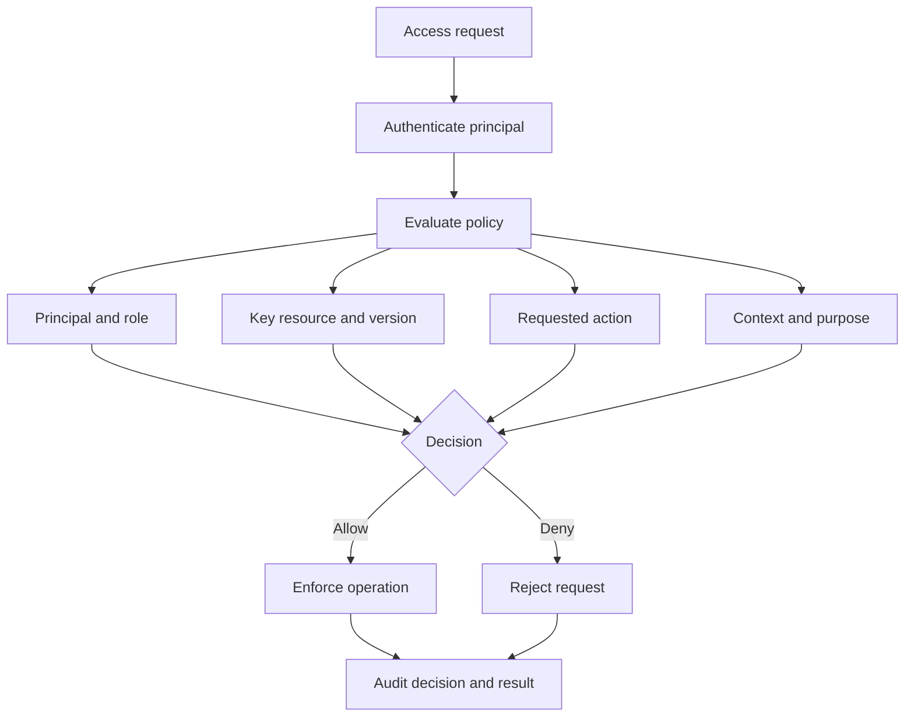

# Read key permission

## Mục tiêu học tập

Sau bài học này, bạn có thể:

- Giải thích ý nghĩa và phạm vi của quyền đọc khóa trong hệ thống quản lý khóa mật mã.
- Phân biệt đọc metadata, đọc public key, export raw key material và sử dụng key qua cryptographic operation.
- Thiết kế RBAC, ABAC và policy theo principal, key, action, purpose, tenant và môi trường.
- Áp dụng least privilege, default deny, separation of duties và kiểm soát truy cập theo vòng đời key.
- Hiểu khác biệt giữa quyền đọc trong Java KeyStore, secret manager, HSM/PKCS#11 và KMS.
- Bảo vệ key material trong bộ nhớ, cache, log, backup và các kênh vận hành.
- Kiểm thử policy, audit access và xử lý tình huống cấp quyền khẩn cấp hoặc nghi ngờ compromise.

## 1. Read key permission là gì?

Read key permission là quyền cho phép một principal truy cập thông tin hoặc key material của một cryptographic key. Tuy nhiên, từ “read” có thể mang nhiều nghĩa. Một hệ thống an toàn phải định nghĩa rõ principal được đọc metadata, public key, secret/private key bytes hay chỉ được gọi một phép toán bằng key.

Ví dụ, một service có thể cần biết algorithm và key version để chọn cách giải mã, nhưng không cần lấy raw AES key ra khỏi KMS. Một verifier cần public key để xác minh chữ ký, nhưng không cần private signing key. Một application có thể cần gọi `Decrypt` hoặc `Sign` mà không được export key material.

Vì vậy, không nên gộp mọi thao tác thành một quyền chung `read`. Quyền đọc phải được chia thành action có ý nghĩa bảo mật rõ ràng, gắn với key cụ thể, principal cụ thể và mục đích sử dụng được phê duyệt.

## 2. Bốn loại truy cập thường bị gọi chung là read

| Loại truy cập | Nội dung | Mức nhạy cảm điển hình |
|---|---|---|
| Read metadata | Alias, key ID, algorithm, size, state, owner, version, creation time | Thấp đến trung bình; metadata vẫn có thể nhạy cảm |
| Read public key | Lấy public key hoặc certificate để verify/encrypt | Thường có thể công khai; cần bảo đảm integrity và provenance |
| Export key material | Lấy raw secret key hoặc private key bytes | Rất cao; có thể làm mất kiểm soát key boundary |
| Use key | Gọi Encrypt, Decrypt, Sign, Verify, Wrap, Unwrap hoặc Derive | Phụ thuộc operation; không đồng nghĩa được export key |

Một policy tốt phân biệt tối thiểu `DescribeKey`, `GetPublicKey`, `ExportKeyMaterial` và từng cryptographic operation. Tên action thực tế phụ thuộc sản phẩm; các tên trong bài là cách mô tả khái niệm, không phải API chuẩn chung cho mọi KMS/HSM.

## 3. Đọc key không đồng nghĩa được dùng key

Đọc metadata giúp ứng dụng biết key tồn tại và trạng thái của nó. Sử dụng key cho phép yêu cầu module thực hiện một phép toán. Export key material cho phép caller nhận được bí mật gốc.

Ví dụ:

- Một API gateway có thể đọc public key để verify JWT nhưng không có quyền ký token.
- Một service có thể được phép gọi `Decrypt` cho một key cụ thể nhưng không được `Export` raw key.
- Một operator có thể xem key metadata và audit history nhưng không được gọi `Decrypt`.
- Một application có thể gọi `Sign` trong HSM bằng key handle không exportable mà không đọc private key bytes.

Đây là nguyên tắc quan trọng khi thiết kế HSM/KMS: ưu tiên cấp quyền sử dụng key qua operation được kiểm soát, thay vì cấp quyền lấy key material về process.

## 4. Secret key, private key và public key có mức đọc khác nhau

| Key type | Đọc/export | Dùng key |
|---|---|---|
| Symmetric secret key | Raw bytes thường phải giữ bí mật tuyệt đối | Encrypt/decrypt, MAC, wrap/unwrap, derive theo purpose |
| Asymmetric private key | Raw private material phải được bảo vệ nghiêm ngặt | Sign, decrypt, key agreement |
| Asymmetric public key | Có thể phân phối công khai nhưng cần xác thực nguồn | Verify, encrypt, key agreement |
| Opaque HSM key handle | Handle có thể lộ ra cho ứng dụng nhưng không chứa raw key | Gọi operation qua provider/session của HSM |

Public key có thể công khai nhưng không có nghĩa mọi public key đều đáng tin cậy. Verifier phải biết public key thuộc issuer nào, purpose nào và version nào. Kẻ tấn công có thể thay public key hoặc certificate để làm giả trust relationship nếu nguồn phân phối không được xác thực.

## 5. Vì sao quyền export key material nguy hiểm?

Khi raw key material rời khỏi boundary bảo vệ, nó có thể bị sao chép sang heap, dump, file tạm, log, backup, artifact hoặc máy của người vận hành. Những bản sao này khó kiểm kê và khó thu hồi.

Nếu một principal export được AES key, họ có thể giải mã mọi ciphertext phụ thuộc key đó trong phạm vi dữ liệu có sẵn. Nếu export được HMAC secret, họ có thể tạo MAC giả. Nếu export được private signing key, họ có thể phát hành chữ ký hoặc token giả cho tới khi verifier loại key khỏi trust set.

Quyền export thường nên bị deny mặc định. Nếu có use case BYOK, migration hoặc backup yêu cầu export, phải có quy trình riêng, approval, wrapping, kiểm soát đích nhận, audit và kế hoạch xóa bản tạm.

## 6. Access control model: principal, resource, action và context

Một quyết định truy cập key có thể được mô hình hóa bằng các thành phần:

- **Principal:** user, service account, workload identity, operator hoặc automation.
- **Resource:** key ID, key version, key alias, tenant hoặc key collection.
- **Action:** describe, read public key, export, encrypt, decrypt, sign, verify, wrap, unwrap, rotate, disable hoặc destroy.
- **Context:** purpose, tenant, environment, network, device, workload identity, request attributes, approval và thời gian.
- **Decision:** allow hoặc deny, kèm policy/rule đã áp dụng.



Chỉ xác thực danh tính chưa đủ. Một principal hợp lệ vẫn có thể yêu cầu action không phù hợp với vai trò hoặc key resource.

## 7. RBAC và ABAC

Role-Based Access Control (RBAC) cấp quyền thông qua vai trò. Ví dụ `token-verifier` có quyền đọc public key và verify, còn `key-custodian` có quyền thực hiện quy trình backup theo approval.

Attribute-Based Access Control (ABAC) xét thuộc tính của principal, key và request context. Ví dụ, service `billing-prod` chỉ được decrypt key thuộc tenant của request khi environment là production và purpose là `invoice-read`.

| Mô hình | Ưu điểm | Rủi ro cần kiểm soát |
|---|---|---|
| RBAC | Dễ hiểu, dễ audit, phù hợp vai trò ổn định | Role quá rộng hoặc tích lũy nhiều quyền |
| ABAC | Biểu đạt được tenant, purpose, environment và context | Policy phức tạp, khó kiểm thử nếu thuộc tính không đáng tin |
| Hybrid | Role xác định nhóm quyền, attribute giới hạn phạm vi | Cần quản trị policy và nguồn thuộc tính nhất quán |

Trong hệ thống nhiều tenant hoặc nhiều service, hybrid RBAC/ABAC thường hữu ích. Không lấy tenant ID hoặc purpose từ dữ liệu caller có thể tự sửa mà không xác minh chúng với identity và authorization context đáng tin cậy.

## 8. Least privilege và default deny

Least privilege nghĩa là principal chỉ có những quyền tối thiểu cần thiết cho công việc. Default deny nghĩa là request bị từ chối nếu không có rule cho phép rõ ràng.

Khi cấp quyền đọc key:

- Chỉ cấp đúng key hoặc key group cần thiết.
- Chỉ cấp action cần thiết, không cấp `*` hoặc quyền quản trị toàn kho.
- Giới hạn theo environment, tenant, purpose và workload identity.
- Tách quyền đọc metadata khỏi quyền export key.
- Tách quyền sử dụng key khỏi quyền thay đổi policy hoặc destroy key.
- Đặt thời hạn cho quyền tạm thời và rà soát định kỳ.

Không dùng alias bí mật như một cách thay thế authorization. Biết tên key không đồng nghĩa có quyền truy cập.

## 9. Read permission trong Java KeyStore

Java `KeyStore` cung cấp API để đọc entry theo alias. Ví dụ `getKey`, `getEntry` hoặc `getCertificate` có thể trả về key/certificate tương ứng nếu provider và protection parameter cho phép.

```java
Key key = keyStore.getKey(alias, entryPassword);
KeyStore.Entry entry = keyStore.getEntry(
        alias,
        new KeyStore.PasswordProtection(entryPassword));
```

Mật khẩu entry bảo vệ việc khôi phục entry theo provider semantics. Nó không tự tạo ra authorization model đầy đủ. Nếu nhiều user/process cùng đọc được file KeyStore và password, họ có thể có cùng khả năng truy cập.

Vì vậy cần kết hợp:

- OS file permissions và service identity.
- Secret/password retrieval policy.
- Phân tách alias và KeyStore theo environment hoặc purpose khi phù hợp.
- Kiểm soát ai được gọi `getKey`/`getEntry`.
- Tránh export key qua `getEncoded()` nếu không cần.
- Audit các thao tác đọc và sử dụng theo yêu cầu.

## 10. `getEncoded()` và ranh giới export

`Key.getEncoded()` có thể trả raw hoặc encoded key material nếu provider cho phép export. Với opaque/non-exportable key, method có thể trả `null`.

```java
byte[] encoded = key.getEncoded();
if (encoded == null) {
    // The provider does not expose an encoded key representation.
}
```

Không gọi `getEncoded()` chỉ để kiểm tra key có hoạt động hay không. Hãy thực hiện một phép toán kiểm thử được phê duyệt hoặc đọc metadata do provider cung cấp.

Nếu raw bytes được trả về, xem chúng như secret: không log, không serialize tùy tiện, không giữ trong cache lâu dài và ghi đè buffer tạm khi có thể. Việc ghi đè một array không bảo đảm JVM/provider đã xóa mọi bản sao.

## 11. Read permission với HSM/PKCS#11

Trong HSM, key object có thể được tạo với attributes như sensitive hoặc non-extractable. Ứng dụng có thể nhận một handle để gọi `Sign`, `Decrypt` hoặc `Wrap` mà không thể đọc raw private/secret key.

Các khái niệm cần phân biệt:

- **Object visibility:** principal/session có nhìn thấy object hoặc tìm kiếm theo label/ID hay không.
- **Attribute read:** có được đọc metadata/attributes của object hay không.
- **Extractability:** key material có được export khỏi HSM hay không.
- **Operation permission:** key có được phép sign/decrypt/unwrap/derive hay không.
- **Administration:** ai được tạo, sửa attributes, backup, restore hoặc destroy object.

PKCS#11 attributes và cơ chế authorization cụ thể phụ thuộc HSM/provider. Không giả định mọi HSM dùng cùng một mô hình role hoặc cùng semantics cho `CKA_SENSITIVE`, `CKA_EXTRACTABLE` và login role.

## 12. Read permission với KMS

KMS thường tách control-plane action và cryptographic data-plane action. Ví dụ khái niệm:

| Nhóm | Ví dụ action | Có nhận raw key không? |
|---|---|---|
| Metadata | Describe key, list aliases, read state | Thường không |
| Public material | Get public key hoặc certificate | Có thể trả public bytes |
| Cryptographic operation | Encrypt, decrypt, sign, verify, wrap, unwrap | Thường trả kết quả phép toán, không trả KEK |
| Export/import | Export hoặc import key material theo dịch vụ hỗ trợ | Có thể làm key material rời boundary |
| Lifecycle/admin | Create, rotate, disable, schedule deletion, policy update | Không nhất thiết đọc key material |

Tên action và quyền thực tế khác nhau giữa các KMS. Một quyền `Decrypt` không có nghĩa caller được `GetKeyMaterial`; một quyền `Describe` cũng không đồng nghĩa được `Decrypt`.

Policy phải ràng buộc key ID, principal, action, resource condition, encryption context và environment. Với envelope encryption, KMS có thể yêu cầu encryption context khớp tenant/object/purpose để ngăn ciphertext bị chuyển sang ngữ cảnh khác.

## 13. Secret manager khác KMS

Secret manager thường lưu và trả về secret dạng credential hoặc configuration, ví dụ database password, API token, certificate bundle hoặc một số secret bytes. KMS thường cung cấp key management và cryptographic operations.

Nếu lưu raw AES key như một secret trong secret manager, principal có quyền đọc secret có thể nhận key bytes và tự thực hiện crypto bên ngoài service. Nếu dùng KMS key non-exportable, principal có thể chỉ được gọi operation mà không nhận KEK.

Chọn dịch vụ theo mục đích:

- Credential cần được ứng dụng đọc để kết nối hệ thống khác: secret manager.
- KEK cần giữ trong cryptographic boundary và chỉ cho phép operation: KMS/HSM.
- DEK cần dùng trong memory để mã hóa một object: có thể nhận plaintext DEK ngắn hạn từ KMS theo envelope pattern, với access policy và cleanup phù hợp.

Không mặc định mọi secret đều là cryptographic key hoặc mọi key đều nên được lưu dưới dạng secret có thể đọc.

## 14. Quyền đọc public key và JWKS

Public key thường được công bố để nhiều verifier có thể xác minh chữ ký. Quyền đọc public key có thể rộng hơn quyền đọc private key, nhưng vẫn cần bảo vệ tính toàn vẹn của key set.

Verifier nên:

- Lấy JWKS từ issuer metadata hoặc endpoint được cấu hình tin cậy.
- Xác thực TLS và issuer identity.
- Kiểm tra `kid`, `kty`, `use`, `key_ops`, `alg` và key parameters.
- Không tải key từ URL tùy ý trong token header.
- Cache theo policy và có cơ chế refresh khi rotation.
- Xử lý key bị thu hồi hoặc compromise bằng invalidation rõ ràng.

Public key có thể công khai; key substitution vẫn có thể làm giả token nếu attacker thay được nguồn JWKS hoặc cấu hình trust.

## 15. Quyền đọc DEK trong envelope encryption

Envelope encryption thường dùng DEK để mã hóa dữ liệu và KEK để wrap DEK. Ứng dụng có thể cần nhận plaintext DEK trong thời gian ngắn để xử lý dữ liệu, nhưng không cần đọc raw KEK.

Một thiết kế tốt:

1. Service được phép yêu cầu `Decrypt`/`Unwrap` với đúng KEK và context.
2. KMS kiểm tra principal, key policy và encryption context.
3. Plaintext DEK chỉ được trả cho workload được phép.
4. Service dùng DEK cho object được ủy quyền.
5. Service giải phóng reference/buffer khi xong và không ghi DEK ra disk/log.
6. Audit ghi key ID, operation, principal, context và kết quả.

Nếu service có thể gọi `Decrypt` với mọi wrapped DEK, quyền của nó có thể rộng hơn dự định. Cần ràng buộc context, tenant, object, purpose và kiểm tra authorization ở tầng ứng dụng.

## 16. Multi-tenant và key isolation

Trong hệ thống nhiều tenant, quyền đọc key phải giới hạn theo tenant. Không dựa vào tenant ID trong request body nếu caller có thể thay đổi.

Các mô hình:

- Một key riêng cho từng tenant.
- Một KEK chung nhưng policy và encryption context tách tenant.
- Một hierarchy key theo organization, tenant và data domain.
- Key per object hoặc per DEK với KEK quản lý tập trung.

Quyết định phụ thuộc isolation requirement, chi phí, throughput, giới hạn KMS và recovery. Nếu dùng shared KEK, context binding và authorization phải ngăn một tenant sử dụng quyền của tenant khác.

Policy nên kiểm tra đồng thời principal tenant, key tenant, object tenant và purpose. Log cần giữ correlation nhưng không lộ raw key hoặc dữ liệu nhạy cảm.

## 17. Separation of duties

Không nên để một principal vừa tự cấp quyền, vừa export key, vừa thay đổi audit hoặc xóa bằng chứng. Separation of duties chia các thao tác nhạy cảm giữa các vai trò.

Ví dụ:

| Vai trò | Quyền có thể cấp | Quyền nên tách riêng |
|---|---|---|
| Application workload | Decrypt/Sign trên key được chỉ định | Không policy admin hoặc export |
| Security administrator | Quản lý policy/role | Không tự ý dùng key nghiệp vụ |
| Key custodian | Tham gia backup/restore hoặc ceremony | Không tự phê duyệt một mình |
| Auditor | Đọc audit và metadata | Không sửa policy hoặc dùng key |
| Data owner | Phê duyệt purpose/retention | Không nhất thiết có quyền raw key |

Với export, backup, restore, import và destroy, cân nhắc dual control hoặc M-of-N approval. Người phê duyệt không nên đồng thời là người thực thi duy nhất nếu threat model yêu cầu separation.

## 18. Cấp quyền tạm thời và break-glass

Break-glass là quyền truy cập khẩn cấp cho tình huống đặc biệt, ví dụ khôi phục dịch vụ hoặc xử lý incident. Quyền này cần được kiểm soát chặt:

- Có incident/ticket và lý do cụ thể.
- Phạm vi key/action tối thiểu.
- Thời hạn ngắn và tự hết hạn.
- Approval độc lập hoặc quorum khi phù hợp.
- Ghi audit không thể sửa bởi người dùng quyền khẩn cấp.
- Alert ngay khi quyền được kích hoạt.
- Rà soát sau sự cố và thu hồi quyền.

Không dùng break-glass làm đường vận hành thường ngày. Không lưu credential khẩn cấp plaintext trong wiki, source hoặc file chung.

## 19. Access review và quyền không còn cần thiết

Quyền đọc key có thể tồn tại lâu hơn nhu cầu ban đầu nếu không có quy trình review. Khi service đổi owner, chuyển environment hoặc ngừng sử dụng key, role cũ có thể vẫn truy cập được.

Access review cần:

1. Lập danh sách principal, key và action đang được cấp.
2. Đối chiếu với owner, service inventory và dependency hiện tại.
3. Xác nhận quyền vẫn cần cho purpose hợp lệ.
4. Thu hồi quyền rộng, quyền không dùng hoặc principal đã nghỉ/retire.
5. Kiểm tra service account, CI/CD, backup job và support role.
6. Lưu người review, thời điểm, quyết định và ngoại lệ.

Không chỉ xem role name. Một policy có thể kế thừa quyền từ group, organization policy hoặc resource policy khác; cần đánh giá effective permissions.

## 20. Caching và key material trong memory

Ứng dụng có thể cache metadata, public key hoặc plaintext DEK để giảm latency. Mỗi loại cache có rủi ro khác nhau.

- Metadata cache: cần xử lý trạng thái key và quyền thay đổi.
- Public key cache: cần refresh khi key rotation/revocation.
- HSM handle/session: cần bảo vệ session và quyền thao tác.
- Plaintext DEK cache: tăng thời gian và phạm vi key material nằm trong process.
- HMAC secret/private key bytes cache: có thể mở rộng blast radius khi process bị compromise.

Đặt TTL và invalidation theo threat model. Không cache raw key lâu hơn cần thiết. Khi principal bị revoke, cần xác định cache nào còn cho phép operation, process nào phải restart và key reference nào phải invalidated.

## 21. Logging và audit cho quyền đọc key

Audit phải giúp trả lời ai đã truy cập key nào, thực hiện action gì, vào thời điểm nào và theo policy nào.

Nên ghi:

- Principal/workload identity và role.
- Key ID/version hoặc alias đã chuẩn hóa.
- Action: describe, get public key, export, decrypt, sign, unwrap, rotate...
- Purpose, tenant và context đã được xác minh.
- Decision allow/deny, policy version và approval reference.
- Thời điểm, source workload, request/correlation ID.
- Kết quả operation và error category không nhạy cảm.
- Thay đổi policy, role, key attributes và break-glass event.

Không ghi raw key, password, PIN, plaintext DEK, bearer token hoặc plaintext dữ liệu vào audit. Audit log cần được bảo vệ khỏi sửa/xóa bởi principal đang được audit và có retention phù hợp.

## 22. Java example: kiểm tra authorization trước khi đọc KeyStore entry

Ví dụ dưới đây minh họa ứng dụng kiểm tra principal và action trước khi gọi `KeyStore.getEntry`. Đây là lớp kiểm tra ở tầng ứng dụng; production phải có enforcement độc lập ở OS, secret manager, HSM/KMS hoặc service boundary. Nếu cùng process có thể bỏ qua guard và đọc file/password trực tiếp, guard này không phải ranh giới bảo mật cuối cùng.

```java
import java.security.KeyStore;
import java.security.Principal;
import java.util.Set;
import javax.crypto.SecretKey;

enum KeyAction {
    READ_METADATA,
    READ_PUBLIC_KEY,
    EXPORT_SECRET_KEY,
    USE_FOR_DECRYPT
}

record KeyRequest(Principal principal, String keyAlias,
                  String tenantId, String purpose, KeyAction action) {}

interface KeyPolicy {
    boolean allows(KeyRequest request);
}

final class KeyStoreReader {
    private final KeyStore keyStore;
    private final KeyPolicy policy;

    KeyStoreReader(KeyStore keyStore, KeyPolicy policy) {
        this.keyStore = keyStore;
        this.policy = policy;
    }

    SecretKey readSecretKey(KeyRequest request, char[] entryPassword)
            throws Exception {
        if (request.action() != KeyAction.EXPORT_SECRET_KEY) {
            throw new SecurityException("Wrong action for secret-key export");
        }
        if (!policy.allows(request)) {
            throw new SecurityException("Key access denied");
        }

        KeyStore.ProtectionParameter protection =
                new KeyStore.PasswordProtection(entryPassword);
        try {
            KeyStore.Entry entry = keyStore.getEntry(
                    request.keyAlias(), protection);
            if (!(entry instanceof KeyStore.SecretKeyEntry secretEntry)) {
                throw new SecurityException("Expected SecretKeyEntry");
            }
            return secretEntry.getSecretKey();
        } finally {
            if (protection instanceof KeyStore.PasswordProtection passwordProtection) {
                passwordProtection.destroy();
            }
        }
    }
}
```

Trong hệ thống thực tế, không nên cấp `EXPORT_SECRET_KEY` nếu service chỉ cần decrypt. Tạo một API riêng chỉ cho phép operation cần thiết; với HSM/KMS, dùng key handle hoặc remote cryptographic operation để raw key không rời boundary. Password buffer do caller sở hữu cũng cần được xóa sau khi hoàn tất.

## 23. Java example: tách metadata access khỏi crypto operation

Một service có thể cần đọc algorithm và trạng thái key nhưng chỉ được gọi operation cụ thể. Có thể biểu diễn action tường minh trong policy:

```java
enum KeyPermission {
    DESCRIBE,
    GET_PUBLIC_KEY,
    SIGN,
    VERIFY,
    ENCRYPT,
    DECRYPT,
    WRAP,
    UNWRAP,
    EXPORT_MATERIAL,
    ROTATE,
    DISABLE,
    DESTROY
}

record KeyGrant(String principalId, String keyId,
                KeyPermission permission, String environment,
                String purpose) {}

boolean isAllowed(KeyGrant grant, String caller, String key,
                  KeyPermission action, String environment,
                  String purpose) {
    return grant.principalId().equals(caller)
            && grant.keyId().equals(key)
            && grant.permission() == action
            && grant.environment().equals(environment)
            && grant.purpose().equals(purpose);
}
```

Đây là ví dụ mô hình hóa, không phải policy engine production. Production cần xác thực principal từ workload identity đáng tin, lấy tenant/purpose từ context đã xác minh, hỗ trợ deny rules và policy versioning, đồng thời enforce quyền tại KMS/HSM hoặc service quản lý key.

## 24. Kiểm thử quyền đọc key

Test matrix cần bao gồm cả trường hợp được phép và bị từ chối:

| Tình huống | Kết quả mong đợi |
|---|---|
| Workload đọc metadata key được cấp | Allow |
| Workload chỉ có `Decrypt` yêu cầu export raw key | Deny |
| Verifier đọc public key đúng issuer | Allow |
| Verifier yêu cầu private signing key | Deny |
| Service tenant A yêu cầu key tenant B | Deny |
| Service staging truy cập key production | Deny |
| Principal bị disable nhưng cache còn grant cũ | Deny sau cơ chế invalidation/revocation đã thiết kế |
| Caller tự thay purpose trong request | Deny nếu purpose không được xác minh |
| Break-glass hết hạn | Deny |
| Policy engine/KMS không sẵn sàng | Fail closed cho thao tác nhạy cảm |
| Operator có quyền xem audit nhưng không có quyền decrypt | Audit allow, decrypt deny |

Kiểm thử effective permissions, group inheritance, resource policy, network path và cached credentials. Một unit test cho hàm authorization không đủ chứng minh enforcement ở KMS/HSM.

## 25. Xử lý khi quyền đọc bị cấp nhầm hoặc key bị lộ

Nếu phát hiện principal có quyền export hoặc read key material ngoài dự kiến:

1. Xác định principal, key ID/version, action và khoảng thời gian quyền tồn tại.
2. Thu hồi grant, role, credential và session liên quan.
3. Kiểm tra audit, data access, logs, heap/core dumps, CI artifacts và backup.
4. Xác định key material có thể đã bị export hoặc sao chép không.
5. Nếu có khả năng compromise, rotate/revoke key theo use case và dependency.
6. Re-encrypt hoặc rewrap dữ liệu khi cần; không chỉ xóa quyền rồi coi key đã an toàn.
7. Invalidate cache, restart workload hoặc revoke session theo runbook.
8. Lưu evidence và thực hiện access review sau incident.

Thu hồi permission ngăn truy cập tương lai nhưng không xóa các bản sao key attacker đã lấy. Khi raw key có thể bị lộ, cần xử lý như key compromise.

## 26. Case study: API chỉ cần decrypt nhưng được cấp quyền export

Một service xử lý hóa đơn cần giải mã DEK đã được wrap bằng KEK trong KMS. Policy ban đầu cấp quyền đọc key cho service, và implementation lưu raw KEK vào configuration để giải mã cục bộ. Khi container bị compromise, attacker lấy được key và có thể giải mã dữ liệu ngoài service.

Nhóm thay đổi thiết kế: KEK ở lại KMS/HSM; service chỉ được gọi `Decrypt`/`Unwrap` trên key ID cụ thể với encryption context gồm tenant, object và purpose. Service nhận plaintext DEK trong thời gian ngắn, giải mã đúng object được ủy quyền, rồi giải phóng reference/buffer. Service không có quyền `Export`, `Describe` toàn bộ key store, thay policy hoặc destroy key.

Audit ghi principal, key ID, operation, context, decision và request ID. Policy test xác minh tenant mismatch, purpose mismatch, staging-to-production và export request đều bị từ chối. Nhóm cũng giới hạn thời gian DEK ở memory và thiết lập quy trình incident nếu workload bị compromise.

## 27. Anti-pattern cần tránh

1. **Một quyền `read` bao trùm mọi thứ.** Không phân biệt metadata, public key, raw key và crypto operation.
2. **Cấp export khi chỉ cần decrypt/sign.** Làm key material rời boundary không cần thiết.
3. **Dùng chung KeyStore password cho mọi workload.** Một credential bị lộ mở rộng phạm vi truy cập.
4. **Coi alias khó đoán là authorization.** Alias không thay thế policy.
5. **Dựa vào UI hoặc code guard duy nhất.** Caller có thể gọi trực tiếp KMS/API/file nếu backend không enforce.
6. **Dùng wildcard key/action.** Quyền lan sang key và operation ngoài nhu cầu.
7. **Tin tenant ID từ request body.** Caller có thể sửa để truy cập chéo tenant.
8. **Không review quyền kế thừa.** Group hoặc organization policy có thể cấp quyền rộng ngoài dự kiến.
9. **Cache plaintext key quá lâu.** Tăng thời gian phơi lộ khi process bị compromise.
10. **Log raw key hoặc password để debug.** Tạo bản sao không kiểm soát.
11. **Không có break-glass governance.** Quyền khẩn cấp trở thành đường truy cập thường xuyên.
12. **Thu hồi quyền nhưng không điều tra key material đã export.** Bản sao attacker lấy được vẫn dùng được.

## 28. Checklist triển khai

- [ ] Định nghĩa riêng metadata read, public key read, key export và cryptographic use.
- [ ] Xác định principal, key resource, action, tenant, purpose và environment.
- [ ] Áp dụng least privilege và default deny.
- [ ] Dùng RBAC/ABAC phù hợp; thuộc tính đến từ nguồn đáng tin cậy.
- [ ] Tách quyền export khỏi quyền Encrypt/Decrypt/Sign/Verify/Wrap/Unwrap.
- [ ] Tách workload, operator, key custodian, administrator và auditor.
- [ ] Ưu tiên HSM/KMS operation với opaque key thay vì export raw key.
- [ ] Giới hạn KeyStore file access và bảo vệ entry/store password.
- [ ] Kiểm soát `getEncoded()` và các bản sao key trong memory.
- [ ] Ràng buộc tenant/object/purpose bằng policy và encryption context.
- [ ] Có TTL/invalidation cho metadata, public key, credential và key cache.
- [ ] Audit allow/deny, principal, key ID, action và policy version.
- [ ] Không ghi raw key, password, PIN hoặc plaintext DEK vào log.
- [ ] Có break-glass ngắn hạn, approval, alert và post-review.
- [ ] Rà soát effective permissions định kỳ và khi service thay đổi.
- [ ] Kiểm thử cross-tenant, wrong-purpose, export, privilege escalation và fail-closed.
- [ ] Có incident runbook cho accidental export hoặc suspected key compromise.

## 29. Câu hỏi tự kiểm tra

**1. Read key permission là gì?**

Là quyền truy cập thông tin hoặc key material; cần xác định rõ phạm vi metadata, public key hay raw secret/private key.

**2. Đọc metadata có đồng nghĩa được decrypt không?**

Không. Metadata read và cryptographic operation là các action khác nhau.

**3. Vì sao export key nguy hiểm?**

Raw key có thể bị sao chép ra khỏi boundary và dùng ngoài hệ thống kiểm soát.

**4. Public key có cần bảo vệ không?**

Thường không cần bí mật, nhưng nguồn gốc và tính toàn vẹn phải được xác thực.

**5. HMAC verifier có thể ký token không?**

Có. Bên giữ HMAC secret có thể tạo MAC hợp lệ.

**6. Opaque HSM key handle có phải raw key không?**

Không. Nó là reference/handle để yêu cầu HSM thực hiện operation.

**7. `getEncoded()` trả null có nghĩa gì?**

Provider có thể không cho export key material; key vẫn có thể dùng qua provider.

**8. PasswordProtection có thay authorization không?**

Không. Nó bảo vệ entry theo provider semantics; cần kiểm soát principal và quyền truy cập độc lập.

**9. RBAC khác ABAC thế nào?**

RBAC cấp quyền theo role; ABAC xét thuộc tính principal, resource và request context.

**10. Default deny có ý nghĩa gì?**

Request bị từ chối nếu không có policy cho phép rõ ràng.

**11. KMS Decrypt permission có cho export KEK không?**

Không nhất thiết. Decrypt thường trả plaintext hoặc kết quả operation, không trả KEK.

**12. Secret manager khác KMS thế nào?**

Secret manager thường trả secret cho ứng dụng đọc; KMS thường quản lý key và cung cấp cryptographic operations.

**13. Vì sao cần encryption context?**

Để ràng buộc operation với tenant, object hoặc purpose và ngăn dùng wrapped key sai ngữ cảnh.

**14. Vì sao không tin tenant ID trong request body?**

Caller có thể sửa; tenant phải được xác minh từ identity và authorization context đáng tin.

**15. Break-glass cần những kiểm soát nào?**

Lý do/incident, approval, scope tối thiểu, thời hạn ngắn, audit, alert và post-review.

**16. Khi nào cần access review?**

Định kỳ và khi owner, service, environment, key purpose hoặc nhân sự thay đổi.

**17. Thu hồi quyền có làm key đã export biến mất không?**

Không. Bản sao đã lấy có thể vẫn sử dụng; cần đánh giá và rotate/revoke key nếu nghi compromise.

**18. Vì sao cần tách operator và auditor?**

Để người thực hiện thao tác không thể tự sửa hoặc xóa bằng chứng kiểm toán.

**19. Có nên cache plaintext DEK không?**

Chỉ khi cần, trong thời gian ngắn và có kiểm soát memory, invalidation, access và incident response.

**20. Nếu KMS không sẵn sàng, có nên fallback sang raw key trong config không?**

Không nếu fallback đó mở rộng quyền hoặc phá boundary; phải xử lý theo availability/security policy đã phê duyệt.

## 30. Kết luận

Read key permission phải được định nghĩa chính xác theo loại dữ liệu và hành động: đọc metadata, đọc public key, export raw key material hay sử dụng key qua một cryptographic operation. Việc tách các quyền này giúp ứng dụng có thể thực hiện công việc cần thiết mà không phải nhận thêm bí mật hoặc quyền ký/giải mã ngoài phạm vi.

Một thiết kế an toàn kết hợp principal đáng tin cậy, key scope, action, purpose, tenant và environment; áp dụng least privilege, default deny, separation of duties, audit và access review. Với HSM/KMS, ưu tiên giữ key trong cryptographic boundary và chỉ cấp operation cần thiết. Nếu raw key đã bị export hoặc có thể bị lộ, thu hồi permission chưa đủ: cần đánh giá bản sao, xử lý key compromise và thực hiện rotation/recovery theo dependency thực tế.
