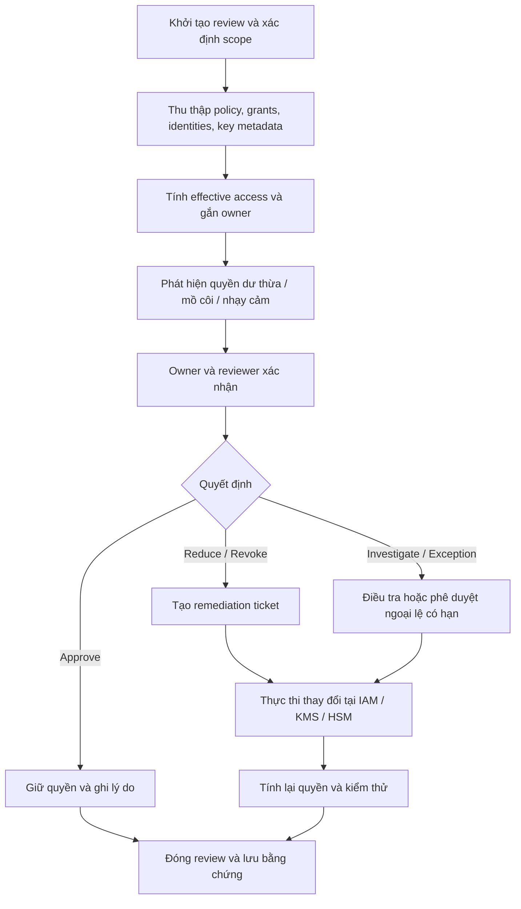

# Access review

**Access review** là hoạt động rà soát có định kỳ hoặc theo sự kiện để xác nhận những danh tính, workload và nhóm quản trị nào còn cần quyền truy cập vào khóa mật mã, quyền đó có đúng phạm vi hay không và có phù hợp với nhiệm vụ hiện tại hay không. Kết quả rà soát có thể là giữ nguyên, giảm quyền, thu hồi, điều tra hoặc chấp nhận ngoại lệ có thời hạn.

Trong quản lý khóa, access review phải xem xét cả quyền gọi thao tác mật mã lẫn quyền quản trị vòng đời khóa. Một workload có thể không bao giờ nhìn thấy raw key material nhưng vẫn có quyền `Decrypt`, `Sign`, `Unwrap` hoặc `Export`; những quyền này có thể tạo tác động lớn tương đương việc nắm giữ khóa. Ngược lại, một administrator có thể thay policy, tạo grant hoặc khôi phục backup và qua đó gián tiếp mở quyền sử dụng khóa.

Access review là một kiểm soát quan trọng trong phạm vi **SECURITY_KEY_MANAGEMENT_FUNDAMENTALS**. Nó kết nối identity, least privilege, RBAC/ABAC, KMS/HSM, separation of duties, key inventory, audit và vòng đời khóa. Mục tiêu là bảo đảm mỗi quyền vẫn có chủ sở hữu, mục đích hợp lệ và phạm vi sử dụng rõ ràng trong suốt thời gian khóa tồn tại.

## 1. Vì sao cần rà soát quyền truy cập khóa?

Quyền truy cập thường được cấp khi một ứng dụng được triển khai, một nhân viên nhận nhiệm vụ hoặc một hệ thống cần tích hợp. Theo thời gian, workload bị thay thế, nhân viên chuyển nhóm, tenant ngừng hoạt động, khóa đổi mục đích hoặc policy được mở rộng để xử lý sự cố. Nếu không rà soát, quyền cũ có thể tồn tại lâu hơn nhu cầu thực tế.

Các rủi ro thường gặp:

- **Quyền dư thừa:** service chỉ cần `Encrypt` nhưng vẫn có `Decrypt`, `Export` hoặc quyền quản trị.
- **Danh tính mồ côi:** tài khoản dịch vụ, access key hoặc workload identity vẫn được cấp quyền sau khi ứng dụng đã ngừng hoạt động.
- **Quyền kế thừa khó thấy:** thành viên nhóm, role chaining, federation hoặc resource policy tạo ra quyền hiệu lực rộng hơn dự kiến.
- **Phạm vi sai:** workload của tenant A có thể dùng khóa của tenant B hoặc khóa có purpose khác.
- **Quyền quản trị tập trung:** một principal có thể sửa policy, tạo grant hoặc thay metadata để tự mở quyền truy cập.
- **Ngoại lệ kéo dài:** quyền khẩn cấp hoặc quyền tạm thời không được thu hồi sau khi sự cố kết thúc.
- **Thiếu bằng chứng:** tổ chức không thể chứng minh ai đã xác nhận quyền còn cần thiết và ai chịu trách nhiệm xử lý phát hiện.

Một lần rà soát hiệu quả không chỉ xác nhận danh sách quyền hiện có. Nó cần so sánh quyền thực tế với nhiệm vụ, tài sản, trạng thái workload và chính sách đã được phê duyệt.

## 2. Phạm vi của một access review

Access review cho khóa phải bao gồm quyền trực tiếp và quyền gián tiếp có thể ảnh hưởng đến việc sử dụng hoặc quản trị khóa.

| Nhóm quyền | Ví dụ | Câu hỏi rà soát |
|---|---|---|
| Sử dụng khóa | `Encrypt`, `Decrypt`, `Sign`, `Verify`, `Wrap`, `Unwrap` | Workload còn cần thao tác này cho mục đích đã khai báo không? |
| Xuất và đọc vật liệu | `Export`, `GetKeyMaterial`, truy cập file keystore hoặc HSM object | Có lý do hợp lệ để xuất hoặc đọc vật liệu khóa không? Có thể thay bằng key handle không? |
| Quản trị khóa | Tạo, import, đổi metadata, enable, disable, rotate, schedule deletion, destroy | Chủ thể có đúng vai trò và quy trình phê duyệt không? |
| Quản trị policy | Sửa key policy, IAM policy, grant, ACL, tag hoặc ABAC attribute | Người sửa có thể tự cấp quyền cho mình hoặc người khác không? |
| Backup và phục hồi | Tạo backup, restore, truy cập escrow, quản lý quorum | Quyền có giới hạn theo nhiệm vụ và được kiểm soát kép không? |
| Quản trị nền tảng | HSM partition, token, slot, provider, secret manager, KMS account | Quyền hạ tầng có thể mở đường truy cập khóa hoặc audit không? |
| Truy cập bằng danh tính con người | Operator, auditor, security approver, administrator | Nhân sự còn giữ nhiệm vụ và mức xác thực phù hợp không? |
| Truy cập bằng workload | Service account, pod identity, VM role, CI/CD principal | Workload còn hoạt động và còn cần quyền không? |

Không giới hạn review vào quyền đọc raw key. Trong nhiều hệ thống, key material không bao giờ rời KMS/HSM nhưng một workload có quyền gọi `Decrypt` vẫn có thể lấy plaintext. Quyền tạo hoặc sửa grant cũng có thể quan trọng hơn quyền sử dụng thông thường vì nó mở rộng phạm vi truy cập cho principal khác.

## 3. Các loại access review

Nên kết hợp rà soát theo lịch và rà soát theo sự kiện. Lịch cụ thể cần dựa trên mức độ quan trọng của khóa, độ nhạy cảm dữ liệu, yêu cầu pháp lý/hợp đồng và chính sách nội bộ.

| Loại review | Thời điểm | Ví dụ |
|---|---|---|
| Periodic review | Theo chu kỳ đã định | Rà soát quyền dùng khóa production theo quý hoặc theo chu kỳ rủi ro |
| Event-driven review | Khi có thay đổi quan trọng | Nhân viên chuyển nhóm, workload bị decommission, tenant kết thúc hoặc khóa đổi purpose |
| Pre-change review | Trước thay đổi quyền hoặc policy lớn | Đánh giá principal và grant trước khi mở quyền decrypt cho hệ thống mới |
| Post-incident review | Sau sự cố hoặc nghi ngờ lộ credential | Rà soát mọi principal đã truy cập khóa và quyền có thể bị lạm dụng |
| Privileged access review | Riêng cho quyền quản trị nhạy cảm | Quyền export, destroy, sửa policy, quản trị HSM và break-glass |
| Recertification | Chủ sở hữu xác nhận lại nhu cầu | Owner xác nhận từng entitlement còn phục vụ nghiệp vụ |

Review theo lịch không thay thế review theo sự kiện. Nếu một workload bị xóa hôm nay, không nên chờ đến kỳ quý sau mới thu hồi quyền. Tương tự, một thay đổi policy ảnh hưởng hàng trăm khóa cần được kiểm tra trước khi phát hành và rà soát lại sau khi áp dụng.

## 4. Xác định đối tượng và quyền hiệu lực

Trước khi gửi danh sách cho người xác nhận, cần thu thập quyền hiệu lực (effective access), không chỉ một danh sách policy riêng lẻ.

Các nguồn quyền có thể gồm:

- Policy gắn trực tiếp với key hoặc key ring.
- Identity policy của user, group, service account hoặc workload role.
- Resource policy, key policy và grant riêng cho một principal.
- Quyền kế thừa từ group membership, nested group hoặc role chaining.
- Trust relationship và federation giữa account, project, subscription hoặc tenant.
- Permission boundary, organization policy, service control policy hoặc deny rule ở tầng cao hơn.
- ACL, quyền file, quyền hệ điều hành, quyền truy cập keystore và quyền quản trị HSM.
- Quyền có thể tạo thêm quyền, ví dụ `PutKeyPolicy`, `CreateGrant`, `AttachPolicy`, `UpdateRole` hoặc quản lý group.

Tên thao tác cụ thể phụ thuộc KMS, IAM và HSM. Khi lập inventory, cần ánh xạ chúng về nhóm năng lực chung như sử dụng, export, quản trị, cấp quyền, backup/restore và destroy.

### 4.1. Phân biệt quyền được cấp và quyền đã sử dụng

Quyền được cấp thể hiện khả năng theo policy; log sử dụng thể hiện hành vi đã quan sát trong một khoảng thời gian. Hai dữ liệu này bổ sung cho nhau:

- Một principal có quyền nhưng không có sự kiện sử dụng vẫn có thể là rủi ro nếu quyền không cần thiết.
- Một principal có hoạt động gần đây không chứng minh quyền hiện tại vẫn đúng phạm vi.
- Không thấy log có thể do log thiếu, retention ngắn, dịch vụ không ghi loại sự kiện đó hoặc hoạt động xảy ra ở hệ thống khác.
- Một quyền restore hoặc break-glass có thể ít dùng nhưng vẫn cần cho khôi phục thảm họa; không thu hồi chỉ dựa trên số lần sử dụng thấp.

Vì vậy, reviewer phải xem cả entitlement, mục đích nghiệp vụ, owner, hoạt động thực tế và yêu cầu dự phòng.

## 5. Inventory cần có cho access review

Một review tốt cần danh mục có thể liên kết principal, key, action và owner. Nên dùng định danh ổn định thay vì chỉ dùng display name hoặc alias.

| Đối tượng | Metadata cần có |
|---|---|
| Key | Key ID/version, purpose, algorithm, owner, tenant, classification, environment, status, region, rotation date |
| Principal | Principal ID, loại identity, service/team, owner, tenant, environment, trạng thái và nguồn identity |
| Entitlement | Policy/grant ID, resource scope, action, condition, ngày cấp, người cấp, expiry và nguồn quyền |
| Workload | Service name, namespace/account, deployment state, repository/application reference, owner và lifecycle state |
| Review | Review ID, phạm vi, kỳ review, reviewer, deadline, policy snapshot version và trạng thái |
| Decision | Approve, reduce, revoke, investigate hoặc exception; lý do, người xác nhận và thời điểm |
| Remediation | Ticket/change ID, người xử lý, thao tác, thời điểm, kết quả và bằng chứng xác minh |

Không đưa raw key material, mật khẩu, token hoặc private credential vào inventory. Review cần metadata về quyền và tài sản, không cần đọc giá trị bí mật.

## 6. Vai trò và trách nhiệm

Access review cần phân công rõ người chuẩn bị dữ liệu, người hiểu nhu cầu nghiệp vụ, người phê duyệt và người thực hiện remediation.

| Vai trò | Trách nhiệm |
|---|---|
| Key owner | Chịu trách nhiệm về mục đích, phạm vi và vòng đời của khóa |
| Data/system owner | Xác nhận hệ thống hoặc dữ liệu nào còn phụ thuộc vào khóa |
| Workload owner | Xác nhận workload và service account còn hoạt động, còn cần quyền gì |
| Reviewer/certifier | Đánh giá entitlement và ghi quyết định có lý do |
| IAM/KMS administrator | Cung cấp snapshot quyền và thực hiện thay đổi đã được phê duyệt |
| Security governance | Định nghĩa tiêu chí, kiểm tra ngoại lệ và theo dõi phát hiện nghiêm trọng |
| Auditor | Kiểm tra quy trình, bằng chứng và tính toàn vẹn hồ sơ |

Người phê duyệt không nên tự xác nhận quyền của chính mình khi có thể áp dụng separation of duties. Với quyền rất nhạy cảm như export, sửa policy, backup/restore hoặc destroy, nên yêu cầu phê duyệt độc lập hoặc dual control theo chính sách.

## 7. Quy trình access review

Một quy trình có thể vận hành theo các bước sau:

1. **Xác định phạm vi:** chọn key, key group, môi trường, tenant, principal, action và khoảng thời gian cần review.
2. **Chụp snapshot:** thu thập policy, grant, group membership, federation, key metadata và quyền quản trị tại một thời điểm xác định; gắn review ID và snapshot version.
3. **Tính quyền hiệu lực:** hợp nhất quyền trực tiếp, quyền kế thừa, điều kiện policy và quyền có thể cấp thêm quyền.
4. **Gắn owner:** liên kết mỗi key và principal với người chịu trách nhiệm; mục không có owner phải được đánh dấu để điều tra.
5. **Đánh giá rủi ro:** tìm quyền quá rộng, sai tenant/purpose, principal mồ côi, quyền hết hạn, quyền nhạy cảm và ngoại lệ cũ.
6. **Gửi xác nhận:** cung cấp cho reviewer đủ ngữ cảnh, quyền cụ thể, lý do cấp, hoạt động quan sát và lựa chọn quyết định.
7. **Ghi quyết định:** approve, reduce, revoke, investigate hoặc exception; yêu cầu lý do và thời hạn khi cần.
8. **Remediate:** tạo change/ticket, thay policy hoặc grant tại hệ thống nguồn và thu hồi credential liên quan.
9. **Xác minh:** tính lại quyền hiệu lực, kiểm tra không còn đường truy cập thay thế và xác nhận workload hợp lệ vẫn hoạt động.
10. **Đóng review:** đối chiếu số lượng entitlement, lưu bằng chứng, ghi ngoại lệ tồn đọng và lập lịch review tiếp theo.



Review chỉ hoàn tất khi quyết định đã được thực thi hoặc ngoại lệ được phê duyệt. Một bảng tính có cột “revoke” nhưng quyền vẫn còn trên KMS chưa phải remediation hoàn tất.

## 8. Đánh giá theo action và purpose

Không nên đánh giá quyền chỉ theo tên role hoặc tên key. Cần xem thao tác cụ thể và mục đích sử dụng.

| Action | Nội dung reviewer cần xác nhận | Dấu hiệu cần điều tra |
|---|---|---|
| `Encrypt` | Workload còn tạo dữ liệu thuộc purpose/tenant đó không? | Service đã ngừng nhưng vẫn có quyền ghi mới |
| `Decrypt` | Workload còn cần đọc dữ liệu nào và phạm vi có giới hạn không? | Quyền decrypt toàn bộ key ring hoặc nhiều tenant |
| `Sign` | Identity có đúng chức năng ký và loại tài liệu không? | Một service không liên quan có thể ký token/tài liệu |
| `Verify` | Nguồn public key và thuật toán có được quản lý không? | Cho phép thuật toán hoặc trust source đã bị loại bỏ |
| `Wrap` / `Unwrap` | Quan hệ DEK/KEK và context có đúng không? | Workload có thể unwrap nhiều DEK ngoài phạm vi |
| `Export` | Có nhu cầu kỹ thuật và phê duyệt đặc biệt không? | Export quyền rộng, không có owner hoặc không có expiry |
| `CreateGrant` / quản trị policy | Principal có thực sự cần cấp quyền cho bên khác không? | Caller có thể tự tạo grant cho chính mình |
| `Rotate` / `Disable` | Vai trò có đúng và có change/incident reference không? | Workload runtime có quyền quản trị key |
| `Destroy` | Đã xác minh phụ thuộc, backup, legal hold và phê duyệt chưa? | Một cá nhân có thể tự yêu cầu và tự hủy |

Quyền `Verify` thường không có cùng tác động với `Sign`, vì xác minh dùng public key; tuy nhiên vẫn cần quản lý nguồn public key, thuật toán và trust policy. Tương tự, quyền đọc metadata không tương đương quyền decrypt nhưng có thể tiết lộ thông tin nhạy cảm về kiến trúc và tài sản.

## 9. Phát hiện quyền rủi ro cao

Review nên phân loại phát hiện để ưu tiên xử lý. Các dấu hiệu thường cần chú ý:

- Principal có `Decrypt` trên khóa bảo vệ dữ liệu nhạy cảm nhưng không có owner hoặc workload reference.
- Một workload có quyền trên nhiều tenant hoặc nhiều môi trường mà không có lý do rõ ràng.
- Quyền `Export`, `CreateGrant`, `PutKeyPolicy`, `Destroy` hoặc HSM administration được cấp rộng.
- Human administrator vừa có quyền thay policy vừa có quyền sử dụng khóa nghiệp vụ.
- Service account không còn workload, repository hoặc deployment tương ứng.
- Grant không có expiry hoặc được tạo bởi principal đã ngừng hoạt động.
- Key purpose/owner không khớp với principal hoặc application metadata.
- Break-glass, emergency token hoặc quyền hỗ trợ nhà cung cấp còn hoạt động sau sự cố.
- Policy wildcard cho phép nhiều key hoặc action hơn nhu cầu đã khai báo.
- Một principal có thể sửa thuộc tính ABAC mà policy dùng để quyết định quyền của chính principal đó.

Không phải mọi wildcard đều sai trong mọi trường hợp; một số nền tảng cần wildcard cho resource pattern hoặc dịch vụ dùng chung. Reviewer cần yêu cầu lý do, phạm vi, compensating control và thời hạn thay vì chỉ dựa vào cú pháp.

## 10. Đánh giá quyền ABAC và nguồn thuộc tính

Với ABAC, reviewer phải kiểm tra cả biểu thức policy lẫn nguồn tạo thuộc tính. Một policy có vẻ chặt chẽ vẫn có thể cấp quyền sai nếu `tenant`, `purpose`, `environment` hoặc `workloadAttested` do caller tự khai.

Các câu hỏi nên đặt ra:

- Subject attributes đến từ identity provider hoặc workload platform nào?
- Object attributes như key purpose, owner, tenant và classification có được bảo vệ khỏi sửa trái phép không?
- Environment attributes như source network, change window và device posture có được xác minh từ nguồn tin cậy không?
- Claim có issuer, audience, thời hạn và chữ ký hợp lệ không?
- Policy có default deny, explicit deny và xử lý rõ trạng thái `Indeterminate` không?
- Có quyền nào cho phép principal sửa tag, group hoặc policy attributes dùng để cấp quyền cho chính nó không?
- Cache có thể giữ quyền cũ sau khi principal, key hoặc policy bị thu hồi trong bao lâu?

Rà soát ABAC phải xem xét cả data governance và policy administration. Nếu nguồn thuộc tính không đáng tin, việc review policy chỉ dựa trên nội dung biểu thức là chưa đủ.

## 11. Review quyền trên KMS và HSM

### 11.1. KMS

KMS thường có nhiều lớp policy: identity policy, key policy, resource policy, grant, condition và quyền ở account/project/organization. Reviewer cần hợp nhất các lớp này để xác định effective access.

Những điểm cần kiểm tra:

- Principal nào có thể gọi `Encrypt`, `Decrypt`, `GenerateDataKey`, `Sign`, `Verify`, `ReEncrypt` hoặc thao tác tương đương.
- Ai có thể sửa key policy, tạo/xóa grant, đổi alias hoặc tag ảnh hưởng đến quyền.
- Policy có giới hạn theo key ID, purpose, tenant, encryption context, region và workload identity không?
- Grant có retiring principal, expiry hoặc cơ chế thu hồi phù hợp không?
- Quyền cross-account/cross-project có owner ở cả hai phía không?
- Quyền quản trị key có bị tách khỏi quyền sử dụng key không?
- Audit log có đủ để truy vết principal, operation, key reference và kết quả không?

Tên API và semantics thay đổi theo nhà cung cấp. Một permission có tên `Decrypt` không nhất thiết cho phép export key material; một thao tác schedule deletion cũng khác thao tác destroy thực tế. Review phải ánh xạ đúng API và semantics của dịch vụ đang dùng.

### 11.2. HSM

Với HSM, review cần xem user, role, partition, slot, token, key object attributes, session và quyền quản trị thiết bị. Các thuộc tính như `sensitive`, `extractable`, `sign`, `decrypt`, `wrap` hoặc `unwrap` có thể ảnh hưởng đến thao tác được phép, tùy PKCS#11 và thiết bị.

Kiểm tra:

- Ai có quyền đăng nhập SO, Crypto Officer, Crypto User hoặc role tương đương?
- Ai có thể tạo, import, export, backup, restore hoặc destroy key object?
- Key có thuộc tính non-extractable đúng policy không?
- Có dual control/M-of-N cho thao tác quản trị và phục hồi không?
- Partition hoặc token nào được workload truy cập và có tách môi trường không?
- Credential, PIN, client certificate và driver/provider có được quản lý riêng không?
- Có tài khoản vendor/support hoặc break-glass nào còn tồn tại không?

Không nên chỉ xem danh sách user trong HSM. Một service account có quyền truy cập PKCS#11 token qua node hoặc provider cũng là một đường truy cập cần đưa vào review.

## 12. Review quyền con người và workload

### 12.1. Con người

Với user và administrator, cần đối chiếu quyền với nhiệm vụ hiện tại, trạng thái nhân sự, nhóm, cấp bậc phê duyệt và yêu cầu xác thực. Khi nhân sự chuyển nhóm hoặc rời tổ chức, phải kích hoạt review theo sự kiện và thu hồi quyền không còn cần thiết.

Quyền đặc quyền cần xem xét kỹ hơn: tài khoản quản trị thường ngày, tài khoản break-glass, tài khoản hỗ trợ nhà cung cấp, tài khoản automation do con người sở hữu và tài khoản có khả năng sửa audit/policy. Không dùng tài khoản cá nhân để chạy workload dài hạn.

### 12.2. Workload và service identity

Với service account, workload role hoặc machine identity, cần xác nhận:

- Service còn được triển khai và có owner đang chịu trách nhiệm không?
- Repository, deployment hoặc namespace còn tồn tại không?
- Credential có được dùng bởi đúng workload hay đang được chia sẻ?
- Quyền có scope đúng key, purpose, tenant và environment không?
- Workload có quyền tạo thêm identity/grant hoặc sửa policy không?
- Có cơ chế tự động thu hồi khi deployment hoặc service bị xóa không?
- Credential có TTL/rotation phù hợp và có bản sao trong CI/CD, image hoặc config không?

Nếu không xác định được owner của workload, không nên tự động giữ quyền vô thời hạn. Đưa entitlement vào trạng thái cần điều tra, giới hạn tạm thời theo risk policy và yêu cầu owner được chỉ định trước khi đóng review.

## 13. Quyết định review và remediation

Mỗi entitlement cần một quyết định có thể kiểm toán. Nên dùng tập kết quả nhất quán:

| Quyết định | Ý nghĩa | Hành động tiếp theo |
|---|---|---|
| `APPROVE` | Quyền còn cần và đúng phạm vi | Giữ nguyên; ghi owner, lý do và kỳ review tiếp theo |
| `REDUCE` | Chỉ cần một phần quyền hoặc scope nhỏ hơn | Sửa action, resource, tenant, condition hoặc thời hạn |
| `REVOKE` | Không còn nhu cầu hoặc không có cơ sở hợp lệ | Thu hồi grant/policy/identity và xác minh effective access |
| `INVESTIGATE` | Thiếu owner, dữ liệu mâu thuẫn hoặc có dấu hiệu bất thường | Mở điều tra, đặt người chịu trách nhiệm và deadline |
| `EXCEPTION` | Có nhu cầu tạm thời chưa thể đáp ứng bằng policy chuẩn | Phê duyệt rủi ro, compensating control và expiry |

Remediation phải được thực hiện tại hệ thống nguồn. Xóa một dòng trong bảng review không thu hồi IAM policy; xóa alias không thu hồi grant; xóa service account ở một identity provider không nhất thiết xóa credential đã phát hành ở hệ thống khác.

Sau remediation, phải tính lại quyền hiệu lực và kiểm tra các đường truy cập gián tiếp. Ví dụ, thu hồi một policy trực tiếp có thể không có tác dụng nếu principal vẫn nhận quyền qua group hoặc resource policy khác.

## 14. Xử lý ngoại lệ

Một số quyền cần được giữ cho hoạt động hiếm gặp như disaster recovery, CA recovery, HSM quorum hoặc ứng phó sự cố. Không nên loại bỏ quyền dự phòng chỉ vì không có log sử dụng trong kỳ review.

Ngoại lệ cần có:

- Lý do nghiệp vụ và rủi ro nếu thu hồi.
- Key ID/resource, principal, action và scope chính xác.
- Owner và người phê duyệt độc lập.
- Thời hạn hết hiệu lực và ngày review lại.
- Compensating controls như dual control, MFA, network restriction, alerting hoặc session recording.
- Điều kiện kích hoạt và runbook sử dụng.
- Bằng chứng thu hồi sau khi hết hạn hoặc sự kiện kết thúc.

Không chấp nhận ngoại lệ không thời hạn chỉ vì hệ thống cũ khó thay đổi. Nếu cần gia hạn, phải đánh giá lại lý do và ghi quyết định mới.

## 15. Tần suất review và sự kiện kích hoạt

Tần suất nên dựa trên mức rủi ro và chính sách tổ chức. Có thể chia theo nhóm:

| Mức rủi ro | Ví dụ | Cách tiếp cận review |
|---|---|---|
| Rất cao | Root/KEK, CA signing key, HSM admin, quyền destroy/export | Review thường xuyên hơn, có dual control và event-driven review |
| Cao | Key bảo vệ dữ liệu nhạy cảm, quyền decrypt rộng, production signing | Review theo chu kỳ ngắn hơn và khi có thay đổi owner/workload |
| Trung bình | Key cho service nội bộ với scope hẹp | Review theo chu kỳ chuẩn và khi thay đổi service |
| Thấp | Key thử nghiệm hoặc dữ liệu không nhạy cảm | Review theo vòng đời môi trường, tự động thu hồi khi hết hạn |

Đây là cách phân nhóm tham khảo, không phải lịch bắt buộc. Tổ chức phải định nghĩa khoảng thời gian cụ thể theo quy định, hợp đồng, threat model và năng lực vận hành.

Các sự kiện nên kích hoạt review ngay:

- Nhân sự rời tổ chức hoặc chuyển sang vai trò khác.
- Service, pod, VM, repository hoặc tenant bị decommission.
- Key đổi owner, purpose, classification, region hoặc trạng thái.
- Policy, grant, group membership hoặc trust relationship thay đổi đáng kể.
- Có incident, credential exposure hoặc hoạt động bất thường.
- Provider, KMS account, HSM partition hoặc kiến trúc triển khai thay đổi.
- Ngoại lệ sắp hết hạn hoặc break-glass vừa được sử dụng.

## 16. Tự động hóa access review

Tự động hóa giúp thu thập dữ liệu và phát hiện bất thường, nhưng quyết định giữ quyền cần ngữ cảnh của owner và policy. Một pipeline có thể:

1. Lấy snapshot từ IAM, KMS, HSM, identity provider, CMDB và workload platform.
2. Chuẩn hóa principal, key, action và resource reference.
3. Tính effective access bằng cách hợp nhất policy, grant, group và trust.
4. Liên kết entitlement với owner, service, tenant và purpose.
5. Phát hiện quyền rộng, quyền mồ côi, grant hết hạn và quyền nhạy cảm.
6. Tạo review item cho người chịu trách nhiệm.
7. Thu quyết định và phê duyệt qua workflow có xác thực.
8. Tạo remediation ticket hoặc gọi API đã được phê duyệt.
9. Chạy kiểm tra sau thay đổi và cập nhật trạng thái review.
10. Lưu snapshot, policy version, decision và evidence manifest.

Không nên tự động thu hồi quyền chỉ vì thuật toán phát hiện “không sử dụng”. Trước khi revoke, cần xét lịch backup/restore, giao dịch theo mùa, job định kỳ, hoạt động failover và quyền dự phòng. Tự động hóa có thể ưu tiên review hoặc đề xuất giảm quyền; thao tác phá vỡ khả năng phục hồi cần phê duyệt rõ.

## 17. Ví dụ bản ghi access review

Một bản ghi có cấu trúc giúp theo dõi từng entitlement và liên kết quyết định với remediation. Ví dụ JSON sau là dữ liệu minh họa, không phải schema của một nhà cung cấp cụ thể:

```json
{
  "reviewId": "KEY-ACCESS-2026-Q4-0142",
  "snapshotAt": "2026-11-28T03:00:00Z",
  "snapshotVersion": "iam-kms-export-2026-11-28T0300Z",
  "resource": {
    "keyId": "kms://prod/payments/data-key",
    "keyVersion": "v5",
    "purpose": "payment-data",
    "tenant": "tenant-42",
    "status": "ENABLED"
  },
  "entitlement": {
    "principalId": "workload://billing-api-prod",
    "principalType": "WORKLOAD",
    "actions": ["Decrypt"],
    "source": "key-policy-and-workload-role",
    "grantedAt": "2026-04-12T08:00:00Z",
    "expiresAt": null
  },
  "ownership": {
    "keyOwner": "payments-platform",
    "workloadOwner": "billing-team"
  },
  "review": {
    "decision": "APPROVE",
    "reviewer": "owner-id-018",
    "reason": "Workload still reads payment records for tenant-42",
    "decidedAt": "2026-11-28T04:00:00Z"
  },
  "evidence": {
    "policyVersion": "policy-31",
    "activityWindowDays": 90,
    "activityReference": "audit://key-access/2026-Q4/entry-142",
    "nextReviewAt": "2027-02-28T00:00:00Z"
  }
}
```

Không lưu token, mật khẩu hoặc raw key trong review record. Nếu cần hiển thị lý do hoặc hoạt động, dùng metadata và tham chiếu đến audit source có kiểm soát. `activityWindowDays` chỉ mô tả khoảng log đã xem; nó không chứng minh mọi hệ thống phụ thuộc đều có telemetry đầy đủ.

## 18. Java: mô hình hóa review decision

Ứng dụng có thể biểu diễn entitlement, quyết định và remediation bằng kiểu dữ liệu rõ ràng. Ví dụ dưới đây chỉ mô hình hóa việc kiểm tra tính hợp lệ của quyết định; nó không tự sửa policy hoặc gọi KMS.

```java
import java.time.Instant;
import java.util.Objects;

enum ReviewDecision {
    APPROVE, REDUCE, REVOKE, INVESTIGATE, EXCEPTION
}

record KeyEntitlement(
        String reviewId,
        String keyId,
        String principalId,
        String action,
        String owner,
        String purpose,
        Instant expiresAt) {}

record ReviewResult(
        ReviewDecision decision,
        String reviewerId,
        String reason,
        Instant decidedAt,
        Instant exceptionExpiresAt) {}

final class AccessReviewValidator {
    private AccessReviewValidator() {}

    static void validate(KeyEntitlement entitlement, ReviewResult result) {
        Objects.requireNonNull(entitlement, "entitlement");
        Objects.requireNonNull(result, "result");

        if (isBlank(entitlement.reviewId())
                || isBlank(entitlement.keyId())
                || isBlank(entitlement.principalId())
                || isBlank(entitlement.owner())) {
            throw new IllegalArgumentException("Incomplete entitlement identity");
        }
        if (result.decision() == null
                || isBlank(result.reviewerId())
                || isBlank(result.reason())
                || result.decidedAt() == null) {
            throw new IllegalArgumentException("Incomplete review decision");
        }
        if (result.decision() == ReviewDecision.EXCEPTION
                && (result.exceptionExpiresAt() == null
                    || !result.exceptionExpiresAt().isAfter(result.decidedAt()))) {
            throw new IllegalArgumentException("Exception must have a future expiry");
        }
        if (result.decision() != ReviewDecision.EXCEPTION
                && result.exceptionExpiresAt() != null) {
            throw new IllegalArgumentException("Expiry is only valid for an exception");
        }
    }

    private static boolean isBlank(String value) {
        return value == null || value.isBlank();
    }
}
```

Ví dụ yêu cầu entitlement và quyết định có định danh, reviewer, lý do và thời điểm. Trong production cần bổ sung kiểm tra reviewer không phải người tự cấp quyền khi policy yêu cầu SoD, xác minh reviewer có thẩm quyền, kiểm tra policy/snapshot version, xử lý trạng thái entitlement thay đổi trong lúc review và ghi audit bất biến. Các `record` và `String.isBlank()` yêu cầu Java 11 trở lên với `record` cần Java 16; có thể thay bằng lớp bất biến và hàm kiểm tra chuỗi tương ứng nếu dùng JDK cũ.

## 19. Xác minh remediation và đóng review

Sau khi reviewer chọn `REDUCE` hoặc `REVOKE`, cần thực hiện thay đổi và kiểm tra kết quả. Quy trình xác minh nên bao gồm:

- Đối chiếu ticket với đúng principal ID, key ID, action và policy/grant source.
- Kiểm tra thay đổi đã được áp dụng ở IAM/KMS/HSM hoặc hệ thống identity nguồn.
- Tính lại effective access sau thay đổi, gồm quyền kế thừa và grant còn lại.
- Kiểm tra principal không thể thực hiện thao tác đã bị thu hồi bằng credential cũ hoặc đường truy cập thay thế.
- Kiểm tra workload hợp lệ còn hoạt động; nếu bị gián đoạn, ghi incident và rollback theo quy trình có phê duyệt.
- Lưu người thực hiện, thời điểm, operation ID, kết quả và audit reference.
- Đánh dấu entitlement là remediated chỉ sau khi có bằng chứng xác minh.

Nếu một quyền được cấp qua nhiều nguồn, thu hồi một nguồn chưa chắc loại bỏ quyền. Ví dụ, xóa inline policy nhưng group membership vẫn cấp cùng action; xóa grant nhưng key policy vẫn cho phép; thu hồi cloud role nhưng token còn hiệu lực đến khi hết hạn. Cần xác minh theo semantics của nền tảng và giới hạn thời gian hiệu lực thực tế.

## 20. Bằng chứng và tính toàn vẹn hồ sơ

Hồ sơ access review phải cho phép kiểm toán viên tái dựng phạm vi, dữ liệu đầu vào, quyết định, remediation và kết quả.

Một bộ evidence nên có:

- Review ID, mục tiêu, phạm vi và thời gian snapshot.
- Danh sách key/principal/entitlement được review và nguồn dữ liệu.
- Phiên bản policy, identity/group mapping và key metadata tại thời điểm review.
- Reviewer, owner, người phê duyệt và thời điểm quyết định.
- Lý do approve/reduce/revoke/investigate/exception.
- Ticket/change ID và bằng chứng thực thi.
- Kết quả tính lại effective access sau remediation.
- Danh sách ngoại lệ, expiry, owner và lịch review lại.
- Manifest/hash hoặc cơ chế bảo vệ tính toàn vẹn của hồ sơ theo yêu cầu.

Không ghi secret value, private key, password, bearer token hoặc plaintext vào evidence. Audit log nên được lưu ở hệ thống độc lập, có kiểm soát quyền sửa/xóa, đồng bộ thời gian và retention phù hợp. Nếu snapshot được xuất ra file, cần bảo vệ file vì nó có thể tiết lộ cấu trúc tài khoản, key ID, quyền và quan hệ giữa các hệ thống.

## 21. Chỉ số theo dõi chất lượng access review

Chỉ số giúp xác định review có được thực hiện đúng hạn và phát hiện có được xử lý thực sự hay không.

| Chỉ số | Ý nghĩa |
|---|---|
| Review coverage | Tỷ lệ entitlement trong scope đã được đưa vào review |
| Certification completion | Tỷ lệ item đã có quyết định hợp lệ |
| Overdue review items | Số item quá hạn chưa được owner xác nhận |
| Orphan principal count | Số principal không có owner hoặc workload reference |
| High-risk entitlement count | Số quyền export, destroy, policy admin hoặc decrypt phạm vi rộng |
| Revocation/remediation rate | Tỷ lệ phát hiện đã được xử lý và xác minh |
| Mean time to remediate | Thời gian trung bình từ quyết định đến khi quyền thực sự được thu hồi/giảm |
| Exception age | Tuổi của ngoại lệ còn hiệu lực và số lần gia hạn |
| Reopened finding rate | Tỷ lệ phát hiện tái xuất hiện sau remediation |
| Evidence completeness | Tỷ lệ hồ sơ có đủ snapshot, reviewer, decision và verification evidence |

Không dùng tỷ lệ revoke cao làm mục tiêu độc lập. Một chương trình review tốt có thể giữ nhiều quyền hợp lệ; điều quan trọng là quyết định có căn cứ, quyền dư thừa được xử lý và bằng chứng đầy đủ.

## 22. Lỗi thường gặp

| Lỗi | Hậu quả | Cách khắc phục |
|---|---|---|
| Chỉ review user, bỏ qua service account | Workload cũ vẫn có quyền dùng key | Đưa non-human identity vào scope |
| Chỉ xem policy trực tiếp | Bỏ sót group, grant, federation hoặc resource policy | Tính effective access từ mọi nguồn |
| Chỉ dựa vào log sử dụng | Quyền không dùng vẫn có thể bị lạm dụng | Review entitlement cùng activity và business need |
| Tự động revoke quyền ít dùng | Có thể làm hỏng DR hoặc job định kỳ | Phân loại quyền dự phòng và yêu cầu owner xác nhận |
| Owner tự phê duyệt quyền của mình | Thiếu kiểm soát độc lập | Áp dụng SoD và reviewer độc lập |
| Review không có key purpose/tenant | Không đánh giá được scope nghiệp vụ | Liên kết key inventory và data owner |
| Đánh dấu hoàn tất trước remediation | Quyền thực tế vẫn còn | Chỉ đóng khi xác minh effective access |
| Ngoại lệ không expiry | Quyền tạm thời tồn tại vô thời hạn | Bắt buộc owner, expiry và recertification |
| Không rà soát quyền sửa policy/grant | Principal có thể tự mở rộng quyền | Đưa control-plane privilege vào review |
| Không giữ snapshot/evidence | Không thể tái dựng quyết định | Lưu snapshot version và evidence manifest |
| Thu hồi một policy nhưng bỏ đường khác | Quyền vẫn tồn tại qua grant/group/resource policy | Recompute effective access và negative test |

## 23. Checklist access review cho khóa

Trước khi đóng một kỳ review, hãy xác nhận:

- [ ] Scope bao gồm key, principal, workload, action và quyền quản trị liên quan.
- [ ] Snapshot có timestamp, nguồn dữ liệu và version rõ ràng.
- [ ] Effective access đã tính cả policy, grant, group, federation và quyền kế thừa.
- [ ] Mỗi key và principal có owner hoặc được đánh dấu điều tra.
- [ ] Reviewer hiểu purpose, tenant, classification và workload dependency.
- [ ] Quyền `Decrypt`, `Sign`, `Export`, `CreateGrant`, `PolicyAdmin`, `Backup` và `Destroy` được đánh giá riêng.
- [ ] Quyền con người, workload, vendor và break-glass đều nằm trong scope phù hợp.
- [ ] Reviewer có thẩm quyền và tách biệt với người tự cấp quyền khi cần.
- [ ] Mỗi quyết định có lý do; exception có owner, expiry và compensating controls.
- [ ] Remediation được thực hiện tại hệ thống nguồn.
- [ ] Effective access được tính lại và negative test được thực hiện cho quyền đã thu hồi.
- [ ] Workload hợp lệ vẫn hoạt động sau khi giảm quyền.
- [ ] Audit/evidence không chứa secret value hoặc key material.
- [ ] Ngoại lệ tồn đọng có deadline và lịch review lại.
- [ ] Kết quả, chỉ số và phát hiện nghiêm trọng được báo cáo cho security governance.

Access review giúp tổ chức duy trì quyền sử dụng khóa đúng với nhu cầu hiện tại. Quy trình có chất lượng phải nhìn thấy quyền hiệu lực qua mọi lớp IAM/KMS/HSM, gắn entitlement với owner và purpose, yêu cầu reviewer đưa ra quyết định có căn cứ, rồi xác minh việc giảm hoặc thu hồi quyền tại hệ thống thực thi. Khi kết hợp review theo lịch với review theo sự kiện, tổ chức giảm được quyền mồ côi, quyền dư thừa và nguy cơ lạm dụng khóa trong suốt vòng đời của chúng.
