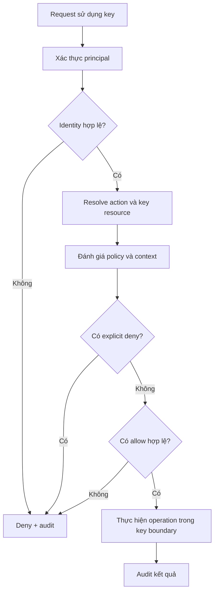

# Deny mặc định

Deny mặc định (default deny) là nguyên tắc kiểm soát truy cập trong đó mọi yêu cầu đều bị từ chối trừ khi một policy hợp lệ cấp quyền rõ ràng cho principal thực hiện action trên resource trong đúng context. Với khóa mật mã, nguyên tắc này giới hạn ai được dùng key, được thực hiện operation nào, trên dữ liệu hoặc tenant nào, từ workload nào và trong điều kiện nào.

Một ứng dụng có thể cần `Decrypt` nhưng không cần `Sign`; một service ký artifact có thể cần `Sign` nhưng không được `ExportPrivateKey`, `DisableKey` hoặc `ScheduleDeletion`. Quyền xem metadata cũng khác quyền sử dụng key. Không nên coi việc có quyền truy cập một key object là quyền thực hiện mọi operation trên key đó.

Trong quản lý khóa mật mã, default deny kết hợp với least privilege, separation of duties, workload identity, policy theo resource và audit để giảm phạm vi ảnh hưởng khi tài khoản hoặc workload bị compromise. Bài học này giải thích cách đánh giá quyết định allow/deny, thiết kế policy cho KMS/HSM, áp dụng RBAC/ABAC, xử lý lỗi theo fail-closed, quản lý quyền trong vòng đời khóa và kiểm thử các trường hợp bị từ chối.

## 1. Default deny giải quyết vấn đề gì?

Nếu hệ thống mặc định cho phép, một principal mới hoặc một service vừa được triển khai có thể truy cập tài nguyên mà người quản trị chưa dự định cấp quyền. Default deny đảo ngược cách tiếp cận: principal không có quyền cho tới khi có policy cho phép rõ ràng.

Nguyên tắc này hữu ích vì:

- Một service mới không tự động có quyền dùng mọi key trong account hoặc namespace.
- Việc thêm key mới không làm mọi workload hiện hữu có quyền sử dụng key đó.
- Một action mới không tự động được cấp cho role đang có quyền trên action khác.
- Thiếu thông tin identity, resource hoặc context không được hiểu thành quyền truy cập.
- Lỗi policy engine, IAM service hoặc metadata lookup không biến thành quyền cho phép.
- Quyền quản trị key được tách khỏi quyền dùng key trong workload.
- Có thể giới hạn blast radius theo key, purpose, tenant, environment và operation.

Default deny không tự động làm hệ thống an toàn. Một policy allow quá rộng như `principal=*`, `resource=*`, `action=*` vẫn có thể cấp quyền gần như toàn bộ. Cần kết hợp default deny với least privilege, policy review, identity protection và kiểm soát thay đổi.

## 2. Xác thực và ủy quyền là hai bước khác nhau

Xác thực (authentication) xác định principal là ai. Ủy quyền (authorization) quyết định principal đó được làm gì trên resource nào.

Ví dụ, một workload xác thực bằng workload identity và nhận được principal `service:orders-api`. Điều đó chỉ chứng minh danh tính của workload trong phạm vi trust configuration. Nó chưa chứng minh workload được phép gọi `Decrypt` trên key `orders-data-kek`.

| Thành phần | Câu hỏi | Ví dụ |
|---|---|---|
| Authentication | Ai đang gửi yêu cầu? | Workload identity, service account, user certificate |
| Authorization | Principal được làm gì? | `Decrypt` hoặc `GenerateDataKey` |
| Resource scope | Quyền áp dụng cho tài nguyên nào? | Key `orders-data-kek`, version hoặc tenant cụ thể |
| Context/condition | Trong điều kiện nào? | Environment production, workload namespace, encryption context |
| Audit | Điều gì đã xảy ra? | Principal, operation, key ID/version, decision và request ID |

Không suy ra quyền từ việc principal đã đăng nhập thành công. Cũng không dùng một token hợp lệ làm bằng chứng rằng mọi thao tác KMS đều được phép.

## 3. Default deny và hai dạng deny

Trong nhiều policy engine, có thể phân biệt implicit deny và explicit deny.

- **Implicit deny:** không có policy nào cấp quyền allow cho yêu cầu. Yêu cầu bị từ chối vì không có quyền rõ ràng.
- **Explicit deny:** một policy khớp yêu cầu và chủ động từ chối action đó. Trong nhiều mô hình policy, explicit deny có ưu tiên cao hơn allow.

Ví dụ: role `orders-reader` được allow `Decrypt` trên key `orders-data-key`. Một policy khác explicit deny `Decrypt` khi request đến từ environment `development`. Khi đó request từ production có thể được phép, còn request từ development bị từ chối.

Không phải mọi sản phẩm KMS/IAM có cùng thuật toán hợp nhất policy. Một số hệ thống dùng key policy, identity policy, grant, permission boundary, organization policy hoặc resource policy với thứ tự đánh giá riêng. Cần đọc đúng semantics của nền tảng đang dùng. Không giả định rằng một quy tắc explicit deny có cùng phạm vi hoặc ưu tiên trên mọi dịch vụ.

## 4. Quyết định truy cập dựa trên principal, action, resource và context

Một yêu cầu sử dụng key nên được đánh giá theo ít nhất bốn thành phần:

1. **Principal:** user, service account, workload identity, role hoặc service principal.
2. **Action:** operation được yêu cầu như `Encrypt`, `Decrypt`, `Sign`, `Verify`, `WrapKey`, `UnwrapKey`, `RotateKey` hoặc `DisableKey`.
3. **Resource:** key ID, key version, key alias đã được resolve, tenant hoặc resource domain.
4. **Context:** environment, workload, region, network boundary, encryption context, approval state và các điều kiện bổ sung.



Nếu không xác định được principal, action, resource hoặc điều kiện bắt buộc, kết quả phải là deny. Không dùng giá trị mặc định rộng quyền khi một thuộc tính bị thiếu.

## 5. Mặc định deny ở cấp key operation

Các operation trên cùng một key có mức độ rủi ro khác nhau. Một principal được cấp quyền `DescribeKey` không mặc nhiên được `Decrypt`; quyền `Sign` không kéo theo quyền export private key.

| Operation | Mục đích | Rủi ro nếu cấp rộng |
|---|---|---|
| `DescribeKey` | Đọc metadata key | Lộ inventory, alias, state hoặc cấu trúc hệ thống |
| `GetPublicKey` | Lấy public key | Thường ít nhạy cảm hơn private key nhưng có thể lộ metadata hoặc hỗ trợ reconnaissance |
| `Encrypt` | Mã hóa dữ liệu | Có thể tạo ciphertext ngoài purpose hoặc làm tăng chi phí/quota |
| `Decrypt` | Giải mã dữ liệu | Lộ plaintext hoặc DEK, ảnh hưởng confidentiality |
| `GenerateDataKey` | Tạo DEK và wrapped DEK | Có thể cấp khả năng mã hóa dữ liệu dưới KEK không đúng scope |
| `Sign` | Tạo chữ ký | Có thể giả mạo artifact, transaction hoặc danh tính |
| `Verify` | Xác minh chữ ký | Thường ít nhạy cảm hơn ký nhưng vẫn cần giới hạn resource và quota |
| `WrapKey` | Bảo vệ key khác | Có thể tạo wrapped key ngoài policy hoặc purpose |
| `UnwrapKey` | Lấy plaintext key từ wrapped key | Có thể làm lộ DEK hoặc key material |
| `RotateKey` | Thay key material/version theo dịch vụ | Có thể làm gián đoạn consumer nếu không phối hợp |
| `DisableKey` | Vô hiệu hóa key | Có thể gây mất khả năng decrypt/verify hoặc outage |
| `ScheduleDeletion` | Lên lịch xóa key | Có thể gây mất khả năng khôi phục dữ liệu nếu thao tác sai |
| `PutKeyPolicy` | Thay đổi policy | Có thể cấp quyền cho attacker hoặc khóa quyền của operator |
| `ExportKey` | Xuất key material nếu được hỗ trợ | Có thể phá vỡ security boundary và làm lộ key |

Hãy cấp đúng operation mà use case yêu cầu. Một workload chỉ cần `Sign` không nên có `ExportKey`, `PutKeyPolicy` hoặc `ScheduleDeletion`. Một service đọc dữ liệu chỉ nên có quyền decrypt trong phạm vi key/tenant cần thiết.

## 6. Deny mặc định theo vòng đời khóa

Quyền sử dụng key phải thay đổi theo trạng thái và giai đoạn lifecycle. Một key mới tạo không nên tự động được mọi service dùng; key đã retire không nên tiếp tục nhận operation ghi mới.

| Trạng thái/giai đoạn | Quyền mặc định cần cân nhắc |
|---|---|
| Planned | Deny tất cả operation cho đến khi key được provision và policy được duyệt |
| Generated/imported | Chỉ key administrator và provisioning workflow được phép thao tác cần thiết |
| Active | Chỉ workload được chỉ định mới có operation phù hợp purpose |
| Rotation pending | Cho phép version mới theo rollout policy; hạn chế tạo operation mới bằng version cũ |
| Decrypt-only/verify-only | Deny encrypt/sign mới; chỉ cho phép đọc/xác minh lịch sử trong thời hạn |
| Disabled/suspended | Deny operation sử dụng key, trừ thao tác quản trị được phép |
| Compromised | Deny sử dụng theo incident policy; revoke identity/grants và chuyển sang key mới |
| Scheduled for deletion | Deny workload operation; chỉ role recovery/administrator được phép hủy lịch nếu policy cho phép |
| Destroyed | Không còn operation khả dụng; audit và metadata retention theo policy |

Tên trạng thái và khả năng chuyển trạng thái phụ thuộc KMS/HSM. Bảng trên là mô hình policy; cần ánh xạ vào state machine thực tế của nền tảng.

## 7. Least privilege: cấp đúng quyền tối thiểu

Least privilege yêu cầu mỗi principal chỉ có quyền cần thiết để hoàn thành nhiệm vụ đã xác định. Kết hợp với default deny, quyền được cấp theo operation, resource và context cụ thể.

Ví dụ phân tách:

- `orders-api` được `GenerateDataKey` và `Decrypt` trên KEK của Orders theo tenant context.
- `artifact-signer` được `Sign` trên signing key riêng.
- `security-admin` được quản lý policy và rotation nhưng không có quyền decrypt dữ liệu nghiệp vụ mặc định.
- `auditor` được đọc audit event và metadata cần thiết nhưng không được dùng key.
- `recovery-operator` có quyền recovery theo quy trình dual control, không phải quyền vận hành hàng ngày.

Không cấp quyền trên toàn account nếu workload chỉ dùng một key. Không dùng `*` cho action hoặc resource nếu có thể xác định tập hợp cụ thể. Khi cần wildcard cho key version hoặc resource được tạo động, giới hạn prefix, tag, namespace hoặc condition theo khả năng của policy engine.

## 8. RBAC: kiểm soát theo vai trò

Role-Based Access Control (RBAC) gán quyền cho role; principal nhận quyền thông qua role membership hoặc workload binding. RBAC dễ quản trị khi tổ chức có các nhóm công việc ổn định.

Ví dụ role:

| Role | Quyền điển hình | Không nên có mặc định |
|---|---|---|
| Key administrator | Tạo key, cấu hình metadata/policy, rotation theo approval | Decrypt dữ liệu nghiệp vụ, export private key |
| Key user/encryptor | Encrypt hoặc GenerateDataKey trong scope | PutKeyPolicy, ScheduleDeletion |
| Key decryptor | Decrypt/UnwrapKey trong scope | Sign, ExportKey, quản trị policy |
| Signing workload | Sign bằng signing key cụ thể | Decrypt, ExportKey, DisableKey |
| Auditor | Đọc audit và metadata cần thiết | Encrypt, Decrypt, Sign, policy mutation |
| Recovery operator | Restore hoặc hủy deletion schedule theo quorum | Quyền thường trực dùng key nghiệp vụ |

RBAC có thể trở nên quá rộng nếu role gom nhiều trách nhiệm. Một role tên `developer` không nên tự động được truy cập mọi key development; càng không nên có quyền production chỉ vì thành viên thuộc nhóm phát triển. Kết hợp role với resource scope và context khi cần.

## 9. ABAC: kiểm soát theo thuộc tính

Attribute-Based Access Control (ABAC) đánh giá các thuộc tính của principal, resource, action và context. ABAC hữu ích khi số lượng workload, tenant, environment hoặc key lớn và quyền cần thay đổi theo thuộc tính.

Ví dụ điều kiện:

- Principal có `workload=orders-api`.
- Resource có `purpose=data-encryption` và `environment=production`.
- Request có `tenant_id` khớp với encryption context.
- Action là `Decrypt` và deployment đang dùng identity được phê duyệt.
- Request đến từ account, region hoặc network boundary được phép.

ABAC giảm số policy riêng lẻ nhưng phụ thuộc chất lượng thuộc tính. Nếu attacker có thể tự gắn tag `environment=production` hoặc thay `tenant_id`, policy có thể bị vượt qua. Các thuộc tính bảo mật phải được tạo và bảo vệ bởi authority đáng tin cậy; không tin giá trị do caller tự khai báo nếu chưa xác minh.

## 10. Kết hợp RBAC và ABAC

Một mô hình thực tế thường dùng RBAC để xác định nhóm operation và ABAC để giới hạn resource/context.

Ví dụ: role `orders-decryptor` cho phép action `Decrypt`, nhưng chỉ khi key có tag `application=orders`, `environment=production` và request context chứa đúng tenant. Role quyết định loại việc; attribute quyết định phạm vi được phép.

Không dùng role membership như điều kiện duy nhất cho key quan trọng. Cũng không dùng tag đơn lẻ làm căn cứ authorization nếu tag có thể bị sửa bởi principal đang được kiểm soát.

## 11. Ví dụ policy: mặc định deny, allow theo scope

Policy dưới đây là schema minh họa độc lập với nhà cung cấp. Nó cho thấy allow được cấp theo principal, action, resource và context; mọi yêu cầu không khớp đều bị từ chối.

```yaml
policy_version: 1
default_effect: DENY
statements:
  - id: orders-generate-data-key
    effect: ALLOW
    principals:
      - workload:orders-api
    actions:
      - GenerateDataKey
    resources:
      - key:orders-data-kek
    conditions:
      environment: production
      application: orders

  - id: orders-decrypt-own-tenant
    effect: ALLOW
    principals:
      - workload:orders-api
    actions:
      - Decrypt
    resources:
      - key:orders-data-kek
    conditions:
      environment: production
      application: orders
      tenant_context_required: true

  - id: deny-development-on-production-key
    effect: DENY
    principals:
      - workload:orders-api
    actions:
      - Decrypt
      - GenerateDataKey
    resources:
      - key:orders-data-kek
    conditions:
      environment: development
```

Đây là ví dụ để thảo luận policy; cú pháp không phải policy document có thể nạp trực tiếp vào một KMS cụ thể. Cần xác định rõ cách nền tảng xử lý explicit deny, wildcard, condition, principal inheritance và key policy.

## 12. Không dùng quyền rộng để giải quyết lỗi truy cập

Một lỗi thường gặp là gặp `AccessDenied` rồi tạm thời cấp `kms:*`, `Resource:*` hoặc quyền administrator để ứng dụng chạy. Cách này che giấu nguyên nhân và tạo quyền vượt nhu cầu.

Khi bị deny, hãy kiểm tra theo thứ tự:

1. Principal thực tế mà workload đang dùng.
2. Action cụ thể mà SDK/API yêu cầu; có thể khác với tên thao tác ở tầng ứng dụng.
3. Key ID/ARN/reference sau khi alias được resolve.
4. Resource policy, key policy, identity policy, grant và permission boundary liên quan.
5. Condition như environment, region, encryption context, tag hoặc network.
6. Explicit deny, organization policy hoặc state của key.
7. Credential hết hạn, identity federation hoặc session policy.
8. Audit event và request ID từ KMS/IAM.

Chỉ thêm đúng quyền còn thiếu sau khi xác định nguyên nhân và owner phê duyệt. Không cấp quyền admin dài hạn chỉ để chẩn đoán; dùng role tạm thời có scope và expiry nếu cần.

## 13. Fail-closed khi policy không thể đánh giá

Fail-closed nghĩa là khi hệ thống không thể xác minh điều kiện bảo mật, yêu cầu không được phép tiếp tục. Với key access, các trường hợp sau phải dẫn đến deny:

- Authorization service không phản hồi hoặc timeout.
- Policy không tải được, không parse được hoặc version không hợp lệ.
- Principal chưa được xác thực hoặc token hết hạn.
- Resource/key ID không xác định được.
- Thuộc tính bắt buộc bị thiếu, sai kiểu hoặc không đáng tin cậy.
- Encryption context không khớp.
- Policy evaluation trả kết quả không xác định hoặc lỗi nội bộ.
- Không xác minh được trạng thái key hoặc trạng thái revocation/grant theo yêu cầu.

Không được diễn giải timeout thành allow, không dùng policy cache cũ vô thời hạn và không fallback sang một key khác để né authorization. Nếu hệ thống có chế độ degraded, phải định nghĩa trước operation nào có thể tiếp tục an toàn; key operation nhạy cảm thường cần fail closed.

## 14. Thứ tự ưu tiên và hợp nhất policy

Một request có thể chịu tác động từ nhiều lớp policy: identity policy, key/resource policy, grant, organization policy, session policy, permission boundary và application authorization. Các lớp này không có thứ tự chung cho mọi nền tảng.

Khi thiết kế, hãy ghi rõ:

- Policy nào có quyền cấp allow.
- Policy nào có thể áp explicit deny.
- Explicit deny có ưu tiên hơn allow không và trong phạm vi nào.
- Grant có thể cấp thêm quyền hay chỉ giới hạn quyền đã tồn tại.
- Permission boundary có giới hạn quyền tối đa hay không.
- Organization policy có thể chặn cả administrator không.
- Alias/key version được đánh giá theo resource nào.
- Context do ai cung cấp và ai xác minh.

Không sao chép policy từ một cloud provider sang nền tảng khác mà không kiểm tra semantics. Cùng một JSON trông giống nhau có thể được diễn giải khác nhau.

## 15. Tách quyền quản trị key và quyền sử dụng key

Separation of duties ngăn một principal nắm toàn bộ quyền tạo, sử dụng, thay đổi policy, backup và xóa key. Đây là kiểm soát quan trọng với key có giá trị cao.

Một phân tách tham khảo:

| Nhiệm vụ | Role thực hiện | Kiểm soát bổ sung |
|---|---|---|
| Tạo key | Key provisioning role | Change request và naming/purpose validation |
| Thay policy | Key administrator | Peer review, approval và audit |
| Dùng key | Workload identity | Operation allowlist và resource scope |
| Rotate key | Key operations | Consumer inventory, rollout và rollback plan |
| Disable key | Security/key operations | Incident/change approval tùy tình huống |
| Schedule deletion | Recovery/security custodian | Dual control, delay window và impact review |
| Backup/restore | Recovery custodian | Quorum, evidence và restore test |
| Audit | Auditor/SOC | Read-only access và log integrity |

Không phải mọi tổ chức đều cần một người cho mỗi role, nhưng key quan trọng nên có kiểm soát hai người cho thao tác có thể gây mất dữ liệu hoặc thay đổi trust boundary. Tránh một tài khoản vừa có quyền dùng key vừa có thể xóa audit evidence.

## 16. Giới hạn quyền theo tenant và encryption context

Trong hệ thống multi-tenant, default deny cần ngăn tenant này dùng key hoặc ciphertext của tenant khác. Chỉ kiểm tra quyền `Decrypt` trên một KEK chung có thể chưa đủ nếu policy không ràng buộc context.

Ví dụ, khi tạo wrapped DEK, ứng dụng gắn encryption context gồm `tenant_id`, `application` và `purpose`. Khi unwrap, context phải được gửi lại đúng giá trị và được kiểm tra bởi KMS hoặc lớp ứng dụng có authority đáng tin cậy.

```json
{
  "tenant_id": "tenant-42",
  "application": "orders",
  "purpose": "order-record-encryption",
  "schema_version": "3"
}
```

Context thường không phải secret và có thể xuất hiện trong audit theo policy. Không đưa password, PII hoặc key material vào context. Context binding chỉ có tác dụng nếu giá trị được xác minh từ resource/identity đáng tin cậy; nếu caller tự khai `tenant_id` mà không đối chiếu quyền, attacker có thể giả mạo tenant.

## 17. Ngăn confused deputy và privilege escalation

Confused deputy xảy ra khi một service có quyền rộng bị caller lợi dụng để thực hiện operation trên resource mà caller không được phép truy cập. Ví dụ, một encryption service có quyền `Decrypt` mọi tenant nhận request từ user và dùng key ID tùy ý mà không kiểm tra quyền tenant.

Kiểm soát cần có:

- Service xác thực caller và xác định tenant/resource từ nguồn tin cậy.
- Không cho caller tự chọn key ID tùy ý nếu service có quyền rộng.
- Mapping giữa tenant, data class và key reference được quản lý bởi control plane.
- Authorization được kiểm tra trước khi service gọi KMS.
- Encryption context được gắn từ metadata đáng tin cậy và kiểm tra khi decrypt.
- Audit ghi cả caller ban đầu lẫn workload principal thực hiện KMS operation.
- Không cho phép principal tự gắn tag hoặc sửa policy để cấp quyền cho chính mình.

KMS chỉ nhìn thấy workload identity của service trong nhiều mô hình. Nếu service không kiểm tra authorization của end user/tenant, audit KMS có thể chỉ cho thấy một service hợp lệ đã decrypt, dù request gốc đến từ caller không được phép.

## 18. Quyền truy cập key qua alias và version

Alias là tên tham chiếu tiện dụng, nhưng có thể được chuyển sang key khác. Authorization cần hiểu alias được resolve thành resource nào và liệu policy áp dụng trên alias hay key ID thực.

Các nguyên tắc:

- Không coi alias dễ đoán là secret hoặc cơ chế authorization.
- Xác minh key ID thực sau khi resolve alias.
- Ghi key ID/version trong audit, không chỉ ghi alias.
- Giới hạn ai được thay đổi alias target.
- Khi rotation, kiểm soát quyền trên cả version mới và cũ.
- Không để workload có thể đổi alias để trỏ sang key ngoài scope.
- Định nghĩa rõ decrypt-only/verify-only cho version cũ.

Nếu policy đánh giá trên alias nhưng operation thực thi trên key ID, cần xác minh cách nền tảng liên kết policy. Không giả định quyền trên alias tự động tương đương quyền trên mọi version hoặc key target trong tương lai.

## 19. Quyền tạm thời và just-in-time access

Một số thao tác cần quyền cao nhưng hiếm khi thực hiện, ví dụ recovery, policy repair hoặc disable key khi incident. Thay vì cấp quyền thường trực, có thể dùng just-in-time access:

1. Người vận hành tạo yêu cầu có ticket/incident ID và lý do.
2. Người phê duyệt độc lập xác nhận scope và thời hạn.
3. Hệ thống cấp role/grant tạm thời cho principal cụ thể.
4. Quyền chỉ áp dụng cho key/action cần thiết.
5. Hết hạn thì grant tự thu hồi hoặc session kết thúc.
6. Audit ghi requester, approver, scope, thời gian và operation thực tế.

Quyền tạm thời vẫn cần default deny. Nếu workflow approval, identity hoặc expiry service lỗi, không cấp quyền vô thời hạn. Không dùng một break-glass credential chung được chia sẻ giữa nhiều người.

## 20. Break-glass access

Break-glass là cơ chế truy cập khẩn cấp khi đường vận hành bình thường không hoạt động. Nó không phải quyền admin thường trực và không được bỏ qua audit.

Một thiết kế break-glass cần:

- Tài khoản/identity khẩn cấp riêng, được bảo vệ mạnh và không dùng hàng ngày.
- Điều kiện kích hoạt rõ, chẳng hạn incident severity hoặc outage của IAM chính.
- Approval hoặc dual control nếu hoàn cảnh cho phép.
- Scope nhỏ nhất có thể và thời hạn ngắn.
- Alert ngay khi quyền được kích hoạt hoặc sử dụng.
- Ghi đầy đủ requester, approver, reason, key ID, action và operation result.
- Kiểm tra lại credential, session và policy sau incident.
- Diễn tập định kỳ để chắc chắn cơ chế hoạt động khi cần.

Nếu tình huống khẩn cấp không thể chờ approval thứ hai, ngoại lệ phải được định nghĩa trước, ghi audit bất biến và yêu cầu hậu kiểm. Không biến exception thành policy allow rộng và không xóa audit vì lý do khẩn cấp.

## 21. Thu hồi quyền và xử lý principal bị compromise

Khi workload hoặc user bị compromise, cần ngăn principal tiếp tục dùng key. Các bước có thể gồm:

1. Disable hoặc revoke identity/session/credential bị ảnh hưởng.
2. Thu hồi grant hoặc role binding liên quan.
3. Chặn key operation ở key policy hoặc authorization layer khi cần.
4. Xác định key ID/version và operation đã được thực hiện trong khoảng thời gian nghi vấn.
5. Đánh giá dữ liệu đã decrypt, chữ ký đã tạo hoặc wrapped DEK đã lấy.
6. Rotate/revoke key nếu key material hoặc quyền sử dụng có nguy cơ bị compromise.
7. Xác minh propagation của deny tới mọi region/replica/cache.
8. Lưu bằng chứng audit và điều tra nguyên nhân gốc.

Thu hồi quyền không tự động thu hồi plaintext đã được đọc hoặc key đã bị export trước đó. Nếu attacker đã có raw key material, cần xử lý như key compromise và đánh giá re-encryption, certificate revocation hoặc signature trust.

## 22. Cache policy và độ trễ thu hồi

Ứng dụng hoặc proxy có thể cache authorization decision để giảm latency. Cache quá lâu làm cho quyền đã thu hồi vẫn có hiệu lực.

Khi thiết kế cache, xác định:

- TTL tối đa theo mức rủi ro của operation.
- Cách invalidate khi role, policy, grant hoặc key state thay đổi.
- Có cần re-check online cho `Decrypt`, `Sign`, `UnwrapKey` hoặc operation đặc biệt không.
- Hành vi khi policy service không khả dụng hoặc cache hết hạn.
- Cách xử lý stale allow và stale deny.
- Version/fingerprint của policy được gắn với decision như thế nào.

Không dùng cached allow vô thời hạn. Với key quan trọng, ưu tiên authorization phía KMS ở mỗi operation hoặc dùng cơ chế grant/session ngắn hạn có semantics rõ. Cache metadata không nhạy cảm khác với cache quyền sử dụng key.

## 23. Ví dụ Java: mặc định deny khi không có allow

Đoạn mã sau minh họa một evaluator đơn giản: chỉ có rule `ALLOW` khớp thì mới cho phép; explicit `DENY` khớp sẽ từ chối; thiếu policy hoặc lỗi đánh giá cũng từ chối. Đây là ví dụ học tập, không thay thế policy engine đã được kiểm thử hoặc authorization phía KMS.

```java
import java.util.List;
import java.util.Map;
import java.util.function.Predicate;

enum Effect {
    ALLOW, DENY
}

record AccessRequest(
    String principal,
    String action,
    String resource,
    Map<String, String> context
) {}

record PolicyRule(
    Effect effect,
    Predicate<AccessRequest> condition
) {}

final class DefaultDenyAuthorizer {
    private DefaultDenyAuthorizer() {}

    static boolean isAllowed(
            AccessRequest request,
            List<PolicyRule> rules) {
        if (request == null || rules == null) {
            return false;
        }

        boolean matchedAllow = false;
        try {
            for (PolicyRule rule : rules) {
                if (rule == null || rule.effect() == null
                        || rule.condition() == null) {
                    return false;
                }

                if (rule.condition().test(request)) {
                    if (rule.effect() == Effect.DENY) {
                        return false;
                    }
                    matchedAllow = true;
                }
            }
            return matchedAllow;
        } catch (RuntimeException policyFailure) {
            return false;
        }
    }
}
```

Ví dụ áp dụng explicit deny precedence trong evaluator này. Policy thực tế cần được parse/validate trước khi nhận request, rule cần immutable và có version, condition phải dùng thuộc tính đã xác minh, đồng thời cần audit decision. Không nuốt exception mà không tạo metric/audit an toàn; đoạn mã chỉ trả deny để thể hiện fail-closed.

## 24. Java: kiểm tra quyền trước khi gọi KMS

Ứng dụng nên kiểm tra quyền nghiệp vụ và context trước khi gọi KMS, nhưng không được coi kiểm tra ở client là lớp bảo vệ duy nhất. KMS/IAM policy vẫn phải chặn operation nếu workload bị gọi ngoài luồng dự kiến.

```java
public final class KeyOperationService {
    private final PolicyRepository policyRepository;
    private final KmsClient kmsClient;

    public KeyOperationService(
            PolicyRepository policyRepository,
            KmsClient kmsClient) {
        this.policyRepository = policyRepository;
        this.kmsClient = kmsClient;
    }

    public byte[] decrypt(
            AccessRequest request,
            byte[] ciphertext,
            byte[] encryptionContext) {

        java.util.List<PolicyRule> rules;
        try {
            rules = policyRepository.loadActivePolicy();
        } catch (RuntimeException policyUnavailable) {
            throw new AccessDeniedException("Key operation denied");
        }

        if (!DefaultDenyAuthorizer.isAllowed(request, rules)) {
            throw new AccessDeniedException("Key operation denied");
        }

        // KMS must independently enforce the workload's key permissions.
        return kmsClient.decrypt(
            request.resource(), ciphertext, encryptionContext
        );
    }

}

public interface PolicyRepository {
    java.util.List<PolicyRule> loadActivePolicy();
}
```

`KmsClient` và `AccessDeniedException` cần được định nghĩa theo ứng dụng; `PolicyRepository` phải chỉ trả policy đã xác thực nguồn gốc, validate schema và version. Đây là minh họa kiến trúc, không phải mã hoàn chỉnh có thể biên dịch độc lập. Nếu không lấy được policy đã xác minh, phải deny. Cần tránh TOCTOU: context được authorize phải là context thực sự gửi tới KMS và resource phải là key ID đã resolve, không bị thay đổi giữa hai bước.

## 25. Kiểm thử default deny

Không chỉ kiểm thử request được phép. Hệ thống phải chứng minh các request thiếu quyền hoặc có điều kiện sai đều bị từ chối.

| Trường hợp | Kết quả mong đợi |
|---|---|
| Principal hợp lệ, action và resource khớp allow | Allow |
| Không có policy khớp | Deny |
| Có explicit deny khớp | Deny theo policy precedence đã định nghĩa |
| Principal không xác thực được | Deny |
| Action không nằm trong allowlist | Deny |
| Key ID ngoài scope | Deny |
| Tenant context không khớp | Deny |
| Environment không đúng | Deny |
| Policy thiếu hoặc lỗi parse | Deny và alert |
| Authorization service timeout | Deny hoặc degraded behavior đã được duyệt; không allow ngầm |
| Attribute thiếu hoặc không tin cậy | Deny |
| Key disabled/compromised | Deny operation sử dụng theo policy |
| Grant hết hạn | Deny |
| Alias trỏ sang key ngoài scope | Deny |
| Caller yêu cầu quyền quản trị từ workload role | Deny |
| Cache chứa allow cũ sau revoke | Decision phải hết hiệu lực theo SLA thu hồi |

Negative test nên chạy ở unit, integration và môi trường staging với IAM/KMS policy thật. Test giả lập ở application layer không chứng minh resource policy của KMS đang được enforce.

## 26. Audit và giám sát quyết định deny

Deny event có giá trị phát hiện sai cấu hình và hành vi bất thường. Tuy nhiên, log phải tránh làm lộ secret hoặc cho attacker biết quá nhiều chi tiết về policy.

Các trường audit phù hợp:

- Principal/workload reference đã được xác minh.
- Action được yêu cầu và key ID/version.
- Policy version hoặc decision source nếu có.
- Decision `ALLOW`/`DENY` và reason code đã chuẩn hóa.
- Timestamp, request ID, service, environment và region.
- KMS operation ID hoặc identity provider event ID nếu có.
- Context đã được giảm thiểu, không chứa secret hoặc PII không cần thiết.

Theo dõi các chỉ số:

- Số lượng deny theo principal, action, key và service.
- Tỷ lệ deny tăng đột biến sau deployment hoặc policy change.
- Thử `Decrypt`/`Sign` trên key ngoài scope.
- Thay đổi key policy, role binding, grant và break-glass activation.
- Thao tác `DisableKey`, `ScheduleDeletion`, `PutKeyPolicy` ngoài change window.
- Authorization timeout, policy load failure và stale cache.

Không log plaintext, password, PIN, private key hoặc DEK trong event. Reason code nên đủ để operator điều tra nhưng không nhất thiết tiết lộ policy nội bộ chi tiết cho caller bên ngoài.

## 27. Triển khai policy an toàn

Thay đổi policy có thể cấp quyền mới hoặc khóa chính operator ra khỏi key. Cần quy trình thay đổi có kiểm soát.

1. Xác định use case, principal, action, resource và context.
2. Tạo policy theo default deny và allow tối thiểu.
3. Review bởi owner của key và security/platform team.
4. Kiểm thử positive và negative cases bằng policy simulator/test environment nếu có.
5. Kiểm tra policy không tự cấp quyền quản trị cho người sửa policy ngoài ý muốn.
6. Triển khai canary hoặc theo nhóm key/workload.
7. Theo dõi deny/allow event, error rate và operation latency.
8. Giữ rollback plan và break-glass đã kiểm thử.
9. Ghi policy version, approver và deployment reference vào audit.

Không triển khai một policy thay thế nếu chưa xác nhận quyền truy cập cần thiết vẫn tồn tại. Với key quan trọng, cần có một đường recovery độc lập và được bảo vệ để tránh lockout vĩnh viễn.

## 28. Tình huống thực tế: workload Orders bị cấp quyền quá rộng

Một hệ thống Orders dùng chung KMS key để bảo vệ DEK của nhiều loại dữ liệu. Để sửa lỗi `AccessDenied`, nhóm vận hành cấp role `orders-api` quyền `kms:*` trên toàn bộ key trong account. Sau đó một lỗi SSRF trong service cho phép attacker gọi endpoint nội bộ và dùng identity của workload để decrypt ciphertext ngoài phạm vi Orders.

Nhóm thu hồi role rộng, kiểm tra audit operation và xác định các key/tenant có thể bị truy cập. Họ tách key theo purpose, giới hạn role `orders-api` vào `GenerateDataKey` và `Decrypt` trên KEK của Orders, thêm encryption context có tenant ID được xác minh và giữ key administration ở role riêng. Signing key và CA key không còn nằm trong scope của role này.

Nhóm thêm negative tests cho key khác, tenant khác, environment development, action `Sign`, `PutKeyPolicy` và `ScheduleDeletion`. Họ kiểm tra KMS resource policy thực tế, không chỉ policy evaluator trong ứng dụng. Audit cảnh báo khi workload yêu cầu operation ngoài baseline. Sau rollout, service chỉ có quyền cần thiết để xử lý dữ liệu Orders.

## 29. Lỗi thường gặp khi áp dụng deny mặc định

- **Chỉ có default deny nhưng allow quá rộng:** policy vẫn cấp quyền gần như toàn hệ thống.
- **Đồng nhất authentication với authorization:** principal hợp lệ bị coi là được dùng mọi key.
- **Cấp quyền theo key mà không theo action:** quyền đọc metadata kéo theo quyền decrypt/sign.
- **Dùng một role cho admin và workload:** service có thể thay policy hoặc xóa key.
- **Tin attribute do caller tự gửi:** attacker có thể giả tenant/environment/tag.
- **Không kiểm tra policy ở KMS:** application guard có thể bị bypass qua API khác.
- **Fail-open khi IAM/KMS timeout:** lỗi dependency biến thành allow.
- **Cache allow vô thời hạn:** revoke không có hiệu lực thực tế.
- **Dùng alias mà không resolve key ID:** quyền có thể áp vào key target ngoài dự kiến.
- **Không tách quyền rotation và deletion:** một thao tác vận hành có thể gây mất dữ liệu.
- **Break-glass không có audit hoặc expiry:** quyền khẩn cấp trở thành đường admin thường trực.
- **Không kiểm thử explicit deny:** allow từ policy khác có thể vô tình mở quyền.
- **Không có recovery path:** thay policy có thể khóa cả operator hợp lệ.
- **Log quá chi tiết:** deny event làm lộ secret hoặc thông tin nhạy cảm.
- **Không kiểm tra propagation:** một số region/replica vẫn dùng policy cũ.

## 30. Checklist triển khai default deny

- [ ] Mọi request đều bắt đầu ở trạng thái deny.
- [ ] Principal được xác thực từ identity provider/workload identity đáng tin cậy.
- [ ] Action được định nghĩa riêng cho từng key operation.
- [ ] Resource được resolve tới key ID/version đúng và có scope.
- [ ] Context/attribute bắt buộc được xác minh từ nguồn đáng tin cậy.
- [ ] Allow policy chỉ cấp quyền tối thiểu cần thiết.
- [ ] Explicit deny và precedence được hiểu đúng theo policy engine thực tế.
- [ ] RBAC/ABAC và role membership được review định kỳ.
- [ ] Key administrator, key user, auditor và recovery operator được tách quyền.
- [ ] Workload không có quyền policy mutation, export hoặc deletion nếu không cần.
- [ ] Tenant isolation được ràng buộc bằng resource scope và encryption context.
- [ ] Confused deputy và privilege escalation được kiểm thử.
- [ ] Authorization timeout, missing attribute và policy error đều fail closed.
- [ ] Cache decision có TTL và revoke propagation được đo lường.
- [ ] Break-glass có approval/dual control, expiry, alert và hậu kiểm.
- [ ] KMS/HSM tự enforce policy; application check chỉ là lớp bổ sung.
- [ ] Positive và negative tests bao phủ action, resource, context và key state.
- [ ] Audit ghi principal, action, key ID/version, decision, reason code và request ID.
- [ ] Policy change có review, simulator/test, canary, rollback và recovery path.
- [ ] Có quy trình thu hồi quyền và ứng phó khi principal bị compromise.

## 31. Câu hỏi tự kiểm tra

1. Default deny là gì và vì sao phù hợp với quản lý khóa mật mã?
2. Authentication khác authorization như thế nào?
3. Implicit deny và explicit deny khác nhau ở đâu?
4. Vì sao không nên giả định mọi KMS có cùng policy precedence?
5. Một yêu cầu key operation cần những thành phần principal, action, resource và context nào?
6. Vì sao `DescribeKey` không nên kéo theo `Decrypt`?
7. Least privilege áp dụng thế nào cho workload chỉ cần ký artifact?
8. RBAC và ABAC khác nhau như thế nào; khi nào nên kết hợp?
9. Vì sao attribute do caller tự khai báo không đủ tin cậy?
10. Fail-closed cần xử lý thế nào khi policy service timeout?
11. Vì sao application authorization không thay thế policy enforcement ở KMS?
12. Separation of duties nên tách những role nào?
13. Encryption context giúp giới hạn tenant access như thế nào?
14. Confused deputy có thể xảy ra khi encryption service dùng quyền KMS rộng ra sao?
15. Vì sao alias và key ID/version cần được kiểm tra riêng?
16. Just-in-time và break-glass access cần những kiểm soát nào?
17. Cache authorization decision có thể làm chậm thu hồi quyền như thế nào?
18. Khi workload identity bị compromise, cần thu hồi những gì?
19. Negative test nào chứng minh default deny hoạt động?
20. Audit event cần ghi gì để điều tra deny mà không làm lộ key material?

Default deny đặt giới hạn rõ ràng cho mọi thao tác với key: chỉ principal được xác thực, có quyền cụ thể, đúng resource và đáp ứng đầy đủ điều kiện mới được tiếp tục. Khi policy được phân tách theo operation, kết hợp RBAC/ABAC, fail-closed, separation of duties, context binding, audit và kiểm thử deny, tổ chức có thể giảm quyền thừa và hạn chế thiệt hại khi identity hoặc workload bị xâm nhập trong toàn bộ vòng đời khóa.
