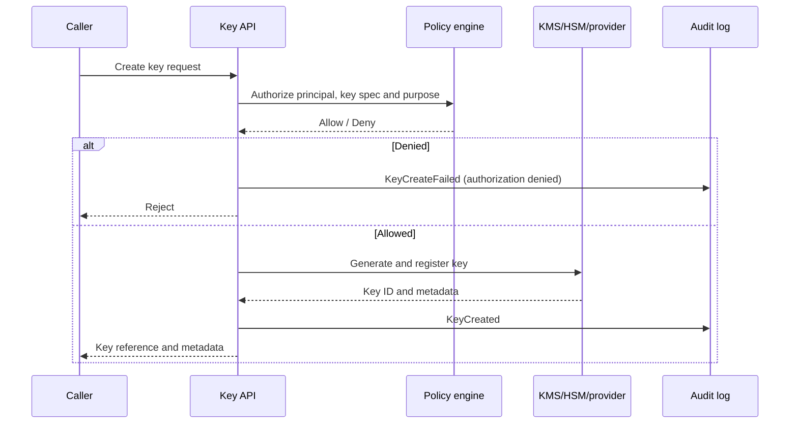

# Key created event

## Mục tiêu học tập

Sau bài học này, bạn có thể:

- Giải thích ý nghĩa của sự kiện `KeyCreated` trong audit và monitoring của hệ thống quản lý khóa.
- Phân biệt yêu cầu tạo key, lần thử tạo key, tạo key material thành công và key resource đã được đăng ký/lưu bền vững.
- Xác định các trường audit cần có về actor, key, algorithm, purpose, nguồn tạo, policy, kết quả và correlation.
- Thiết kế event schema có version, timestamp, event ID và dữ liệu đủ để điều tra mà không làm lộ key material.
- Ghi nhận key được generate, import, derive hoặc replicate với provenance rõ ràng.
- Tích hợp audit event với Java, KeyStore, HSM/KMS và pipeline log tập trung.
- Bảo vệ tính toàn vẹn, khả dụng, retention và khả năng truy vết của audit log.
- Phát hiện bất thường qua sự kiện tạo key và xử lý khi audit event bị thiếu, trùng hoặc sai lệch.

## 1. Key created event là gì?

`KeyCreated` là audit event ghi nhận một cryptographic key resource đã được tạo thành công theo quy trình quản lý khóa. Event giúp trả lời: key nào được tạo, ai hoặc workload nào yêu cầu, tạo ở đâu, bằng thuật toán và cấu hình nào, mục đích gì, kết quả ra sao và request nào liên quan.

Trong hệ thống KMS, HSM hoặc key management service, việc tạo key là một hành động bảo mật quan trọng. Key mới có thể trở thành nền tảng để mã hóa dữ liệu, ký token, bảo vệ backup hoặc wrap các DEK khác. Nếu không ghi nhận đầy đủ, tổ chức khó xác định nguồn gốc key, owner, phạm vi sử dụng và trách nhiệm khi xảy ra sự cố.

Key created event là metadata audit. Nó không được chứa raw secret key, private key, seed, password hoặc plaintext key material. Mục tiêu là tạo bằng chứng về hành động và trạng thái của key, không tạo thêm một bản sao của bí mật.

## 2. Phân biệt request, attempt và created event

Một API request tạo key chưa có nghĩa key đã được tạo. Hệ thống có thể từ chối do thiếu quyền, tham số sai, quota, HSM không sẵn sàng hoặc lỗi persistence.

Nên phân biệt các trạng thái:

| Event/state | Ý nghĩa |
|---|---|
| `KeyCreateRequested` | Principal gửi yêu cầu tạo key |
| `KeyCreateAttempted` | Hệ thống bắt đầu thực thi thao tác |
| `KeyCreateFailed` | Thao tác thất bại; không có key resource được tạo theo contract |
| `KeyCreated` | Key resource đã được tạo và đạt điều kiện commit/persistence của hệ thống |
| `KeyCreatePending` | Thao tác bất đồng bộ đã được nhận nhưng chưa có kết quả cuối |
| `KeyCreateCompleted` | Thao tác bất đồng bộ hoàn tất thành công; có thể tương đương KeyCreated theo schema |

Tên event phụ thuộc hệ thống. Điều quan trọng là không phát `KeyCreated` khi mới nhận request hoặc mới sinh key material trong bộ nhớ nhưng chưa hoàn tất bước tạo resource mà hệ thống cam kết.

Với key ephemeral hoặc data key được tạo để trả về ngay, cần định nghĩa event phù hợp như `DataKeyGenerated`. Không nên giả định mọi lần `GenerateDataKey` đều tạo một key resource lâu dài trong KMS.

## 3. Vòng đời của sự kiện tạo key

Một luồng điển hình:



Trong hệ thống thực tế, audit có thể được ghi đồng bộ trong transaction, qua transactional outbox hoặc qua audit interface riêng của KMS/HSM. Cần xác định rõ thời điểm event được coi là durable và cách xử lý nếu key đã tạo nhưng audit sink tạm thời lỗi.

## 4. Khi nào được phát KeyCreated?

Điều kiện thành công phải được định nghĩa theo loại hệ thống:

- Với KMS, key resource đã được tạo và có key ID ổn định theo contract của dịch vụ.
- Với HSM, key object đã được tạo trong token/partition và có thể được truy xuất bằng handle hoặc label theo policy.
- Với file KeyStore, key entry đã được ghi thành công và file/store đã được persist theo cơ chế của ứng dụng.
- Với key được generate trong memory để dùng tạm, chỉ phát event `KeyCreated` nếu domain định nghĩa nó là resource được quản lý; nếu không, dùng event ephemeral phù hợp.
- Với thao tác bất đồng bộ, chỉ phát success event sau khi job đạt trạng thái cuối thành công.

Nếu key generation thành công nhưng bước lưu hoặc đăng ký thất bại, không được ghi event thành công như thể key resource đã sẵn sàng. Có thể ghi `KeyMaterialGenerated` hoặc `KeyCreateFailed` kèm failure stage nếu việc phân biệt đó hữu ích và không làm lộ thông tin nhạy cảm.

## 5. Những thông tin cần có trong event

Một KeyCreated event hữu ích cho audit nên mô tả được bốn nhóm: event, actor, key resource và kết quả.

| Nhóm | Trường ví dụ | Mục đích |
|---|---|---|
| Event | `eventId`, `eventType`, `schemaVersion`, `occurredAt`, `recordedAt` | Nhận diện, version và thời điểm |
| Actor | `principalId`, `principalType`, `workload`, `role`, `authContext` | Xác định ai yêu cầu |
| Request | `requestId`, `correlationId`, `source`, `environment`, `region` | Truy vết request và nguồn |
| Key | `keyId`, `keyVersion`, `keyType`, `algorithm`, `keySize`, `origin` | Nhận diện key và cấu hình |
| Purpose | `purpose`, `owner`, `tenant`, `allowedUsages` | Giải thích key được tạo để làm gì |
| Policy | `policyId`, `policyVersion`, `approvalId`, `decision` | Chứng minh quyết định authorization |
| Result | `outcome`, `status`, `failureStage`, `errorCode` | Phân biệt thành công/thất bại |
| Provenance | `provider`, `moduleId`, `hsmPartition`, `kmsKeyReference` | Xác định môi trường tạo key |

Không phải hệ thống nào cũng cần mọi trường. Schema phải cân bằng khả năng điều tra, privacy, dung lượng và dữ liệu thực sự có sẵn.

## 6. Actor và nguồn yêu cầu

Actor có thể là user, service account, workload identity, automation, operator hoặc key custodian. Audit cần ghi principal đã được xác thực, không chỉ ghi username do caller gửi trong request body.

Nên lưu:

- Principal ID ổn định và loại principal.
- Workload/service identity và môi trường deploy.
- Role hoặc authorization context có liên quan.
- Authentication method hoặc identity provider reference nếu policy cho phép.
- Delegation/assumed-role chain khi thao tác được thực hiện thay mặt một principal khác.
- Source service, request ID và correlation ID.

Không ghi access token, session cookie, password, PIN hoặc credential dùng để xác thực. Nếu cần điều tra identity chain, ghi identifier và reference an toàn tới hệ thống identity/audit gốc.

## 7. Key metadata trong event

Key metadata nên đủ để nhận diện key và đánh giá cấu hình:

- Key ID hoặc resource ID ổn định.
- Key version nếu hệ thống version hóa.
- Alias/label nếu cần cho vận hành, nhưng không dùng alias làm định danh duy nhất.
- Key type: symmetric, asymmetric, HMAC, wrapping hoặc loại khác.
- Algorithm và key size/curve.
- Allowed usages: encrypt, decrypt, sign, verify, wrap, unwrap, derive.
- Extractability/exportability hoặc key attributes liên quan.
- Owner, tenant, environment và purpose.
- Creation time và trạng thái ban đầu.

Metadata cần phản ánh cấu hình thực tế được module chấp nhận. Không ghi một key size do caller yêu cầu nếu provider đã tạo key với cấu hình khác; nên ghi effective parameters hoặc cả requested/effective values nếu cần điều tra.

## 8. Key origin và provenance

Nguồn gốc key ảnh hưởng tới cách đánh giá độ tin cậy. Event nên phân biệt:

| Origin | Ý nghĩa |
|---|---|
| `generated` | Key material được tạo bởi CSPRNG/provider trong boundary được chỉ định |
| `imported` | Key material được đưa từ bên ngoài vào hệ thống |
| `derived` | Key được dẫn xuất từ secret/key khác qua KDF |
| `replicated` | Key resource được đồng bộ hoặc phục hồi từ hệ thống khác |
| `restored` | Key được khôi phục từ backup/recovery process |
| `wrapped-import` | Key được import dưới dạng đã wrap theo quy trình hỗ trợ |

Không gộp mọi trường hợp vào `generated`. Key import có threat model khác key được tạo bên trong HSM; key derived phụ thuộc nguồn đầu vào và KDF; key restored phụ thuộc integrity của backup và approval.

Provenance có thể bao gồm provider, HSM model/partition, KMS key reference, import job ID, KDF algorithm/version hoặc backup reference. Tuyệt đối không ghi raw imported/derived key material.

## 9. Purpose và allowed usages

Một key được tạo mà không xác định purpose có thể trở thành key dùng chung cho nhiều service. Điều đó làm khó kiểm soát quyền và tăng blast radius.

Purpose nên mô tả công việc cụ thể, ví dụ:

- `payments-data-encryption`.
- `token-signing`.
- `backup-key-wrapping`.
- `tenant-42-field-encryption`.
- `audit-event-integrity`.

Allowed usages phải phù hợp với key type và provider. Public key có thể verify/encrypt nhưng private key có thể sign/decrypt; symmetric key có thể có encrypt/decrypt hoặc MAC usage. Không cho phép operation không cần thiết chỉ vì provider hỗ trợ.

Event ghi purpose và usage được policy chấp nhận, không chỉ copy giá trị tự khai từ caller. Nếu purpose do application gửi, cần authorization policy kiểm tra purpose đó có hợp lệ với principal/key namespace không.

## 10. Requested spec và effective spec

Caller có thể yêu cầu AES-256, key non-exportable và usage chỉ encrypt/decrypt. Provider hoặc HSM có thể từ chối, chuẩn hóa hoặc áp dụng cấu hình khác theo capability.

Audit có thể lưu hai nhóm:

- `requestedSpec`: cấu hình caller yêu cầu.
- `effectiveSpec`: cấu hình key thực tế được tạo và đăng ký.

Ví dụ effective spec có thể bao gồm algorithm, size, curve, extractability, sensitivity, allowed usages và origin. Nếu hai nhóm khác nhau, event hoặc event liên quan cần giải thích policy/provider đã điều chỉnh thế nào.

Không đưa toàn bộ request payload vào audit một cách mù quáng. Chỉ chọn trường cần thiết và loại bỏ password, secret, raw key, credential, plaintext hoặc dữ liệu cá nhân không cần cho audit.

## 11. Event schema và versioning

Event schema cần có version rõ ràng để consumer có thể xử lý thay đổi theo thời gian. Một schema tối thiểu có thể gồm:

```json
{
  "eventId": "evt-01JXYZ...",
  "eventType": "KeyCreated",
  "schemaVersion": 1,
  "occurredAt": "2026-11-28T04:30:00Z",
  "recordedAt": "2026-11-28T04:30:00.125Z",
  "actor": {
    "principalId": "svc-key-provisioner",
    "principalType": "workload",
    "environment": "production"
  },
  "requestId": "req-8f1a",
  "key": {
    "keyId": "key-7c92",
    "keyVersion": 1,
    "keyType": "symmetric",
    "algorithm": "AES",
    "keySizeBits": 256,
    "origin": "generated",
    "purpose": "payments-data-encryption",
    "allowedUsages": ["encrypt", "decrypt"],
    "extractable": false
  },
  "provider": {
    "name": "approved-kms-provider",
    "moduleReference": "hsm-partition-prod-a"
  },
  "policy": {
    "policyId": "key-create-prod",
    "policyVersion": 12,
    "decision": "allow"
  },
  "outcome": "success"
}
```

Đây là schema minh họa, không phải format bắt buộc của mọi nền tảng. Giá trị ID và provider trong ví dụ là giả định. Production cần dùng ID thật từ hệ thống và thống nhất timestamp format, enum, nullability, cardinality và schema evolution.

Khi thêm field, ưu tiên backward-compatible. Khi đổi nghĩa field hoặc enum, tăng schema version và cập nhật consumer. Không tái sử dụng tên field cũ với semantics khác.

## 12. Timestamp: occurredAt và recordedAt

Hai thời điểm có ý nghĩa khác nhau:

- `occurredAt`: thời điểm hành động tạo key thực sự hoàn tất tại nguồn phát event.
- `recordedAt`: thời điểm audit pipeline ghi nhận event bền vững.

Chênh lệch giữa hai thời điểm giúp phát hiện queue delay, mạng chậm, pipeline bị nghẽn hoặc log bị chuyển tiếp trễ. Dùng UTC và đồng bộ clock theo hạ tầng thời gian đáng tin cậy.

Không dùng timestamp làm event ID. Hai event có thể xảy ra cùng thời điểm; clock có thể lệch hoặc bị chỉnh. Dùng UUID/ULID hoặc ID duy nhất do hệ thống phát sinh, cùng request/correlation ID để liên kết.

## 13. Những gì tuyệt đối không được ghi vào KeyCreated

Audit event không phải nơi backup key. Không ghi:

- Raw AES/HMAC secret key bytes.
- RSA/EC private key material hoặc private key PEM/DER.
- Seed, DRBG state hoặc entropy input.
- Password, PIN, passphrase, access token hoặc session credential.
- Plaintext DEK trả về từ KMS.
- Wrapped key blob nếu policy không cho phép hoặc không cần thiết.
- Plaintext dữ liệu nghiệp vụ.
- Toàn bộ request/response object có thể chứa secret.

Có thể ghi key ID, key version, algorithm, size, origin, usages, extractability và fingerprint của public key nếu policy cho phép. Fingerprint hoặc alias vẫn có thể là metadata nhạy cảm trong một số môi trường; áp dụng data classification và access control cho audit.

## 14. Không nhầm KeyCreated với key access event

Tạo key và truy cập key là hai hành động khác nhau. KeyCreated không cho biết ai đã decrypt, sign, export hoặc rotate key về sau.

Nên có event riêng cho các thao tác:

| Event family | Ví dụ |
|---|---|
| Create | `KeyCreateRequested`, `KeyCreated`, `KeyCreateFailed` |
| Access/use | `KeyDescribe`, `KeyPublicKeyRead`, `KeyEncrypt`, `KeyDecrypt`, `KeySign` |
| Material movement | `KeyImport`, `KeyExport`, `KeyWrap`, `KeyUnwrap` |
| Lifecycle | `KeyEnabled`, `KeyDisabled`, `KeyRotated`, `KeyScheduledForDeletion`, `KeyDestroyed` |
| Policy | `KeyPolicyChanged`, `KeyGrantAdded`, `KeyGrantRevoked` |
| Recovery | `KeyBackupCreated`, `KeyRestoreStarted`, `KeyRestored` |

Tên event phụ thuộc hệ thống, nhưng taxonomy phải giúp auditor phân biệt hành động và kết quả. Một KeyCreated event không thay thế audit trail cho những lần sử dụng key sau đó.

## 15. Ghi nhận key creation failure

Failure event có giá trị điều tra và monitoring. Nó giúp phát hiện principal thử tạo key không được phép, cấu hình sai, quota bị cạn hoặc provider/HSM gặp sự cố.

Failure event nên có:

- Actor và request ID.
- Key spec đã yêu cầu ở mức an toàn.
- Policy decision: deny, invalid parameter, quota, provider unavailable hoặc internal failure.
- Failure stage và error category ổn định.
- Retryability hoặc job state nếu phù hợp.
- Thời điểm và provider/module reference.

Không đưa stack trace đầy đủ, credential hoặc raw provider response vào event công khai. Chi tiết kỹ thuật có thể lưu trong log vận hành có access control, còn audit event nên dùng error code và correlation ID.

## 16. Audit cho key được tạo trong Java KeyStore

Với file KeyStore, cần xác định thời điểm nào được coi là key đã được tạo. Một flow đơn giản:

1. Xác thực principal và authorize key spec/purpose.
2. Tạo key bằng `KeyGenerator` hoặc `KeyPairGenerator`.
3. Đưa key vào KeyStore entry.
4. Persist KeyStore thành công.
5. Ghi audit event với key alias/ID, algorithm, size, purpose, provider và outcome.

Nếu bước persist thất bại, không ghi `KeyCreated` như một resource đã sẵn sàng. Nếu event sink lỗi sau khi persist thành công, cần durable outbox hoặc cơ chế reconcile để không mất audit event.

File KeyStore và audit log nên có quyền truy cập riêng. Không đưa `getEncoded()` hoặc password vào event. Nếu dùng HSM-backed KeyStore, event nên lấy metadata từ provider/HSM đã xác minh.

## 17. Audit cho HSM và PKCS#11

HSM có thể tạo key object bên trong thiết bị. Audit cần gắn event với:

- HSM model, firmware và partition/slot.
- Object ID/handle hoặc label ổn định theo khả năng thiết bị.
- User/role/session đã thực hiện thao tác.
- Key attributes: sensitive, extractable, usage flags và persistence.
- Key generation mechanism và algorithm parameters.
- Approval/ceremony reference nếu có.
- HSM audit sequence hoặc vendor event ID.

Không log PIN, SO credential hoặc key bytes. Một số HSM có audit log riêng; cần đồng bộ hoặc đối chiếu vendor event ID với application event để giữ chain of evidence.

## 18. Audit cho KMS

KMS thường phát sinh audit record ở control plane hoặc data plane. KeyCreated có thể được ghi bởi KMS, bởi application, hoặc cả hai với correlation ID chung.

Nếu KMS là nguồn audit authoritative, ứng dụng nên lưu request ID, key ID và tham chiếu event gốc thay vì tự tạo event có thể mâu thuẫn. Nếu ứng dụng phát event domain riêng, cần ghi nguồn và liên kết tới KMS audit record.

Các thông tin hữu ích:

- KMS account/project/region hoặc tenant.
- Key ID và version.
- Principal/service identity.
- Create operation và request ID.
- Key spec, origin, purpose và policy.
- KMS status/result.
- Audit event ID từ dịch vụ nếu có.

Không giả định KMS API trả raw key material khi tạo key resource. Với API generate data key, phân biệt plaintext DEK và wrapped DEK; plaintext DEK tuyệt đối không được đưa vào audit.

## 19. Audit pipeline và transactional outbox

Một lỗi thường gặp là tạo key thành công rồi gửi audit event qua network; nếu audit service lỗi, key đã tồn tại nhưng không có event. Ngược lại, ghi event trước rồi tạo key thất bại có thể khiến consumer tin rằng key đã sẵn sàng.

Với database-backed key registry, transactional outbox có thể giúp commit trạng thái key và event record trong cùng transaction. Worker gửi event tới message broker sau đó, dùng event ID để deduplicate.

Với HSM/KMS không tham gia transaction database của ứng dụng, không thể giả định atomic commit xuyên hệ thống. Cần:

- Dùng operation/request ID idempotent nếu API hỗ trợ.
- Ghi durable intent/request trước khi gọi KMS/HSM.
- Sau response, persist key reference và outbox event.
- Có reconciliation job đối chiếu key inventory với audit source.
- Phát cảnh báo khi có key resource không có event tương ứng hoặc event success không tìm thấy resource.

## 20. Event delivery: duplicate, delay và ordering

Audit pipeline có thể giao event nhiều lần, đến trễ hoặc sai thứ tự. Consumer cần idempotent theo `eventId` và không dựa duy nhất vào thứ tự nhận.

Các nguyên tắc:

- Mỗi event có ID duy nhất.
- Dùng request ID/correlation ID để nhóm các bước.
- Có occurred time và recorded time.
- Consumer lưu deduplication key và xử lý retry an toàn.
- Key version hoặc sequence number giúp xác định trạng thái mới hơn.
- Không xóa event duplicate khỏi raw archive trước khi bảo toàn bằng chứng; deduplicate ở view/consumer.
- Có dead-letter queue và quy trình replay được kiểm soát.

Nếu event đến trễ, trạng thái hiện tại của key có thể đã thay đổi. Auditor cần phân biệt event lịch sử với snapshot hiện tại.

## 21. Tính toàn vẹn và chống sửa audit log

Audit log có giá trị khi attacker khó sửa, xóa hoặc tạo lại lịch sử. Các biện pháp có thể gồm:

- Append-only storage hoặc WORM retention.
- Quyền ghi tách khỏi quyền đọc/xóa và quản trị key.
- Chuyển log tới account/project hoặc security boundary độc lập.
- Hash chain, signed checkpoint hoặc integrity verification theo thiết kế.
- Đồng bộ thời gian và lưu nguồn timestamp.
- Mã hóa log khi lưu/truyền và quản lý encryption key riêng.
- Giám sát thay đổi retention, lifecycle và access policy của log store.

Hash chain tự nó không ngăn attacker có quyền sửa toàn bộ log và tính lại chain. Cần bảo vệ checkpoint/signing key, tách quyền quản trị và lưu bản sao ở miền tin cậy độc lập.

## 22. Access control cho audit record

Audit log chứa thông tin về key inventory, principal, tenant, policy và hoạt động mật mã. Dù không có raw key, dữ liệu này vẫn nhạy cảm.

Phân quyền nên tách:

- Application writer: chỉ append event thuộc service của mình.
- Security auditor: đọc event theo phạm vi được giao.
- SOC analyst: truy vấn và tạo detection, không sửa raw archive.
- Platform administrator: quản trị hạ tầng nhưng không tự xóa evidence.
- Compliance owner: quản lý retention/legal hold theo quy trình.

Không cấp quyền sửa raw audit record cho principal có quyền tạo key. Truy vấn audit cũng cần được audit nếu có dữ liệu tenant hoặc hoạt động nhạy cảm.

## 23. Monitoring và phát hiện bất thường

KeyCreated event có thể làm đầu vào cho detection rule. Một số tín hiệu cần theo dõi:

- Principal tạo key ngoài vai trò hoặc ngoài thời gian triển khai.
- Tăng đột biến số lượng key được tạo.
- Key tạo trong region/environment không được phép.
- Algorithm, key size hoặc key usage yếu hơn policy baseline.
- Key mới có extractable=true trong khi policy yêu cầu non-exportable.
- Purpose, tenant hoặc owner không hợp lệ.
- Key được tạo rồi export/disable/destroy ngay sau đó.
- Nhiều lần tạo key thất bại hoặc authorization denied.
- HSM/KMS provider, firmware hoặc module reference thay đổi bất thường.
- Không có audit event cho key xuất hiện trong inventory.

Detection cần xét baseline và change window để giảm false positive. Một đợt rotation hợp lệ có thể tạo nhiều key trong thời gian ngắn; cần gắn change ticket/approval ID để correlation.

## 24. Alert severity và phản ứng

Không phải mọi KeyCreated event đều cần alert. Event thành công theo policy có thể chỉ cần lưu audit và cập nhật inventory. Alert nên tập trung vào vi phạm policy hoặc pattern bất thường.

| Tín hiệu | Mức ưu tiên gợi ý | Hành động |
|---|---|---|
| Key được tạo bởi principal hợp lệ trong change window | Informational | Lưu event và inventory |
| Key thiếu owner/purpose hoặc metadata bắt buộc | Medium | Chặn activation hoặc yêu cầu remediation |
| Key exportable trái policy | High | Disable/contain theo runbook, điều tra |
| Tạo key hàng loạt từ principal lạ | High | Rate limit, disable identity, kiểm tra audit |
| Key xuất hiện trong inventory nhưng thiếu audit | High | Reconcile và điều tra gap |
| Key creation từ identity nghi compromise | Critical | Incident response, assess key exposure và rotate/revoke |

Severity cuối cùng phải theo risk model của tổ chức. Alert nên có key ID, principal, request ID, policy rule và liên kết tới audit detail, không đính kèm secret material.

## 25. Retention và data minimization

Retention audit phụ thuộc yêu cầu pháp lý, hợp đồng, compliance và threat model. Key lifecycle có thể kéo dài nhiều năm; event tạo key cần được giữ đủ lâu để giải thích nguồn gốc key trong thời gian dữ liệu hoặc backup còn phụ thuộc vào nó.

Retention policy nên xác định:

- Thời hạn lưu raw event và bản tổng hợp.
- Legal hold và quy trình xóa khi hết hạn.
- Phân loại dữ liệu theo tenant và sensitivity.
- Mã hóa log, key quản lý log và quyền truy cập.
- Backup/replica và cách áp dụng retention đồng nhất.
- Data minimization: không lưu field không cần thiết.
- Khả năng export evidence cho audit mà không lộ bí mật.

Không giữ log vô thời hạn chỉ vì dung lượng rẻ. Ngược lại, không xóa event tạo key khi key hoặc dữ liệu phụ thuộc vẫn còn trong retention.

## 26. Key inventory reconciliation

Audit event mô tả lịch sử; key inventory mô tả trạng thái tài nguyên. Hai nguồn cần được đối chiếu định kỳ.

Reconciliation có thể phát hiện:

- Key tồn tại nhưng thiếu `KeyCreated` hoặc `KeyRestored` event.
- Event `KeyCreated` nhưng resource không tồn tại.
- Key owner/purpose khác inventory đã đăng ký.
- Key version bị trùng hoặc alias ánh xạ sai.
- Key ở trạng thái active nhưng policy đã yêu cầu disabled.
- Key import/restore không có approval reference.
- Key đã destroy nhưng vẫn xuất hiện trong inventory/cache.

Reconciliation không nên tự động tạo lại key hoặc xóa resource để “sửa” sai lệch. Nó tạo finding và yêu cầu quy trình remediation có approval, audit và đánh giá dependency.

## 27. Java example: mô hình hóa KeyCreated event

Ví dụ Java 17 dùng record để biểu diễn event metadata. Event chỉ chứa key reference và thuộc tính không bí mật.

```java
import java.time.Instant;
import java.util.List;
import java.util.UUID;

record KeyCreatedEvent(
        String eventId,
        int schemaVersion,
        Instant occurredAt,
        String principalId,
        String requestId,
        String keyId,
        int keyVersion,
        String keyType,
        String algorithm,
        int keySizeBits,
        String origin,
        String purpose,
        List<String> allowedUsages,
        boolean extractable,
        String provider,
        String policyVersion,
        String outcome) {

    static KeyCreatedEvent success(
            String principalId,
            String requestId,
            EffectiveKeyMetadata metadata) {
        return new KeyCreatedEvent(
                UUID.randomUUID().toString(),
                1,
                Instant.now(),
                principalId,
                requestId,
                metadata.keyId(),
                metadata.keyVersion(),
                metadata.keyType(),
                metadata.algorithm(),
                metadata.keySizeBits(),
                metadata.origin(),
                metadata.purpose(),
                metadata.allowedUsages(),
                metadata.extractable(),
                metadata.provider(),
                metadata.policyVersion(),
                "success");
    }
}

record EffectiveKeyMetadata(
        String keyId,
        int keyVersion,
        String keyType,
        String algorithm,
        int keySizeBits,
        String origin,
        String purpose,
        List<String> allowedUsages,
        boolean extractable,
        String provider,
        String policyVersion) {}
```

Ví dụ minh họa schema, không phải audit framework hoàn chỉnh. `EffectiveKeyMetadata` phải được tạo từ kết quả/metadata thực tế của key manager sau khi provider xác nhận key resource; không lấy các thuộc tính nhạy cảm hoặc giá trị do caller tự khai. `Instant.now()` cần đi cùng time synchronization và có thể cần ghi thêm `recordedAt` tại audit sink.

## 28. Java example: chỉ phát success event sau khi persist

Đoạn code sau mô tả thứ tự thao tác với KeyStore. `AuditOutbox` đại diện cho một cơ chế ghi event bền vững; production cần triển khai outbox hoặc cơ chế tương đương có retry/reconciliation.

```java
import java.io.OutputStream;
import java.nio.file.Files;
import java.nio.file.Path;
import java.security.KeyStore;
import java.security.SecureRandom;
import java.util.List;
import javax.crypto.KeyGenerator;
import javax.crypto.SecretKey;

interface AuditOutbox {
    void append(KeyCreatedEvent event);
}

interface KeyMetadataResolver {
    EffectiveKeyMetadata describe(String alias, SecretKey key,
                                  String providerName, String purpose,
                                  String policyVersion);
}

final class KeyProvisioningService {
    private final KeyStore keyStore;
    private final Path storePath;
    private final char[] storePassword;
    private final char[] entryPassword;
    private final AuditOutbox auditOutbox;
    private final KeyMetadataResolver metadataResolver;

    KeyProvisioningService(KeyStore keyStore, Path storePath,
                           char[] storePassword, char[] entryPassword,
                           AuditOutbox auditOutbox,
                           KeyMetadataResolver metadataResolver) {
        this.keyStore = keyStore;
        this.storePath = storePath;
        this.storePassword = storePassword;
        this.entryPassword = entryPassword;
        this.auditOutbox = auditOutbox;
        this.metadataResolver = metadataResolver;
    }

    void createAesKey(String principalId, String requestId,
                      String alias, String purpose,
                      String policyVersion) throws Exception {
        KeyGenerator generator = KeyGenerator.getInstance("AES");
        generator.init(256, new SecureRandom());
        SecretKey secretKey = generator.generateKey();
        EffectiveKeyMetadata metadata = metadataResolver.describe(
                alias, secretKey, generator.getProvider().getName(),
                purpose, policyVersion);

        if (!"AES".equals(metadata.algorithm())
                || !alias.equals(metadata.keyId())) {
            throw new IllegalArgumentException("Key metadata does not match the created entry");
        }

        KeyStore.PasswordProtection protection =
                new KeyStore.PasswordProtection(entryPassword);
        try {
            keyStore.setEntry(alias,
                    new KeyStore.SecretKeyEntry(secretKey), protection);
            try (OutputStream output = Files.newOutputStream(storePath)) {
                keyStore.store(output, storePassword);
            }

            // The event contains metadata only; never include secretKey bytes.
            KeyCreatedEvent event = KeyCreatedEvent.success(
                    principalId, requestId, metadata);
            auditOutbox.append(event);
        } finally {
            protection.destroy();
        }
    }
}
```

Đây là skeleton để minh họa trình tự, không phải code production hoàn chỉnh. `KeyMetadataResolver` phải đọc metadata hiệu lực từ provider/key manager mà không export key material; Java JCA không có một API chuẩn chung để truy vấn mọi thuộc tính extractability của mọi provider. Với HSM/KMS, lấy key ID, attributes và provider identity từ response đáng tin của dịch vụ. File KeyStore update và audit outbox không nằm trong cùng transaction; nếu store thành công nhưng `append` thất bại, cần retry bền vững hoặc reconciliation để không mất event. Không ghi raw key, password hoặc `getEncoded()` vào event.

## 29. Kiểm thử KeyCreated event

Test matrix cần kiểm tra cả nội dung và thời điểm phát event:

| Tình huống | Kết quả mong đợi |
|---|---|
| Key được tạo và persist thành công | Có đúng một logical `KeyCreated` |
| Authorization bị từ chối | Có failure/deny event, không có success event |
| Key generation thất bại | Ghi failure stage, không ghi KeyCreated |
| Persist KeyStore thất bại | Không ghi success event |
| Audit sink lỗi sau khi key đã commit | Event được giữ trong outbox/retry/reconcile |
| Consumer nhận event trùng | Deduplicate theo event ID, giữ raw evidence theo policy |
| Event đến trễ | occurredAt và recordedAt phân biệt rõ |
| Key import | origin là imported, có approval/import reference |
| Key restored | origin/event thể hiện restore, có backup reference |
| Key có extractability trái policy | Chặn hoặc alert theo policy |
| Event chứa raw key/password | Test phải thất bại; dữ liệu secret không được serialize |
| Schema version mới | Consumer tương thích hoặc từ chối có kiểm soát |

Ngoài unit test, cần integration test với KMS/HSM sandbox, kiểm thử mất kết nối, retry, dead-letter, log integrity và reconciliation.

## 30. Những lỗi thường gặp

| Lỗi | Hậu quả | Cách xử lý |
|---|---|---|
| Ghi KeyCreated ngay khi nhận request | Báo key đã tồn tại dù thao tác có thể thất bại | Chỉ phát success sau commit |
| Không ghi failure event | Không điều tra được deny/provider failure | Ghi event thất bại với error category |
| Log raw key hoặc plaintext DEK | Tạo bản sao bí mật trong audit | Chỉ log metadata/reference |
| Không ghi origin | Không phân biệt generated/imported/derived/restored | Thêm provenance rõ ràng |
| Không ghi purpose/owner | Key mồ côi, khó review quyền | Bắt buộc metadata và policy |
| Chỉ ghi requested spec | Audit không biết cấu hình thực tế | Ghi effective spec từ provider |
| Dùng timestamp làm event ID | Có thể trùng hoặc sai thứ tự | Dùng ID duy nhất và correlation ID |
| Audit sink lỗi bị bỏ qua | Key tồn tại nhưng thiếu bằng chứng | Outbox, retry và reconciliation |
| Consumer không idempotent | Duplicate event làm sai inventory/alert | Deduplicate theo event ID |
| Cho phép sửa/xóa audit cùng quyền tạo key | Attacker có thể xóa dấu vết | Tách quyền và immutable storage |
| Không đối chiếu inventory | Key không có audit hoặc event mồ côi | Reconciliation định kỳ |
| Giữ log quá nhiều dữ liệu | Tăng privacy risk và lộ metadata | Data minimization và retention policy |

## 31. Case study: phát hiện key không rõ nguồn gốc

Một nhóm vận hành phát hiện trong KMS có một key mới mang purpose `data-encryption`, nhưng inventory không có owner và audit dashboard không tìm thấy KeyCreated event tương ứng. Key có trạng thái active và policy cho phép nhiều service decrypt.

Nhóm không tự xóa key ngay vì chưa biết ciphertext nào phụ thuộc vào nó. Họ đối chiếu KMS native audit, request ID, workload identity, region và key inventory; phát hiện key được tạo bởi một automation cũ sau khi audit forwarder mất kết nối. Key có origin generated nhưng không có change ticket hoặc owner hợp lệ.

Nhóm tạm hạn chế usage theo incident policy, xác định dependency và dữ liệu đã mã hóa, gán owner/approval sau khi xác minh, rồi rotate sang key mới nếu provenance không đủ tin cậy. Họ khôi phục audit forwarder, replay event từ nguồn gốc và bổ sung reconciliation alert khi key resource không có event. Incident được lưu lại để cải thiện outbox, monitoring và access review.

## 32. Checklist triển khai

- [ ] Định nghĩa rõ điều kiện để phát `KeyCreated`.
- [ ] Phân biệt request, attempt, pending, success và failure.
- [ ] Ghi event ID, schema version, occurredAt, recordedAt và correlation ID.
- [ ] Ghi principal đã xác thực, workload, role và approval reference.
- [ ] Ghi key ID/version, algorithm, size, key type, origin và effective usages.
- [ ] Ghi purpose, owner, tenant, environment và provider/module reference.
- [ ] Phân biệt generated, imported, derived, replicated và restored.
- [ ] Không ghi raw key, private key, seed, password, PIN hoặc plaintext DEK.
- [ ] Ghi failure event và failure stage mà không lộ secret.
- [ ] Chỉ phát success sau khi key resource đạt trạng thái commit/persistence.
- [ ] Có outbox/retry/reconciliation nếu audit sink không cùng transaction.
- [ ] Consumer idempotent, xử lý duplicate, delay và out-of-order.
- [ ] Bảo vệ audit bằng append-only/WORM, access separation và integrity checks.
- [ ] Đồng bộ thời gian và bảo vệ timestamp provenance.
- [ ] Có detection cho bất thường về principal, volume, algorithm, origin và policy.
- [ ] Đối chiếu KeyCreated với key inventory định kỳ.
- [ ] Có retention, privacy và legal hold policy.
- [ ] Kiểm thử KMS/HSM, failure, retry, event tampering và secret leakage.

## 33. Câu hỏi tự kiểm tra

**1. KeyCreated event ghi nhận điều gì?**

Nó ghi nhận key resource đã được tạo thành công, cùng actor, key metadata, purpose, provenance, policy và kết quả.

**2. Nhận CreateKey request có đủ để phát KeyCreated không?**

Không. Phải chờ thao tác tạo resource hoàn tất theo contract và đạt trạng thái commit/persistence.

**3. KeyCreateFailed khác KeyCreated thế nào?**

KeyCreateFailed ghi thao tác thất bại; KeyCreated chỉ ghi thành công.

**4. Vì sao cần event ID?**

Để nhận diện duy nhất, deduplicate và liên kết retry/replay.

**5. occurredAt khác recordedAt thế nào?**

occurredAt là lúc hành động xảy ra; recordedAt là lúc audit sink ghi nhận bền vững.

**6. KeyCreated có được chứa raw key bytes không?**

Không. Event chỉ chứa metadata/reference; raw key và secret phải được giữ ngoài audit log.

**7. Vì sao phải ghi origin?**

Để phân biệt key được generate, import, derive, replicate hoặc restore và đánh giá provenance.

**8. Requested spec khác effective spec thế nào?**

Requested spec là cấu hình caller yêu cầu; effective spec là cấu hình thực tế provider đã tạo.

**9. Vì sao cần purpose và owner?**

Để xác định trách nhiệm, giới hạn usage, access review và vòng đời của key.

**10. Key ephemeral có luôn là KeyCreated không?**

Không. Có thể cần event DataKeyGenerated riêng nếu nó không phải resource lâu dài.

**11. Khi nào ghi event thành công với file KeyStore?**

Sau khi entry được lưu và KeyStore persist thành công theo contract của ứng dụng.

**12. Audit sink lỗi sau khi key đã tạo thì sao?**

Cần outbox, retry hoặc reconciliation để bảo đảm event không bị mất.

**13. Vì sao cần schema version?**

Để consumer xử lý thay đổi field và semantics tương thích theo thời gian.

**14. Tại sao timestamp không nên dùng làm event ID?**

Timestamp có thể trùng, lệch clock hoặc đến sai thứ tự; cần ID duy nhất.

**15. Audit event có thay thế key inventory không?**

Không. Event mô tả lịch sử; inventory mô tả trạng thái tài nguyên hiện tại. Cần đối chiếu hai nguồn.

**16. Vì sao phải ghi failure event?**

Để điều tra authorization denial, cấu hình sai, quota và lỗi provider/HSM/KMS.

**17. Làm thế nào phát hiện key không có audit event?**

Reconcile key inventory với audit source và phát finding khi thiếu event tương ứng.

**18. Hash chain có đủ bảo vệ audit log không?**

Không nếu attacker có thể sửa toàn bộ log và tính lại chain; cần bảo vệ checkpoint, quyền và bản sao độc lập.

**19. Có nên ghi toàn bộ KMS response vào log không?**

Không. Chỉ chọn metadata cần thiết và loại bỏ plaintext key, credential, wrapped material không cần thiết.

**20. KeyCreated event có chứng minh key được dùng an toàn không?**

Không. Nó chứng minh một hành động tạo key; việc sử dụng, rotation, access và destruction cần event cùng kiểm soát riêng.

## 34. Kết luận

KeyCreated event là bằng chứng audit về nguồn gốc và cấu hình ban đầu của một key resource. Event cần phân biệt yêu cầu, lần thử và kết quả tạo thành công; ghi actor, key ID/version, algorithm, origin, purpose, effective usages, provider, policy và correlation; đồng thời tuyệt đối không chứa raw key material hoặc credential.

Một hệ thống đáng tin cậy cần phát success event sau khi resource được commit, ghi failure event, bảo đảm event không mất qua outbox/retry/reconciliation, bảo vệ log khỏi sửa đổi và đối chiếu audit với key inventory. KeyCreated chỉ là điểm bắt đầu của audit trail; các thao tác đọc, sử dụng, export, rotation, disable, backup, restore và destruction phải được ghi nhận riêng để theo dõi toàn bộ vòng đời khóa.
