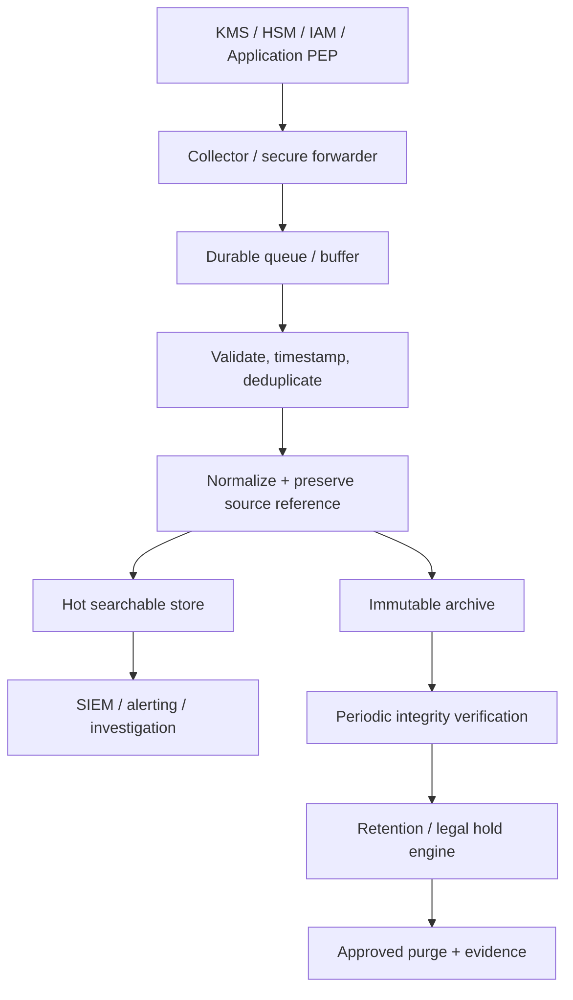

# Audit retention

**Audit retention** là chính sách và quy trình xác định audit record phải được giữ trong bao lâu, ở đâu, với mức bảo vệ nào, ai được truy cập và khi nào được phép hủy. Với quản lý khóa mật mã, audit retention bảo toàn bằng chứng về việc tạo, sử dụng, thay đổi quyền, xoay vòng, backup, phục hồi, thu hồi và hủy khóa để có thể điều tra sự cố, chứng minh tuân thủ và tái dựng quyết định bảo mật.

Audit log có giá trị khi tổ chức có thể tin rằng bản ghi đầy đủ, đúng thời gian, không bị sửa trái phép và vẫn đọc được trong suốt thời hạn cần thiết. Lưu log vô thời hạn không tự động làm hệ thống an toàn hơn: dữ liệu log có thể tiết lộ cấu trúc hệ thống, danh tính, key ID, quan hệ tenant và hành vi nghiệp vụ. Retention phải cân bằng nhu cầu bằng chứng, yêu cầu pháp lý/hợp đồng, khả năng điều tra, quyền riêng tư, chi phí và rủi ro khi lưu quá lâu.

Trong phạm vi **SECURITY_KEY_MANAGEMENT_FUNDAMENTALS**, audit retention gắn với vòng đời khóa, KMS/HSM, IAM, key access control, backup/recovery, revocation và destruction. Bài học tập trung vào cách phân loại bản ghi, thiết kế thời hạn lưu, bảo vệ tính toàn vẹn, xử lý legal hold, lưu trữ dài hạn và hủy có kiểm soát.

## 1. Vì sao audit retention quan trọng?

Một sự kiện mật mã có thể chỉ diễn ra trong vài mili giây nhưng hậu quả cần điều tra nhiều tháng hoặc nhiều năm sau. Ví dụ, một khóa ký bị dùng trái phép, một quyền `Decrypt` được cấp nhầm, một key policy bị sửa hoặc một backup được khôi phục bằng khóa không đúng có thể chỉ được phát hiện sau khi dữ liệu bị truy cập.

Audit retention giúp trả lời các câu hỏi:

- Ai hoặc workload nào đã gọi thao tác trên key ID/version nào?
- Thao tác `Encrypt`, `Decrypt`, `Sign`, `Export`, `Disable` hoặc `Destroy` diễn ra khi nào và kết quả ra sao?
- Policy, grant, role hoặc thuộc tính ABAC nào có hiệu lực tại thời điểm đó?
- Ai đã tạo, thay đổi, phê duyệt hoặc thu hồi quyền?
- Khóa nào đã được backup, restore, rotate hoặc chuyển sang provider khác?
- Sự kiện đã được gửi đến hệ thống giám sát đầy đủ chưa, có khoảng trống log hay không?
- Bằng chứng có bị sửa, xóa, thay thế hoặc ghi nhận trễ không?
- Tổ chức có thể chứng minh bản ghi được giữ và hủy theo chính sách không?

Nếu log đã bị ghi đè trước khi sự cố được phát hiện, điều tra có thể không xác định được phạm vi ảnh hưởng. Nếu log được giữ nhưng không có integrity control, attacker có thể xóa dấu vết hoặc sửa timeline. Nếu log giữ quá nhiều dữ liệu nhạy cảm, chính kho log trở thành một nguồn rò rỉ mới.

## 2. Phân biệt audit log, application log và security telemetry

Các nguồn dữ liệu này bổ sung cho nhau nhưng có mục đích và yêu cầu retention khác nhau.

| Loại dữ liệu | Nội dung | Ví dụ trong quản lý khóa | Mục tiêu chính |
|---|---|---|---|
| Audit log | Bản ghi hành động có danh tính, tài nguyên, thao tác, thời điểm và kết quả | KMS `Decrypt`, tạo grant, đổi key policy, HSM login, key rotation | Trách nhiệm giải trình và bằng chứng |
| Application log | Sự kiện xử lý nội bộ của ứng dụng | Lỗi tải keystore, refresh secret thất bại, mã lỗi từ provider | Chẩn đoán và vận hành |
| Security telemetry | Tín hiệu phục vụ phát hiện và phản ứng | Số lần decrypt tăng bất thường, truy cập từ mạng lạ, quyền admin được dùng | Phát hiện và ứng phó |
| Configuration/change history | Trạng thái cấu hình và lịch sử thay đổi | Phiên bản policy, provider, HSM firmware, retention policy | Tái dựng trạng thái hệ thống |
| Evidence package | Tập hợp bản ghi, snapshot, phê duyệt và kết quả kiểm tra | Hồ sơ điều tra key compromise hoặc xác nhận destruction | Kiểm toán và chứng minh |

Một sự kiện có thể được sao chép sang SIEM hoặc hệ thống phân tích, nhưng bản sao phân tích không nhất thiết thay thế bản ghi nguồn có thẩm quyền. Cần xác định rõ nguồn gốc (system of record), cách đồng bộ và nơi lưu bản gốc bất biến.

## 3. Phạm vi sự kiện cần lưu cho key management

Không chỉ ghi thao tác mã hóa và giải mã. Những thay đổi có thể làm thay đổi khả năng sử dụng hoặc độ tin cậy của khóa cũng cần được xem xét.

| Nhóm sự kiện | Sự kiện nên ghi | Trường thông tin quan trọng |
|---|---|---|
| Key lifecycle | Create, generate, import, enable, disable, rotate, schedule deletion, destroy | Key ID, version, algorithm, purpose, actor, trạng thái trước/sau |
| Cryptographic operation | Encrypt, decrypt, sign, verify, wrap, unwrap, derive | Principal, operation, key reference, context reference, result, request ID |
| Access control | Grant, revoke grant, policy update, IAM role change, ABAC attribute change | Actor, principal bị ảnh hưởng, policy version, scope và approval |
| Authentication | KMS/HSM login, token issue, failed authentication, session termination | Identity reference, source, assurance, result và reason code |
| Provider/HSM | Token login, partition change, firmware/config update, slot state, provider registration | Device/partition, provider version, operator, change reference |
| Backup/recovery | Backup creation, export package, restore, quorum ceremony, recovery test | Backup ID, key version, participants, approval, result |
| Incident/revocation | Key compromise, emergency disable, certificate revocation, access containment | Incident ID, affected key, decision, timeline và action |
| Audit administration | Logging configuration change, sink failure, retention change, hold/release, purge | Actor, policy version, scope, approval và evidence |

Mỗi tổ chức cần lập event catalog theo dịch vụ và provider thực tế. Một KMS có thể ghi operation-level event, trong khi một HSM hoặc provider chỉ ghi login, administrative action hoặc trạng thái thiết bị. Không giả định mọi thiết bị đều cung cấp cùng mức chi tiết; khoảng trống cần được bổ sung bằng log ở API gateway, application PEP hoặc orchestration layer.

## 4. Xác định thời hạn retention

Không có một con số thời hạn duy nhất phù hợp cho mọi audit log. Thời hạn phụ thuộc loại sự kiện, độ nhạy cảm của dữ liệu, thời gian phát hiện sự cố, nghĩa vụ pháp lý/hợp đồng, thời gian lưu dữ liệu nghiệp vụ và khả năng điều tra.

Các yếu tố cần xem xét:

1. **Yêu cầu pháp lý và quy định:** xác định luật, tiêu chuẩn ngành, quy định về dữ liệu cá nhân, tài chính, chứng cứ điện tử và yêu cầu lưu trữ áp dụng cho tổ chức, khu vực và loại dữ liệu.
2. **Hợp đồng và cam kết khách hàng:** SLA, hợp đồng xử lý dữ liệu, điều khoản kiểm toán hoặc yêu cầu cung cấp bằng chứng.
3. **Threat model:** attacker có thể ở trong hệ thống bao lâu trước khi bị phát hiện; log cần bao phủ cả khoảng thời gian trước khi phát hiện.
4. **Cryptoperiod và vòng đời dữ liệu:** khóa có thể đã nghỉ nhưng ciphertext, backup hoặc chữ ký liên quan vẫn còn cần kiểm tra.
5. **Điều tra và phản ứng sự cố:** thời gian cần để phát hiện, phân tích, xác định phạm vi và xử lý tranh chấp.
6. **Quyền riêng tư và data minimization:** không giữ định danh hoặc metadata nhạy cảm lâu hơn mục đích được phép.
7. **Khả năng đọc lại:** định dạng, schema, chữ ký, certificate và công cụ xác minh phải còn sử dụng được trong thời hạn lưu.
8. **Chi phí và khả năng phục hồi:** dung lượng, truy vấn, egress, archive restore, replication và kiểm thử định kỳ.

Thời hạn cụ thể phải được legal/compliance, security, data owner và records management phê duyệt. Không tự suy ra rằng mọi log phải giữ 1 năm, 7 năm hoặc vĩnh viễn. Nếu các yêu cầu mâu thuẫn, cần ghi nhận căn cứ quyết định, owner và cách xử lý legal hold.

## 5. Phân loại log và retention schedule

Nên phân loại theo giá trị bằng chứng và rủi ro, sau đó gắn retention schedule riêng. Bảng dưới đây là khung thiết kế; các mức thời hạn là placeholder để tổ chức điền sau khi đối chiếu nghĩa vụ áp dụng.

| Nhóm | Ví dụ | Retention class | Thời hạn cần phê duyệt |
|---|---|---|---|
| Key administration | Create/import/disable/destroy, policy update | `KEY_ADMIN_AUDIT` | Theo yêu cầu điều tra, compliance và vòng đời khóa |
| Key usage | Encrypt/decrypt/sign/unwrap/export | `KEY_OPERATION_AUDIT` | Theo độ nhạy cảm dữ liệu và thời gian cần truy vết |
| Privileged access | HSM admin, root/break-glass, policy/grant changes | `PRIVILEGED_AUDIT` | Thường cần mức bảo vệ và thời hạn cao hơn log vận hành thông thường |
| Authentication | Login, failed login, token issue/revoke | `IDENTITY_AUDIT` | Theo yêu cầu identity/security và privacy |
| Provider/device | HSM state, firmware, slot, provider config | `CRYPTO_PLATFORM_AUDIT` | Theo vòng đời thiết bị và điều tra thay đổi |
| Backup/recovery | Backup, restore, quorum, recovery drill | `KEY_RECOVERY_AUDIT` | Theo thời gian lưu backup và nghĩa vụ chứng minh phục hồi |
| Monitoring/diagnostic | Latency, error, health check | `OPERATIONAL_TELEMETRY` | Theo nhu cầu vận hành; thường khác audit evidence |
| Review evidence | Access review, approvals, remediation | `CONTROL_EVIDENCE` | Theo chu kỳ kiểm toán và hồ sơ kiểm soát |

Retention class cần có owner, mục đích, thời điểm bắt đầu tính, thời hạn, nơi lưu, mức integrity, quyền truy cập, legal hold behavior và quy trình purge. Không nên dùng một retention rule duy nhất cho mọi event chỉ vì chúng được gửi vào cùng một SIEM.

## 6. Kiến trúc pipeline lưu trữ audit

Một pipeline có thể tách tiếp nhận, chuẩn hóa, lưu trữ nóng, archive dài hạn và hủy có kiểm soát.



Các lớp nên được tách về quyền và failure domain:

- **Producer:** KMS, HSM, IAM, secret manager, application gateway và hệ thống phê duyệt.
- **Collector:** nhận sự kiện qua kênh xác thực, kiểm tra nguồn, thêm metadata vận chuyển và chống giả mạo.
- **Durable buffer:** giữ sự kiện khi downstream tạm ngừng; có retry, backpressure và cảnh báo queue lag.
- **Validation/normalization:** kiểm tra schema, timestamp, event ID, nguồn và trường bắt buộc; giữ tham chiếu đến bản ghi gốc.
- **Hot store:** phục vụ truy vấn và cảnh báo trong giai đoạn điều tra thường xuyên.
- **Archive:** lưu dài hạn với kiểm soát xóa, encryption và integrity phù hợp.
- **Retention engine:** xác định expiry, legal hold, purge eligibility và lưu bằng chứng hủy.

Nếu chỉ lưu log trong cùng account, cùng quyền quản trị hoặc cùng failure domain với KMS, attacker chiếm quyền quản trị có thể xóa cả khóa lẫn bằng chứng. Nên tách account/project, identity, role, network boundary và audit administration; log cần được gửi ra miền bảo vệ độc lập.

## 7. Bảo đảm tính đầy đủ và chống mất log

Một log store bất biến vẫn không hữu ích nếu producer không phát sự kiện hoặc pipeline làm rơi dữ liệu trước khi ghi. Cần bảo đảm cả completeness và integrity.

Các kiểm soát cần thiết:

- Bật audit source theo baseline và giám sát thay đổi cấu hình logging.
- Theo dõi sequence, event counter hoặc watermark nếu nguồn hỗ trợ.
- Ghi nhận thời điểm event xảy ra, thời điểm collector nhận và thời điểm archive xác nhận.
- Dùng durable queue, retry có backoff và dead-letter queue có cảnh báo.
- Thiết kế ingest idempotent bằng event ID hoặc deduplication key.
- Cảnh báo khi producer im lặng bất thường, queue lag tăng, event bị reject hoặc archive không xác nhận ghi.
- Ghi audit về chính pipeline: ai thay collector, route, filter, retention hoặc sink.
- Kiểm tra định kỳ bằng synthetic event và đối chiếu số lượng ở source, collector, hot store và archive.
- Bảo toàn raw event hoặc source payload có kiểm soát khi normalization thay đổi schema.

Không coi “không có log bất thường” là bằng chứng “không có hoạt động”. Có thể producer đã tắt logging, credential không được giám sát, pipeline bị gián đoạn hoặc event bị lọc nhầm. Báo cáo điều tra cần nêu rõ khoảng trống telemetry và mức độ tin cậy của kết luận.

## 8. Timestamp, clock synchronization và thứ tự sự kiện

Điều tra phụ thuộc vào timeline đáng tin cậy. Nên lưu ít nhất:

- `eventTime`: thời điểm nguồn nói sự kiện xảy ra.
- `observedTime`: thời điểm collector nhận sự kiện.
- `ingestedTime`: thời điểm event được ghi vào kho đích.
- `sourceClockStatus` hoặc metadata tương đương nếu có thể đánh giá độ tin cậy clock.
- `sequenceNumber` hoặc `eventId` để xử lý trùng và thứ tự trong cùng nguồn.

Các máy cần đồng bộ thời gian bằng nguồn đáng tin cậy và được giám sát drift. Lưu timestamp theo UTC ở định dạng có timezone; giữ nguyên timestamp gốc nếu nguồn có độ chính xác hoặc semantics riêng. Không tự sắp xếp các event từ nhiều hệ thống chỉ dựa trên một trường thời gian khi clock drift hoặc độ trễ ingest đáng kể.

Khi xảy ra lệch giờ, `observedTime` giúp phát hiện event đến trễ; `eventTime` vẫn cần giữ để phản ánh thời gian do nguồn ghi nhận. Báo cáo điều tra nên phân biệt thời gian xảy ra, thời gian phát hiện và thời gian ghi nhận.

## 9. Bảo vệ tính toàn vẹn và chống sửa log

Audit record cần có bằng chứng phát hiện sửa đổi hoặc xóa. Có thể kết hợp nhiều lớp:

- Append-only hoặc immutable storage với retention lock phù hợp.
- Quyền ghi chỉ dành cho collector; quyền đọc, quản trị retention và xóa được tách riêng.
- Mã hóa khi truyền và khi lưu, với khóa bảo vệ log độc lập hoặc được phân vùng khỏi key nghiệp vụ.
- Hash từng object/batch, manifest có số lượng, khoảng thời gian và digest.
- Chữ ký số cho manifest hoặc checkpoint bằng khóa ký audit chuyên dụng.
- Hash chain hoặc Merkle tree để phát hiện sửa, xóa hoặc đổi thứ tự trong tập bản ghi.
- Định kỳ neo checkpoint/digest vào một miền độc lập hoặc kho WORM để chống viết lại toàn bộ chuỗi.
- Kiểm tra integrity khi ingest, archive, restore và trước khi cung cấp bằng chứng.

Hash chain đơn thuần không ngăn được administrator có đủ quyền viết lại toàn bộ log và tính lại hash. Cần bảo vệ checkpoint, signing key, manifest và quyền quản trị ở miền độc lập. Chữ ký số cũng không chứng minh nội dung sự kiện là đúng nếu producer ban đầu đã bị chiếm quyền; nó chứng minh nguồn ký đã phát hành nội dung đó và nội dung không bị thay đổi sau khi ký.

## 10. Immutable storage và WORM

WORM (write once, read many) hoặc object lock có thể ngăn sửa/xóa object trong thời hạn được khóa. Tuy nhiên, cần phân biệt chế độ governance và compliance của từng nền tảng, cũng như semantics của retention lock.

Khi thiết kế immutable archive, xác định:

- Ai có thể tạo object, ai có thể đọc và ai có thể thay đổi retention metadata.
- Có thể rút ngắn hoặc bypass retention không; ai có quyền đó?
- Retention lock áp dụng theo object, bucket, container hay account?
- Legal hold có độc lập với ngày hết hạn không?
- Versioning có giữ cả phiên bản bị thay thế không?
- Replication có giữ nguyên object lock, legal hold và metadata không?
- Delete marker hoặc lifecycle rule có thể làm object khó truy cập dù bản gốc vẫn tồn tại không?
- Cách xác minh rằng bản sao archive ở failure domain khác có cùng integrity.

Không coi việc bật object lock là đủ. Quyền quản trị account, khóa mã hóa archive, replication policy và audit control của chính kho log cũng phải được rà soát. Cần thử hành vi xóa, overwrite, shorten-retention và restore trên môi trường kiểm thử theo đúng semantics nhà cung cấp.

## 11. Mã hóa audit log và quản lý khóa bảo vệ log

Audit log thường chứa metadata nhạy cảm như principal ID, key ID, tenant, IP, policy name, resource path và thời điểm truy cập. Cần mã hóa khi truyền và khi lưu, đồng thời tách khóa bảo vệ log khỏi khóa mà log đang ghi nhận.

Nguyên tắc thiết kế:

- Dùng TLS với xác minh certificate và hostname cho luồng truyền log.
- Mã hóa archive bằng DEK phù hợp; bọc DEK bằng KEK được quản lý trong KMS/HSM.
- Dùng key purpose riêng cho audit storage, tránh tái sử dụng key nghiệp vụ.
- Giới hạn quyền decrypt archive cho forensic/audit role và quy trình được phê duyệt.
- Tách key administrator khỏi log reader và audit administrator.
- Có kế hoạch rotation KEK, rewrap DEK và khả năng đọc archive lịch sử.
- Backup metadata, wrapped DEK, key reference và policy cần thiết để phục hồi.
- Không hủy key bảo vệ audit archive khi bản ghi vẫn phải được giữ hoặc legal hold đang hiệu lực.

Nếu dùng crypto-erasure để hủy log, phải chứng minh không còn bản sao khóa giải mã, wrapped DEK hoặc replica có thể khôi phục. Crypto-erasure không thay thế yêu cầu xóa object hoặc metadata khi luật/hợp đồng yêu cầu, và không được dùng để phá hủy bằng chứng đang bị legal hold.

## 12. Data minimization và quyền riêng tư

Audit log phải đủ để truy vết nhưng không nên trở thành nơi lưu bí mật hoặc dữ liệu cá nhân không cần thiết.

Không ghi các dữ liệu sau vào audit event thông thường:

- Raw key material, private key, DEK dạng rõ hoặc secret share.
- Password, PIN, bearer token, API secret, session cookie hoặc credential đầy đủ.
- Plaintext dữ liệu khách hàng hoặc nội dung tài liệu đã ký/mã hóa.
- Toàn bộ request/response nếu có thể chứa secret hoặc dữ liệu cá nhân.
- Encryption context/AAD có chứa thông tin nhạy cảm không cần thiết.

Thay vào đó, dùng key ID, version, operation, result, reason code, correlation ID và tham chiếu có kiểm soát. Có thể pseudonymize principal hoặc tenant trong kho phân tích, nhưng cần bảo toàn khả năng điều tra qua một mapping được bảo vệ riêng. Không băm định danh đơn giản nếu giá trị đầu vào có entropy thấp và dễ dò; dùng tokenization hoặc keyed HMAC theo thiết kế privacy phù hợp.

Phải đánh giá data residency, quyền truy cập cross-border, retention của dữ liệu cá nhân và yêu cầu xóa. Nếu một audit record chứa dữ liệu cá nhân, áp dụng phân loại và retention tương ứng; không mặc định rằng mọi audit log được miễn các quy tắc privacy.

## 13. Retention lifecycle: hot, warm, cold và archive

Log có thể được chuyển qua nhiều tầng lưu trữ khi nhu cầu truy vấn thay đổi theo thời gian.

| Tầng | Mục đích | Yêu cầu |
|---|---|---|
| Hot | Điều tra và alert gần thời điểm xảy ra | Truy vấn nhanh, index, access control, thời hạn ngắn hơn |
| Warm | Điều tra định kỳ và phân tích xu hướng | Chi phí thấp hơn, vẫn có thể truy vấn với độ trễ chấp nhận được |
| Cold/archive | Bằng chứng dài hạn, compliance và sự cố hiếm gặp | Immutable/integrity, encryption, catalog và restore procedure |
| Expired/purge | Bản ghi hết hạn và không còn hold | Xác minh điều kiện, phê duyệt nếu cần, xóa mọi bản sao theo policy |

Chuyển tầng không được làm mất event ID, timestamp, source, schema version, integrity manifest hoặc legal hold metadata. Cần ghi nhận archive object ID và mapping từ event range sang object để có thể tìm lại bằng chứng.

Định kỳ kiểm tra khả năng đọc archive. Một file nén có checksum nhưng thiếu schema, codec, certificate chain hoặc khóa giải mã có thể không còn hữu ích sau nhiều năm. Hãy lưu kèm format documentation, schema version và công cụ xác minh phù hợp.

## 14. Bắt đầu tính retention và xử lý event đến trễ

Policy cần định nghĩa rõ thời điểm bắt đầu tính thời hạn. Có thể dùng event time, ingestion time hoặc một mốc khác tùy yêu cầu pháp lý và semantics nguồn.

Ví dụ:

- Với audit event, retention thường được tính từ ngày event xảy ra hoặc ngày hồ sơ được đóng, tùy policy đã phê duyệt.
- Với incident evidence, retention có thể bắt đầu từ ngày incident đóng hoặc theo legal/records schedule.
- Với log vận hành, retention có thể tính từ ngày ingest.
- Với access review evidence, retention có thể gắn với kỳ review hoặc ngày kiểm soát được chứng nhận.

Event đến trễ không nên bị xóa ngay vì đã quá thời hạn tính từ `eventTime` trước khi ingest. Cần quy định late-arrival window, xử lý event đang bị điều tra và cách áp dụng expiry khi event mới được phát hiện. Bản ghi có thể cần giữ thêm nếu nó liên quan đến incident, legal hold hoặc nghĩa vụ cung cấp bằng chứng.

Không được tự động kéo dài retention vô hạn chỉ vì event đến trễ. Ghi nhận nguyên nhân, nguồn, thời điểm nhận và áp dụng schedule đã được phê duyệt.

## 15. Legal hold và investigation hold

Legal hold là chỉ thị tạm dừng hủy hoặc thay đổi một tập hồ sơ vì có tranh chấp, điều tra, yêu cầu cơ quan có thẩm quyền hoặc nghĩa vụ bảo toàn chứng cứ. Investigation hold có thể được áp dụng theo quy trình nội bộ khi xảy ra sự cố bảo mật.

Một hold record cần xác định:

- Hold ID, người yêu cầu, người phê duyệt và căn cứ.
- Phạm vi: event range, key ID, principal, tenant, incident, account hoặc archive object.
- Thời điểm bắt đầu, trạng thái và điều kiện release.
- Owner chịu trách nhiệm rà soát hold.
- Những bản sao, replica, export và backup bị ảnh hưởng.
- Hạn chế truy cập và yêu cầu bảo toàn integrity.
- Bằng chứng release hold và quyết định retention tiếp theo.

Hold phải được áp dụng đồng nhất cho hot store, archive, replica, export, backup và bản sao phục vụ điều tra trong phạm vi kiểm soát. Không chỉ gắn nhãn trên một dashboard rồi cho phép lifecycle rule ở storage xóa bản sao khác.

Chỉ người có thẩm quyền mới được tạo hoặc release hold. Không tự giải phóng hold khi incident đóng nếu legal/compliance chưa xác nhận. Sau khi hold được release, tính lại expiry theo schedule và lưu bằng chứng quyết định.

## 16. Purge và destruction khi hết hạn

Khi bản ghi hết hạn, hệ thống phải xác định nó có còn legal hold, incident hold, retention extension hoặc dependency nào không. Chỉ khi đủ điều kiện mới thực hiện purge.

Quy trình purge nên gồm:

1. Xác định tập record/object đã đến expiry theo đúng retention class.
2. Kiểm tra legal hold, investigation hold, incident, dispute và retention extension.
3. Xác định mọi bản sao: hot index, warm store, archive, replica, export, backup và cache.
4. Xác minh người yêu cầu và người phê duyệt theo policy.
5. Thực hiện xóa theo semantics của từng storage tier và nhà cung cấp.
6. Xác minh object, version, replica và index không còn truy cập được theo yêu cầu.
7. Ghi purge evidence gồm scope, policy version, thời điểm, actor, kết quả và ngoại lệ.
8. Giữ purge evidence theo thời hạn riêng để chứng minh quy trình đã được thực hiện.

Purge evidence không nên chứa nội dung log đã bị xóa. Nó chỉ cần metadata đủ chứng minh tập dữ liệu nào được xử lý, theo chính sách nào và kết quả xác minh ra sao.

Xóa logical object không nhất thiết đồng nghĩa media đã bị ghi đè vật lý ngay lập tức. Với cloud object storage, backup và immutable media, cần mô tả chính xác semantics xóa, thời gian propagation và giới hạn do nhà cung cấp công bố. Không tuyên bố “đã xóa vật lý” nếu chỉ mới xóa reference hoặc delete marker.

## 17. Retention của audit liên quan đến key lifecycle

Audit log cần được giữ đủ lâu để giải thích toàn bộ vòng đời và các dependency quan trọng của khóa.

| Sự kiện vòng đời | Vì sao cần bằng chứng | Nội dung cần giữ |
|---|---|---|
| Key generation/import | Chứng minh nguồn tạo, người thực hiện và cấu hình | Key ID/version, algorithm, purpose, source type, actor, approval |
| Key distribution/grant | Xác định ai được phép dùng | Principal, action, scope, policy/grant version |
| Key usage | Điều tra truy cập dữ liệu hoặc ký trái phép | Operation, key reference, principal, result, correlation ID |
| Rotation/rewrap | Tái dựng quan hệ key version và dữ liệu | Old/new key version, operation ID, migration result |
| Backup/restore | Chứng minh khả năng phục hồi và custody | Backup ID, key version, participants, approval, restore result |
| Disable/revocation | Xác định thời điểm ngừng cho phép sử dụng | State transition, actor, reason, propagation evidence |
| Destruction | Chứng minh key đã được hủy theo phê duyệt | Key reference, destruction request, approval, provider result, verification |
| Access review | Chứng minh quyền được xác nhận lại | Snapshot, reviewer, decision, remediation và exception |

Khi key bị destroy, audit record về key đó vẫn có thể cần được giữ để chứng minh lịch sử. Không đồng nhất việc hủy khóa với việc hủy log mô tả khóa. Ngược lại, không giữ raw key hoặc secret trong audit để “phục vụ điều tra”; metadata và tham chiếu là đủ trong hầu hết trường hợp.

## 18. KMS và HSM: các điểm cần chú ý

### 18.1. KMS

KMS thường cung cấp audit event cho thao tác key và thay đổi policy, nhưng chi tiết phụ thuộc dịch vụ, region, account, loại key và cấu hình logging. Cần xác nhận:

- Event nào được ghi mặc định và event nào cần bật thêm?
- Log có bao gồm principal, key ID, operation, region, request ID và error result không?
- Có ghi thay đổi key policy, grant, alias, tag, rotation schedule và deletion schedule không?
- Event có thể đến trễ, trùng lặp hoặc thiếu khi dịch vụ gặp sự cố không?
- Log được gửi sang account hoặc storage độc lập như thế nào?
- Ai có quyền tắt trail, thay destination hoặc thay retention?
- Audit log có bao phủ cross-account use và service-to-service request không?

Không giả định mọi KMS ghi đầy đủ plaintext context hoặc mọi thao tác nội bộ. Cần đối chiếu tài liệu dịch vụ, kiểm thử event thực tế và bổ sung audit ở ứng dụng/API gateway nếu cần.

### 18.2. HSM

HSM có thể ghi audit nội bộ về login, role, session, key object và thao tác quản trị. Một số thiết bị có audit buffer hữu hạn hoặc cần cấu hình export/forward. Cần xác định:

- Audit log nằm trong HSM, host, appliance manager hay SIEM?
- Buffer đầy thì thiết bị block operation, drop event hay ghi đè?
- Ai có thể xóa log, reset device hoặc thay cấu hình audit?
- Log có được ký hoặc bảo vệ integrity không?
- Clock của HSM đồng bộ ra sao và drift được giám sát thế nào?
- Có event cho từng cryptographic operation hay chỉ event quản trị?
- Log từ cluster/partition/replica có thể liên kết bằng ID nào?

Nếu HSM không phát event chi tiết cho mọi thao tác, lớp tích hợp PKCS#11/provider hoặc service gateway cần ghi request metadata và kết quả. Phải tránh ghi PIN, key material hoặc dữ liệu đầu vào nhạy cảm.

## 19. Quản lý schema và khả năng đọc dài hạn

Audit record có thể được lưu nhiều năm, trong khi producer và schema thay đổi. Cần version hóa schema và bảo toàn ngữ nghĩa của trường dữ liệu.

Một event envelope có thể gồm:

```json
{
  "schemaVersion": "2.1",
  "eventId": "evt-01J9EXAMPLE",
  "eventType": "kms.key.decrypt",
  "eventTime": "2026-11-28T03:15:21.481Z",
  "observedTime": "2026-11-28T03:15:22.006Z",
  "source": {
    "system": "payments-kms-gateway",
    "region": "ap-southeast-1",
    "instance": "gateway-17"
  },
  "actor": {
    "principalRef": "workload://billing-api-prod",
    "principalType": "WORKLOAD"
  },
  "resource": {
    "keyId": "key-ref-7f31",
    "keyVersion": "v5",
    "purpose": "payment-data"
  },
  "operation": "Decrypt",
  "result": "DENY",
  "reasonCode": "TENANT_CONTEXT_MISMATCH",
  "requestId": "req-82a1",
  "policyVersion": "key-policy-31"
}
```

Đây là schema minh họa, không phải chuẩn của một KMS. Không chứa ciphertext, plaintext, secret hoặc key bytes. Nếu cần giữ raw event, bảo vệ riêng và ghi rõ quan hệ giữa raw payload với normalized record.

Khi schema thay đổi, không diễn giải lại dữ liệu cũ theo schema mới mà không lưu phiên bản. Archive cần giữ schema definition, enum mapping, timezone semantics, field dictionary và công cụ xác minh. Tránh tái sử dụng tên field với ý nghĩa mới vì sẽ làm sai báo cáo lịch sử.

## 20. Java: xác định eligibility trước khi purge

Ứng dụng có thể mô hình hóa quyết định retention trước khi gọi storage API. Ví dụ dưới đây chỉ kiểm tra điều kiện; nó không thực hiện xóa dữ liệu.

```java
import java.time.Instant;
import java.util.Objects;

enum HoldState {
    NONE, LEGAL_HOLD, INVESTIGATION_HOLD
}

record AuditRecordRef(
        String eventId,
        String retentionClass,
        Instant retentionStart,
        Instant expiresAt,
        HoldState holdState,
        String archiveObjectId) {}

record PurgeDecision(
        boolean eligible,
        String reason,
        Instant evaluatedAt) {}

final class AuditRetentionPolicy {
    private AuditRetentionPolicy() {}

    static PurgeDecision evaluate(AuditRecordRef record, Instant now) {
        Objects.requireNonNull(record, "record");
        Objects.requireNonNull(now, "now");

        if (isBlank(record.eventId())
                || isBlank(record.retentionClass())
                || record.retentionStart() == null
                || record.expiresAt() == null
                || record.holdState() == null) {
            return new PurgeDecision(false, "INCOMPLETE_RETENTION_METADATA", now);
        }
        if (record.expiresAt().isBefore(record.retentionStart())) {
            return new PurgeDecision(false, "INVALID_RETENTION_WINDOW", now);
        }
        if (record.holdState() != HoldState.NONE) {
            return new PurgeDecision(false, "ACTIVE_HOLD", now);
        }
        if (now.isBefore(record.expiresAt())) {
            return new PurgeDecision(false, "RETENTION_NOT_EXPIRED", now);
        }
        if (isBlank(record.archiveObjectId())) {
            return new PurgeDecision(false, "ARCHIVE_REFERENCE_MISSING", now);
        }
        return new PurgeDecision(true, "RETENTION_EXPIRED_NO_HOLD", now);
    }

    private static boolean isBlank(String value) {
        return value == null || value.isBlank();
    }
}
```

Đoạn mã minh họa fail-closed khi thiếu metadata hoặc còn hold. Trong production, quyết định cần kiểm tra hold ở nguồn có thẩm quyền, các bản sao/replica, incident state, legal schedule, quyền phê duyệt và trạng thái archive. Phải chống TOCTOU: hold có thể được tạo sau khi evaluate nhưng trước khi purge. Vì vậy, hệ thống cần kiểm tra lại hold và expiry tại thời điểm thực thi, dùng lock/version/CAS hoặc transaction phù hợp, và ghi audit cho cả quyết định lẫn kết quả.

Các `record` yêu cầu Java 16 trở lên. Nếu dùng JDK cũ, có thể thay bằng lớp bất biến thông thường. `PurgeDecision.eligible=true` chỉ cho phép bước tiếp theo xem xét; nó không phải lệnh xóa và không thay thế approval workflow.

## 21. Legal hold và purge trong hệ thống phân tán

Một audit event có thể có nhiều bản sao: hot index, archive, replica, export phục vụ điều tra, backup storage, SIEM và data lake. Một retention controller đơn lẻ không thể giả định mọi bản sao đều đã bị xóa.

Thiết kế phân tán cần:

- Một hold registry có thẩm quyền và ID ổn định.
- Mapping từ event ID/range đến object, partition, index và replica.
- Propagation hold/release đến mọi tier và consumer có lưu bản sao.
- Version hoặc generation để tránh worker purge dùng snapshot cũ.
- Idempotent purge operation và retry có kiểm soát.
- Tombstone/purge marker không chứa dữ liệu đã xóa nhưng giúp phát hiện bản sao quay trở lại.
- Reconciliation job đối chiếu inventory với trạng thái thực tế ở từng storage tier.
- Bằng chứng cho từng nơi lưu và tổng hợp kết quả, kể cả nơi chưa xác nhận.

Nếu một replica offline, phải ghi rõ trạng thái chưa hoàn tất và tiếp tục quy trình khi replica hoạt động lại. Không đánh dấu purge thành công toàn hệ thống chỉ vì object chính đã bị xóa.

## 22. Kiểm thử retention và integrity

Retention policy cần được kiểm thử bằng dữ liệu giả lập trước khi áp dụng cho log thật. Những nhóm test quan trọng:

| Test | Tình huống | Kết quả mong đợi |
|---|---|---|
| Expiry boundary | `now` trước, đúng bằng và sau `expiresAt` | Quyết định theo quy tắc biên đã định, không xóa sớm |
| Active legal hold | Record hết hạn nhưng legal hold còn hiệu lực | Không purge |
| Investigation hold | Incident đang mở | Không purge |
| Missing metadata | Thiếu class, expiry hoặc archive reference | Fail closed, đưa vào queue điều tra |
| Late arrival | Event cũ được ingest trễ | Áp dụng late-arrival policy và ghi thời điểm nhận |
| Duplicate event | Cùng event ID đến nhiều lần | Deduplicate mà không mất bằng chứng nguồn |
| Clock drift | Event time lệch xa observed time | Cảnh báo và bảo toàn cả hai timestamp |
| Integrity tamper | Sửa byte, xóa object hoặc thay thứ tự | Hash/signature/checkpoint verification thất bại |
| Key rotation | KEK archive đổi version | Archive cũ vẫn đọc được qua key version hợp lệ |
| Restore | Phục hồi archive và schema cũ | Verify integrity và parse đúng schema |
| Replica outage | Một replica chưa nhận hold hoặc purge | Trạng thái chưa hoàn tất, có reconciliation |
| Hold race | Hold xuất hiện sau eligibility check | Recheck ngăn purge |
| Purge verification | Xóa object, version và index | Có evidence theo từng storage tier |

Ngoài test chức năng, cần diễn tập quy trình legal hold, archive restore, key recovery, log pipeline outage và incident investigation. Test phải chứng minh được cả đường cho phép lẫn đường từ chối.

## 23. Chỉ số monitoring cho audit retention

Theo dõi các chỉ số giúp phát hiện khoảng trống và sai lệch trong pipeline:

- Event volume theo producer, event type và retention class.
- Tỷ lệ event bị reject, malformed, duplicate hoặc đưa vào dead-letter queue.
- Ingest lag giữa `eventTime`, `observedTime` và `ingestedTime`.
- Producer heartbeat và thời gian kể từ event cuối của từng nguồn quan trọng.
- Queue depth, retry count, archive write latency và failed upload.
- Integrity verification failures, signature failures và missing checkpoint.
- Tỷ lệ event có metadata bắt buộc hoặc schema version không được hỗ trợ.
- Số record sắp hết hạn, đang legal hold, quá hạn nhưng chưa purge và purge thất bại.
- Tỷ lệ archive restore test thành công và thời gian truy xuất bằng chứng.
- Số lần retention policy, hold registry, collector hoặc sink bị thay đổi.

Đặt cảnh báo cho các thay đổi có thể làm mất bằng chứng, như tắt audit source, đổi destination, giảm retention, xóa key bảo vệ archive hoặc vô hiệu hóa integrity verification. Các cảnh báo này cần được gửi tới hệ thống độc lập với control plane bị giám sát.

## 24. Lỗi thường gặp

| Lỗi | Hậu quả | Cách kiểm soát |
|---|---|---|
| Một retention period cho mọi log | Giữ thiếu bằng chứng quan trọng hoặc giữ dữ liệu thừa | Phân loại theo event và mục đích |
| Giữ log vô thời hạn | Tăng chi phí, privacy risk và attack surface | Retention schedule và purge có kiểm soát |
| Chỉ lưu ở cùng account với KMS | Attacker có thể xóa khóa và log cùng lúc | Tách account, identity và failure domain |
| Chỉ bật WORM nhưng không kiểm tra completeness | Event không được ghi vẫn bị mất | Theo dõi producer, queue, watermark và synthetic event |
| Hash chain không có checkpoint độc lập | Attacker có thể viết lại toàn chuỗi | Ký checkpoint và neo vào miền độc lập |
| Log raw request/response | Token, key hoặc plaintext bị rò rỉ | Data minimization và structured event |
| Không version hóa schema | Log cũ không thể diễn giải đúng | Schema registry và archive metadata |
| Tính retention từ ingest một cách tùy tiện | Thời hạn pháp lý hoặc điều tra bị sai | Định nghĩa retention start theo class |
| Bỏ qua legal hold ở replica | Bản sao chứng cứ bị xóa ngoài ý muốn | Hold registry và propagation/reconciliation |
| Xóa object nhưng không xóa version/index/replica | Dữ liệu vẫn còn truy cập ở nơi khác | Purge inventory và verification theo tier |
| Hủy KEK của archive quá sớm | Mất khả năng đọc log lịch sử | Key lifecycle gắn với archive retention |
| Không lưu purge evidence | Không chứng minh được việc hủy đúng policy | Lưu metadata purge độc lập |

## 25. Checklist triển khai audit retention

Trước khi đưa chính sách vào production, hãy xác nhận:

- [ ] Có event catalog cho KMS, HSM, IAM, provider, backup/recovery và application PEP.
- [ ] Đã xác định system of record và các bản sao phân tích.
- [ ] Mỗi retention class có owner, mục đích, start time, expiry và legal hold behavior.
- [ ] Thời hạn đã được legal/compliance, security và data owner phê duyệt.
- [ ] Pipeline có durable buffer, retry, deduplication, dead-letter queue và cảnh báo mất log.
- [ ] Event giữ event time, observed time, ingest time, source và schema version.
- [ ] Integrity có immutable storage, manifest/hash/signature/checkpoint phù hợp.
- [ ] Quyền collector, reader, retention admin, key admin và purge operator được tách biệt.
- [ ] Log được mã hóa; key bảo vệ archive có purpose và vòng đời riêng.
- [ ] Log không chứa raw key, password, token, PIN hoặc plaintext nhạy cảm.
- [ ] Data residency, privacy, pseudonymization và access review được xác định.
- [ ] Hot/warm/archive chuyển tầng mà không mất metadata, integrity hoặc hold.
- [ ] Legal/investigation hold bao phủ mọi replica, export và backup trong scope.
- [ ] Purge có eligibility check, approval, recheck chống TOCTOU và verification theo tier.
- [ ] Purge evidence được lưu riêng theo retention class đã phê duyệt.
- [ ] Archive restore, integrity check, schema compatibility và key recovery được diễn tập.
- [ ] Monitoring phát hiện pipeline gap, retention change, hold failure và purge failure.
- [ ] Có runbook điều tra, bảo toàn chứng cứ và xử lý khi log source hoặc archive bị compromise.

Audit retention giúp tổ chức giữ được bằng chứng đúng thời hạn và có thể xác minh về hoạt động quản lý khóa. Một thiết kế tốt xác định rõ sự kiện nào cần ghi, bản ghi bắt đầu tính thời hạn từ đâu, ai được đọc hoặc thay đổi, cách phát hiện sửa/xóa, cách xử lý legal hold và cách chứng minh purge. Khi kết hợp pipeline đầy đủ, immutable archive, khóa bảo vệ log độc lập, data minimization và kiểm thử restore, audit log có thể phục vụ điều tra và kiểm toán mà không trở thành một kho bí mật không được kiểm soát.
