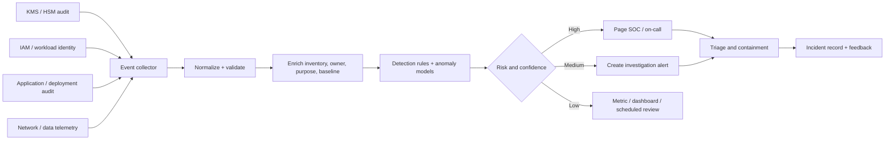

# Alert khi key bị lạm dụng

Alert khi key bị lạm dụng là cơ chế phát hiện và thông báo kịp thời những hành vi sử dụng khóa mật mã khác với mục đích, phạm vi hoặc nhịp hoạt động đã được phê duyệt. Mục tiêu là nhận ra việc truy cập trái phép, lạm dụng quyền hợp lệ, rò rỉ key material, thay đổi policy đáng ngờ và thao tác có thể làm mất khả năng giải mã hoặc xác minh dữ liệu.

Một lần gọi KMS thành công chưa chắc là an toàn. Attacker có thể chiếm workload identity hợp lệ rồi dùng quyền `Decrypt` hoặc `Sign` đúng API nhưng sai mục đích. Vì vậy, phát hiện cần kết hợp audit event từ KMS/HSM, identity provider, ứng dụng, control plane và hạ tầng; sau đó so sánh principal, key, operation, context, thời điểm, nguồn gọi và mức độ lệch khỏi baseline.

Trong quản lý khóa mật mã, alerting phải giúp đội vận hành trả lời được: ai đã dùng key, dùng key nào, thực hiện operation gì, kết quả ra sao, request đến từ đâu, có khớp workload/purpose/tenant không và cần containment nào. Alert phải đủ thông tin để triage nhưng không chứa password, plaintext, DEK, KEK, private key hoặc dữ liệu nhạy cảm.

## 1. Vì sao cần alert cho hành vi sử dụng key?

Key là tài sản có thể bảo vệ lượng dữ liệu lớn hoặc đại diện cho một danh tính có thẩm quyền. Một key bị lạm dụng có thể dẫn đến:

- Giải mã dữ liệu trái phép hoặc lấy plaintext DEK.
- Ký artifact, giao dịch hoặc thông điệp giả mạo.
- Tạo wrapped key ngoài tenant hoặc purpose được phép.
- Lạm dụng HMAC/MAC để tạo message authentication giả.
- Thay policy, tạo grant hoặc mở rộng quyền cho principal khác.
- Disable key, thay alias hoặc lên lịch xóa khiến dịch vụ mất khả năng hoạt động.
- Thử nhiều operation để dò key ID, kiểm tra quyền hoặc tìm đường truy cập.
- Dùng workload identity bị chiếm quyền để thực hiện operation hợp lệ về mặt API nhưng bất thường về nghiệp vụ.

Authorization policy ngăn nhiều request trái phép trước khi operation xảy ra. Alerting phát hiện cả những hành vi vượt qua authorization, những thay đổi control plane và các bất thường trong hành vi principal được cấp quyền. Hai lớp này bổ sung cho nhau.

## 2. Định nghĩa “key bị lạm dụng”

Key abuse là việc key hoặc quyền sử dụng key bị dùng ngoài mục đích, phạm vi, điều kiện hay mức hoạt động được chấp thuận. Nó không chỉ có nghĩa key material đã bị export.

| Dạng lạm dụng | Ví dụ | Tín hiệu có thể quan sát |
|---|---|---|
| Unauthorized access attempt | Principal thử decrypt key ngoài scope | Access denied, policy violation, unknown principal |
| Credential compromise | Attacker dùng workload identity bị đánh cắp | Principal hợp lệ nhưng source, device, region hoặc thời điểm bất thường |
| Excessive decrypt | Một service decrypt nhiều hơn baseline | Số operation, bytes hoặc số DEK tăng đột biến |
| Signing abuse | Signing key ký ngoài release window hoặc artifact lạ | Sign volume, caller, digest metadata, approval reference |
| Key export/extraction | Yêu cầu export hoặc thao tác có thể làm lộ key | Export request, unwrap, key retrieval, HSM attribute change |
| Policy tampering | Thay key policy, grant, role hoặc alias | Control-plane change event |
| Destructive operation | Disable, schedule deletion hoặc destroy key | State transition, deletion schedule, unusual actor |
| Cross-tenant use | Dùng key/context của tenant khác | Encryption context mismatch, resource/context inconsistency |
| Reconnaissance | Liệt kê key, describe metadata, thử nhiều alias | Metadata read burst, nhiều access denied, key enumeration pattern |
| Availability abuse | Gọi KMS dồn dập làm cạn quota | Throttling, latency, request rate, error burst |

Không phải mọi bất thường đều là tấn công. Một đợt backfill, rotation, disaster recovery hoặc deployment mới có thể làm tăng operation hợp lệ. Alert cần có context và quy trình xác minh thay vì tự động kết luận compromise.

## 3. Nguồn dữ liệu cần thu thập

Một hệ thống alerting tốt kết hợp nhiều nguồn. Audit của KMS/HSM cho biết operation đã được yêu cầu và thực hiện; dữ liệu ứng dụng giải thích nghiệp vụ; identity và deployment metadata giúp xác minh caller.

| Nguồn | Sự kiện cần lấy | Mục đích |
|---|---|---|
| KMS audit/control plane | Encrypt, Decrypt, Sign, GenerateDataKey, Wrap/Unwrap, key state, policy, grant, rotation, deletion | Nguồn chính cho key operation và thay đổi quản trị |
| HSM audit | Login, session, mechanism, key object, sign/decrypt, backup/restore, tamper/status | Xác minh operation trong hardware security boundary |
| IAM/identity provider | Role assumption, token issue/revoke, service identity, MFA, failed authentication | Liên kết operation với principal và credential lifecycle |
| Application audit | Business purpose, tenant, record class, approval, request ID | Phân biệt operation đúng nghiệp vụ với lạm dụng quyền hợp lệ |
| Network/security telemetry | Source IP, VPC/subnet, private endpoint, proxy, egress, device/workload location | Phát hiện nguồn gọi bất thường và truy cập ngoài boundary |
| Deployment/CI/CD | Release, rollout, job identity, maintenance window, config/policy change | Giảm false positive và phát hiện thay đổi không được duyệt |
| Certificate/PKI | Certificate issuance, renewal, revocation, signing profile | Theo dõi private key và trust change |
| Data platform | Tenant, data volume, access pattern, object/record count | Phát hiện decrypt/sign lệch với nghiệp vụ |

Thu thập dữ liệu theo nguyên tắc tối thiểu cần thiết. Không đưa plaintext, raw key, password, PIN, bearer token hoặc payload đầy đủ vào SIEM chỉ để tăng khả năng tìm kiếm.

## 4. Chuẩn hóa audit event

Các nguồn thường dùng tên field và schema khác nhau. Trước khi tạo detection rule, chuẩn hóa event về một schema chung để so sánh được giữa KMS, HSM, IAM và ứng dụng.

Các trường nên có:

| Field | Ý nghĩa | Ghi chú |
|---|---|---|
| `event_time` | Thời điểm xảy ra operation | Giữ timestamp gốc và timezone; đồng bộ clock |
| `ingest_time` | Thời điểm hệ thống nhận event | Dùng đo độ trễ ingest |
| `actor_id` | Principal/workload đã xác thực | Dùng stable ID, không chỉ display name |
| `actor_type` | User, role, workload, service principal | Hỗ trợ phân nhóm detection |
| `source` | KMS, HSM, IAM, application, control plane | Giữ nguồn gốc event |
| `action` | Operation chuẩn hóa | Ví dụ `DECRYPT`, `SIGN`, `PUT_KEY_POLICY` |
| `key_id` | Định danh key bất biến | Không chỉ dùng alias |
| `key_version` | Version/material version nếu có | Phân biệt rotation và lịch sử |
| `key_purpose` | Encrypt, sign, MAC, wrap, CA | Enrich từ inventory tin cậy |
| `result` | Success, denied, error, throttled | Không gộp tất cả lỗi thành một loại |
| `request_id` | Correlation ID từ KMS/HSM | Hỗ trợ tra cứu provider logs |
| `source_ip` | Địa chỉ nguồn nếu có | Kết hợp private endpoint/network metadata |
| `region` | Region/partition | Dùng phát hiện truy cập ngoài vị trí dự kiến |
| `workload_id` | Workload identity/deployment | Enrich từ IAM hoặc orchestrator |
| `environment` | Production, staging, development | Lấy từ inventory/deployment authority |
| `tenant_ref` | Tenant reference nếu được phép | Pseudonymize khi cần |
| `encryption_context_ref` | Context đã chuẩn hóa hoặc fingerprint | Không ghi secret/PII không cần thiết |
| `approval_ref` | Change/incident/release approval | Dùng xác minh thao tác đặc quyền |
| `bytes_or_items` | Khối lượng xử lý nếu nguồn cung cấp | Tránh ghi payload; dùng count/size metadata |

Không phải provider nào cũng phát mọi trường. Khi thiếu dữ liệu, giữ giá trị `unknown`/null và đưa vào quality metric; không tự suy đoán principal, tenant hoặc key purpose. Nên lưu raw event gốc trong kho audit được bảo vệ, còn detection dùng schema đã chuẩn hóa và enrichment có nguồn tin cậy.

## 5. Kiến trúc alerting end-to-end

Pipeline điển hình nhận audit event, chuẩn hóa, enrich, áp detection rule và chuyển alert tới đúng nhóm xử lý.



Pipeline phải giữ được event identity và correlation ID từ nguồn tới alert. Nếu collector drop event, timestamp sai hoặc enrichment dùng inventory cũ, detection có thể bỏ sót hoặc tạo false positive. Cần giám sát cả pipeline alerting, không chỉ operation mật mã.

## 6. Những tín hiệu cần phát hiện

Không có một rule duy nhất nhận ra mọi loại key abuse. Nên xây detection theo nhiều nhóm và kết hợp các tín hiệu liên quan.

### 6.1. Tần suất operation bất thường

- `Decrypt` tăng mạnh so với baseline của key/principal.
- Một workload gọi `GenerateDataKey` với số lượng lớn bất thường.
- `Sign` tăng đột biến hoặc xuất hiện ngoài release window.
- Một key nhận operation từ nhiều workload mới trong thời gian ngắn.
- Số bytes/items được xử lý vượt xa khối lượng nghiệp vụ dự kiến.

### 6.2. Principal hoặc nguồn gọi bất thường

- Principal mới dùng key production lần đầu.
- User role hoặc workload identity hiếm khi dùng key nhưng đột nhiên gọi operation nhạy cảm.
- Source IP, network, region hoặc private endpoint khác baseline.
- Workload identity gọi KMS từ namespace, cluster hoặc account không được phê duyệt.
- Một session/credential mới thực hiện operation trên nhiều key không liên quan.

### 6.3. Operation bất thường theo purpose

- Signing key bị dùng để decrypt hoặc operation không đúng key type/purpose.
- Key CA bị dùng ngoài certificate issuance workflow.
- KEK nhận `Encrypt`/`Decrypt` trực tiếp cho payload lớn thay vì wrap/unwrap DEK theo thiết kế.
- Key decrypt-only hoặc verify-only bị dùng để tạo dữ liệu mới.
- `ExportKey`, `GetPrivateKey` hoặc thao tác nhạy cảm tương đương xuất hiện.

### 6.4. Thay đổi control plane

- Key policy bị sửa ngoài change window.
- Grant hoặc role binding mới được tạo cho principal không thuộc inventory.
- Alias chuyển sang key khác ngoài rotation workflow.
- Key được enable/disable hoặc schedule deletion không có approval.
- Key attribute như extractable/sensitive/use flags thay đổi bất thường.
- Logging/audit trail bị tắt, đổi destination hoặc retention bị rút ngắn.

### 6.5. Lỗi và dấu hiệu dò quyền

- Nhiều `AccessDenied` trên nhiều key hoặc action trong thời gian ngắn.
- Một principal thử nhiều alias/key ID liên tiếp.
- Một workload gọi action ngoài allowlist của nó.
- Login/token issuance thất bại rồi có operation thành công bất thường.
- Throttling hoặc lỗi tăng đồng thời với lượng request lớn.

### 6.6. Sai lệch tenant hoặc context

- `tenant_ref` trong request không khớp owner của key.
- Encryption context thiếu field bắt buộc hoặc thay đổi đột ngột.
- Một workload dùng context của nhiều tenant ngoài scope được giao.
- Wrapped DEK được unwrap bởi service không thuộc data domain.

## 7. Phân loại detection theo mức độ

Severity nên phản ánh tác động tiềm tàng, độ tin cậy của tín hiệu và khả năng cần hành động ngay. Không nên đánh severity chỉ dựa trên một tên operation.

| Mức | Ví dụ | Xử lý gợi ý |
|---|---|---|
| Critical | Private key export, policy mở quyền rộng, key deletion không được duyệt, decrypt lớn từ principal có dấu hiệu compromise | Page SOC/on-call ngay; bắt đầu incident response và containment theo playbook |
| High | Decrypt/sign bất thường trên key nhạy cảm; principal production mới; grant lạ; cross-tenant context | Điều tra khẩn, xác minh owner/approval, cân nhắc revoke session/grant |
| Medium | Access denied burst, volume tăng vừa phải, operation ngoài giờ nhưng có thể là job hợp lệ | Tạo alert điều tra, đối chiếu deployment/maintenance và baseline |
| Low/Informational | Thay đổi định kỳ đã được phê duyệt, rotation thành công, event baseline | Dashboard, audit review hoặc thông báo change owner |

Mỗi tổ chức cần định nghĩa severity theo data classification, key purpose, blast radius, độ trễ ingest và khả năng phản ứng. Ví dụ `Decrypt` burst trên key chứa dữ liệu sức khỏe có thể cần severity cao hơn cùng mức tăng trên key test.

## 8. Thiết lập baseline cho từng key và principal

Baseline mô tả hoạt động bình thường theo key, principal, action, environment và thời gian. Một baseline toàn account thường quá thô: service batch và service interactive có nhịp hoạt động khác nhau.

Nên theo dõi các chiều:

- Operation count theo 5 phút/1 giờ/1 ngày.
- Số bytes, record hoặc data key được xử lý nếu có metadata đáng tin cậy.
- Số principal, source IP, region và workload mới.
- Tỷ lệ success/denied/error/throttled.
- Giờ hoạt động theo lịch service, batch và release.
- Phân bố operation theo key purpose và tenant.
- Số policy/grant/alias changes và người phê duyệt.
- Latency và quota utilization.

Baseline nên được xây dựng từ giai đoạn vận hành đã được xác minh là bình thường, loại trừ incident và test noise. Khi thay đổi lịch batch hoặc workload, cập nhật baseline qua change process có audit; không tự động học mọi thay đổi mới như hành vi hợp lệ vì attacker có thể đầu độc baseline.

## 9. Rule threshold và anomaly detection

Kết hợp rule xác định (deterministic) với anomaly detection. Rule xác định dễ giải thích và phù hợp sự kiện nguy hiểm rõ ràng; anomaly model phát hiện thay đổi khó mô tả bằng một ngưỡng cố định.

Ví dụ rule xác định:

- Alert ngay khi `ScheduleDeletion` hoặc `PutKeyPolicy` xuất hiện ngoài approved change window.
- Alert khi principal không nằm trong allowlist thực hiện `Decrypt` hoặc `Sign` trên production key.
- Alert khi có request `ExportKey` đối với key được policy đánh dấu non-exportable.
- Alert khi một workload truy cập key của tenant khác.
- Alert khi audit logging bị tắt hoặc event delivery bị gián đoạn.

Ví dụ anomaly:

- `Decrypt` count cao hơn nhiều lần median theo cùng giờ/ngày trong baseline.
- Số key distinct mà principal truy cập tăng đột ngột.
- Operation rate lệch khỏi chu kỳ batch thông thường.
- Principal dùng key từ region hoặc network segment chưa từng thấy.
- Tỷ lệ AccessDenied tăng nhanh rồi chuyển sang Success.

Không dùng một threshold chung như “100 decrypt/giờ” cho mọi key. Ngưỡng phải dựa trên baseline, sensitivity, throughput, tenant size, batch schedule và khả năng xử lý alert. Các con số trong ví dụ rule chỉ để minh họa cách viết điều kiện; cần hiệu chỉnh bằng dữ liệu vận hành.

## 10. Correlation: kết hợp nhiều tín hiệu

Một tín hiệu riêng lẻ có thể không đủ để kết luận. Correlation tăng độ tin cậy bằng cách ghép các event có cùng principal, key, session, request ID hoặc khoảng thời gian.

Ví dụ chuỗi đáng ngờ:

1. Một workload identity nhận token từ source IP chưa từng xuất hiện.
2. Principal thử `DescribeKey` trên nhiều key.
3. Nhiều request `Decrypt` bị deny.
4. Một request `Decrypt` thành công trên key production.
5. Số bytes/DEK được xử lý tăng mạnh.

Từng event có thể có giải thích riêng; chuỗi này tạo tín hiệu compromise mạnh hơn. Một chuỗi khác là thay key policy, tạo grant mới, rồi dùng grant đó để decrypt hoặc sign. Detection cần giữ quan hệ giữa actor thực hiện thay đổi và actor dùng key sau đó.

Correlation phải xử lý event đến trễ, trùng lặp và clock skew. Dùng event time cho phân tích hành vi, ingest time để đo độ trễ; deduplicate theo event ID/request ID khi nguồn hỗ trợ.

## 11. Ví dụ rule cấu hình

YAML sau mô tả detection logic ở mức khái niệm, không phải schema của SIEM cụ thể:

```yaml
rules:
  - id: key-policy-change-outside-window
    severity: critical
    match:
      action: PUT_KEY_POLICY
      environment: production
    condition:
      approved_change_ref: missing
    response:
      - page_security_oncall
      - preserve_control_plane_audit

  - id: unexpected-decrypt-principal
    severity: high
    match:
      action: DECRYPT
      environment: production
    condition:
      actor_id_not_in_key_allowlist: true
    response:
      - alert_key_owner
      - correlate_identity_events

  - id: decrypt-volume-anomaly
    severity: high
    match:
      action: DECRYPT
      group_by: [key_id, actor_id]
      window: 10m
    condition:
      count_above_dynamic_baseline: true
      or_bytes_above_dynamic_baseline: true
    response:
      - create_security_investigation

  - id: key-deletion-without-approval
    severity: critical
    match:
      action: SCHEDULE_DELETION
    condition:
      approval_ref: missing
    response:
      - page_security_oncall
      - notify_key_custodian
```

Detection engine cần hiểu semantics của `missing`, null và giá trị không được ingest. Không coi trường approval bị thiếu do pipeline lỗi là bằng chứng chắc chắn không có approval; có thể tạo alert về data quality đồng thời nâng cấp điều tra.

## 12. Ví dụ truy vấn SIEM dạng giả lập

Truy vấn sau minh họa cách tìm principal có số lần decrypt tăng bất thường trong cửa sổ 10 phút. Cú pháp là pseudo-SQL, cần chuyển đổi sang SPL/KQL/SQL của hệ thống thực tế.

```sql
SELECT
    key_id,
    actor_id,
    COUNT(*) AS decrypt_count,
    COUNT(DISTINCT source_ip) AS source_count
FROM normalized_key_events
WHERE action = 'DECRYPT'
  AND result = 'SUCCESS'
  AND event_time >= CURRENT_TIMESTAMP - INTERVAL '10' MINUTE
GROUP BY key_id, actor_id
HAVING COUNT(*) > baseline_decrypt_count(key_id, actor_id, '10m') * 5
   OR COUNT(DISTINCT source_ip) > 3;
```

Hệ số `5` và source count `3` chỉ là ví dụ minh họa, không phải ngưỡng production. Hàm `baseline_decrypt_count` cũng là hàm giả lập; hệ thống thực cần lưu baseline theo khung giờ, ngày trong tuần, environment và workload schedule. Tránh alert chỉ dựa trên `COUNT(*)` khi một retry hợp lệ có thể tạo nhiều event.

Một truy vấn khác tìm thay đổi policy hoặc grant ngoài change window:

```sql
SELECT event_time, actor_id, action, key_id, request_id
FROM normalized_key_events
WHERE action IN ('PUT_KEY_POLICY', 'CREATE_GRANT', 'UPDATE_GRANT')
  AND environment = 'production'
  AND approved_change_ref IS NULL;
```

Nếu approval metadata đến từ hệ thống khác, cần join bằng change ID đã xác thực và xử lý event đến trễ. Không bỏ qua event chỉ vì approval chưa kịp ingest; có thể đưa vào trạng thái pending correlation trong khoảng thời gian giới hạn rồi nâng severity nếu không xác minh được.

## 13. Alert về policy, grant và thay đổi key state

Thay đổi control plane thường có tác động lớn vì nó thay đổi ai có thể dùng key trong tương lai.

Nên cảnh báo khi:

- Key policy thêm principal mới hoặc mở rộng resource/action wildcard.
- Grant mới cấp `Decrypt`, `Sign`, `UnwrapKey` hoặc operation nhạy cảm.
- Principal tự cấp quyền cho chính mình hoặc thay policy để mở đường truy cập.
- Alias trỏ sang key khác không khớp rotation plan.
- Key chuyển sang enabled/disabled ngoài change window.
- Key được schedule deletion hoặc deletion window bị thay đổi.
- Key attributes thay đổi theo hướng exportable hoặc mở thêm usage.
- Audit trail, retention hoặc event destination bị sửa/tắt.

Alert nên chứa diff đã được làm sạch: principal thêm/bớt, action thay đổi, resource scope, policy version và approval reference. Không đưa credential hoặc secret trong policy document vào notification.

## 14. Alert về signing key

Signing key có thể được dùng để tạo artifact hoặc transaction mà consumer tin cậy. Một signing key bị lạm dụng có thể gây thiệt hại dù private key chưa bao giờ được export.

Detection cần quan sát:

- Số lần ký theo release pipeline, repository, project hoặc tenant.
- Principal và workload identity gọi `Sign`.
- Artifact type, digest reference hoặc approval reference đã được kiểm soát.
- Thời điểm ký so với release schedule.
- Key version/certificate serial được dùng.
- Signing request bị deny hoặc sử dụng algorithm/parameter ngoài profile.
- Key được dùng từ region/runner chưa được phê duyệt.

Không nhất thiết lưu nội dung artifact trong SIEM. Dùng artifact ID, digest reference hoặc build provenance đã được phân loại. Nếu ký giao dịch, cần correlation với transaction ID và approval system.

## 15. Alert về decrypt và envelope encryption

Với envelope encryption, KMS audit có thể cho biết thao tác `Decrypt`/`UnwrapKey` trên KEK nhưng không nhất thiết biết record hoặc tenant cuối cùng nếu context không được gửi hoặc audit không ghi nhận.

Để phát hiện lạm dụng:

- Bắt buộc application gửi encryption context có purpose/resource/tenant theo schema.
- Ghi wrapped DEK reference và key ID/version trong application audit, không ghi plaintext DEK.
- So sánh `Decrypt`/`UnwrapKey` count với số record đọc hoặc job được phê duyệt.
- Phát hiện một workload unwrap nhiều DEK thuộc nhiều tenant ngoài scope.
- Theo dõi decrypt từ key version đã retire hoặc ngoài decrypt-only window.
- Phát hiện KMS operation không có request ID tương ứng trong application audit.
- Correlate KMS request ID với application request ID nếu SDK/API hỗ trợ metadata.

Không phải mọi KMS đều ghi encryption context đầy đủ vào audit event; có thể cần fingerprint hoặc application-side reference. Nếu context chứa PII, pseudonymize hoặc chỉ ghi trường cần thiết.

## 16. Alert về HSM

HSM có thể phát ra audit event riêng về login, session, mechanism và key object. Những event cần chú ý:

- Login thất bại lặp lại, PIN lock hoặc login từ host/session mới.
- Thao tác sign/decrypt ngoài workload hoặc application allowlist.
- Key object thay đổi attribute như sensitive, extractable hoặc usage flags.
- Key import/export, backup/restore hoặc cloning ngoài ceremony đã duyệt.
- HSM partition, security domain, quorum hoặc role thay đổi.
- Tamper alarm, device reset, firmware update hoặc audit logging interruption.
- Session count, operation rate hoặc latency bất thường.

Tên event và mức độ chi tiết phụ thuộc vendor/firmware. Chuẩn hóa event nhưng giữ raw vendor code để điều tra. Không giả định HSM luôn phát hiện được việc ứng dụng lạm dụng một operation hợp lệ; cần correlate identity và business context bên ngoài thiết bị.

## 17. Alert delivery và chống alert fatigue

Alert không có người nhận, không có owner hoặc bị lặp quá nhiều sẽ mất giá trị. Mỗi rule cần xác định owner, severity, channel, SLA, runbook và điều kiện đóng.

| Thành phần | Cách thiết kế |
|---|---|
| Routing | Theo key owner, service owner, severity và environment |
| Deduplication | Gom event cùng key/principal/rule trong cửa sổ thời gian |
| Suppression | Chỉ suppress khi có change/maintenance reference hợp lệ và expiry |
| Escalation | Tăng cấp khi không acknowledge trong SLA hoặc có thêm tín hiệu compromise |
| Enrichment | Thêm key purpose, owner, data class, workload, change reference và runbook link |
| Notification | Pager cho critical/high; ticket/chat/dashboard cho mức thấp hơn theo policy |
| Closure | Ghi disposition: true positive, benign change, false positive hoặc data-quality issue |

Không suppress toàn bộ operation trong maintenance window. Giới hạn suppression theo principal, key, action và thời gian; vẫn alert nếu có hành vi ngoài scope hoặc key state destructive.

## 18. False positive và tuning rule

False positive thường đến từ rotation, backfill, batch job, disaster recovery, release, scale-out hoặc thay đổi network. Cần enrich detection với lịch hoạt động và change management.

Quy trình tuning:

1. Thu thập mẫu event và xác định baseline bình thường.
2. Gắn owner và purpose cho key/principal.
3. Kiểm tra change/release/batch schedule.
4. Tách rule theo key class và workload type.
5. Dùng threshold động hoặc nhiều tín hiệu thay vì một ngưỡng cố định.
6. Suppress có thời hạn và scope hẹp cho hoạt động đã duyệt.
7. Theo dõi false-positive rate và missed detection từ exercise.
8. Review rule sau mỗi thay đổi key policy, architecture hoặc KMS provider.

Không hạ severity chỉ để giảm số alert. Nếu một rule tạo quá nhiều false positive, cải thiện enrichment hoặc điều kiện; giữ alert critical cho event có impact lớn như key deletion ngoài phê duyệt.

## 19. Triage khi nhận alert

Người nhận alert cần có thông tin đủ để xác minh nhanh mà không phải tìm thủ công qua nhiều hệ thống.

Các câu hỏi đầu tiên:

- Key này bảo vệ dữ liệu hoặc danh tính nào? Owner và data class là gì?
- Principal thực tế là ai? Workload/session/token được tạo khi nào?
- Operation nào, trên key ID/version nào, thành công hay bị deny?
- Request đến từ source IP, region, network và deployment nào?
- Có release, batch, rotation, backup, recovery hoặc change approval liên quan không?
- Đây có phải pattern bình thường của principal/key trong cùng time window không?
- Có event policy/grant/alias change trước đó không?
- Có operation tương tự trên key/tenant khác không?
- Có bằng chứng raw key material bị export hoặc plaintext đã bị truy cập không?

Không kết luận false positive chỉ vì principal hợp lệ. Credential hợp lệ có thể bị chiếm; cần xác minh session, source, workload integrity và business request.

## 20. Runbook containment khi nghi ngờ key abuse

Containment cần cân bằng giữa ngăn attacker và giữ khả năng giải mã/khôi phục. Không tự động disable mọi key khi thấy một anomaly chưa xác minh.

1. **Preserve evidence:** giữ KMS/HSM/IAM audit, request ID, policy version, identity event và application correlation trong kho được bảo vệ.
2. **Validate scope:** xác định key, principal, operation, tenant, thời gian và data class bị ảnh hưởng.
3. **Contain identity:** revoke session/token, disable workload identity hoặc thu hồi grant khi có bằng chứng compromise.
4. **Block operation:** thu hẹp policy hoặc explicit deny operation đáng ngờ theo incident plan; xác minh propagation.
5. **Protect key state:** cân nhắc disable key nếu có nguy cơ tiếp tục bị lạm dụng và đã đánh giá ảnh hưởng tới decrypt/verify/backup.
6. **Rotate/recover:** tạo key mới, thay certificate/credential hoặc rewrap/re-encrypt dữ liệu tùy loại key và mức compromise.
7. **Check downstream:** rà soát plaintext, artifact, signature, wrapped DEK, backup và consumer đã bị truy cập.
8. **Hunt:** tìm cùng principal/session/source trên key khác và các operation liên quan.
9. **Restore safely:** chỉ mở lại quyền theo policy đã review, key version đã xác minh và workload sạch.
10. **Document:** ghi timeline, impact, decision, owner, false-positive/true-positive và action khắc phục.

Nếu raw key material đã bị lộ, revoke quyền sử dụng trong KMS không thu hồi được bản sao attacker đã lấy. Cần xử lý như key compromise, rotate/revoke và đánh giá re-encryption hoặc certificate trust. Nếu chỉ một workload bị chiếm nhưng key non-exportable, vẫn phải thu hồi identity/operation permission vì attacker có thể tiếp tục gọi key.

## 21. Tự động phản ứng: khi nào nên và không nên

Một số action có thể tự động hóa an toàn hơn, ví dụ tạo ticket, enrich owner, revoke một short-lived session theo policy hoặc tạm dừng job đã xác định. Các action phá hủy như disable key, schedule deletion hoặc rotate key hàng loạt có thể gây outage hoặc mất khả năng giải mã.

| Action | Mức tự động hóa gợi ý | Điều kiện |
|---|---|---|
| Tạo alert/ticket và enrich | Tự động | Không làm thay đổi quyền/key state |
| Thu thập audit evidence | Tự động | Kho lưu trữ bảo vệ integrity/access |
| Revoke short-lived session | Có thể tự động | Identity đã xác minh, playbook được duyệt, rollback rõ |
| Tạm dừng CI job hoặc release | Có thể tự động | Correlation với pipeline ID và policy |
| Tạo explicit deny tạm thời | Thận trọng | Scope nhỏ, expiry, dual control hoặc approval theo severity |
| Disable key | Thường cần incident authority | Đánh giá tác động decrypt/verify và recovery |
| Schedule deletion/destroy | Không tự động từ anomaly đơn lẻ | Approval, dual control, retention/recovery review |
| Rotate/re-encrypt dữ liệu | Theo runbook | Đã xác định key compromise và consumer impact |

Không để anomaly model tự ý xóa key hoặc rotate toàn bộ key chỉ dựa trên điểm số. Tự động hóa cần idempotency, audit, timeout, expiry và cơ chế dừng khi dữ liệu detection không đầy đủ.

## 22. Ví dụ Java: audit event an toàn cho key operation

Ứng dụng có thể phát business audit event để bổ sung ngữ cảnh mà KMS không biết. Event chỉ chứa metadata được phép, không chứa key material hoặc plaintext.

```java
import java.time.Instant;

public record KeyOperationEvent(
    Instant eventTime,
    String actorId,
    String workloadId,
    String action,
    String keyId,
    String keyVersion,
    String purpose,
    String tenantRef,
    String requestId,
    String result,
    String approvalRef
) {}
```

Ví dụ tạo event sau operation:

```java
KeyOperationEvent event = new KeyOperationEvent(
    Instant.now(),
    authenticatedPrincipalId,
    "orders-api-prod",
    "DECRYPT",
    "orders-data-kek",
    "v7",
    "order-record-encryption",
    pseudonymousTenantRef,
    requestId,
    "SUCCESS",
    null
);

auditPublisher.publish(event);
```

Các biến phải đến từ nguồn đã xác minh. Không lấy `actorId`, `tenantRef`, `keyId` hoặc `approvalRef` trực tiếp từ request body mà không kiểm tra. `auditPublisher` cần gửi tới pipeline có authentication, retry, integrity và monitoring; nếu audit bắt buộc cho operation nhạy cảm, định nghĩa hành vi khi audit sink unavailable trước khi triển khai.

`Instant.now()` lấy thời gian từ clock của process; hệ thống phân tán cần đồng bộ clock và ưu tiên timestamp từ KMS/HSM audit cho thời điểm operation. Nên giữ cả source event ID và request ID để correlate.

## 23. Ví dụ Java: phát hiện volume tăng theo cửa sổ

Ví dụ sau minh họa cách đếm operation thành công theo key và principal trong một cửa sổ thời gian. Production detection thường chạy trong stream processor/SIEM, không nên giữ toàn bộ state trong một JVM instance nếu có nhiều replica.

Ví dụ dùng Java record (Java 16 trở lên) và các collection chuẩn.

```java
import java.time.Duration;
import java.time.Instant;
import java.util.ArrayDeque;
import java.util.Deque;
import java.util.HashMap;
import java.util.Map;

record CounterKey(String keyId, String actorId) {}

final class DecryptWindowCounter {
    private final Duration window;
    private final Map<CounterKey, Deque<Instant>> events = new HashMap<>();

    DecryptWindowCounter(Duration window) {
        this.window = window;
    }

    synchronized int record(
            String keyId, String actorId, Instant eventTime) {
        CounterKey key = new CounterKey(keyId, actorId);
        Deque<Instant> timestamps = events.computeIfAbsent(
            key, ignored -> new ArrayDeque<>()
        );

        Instant cutoff = eventTime.minus(window);
        while (!timestamps.isEmpty()
                && timestamps.peekFirst().isBefore(cutoff)) {
            timestamps.removeFirst();
        }
        timestamps.addLast(eventTime);
        return timestamps.size();
    }
}
```

Đây là ví dụ giáo dục. Nó giả định event đến theo thứ tự thời gian; production phải xử lý out-of-order event, duplicate, event time vs ingest time, state eviction, memory bound, partitioning và clock skew. Cần đếm riêng success/denied/error; không trộn các result thành một metric.

Không đặt một ngưỡng cố định trong class này. Detection service cần lấy threshold/baseline theo key class, principal, time-of-day, environment và business schedule. Khi vượt ngưỡng, phát signal có evidence thay vì tự disable key.

## 24. Metrics để đánh giá hiệu quả alerting

Alerting cần được đo lường như một hệ thống vận hành:

| Metric | Ý nghĩa | Cách dùng |
|---|---|---|
| Event ingestion delay | Độ trễ từ event time tới ingest | Phát hiện pipeline chậm hoặc mất event |
| Event coverage | Tỷ lệ operation/key có audit event | Tìm nguồn chưa bật audit hoặc thiếu permission |
| Detection latency | Thời gian từ event tới alert | Đánh giá khả năng phát hiện kịp thời |
| Mean time to acknowledge (MTTA) | Thời gian người nhận xác nhận alert | Đo khả năng trực và routing |
| Mean time to contain (MTTC) | Thời gian containment | Đo hiệu quả runbook/authority |
| True-positive rate | Alert đúng trên tổng alert đã xác minh | Đánh giá chất lượng rule |
| False-positive rate | Alert sai trên tổng alert đã xác minh | Hướng tuning/enrichment |
| Missed detection | Hành vi trong exercise/incident không tạo alert | Tìm gap detection |
| Alert volume per owner | Số alert mỗi key/service owner | Phát hiện alert fatigue |
| Audit completeness | Tỷ lệ event có actor/action/key/result đầy đủ | Kiểm soát chất lượng evidence |

Không tối ưu chỉ để giảm false positive; điều đó có thể làm tăng missed detection. Đánh giá theo use case và impact, đồng thời chạy purple-team/tabletop exercise để kiểm tra rule.

## 25. Kiểm thử detection và diễn tập

Detection rule cần được kiểm tra với event mô phỏng và hành vi hợp lệ.

- **Positive tests:** decrypt burst, principal mới, policy tampering, grant bất thường, key deletion ngoài approval, cross-tenant context.
- **Negative tests:** batch job đã duyệt, rotation, backup/restore, release signing, disaster recovery và retry bình thường.
- **Correlation tests:** identity anomaly + denied burst + successful decrypt; policy change + grant + sign.
- **Pipeline tests:** duplicate event, delayed event, missing field, malformed event, collector outage và clock skew.
- **Response tests:** alert routing, escalation, runbook link, session revoke, key owner notification và evidence preservation.
- **Recovery tests:** xác minh key không bị disable/xóa ngoài ý muốn; restore và decrypt lịch sử vẫn hoạt động.

Chỉ dùng test key và dữ liệu giả trong exercise. Không tạo hành vi destructive trên production key thật để chứng minh alert. Nếu cần kiểm tra production pipeline, dùng test principal/key được cô lập, scope và approval rõ.

## 26. Tình huống thực tế: workload bị chiếm và decrypt bất thường

Một dịch vụ Orders có quyền `Decrypt` trên KEK dùng để unwrap DEK cho dữ liệu giao dịch. Attacker khai thác SSRF và lấy được quyền gọi metadata endpoint, sau đó sử dụng workload identity của `orders-api` để gọi KMS. Vì principal hợp lệ và policy cho phép `Decrypt`, KMS không từ chối request.

Hệ thống alert phát hiện ba tín hiệu: source network mới, số lượng `Decrypt` thành công cao hơn baseline của workload và số tenant context distinct tăng mạnh. Correlation engine liên kết request với một session vừa được cấp từ source bất thường. Alert High được gửi tới SOC và owner Orders, kèm key ID/version, operation IDs, workload identity, time window và runbook.

Đội phản ứng bảo toàn audit, revoke session/workload credential, thu hẹp quyền decrypt trong thời gian điều tra và xác minh các DEK/tenant bị truy cập. Họ không xóa KEK ngay vì dữ liệu lịch sử vẫn phụ thuộc key; sau khi xác định phạm vi compromise, nhóm rotate workload identity, đánh giá DEK/ciphertext bị lộ và triển khai key/policy mới. Negative test được bổ sung để phát hiện source network mới và tenant fan-out bất thường.

Tình huống cho thấy authorization hợp lệ không thay thế behavior monitoring. Alert cần nhận ra một principal đang dùng đúng API nhưng sai bối cảnh và khối lượng.

## 27. Lỗi thường gặp khi xây dựng alert key abuse

- **Chỉ alert AccessDenied:** bỏ sót attacker dùng credential hợp lệ và operation thành công.
- **Chỉ theo dõi volume toàn account:** không nhận ra lệch baseline của từng key/principal.
- **Không có inventory key owner/purpose:** alert không biết operation nào là bất thường.
- **Không correlate IAM và application event:** thiếu context về session, tenant và business request.
- **Ngưỡng cố định cho mọi key:** gây false positive hoặc bỏ sót workload có baseline khác.
- **Tin mọi event có approval là an toàn:** approval có thể sai scope hoặc bị compromise.
- **Không phát hiện control-plane change:** attacker mở quyền trước rồi mới dùng key.
- **Không giám sát audit pipeline:** mất event nhưng dashboard vẫn trông bình thường.
- **Tự động disable key từ anomaly đơn lẻ:** có thể gây outage hoặc mất khả năng giải mã.
- **Alert không có owner/runbook:** không ai biết cần xử lý thế nào.
- **Suppress quá rộng:** maintenance window che cả hành vi ngoài scope.
- **Ghi secret vào alert:** notification nhân bản key material tới email/chat/ticket.
- **Không xử lý event đến trễ/trùng:** tạo đếm sai và correlation sai.
- **Không diễn tập:** rule tồn tại nhưng không ai xác nhận routing và containment hoạt động.

## 28. Checklist triển khai alert khi key bị lạm dụng

- [ ] KMS/HSM audit được bật cho operation và control-plane event quan trọng.
- [ ] IAM, workload identity, application, deployment và network event được correlate.
- [ ] Event schema có actor, action, key ID/version, result, timestamp và request ID.
- [ ] Inventory có owner, purpose, environment, data class và principal allowlist.
- [ ] Detection theo dõi decrypt/sign/wrap/unwrap/generate volume và operation ngoài purpose.
- [ ] Detection theo dõi principal/source/region/workload mới và cross-tenant context.
- [ ] Policy, grant, alias, key state, attribute và audit configuration changes được alert.
- [ ] Có baseline riêng theo key, principal, action, environment và lịch workload.
- [ ] Rule threshold được hiệu chỉnh bằng dữ liệu và có owner phê duyệt.
- [ ] Correlation xử lý event trễ, trùng, clock skew và missing fields.
- [ ] Severity, routing, deduplication, suppression và escalation được định nghĩa.
- [ ] Alert chứa đủ metadata và runbook nhưng không chứa secret/plaintext/key material.
- [ ] Runbook có preserve evidence, validate scope, contain identity, block operation và recovery.
- [ ] Tự động hóa không disable/delete key từ anomaly đơn lẻ nếu chưa có policy rõ.
- [ ] Event ingestion, coverage, detection latency, MTTA/MTTC và false positive được đo.
- [ ] Positive/negative/correlation/pipeline/response tests đã chạy.
- [ ] Tabletop hoặc purple-team exercise xác minh detection và containment.
- [ ] Alert disposition và feedback được dùng để cải thiện rule, không đầu độc baseline tự động.

## 29. Câu hỏi tự kiểm tra

1. Key abuse khác với việc raw key material bị export như thế nào?
2. Vì sao một operation KMS thành công vẫn có thể là hành vi lạm dụng?
3. Những nguồn event nào cần kết hợp để phát hiện key abuse?
4. Một normalized key event cần những trường nào?
5. Những pattern nào có thể chỉ ra decrypt hoặc sign bất thường?
6. Vì sao cần alert control-plane changes như key policy, grant và alias?
7. Baseline nên được phân tách theo những chiều nào?
8. Khi nào dùng deterministic rule và khi nào dùng anomaly detection?
9. Vì sao không nên áp dụng một threshold chung cho mọi key?
10. Correlation giữa identity anomaly, denied burst và successful decrypt giúp gì?
11. Làm sao phát hiện cross-tenant misuse trong envelope encryption?
12. Những event HSM nào có thể báo hiệu key object hoặc security boundary bị thay đổi?
13. Severity nên dựa trên những yếu tố nào?
14. Deduplication và suppression khác nhau ra sao?
15. Khi nhận alert High, cần xác minh những gì trước khi containment?
16. Vì sao không nên tự động disable key từ anomaly score đơn lẻ?
17. Khi private key đã bị export, revoke quyền KMS có giải quyết được không?
18. Metrics nào phản ánh chất lượng alerting và pipeline audit?
19. Làm sao kiểm thử detection mà không gây ảnh hưởng production key?
20. Một alert hữu ích cần chứa metadata gì và phải tránh dữ liệu nào?

Alert khi key bị lạm dụng cần phát hiện cả request bị từ chối lẫn operation thành công nhưng lệch khỏi purpose, principal, context hoặc baseline. Khi audit event được chuẩn hóa, enrichment dựa trên inventory tin cậy, detection kết hợp rule và baseline, alert có owner/runbook và containment được diễn tập, tổ chức có thể nhận ra sớm việc lạm dụng key mà vẫn giữ được khả năng giải mã, xác minh và phục hồi dịch vụ.
