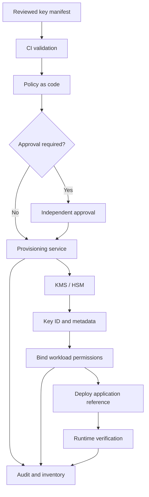
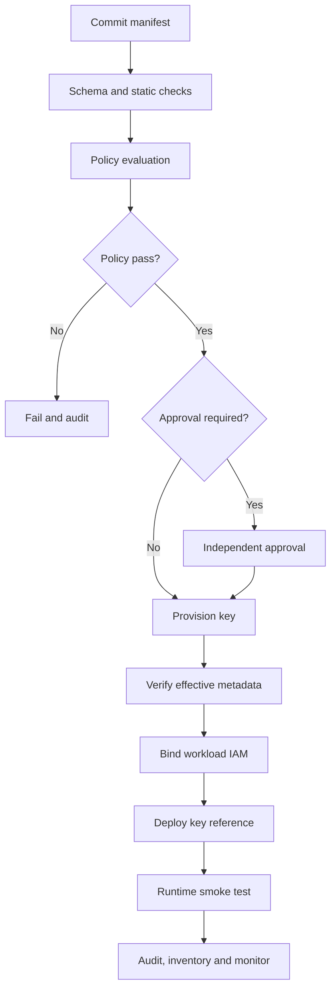

# Key deployment pipeline

## Mục tiêu học tập

Sau bài học này, bạn có thể:

- Giải thích vai trò của pipeline triển khai key trong vòng đời quản lý khóa mật mã.
- Phân biệt triển khai key resource với triển khai ứng dụng có tham chiếu tới key.
- Mô hình hóa key specification và desired state dưới dạng cấu hình có kiểm soát.
- Xây dựng các bước validate, approve, provision, bind permission, deploy và verify.
- Dùng workload identity và credential ngắn hạn cho CI/CD thay cho secret tĩnh.
- Tích hợp KMS/HSM, IaC, Kubernetes và Java runtime mà không đưa raw key vào artifact hoặc configuration.
- Thiết kế idempotency, retry, rollback, rotation và drift detection.
- Bảo đảm audit, separation of duties, kiểm thử và runbook cho vận hành production.

## 1. Key deployment pipeline là gì?

Key deployment pipeline là quy trình tự động, có kiểm soát để đưa một key resource vào trạng thái sẵn sàng phục vụ một workload. Quy trình có thể bao gồm kiểm tra yêu cầu, phê duyệt, tạo hoặc import key, áp dụng policy, cấp quyền cho workload, triển khai tham chiếu key và xác minh hoạt động.

Pipeline này thuộc phạm vi quản lý vòng đời khóa. Nó kết nối quy trình phát triển phần mềm với KMS/HSM, IAM, hệ thống cấu hình, audit và vận hành. Mục tiêu là tạo ra trạng thái nhất quán, có thể tái lập và truy vết được.

Triển khai key không có nghĩa chép raw key vào máy chủ ứng dụng. Trong nhiều kiến trúc, pipeline chỉ tạo key trong KMS/HSM, sau đó cấp cho ứng dụng một key ID, alias hoặc URI để yêu cầu phép toán được phép. Key material tiếp tục nằm trong cryptographic boundary.

## 2. Phân biệt triển khai key và triển khai ứng dụng

Hai pipeline có liên quan nhưng quản lý các tài sản khác nhau:

| Pipeline | Đầu vào chính | Kết quả |
|---|---|---|
| Key deployment | Key specification, owner, purpose, policy, environment | Key resource, key reference, access policy, audit evidence |
| Application deployment | Source code, build artifact, runtime configuration | Phiên bản ứng dụng được triển khai và workload identity |

Ứng dụng có thể được deploy nhiều lần mà không cần tạo key mới mỗi lần. Ngược lại, key có thể được provision hoặc rotate độc lập với release ứng dụng. Cần version hóa key reference và cấu hình để hai quy trình phối hợp mà không buộc key material đi theo artifact.

## 3. Desired state và actual state

Pipeline thường bắt đầu từ một mô tả desired state: key nào cần tồn tại, thuộc owner nào, dùng thuật toán gì, purpose nào, được phép thực hiện operation nào và workload nào được sử dụng.

Actual state là trạng thái thật của KMS/HSM và hệ thống IAM: key resource đã tồn tại chưa, version nào active, attributes ra sao, policy có đúng không và workload có quyền thực tế nào.

Automation so sánh hai trạng thái và thực hiện thay đổi cần thiết. Nếu key đã tồn tại với cấu hình đúng, pipeline nên nhận diện trạng thái đó thay vì tạo key thứ hai. Nếu actual state lệch policy, pipeline cần báo drift hoặc đưa resource về trạng thái an toàn theo quy trình được phê duyệt.

Không nên tự động sửa mọi khác biệt một cách mù quáng. Một key đang được dùng để giải mã dữ liệu cũ có thể không được phép destroy chỉ vì manifest mới không còn khai báo nó.

## 4. Các thành phần và ranh giới tin cậy

Một pipeline triển khai key có thể gồm:

- Requester khai báo nhu cầu và owner.
- Source repository lưu manifest/policy đã review.
- CI runner kiểm tra cấu hình và build artifact.
- Policy engine xác thực algorithm, key size, purpose và environment.
- Approver xác nhận thao tác nhạy cảm.
- Provisioning service gọi KMS/HSM để tạo hoặc import key.
- IAM/policy service cấp quyền cho workload identity.
- Deployment system đưa key reference vào runtime configuration.
- Audit/monitoring lưu bằng chứng và phát hiện bất thường.



CI runner không nên có quyền rộng để export mọi key. Provisioning identity, workload identity, policy administrator và auditor cần được tách theo nhiệm vụ.

## 5. Key specification và manifest

Manifest mô tả yêu cầu tạo và vận hành key. Những trường thường cần có:

| Trường | Ý nghĩa |
|---|---|
| `keyName` / `keyAlias` | Tên định danh dễ quản trị |
| `environment` | Development, staging hoặc production |
| `owner` | Team/service chịu trách nhiệm |
| `purpose` | Mục đích nghiệp vụ và cryptographic purpose |
| `keyType` | Symmetric, asymmetric, HMAC hoặc loại phù hợp |
| `algorithm` / `keySize` | Thuật toán và strength được yêu cầu |
| `allowedUsages` | Encrypt, decrypt, sign, verify, wrap, unwrap, derive |
| `origin` | Generated, imported hoặc derived |
| `exportable` | Có cho phép export theo policy hay không |
| `rotationPolicy` | Chu kỳ hoặc điều kiện rotation |
| `region` / `partition` | Vị trí KMS/HSM được phép |
| `workloadIdentity` | Principal được phép sử dụng key |
| `retention` | Quy tắc giữ, disable và destruction |

Manifest không chứa password, PIN, raw key bytes, private key PEM, seed hoặc credential của KMS. Các giá trị secret đầu vào cho import phải đi qua quy trình riêng được bảo vệ, có wrapping và approval theo policy.

## 6. Version hóa manifest và thay đổi có review

Manifest nên được lưu trong source control cùng lịch sử thay đổi. Pull request hoặc change request cần nêu:

- Lý do cần key mới hoặc thay đổi key hiện tại.
- Owner, workload, tenant và data domain liên quan.
- Thay đổi algorithm, size, usage hoặc exportability.
- Tác động tới dữ liệu hiện hữu và khả năng tương thích.
- Rotation, backup, recovery và retirement plan.
- Approval của security/key owner nếu policy yêu cầu.

Không để CI tự suy ra purpose từ tên branch hoặc tên ứng dụng. Purpose và owner phải là dữ liệu được review và kiểm tra bằng policy.

## 7. Policy as code và preflight validation

Trước khi gọi KMS/HSM, pipeline phải kiểm tra manifest với baseline bảo mật.

Ví dụ các rule:

- Chỉ cho phép algorithm và key size trong allowlist.
- Key production phải có owner và purpose hợp lệ.
- Signing key không được dùng cho data encryption.
- Key nhạy cảm phải non-exportable nếu provider hỗ trợ và policy yêu cầu.
- Workload identity phải thuộc đúng environment và tenant.
- Region/partition phải nằm trong danh sách được phép.
- Production key creation hoặc import có thể cần approval độc lập.
- Rotation và retirement policy phải được khai báo.

Policy validation nên fail closed khi policy engine không sẵn sàng hoặc không thể xác định rule áp dụng. Không dùng cảnh báo dạng warning cho một vi phạm mà policy production yêu cầu từ chối.

## 8. Workload identity cho CI/CD

CI runner cần xác thực với provisioning service hoặc KMS. Ưu tiên workload identity federation/OIDC hoặc cơ chế credential ngắn hạn được nền tảng hỗ trợ.

Lợi ích:

- Không phải lưu cloud access key dài hạn trong repository hoặc CI variable.
- Credential gắn với repository, branch, environment hoặc runner identity.
- Có thể giới hạn audience, thời hạn và permission.
- Có thể thu hồi trust relationship mà không phải tìm mọi bản sao secret tĩnh.

Trust policy cần giới hạn chính xác issuer, subject, audience, repository/project và environment. Không chấp nhận mọi token từ một identity provider chỉ vì chữ ký token hợp lệ.

## 9. Tách provisioning identity và runtime identity

Provisioning identity tạo key resource và thay đổi policy. Runtime identity chỉ có quyền thực hiện operation cần thiết trên key cụ thể.

Ví dụ:

| Identity | Quyền điển hình | Không nên có |
|---|---|---|
| CI validation runner | Đọc manifest, chạy policy check | Export key hoặc decrypt dữ liệu production |
| Key provisioning service | Create/import, set tags, cấu hình policy theo scope | Quyền quản trị toàn bộ cloud account |
| Application workload | Encrypt/decrypt hoặc sign theo use case | Create, export, policy admin, destroy |
| Key administrator | Quản lý policy và lifecycle theo approval | Tự ý sử dụng key nghiệp vụ |
| Auditor | Đọc audit/inventory | Thay đổi key hoặc xóa evidence |

Không dùng một service account chung cho CI, runtime và quản trị. Nếu CI có quyền tạo key, quyền đó phải được giới hạn theo namespace, environment và action.

## 10. Provision key trong KMS/HSM

Provisioning service gọi API hoặc provider phù hợp để tạo key. Các bước thường gồm:

1. Xác thực provisioning identity.
2. Kiểm tra policy và approval.
3. Chọn KMS account/project, region hoặc HSM partition.
4. Gọi create/generate với algorithm, size, purpose và attributes.
5. Nhận key ID/reference và effective metadata.
6. Kiểm tra trạng thái key, usage và extractability theo policy.
7. Ghi inventory và audit event.
8. Chỉ sau đó mới cấp quyền cho workload.

Nếu yêu cầu key non-exportable, nên tạo key bên trong HSM/KMS và giữ raw key trong boundary. Với key import, phải có quy trình secure import riêng; không đưa private key hoặc symmetric key vào command line, build log hay manifest.

## 11. Idempotency và tránh tạo key trùng

CI/CD có thể retry do timeout hoặc runner bị gián đoạn. Nếu mỗi lần retry đều tạo key mới, inventory sẽ có nhiều key mồ côi và workload có thể dùng nhầm version.

Thiết kế idempotent cần:

- Một logical key identifier ổn định theo application/environment/purpose.
- Idempotency token hoặc request ID nếu KMS API hỗ trợ.
- Tra cứu resource theo ID/alias trước khi tạo.
- Kiểm tra metadata thực tế trước khi tái sử dụng key.
- Xử lý trạng thái create pending và timeout không rõ kết quả.
- Không tự động ghi đè hoặc destroy key hiện hữu khi spec khác.

Alias chỉ là tên tham chiếu; không phải lúc nào cũng là unique immutable ID. Lưu cả resource ID/version do KMS trả về và correlation ID của provisioning request.

## 12. Gắn tag, owner và inventory

Ngay khi key được tạo, pipeline nên gắn metadata quản trị:

- Owner/team và service.
- Environment, region và tenant.
- Purpose và data classification.
- Application/repository reference.
- Change ticket hoặc approval ID.
- Creation pipeline run ID.
- Rotation schedule và lifecycle state.

Tag hỗ trợ inventory, access review, cost allocation và incident response. Tuy nhiên, tag do caller tự khai không phải authorization boundary. Policy phải kiểm tra tag hoặc attribute từ nguồn tin cậy và ngăn principal tự sửa tag để mở rộng quyền.

## 13. Bind quyền cho workload

Sau khi tạo key, pipeline cấp quyền sử dụng cho workload identity cụ thể. Cấp quyền theo key ID và action, ví dụ chỉ `Encrypt`/`Decrypt` hoặc chỉ `Sign`.

Với envelope encryption, workload có thể cần `GenerateDataKey` hoặc `Decrypt` trên KEK; không nhất thiết cần export KEK. Với token signing, chỉ signing service được phép gọi `Sign`, còn resource server chỉ cần public key để `Verify`.

Sau khi cấp quyền, pipeline nên kiểm tra effective policy hoặc gọi một operation kiểm thử an toàn trong sandbox. Không kiểm tra quyền bằng cách export raw key.

## 14. Tách môi trường development, staging và production

Không dùng chung key giữa các môi trường chỉ để tiện cấu hình. Mỗi environment nên có key resource, identity, policy và audit scope riêng.

- Development dùng dữ liệu giả lập và quyền hạn giới hạn.
- Staging xác minh pipeline, rotation và failover với cấu hình gần production.
- Production dùng key riêng, approval chặt hơn, audit độc lập và quyền runtime tối thiểu.

Không promote raw key material từ development sang production. Promote manifest, policy và application artifact; production key được provision theo pipeline và trust boundary của production.

## 15. Đưa key reference vào application deployment

Ứng dụng nên nhận key ID, alias, URI hoặc logical reference qua configuration. Reference không thay thế authorization; workload vẫn cần identity được cấp quyền tại KMS/HSM.

Ví dụ cấu hình:

```yaml
crypto:
  provider: cloud-kms
  key-reference: projects/payments-prod/locations/asia/keyRings/data/cryptoKeys/invoice-v3
  purpose: invoice-data-encryption
  expected-algorithm: AES
  data-transformation: AES/GCM/NoPadding
```

Giá trị trên là reference minh họa. Không đưa raw AES key, HMAC secret, private key hoặc password vào file YAML, environment variable, image hay deployment artifact.

Ứng dụng phải xác minh key reference thuộc environment và purpose dự kiến. Không cho phép request tùy ý thay key ID để truy cập key của tenant hoặc service khác.

## 16. CI/CD pipeline stages

Một pipeline triển khai key có thể được chia thành các stage:

1. **Source review:** review manifest, owner và change request.
2. **Static validation:** kiểm tra schema, algorithm, key size, usages và naming.
3. **Policy evaluation:** kiểm tra rule bảo mật và environment.
4. **Approval:** yêu cầu phê duyệt độc lập cho production hoặc action nhạy cảm.
5. **Provision:** tạo/import key trong KMS/HSM theo idempotency token.
6. **Verify metadata:** xác minh key ID, state, algorithm, attributes và origin.
7. **Bind permissions:** cấp quyền cho workload identity.
8. **Deploy reference:** phát hành cấu hình có key reference.
9. **Runtime smoke test:** xác minh workload gọi đúng operation trên key đúng.
10. **Audit and inventory:** lưu kết quả, correlation và trạng thái mong muốn.



Mỗi stage cần có output có thể truy vết, nhưng không được đưa key material vào artifact truyền giữa stage.

## 17. IaC và Terraform state

Infrastructure as Code giúp khai báo KMS key, alias, IAM policy và tags dưới dạng code. Tuy nhiên, state file có thể chứa thuộc tính nhạy cảm, secret hoặc imported key material tùy resource/provider.

Nguyên tắc:

- Ưu tiên resource tạo key trong KMS/HSM thay vì truyền raw key vào IaC.
- Không đưa private key PEM hoặc symmetric key bytes vào variable/plan.
- Bảo vệ remote state bằng encryption, access control, versioning và audit.
- Giới hạn ai được đọc state, plan artifact và debug output.
- Không bật output chứa sensitive values chỉ để tiện kiểm tra.
- Review provider behavior trước khi import key material hoặc dùng resource có sensitive attribute.
- Không xem `sensitive = true` là biện pháp mã hóa state; nó chủ yếu kiểm soát hiển thị ở một số output.

Destroy/recreate trong IaC có thể làm mất khả năng giải mã dữ liệu. Trước khi áp dụng plan, cần phân tích dependency, retention, backup và deletion schedule của key.

## 18. Kubernetes và workload runtime

Trong Kubernetes, workload nên truy cập KMS/HSM qua workload identity, CSI integration hoặc provider/agent được quản trị. Tránh đưa raw key vào container image hoặc ConfigMap.

Nếu phải dùng Kubernetes Secret:

- Bật encryption at rest cho etcd theo cấu hình cluster.
- Giới hạn RBAC đọc Secret theo namespace/service account.
- Không coi Base64 encoding là encryption.
- Tránh mount secret vào container không cần thiết.
- Hạn chế environment variable vì có thể lộ qua process inspection, crash dump hoặc diagnostic.
- Dùng external secret/CSI integration khi phù hợp và kiểm soát refresh/rotation.

Với KMS key non-exportable, ứng dụng nên gọi operation qua SDK/agent hoặc provider phù hợp. Đừng copy key bytes từ KMS vào Kubernetes Secret chỉ để tránh tích hợp identity.

## 19. Java runtime: dùng key reference thay raw key

Java application có thể nhận key reference từ cấu hình và gọi KMS client hoặc JCA provider. API cụ thể phụ thuộc vendor; ví dụ sau mô hình hóa ranh giới này:

```java
import java.util.Objects;
import java.util.Arrays;
import java.security.GeneralSecurityException;
import javax.crypto.Cipher;
import javax.crypto.spec.GCMParameterSpec;
import javax.crypto.spec.SecretKeySpec;

record CryptoConfig(String environment, String keyReference,
                    String purpose, String expectedAlgorithm) {}

interface KeyManagementClient {
    KeyMetadata describe(String keyReference);
    byte[] unwrapDataKey(String keyReference, byte[] wrappedDataKey,
                         byte[] encryptionContext);
}

record KeyMetadata(String keyId, String algorithm,
                   String state, String purpose, String environment) {}

final class InvoiceCryptoService {
    private final KeyManagementClient kms;
    private final CryptoConfig config;

    InvoiceCryptoService(KeyManagementClient kms, CryptoConfig config) {
        this.kms = Objects.requireNonNull(kms);
        this.config = Objects.requireNonNull(config);
    }

    void verifyConfiguration() {
        KeyMetadata metadata = kms.describe(config.keyReference());
        if (!"ENABLED".equals(metadata.state())
                || !config.expectedAlgorithm().equals(metadata.algorithm())
                || !config.purpose().equals(metadata.purpose())
                || !config.environment().equals(metadata.environment())) {
            throw new IllegalStateException("Configured key does not match policy");
        }
    }

    byte[] decryptInvoice(byte[] wrappedDataKey, byte[] nonce,
                          byte[] ciphertextAndTag,
                          byte[] kmsEncryptionContext, byte[] gcmAad)
            throws GeneralSecurityException {
        byte[] dekBytes = Objects.requireNonNull(kms.unwrapDataKey(
                config.keyReference(), wrappedDataKey, kmsEncryptionContext));
        try {
            Cipher cipher = Cipher.getInstance("AES/GCM/NoPadding");
            cipher.init(Cipher.DECRYPT_MODE,
                    new SecretKeySpec(dekBytes, "AES"),
                    new GCMParameterSpec(128, nonce));
            cipher.updateAAD(gcmAad);
            return cipher.doFinal(ciphertextAndTag);
        } finally {
            Arrays.fill(dekBytes, (byte) 0);
        }
    }
}
```

Đây là interface minh họa, không phải SDK cụ thể. KMS unwrap DEK; ứng dụng dùng DEK trong memory để giải mã payload AES-GCM. Workload identity và KMS policy phải enforce quyền unwrap ở phía dịch vụ; kiểm tra metadata trong Java không thay thế authorization. Trong production, xác minh cả environment/tenant, giới hạn kích thước input, xử lý exception, timeout, retry và audit. `SecretKeySpec`/provider có thể giữ bản sao key trong memory; ghi đè `dekBytes` chỉ là best effort, không bảo đảm zeroization toàn bộ JVM. Raw KEK vẫn nằm trong KMS/HSM.

## 20. Runtime startup và health check

Khi ứng dụng khởi động, có thể kiểm tra:

- Key reference được cấu hình và parse đúng.
- KMS/HSM endpoint hoặc provider khả dụng.
- Workload identity có quyền tối thiểu cần thiết.
- Key đang enabled và algorithm/purpose khớp policy.
- Phiên bản key hoặc alias resolution đúng với deployment manifest.
- Audit/monitoring có thể ghi nhận operation.

Health check không nên thực hiện decrypt dữ liệu thật hoặc log plaintext. Có thể dùng metadata check hoặc phép toán canary trên dữ liệu kiểm thử được quản lý riêng. Phân biệt liveness với readiness: KMS tạm thời lỗi có thể làm workload chưa sẵn sàng xử lý request, nhưng không nhất thiết cần restart liên tục.

## 21. Rollout khi đổi key version

Rotation cần phối hợp writer và reader. Một mô hình phổ biến là single writer, dual reader:

- Writer bắt đầu dùng key version mới.
- Reader vẫn chấp nhận version mới và version cũ trong thời gian migration.
- Dữ liệu mới được mã hóa bằng key mới.
- Dữ liệu cũ được đọc/rewrap theo kế hoạch.
- Chỉ retire key cũ khi dependency, backup và retention đã được xử lý.

Với signing key, publish public key mới cho verifier trước khi issuer bắt đầu ký bằng private key mới. Giữ public key cũ trong JWKS tới khi token cũ hết hạn hoặc cho tới khi emergency revocation yêu cầu reject ngay.

Không chuyển tất cả workload sang key mới cùng lúc nếu chưa xác minh khả năng đọc dữ liệu cũ và compatibility giữa các phiên bản ứng dụng.

## 22. Tự động hóa rotation

Rotation pipeline có thể chạy theo lịch hoặc theo sự kiện:

1. Kiểm tra rotation policy và dependency.
2. Tạo key version mới bằng provisioning identity.
3. Xác minh algorithm, attributes và policy.
4. Cập nhật key alias/reference hoặc key version binding.
5. Deploy cấu hình mới theo rollout strategy.
6. Theo dõi lỗi decrypt/verify và usage của key cũ.
7. Rewrap/re-encrypt nếu cần.
8. Retire key cũ sau khi hết dependency và retention.
9. Ghi audit, inventory và rotation report.

Không tự động destroy key cũ chỉ vì đã tạo key mới. Retention và khả năng khôi phục dữ liệu phải là điều kiện rõ ràng trong pipeline.

## 23. Rollback và partial failure

Pipeline có thể dừng sau khi key đã được tạo nhưng trước khi cấp quyền hoặc deploy ứng dụng. Cần xác định trạng thái từng stage và hành động bù trừ.

| Điểm thất bại | Cách xử lý |
|---|---|
| Validate manifest | Dừng trước khi gọi KMS/HSM |
| Approval bị từ chối | Không provision; ghi audit decision |
| Create timeout, kết quả không rõ | Tra cứu bằng idempotency/request ID trước khi retry |
| Key tạo thành công, IAM binding lỗi | Giữ key ở trạng thái chưa active cho workload; retry hoặc quarantine |
| IAM thành công, app deploy lỗi | Không xóa key ngay; giữ trạng thái an toàn và reconcile |
| Smoke test thất bại | Dừng rollout, điều tra identity/reference/provider |
| Rotation rollout lỗi | Duy trì reader compatibility; chuyển writer theo runbook, không phá key cũ |

Rollback ứng dụng không đồng nghĩa rollback key version. Việc đổi lại key có thể làm dữ liệu vừa ghi không đọc được. Thường cần roll forward hoặc giữ dual-read cho đến khi dữ liệu được xử lý an toàn.

## 24. Drift detection và reconciliation

Drift xảy ra khi actual state khác desired state hoặc baseline policy. Ví dụ:

- Key bị đổi usage hoặc exportability ngoài pipeline.
- Workload mới được cấp quyền decrypt.
- Alias trỏ sang key version khác.
- Key production xuất hiện ở region không được phép.
- Rotation bị bỏ lỡ hoặc key cũ vẫn được sử dụng ngoài thời hạn.
- Key inventory không có owner/purpose hoặc audit reference.
- IaC state và KMS actual state không khớp.

Reconciliation nên so sánh manifest, KMS/HSM inventory, IAM effective policy, application config và audit event. Phân loại drift thành informational, remediation cần approval hoặc critical violation. Không tự động xóa key có dependency chưa được xác định.

## 25. Audit và provenance của pipeline

Mỗi lần chạy pipeline cần correlation ID nối các stage. Audit nên ghi:

- Commit, manifest version và artifact digest.
- Pipeline run ID, runner/workload identity và environment.
- Policy version và approval reference.
- Key ID/version, provider, region/partition và effective attributes.
- IAM binding được tạo hoặc thay đổi.
- Application deployment version và key reference đã phát hành.
- Smoke test result, exception và remediation.
- Rotation, disable, rollback, retire hoặc destroy decision.

Không ghi raw key, private key, plaintext DEK, password hoặc token xác thực vào pipeline log. Masking log là lớp bảo vệ bổ sung; cách an toàn nhất là không đưa secret vào command line hoặc output ngay từ đầu.

## 26. Monitoring và alerting

Monitoring pipeline cần quan sát cả trạng thái key và trạng thái automation:

- Create/import thất bại hoặc timeout tăng bất thường.
- Pipeline tạo quá nhiều key hoặc tạo ngoài change window.
- Policy deny hoặc approval bị bỏ qua.
- Key mới có attributes yếu hơn baseline.
- Workload binding mở rộng ngoài dự kiến.
- Rotation trễ, alias không cập nhật hoặc key cũ vẫn có usage.
- KMS/HSM quota, latency, availability và throttling.
- Audit event thiếu, duplicate hoặc đến trễ.
- Drift giữa manifest, IAM, inventory và runtime config.

Alert nên kèm key ID, pipeline run ID, principal, policy rule và correlation ID. Không đưa key material vào alert payload. Đặt severity theo tác động và có runbook cụ thể cho từng loại.

## 27. Kiểm thử pipeline

Trước production, kiểm thử ít nhất:

| Nhóm test | Nội dung |
|---|---|
| Manifest validation | Thiếu owner/purpose, algorithm không allowlist, key size sai |
| Authorization | CI identity, approver và workload chỉ có quyền cần thiết |
| Idempotency | Retry sau timeout không tạo key trùng |
| Provisioning | KMS/HSM tạo đúng type, attributes và region |
| Policy binding | Workload A không truy cập key của workload/tenant B |
| Deployment | App nhận đúng key reference và environment |
| Rotation | Dual-read, new-write, old-key retirement |
| Failure injection | KMS outage, IAM failure, audit sink failure, runner interruption |
| Recovery | Backup/restore và key dependency được bảo toàn |
| Audit | Có correlation đầy đủ, không log secret |
| Drift | Phát hiện policy/key/IAM thay đổi ngoài pipeline |

Dùng KMS/HSM sandbox hoặc test partition khi có thể. Không chạy test destructive trên key production. Test cần kiểm tra cả negative path và khả năng khôi phục sau partial failure.

## 28. Runbook vận hành

Runbook nên mô tả thao tác và người chịu trách nhiệm:

- Provision key mới và xác minh metadata.
- Cấp hoặc thu hồi workload permission.
- Xử lý key create timeout và request có kết quả không rõ.
- Rotate key và kiểm tra reader compatibility.
- Revoke/disable key khi nghi compromise.
- Khôi phục KMS/HSM connection hoặc provider.
- Xử lý quota/throttling và audit pipeline outage.
- Reconcile key inventory và policy drift.
- Backup/restore, retire và destroy theo approval.

Mỗi runbook cần chỉ rõ điều kiện dừng, rollback/roll-forward, dependency, audit evidence và escalation path. Không yêu cầu operator copy raw key vào ticket hoặc chat để khắc phục.

## 29. Case study: triển khai key mã hóa cho dịch vụ hóa đơn

Một dịch vụ hóa đơn cần AES key để mã hóa dữ liệu theo tenant. Nhóm khai báo manifest với owner, purpose, environment, algorithm, usage và rotation policy. Pull request được policy engine kiểm tra; production yêu cầu security approver độc lập.

Provisioning service dùng workload identity ngắn hạn để tạo KEK trong KMS. KMS trả key reference và metadata; pipeline xác minh key đang enabled, đúng algorithm, non-exportable và có policy phù hợp. Workload identity của invoice service được cấp quyền wrap/unwrap hoặc decrypt theo encryption context chứa tenant và purpose.

Pipeline deploy cấu hình chỉ có key reference. Java service gọi KMS qua SDK, không nhận raw KEK. Smoke test dùng dữ liệu kiểm thử, audit nối request ID với pipeline run và KMS event. Khi rotation, key version mới được provision trước, workload chuyển sang version mới, reader giữ khả năng xử lý ciphertext cũ cho tới khi rewrap hoàn tất. Key cũ chỉ được retire sau khi inventory và dependency scan xác nhận không còn dữ liệu cần nó.

## 30. Anti-pattern cần tránh

1. **Đưa raw key vào repository hoặc CI variable.** Tạo bản sao khó kiểm soát và có thể bị lộ qua log/artifact.
2. **Dùng credential cloud dài hạn trong runner.** Credential có thể tồn tại lâu hơn pipeline và khó thu hồi triệt để.
3. **Một identity vừa provision vừa runtime.** Quyền tạo/quản trị lan sang workload.
4. **Mỗi lần retry lại tạo key mới.** Tạo orphan key và sai binding.
5. **Dùng chung key giữa dev và production.** Mở rộng blast radius và làm yếu isolation.
6. **Đưa private key vào IaC state.** State có thể trở thành nơi lưu key material.
7. **Coi Base64 Kubernetes Secret là encryption.** Encoding không bảo vệ confidentiality.
8. **Cấp wildcard KMS permission.** Workload có thể truy cập key ngoài purpose.
9. **Rollback bằng cách xóa key mới ngay.** Có thể làm mất dữ liệu vừa ghi hoặc phá recovery.
10. **Destroy key cũ ngay sau rotation.** Dữ liệu backup hoặc ciphertext lịch sử có thể không giải mã được.
11. **Không kiểm tra effective metadata.** Key thực tế có thể khác manifest.
12. **Không có reconciliation.** Drift và orphan key tồn tại lâu mà không bị phát hiện.
13. **Log toàn bộ API response.** Có thể vô tình ghi plaintext DEK hoặc credential.
14. **Dùng smoke test trên dữ liệu production.** Test có thể tạo side effect hoặc lộ dữ liệu.

## 31. Checklist triển khai

- [ ] Manifest có owner, purpose, environment, algorithm, usage và lifecycle policy.
- [ ] Manifest được version hóa và review qua change control.
- [ ] Policy as code validate algorithm, key size, exportability và region.
- [ ] CI dùng workload identity/credential ngắn hạn.
- [ ] Provisioning identity tách khỏi runtime identity và administrator.
- [ ] Production action có approval theo risk/policy.
- [ ] KMS/HSM tạo key trong boundary phù hợp; không đưa raw key vào artifact.
- [ ] Pipeline idempotent và xử lý timeout không rõ kết quả.
- [ ] Key ID/version và effective metadata được lưu trong inventory.
- [ ] IAM binding giới hạn theo workload, key, action, tenant và purpose.
- [ ] Môi trường dev/staging/prod có key và identity tách biệt.
- [ ] Application config chỉ chứa key reference.
- [ ] IaC state, CI logs, plan artifacts và Kubernetes Secret được bảo vệ.
- [ ] Runtime startup kiểm tra key state, algorithm và purpose.
- [ ] Rotation hỗ trợ overlap, dual-read và old-key retention.
- [ ] Rollback/partial failure có runbook và không destroy key mù quáng.
- [ ] Drift detection đối chiếu manifest, IAM, KMS/HSM và runtime.
- [ ] Audit có pipeline run ID, commit, approval, key reference và policy version.
- [ ] Có alert cho create bất thường, permission drift, rotation trễ và audit gap.
- [ ] Kiểm thử idempotency, negative policy, outage, recovery và secret leakage.

## 32. Câu hỏi tự kiểm tra

**1. Key deployment pipeline là gì?**

Là quy trình tự động có kiểm soát để validate, provision, cấp quyền, triển khai tham chiếu và xác minh key resource.

**2. Key deployment khác application deployment thế nào?**

Key deployment quản lý key resource và policy; application deployment phát hành ứng dụng cùng key reference.

**3. Desired state và actual state là gì?**

Desired state là cấu hình được phê duyệt; actual state là trạng thái thực tế của KMS/HSM, IAM và runtime.

**4. Vì sao manifest không nên chứa raw key?**

Manifest đi qua source control, CI và artifact; đưa key vào đó tạo nhiều bản sao và tăng nguy cơ lộ.

**5. Vì sao CI nên dùng workload identity?**

Credential ngắn hạn giảm phụ thuộc secret tĩnh và có thể ràng buộc với repository, runner hoặc environment.

**6. Provisioning identity khác runtime identity thế nào?**

Provisioning identity tạo/cấu hình key; runtime identity chỉ dùng operation được cấp trên key cụ thể.

**7. Idempotency giúp gì khi pipeline retry?**

Nó ngăn retry tạo key trùng và giúp xác định kết quả của request đã timeout.

**8. Vì sao phải kiểm tra effective metadata?**

Để xác nhận provider thực sự tạo key đúng algorithm, usage, origin và attributes theo policy.

**9. Alias có phải immutable key ID không?**

Không nhất thiết. Cần lưu resource ID/version do KMS/HSM trả về.

**10. Vì sao tách key giữa dev và production?**

Để cô lập quyền, dữ liệu, audit và blast radius giữa các môi trường.

**11. Application config nên chứa gì?**

Key ID, alias hoặc URI cùng purpose; raw key material phải ở trong boundary bảo vệ.

**12. `sensitive = true` có mã hóa Terraform state không?**

Không. Nó chủ yếu kiểm soát hiển thị; state backend vẫn cần encryption và access control.

**13. Base64 Kubernetes Secret có bảo vệ bí mật không?**

Không. Base64 chỉ encoding; cần encryption at rest và RBAC phù hợp.

**14. Khi nào cấp workload permission?**

Sau khi key được provision và metadata được xác minh; quyền phải giới hạn theo key/action/purpose.

**15. Rotation nên triển khai theo nguyên tắc nào?**

Tạo version mới, xác minh, chuyển writer, giữ dual-read cho dữ liệu cũ rồi retire sau khi hết dependency.

**16. Có nên rollback bằng cách xóa key mới không?**

Không tự động. Key mới có thể đã bảo vệ dữ liệu; cần đánh giá dependency và dùng roll-forward/rollback theo runbook.

**17. Drift detection so sánh những gì?**

Manifest, KMS/HSM inventory, IAM policy, application config và audit evidence.

**18. Vì sao audit cần pipeline run ID?**

Để nối key creation, IAM binding, application deployment và approval thành một chuỗi truy vết.

**19. Smoke test nên tránh điều gì?**

Không dùng dữ liệu production nhạy cảm hoặc log plaintext/key; dùng canary data và operation được kiểm soát.

**20. Khi nào có thể destroy key cũ?**

Khi dependency, ciphertext, backup, retention và recovery đã được xử lý, có approval và audit phù hợp.

## 33. Kết luận

Key deployment pipeline biến yêu cầu quản lý khóa thành một quy trình có thể review, thực thi, kiểm tra và truy vết. Một pipeline tốt validate manifest và policy trước khi provision, dùng workload identity ngắn hạn, tạo key trong KMS/HSM, cấp quyền tối thiểu, deploy key reference thay vì raw key và xác minh trạng thái runtime.

Automation cần xử lý idempotency, partial failure, rotation, rollback và drift mà không phá dependency của dữ liệu đã mã hóa. IaC state, CI logs, Kubernetes configuration và application runtime đều nằm trong phạm vi bảo vệ. Khi audit, inventory, monitoring và runbook được nối với pipeline run ID, tổ chức có thể vận hành key nhất quán qua nhiều release và môi trường mà vẫn giữ được ranh giới bảo vệ key material.
