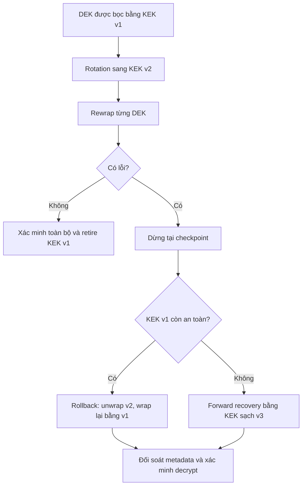
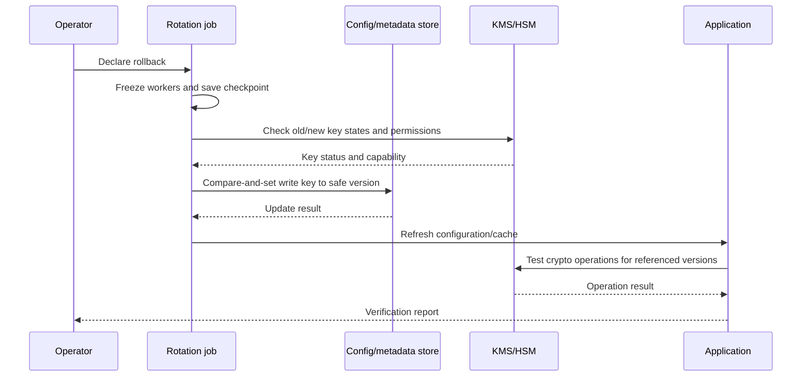

# Rollback rotation

Key rotation là quá trình thay một khóa đang sử dụng bằng khóa mới theo kế hoạch. Trong quá trình này, ứng dụng, dữ liệu, KMS/HSM và các workload có thể chuyển trạng thái ở những thời điểm khác nhau. **Rollback rotation** là quy trình đưa hệ thống về một trạng thái vận hành an toàn đã biết khi lần rotation gặp lỗi, gây gián đoạn hoặc tạo ra kết quả không đúng dự kiến.

Rollback khóa phức tạp hơn rollback một bản phát hành ứng dụng. Một phần dữ liệu có thể đã được mã hóa bằng khóa mới; một số DEK có thể đã được bọc lại bằng KEK mới; metadata có thể đã trỏ sang key version mới; và khóa cũ có thể đã bị disable hoặc lên lịch hủy. Vì vậy, rollback phải xét đồng thời trạng thái khóa, dữ liệu đã chuyển đổi, quyền truy cập và khả năng đọc ciphertext ở cả hai phiên bản.

Mục tiêu là phục hồi dịch vụ mà vẫn bảo toàn khả năng giải mã dữ liệu và ranh giới bảo mật. Với sự cố do lỗi triển khai thông thường, có thể quay lại phiên bản khóa trước nếu khóa đó vẫn đáng tin cậy. Nếu khóa cũ bị xâm phạm, không được quay lại dùng khóa đó chỉ để khôi phục nhanh; cần thực hiện forward recovery bằng khóa sạch và chuyển đổi dữ liệu phụ thuộc.

## 1. Rollback rotation là gì?

Rotation thường có các hoạt động: tạo khóa mới, cấp quyền, chuyển workload sang khóa mới, chuyển đổi dữ liệu, ngừng sử dụng khóa cũ và cuối cùng thu hồi/hủy khóa cũ. Rollback là kế hoạch xử lý khi một hoặc nhiều hoạt động này không đạt tiêu chí.

Rollback có thể bao gồm:

- Chuyển lại cấu hình ghi dữ liệu sang key version trước.
- Khôi phục alias hoặc con trỏ `currentWriteKey` về phiên bản trước.
- Giữ khả năng decrypt bằng cả khóa cũ và khóa mới trong giai đoạn chuyển tiếp.
- Rewrap DEK bằng KEK trước nếu quá trình chuyển KEK gây lỗi.
- Khôi phục metadata hoặc checkpoint migration đã được xác minh.
- Khôi phục ứng dụng tương thích với định dạng ciphertext đang tồn tại.
- Dừng quy trình retire/destroy khóa cũ cho đến khi điều tra xong.

Rollback không nhất thiết xóa khóa mới. Nếu dữ liệu đã được mã hóa bằng khóa mới, khóa mới vẫn có thể cần thiết để giải mã dữ liệu đó. Xóa khóa mới ngay sau khi chuyển con trỏ ghi về khóa cũ có thể làm mất dữ liệu.

## 2. Phân biệt rollback cấu hình, rollback dữ liệu và forward recovery

Ba khái niệm này cần được tách rõ:

| Hành động | Mục tiêu | Ví dụ |
|---|---|---|
| Rollback cấu hình | Đưa ứng dụng hoặc policy về cấu hình đã biết | Chuyển `currentWriteKey` từ `key-v8` về `key-v7` |
| Rollback dữ liệu khóa | Đảo ngược chuyển đổi dữ liệu nếu có thể và được phép | Unwrap DEK bằng KEK mới rồi wrap lại bằng KEK cũ |
| Forward recovery | Tiến tới trạng thái mới an toàn bằng khóa sạch | Tạo KEK v9, rewrap DEK và tiếp tục rotation sau khi v8 có lỗi |

Rollback cấu hình thường dễ hơn rollback dữ liệu. Nếu ciphertext đã được ghi bằng DEK mới, chuyển cấu hình về DEK cũ không tự làm ciphertext trở lại có thể giải mã bằng khóa cũ. Cần duy trì resolver biết key version cho từng ciphertext hoặc thực hiện chuyển đổi dữ liệu có kiểm soát.

Forward recovery là lựa chọn bắt buộc khi khóa cũ đã bị xâm phạm hoặc khi quay lại trạng thái cũ sẽ khôi phục lỗ hổng bảo mật. Khi đó, mục tiêu là tiếp tục tiến tới trạng thái sạch, không tái sử dụng bí mật đã mất độ tin cậy.

## 3. Các giai đoạn rotation và điểm rollback

Một quy trình rotation an toàn nên chia thành các giai đoạn có checkpoint:

| Giai đoạn | Trạng thái | Hành động rollback có thể có |
|---|---|---|
| 1. Prepare | Khóa mới được tạo, chưa có workload sử dụng | Dừng rollout; disable hoặc xóa khóa mới nếu chắc chắn chưa có dữ liệu phụ thuộc |
| 2. Distribute | Cấp quyền và phân phối metadata/key reference | Thu hồi quyền mới, giữ nguyên khóa cũ active |
| 3. Canary | Một nhóm nhỏ workload dùng khóa mới | Chuyển canary về khóa cũ; giữ khóa mới để đọc dữ liệu đã tạo |
| 4. Cutover | Workload bắt đầu ghi bằng khóa mới | Đưa write pointer về khóa cũ nếu khóa cũ an toàn; vẫn giữ read support cho khóa mới |
| 5. Migrate | Dữ liệu cũ đang được re-encrypt hoặc DEK đang được rewrap | Dừng migration tại checkpoint; giữ cả hai phiên bản và tiếp tục/đảo chuyển đổi theo metadata |
| 6. Retire | Khóa cũ không còn dùng để ghi, có thể chỉ decrypt | Hủy lịch retire nếu cần rollback và khóa cũ còn an toàn |
| 7. Destroy | Key material cũ đã bị hủy | Thường không thể rollback bằng cấu hình; cần recovery từ backup hợp lệ hoặc forward recovery |

Điểm không thể quay lại thường xuất hiện khi key material đã bị destroy, backup đã hết hạn hoặc ciphertext đã chuyển sang định dạng không tương thích với phiên bản cũ. Không nên bước sang giai đoạn destroy cho đến khi các tiêu chí hoàn tất rotation được kiểm chứng độc lập.

## 4. Rollback khác nhau giữa DEK rotation và KEK rotation

Phương án rollback phụ thuộc loại khóa được xoay vòng.

### DEK rotation

DEK mã hóa dữ liệu thực tế. Nếu dữ liệu mới đã được mã hóa bằng DEK v2, hệ thống cần lưu key ID/version gắn với ciphertext. Trong giai đoạn chuyển tiếp, reader phải có thể chọn đúng DEK để giải mã từng bản ghi.

Nếu rollback write pointer về DEK v1, dữ liệu đã mã hóa bằng DEK v2 vẫn phải đọc được. Do đó:

- Giữ DEK v2 ở trạng thái decrypt-capable nếu dữ liệu v2 còn tồn tại.
- Không ghi đè metadata `keyVersion` của ciphertext v2 thành v1.
- Nếu cần chuyển ciphertext v2 về v1, phải giải mã bằng v2 và mã hóa lại bằng v1 theo quy trình có checkpoint.
- Không rollback về DEK v1 nếu v1 bị compromise hoặc không còn đáp ứng chính sách.

### KEK rotation

KEK dùng để wrap DEK. Khi chuyển từ KEK v1 sang KEK v2, payload ciphertext có thể giữ nguyên; hệ thống chỉ cần rewrap các DEK.

Nếu rewrap một phần rồi gặp lỗi:

- Mỗi wrapped DEK phải ghi rõ `wrappingKeyId` và version đang bảo vệ nó.
- Giữ cả KEK v1 và v2 đủ lâu để unwrap đúng phiên bản.
- Có thể dừng rewrap và tiếp tục sau từ checkpoint.
- Nếu cần rollback, unwrap DEK bằng KEK v2 rồi wrap lại bằng KEK v1, miễn là KEK v1 còn đáng tin cậy và được phép sử dụng.
- Không xóa KEK v2 nếu còn DEK chỉ được bọc bằng KEK v2.

Nếu KMS/HSM hỗ trợ thao tác rewrap hoặc chuyển đổi khóa nội bộ, nên dùng API đó để DEK không phải xuất dạng rõ về ứng dụng. Nếu buộc phải xử lý qua ứng dụng, phải thực hiện trong ranh giới tin cậy được phê duyệt, bảo vệ bộ nhớ và không ghi key material vào file tạm, log hay telemetry.



## 5. Điều kiện tiên quyết trước khi cho phép rollback

Không phải mọi rotation đều được phép rollback. Trước khi thực hiện, cần kiểm tra:

- Khóa trước có còn được đánh giá là an toàn và không bị compromise không?
- Key material cũ còn tồn tại trong KMS/HSM hoặc backup hợp lệ không?
- KMS/HSM có cho phép bật lại khóa hoặc khôi phục trạng thái không?
- Ứng dụng phiên bản cũ có đọc được ciphertext và metadata hiện tại không?
- Dữ liệu nào đã được ghi bằng khóa mới hoặc đã rewrap bằng KEK mới?
- Có key ID/version chính xác cho từng object, record hoặc wrapped DEK không?
- Migration có checkpoint và cách xác định record đã xử lý/chưa xử lý không?
- Có thể giữ đồng thời quyền decrypt cho cả hai phiên bản không?
- Các consumer, replica, cache và batch job đã nhận cấu hình nào?
- Có backup, audit log và người phê duyệt cần thiết không?

Nếu không xác định được dữ liệu nào phụ thuộc vào khóa mới, không được xóa khóa mới. Nếu khóa cũ bị compromise, không được kích hoạt lại khóa cũ dù rollback có vẻ giúp dịch vụ hoạt động nhanh hơn.

## 6. Thiết kế versioning để rollback an toàn

Mỗi khóa nên có ID và version ổn định. Ứng dụng không nên chỉ dựa vào alias như `current-key` để giải mã dữ liệu cũ vì alias có thể trỏ sang phiên bản khác theo thời gian.

Metadata của ciphertext hoặc wrapped DEK nên lưu tối thiểu:

- `keyId`: định danh khóa logic.
- `keyVersion`: phiên bản DEK hoặc khóa dùng mã hóa payload.
- `wrappingKeyId` và `wrappingKeyVersion`: khóa bảo vệ DEK.
- `algorithm` và các tham số cần thiết.
- `nonce`/IV và tag nếu định dạng AEAD yêu cầu.
- `formatVersion`: phiên bản định dạng ciphertext.
- `migrationId` hoặc checkpoint nếu dữ liệu đang trong quá trình chuyển đổi.

Write path có thể dùng một cấu hình `currentWriteKeyVersion`, trong khi read path tra cứu version từ metadata của từng object. Mô hình này cho phép rollback việc ghi mới mà vẫn đọc được dữ liệu đã tạo trong thời gian rotation.

Không nên xóa version cũ khỏi inventory khi còn ciphertext hoặc backup tham chiếu tới nó. Key inventory cần phân biệt trạng thái `ACTIVE`, `WRITE_DISABLED`, `DECRYPT_ONLY`, `DISABLED`, `COMPROMISED` và `DESTROYED` theo state machine nội bộ, đồng thời ánh xạ chính xác với trạng thái thật của KMS/HSM.

## 7. Dual-read và single-write trong giai đoạn chuyển tiếp

Một chiến lược phổ biến là **dual-read, single-write**:

- Reader hỗ trợ giải mã bằng khóa cũ và khóa mới dựa trên key version trong metadata.
- Writer chỉ dùng một phiên bản được chọn làm write key tại một thời điểm.
- Khi cutover, chỉ đổi write key; không buộc reader bỏ hỗ trợ phiên bản cũ.
- Khi rollback, đổi write key về phiên bản trước nếu an toàn; reader vẫn giữ khả năng đọc dữ liệu đã tạo bằng khóa mới.

Chiến lược này giảm rủi ro tương thích khi triển khai dần trên nhiều workload. Tuy nhiên, cần giới hạn thời gian dual-read và quyền decrypt cho khóa cũ theo chính sách; không để trạng thái chuyển tiếp kéo dài vô thời hạn.

Trước khi rollback ứng dụng, phải xác minh phiên bản ứng dụng cũ hiểu được `formatVersion`, key ID và thuật toán mới. Nếu không, cần giữ một lớp compatibility hoặc forward-fix ứng dụng thay vì triển khai một bản cũ không đọc được dữ liệu đã tạo.

## 8. Checkpoint và idempotency cho migration

Re-encryption hoặc rewrap có thể xử lý hàng triệu object. Một job rotation cần lưu checkpoint bền vững để biết tiến độ và có thể tiếp tục sau lỗi.

Checkpoint nên ghi:

- `migrationId` và phiên bản kế hoạch.
- Nguồn/đích key ID và version.
- Partition, shard hoặc phạm vi dữ liệu.
- Cursor hoặc watermark cuối đã xử lý.
- Số object thành công, thất bại, bỏ qua và đang retry.
- Thời điểm bắt đầu, cập nhật và trạng thái job.
- Hash/checksum hoặc kết quả xác minh phù hợp với định dạng dữ liệu.

Mỗi bước migration phải idempotent: chạy lại một object đã hoàn thành không được mã hóa chồng, làm mất metadata hoặc tạo nhiều wrapped DEK không kiểm soát. Có thể dùng optimistic locking/version check để chỉ cập nhật object nếu metadata vẫn ở phiên bản mà worker đã đọc.

Không chỉ lưu một con số tổng như `processedCount`. Cần biết chính xác object nào đã chuyển đổi, object nào chưa, và trạng thái của object bị lỗi. Khi rollback, phải đối soát dữ liệu thực tế với checkpoint thay vì giả định mọi record trước cursor đều đã commit thành công.

## 9. Quy trình rollback rotation chuẩn

Một quy trình có kiểm soát có thể gồm:

1. **Declare rollback:** xác định trigger, incident/change ID và người có quyền quyết định.
2. **Freeze migration:** dừng cấp thêm công việc cho worker, ngăn job mới bắt đầu và chờ các thao tác đang chạy đạt trạng thái xác định.
3. **Capture state:** lưu checkpoint, key version, write pointer, KMS policy, metadata và số liệu trước rollback.
4. **Assess key trust:** xác nhận khóa cũ có còn an toàn; nếu bị compromise, chuyển sang forward recovery.
5. **Protect readability:** giữ các key version cần để giải mã dữ liệu đã ghi hoặc wrapped bằng khóa mới.
6. **Restore write path:** chuyển write pointer về phiên bản an toàn đã chọn bằng cập nhật có kiểm soát và compare-and-set.
7. **Handle migrated data:** tiếp tục đọc theo key version; rewrap/re-encrypt ngược chỉ khi cần và đã có checkpoint.
8. **Refresh consumers:** cập nhật cache, config, connection pool, worker và replica.
9. **Verify:** kiểm tra encrypt/decrypt, đọc mẫu dữ liệu cũ/mới, metadata và audit event.
10. **Close or resume:** quyết định hủy migration, sửa lỗi rồi chạy lại, hoặc chuyển sang forward recovery.
11. **Retain keys:** giữ khóa liên quan cho tới khi chứng minh không còn dữ liệu phụ thuộc.
12. **Document:** ghi kết quả, phạm vi, thời gian, lỗi và rủi ro còn lại.



## 10. Ví dụ Java: chuyển write key về phiên bản trước

Ví dụ sau mô tả cách một service điều phối cập nhật write key. Key material không được tải về ứng dụng; ứng dụng chỉ giữ key reference và gọi KMS/provider theo quyền được cấp.

```java
public record KeyRef(String keyId, String version) {}

public interface KeyPolicyStore {
    KeyRef currentWriteKey();

    // Atomic compare-and-set: only replace expected with replacement.
    boolean compareAndSetWriteKey(KeyRef expected, KeyRef replacement);
}

public interface KeyOperations {
    boolean canEncrypt(KeyRef key);
    boolean canDecrypt(KeyRef key);
    boolean isCompromised(KeyRef key);
}

public final class RotationRollbackService {
    private final KeyPolicyStore policyStore;
    private final KeyOperations keyOperations;

    public RotationRollbackService(
            KeyPolicyStore policyStore,
            KeyOperations keyOperations) {
        this.policyStore = policyStore;
        this.keyOperations = keyOperations;
    }

    public void rollbackWriteKey(KeyRef expectedCurrent, KeyRef previous) {
        if (keyOperations.isCompromised(previous)) {
            throw new SecurityException(
                    "Cannot roll back to a compromised key version");
        }
        if (!keyOperations.canEncrypt(previous)) {
            throw new IllegalStateException(
                    "Previous key is not enabled for encryption");
        }
        if (!keyOperations.canDecrypt(previous)) {
            throw new IllegalStateException(
                    "Previous key cannot decrypt data already using that version");
        }
        if (!keyOperations.canDecrypt(expectedCurrent)) {
            throw new IllegalStateException(
                    "Current version must remain readable for existing data");
        }
        if (!policyStore.compareAndSetWriteKey(expectedCurrent, previous)) {
            throw new IllegalStateException(
                    "Write key changed concurrently; re-evaluate rotation state");
        }
    }
}
```

Đây là ví dụ điều phối, không phải implementation KMS cụ thể. `canEncrypt`, `canDecrypt` và `isCompromised` phải lấy trạng thái từ inventory/policy đáng tin cậy; không dựa vào cache cũ. `compareAndSetWriteKey()` cần cập nhật nguyên tử để một rollback không ghi đè thay đổi mới hơn do operator hoặc rotation job khác thực hiện. Sau khi đổi write key, ứng dụng vẫn phải chọn key version từ metadata khi đọc từng ciphertext.

Trong production, service còn cần authorization, audit, change ticket, concurrency lock hoặc lease, timeout, retry có giới hạn và kiểm tra trạng thái sau commit. Không tự động rollback khi chỉ có một lỗi timeout: thao tác cập nhật có thể đã thành công ở phía server dù client không nhận được response. Hãy đọc lại trạng thái hiện tại trước khi retry.

## 11. Ví dụ metadata và cập nhật an toàn

Một record dữ liệu có thể lưu key version dùng mã hóa payload:

```json
{
  "objectId": "customer-4821",
  "formatVersion": 2,
  "encryption": {
    "algorithm": "AES-256-GCM",
    "dekId": "customer-data-dek",
    "dekVersion": "v2",
    "wrappingKeyId": "customer-data-kek",
    "wrappingKeyVersion": "v5",
    "nonce": "base64url(...)"
  },
  "migration": {
    "migrationId": "rotate-kek-v5-2026-11",
    "state": "COMPLETED"
  }
}
```

Khi rewrap DEK, chỉ metadata về wrapping key version thay đổi sau khi thao tác unwrap/wrap thành công và kết quả được xác minh. Cập nhật ciphertext, wrapped DEK và metadata nên dùng transaction hoặc protocol có trạng thái rõ ràng để tránh metadata trỏ tới wrapped key chưa được tạo.

Với object storage hoặc database không hỗ trợ transaction nhiều thành phần, có thể ghi wrapped DEK mới thành object/version riêng, xác minh rồi atomically đổi metadata pointer. Chỉ xóa wrapped DEK cũ sau khi đã qua thời gian an toàn, xác nhận reader không còn dùng và backup đáp ứng chính sách.

## 12. Khi nào không được rollback về khóa cũ?

Không rollback về phiên bản cũ trong các tình huống sau:

- Có bằng chứng hoặc nghi ngờ hợp lý rằng key material cũ đã bị lộ.
- Khóa cũ bị thu hồi do sai mục đích, sai owner hoặc vi phạm chính sách.
- Thuật toán/độ dài khóa cũ không còn được chấp thuận hoặc đã bị loại bỏ.
- Private key cũ có chứng thư bị thu hồi và hệ thống relying party phải từ chối nó.
- Khóa cũ đã bị destroy và không có quy trình recovery được phê duyệt.
- Bản sao khôi phục không xác minh được tính toàn vẹn hoặc nguồn gốc.
- Rollback sẽ làm tái xuất hiện quyền truy cập đã bị thu hồi hoặc lỗ hổng đã được xử lý.

Trong các trường hợp này, hãy thực hiện forward recovery: tạo khóa sạch, cập nhật policy và workload, chuyển đổi dữ liệu, thu hồi các phiên bản không còn tin cậy và theo dõi khả năng giải mã. Nếu dữ liệu đã được mã hóa bằng khóa cũ bị compromise, cần đánh giá re-encryption và phạm vi dữ liệu có thể đã bị đọc.

## 13. Rollback khi khóa cũ đã disable hoặc schedule deletion

Nếu khóa cũ chỉ bị disable, một số KMS có thể cho phép enable lại; một số policy hoặc trạng thái có thể ngăn điều đó. Cần xác minh semantics cụ thể và phê duyệt trước khi bật lại.

Nếu khóa đã được schedule deletion, nhiều dịch vụ có giai đoạn chờ trước khi hủy thực tế. Trong giai đoạn này, có thể có API cancel deletion hoặc restore. Không giả định mọi KMS/HSM có thời gian chờ giống nhau; phải kiểm tra tài liệu dịch vụ và trạng thái thực tế.

Nếu key material đã bị destroy, không thể phục hồi chỉ bằng cách tạo lại alias hoặc cùng tên key. Khóa mới có key ID/version mới và không giải mã được ciphertext cũ. Phục hồi chỉ khả thi nếu có backup/escrow hợp lệ chứa đúng key material và quy trình restore được kiểm soát. Nếu không có, dữ liệu đã mã hóa có thể mất khả năng giải mã.

Vì vậy, destroy phải là bước tách biệt với retire. Cần có thời gian quan sát, xác minh dependency inventory, backup/recovery test và phê duyệt độc lập trước khi hủy không thể đảo ngược.

## 14. Rollback và cache, replica, workload phân tán

Trong hệ thống nhiều instance, mỗi workload có thể giữ cấu hình key version trong cache hoặc environment riêng. Sau rollback, một số instance có thể tiếp tục ghi bằng khóa mới trong khi instance khác đã chuyển về khóa cũ.

Để tránh trạng thái split-brain:

- Dùng một nguồn cấu hình có version và cơ chế compare-and-set.
- Phát sự kiện invalidation có `configVersion` tăng đơn điệu.
- Yêu cầu workload xác nhận đã nạp cấu hình mới.
- Có readiness check để instance cũ không tiếp tục nhận traffic nếu không tương thích.
- Kiểm tra batch job, worker nền, consumer queue và tác vụ định kỳ, không chỉ API server.
- Theo dõi event KMS theo key ID/version để phát hiện writer còn dùng khóa ngoài dự kiến.
- Dùng lease hoặc fencing token để worker cũ không ghi metadata sau khi rollback đã hoàn tất.

Không dựa hoàn toàn vào restart toàn bộ cluster. Với hệ thống lớn, cần rollout có kiểm soát và khả năng quan sát trạng thái từng workload.

## 15. Tự động hóa rollback có kiểm soát

Rotation job nên được triển khai như một state machine có trạng thái bền vững, thay vì một script chạy tuần tự không có checkpoint.

Các trạng thái gợi ý:

`PLANNED → KEY_CREATED → DISTRIBUTED → CANARY → CUTOVER → MIGRATING → VERIFIED → OLD_KEY_RETIRED → DESTROYED`

Nhánh lỗi có thể chuyển sang `PAUSED`, `ROLLBACK_REQUESTED`, `ROLLING_BACK`, `ROLLED_BACK` hoặc `FORWARD_RECOVERY`. Chỉ state machine mới được phép chuyển trạng thái hợp lệ; mỗi transition cần kiểm tra precondition và ghi audit.

Automation nên có:

- Idempotency key cho mỗi rotation run và từng object migration.
- Checkpoint bền vững và khả năng resume.
- Lock/lease để ngăn hai rotation hoặc rollback chạy đồng thời.
- Canary và health gate trước cutover.
- Ngưỡng lỗi, latency, decrypt failure và KMS throttling để pause tự động.
- Approval gate cho rollback tới khóa cũ và cho destroy.
- Timeout, retry có giới hạn, exponential backoff và dead-letter queue.
- Đối soát số lượng object theo trạng thái và key version.
- Audit event cho mọi transition, approval và thao tác KMS/HSM.
- Cơ chế forward recovery khi precondition rollback không còn đúng.

Không tự động rollback chỉ dựa vào một metric đơn lẻ như HTTP 5xx tăng. Cần tương quan với lỗi decrypt, trạng thái KMS, version config và phạm vi workload để tránh một lỗi ứng dụng không liên quan làm thay đổi khóa mật mã.

## 16. Kiểm thử và diễn tập rollback

Rollback chỉ đáng tin khi đã được diễn tập trong môi trường gần với production. Các tình huống cần kiểm thử:

| Tình huống | Kết quả mong đợi |
|---|---|
| Lỗi ngay sau khi tạo khóa mới | Dừng rollout; khóa cũ tiếp tục hoạt động |
| Canary decrypt failure | Dừng canary; giữ khóa mới để điều tra; write path vẫn ở khóa cũ |
| Lỗi sau cutover nhưng chưa migration | Chuyển write pointer về khóa cũ nếu an toàn; đọc dữ liệu mới bằng version mới |
| Rewrap bị dừng giữa chừng | Resume hoặc rollback từ checkpoint; mọi DEK vẫn có ít nhất một wrapped copy đọc được |
| Client timeout khi đổi write pointer | Đọc lại trạng thái trước khi retry; không tạo chuyển đổi cạnh tranh |
| Một replica chưa nhận rollback | Fencing/health gate ngăn replica ghi bằng version sai |
| Khóa cũ bị phát hiện compromise | Không rollback về khóa cũ; chuyển sang forward recovery |
| Khóa cũ đã schedule deletion | Hủy lịch nếu được phép và an toàn; nếu không, dùng recovery/forward path |
| Key material đã destroy | Xác minh backup hợp lệ; không giả định tạo lại cùng tên là phục hồi |
| Ứng dụng cũ không đọc format mới | Giữ compatibility layer hoặc forward-fix; không deploy bản cũ gây mất khả năng đọc |

Sau diễn tập, đo thời gian phục hồi, tỷ lệ dữ liệu đọc được, số object cần rewrap/re-encrypt, thời gian propagation và số event audit bị thiếu. Cập nhật runbook dựa trên bằng chứng thực tế.

## 17. Checklist Rollback rotation

- Phân loại rotation là DEK, KEK, asymmetric key, signing key hay certificate.
- Lưu key ID/version trong ciphertext, wrapped DEK và metadata.
- Duy trì dual-read/single-write trong giai đoạn chuyển tiếp khi phù hợp.
- Xác định checkpoint, migration cursor, trạng thái object và khả năng resume.
- Giữ khóa mới để đọc dữ liệu đã được mã hóa bằng khóa mới.
- Chỉ rollback về khóa cũ khi đã xác nhận khóa cũ còn an toàn và được phép sử dụng.
- Dùng compare-and-set, transaction hoặc fencing để tránh cập nhật cạnh tranh.
- Freeze worker, capture state và kiểm tra trạng thái KMS/HSM trước rollback.
- Cập nhật cache, replica, batch job và workload; xác minh mọi instance đã nhận config.
- Kiểm thử decrypt dữ liệu cũ/mới và đối soát metadata sau rollback.
- Không destroy khóa hoặc bản wrapped cuối cùng khi còn dependency.
- Dùng forward recovery nếu khóa cũ compromise, bị thu hồi hoặc không còn phù hợp chính sách.
- Có backup, recovery test, approval, audit và runbook cho bước không thể đảo ngược.
- Diễn tập rollback và đo recovery time trước khi áp dụng production.

Rollback rotation là một phần phải được thiết kế ngay từ đầu của quy trình rotation. Versioning, metadata chính xác, dual-read/single-write, checkpoint và khả năng giữ khóa cũ ở chế độ cần thiết giúp hệ thống quay lui cấu hình mà vẫn đọc được dữ liệu đã chuyển đổi. Tuy nhiên, rollback chỉ hợp lệ khi khóa cũ còn đáng tin cậy. Khi khóa cũ bị compromise hoặc đã bị hủy, hệ thống phải tiến tới trạng thái an toàn mới bằng forward recovery, đồng thời bảo toàn bằng chứng và xử lý đầy đủ dữ liệu phụ thuộc.

## Tài liệu tham khảo

- [NIST SP 800-57 Part 1 Rev. 5: Recommendation for Key Management](https://csrc.nist.gov/pubs/sp/800/57/pt1/r5/final)
- [NIST SP 800-130: A Framework for Designing Cryptographic Key Management Systems](https://csrc.nist.gov/pubs/sp/800/130/final)
- [NIST SP 800-38F: Recommendation for Block Cipher Modes of Operation: Methods for Key Wrapping](https://csrc.nist.gov/pubs/sp/800/38/f/final)
- [OWASP Secrets Management Cheat Sheet](https://cheatsheetseries.owasp.org/cheatsheets/Secrets_Management_Cheat_Sheet.html)
- [Java SE API: `java.security.Key`](https://docs.oracle.com/en/java/javase/21/docs/api/java.base/java/security/Key.html)
