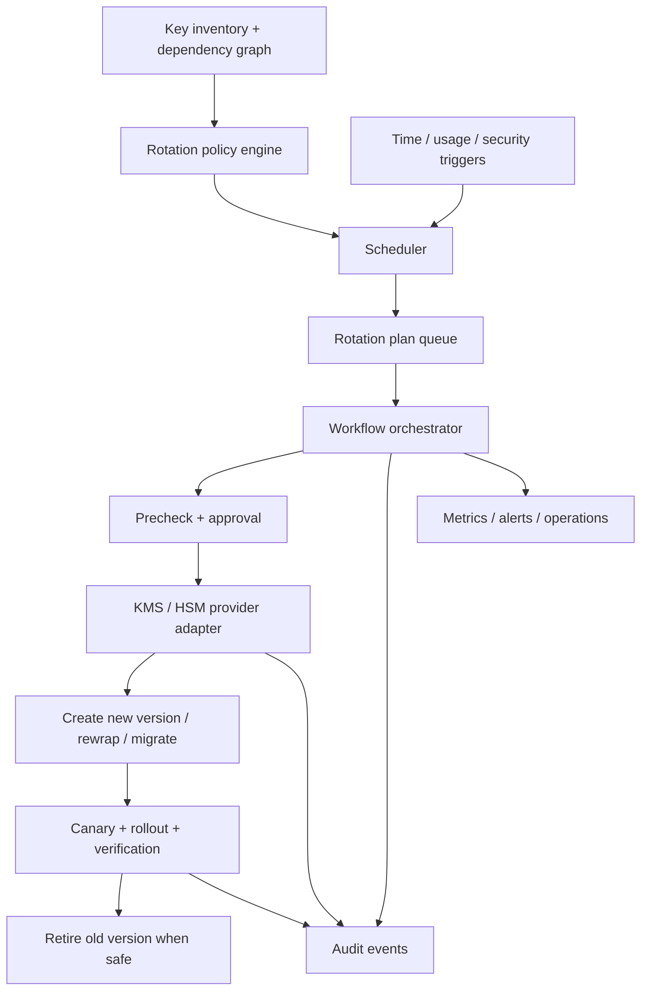
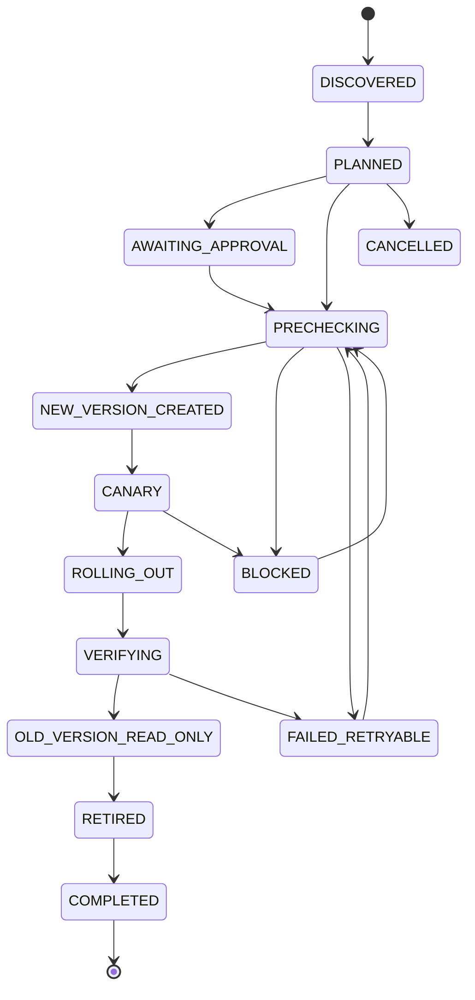

# Rotation scheduler

**Rotation scheduler** là thành phần tự động xác định khi nào một khóa cần được xoay vòng, lập kế hoạch cho lần xoay, điều phối workflow đã được phê duyệt và theo dõi kết quả đến khi trạng thái mới được xác minh. Scheduler kết hợp lịch định kỳ với các sự kiện như khóa sắp hết cryptoperiod, thay đổi chính sách, credential bị lộ hoặc yêu cầu từ incident response.

Trong quản lý khóa mật mã, rotation không chỉ là tạo một khóa mới. Hệ thống còn phải chuyển workload sang phiên bản mới, giữ khả năng đọc dữ liệu cũ, cập nhật wrapped DEK hoặc ciphertext khi cần, kiểm tra backup và replica, rồi mới giới hạn hoặc thu hồi khóa cũ. Một scheduler chỉ phát lệnh tạo key version mà không theo dõi các bước phụ thuộc có thể khiến ứng dụng ngừng hoạt động hoặc dữ liệu không thể giải mã.

Trong phạm vi **SECURITY_KEY_MANAGEMENT_FUNDAMENTALS**, Rotation scheduler kết nối key lifecycle, cryptoperiod, KMS/HSM, envelope encryption, access control, backup/recovery, audit và automation. Scheduler nên điều phối các thao tác theo policy, còn việc thực thi phép toán mật mã và bảo vệ key material thuộc về KMS/HSM hoặc provider được phê duyệt.

## 1. Vì sao cần rotation scheduler?

Khóa có thể cần thay đổi vì nhiều lý do: cryptoperiod đã đến hạn, số lần sử dụng vượt ngưỡng, thuật toán hoặc provider bị loại khỏi policy, nhân sự/quyền quản trị thay đổi, khóa có dấu hiệu bị lộ hoặc một yêu cầu tuân thủ bắt buộc rotation. Nếu mỗi nhóm tự theo dõi ngày hết hạn bằng bảng tính và thao tác thủ công, tổ chức dễ bỏ sót khóa, xoay sai thứ tự hoặc không có bằng chứng rằng dữ liệu đã chuyển sang phiên bản mới.

Rotation scheduler giúp:

- Theo dõi inventory và xác định khóa đến hạn theo policy.
- Kết hợp thời hạn, số lượng operation, trạng thái khóa và dependency.
- Lập kế hoạch trước, phân tán tải và tránh xoay đồng loạt.
- Điều phối approval, precheck, tạo version mới, rollout và verification.
- Theo dõi workload chưa cập nhật hoặc dữ liệu còn phụ thuộc khóa cũ.
- Retry an toàn khi lỗi tạm thời mà không tạo nhiều phiên bản ngoài ý muốn.
- Phát cảnh báo khi rotation bị chặn, trễ hạn hoặc cần quyết định của con người.
- Lưu audit trail và bằng chứng đóng workflow.

Scheduler không tự bảo đảm khóa được bảo vệ tốt. Kết quả phụ thuộc vào inventory chính xác, policy đúng, provider semantics, quyền hạn tối thiểu, quy trình migration và khả năng phục hồi.

## 2. Phân biệt rotation với các thao tác liên quan

Trong vận hành, từ “rotation” đôi khi được dùng cho nhiều công việc khác nhau. Cần phân biệt để scheduler chọn đúng workflow.

| Thao tác | Điều thay đổi | Dữ liệu đã mã hóa có cần xử lý lại không? |
|---|---|---|
| Key version rotation | Tạo phiên bản key mới dưới logical key hoặc key family | Tùy mục đích; dữ liệu mới dùng version mới, dữ liệu cũ có thể vẫn cần version cũ |
| DEK rotation | Thay khóa mã hóa dữ liệu | Thường cần re-encrypt dữ liệu hoặc chuyển DEK theo một quy trình migration |
| KEK rotation | Thay khóa bảo vệ DEK | Có thể rewrap DEK mà không cần re-encrypt payload |
| Rewrapping | Bọc lại DEK bằng KEK mới | Ciphertext payload và DEK giữ nguyên |
| Re-encryption | Giải mã rồi mã hóa lại dữ liệu bằng DEK/thuật toán mới | Có; cần migration dữ liệu |
| Credential rotation | Thay password, API token hoặc credential truy cập | Không phải key rotation của dữ liệu, nhưng có thể thuộc cùng automation platform |
| Certificate renewal/rekey | Gia hạn chứng thư hoặc tạo cặp khóa mới | Phụ thuộc quy trình PKI và việc private key có thay đổi hay không |
| Revocation/disable | Ngăn sử dụng khóa hoặc credential theo semantics của provider | Không tự chuyển dữ liệu sang khóa mới |

Scheduler cần định danh rõ `rotationType`, `keyPurpose` và `migrationStrategy`. Không gọi một workflow “rotate” chung cho cả rewrap, re-encrypt, credential replacement và certificate renewal.

## 3. Các trigger của scheduler

Một scheduler thường hỗ trợ trigger theo lịch và trigger theo sự kiện.

| Trigger | Ví dụ | Hành vi gợi ý |
|---|---|---|
| Time-based | Đến ngày rotation theo cryptoperiod | Tạo rotation plan theo policy |
| Usage-based | Số operation hoặc lượng dữ liệu đã vượt ngưỡng | Đánh giá rotation sớm và kiểm tra giới hạn provider |
| Expiry-based | Key version hoặc certificate sắp hết hạn | Lập kế hoạch trước thời điểm hết hạn |
| Policy change | Thuật toán/provider bị deprecate hoặc thay yêu cầu độ dài khóa | Xác định tập khóa bị ảnh hưởng và ưu tiên migration |
| Security event | Nghi ngờ key compromise hoặc credential exposure | Chuyển sang emergency rotation/incident workflow |
| Access change | Owner, workload, tenant hoặc trust boundary thay đổi | Đánh giá lại quyền và nhu cầu thay khóa |
| Manual request | Key owner yêu cầu rotation có phê duyệt | Kiểm tra quyền, lý do, scope và change window |
| Recovery event | Khôi phục backup hoặc failover sang region khác | Xác minh key version và trạng thái trước khi tiếp tục |

Trigger không đồng nghĩa với lệnh thực thi ngay. Ví dụ, `rotationDueAt` có thể tạo một plan ở trạng thái `DUE`; workflow vẫn cần precheck và approval nếu policy yêu cầu. Trường hợp compromise cần ưu tiên incident response và containment, không nên xếp hàng như một rotation định kỳ thông thường.

## 4. Nguồn dữ liệu và key inventory

Scheduler chỉ có thể lập kế hoạch đáng tin khi biết khóa nào đang tồn tại, ai sở hữu và dữ liệu nào phụ thuộc vào nó. Inventory nên là nguồn metadata có thẩm quyền hoặc được đồng bộ có kiểm soát từ KMS/HSM và các hệ thống liên quan.

Các trường quan trọng:

| Nhóm | Thuộc tính gợi ý |
|---|---|
| Định danh | `keyId`, `keyVersion`, provider reference, account/project, region |
| Phân loại | `keyType`, `algorithm`, `purpose`, `tenant`, `environment`, `classification` |
| Vòng đời | `status`, `createdAt`, `enabledAt`, `rotationDueAt`, `expiresAt`, `retireAfter` |
| Policy | `rotationEnabled`, `rotationInterval`, usage threshold, algorithm policy, approval requirement |
| Ownership | key owner, service owner, data owner, on-call contact |
| Dependency | DEK/KEK relationship, encrypted dataset, wrapped DEK, backup, replica, archive, workload |
| Trạng thái automation | `lastRotationRunId`, `lastSuccessfulRotationAt`, `nextAttemptAt`, failure reason |

Không suy ra purpose hoặc owner chỉ từ alias hay tên thư mục. Metadata ảnh hưởng đến quyền và migration phải đến từ nguồn được quản trị. Nếu inventory thiếu owner, thiếu dependency hoặc không xác định được provider, scheduler nên tạo finding và chuyển sang `BLOCKED` để bổ sung thông tin.

## 5. Xác định cryptoperiod và lịch rotation

Cryptoperiod là khoảng thời gian một khóa được phép hoặc dự kiến sử dụng cho một mục đích cụ thể. Độ dài phù hợp phụ thuộc thuật toán, key size, loại khóa, lượng dữ liệu/operation, threat model, thời gian cần bảo mật và yêu cầu của tổ chức.

Policy có thể dùng nhiều điều kiện:

- Thời gian từ khi key version được tạo hoặc đưa vào sử dụng.
- Số lượng operation hoặc lượng dữ liệu đã xử lý.
- Thời điểm hết hạn của certificate hoặc credential liên quan.
- Trạng thái thuật toán/provider và lộ trình deprecation.
- Mức phân loại dữ liệu và blast radius nếu khóa bị lộ.
- Yêu cầu của hợp đồng, tiêu chuẩn hoặc quy định áp dụng.

Không nên hardcode một số ngày giống nhau cho mọi khóa. Khóa ký CA, KEK, DEK theo object, khóa TLS ngắn hạn và khóa dùng cho backup có threat model và quy trình khác nhau. Policy cần lưu `rotationInterval`, `rotationBasis`, `maxUsage` (nếu có), owner và nguồn phê duyệt.

### 5.1. Tính thời điểm đến hạn

Một cách đơn giản là `rotationDueAt = activatedAt + rotationInterval`. Trong hệ thống thực tế, cần xác định rõ mốc bắt đầu: `createdAt`, `enabledAt`, `firstUseAt` hay thời điểm phát hành. Nếu key version được tạo trước nhưng chỉ được kích hoạt sau vài ngày, dùng sai mốc sẽ làm lịch rotation lệch.

Scheduler nên dùng thời gian UTC và clock được đồng bộ. Lịch theo ngày/tháng cần quy định cách xử lý ngày cuối tháng, daylight saving time nếu policy có timezone địa phương, và hành vi khi scheduler chạy trễ sau outage.

### 5.2. Usage-based rotation

Với khóa có giới hạn số lần dùng hoặc lượng dữ liệu, scheduler cần nhận counter từ nguồn đáng tin cậy. Counter phải xác định rõ phạm vi: theo key version, logical key, region hay toàn bộ account. Nếu dữ liệu đến trễ hoặc counter không nhất quán, không nên tự kết luận khóa chưa vượt ngưỡng; hãy đánh dấu trạng thái dữ liệu chưa đủ và áp dụng ngưỡng an toàn theo policy.

## 6. Lập lịch phân tán và tránh thundering herd

Khi nhiều khóa cùng đến hạn, scheduler không nên tạo đồng thời hàng nghìn request tới KMS/HSM. Việc này có thể vượt quota, làm tăng latency, gây timeout dây chuyền hoặc ảnh hưởng workload đang mã hóa/giải mã.

Các biện pháp:

- **Deterministic jitter:** phân tán thời điểm bắt đầu dựa trên key ID và cửa sổ được policy cho phép.
- **Batching:** nhóm các rotation plan theo provider, region, tenant hoặc mức ưu tiên.
- **Rate limit:** giới hạn operation đồng thời và request rate theo quota thực tế.
- **Concurrency cap:** giới hạn số workflow đang ở giai đoạn tạo key hoặc rewrap/re-encrypt.
- **Priority queue:** ưu tiên emergency/security event, sau đó đến khóa sắp hết hạn và rotation định kỳ.
- **Maintenance window:** tránh rollout vào thời điểm hệ thống nghiệp vụ có tải cao nếu không có lý do khẩn cấp.
- **Backpressure:** dừng nhận thêm công việc khi queue, provider hoặc downstream không đáp ứng.

Jitter chỉ được phân tán trong khoảng policy cho phép. Không dời rotation qua hạn cuối đã được phê duyệt hoặc làm giảm thời gian bảo vệ tối thiểu. Emergency rotation không nên bị trì hoãn bởi jitter của lịch định kỳ.

## 7. Kiến trúc rotation scheduler

Một kiến trúc tham khảo gồm inventory, policy engine, scheduler, workflow orchestrator, adapter tới KMS/HSM và hệ thống audit/monitoring.



Trách nhiệm cần tách rõ:

- **Inventory:** mô tả key, version, owner và dependency.
- **Policy engine:** xác định khi nào và theo cách nào phải rotation.
- **Scheduler:** phát hiện công việc đến hạn, ưu tiên và xếp hàng.
- **Orchestrator:** quản lý state machine, retry, approval và checkpoint.
- **Provider adapter:** gọi API cụ thể của KMS/HSM, xử lý semantics và error code.
- **Migration worker:** cập nhật DEK, wrapped DEK, ciphertext hoặc workload theo kế hoạch.
- **Verifier:** xác nhận version mới được dùng đúng và dữ liệu cũ vẫn đọc được.
- **Audit/monitoring:** lưu bằng chứng, metric, cảnh báo và trạng thái vận hành.

Không để scheduler trực tiếp xử lý raw key material. Adapter nên dùng key ID/handle và API của provider; quyền của scheduler cần giới hạn vào các hành động điều phối cần thiết.

## 8. State machine của một rotation run

Rotation là workflow nhiều bước, có thể kéo dài từ vài giây đến nhiều ngày. Cần lưu trạng thái bền vững để có thể tiếp tục sau restart hoặc outage.

| Trạng thái | Ý nghĩa |
|---|---|
| `DISCOVERED` | Tìm thấy key đến hạn hoặc trigger mới |
| `PLANNED` | Đã tạo plan, xác định scope, owner và strategy |
| `AWAITING_APPROVAL` | Đang chờ phê duyệt theo policy |
| `PRECHECKING` | Kiểm tra provider, quota, backup, dependency và workload |
| `NEW_VERSION_CREATED` | Phiên bản mới đã được tạo hoặc import hợp lệ |
| `CANARY` | Một nhóm workload/dữ liệu nhỏ đang chuyển sang version mới |
| `ROLLING_OUT` | Mở rộng rollout theo batch |
| `VERIFYING` | Kiểm tra thao tác mới, khả năng đọc dữ liệu cũ và audit |
| `OLD_VERSION_READ_ONLY` | Chặn ghi/mã hóa mới bằng version cũ nhưng vẫn giữ quyền đọc cần thiết theo policy |
| `RETIRED` | Version cũ không còn được dùng trong vận hành thường ngày |
| `COMPLETED` | Workflow đã đạt điều kiện đóng và có bằng chứng |
| `BLOCKED` | Thiếu điều kiện hoặc approval; cần con người xử lý |
| `FAILED_RETRYABLE` | Lỗi tạm thời, có thể retry theo policy |
| `FAILED_FINAL` | Lỗi không thể tự retry hoặc cần quyết định mới |
| `CANCELLED` | Kế hoạch bị hủy hợp lệ trước khi có tác động không thể đảo ngược |



Mỗi transition cần lưu actor/system, thời điểm, policy version, input reference, operation ID và kết quả. Không nhảy thẳng từ `NEW_VERSION_CREATED` sang `COMPLETED`; tạo key mới chưa chứng minh workload đã dùng nó hoặc dữ liệu cũ còn phục hồi được.

## 9. Precheck trước khi rotation

Precheck ngăn scheduler bắt đầu workflow khi thiếu điều kiện cần thiết. Tùy loại khóa, precheck có thể bao gồm:

- Key ID/version và provider state được xác minh.
- Owner, purpose, tenant, environment và policy còn hợp lệ.
- Dependency graph đã được cập nhật: ciphertext, wrapped DEK, backup, replica, archive, cache và consumer.
- Có backup hoặc recovery path đã được kiểm thử khi policy yêu cầu.
- KMS/HSM health, quota, latency và khả năng tạo version mới đủ tốt.
- Workload hỗ trợ đọc version cũ và mới trong giai đoạn chuyển tiếp.
- Có rollout plan, batch size, maintenance window và rollback/containment plan.
- Có approval cho thao tác nhạy cảm và quyền cần thiết được cấp đúng thời hạn.
- Audit pipeline hoạt động và có thể ghi lại workflow.
- Không có incident/hold/rotation khác đang xung đột trên cùng key family.

Nếu precheck không đạt, chuyển `BLOCKED` với reason code cụ thể. Không bỏ qua dependency hoặc backup check chỉ để đạt KPI rotation đúng hạn.

## 10. Chọn strategy theo loại khóa

Rotation scheduler phải chọn strategy theo purpose và cách sử dụng khóa.

| Loại khóa | Strategy phổ biến | Điều cần xác minh |
|---|---|---|
| KEK trong envelope encryption | Tạo KEK version mới, sau đó rewrap DEK | Wrapped DEK đã cập nhật; DEK và ciphertext payload vẫn nhất quán |
| DEK theo object/record | Tạo DEK mới và re-encrypt dữ liệu hoặc migrate object | Nonce, tag, AAD, transaction và tính toàn vẹn dữ liệu |
| Signing key | Tạo key pair mới, publish public key/certificate, chuyển signer | Verifier chấp nhận key mới; lịch sử chữ ký vẫn xác minh được |
| TLS private key | Tạo hoặc cấp key/certificate mới và rollout endpoint | Certificate chain, hostname, trust, reload và client compatibility |
| HMAC key | Phát hành version mới và hỗ trợ verify overlap | Consumer phân biệt version; không dùng key cũ để tạo MAC mới sau cutover |
| Backup encryption key | Tạo KEK mới, rewrap backup DEK hoặc thực hiện migration theo định dạng | Archive cũ vẫn restore được và key reference không mất |
| KMS/HSM root/cluster key | Theo quy trình provider/device-specific | Quorum, backup/restore, replication và semantics được nhà cung cấp hỗ trợ |

Với public-key signing, không thể “rewrap” chữ ký cũ bằng private key mới. Cần giữ public key/certificate lịch sử và thông tin timestamp/revocation để xác minh chữ ký theo policy. Với TLS, rotation private key thường đi cùng certificate issuance và rollout endpoint; đây là workflow PKI có dependency riêng.

## 11. Rotation KEK và rewrap DEK

Trong envelope encryption, dữ liệu được mã hóa bằng DEK; KEK bảo vệ DEK. Khi rotation KEK, scheduler thường tạo KEK version mới rồi yêu cầu KMS/HSM rewrap hoặc unwrap-wrap DEK theo API được phép.

Quy trình tham khảo:

1. Tạo KEK version mới và xác minh purpose, policy, region và trạng thái.
2. Đưa version mới vào trạng thái có thể wrap DEK mới.
3. Liệt kê wrapped DEK còn phụ thuộc KEK cũ, bao gồm backup, replica và archive.
4. Rewrap theo batch, lưu nguyên tử wrapped DEK mới cùng key version/context.
5. Đọc thử và xác minh một mẫu dữ liệu bằng wrapped DEK mới.
6. Tiếp tục đến khi mọi dependency trong scope được xử lý hoặc có exception được phê duyệt.
7. Chuyển KEK cũ sang trạng thái không wrap mới; vẫn cho unwrap nếu dữ liệu cũ còn phụ thuộc.
8. Chỉ retire/disable/destroy theo điều kiện vòng đời và provider semantics.

Rewrap không đổi DEK hoặc ciphertext payload. Tuy nhiên, wrapped DEK và metadata liên quan phải được cập nhật nhất quán. Nếu ứng dụng lưu wrapped DEK ở database, hãy dùng transaction hoặc compare-and-swap để tránh hai worker ghi đè kết quả của nhau.

## 12. Rotation DEK và re-encryption

Khi DEK bị compromise, thuật toán không còn được chấp nhận hoặc policy yêu cầu thay DEK, chỉ rewrap bằng KEK mới không đủ. Cần tạo DEK mới và mã hóa lại payload.

Workflow nên:

- Xác định đầy đủ object, version, backup, replica, snapshot và bản sao dữ liệu.
- Giữ ciphertext cũ cho đến khi ciphertext mới được xác minh và có thể phục hồi.
- Ràng buộc AAD với tenant, record ID, purpose và format version theo schema đã chuẩn hóa.
- Ghi atomically ciphertext mới, nonce, tag, wrapped DEK và key reference.
- Dùng checkpoint, idempotency và CAS để tiếp tục sau lỗi.
- Kiểm tra đọc lại, integrity và khả năng restore trước khi đánh dấu object đã migrate.
- Lập kế hoạch cho dữ liệu offline hoặc archive chưa thể xử lý ngay.

Re-encryption có thể tốn nhiều tài nguyên và kéo dài. Scheduler cần giới hạn throughput, theo dõi tiến độ và đảm bảo dữ liệu đang được ghi đồng thời không bị mất cập nhật.

## 13. Rollout nhiều giai đoạn và canary

Không nên chuyển mọi workload cùng lúc nếu có thể chia nhỏ. Canary cho phép phát hiện lỗi provider, policy hoặc ứng dụng trước khi mở rộng.

Một rollout có thể gồm:

1. **Shadow validation:** kiểm tra policy và metadata của key version mới mà chưa dùng cho dữ liệu thật.
2. **Canary:** chuyển một workload hoặc một nhóm record nhỏ.
3. **Observe:** theo dõi lỗi decrypt/sign, latency, retry, audit và metric nghiệp vụ.
4. **Batch rollout:** mở rộng theo tenant, partition, region hoặc nhóm workload.
5. **Cutover:** đặt version mới làm mặc định cho thao tác ghi/ký mới.
6. **Old-version restriction:** ngừng tạo ciphertext/signature mới bằng version cũ, nhưng giữ khả năng đọc/xác minh cần thiết.
7. **Dependency clearance:** xử lý backup, archive, offline client và dữ liệu lịch sử.
8. **Retirement:** chỉ retire khi các điều kiện được đáp ứng và có approval.

Nếu canary thất bại, dừng rollout và giữ nguyên trạng thái có thể phục hồi. Không xóa key version mới ngay lập tức nếu đã có ciphertext được tạo bằng nó; cần xác định dependency trước.

## 14. Retry, idempotency và chống chạy trùng

Scheduler phân tán có thể gửi cùng một job nhiều lần do timeout, leader failover, queue redelivery hoặc worker restart. API tạo key cũng có thể thành công ở provider nhưng response bị mất. Nếu retry mù, hệ thống có thể tạo nhiều key version hoặc chạy migration hai lần.

Thiết kế cần:

- `rotationRunId` ổn định cho một lần rotation logic.
- Idempotency key cho mỗi operation/provider request nếu API hỗ trợ.
- Persist checkpoint sau mỗi transition đã xác nhận.
- Ghi provider operation ID để truy vấn trạng thái khi response không rõ.
- Dùng lock/lease hoặc optimistic concurrency để một workflow điều khiển key family tại một thời điểm.
- Dùng fencing token/version để worker cũ không ghi trạng thái sau khi lease đã hết hạn.
- Phân biệt lỗi retryable như timeout/throttling với lỗi final như invalid policy/unsupported algorithm.
- Backoff có jitter và giới hạn số lần retry; sau ngưỡng chuyển `BLOCKED` hoặc `FAILED_FINAL`.

Không giả định mọi KMS/HSM API hỗ trợ idempotency key. Nếu provider không hỗ trợ, cần lưu request intent và đối soát key inventory/provider operation trước khi gửi lại thao tác tạo key.

## 15. Locking, lease và concurrency control

Hai scheduler instance có thể cùng phát hiện một key đến hạn. Dùng database lock hoặc distributed lease để giảm chạy trùng, nhưng lock hết hạn trong lúc worker vẫn chạy có thể gây split-brain.

Các kiểm soát nên có:

- Lock scope theo `keyId` hoặc key family, không khóa toàn hệ thống nếu không cần.
- Lease có expiry và heartbeat.
- Fencing token tăng đơn điệu để worker cũ không ghi được sau worker mới.
- CAS trên `keyVersion`, `rotationRunId` hoặc state version khi commit.
- Unique constraint cho một rotation run đang hoạt động trên cùng key family.
- Reconciliation khi lease hết hạn hoặc workflow bị bỏ dở.

Lock của scheduler không thay thế concurrency control tại storage dữ liệu. Khi cập nhật wrapped DEK hoặc ciphertext, ứng dụng vẫn cần transaction/version check để tránh lost update.

## 16. Approval, IAM và separation of duties

Không phải rotation nào cũng cần phê duyệt thủ công. Policy có thể cho phép tự động hóa với khóa rủi ro thấp và yêu cầu dual control cho khóa gốc, CA signing key, HSM partition hoặc thao tác có nguy cơ làm mất khả năng giải mã.

| Thành phần | Quyền phù hợp | Quyền cần tránh cấp rộng |
|---|---|---|
| Scheduler identity | Đọc metadata, tạo plan, enqueue workflow | Export key material, destroy key, sửa policy tùy ý |
| Rotation worker | Gọi operation cụ thể qua provider adapter | Quyền quản trị toàn account hoặc mọi key |
| Key administrator | Quản lý policy/version theo nhiệm vụ | Tự phê duyệt và tự thực hiện thao tác phá hủy |
| Approver | Phê duyệt scope/action/change window | Trực tiếp dùng key cho nghiệp vụ không liên quan |
| Auditor | Đọc audit/evidence | Sửa policy hoặc key material |

Policy có thể dựa trên key purpose, tenant, environment, risk level, change ticket và approval status. Workload identity phải riêng biệt, credential ngắn hạn và scope hẹp. Scheduler không nên lưu root token hoặc credential quản trị dài hạn trong cấu hình.

## 17. Backup, recovery và dependency management

Rotation có thể làm thay đổi key version mà backup hoặc archive cần để phục hồi. Trước khi retire key cũ, phải kiểm tra dependency graph:

- Wrapped DEK còn dùng KEK cũ.
- Ciphertext, object version, database snapshot và WAL/CDC.
- Backup full/incremental và catalog restore.
- Replica ở region khác hoặc môi trường DR.
- Archive dài hạn và dữ liệu offline.
- Consumer chưa cập nhật, batch job chạy định kỳ hoặc client ít hoạt động.
- Chữ ký số lịch sử, certificate chain và timestamp evidence.

Scheduler nên có trạng thái `DEPENDENCY_PENDING` hoặc tương đương nếu còn dữ liệu chưa chuyển. Có thể retire key khỏi đường ghi mới nhưng vẫn giữ quyền unwrap/decrypt/verify theo policy. Không được hiểu `rotation completed` là có thể destroy key cũ ngay.

Recovery test cần xác minh key version mới và cũ có thể phục hồi đúng theo thiết kế. Nếu provider hỗ trợ backup/replication với semantics riêng, adapter cần áp dụng quy trình đã được kiểm chứng thay vì tự sao chép vật liệu khóa.

## 18. Provider-specific KMS/HSM behavior

Các KMS/HSM không có cùng semantics cho trạng thái key, rotation và deletion. Một provider có thể tự động tạo version mới dưới một logical key; provider khác yêu cầu tạo key object mới và cập nhật alias. Một HSM có thể yêu cầu quorum cho backup hoặc không cho export key.

Adapter cần trừu tượng hóa các thao tác nhưng vẫn giữ khác biệt quan trọng:

- Tạo key/version và xác định immutable key reference.
- Đọc trạng thái provider và khả năng dùng cho operation cụ thể.
- Wrap/unwrap hoặc re-encrypt theo API được hỗ trợ.
- Rotation schedule do provider quản lý hay do ứng dụng điều phối.
- Replication, backup, restore và quorum.
- Disable, pending deletion, cancellation và destroy semantics.
- Quota, throttling, timeout, eventual consistency và operation status.

Không giả định trạng thái `Enabled` có nghĩa key được phép mã hóa dữ liệu mới theo policy nghiệp vụ. Có thể provider vẫn bật để decrypt dữ liệu cũ trong khi policy ứng dụng chỉ cho phép unwrap. Ngược lại, không giả định provider tự giữ tất cả version cũ vô thời hạn.

## 19. Emergency rotation và key compromise

Emergency rotation phát sinh từ incident, không phải lịch định kỳ. Khi nghi ngờ compromise, mục tiêu đầu tiên là containment và xác định phạm vi; tạo key mới chỉ là một phần của response.

Quy trình khái quát:

1. Nhận incident và xác minh key/credential bị ảnh hưởng.
2. Hạn chế quyền, cô lập workload hoặc disable operation theo quyết định incident commander.
3. Bảo toàn audit, memory/host evidence và dependency metadata cần điều tra.
4. Tạo key mới qua quy trình khẩn cấp được phê duyệt.
5. Chuyển workload và dữ liệu theo mức độ ảnh hưởng; ưu tiên dữ liệu đang hoạt động.
6. Revoke credential/key cũ khi có thể và kiểm tra mọi replica/provider.
7. Đánh giá ciphertext, plaintext cache, wrapped DEK, backup và chữ ký bị ảnh hưởng.
8. Xác minh key cũ không còn được sử dụng trái phép và lưu evidence.

Không dùng scheduler định kỳ để trì hoãn response. Emergency trigger phải có priority cao, bypass maintenance window chỉ khi policy incident cho phép và vẫn cần audit đầy đủ. Nếu raw key material bị lộ, chỉ rotate wrapping key có thể không đủ; strategy phải xét loại khóa bị lộ và dữ liệu có thể bị giải mã.

## 20. Failure handling và circuit breaker

Rotation có thể thất bại vì provider outage, quota, policy denial, workload không tương thích, backup không hợp lệ hoặc dependency inventory không đầy đủ.

| Lỗi | Xử lý gợi ý |
|---|---|
| KMS/HSM timeout | Query operation status trước khi retry; dùng backoff và idempotency |
| Throttling/quota | Giảm concurrency, giữ queue và retry sau khoảng chờ |
| Permission denied | Dừng và chuyển `BLOCKED`; không tự xin quyền rộng hơn |
| Unsupported algorithm/provider | `FAILED_FINAL` hoặc yêu cầu policy migration mới |
| Backup/recovery check fail | Không retire key cũ; tạo incident/remediation |
| Canary decrypt/sign failure | Dừng rollout, giữ version cũ và điều tra |
| Inventory/dependency mismatch | Dừng bước destructive; reconcile nguồn dữ liệu |
| Audit sink unavailable | Áp dụng policy fail-closed hoặc durable local buffer cho thao tác nhạy cảm |
| Scheduler outage | Phục hồi từ persistent state; không phát lại mù các thao tác đã gửi |

Circuit breaker có thể tạm ngừng gọi provider khi tỷ lệ lỗi vượt ngưỡng. Khi mở circuit, workflow phải giữ trạng thái rõ ràng và không đánh dấu hoàn thành. Sau khi provider phục hồi, reconciliation xác định operation nào đã thành công trước outage.

## 21. Java: lập rotation plan từ policy

Ví dụ sau minh họa planner xác định một key version đã đến hạn. Nó chỉ tạo plan trong bộ nhớ; không gọi KMS/HSM, không sinh key material và không tự thay đổi trạng thái provider.

```java
import java.time.Duration;
import java.time.Instant;
import java.util.Objects;
import java.util.Optional;

enum KeyLifecycleStatus {
    ENABLED, DISABLED, COMPROMISED, PENDING_DELETION, DESTROYED
}

record KeyRotationMetadata(
        String keyId,
        String keyVersion,
        String purpose,
        String owner,
        KeyLifecycleStatus status,
        boolean rotationEnabled,
        Instant activatedAt,
        Duration rotationInterval,
        Instant rotationDueAt,
        boolean emergencyHold) {}

record RotationPlan(
        String keyId,
        String sourceVersion,
        String purpose,
        Instant dueAt,
        Instant plannedAt,
        String reason) {}

final class RotationPlanner {
    private RotationPlanner() {}

    static Optional<RotationPlan> planIfDue(
            KeyRotationMetadata key,
            Instant now) {

        Objects.requireNonNull(key, "key");
        Objects.requireNonNull(now, "now");

        if (isBlank(key.keyId()) || isBlank(key.keyVersion())
                || isBlank(key.purpose()) || isBlank(key.owner())
                || key.status() == null || key.rotationDueAt() == null) {
            throw new IllegalArgumentException("Incomplete key rotation metadata");
        }
        if (key.activatedAt() == null || key.rotationInterval() == null
                || key.rotationInterval().isZero()
                || key.rotationInterval().isNegative()
                || key.rotationDueAt().isBefore(key.activatedAt())) {
            throw new IllegalArgumentException("Invalid rotation schedule metadata");
        }

        if (!key.rotationEnabled()
                || key.status() != KeyLifecycleStatus.ENABLED
                || key.emergencyHold()
                || key.rotationDueAt().isAfter(now)) {
            return Optional.empty();
        }

        return Optional.of(new RotationPlan(
                key.keyId(),
                key.keyVersion(),
                key.purpose(),
                key.rotationDueAt(),
                now,
                "SCHEDULED_ROTATION_DUE"));
    }

    private static boolean isBlank(String value) {
        return value == null || value.isBlank();
    }
}
```

Planner fail-fast khi metadata bắt buộc thiếu và không tạo plan cho key đã bị disable, compromised, đang pending deletion hoặc có emergency hold. `rotationInterval` và `activatedAt` được lưu để policy engine tính `rotationDueAt`; ví dụ nhận thời điểm đến hạn đã được tính sẵn nhằm tách policy calculation khỏi scheduler. Trong production cần xác minh `rotationDueAt` đến từ nguồn tin cậy, kiểm tra owner/purpose/tenant, tạo `rotationRunId` ổn định, persist plan và dùng lock/CAS để tránh chạy trùng.

Các `record` yêu cầu Java 16 trở lên. Với Java 8 hoặc 11, có thể thay bằng lớp bất biến thông thường. Không đưa key bytes vào `KeyRotationMetadata` hoặc `RotationPlan`; chỉ dùng key reference và metadata.

## 22. Audit, metrics và cảnh báo

Mỗi rotation run phải có thể tái dựng từ trigger đến kết quả. Audit event nên lưu:

- `rotationRunId`, key ID/version và purpose.
- Trigger type, due time, policy version và rotation strategy.
- Actor/system, approval reference và change/incident ID.
- State transition, timestamp, operation ID của provider và result.
- Batch/canary scope, số lượng object đã xử lý và checkpoint.
- Verification result, dependency còn tồn đọng và exception.
- Thời điểm key cũ chuyển read-only/retired và người phê duyệt.

Không ghi raw key material, DEK, KEK, password, token hoặc plaintext vào audit. Dùng key reference và correlation ID.

Metrics nên theo dõi:

- Số key đến hạn, quá hạn, blocked và failed.
- Rotation success rate và duration theo provider/purpose.
- Queue depth, oldest due job và scheduler lag.
- Retry, throttling, timeout, provider error và circuit breaker state.
- Canary failure, rollout progress và số dependency còn trên key cũ.
- Tỷ lệ key inventory có owner, purpose, due date và recovery path hợp lệ.
- Số exception, tuổi exception và số lần gia hạn.

Alert khi key quá hạn, rotation run bị treo, audit event thiếu, provider operation không rõ kết quả hoặc key cũ vẫn nhận write operation sau cutover.

## 23. Kiểm thử rotation scheduler

Kiểm thử cần bao gồm planner, state machine, concurrency, provider adapter, migration và recovery.

| Nhóm test | Tình huống | Kết quả mong đợi |
|---|---|---|
| Due calculation | Trước, đúng và sau `rotationDueAt` | Chỉ tạo plan khi đến hạn theo quy tắc |
| Invalid metadata | Thiếu owner, purpose, key ID hoặc due time | Dừng fail-fast và tạo finding |
| Disabled/compromised key | Key không ở trạng thái được phép | Không tạo scheduled rotation thông thường |
| Duplicate trigger | Cùng event được gửi nhiều lần | Một rotation run logic, không tạo nhiều version |
| Concurrent scheduler | Hai instance cùng phát hiện key | Lock/fencing/CAS ngăn chạy song song |
| Provider timeout | Provider có thể đã hoàn tất nhưng response mất | Query operation status trước retry |
| Throttling | Vượt quota KMS/HSM | Backoff, giảm concurrency và giữ job |
| Approval missing | Key yêu cầu dual control | Chuyển `AWAITING_APPROVAL`, không gọi operation |
| Canary failure | Decrypt/sign mới lỗi | Dừng rollout và giữ đường đọc an toàn |
| Rewrap retry | Worker chạy lại cùng batch | Idempotent, không làm hỏng wrapped DEK |
| Re-encryption race | Record bị cập nhật đồng thời | CAS/transaction ngăn lost update |
| Old key dependency | Backup/archive vẫn cần version cũ | Không retire/destroy sớm |
| Audit outage | Audit sink mất kết nối | Buffer bền vững hoặc fail-closed theo policy |
| Scheduler restart | Worker chết giữa workflow | Resume từ checkpoint, reconcile provider state |
| Emergency trigger | Key compromise trong lúc scheduled run | Incident priority và containment workflow được kích hoạt |

Ngoài unit test, cần diễn tập rotation trên môi trường tích hợp với KMS/HSM sandbox, backup restore, multi-region và workload canary. Không dùng production key thật trong test tự động.

## 24. Lỗi thường gặp khi tự động hóa rotation

| Lỗi | Hậu quả | Cách kiểm soát |
|---|---|---|
| Chỉ dựa vào cron, không có inventory | Bỏ sót key không nằm trong lịch | Đồng bộ inventory và reconcile provider |
| Tạo key mới rồi đánh dấu hoàn tất | Workload vẫn dùng key cũ | Theo dõi rollout và verify operation thực tế |
| Xóa key cũ ngay sau rotation | Mất khả năng đọc backup/dữ liệu cũ | Dependency clearance và retirement gate |
| Retry tạo key không idempotent | Nhiều key version không được quản lý | Operation ID, reconciliation và stable run ID |
| Xoay tất cả key cùng lúc | Quá tải KMS/HSM hoặc gián đoạn dịch vụ | Jitter, batching, rate limit và priority |
| Dùng một strategy cho mọi key type | Rewrap nhầm trường hợp cần re-encrypt hoặc rekey | Strategy theo purpose và key type |
| Bỏ qua backup/DR | Không phục hồi được dữ liệu sau cutover | Restore test và dependency inventory |
| Dùng credential quản trị chung | Blast radius lớn khi scheduler bị chiếm quyền | Workload identity và least privilege |
| Không có canary/verification | Lỗi chỉ xuất hiện sau rollout diện rộng | Staged rollout và negative test |
| Nhầm provider Enabled với policy cho write | Key cũ tiếp tục mã hóa dữ liệu mới | Tách provider state và application policy |
| Không xử lý emergency trigger | Compromise phải chờ lịch định kỳ | Incident workflow ưu tiên cao |
| Không lưu audit/checkpoint | Không tái dựng được trạng thái khi lỗi | Durable state, audit và reconciliation |

## 25. Checklist vận hành rotation scheduler

Trước khi đưa scheduler vào production, hãy xác nhận:

- [ ] Inventory có key ID/version, owner, purpose, provider và dependency.
- [ ] Policy xác định cryptoperiod, usage threshold, rotation strategy và due-time basis.
- [ ] Có trigger định kỳ, trigger theo sự kiện và emergency path riêng.
- [ ] Scheduler dùng UTC, clock đồng bộ và quy tắc jitter không vượt hạn policy.
- [ ] Queue có priority, rate limit, concurrency cap và backpressure.
- [ ] Workflow có state machine bền vững và checkpoint sau transition.
- [ ] Có precheck về provider health, quota, backup, dependency và approval.
- [ ] Provider adapter giữ đúng semantics của KMS/HSM và không export raw key không cần thiết.
- [ ] Có stable run ID, idempotency/reconciliation và concurrency control.
- [ ] Có canary, staged rollout và verification cho workload/dữ liệu.
- [ ] Phân biệt KEK rewrap, DEK re-encrypt, signing-key rekey và credential rotation.
- [ ] Key cũ được giữ cho read/unwrap/verify khi còn dependency.
- [ ] Retirement/destruction có dependency clearance, approval và recovery evidence.
- [ ] Scheduler identity và worker identity có least privilege; có SoD cho thao tác nhạy cảm.
- [ ] Audit ghi trigger, policy, transition, provider operation, approval và kết quả.
- [ ] Metrics/cảnh báo phát hiện job trễ, blocked, retry loop và key cũ còn write.
- [ ] Có runbook cho provider outage, scheduler restart, rollback và key compromise.
- [ ] Đã diễn tập backup restore, multi-region failover và emergency rotation.

Rotation scheduler giúp biến cryptoperiod và policy thành quy trình có thể lặp lại, theo dõi và kiểm toán. Một workflow an toàn phải biết khóa nào đến hạn, vì sao cần xoay, dữ liệu nào phụ thuộc, ai phê duyệt, provider đã thực hiện gì và workload đã chuyển đổi thành công hay chưa. Khi kết hợp inventory chính xác, state machine bền vững, idempotency, rollout theo giai đoạn, dependency clearance và audit đầy đủ, tổ chức có thể tự động hóa rotation mà vẫn duy trì khả năng đọc dữ liệu lịch sử và phục hồi sau sự cố.
