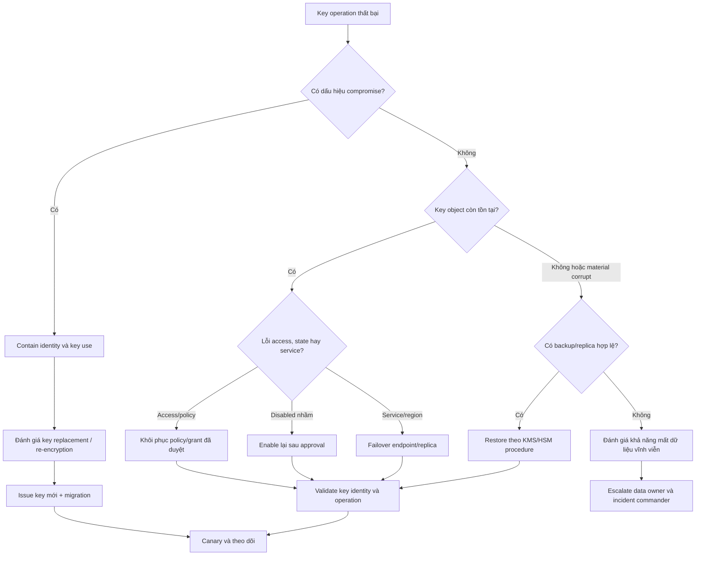

# Runbook key recovery

Runbook key recovery là quy trình có kiểm soát để khôi phục khả năng sử dụng khóa mật mã sau khi key service, HSM, account, region, key metadata hoặc quyền truy cập gặp sự cố. Mục tiêu là khôi phục dịch vụ và dữ liệu theo thứ tự ưu tiên đã định, đồng thời bảo đảm đúng key material, đúng version, đúng security boundary và có bằng chứng kiểm toán.

Khôi phục khóa không đồng nghĩa với tạo một key mới cùng thuật toán. Với dữ liệu đã mã hóa, key material cũ hoặc một bản sao tương đương có thể là điều kiện duy nhất để giải mã. Nếu mất vĩnh viễn key mã hóa và không có bản backup/replica/wrapped key có thể phục hồi, dữ liệu có thể không thể khôi phục. Ngược lại, nếu key bị compromise, khôi phục bản cũ để tiếp tục sử dụng có thể đưa attacker trở lại hệ thống; cần containment, rotation và re-encryption theo incident plan.

Runbook phải phân biệt rõ **khôi phục khả năng truy cập**, **khôi phục key material**, **khôi phục policy/metadata**, **khôi phục dịch vụ KMS/HSM** và **thay thế key bị compromise**. Mỗi loại có quy trình, quyền phê duyệt, RTO/RPO và bằng chứng khác nhau. Bài học này trình bày quy trình vận hành từ lúc kích hoạt tới khi đóng sự cố, bao gồm KMS, HSM, envelope encryption, certificate/signing key, backup, quorum, kiểm chứng và diễn tập.

## 1. Mục tiêu và phạm vi của runbook

Runbook này dùng khi một hoặc nhiều điều kiện sau xảy ra:

- KMS hoặc HSM không khả dụng, lỗi region, partition, network hoặc account.
- Key bị disable, policy bị thay đổi hoặc principal hợp lệ mất quyền sử dụng.
- Key metadata, alias, grant hoặc version reference bị mất/sai.
- Key material bị xóa, corrupt hoặc không thể truy cập từ primary service.
- HSM cluster, security domain hoặc backup appliance cần phục hồi.
- Backup key hoặc key-encryption hierarchy cần được restore.
- Ứng dụng không thể unwrap DEK để đọc dữ liệu lịch sử.
- Key bị compromise và cần chuyển sang key mới để tiếp tục vận hành.
- Mất quyền quản trị account/tenant hoặc credential phục hồi.

Runbook bao gồm key encryption key (KEK), data encryption key (DEK), symmetric key, asymmetric private key, HMAC key, signing key, CA key và key reference trong KMS/HSM. Quy trình cũng xét Secret Manager khi secret bootstrap hoặc credential cần thiết cho recovery bị mất.

Runbook không thay thế quy trình phục hồi toàn bộ database, ứng dụng, mạng hoặc identity provider. Nó xác định các phụ thuộc liên quan tới key để các runbook hạ tầng khác có thể gọi đúng bước và đúng owner.

## 2. Những khái niệm cần phân biệt trước khi khôi phục

| Khái niệm | Ý nghĩa | Câu hỏi khi sự cố xảy ra |
|---|---|---|
| Key material | Giá trị mật mã thực tế của key | Có còn bản material hợp lệ không? |
| Key object | Đối tượng key trong KMS/HSM gồm material hoặc handle, attributes và metadata | Object còn tồn tại, đúng state và đúng partition không? |
| Key reference | Key ID, ARN, alias, URI hoặc handle dùng để gọi dịch vụ | Reference có trỏ tới đúng key/version không? |
| Key metadata | Algorithm, purpose, owner, version, policy, creation time và tags | Metadata có backup hoặc source of truth khác không? |
| Key policy/grant | Quyền quản trị và sử dụng key | Lỗi do key mất hay do authorization? |
| Replica | Bản sao phục vụ HA/region failover theo semantics dịch vụ | Replica có đồng bộ và dùng được không? |
| Backup | Bản sao phục hồi theo cơ chế được hỗ trợ | Backup có đúng security domain và đã test restore chưa? |
| Wrapped DEK | DEK được mã hóa bởi KEK | KEK/version/context cần để unwrap còn khả dụng không? |
| Recovery credential | Credential hoặc share để mở quyền phục hồi | Có đủ quorum và đúng custodian không? |
| Rotation | Thay material/version theo lifecycle | Có cần đổi key mới hay chỉ phục hồi truy cập key cũ? |
| Re-encryption | Giải mã bằng key cũ và mã hóa lại bằng key mới | Có cần thực hiện do compromise hoặc migration không? |

Một alias trỏ tới key không phải là backup của key. Một bản export metadata không chứa key material cũng không đủ để phục hồi key đã mất. Replication có thể bảo vệ trước lỗi region nhưng không nhất thiết bảo vệ trước thao tác xóa nhầm hoặc compromise được đồng bộ sang replica.

## 3. Nguyên tắc an toàn khi recovery

Mọi thao tác recovery cần tuân thủ các nguyên tắc sau:

1. **Xác định loại sự cố trước khi thao tác:** phân biệt availability, access/policy, material loss, corruption và compromise.
2. **Bảo toàn bằng chứng:** giữ audit, request ID, key state, policy version, HSM event và timeline trước khi thay đổi.
3. **Không tạo key thay thế rồi giả định dữ liệu cũ sẽ đọc được:** key mới không tương đương key cũ.
4. **Dùng đúng security boundary:** HSM key phải được phục hồi bằng quy trình backup/restore được vendor và security policy hỗ trợ.
5. **Separation of duties:** người yêu cầu, người phê duyệt, custodian và người thực hiện phải được phân vai theo mức rủi ro.
6. **Quorum/dual control:** recovery key hoặc HSM backup share chỉ được dùng theo ngưỡng M-of-N đã định.
7. **Fail closed:** thiếu share, sai fingerprint, sai context hoặc không xác minh được key thì dừng.
8. **Kiểm chứng trước cutover:** xác minh identity, algorithm, key version, certificate, decrypt/verify và audit.
9. **Không để secret xuất hiện trong log:** không ghi PIN, password, raw key, recovery share, plaintext DEK hoặc private key.
10. **Đóng sự cố bằng bằng chứng:** cập nhật inventory, quyền, backup status, owner và kết quả restore test.

Không dùng runbook để vượt qua kiểm soát approval hoặc xuất key ra ngoài boundary chỉ nhằm khôi phục nhanh hơn. Nếu quy trình được tài liệu hóa không đáp ứng tình huống thực tế, dừng ở điểm an toàn và kích hoạt incident commander/security owner.

## 4. Phân loại tình huống và hướng xử lý

| Tình huống | Dấu hiệu | Hướng xử lý chính |
|---|---|---|
| KMS service/region outage | API timeout, service health incident, nhiều workload bị ảnh hưởng | Failover sang endpoint/replica đã kiểm thử; theo dõi consistency và quota |
| HSM partition/device unavailable | Token/slot không sẵn sàng, session/login lỗi | Kiểm tra cluster/partition; failover theo vendor procedure hoặc restore HSM |
| Authorization/policy failure | `AccessDenied`, key vẫn tồn tại và operation khác hoạt động | Khôi phục policy/grant từ bản đã duyệt; không restore key material |
| Alias/version reference lỗi | Alias trỏ sai hoặc consumer dùng version không tồn tại | Khôi phục mapping có approval, xác minh key ID thực |
| Key bị disable nhầm | Key tồn tại nhưng state không cho phép operation | Xác minh change/audit; enable lại theo approval nếu không compromise |
| Key đang chờ xóa | Key ở trạng thái pending deletion hoặc scheduled deletion | Xác minh deletion window và dependency; hủy lịch xóa theo approval nếu còn được hỗ trợ |
| Key material mất/corrupt | Không thể unwrap/decrypt; replica/backup là nguồn duy nhất | Restore material hoặc key object từ nguồn hợp lệ |
| Wrapped DEK không unwrap được | KEK/version/context mismatch hoặc DEK blob corrupt | Kiểm tra metadata, context, KEK version và backup; không thử key tùy tiện |
| Private signing key mất | Không thể ký bằng key/certificate hiện hành | Restore HSM backup hoặc tạo key pair/certificate mới theo PKI plan |
| Key compromise | Material/credential bị lộ hoặc operation bị lạm dụng | Contain, revoke, rotate; đánh giá re-encryption/revocation, không restore key cũ để dùng tiếp |
| Account/control-plane lockout | Không thể truy cập KMS admin hoặc recovery role | Kích hoạt account recovery/break-glass theo quy trình độc lập |

Nếu chưa xác định được loại sự cố, coi là security incident có thể liên quan compromise và không thực hiện thao tác destructive.

## 5. Vai trò và trách nhiệm

Một recovery cần người chịu trách nhiệm ra quyết định và người có quyền thực hiện thao tác kỹ thuật. Tránh để một cá nhân tự yêu cầu, phê duyệt, phục hồi và xác nhận toàn bộ quy trình.

| Vai trò | Trách nhiệm |
|---|---|
| Incident commander | Kích hoạt runbook, xác định mức độ, điều phối timeline và quyết định ưu tiên dịch vụ |
| Key owner/data owner | Xác nhận purpose, dữ liệu phụ thuộc key, RTO/RPO và impact của disable/rotation |
| Security approver | Phê duyệt recovery scope, kiểm tra compromise risk và separation of duties |
| KMS/HSM operator | Thực hiện thao tác kỹ thuật theo vendor procedure và policy |
| Recovery custodians | Cung cấp share/credential theo quorum và ghi nhận custody |
| Application/service owner | Kiểm tra consumer, key reference, decrypt/sign và readiness |
| Auditor/SOC | Bảo toàn audit evidence, theo dõi quyền đặc biệt và hậu kiểm |
| Communications lead | Thông báo trạng thái và impact tới các nhóm liên quan |

Trong môi trường nhỏ, một người có thể kiêm nhiều vai trò nhưng các hành động nhạy cảm vẫn cần approval độc lập theo policy. Recovery custodian không nên gửi share qua chat, email hoặc ticket.

## 6. Điều kiện kích hoạt và mức độ sự cố

Runbook được kích hoạt khi có một trong các điều kiện:

- Dịch vụ production không thể encrypt/decrypt/sign do key dependency.
- RTO của key service hoặc ứng dụng đã bị đe dọa.
- Key hoặc HSM partition không thể phục hồi bằng thao tác vận hành thông thường.
- Có bằng chứng mất quyền, mất key material, corruption hoặc compromise.
- Cần dùng backup, quorum, break-glass hoặc cross-region recovery.

| Mức | Tiêu chí gợi ý | Điều phối |
|---|---|---|
| SEV-1 | Nhiều dịch vụ production không thể truy cập dữ liệu; key compromise có blast radius lớn; CA/root signing bị ảnh hưởng | Incident commander, security lead, key owner và hạ tầng trực ngay |
| SEV-2 | Một dịch vụ/dataset quan trọng bị ảnh hưởng; recovery path chính không hoạt động | Service owner và KMS/HSM operator; security approver tham gia |
| SEV-3 | Một workload hoặc môi trường không production bị ảnh hưởng; có workaround đã duyệt | Owner xử lý theo change/incident process |
| Planned recovery | Diễn tập, migration, restore test hoặc kiểm tra backup | Change owner, custodians và auditor theo lịch |

Mức độ cuối cùng phụ thuộc data classification, số tenant, khả năng đọc dữ liệu, thời gian gián đoạn và phạm vi compromise. Không hạ severity chỉ vì đã có replica; cần xác minh replica thực sự dùng được.

## 7. Thông tin cần có trước khi recovery

Runbook vận hành phải liên kết tới inventory tin cậy chứa tối thiểu:

- Key ID, alias và version/material version.
- Key type, algorithm, key size/curve và purpose.
- Owner, service, tenant/domain, environment và data classification.
- KMS account/project, region, HSM cluster/partition/slot và security domain reference.
- State hiện tại, cryptoperiod, rotation policy và trạng thái cũ nếu có.
- Consumer/workload, key reference, endpoint và dependency map.
- Key policy, grant, role binding và approver.
- Backup/replica location, backup timestamp, version và restore procedure.
- Recovery quorum, custodian list và contact channel an toàn.
- Wrapped DEK format, encryption context schema, nonce/tag và ciphertext format version.
- Certificate chain, serial/fingerprint, validity, CRL/OCSP và public key archive nếu là signing key.
- RTO/RPO, retention, legal hold và destruction constraints.

Không đưa raw key, PIN, recovery share hoặc password vào inventory. Inventory chỉ lưu reference, metadata, owner và đường dẫn tới quy trình custody được bảo vệ.

## 8. RTO, RPO và thứ tự ưu tiên phục hồi

RTO (Recovery Time Objective) là thời gian mục tiêu để khôi phục dịch vụ; RPO (Recovery Point Objective) là mức mất dữ liệu hoặc trạng thái chấp nhận được theo thời gian. Với key management, RPO cần xem cả key material, key metadata, policy, grants, aliases và audit state.

Ví dụ mục tiêu để tổ chức hiệu chỉnh:

| Thành phần | RTO minh họa | RPO minh họa | Lưu ý |
|---|---:|---:|---|
| KMS API cho workload critical | 30 phút | Theo semantics replication của dịch vụ | Không tự suy ra RPO bằng 0 từ multi-region |
| HSM signing partition | 1 giờ | Không mất key object đã backup/replicate theo quy trình | Có thể cần quorum và thao tác vendor |
| Key policy/grant metadata | 1 giờ | 15 phút hoặc theo change log | Phải có version và approval evidence |
| Alias/key reference mapping | 30 phút | 15 phút | Sai mapping có thể gây dùng nhầm key |
| Wrapped DEK metadata | Theo RTO của data service | Theo transaction durability | Mất wrapped DEK có thể làm mất khả năng đọc record |
| CA signing service | Theo PKI business continuity | Không mất key/certificate state đã phát hành | Cần PKI-specific recovery plan |

Các số liệu chỉ minh họa cách đặt mục tiêu. Owner phải phê duyệt mục tiêu dựa trên business impact, provider SLA, recovery test và phụ thuộc ứng dụng. Đừng đặt RTO thấp hơn thời gian thực tế cần cho quorum, restore, validation và rollout.

Thứ tự phục hồi thường là: identity/control plane cần cho recovery → KMS/HSM endpoint → key object/material → policy/grant → key reference/alias → application integration → dữ liệu và consumer. Tuy nhiên, nếu identity provider chính bị compromise hoặc unavailable, cần recovery identity path độc lập được thiết kế trước.

## 9. Quy trình kích hoạt runbook

Khi incident được xác nhận, thực hiện tuần tự:

1. Tạo incident/change record và chỉ định incident commander.
2. Ghi nhận thời điểm phát hiện, service/tenant, key ID/version và triệu chứng.
3. Phân loại sự cố: availability, access/policy, reference, material loss, corruption hay compromise.
4. Xác định key owner, data owner, custodians, KMS/HSM operator và approver.
5. Đọc inventory và dependency map để xác định consumer cùng dữ liệu bị ảnh hưởng.
6. Thu thập audit evidence trước khi sửa state/policy nếu có thể.
7. Kiểm tra status KMS/HSM, region, network, identity, quota và service health.
8. Xác định recovery path: failover, policy restore, re-enable, backup restore, quorum recovery hoặc key replacement.
9. Đánh giá rủi ro của mỗi lựa chọn, đặc biệt khả năng làm mất dữ liệu hoặc tái sử dụng key compromised.
10. Lấy approval theo severity và recovery policy.
11. Thực hiện theo từng bước, ghi operator, timestamp, request ID và result.
12. Chạy validation độc lập trước cutover.
13. Chuyển traffic theo canary/controlled rollout và theo dõi.
14. Đóng incident sau khi owner xác nhận service/data/key state và audit đầy đủ.

Nếu bằng chứng cho thấy compromise, chuyển sang nhánh containment và replacement tại mục 20. Không dùng nhánh restore để đưa key compromised trở lại trạng thái active.

## 10. Bước 1: bảo toàn bằng chứng và xác định phạm vi

Trước khi thay đổi key state, policy hoặc alias, thu thập:

- KMS audit event, HSM audit, IAM/identity event và control-plane change log.
- Key state, key ID/version, policy snapshot và grant list.
- Alias mapping và metadata hiện tại.
- Request ID, correlation ID, error code và timestamp.
- Application logs đã được redaction, deployment version và workload identity.
- Backup/replica metadata và thời điểm snapshot gần nhất.
- Alert hoặc incident evidence đã kích hoạt runbook.

Lưu bằng chứng vào kho incident được bảo vệ integrity và access. Không export key material để “kiểm tra xem còn không”. Không chụp màn hình hoặc copy PIN/share vào incident ticket.

Phạm vi phải trả lời: key nào bị ảnh hưởng, dữ liệu/tenant nào phụ thuộc, operation nào thất bại, có operation trái phép nào thành công không, key material có dấu hiệu lộ không và các replica/backup có bị ảnh hưởng không.

## 11. Bước 2: kiểm tra KMS/HSM và phụ thuộc

Kiểm tra theo thứ tự để tránh restore không cần thiết:

1. Health/status của KMS service và region/endpoint.
2. Network path, private endpoint, DNS, TLS certificate và firewall.
3. Workload identity, token expiry, federation và IAM authorization.
4. Quota, throttling, API version và SDK/provider compatibility.
5. Key state: enabled, disabled, pending deletion, suspended hoặc compromised. Nếu đang pending deletion, kiểm tra thời hạn hủy lịch xóa và approval trước khi thao tác; nếu đã bị xóa vĩnh viễn, chỉ tiếp tục khi có recovery mechanism được dịch vụ hỗ trợ.
6. Key policy, grants, permission boundary và organization policy.
7. Alias/reference mapping, version và key object attributes.
8. HSM cluster, partition, slot, token presence, login/session và mechanism support.
9. Audit pipeline có đang ghi event đầy đủ không.

Nếu lỗi chỉ do token hết hạn, network hoặc policy sai, xử lý đúng lớp đó. Không restore key material khi key object vẫn nguyên vẹn. Nếu KMS provider báo service incident, sử dụng failover path đã được kiểm thử và theo dõi semantics consistency.

## 12. Bước 3: chọn recovery path



Không đi tiếp nếu key ID, fingerprint, key purpose hoặc backup provenance không khớp. Nếu backup chưa từng được restore test, coi khả năng phục hồi là chưa được chứng minh và escalates theo policy.

## 13. Recovery KMS: service hoặc region outage

Khi KMS API không khả dụng nhưng key material không bị mất:

1. Xác nhận incident từ provider status và telemetry nội bộ.
2. Kiểm tra endpoint/region dự phòng và key replication state.
3. Xác minh workload identity có quyền tại endpoint dự phòng.
4. Xác nhận key ID/replica mapping và encryption context semantics.
5. Kiểm tra quota, throttling và rate limit trước khi chuyển tải.
6. Chạy operation test bằng key test hoặc record canary đã được phê duyệt.
7. Chuyển một nhóm workload nhỏ sang endpoint dự phòng.
8. Theo dõi error rate, latency, decrypt/sign result và audit event.
9. Mở rộng traffic khi validation đạt; giữ rollback path.
10. Khi primary phục hồi, quyết định failback theo change plan, không tự chuyển ngay.

Multi-region key hoặc replica có semantics khác nhau giữa nhà cung cấp. Cần xác minh key ID, version, policy, grants, rotation state, encryption context và audit visibility ở region đích. Không giả định replica tự động có cùng policy hoặc mọi operation được hỗ trợ.

Nếu dịch vụ provider-managed không cho người dùng restore material, recovery có thể chỉ là chuyển endpoint/region hoặc làm việc với support theo contract. Ghi rõ ranh giới trách nhiệm của nhà cung cấp trong runbook.

## 14. Recovery policy, grants và alias

Nếu key còn tồn tại nhưng workload bị `AccessDenied`, kiểm tra policy trước khi thay đổi.

1. So sánh policy hiện tại với version đã được duyệt trong source of truth.
2. Xác minh principal và action cần cấp; không thêm wildcard để sửa nhanh.
3. Kiểm tra explicit deny, organization policy, session policy và grant constraints.
4. Kiểm tra alias có trỏ đúng key ID/version không.
5. Restore policy bằng change được phê duyệt và peer review.
6. Kiểm tra quyền allow và deny bằng test principal.
7. Chạy operation test trong phạm vi nhỏ và xác minh audit.
8. Theo dõi propagation tới region/replica/cache.

Không copy policy từ environment khác nếu principal, account, region hoặc resource ARN khác. Không cấp quyền `Decrypt`, `Sign`, `PutKeyPolicy` hoặc `ScheduleDeletion` rộng hơn yêu cầu. Nếu policy gốc không có bản kiểm soát, dừng và yêu cầu owner/security xác định intended state.

## 15. Recovery key material từ KMS backup

Khả năng backup/restore key material phụ thuộc KMS. Một số dịch vụ không cho export key material; dịch vụ quản lý durability và replication. Một số hỗ trợ imported key material hoặc backup/restore theo cơ chế riêng. Không áp dụng quy trình file backup cho mọi KMS.

Trước khi restore, xác minh:

- Backup source, creation time, key ID/reference và version.
- Backup có thuộc đúng account, region, HSM security domain hoặc tenant không.
- Integrity/authenticity của backup metadata và manifest.
- Key type, algorithm, size/curve, usage attributes và exportability.
- Backup có được tạo trước thời điểm corruption/compromise không.
- Quy trình cần quorum/custodian hoặc provider support nào.
- Policy và grants sẽ được restore hay phải cấu hình lại riêng.
- Restore có tạo key ID mới hay giữ nguyên reference; consumer cần cập nhật gì.

Thực hiện restore bằng API/tool chính thức của nhà cung cấp hoặc quy trình đã được kiểm thử. Không tự giải mã backup blob, copy file HSM hoặc dùng công cụ không được vendor hỗ trợ. Sau restore, kiểm tra key fingerprint/public key hoặc test operation phù hợp; với symmetric key không exportable, dùng known-answer/known-ciphertext test trong boundary test đã phê duyệt thay vì đọc raw key.

## 16. Recovery HSM với quorum và security domain

HSM backup thường gắn với security domain, cluster, partition hoặc backup appliance. Việc restore có thể yêu cầu M-of-N recovery shares, security officer role hoặc ceremony có người chứng kiến.

Quy tắc vận hành:

- Xác minh đúng model, firmware, security domain và backup set.
- Kiểm tra số lượng custodians tối thiểu và danh tính của từng người.
- Dùng quy trình ceremony, dual control và evidence form đã phê duyệt.
- Không tập trung mọi share vào một người hoặc một máy tính.
- Không chụp ảnh, scan, copy hoặc gửi share qua kênh không được duyệt.
- Chỉ nhập share vào HSM/backup device theo hướng dẫn vendor.
- Kiểm tra tamper status, audit state, clock và role sau restore.
- Xác minh key object attributes: sensitive, non-extractable và usage flags.
- Ghi custodian, witness, device serial, backup ID và operation reference; không ghi giá trị share.

Không tự thay đổi ngưỡng M-of-N trong lúc incident để làm recovery dễ hơn. Nếu thiếu custodian hoặc share không hợp lệ, escalates theo recovery governance; không dùng share từ backup set khác.

## 17. Recovery DEK và envelope encryption

Trong envelope encryption, dữ liệu thường được mã hóa bằng DEK, còn KEK bảo vệ DEK. Khi ứng dụng không đọc được record, xác định lỗi ở ciphertext, wrapped DEK, KEK, key version hay encryption context.

### 17.1. Kiểm tra metadata trước khi unwrap

Xác minh các trường sau:

- Algorithm/mode và format version.
- Key ID/version của KEK được dùng để wrap.
- Wrapped DEK còn nguyên vẹn và đúng encoding.
- Nonce/IV và authentication tag.
- AAD schema và context (tenant, record ID, purpose).
- Record ID, tenant reference và data schema version.
- KMS region/endpoint và quyền `Decrypt`/`UnwrapKey`.

Không thử hàng loạt key hoặc context khác nhau trên production record. Cách đó có thể tạo audit noise, tăng rủi ro lạm dụng và che giấu nguyên nhân. Dùng bản sao test đã được phê duyệt hoặc record canary.

### 17.2. KEK rotation nhưng DEK còn an toàn

Nếu chỉ KEK cũ cần thay thế và DEK không bị compromise, có thể rewrap DEK bằng KEK mới. Payload ciphertext có thể giữ nguyên nếu format, AEAD key và metadata vẫn hợp lệ.

Quy trình:

1. Xác định toàn bộ wrapped DEK dùng KEK/version cũ.
2. Xác minh KEK cũ vẫn hoạt động và không bị compromise.
3. Tạo/activate KEK mới và policy cho rewrap workflow.
4. Unwrap DEK trong memory được kiểm soát.
5. Wrap DEK bằng KEK mới và context tương ứng.
6. Ghi wrapped DEK mới cùng key ID/version mới theo transaction an toàn.
7. Đọc thử và xác minh AEAD tag/AAD trên sample.
8. Theo dõi coverage; chỉ retire KEK cũ khi không còn dependency.

Không log plaintext DEK. Nếu rewrap thất bại giữa chừng, phải giữ bản wrapped DEK cũ đến khi bản mới được xác minh và transaction commit thành công.

### 17.3. DEK bị compromise hoặc mất

Nếu DEK bị lộ, chỉ rewrap DEK bằng KEK mới không giải quyết được vì attacker đã có DEK. Cần tạo DEK mới, decrypt dữ liệu bằng DEK cũ nếu còn an toàn và re-encrypt bằng DEK mới. Nếu DEK bị mất và không có backup/replica có thể phục hồi, dữ liệu tương ứng có thể không đọc được.

Khi key bị compromise, cân nhắc cả bản sao ciphertext, plaintext đã được truy cập, backup và data export. Key rotation không thu hồi plaintext attacker đã lấy.

## 18. Recovery asymmetric key, signing key và certificate

Với asymmetric key, private key và public key có vai trò khác nhau. Recovery phụ thuộc purpose:

| Purpose | Recovery concern | Hướng xử lý |
|---|---|---|
| Data decryption | Private key cũ cần để giải mã ciphertext | Restore đúng private key hoặc chấp nhận mất dữ liệu; không thể thay bằng key pair mới |
| Artifact/document signing | Private key cũ tạo chữ ký mới; public key xác minh chữ ký lịch sử | Restore nếu key an toàn; nếu mất/compromise, tạo key pair mới và cập nhật trust/consumer |
| CA signing | Private key CA ảnh hưởng trust chain và certificate issuance | HSM ceremony, CA backup, revocation/CRL/OCSP và PKI incident plan |
| TLS/mTLS identity | Private key gắn với certificate và workload identity | Restore theo policy hoặc phát hành certificate/key pair mới; cập nhật endpoints và trust |
| Key agreement | Private key có thể cần cho phiên/dữ liệu lịch sử tùy protocol | Đánh giá protocol semantics, forward secrecy và khả năng thiết lập key mới |

Nếu signing key bị mất nhưng không bị compromise, có thể tạo key pair/certificate mới và tiếp tục ký; chữ ký cũ vẫn cần public key/certificate archive, timestamp và validation evidence. Nếu private key bị compromise, revoke certificate hoặc cập nhật trust theo PKI policy; việc phát hành certificate mới không tự làm chữ ký cũ mất hiệu lực.

Không import private key từ backup vào HSM mới nếu security domain, key attributes hoặc vendor procedure không tương thích. Với CA root key, mọi thao tác recovery phải tuân theo ceremony và approval riêng.

## 19. Recovery credential và account lockout

KMS/HSM có thể vẫn hoạt động nhưng operator mất quyền quản trị do IdP outage, credential expiry, role binding bị xóa hoặc account bị khóa. Đây là sự cố access recovery, không phải key material loss.

Kiểm tra:

- Workload identity còn hoạt động không; operator identity có bị revoke không?
- Token, certificate, federation trust và MFA dependency có còn hiệu lực không?
- Break-glass role/account có hoạt động và được giám sát không?
- Có đủ dual control/quorum để khôi phục admin path không?
- Organization policy hoặc SCP có chặn cả recovery role không?
- Kênh liên hệ provider/account recovery có sẵn không?

Break-glass credential phải được bảo vệ ngoài dependency đang gặp sự cố và chỉ dùng theo quy trình. Không lưu password/PIN trong runbook hoặc ticket. Sau recovery, rotate credential đã dùng, thu hồi session, review role/policy và kiểm tra audit.

## 20. Nhánh riêng: key bị compromise

Compromise khác với mất khả năng truy cập. Nếu attacker có raw key material, recovery bản cũ không thể làm key trở lại bí mật. Nếu attacker chỉ chiếm workload identity, key có thể vẫn an toàn về material nhưng quyền sử dụng cần bị thu hồi.

Trình tự xử lý:

1. Preserve audit và xác định thời điểm/phạm vi compromise.
2. Revoke session, token, workload identity hoặc grant bị chiếm.
3. Block operation đáng ngờ; disable key nếu incident authority xác định cần thiết và đã đánh giá impact.
4. Xác định key material có exportable hay đã được truy cập ngoài boundary không.
5. Tạo key mới với purpose, policy và owner được xác minh.
6. Với signing/certificate key: revoke certificate hoặc cập nhật trust, phát hành identity mới.
7. Với KEK: tạo KEK mới và rewrap DEK nếu DEK an toàn.
8. Với DEK: re-encrypt dữ liệu bằng DEK mới nếu có thể.
9. Với HMAC key: thay key ở cả producer/consumer và quản lý thời gian dual-verify có kiểm soát.
10. Kiểm tra backup/replica không tiếp tục đưa key compromised trở lại active.
11. Retire/destroy key cũ theo incident, retention và forensic requirements.
12. Xác minh không còn consumer sử dụng key cũ và audit đã ghi nhận migration.

Không restore backup tạo trước incident nếu backup chứa chính key material đã compromise rồi đưa nó trở lại active. Backup có thể cần giữ cho forensic/legal hold nhưng phải cô lập và đánh dấu trạng thái compromised.

## 21. Validation sau recovery

Không coi việc API trả `200 OK` hoặc key state hiển thị `Enabled` là đủ. Cần kiểm tra độc lập:

- Key ID/reference và version đúng inventory.
- Key type, algorithm, size/curve, purpose và attributes đúng.
- Policy/grant chỉ cấp quyền cần thiết; không có wildcard ngoài dự kiến.
- Principal/workload identity đúng và có thể thực hiện operation cần thiết.
- Deny test cho principal/action/resource/context ngoài scope vẫn hoạt động.
- Encrypt/decrypt hoặc sign/verify test bằng test vector/canary được phê duyệt.
- AEAD tag và AAD được xác minh; không chấp nhận plaintext khi tag sai.
- Wrapped DEK có thể unwrap bằng đúng KEK/version/context.
- Certificate chain, validity, EKU, revocation và public key mapping đúng nếu có PKI.
- HSM object attributes và audit operation phù hợp policy.
- Audit event được phát, ingest và correlate đúng request ID.
- Backup/replica state và recovery metadata được cập nhật.

Test phải dùng dữ liệu giả/test key hoặc canary đã được phê duyệt. Không dùng key production để tạo vector cố định, không export raw key để so sánh và không log plaintext.

## 22. Cutover và khôi phục traffic

Sau validation, chuyển workload theo từng bước:

1. Chọn một canary workload/tenant không vượt phạm vi được phê duyệt.
2. Cập nhật key reference/endpoint/secret version qua config control plane.
3. Xác minh workload dùng đúng principal và key version.
4. Chạy read/write hoặc sign/verify test theo use case.
5. Theo dõi error rate, latency, KMS quota, HSM sessions và audit.
6. Mở rộng từng nhóm workload theo rollout gate.
7. Kiểm tra backlog, retry và dữ liệu được tạo trong thời gian outage.
8. Chỉ failback sang primary khi consistency, policy và key state đã được xác minh.

Không để hai key version cùng nhận operation ghi ngoài kế hoạch nếu format metadata không xác định được version. Nếu có dual-read/single-write, quy định rõ version được ghi mới và thời hạn đọc version cũ.

## 23. Rollback và điều kiện dừng

Rollback không phải lúc nào cũng là quay về key cũ. Với outage thông thường, có thể chuyển endpoint trở lại sau khi primary phục hồi. Với compromise, không được quay về key cũ chỉ vì key mới gây lỗi.

Dừng recovery và escalates nếu:

- Backup provenance hoặc integrity không xác minh được.
- Fingerprint/public key/certificate không khớp inventory.
- Thiếu quorum hoặc custodian identity không hợp lệ.
- Không xác định được key purpose hoặc data owner.
- Restore làm thay đổi exportability hoặc key usage attributes ngoài policy.
- Có dấu hiệu key/backup bị compromise.
- Policy mới cấp quyền rộng hơn hoặc audit không hoạt động.
- Test decrypt/sign/verify không nhất quán.
- Có nguy cơ ghi đè bản backup tốt bằng bản lỗi.
- Không thể xác định consumer nào còn dùng key/version cũ.

Trong các trường hợp này, giữ hệ thống ở trạng thái an toàn, duy trì evidence và để incident commander quyết định phương án thay thế hoặc chấp nhận data loss theo governance.

## 24. Ví dụ checklist thao tác theo ca

```text
Incident ID:
Severity:
Incident commander:
Key owner / data owner:
Security approver:
KMS/HSM operator:
Recovery custodians / witnesses:

Affected service / tenant:
Key ID / version:
Key purpose / algorithm:
KMS account / region or HSM partition:
Current key state:
Suspected cause: availability / access / metadata / material loss / corruption / compromise
Compromise suspected: yes / no / unknown

Evidence preserved: yes / no
Backup ID / timestamp / provenance:
Quorum verified: yes / no / not applicable
Recovery path approved:
Policy and key identity validated: yes / no
Test operation passed: yes / no
Negative authorization test passed: yes / no
Audit event verified: yes / no
Canary rollout result:
Consumer coverage:
Rollback/stop condition:

Approvals and timestamps:
Operator actions and request IDs:
Final key state:
RTO achieved:
Data loss / RPO assessment:
Follow-up actions / owners:
```

Đây là biểu mẫu ghi nhận metadata. Không điền PIN, recovery share, password, raw key, plaintext DEK hoặc nội dung bí mật vào biểu mẫu/ticket.

## 25. Tự động hóa recovery an toàn

Automation có thể giảm lỗi thao tác nhưng phải giới hạn hành động và giữ approval cho thao tác nhạy cảm.

Có thể tự động hóa:

- Thu thập key metadata, service health, region status và audit reference.
- Kiểm tra inventory, dependency map và backup age.
- So sánh policy hiện tại với bản approved và tạo diff.
- Kiểm tra quorum readiness mà không đọc/hiển thị share.
- Chạy test operation bằng test key/canary.
- Tạo incident timeline, ticket và alert cho owner.
- Rollout endpoint/config tới canary sau approval.
- Theo dõi consumer coverage và key version usage.

Không tự động hóa không kiểm soát:

- Export private/symmetric key hoặc in recovery material.
- Bỏ qua quorum, dual control hoặc approval.
- Restore backup không xác minh provenance.
- Disable/delete hàng loạt key từ anomaly đơn lẻ.
- Đưa key compromised trở lại active.
- Xóa backup/audit evidence để giải phóng dung lượng.

Automation cần idempotency, bounded retry, timeout, audit, approval token, expiry và stop condition. Nếu API timeout sau thao tác có thể đã thành công, truy vấn trạng thái theo request ID trước khi lặp lại `CreateKey`, `RestoreKey`, `ScheduleDeletion` hoặc state transition.

## 26. Ví dụ Java: recovery orchestration theo state

Đoạn mã sau minh họa orchestration có trạng thái rõ ràng. Nó không gọi API của một nhà cung cấp cụ thể và không xử lý key material trực tiếp.

```java
enum RecoveryState {
    DETECTED,
    CLASSIFIED,
    APPROVED,
    RESTORED,
    VALIDATED,
    CANARY,
    COMPLETED,
    STOPPED
}

enum RecoveryCause {
    SERVICE_OUTAGE,
    ACCESS_POLICY,
    REFERENCE_ERROR,
    MATERIAL_LOSS,
    CORRUPTION,
    COMPROMISE
}

record RecoveryCase(
    String incidentId,
    String keyId,
    String keyVersion,
    RecoveryCause cause,
    RecoveryState state,
    String approvalRef
) {}

interface RecoveryGateway {
    void failover(RecoveryCase recoveryCase);
    void restoreApprovedBackup(RecoveryCase recoveryCase);
    void restorePolicy(RecoveryCase recoveryCase);
    void restoreReference(RecoveryCase recoveryCase);
    void validateKeyIdentity(RecoveryCase recoveryCase);
    void runCanary(RecoveryCase recoveryCase);
    void containCompromisedKey(RecoveryCase recoveryCase);
}

final class KeyRecoveryOrchestrator {
    private final RecoveryGateway gateway;

    KeyRecoveryOrchestrator(RecoveryGateway gateway) {
        this.gateway = gateway;
    }

    RecoveryState execute(RecoveryCase recoveryCase) {
        if (recoveryCase == null || recoveryCase.approvalRef() == null) {
            return RecoveryState.STOPPED;
        }

        try {
            switch (recoveryCase.cause()) {
                case COMPROMISE -> {
                    gateway.containCompromisedKey(recoveryCase);
                    return RecoveryState.STOPPED;
                }
                case SERVICE_OUTAGE -> gateway.failover(recoveryCase);
                case ACCESS_POLICY -> gateway.restorePolicy(recoveryCase);
                case REFERENCE_ERROR -> gateway.restoreReference(recoveryCase);
                case MATERIAL_LOSS, CORRUPTION ->
                    gateway.restoreApprovedBackup(recoveryCase);
            }

            gateway.validateKeyIdentity(recoveryCase);
            gateway.runCanary(recoveryCase);
            return RecoveryState.COMPLETED;
        } catch (RuntimeException failure) {
            return RecoveryState.STOPPED;
        }
    }
}
```

Ví dụ minh họa một nhánh điều phối đơn giản, không phải production implementation. `approvalRef` phải được xác minh với approval service; chỉ kiểm tra khác null là không đủ. Gateway phải enforce idempotency, authorization, quorum, backup provenance, audit và state transition. Nhánh compromise chỉ containment rồi dừng để incident commander thực hiện replacement/re-encryption theo playbook riêng; không tự restore key cũ.

Ví dụ dùng record và switch arrow, phù hợp Java 17 trở lên. Các interface là abstraction để thể hiện thứ tự quyết định; implementation production cần kiểm tra approval, state transition, timeout và retry an toàn.

## 27. Backup và restore test định kỳ

Backup chỉ có giá trị khi có thể phục hồi đúng key, đúng attributes và đúng quyền trong điều kiện thực tế. Một file backup có timestamp mới không chứng minh restore thành công.

Kế hoạch test nên gồm:

- Xác minh backup coverage theo key class, region, HSM domain và owner.
- Kiểm tra backup integrity/provenance và quyền truy cập.
- Restore test trong môi trường cô lập theo quy trình vendor.
- Kiểm tra key ID/version mapping và attributes sau restore.
- Kiểm tra policy/grant/alias có được phục hồi hay cần áp lại.
- Decrypt test với ciphertext canary đã được lưu riêng.
- Sign/verify test với test certificate hoặc public key archive.
- Kiểm tra quorum và sự hiện diện của custodian.
- Đo thời gian thực tế để so sánh với RTO.
- Kiểm tra audit, evidence, rollback và cleanup sau test.

Không chạy restore test bằng cách thay thế key production đang phục vụ. Dùng isolated account/partition hoặc quy trình vendor cho phép. Không tạo thêm bản export raw key ngoài backup boundary.

## 28. Rà soát sau sự cố và đóng runbook

Sau khi service phục hồi:

1. Xác nhận service owner và data owner kiểm tra chức năng nghiệp vụ.
2. Xác nhận key state, policy, version và consumer inventory.
3. Xác nhận mọi workload dùng đúng endpoint/key version.
4. Đối chiếu RTO/RPO thực tế và dữ liệu bị mất/không truy cập được.
5. Xác minh audit event từ KMS/HSM và application đã được ingest.
6. Thu hồi break-glass session, credential và temporary grant.
7. Xử lý backup/restore artifact tạm theo retention và evidence policy.
8. Cập nhật key inventory, backup manifest, owner và recovery contacts.
9. Tạo action item cho nguyên nhân gốc, automation và detection gap.
10. Tổ chức post-incident review và cập nhật runbook có version/approval.

Không đánh dấu recovery hoàn tất chỉ vì API KMS hoạt động lại. Cần xác minh dữ liệu có thể đọc, operation đúng purpose, audit đầy đủ và quyền tạm thời đã được thu hồi.

## 29. Lỗi thường gặp khi key recovery

- **Tạo key mới rồi mong giải mã dữ liệu cũ:** key mới không thay thế material cũ.
- **Nhầm replica với backup:** thao tác xóa hoặc compromise có thể lan sang replica.
- **Không phân biệt access failure và material loss:** restore sai lớp làm tăng rủi ro.
- **Restore key compromised:** đưa lại khả năng cho attacker sử dụng key cũ.
- **Không kiểm tra backup provenance:** có thể restore nhầm hoặc backup đã bị sửa.
- **Bỏ qua quorum/dual control:** recovery share có thể bị lộ hoặc dùng sai security domain.
- **Không khôi phục policy/grant:** key có material nhưng workload vẫn không dùng được.
- **Không kiểm tra alias/version:** ứng dụng có thể dùng nhầm key.
- **Rewrap DEK khi DEK đã compromise:** attacker vẫn có DEK cũ.
- **Không phân biệt rewrap và re-encryption:** payload vẫn được bảo vệ bằng DEK bị lộ.
- **Disable key quá sớm:** làm mất khả năng decrypt/verify và tăng downtime.
- **Không đánh giá certificate/signature lịch sử:** mất khả năng xác minh artifact cũ.
- **Không test restore:** phát hiện backup không dùng được trong lúc disaster.
- **Automation retry không idempotent:** tạo duplicate key hoặc state transition khó kiểm soát.
- **Ghi recovery share/PIN vào ticket:** tạo thêm đường lộ key material.
- **Đóng incident khi chỉ API hoạt động:** dữ liệu, audit hoặc consumer có thể vẫn lỗi.

## 30. Checklist runbook key recovery

- [ ] Có incident commander, key owner, data owner, security approver và operator.
- [ ] Đã phân loại outage, access/policy, reference, material loss, corruption hay compromise.
- [ ] Đã bảo toàn audit, key state, policy, grant, alias và request ID.
- [ ] Inventory xác định key ID/version, purpose, owner, consumer và data dependency.
- [ ] RTO/RPO và data impact được đánh giá.
- [ ] Đã kiểm tra KMS/HSM health, region, network, identity, quota và token.
- [ ] Đã chọn recovery path đúng; không restore material nếu chỉ lỗi policy/network.
- [ ] Backup provenance, integrity, timestamp, domain và quorum được xác minh.
- [ ] Approval/dual control/quorum đáp ứng policy.
- [ ] Không có PIN, password, raw key, DEK hoặc recovery share trong log/ticket.
- [ ] Key identity, algorithm, attributes, version và policy được xác minh sau restore.
- [ ] Envelope metadata, KEK version, wrapped DEK, AAD và context được kiểm tra.
- [ ] Certificate/public key, revocation và historical verification được kiểm tra nếu có.
- [ ] Positive operation test và negative authorization test đều PASS.
- [ ] KMS/HSM và application audit event được xác nhận.
- [ ] Canary rollout, monitoring, failback và rollback/stop conditions đã sẵn sàng.
- [ ] Credential/grant tạm thời được thu hồi sau recovery.
- [ ] Backup/restore test và post-incident action được ghi nhận.

## 31. Câu hỏi tự kiểm tra

1. Key recovery khác key rotation và key replacement như thế nào?
2. Vì sao tạo key mới không giúp giải mã ciphertext đã mã hóa bằng key cũ?
3. Phân biệt key material, key object, key reference, metadata, replica và backup.
4. Vì sao replica không nhất thiết bảo vệ trước thao tác xóa nhầm hoặc compromise?
5. Những vai trò nào cần tham gia recovery và vì sao phải separation of duties?
6. RTO/RPO cho key management cần xét những thành phần nào ngoài key material?
7. Khi nào nên failover KMS region và khi nào cần restore key?
8. Vì sao phải bảo toàn audit trước khi thay policy hoặc key state?
9. HSM recovery share cần được quản lý theo nguyên tắc nào?
10. Quorum M-of-N bảo vệ điều gì và vì sao không được hạ ngưỡng khi incident?
11. Khi KEK rotation nhưng DEK an toàn, rewrap khác re-encryption như thế nào?
12. Khi DEK bị compromise, vì sao chỉ rewrap không đủ?
13. Recovery signing key cần xử lý certificate và chữ ký lịch sử ra sao?
14. Vì sao key compromise không nên đi theo nhánh restore để tiếp tục sử dụng key cũ?
15. Những validation nào phải đạt trước khi cutover traffic?
16. Điều kiện nào buộc phải dừng recovery và escalate?
17. Automation recovery cần idempotency và approval như thế nào?
18. Backup/restore drill cần kiểm tra những gì ngoài việc file backup tồn tại?
19. Sau recovery cần thu hồi những credential/grant tạm thời nào?
20. Những bằng chứng nào cho phép incident commander đóng sự cố key recovery?

Runbook key recovery phải khôi phục đúng key và đúng quyền trong đúng security boundary, đồng thời giữ được khả năng giải mã, xác minh và kiểm toán. Khi phân loại chính xác sự cố, bảo toàn evidence, dùng backup/quorum đã kiểm thử, xác minh key identity trước cutover và tách riêng quy trình compromise khỏi quy trình restore, tổ chức có thể phục hồi dịch vụ có kiểm soát mà không biến recovery thành một nguồn rò rỉ hoặc lạm dụng key mới.
