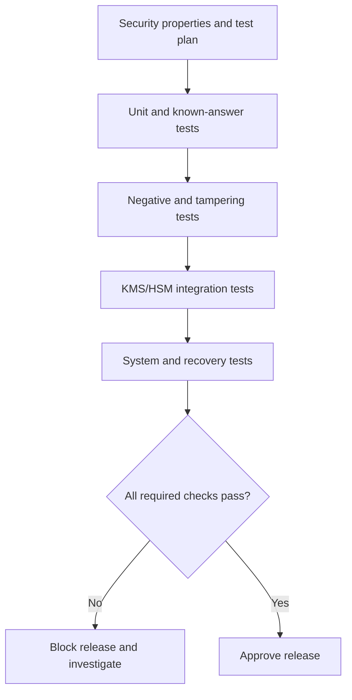

# Test encryption và decryption

## Mục tiêu học tập

Sau bài học này, bạn có thể:

- Thiết kế test xác minh encryption/decryption theo đúng thuật toán và key policy.
- Phân biệt round-trip test, known-answer test, negative test, property test và integration test.
- Kiểm tra AES-GCM/AEAD, nonce, authentication tag và Additional Authenticated Data (AAD).
- Phát hiện lỗi dùng sai key, sai version, sai algorithm, sai encoding hoặc sai encryption context.
- Kiểm thử envelope encryption, KMS/HSM integration, key rotation và khả năng đọc ciphertext lịch sử.
- Viết test Java JCA và JUnit cho trường hợp thành công, dữ liệu bị sửa và key không hợp lệ.
- Kiểm tra failure handling, concurrency, audit, backup/restore và các rủi ro vận hành.
- Xây dựng test suite không làm lộ raw key, plaintext hoặc dữ liệu production.

## 1. Vì sao phải test encryption và decryption?

Encryption và decryption là các thao tác cốt lõi của hệ thống bảo vệ dữ liệu. Một lỗi nhỏ trong key selection, nonce, AAD, encoding hoặc metadata có thể khiến dữ liệu không giải mã được, làm mất tính toàn vẹn hoặc tạo ra lỗ hổng bảo mật.

Test cần xác minh nhiều hơn việc mã hóa xong rồi giải mã ra đúng plaintext. Hệ thống còn phải từ chối ciphertext bị sửa, dùng đúng key và algorithm, kiểm tra metadata, xử lý key rotation, không làm lộ bí mật và hoạt động đúng khi KMS/HSM gặp sự cố.

Một test suite tốt cung cấp bằng chứng cho cả correctness lẫn security properties. Nó cũng giúp phát hiện regression khi đổi provider, thư viện, cấu hình, format lưu trữ hoặc quy trình quản lý key.

## 2. Những lớp kiểm thử cần có

| Lớp test | Mục đích | Ví dụ |
|---|---|---|
| Unit test | Kiểm tra một hàm hoặc lớp crypto | AES-GCM encrypt/decrypt, input validation |
| Known-answer test (KAT) | So kết quả với test vector độc lập | NIST AES-GCM vector |
| Negative/security test | Xác minh dữ liệu sai bị từ chối | Tampered tag, wrong key, wrong AAD |
| Property test | Kiểm tra tính chất trên nhiều input | Round-trip với nhiều kích thước dữ liệu |
| Integration test | Kiểm tra ranh giới provider/KMS/HSM | Wrap/unwrap DEK, permission |
| System test | Kiểm tra luồng end-to-end | API lưu và đọc ciphertext |
| Operational test | Kiểm tra vận hành và phục hồi | Rotation, backup/restore, outage |
| Performance/load test | Đo latency, throughput và giới hạn | Concurrent encrypt/decrypt |

Không thay thế một lớp bằng lớp khác. Unit test nhanh nhưng không chứng minh KMS policy đúng; integration test thật giúp kiểm tra provider nhưng không nên là cách duy nhất để kiểm tra mọi trường hợp biên.



## 3. Xác định security properties trước khi viết test

Trước khi tạo test case, xác định hệ thống phải bảo đảm điều gì:

- **Confidentiality:** người không có key không đọc được plaintext.
- **Integrity:** ciphertext hoặc metadata bị sửa phải bị phát hiện khi dùng AEAD.
- **Authenticity:** chỉ principal/key được phép mới thực hiện được operation tương ứng.
- **Key separation:** key cho purpose hoặc tenant này không được dùng thay key của purpose/tenant khác.
- **Correctness:** dữ liệu hợp lệ được khôi phục nguyên vẹn.
- **Availability/recovery:** dữ liệu vẫn đọc được theo chính sách khi rotate hoặc restore key.
- **Auditability:** thao tác được ghi nhận mà không lộ secret.

Mỗi property cần có test dương và test âm. Ví dụ, kiểm tra decrypt thành công với đúng key phải đi cùng test decrypt thất bại với key khác.

## 4. Round-trip test không đủ

Round-trip test mã hóa plaintext rồi giải mã và so sánh kết quả:

```text
plaintext -> encrypt(key) -> ciphertext -> decrypt(key) -> plaintext'
assert plaintext' == plaintext
```

Test này hữu ích để phát hiện lỗi cơ bản nhưng có thể bỏ sót nhiều lỗi:

- Encrypt và decrypt cùng dùng một implementation sai theo cùng cách.
- Test không phát hiện ciphertext có thể bị sửa mà vẫn được chấp nhận.
- Test không xác minh algorithm, key version, nonce hoặc AAD.
- Test không phát hiện key dùng chung sai tenant/purpose.
- Test không bao phủ rotation, serialization hoặc KMS permission.

Vì vậy, round-trip chỉ là một phần của test suite. Cần thêm known-answer, tampering, wrong-key, metadata, integration và operational tests.

## 5. Test vector và known-answer test

Known-answer test dùng một bộ input/output đã được công bố hoặc xác minh độc lập. Với AES-GCM, vector có thể gồm key, nonce, plaintext, AAD, ciphertext và authentication tag.

KAT giúp phát hiện implementation hoặc provider không tuân theo thuật toán mong đợi. Nên dùng test vector từ nguồn chuẩn như NIST và kiểm tra đúng serialization/encoding của thư viện.

Không tự tạo expected ciphertext bằng chính hàm đang được test rồi dùng kết quả đó làm expected value. Cách này chỉ lặp lại cùng lỗi nếu implementation sai. Khi so sánh kết quả, phải phân biệt ciphertext với tag và quy ước thư viện trả tag nối vào ciphertext hay tách riêng.

## 6. Kiểm thử AES-GCM/AEAD

AES-GCM là authenticated encryption with associated data (AEAD). Nó cung cấp confidentiality và integrity/authenticity cho ciphertext cùng AAD.

Một lần encrypt thường sử dụng:

- AES key có độ dài được profile cho phép, thường 128 hoặc 256 bit.
- Nonce/IV 96 bit theo profile GCM thông dụng.
- Plaintext cần bảo vệ.
- AAD tùy chọn, được xác thực nhưng không mã hóa.
- Authentication tag, thường dùng 128 bit.

Test phải kiểm tra decrypt thành công với đúng key, nonce, AAD; và từ chối khi ciphertext, tag, nonce hoặc AAD không khớp. Với GCM, không được tái sử dụng nonce dưới cùng một key. Nonce reuse có thể làm suy yếu nghiêm trọng cả confidentiality và integrity.

## 7. Nonce và IV test

Nonce không cần bí mật, nhưng phải tuân thủ yêu cầu của mode. Với AES-GCM, mỗi lần encryption dưới cùng một key phải có nonce duy nhất.

Test nên kiểm tra:

- Độ dài nonce đúng theo profile đã chọn.
- Nonce được lưu cùng ciphertext để decrypt.
- Không tái sử dụng nonce khi cùng key mã hóa nhiều message.
- Nonce generator xử lý concurrency và restart theo thiết kế.
- Khi rotate key, nonce namespace/counter không gây collision với key version khác nếu thiết kế yêu cầu uniqueness toàn cục.
- Nonce không bị cắt, đổi endian hoặc chuyển encoding sai khi serialize.

Sinh nonce ngẫu nhiên 96 bit có xác suất collision khác 0. Với volume cao, phải đặt giới hạn invocation per key và đánh giá collision risk; có thể cần counter/sequence strategy được quản lý bền vững. Một test vài trăm lần không chứng minh uniqueness trong production.

## 8. AAD test

AAD là dữ liệu được xác thực nhưng không được mã hóa. Nó phù hợp để ràng buộc ciphertext với metadata như tenant ID, record ID, schema version hoặc purpose.

Ví dụ AAD:

```text
tenant=tenant-42
record=invoice-9001
purpose=invoice-data
format=v2
```

Test cần xác minh:

- Decrypt thành công với đúng AAD.
- Decrypt thất bại khi tenant, record, purpose hoặc version thay đổi.
- Cách serialize AAD ổn định giữa các phiên bản ứng dụng.
- Không bỏ qua AAD khi field bị thiếu.
- Metadata nhạy cảm không bị đưa vào AAD một cách không cần thiết vì AAD không được mã hóa.

Hai bên phải tạo cùng byte sequence AAD. Nên dùng canonical encoding có version, độ dài hoặc định dạng không nhập nhằng; nối chuỗi tùy tiện có thể tạo nhiều cấu trúc khác nhau nhưng cùng byte representation.

## 9. Kiểm thử authentication tag

Với AEAD, tag xác nhận ciphertext và AAD chưa bị sửa theo key/nonce tương ứng. Nếu tag không hợp lệ, decrypt phải thất bại và plaintext không được trả về cho caller.

Các trường hợp cần test:

- Tag bị thay đổi một bit.
- Tag bị cắt ngắn hoặc thiếu.
- Ciphertext bị thay đổi.
- Nonce bị thay đổi.
- AAD bị thay đổi.
- Tag thuộc một message khác.
- Ciphertext/tag bị ghép từ hai record khác nhau.

Không xử lý lỗi tag bằng cách trả về plaintext một phần hoặc fallback sang decrypt không xác thực. API ở tầng ứng dụng nên chuyển lỗi thành kết quả thất bại an toàn và tránh phân biệt chi tiết giúp attacker xây dựng oracle.

## 10. Wrong-key và key-selection test

Decrypt với key khác phải thất bại đối với AEAD. Test nên dùng hai key độc lập, không dùng cùng key bytes với alias khác.

Kiểm tra cả key selection:

- Ciphertext mang `keyId`/`keyVersion` nào thì resolver phải chọn đúng key.
- Unknown key ID phải bị từ chối.
- Key bị disable/revoke không được dùng trái policy.
- Key của tenant A không được dùng để giải mã record của tenant B.
- Key dùng để sign không được dùng như encryption key nếu policy tách purpose.
- Không fallback sang key mặc định khi metadata thiếu hoặc không hợp lệ.

Key ID trong ciphertext envelope là metadata không đáng tin cho tới khi được xác thực và đối chiếu với inventory/policy.

## 11. Input validation và boundary tests

Crypto API phải xử lý input lỗi rõ ràng:

- `null` key, nonce, ciphertext hoặc metadata.
- Key có algorithm hoặc size không hỗ trợ.
- Nonce sai độ dài.
- Ciphertext ngắn hơn tag tối thiểu.
- AAD quá lớn hoặc encoding không hợp lệ.
- Payload rỗng, một byte, kích thước lớn và sát giới hạn.
- Ciphertext bị truncate hoặc thêm byte ngoài format.
- Key ID/version không tồn tại.
- Metadata version không được hỗ trợ.

Xác định giới hạn kích thước trước khi cấp phát buffer hoặc gọi KMS. Input quá lớn có thể gây memory exhaustion, CPU exhaustion hoặc chi phí KMS bất thường.

## 12. Encoding và serialization tests

Ciphertext thường được lưu trong binary field hoặc chuyển sang Base64URL/Base64. Serialization sai có thể khiến dữ liệu không giải mã được hoặc thay đổi bytes.

Test cần bao gồm:

- Binary round-trip qua database/file/message broker.
- Base64URL padding và alphabet theo format đã chọn.
- UTF-8 plaintext có tiếng Việt, emoji và ký tự combining.
- Null byte và dữ liệu binary tùy ý.
- JSON/CBOR/protobuf field mapping và versioning.
- Nonce, tag, wrapped DEK và key ID không bị tráo field.
- Backward compatibility khi đọc format version cũ.

Không chuyển plaintext binary thành String mặc định. Chỉ decode UTF-8 khi plaintext thực sự là text và encoding đã được xác định.

## 13. Kiểm thử key length và algorithm policy

Test cần xác minh key được tạo hoặc nạp đúng loại:

| Algorithm | Kiểm tra điển hình |
|---|---|
| AES | Key length 128/192/256 bit theo policy/provider |
| HMAC-SHA-256 | Secret key có entropy/length theo baseline |
| RSA | Modulus size và public exponent theo profile |
| EC | Curve được phép và key pair hợp lệ |
| EdDSA | Key type/profile và provider support |

Không chỉ kiểm tra `key.getAlgorithm()`. Cần kiểm tra key type, size/curve và provider metadata khi API hỗ trợ. Test phải từ chối algorithm ngoài allowlist, key size yếu hoặc key không phù hợp operation.

## 14. Test key separation và purpose binding

Một key không nên được dùng cho nhiều purpose chỉ vì API cho phép. Test nên xác minh:

- Encryption key khác signing key.
- KEK khác DEK.
- Key giữa production và staging độc lập.
- Key giữa tenant hoặc data domain được cô lập theo thiết kế.
- Purpose trong metadata khớp policy và AAD/encryption context.
- Key alias không trỏ nhầm sang key resource khác.

Thử truy cập chéo tenant, chéo environment và chéo purpose. Tất cả phải bị từ chối hoặc bị giới hạn theo policy.

## 15. Envelope encryption test

Envelope encryption thường dùng DEK để mã hóa dữ liệu và KEK để wrap DEK. Test cần kiểm tra toàn bộ chuỗi:

1. Sinh DEK ngẫu nhiên.
2. Encrypt plaintext bằng DEK và AEAD.
3. Wrap DEK bằng KMS/HSM KEK.
4. Lưu ciphertext, nonce, tag, AAD, wrapped DEK và key reference.
5. Khi đọc, unwrap DEK bằng đúng KEK và encryption context.
6. Decrypt payload bằng DEK và xác thực AAD.
7. Xóa/giải phóng reference plaintext DEK theo khả năng runtime.

Test phải xác minh ciphertext không giải mã được nếu wrapped DEK, KEK, context hoặc AAD sai. Phân biệt encryption context do KMS xác thực với AAD dùng trong AES-GCM; hai thứ có thể chứa thông tin tương tự nhưng được kiểm tra ở hai ranh giới khác nhau.

## 16. KMS/HSM integration tests

Integration test cần kiểm tra các hành vi thật của provider:

- Workload identity được xác thực đúng.
- Principal có quyền đúng operation trên đúng key.
- `GenerateDataKey`, `Encrypt`, `Decrypt`, `WrapKey`, `UnwrapKey` hoặc `Sign` được gọi đúng semantics.
- Key policy và encryption context được enforce.
- Key disabled, pending deletion hoặc revoked được xử lý theo policy.
- Timeout, throttling và service unavailable không làm lộ plaintext.
- Audit event có principal, key ID, operation và request ID.

Dùng sandbox account, test partition hoặc test key. Không chạy test destructive trên key production hoặc dữ liệu production.

## 17. Rotation và backward decryption tests

Khi rotate key, hệ thống thường phải đọc ciphertext được tạo bởi key version cũ trong một khoảng thời gian. Test cần xác minh:

- Ciphertext mới dùng key version mới.
- Ciphertext cũ vẫn decrypt được bằng key version cũ khi còn được phép.
- Metadata resolver chọn đúng version cho từng record.
- Không vô tình ghi dữ liệu mới bằng key đã retire.
- Sau khi policy revoke key cũ, hệ thống từ chối theo đúng kế hoạch.
- Rewrap DEK không làm thay đổi plaintext hoặc AAD.
- Backup/restore vẫn có đủ key version để đọc dữ liệu cần giữ.

Không xóa key cũ ngay khi key mới được tạo. Retirement cần dựa trên dependency scan, retention và recovery evidence.

## 18. Backup và restore tests

Backup của ciphertext mà thiếu key hoặc metadata cần thiết có thể không khôi phục được dữ liệu. Test recovery phải bao phủ:

- Backup ciphertext, nonce, tag, AAD và wrapped DEK.
- Backup/replication key metadata và version reference.
- KMS/HSM key backup hoặc recovery theo cơ chế được hỗ trợ.
- Khôi phục sang environment/region được phép.
- Kiểm tra authorization và encryption context sau restore.
- Decrypt sample record và so sánh hash/plaintext test fixture.
- Xác minh audit trail cho restore và key access.

Một job backup thành công không chứng minh dữ liệu có thể decrypt. Chỉ restore test định kỳ mới kiểm tra được chuỗi dependency thực tế.

## 19. Java JCA: AES-GCM implementation cho test

Ví dụ Java 17 dưới đây mô hình hóa AES-GCM. Nonce được cấp qua `NonceSource` để test có thể kiểm soát; production cần triển khai nguồn nonce phù hợp và bảo đảm không tái sử dụng nonce dưới cùng một key.

```java
import java.security.GeneralSecurityException;
import javax.crypto.Cipher;
import javax.crypto.SecretKey;
import javax.crypto.spec.GCMParameterSpec;

interface NonceSource {
    byte[] nextNonce();
}

record Ciphertext(byte[] nonce, byte[] value) {
    Ciphertext {
        nonce = nonce.clone();
        value = value.clone();
    }

    @Override
    public byte[] nonce() {
        return nonce.clone();
    }

    @Override
    public byte[] value() {
        return value.clone();
    }
}

final class AesGcm {
    private static final int NONCE_BYTES = 12;
    private static final int TAG_BITS = 128;

    private AesGcm() {}

    static Ciphertext encrypt(SecretKey key, byte[] plaintext,
                              byte[] aad, NonceSource nonceSource)
            throws GeneralSecurityException {
        byte[] nonce = nonceSource.nextNonce();
        if (nonce == null || nonce.length != NONCE_BYTES) {
            throw new IllegalArgumentException("Invalid GCM nonce length");
        }

        Cipher cipher = Cipher.getInstance("AES/GCM/NoPadding");
        cipher.init(Cipher.ENCRYPT_MODE, key,
                new GCMParameterSpec(TAG_BITS, nonce));
        if (aad != null) {
            cipher.updateAAD(aad);
        }
        return new Ciphertext(nonce, cipher.doFinal(plaintext));
    }

    static byte[] decrypt(SecretKey key, Ciphertext encrypted,
                          byte[] aad) throws GeneralSecurityException {
        byte[] nonce = encrypted.nonce();
        byte[] value = encrypted.value();
        if (nonce.length != NONCE_BYTES || value.length < TAG_BITS / 8) {
            throw new IllegalArgumentException("Malformed GCM payload");
        }

        Cipher cipher = Cipher.getInstance("AES/GCM/NoPadding");
        cipher.init(Cipher.DECRYPT_MODE, key,
                new GCMParameterSpec(TAG_BITS, nonce));
        if (aad != null) {
            cipher.updateAAD(aad);
        }
        return cipher.doFinal(value);
    }
}
```

`Cipher.doFinal` xác minh tag trước khi trả plaintext thành công. Ứng dụng cần xử lý `AEADBadTagException` như một lỗi xác thực và không fallback sang chế độ không xác thực. Defensive copy trong record tránh caller sửa array đã lưu sau khi tạo object. Đây là ví dụ minh họa; production còn cần quản lý nonce uniqueness, giới hạn input, metadata version và error handling.

## 20. Java JUnit: round-trip và tampering tests

Ví dụ JUnit 5 sau kiểm tra round-trip, wrong key, AAD bị sửa và ciphertext/tag bị thay đổi. Nonce nguồn đếm chỉ dùng trong test để kết quả dễ lặp lại; tuyệt đối không dùng counter reset theo process làm nonce production nếu không có cơ chế uniqueness bền vững.

```java
import static org.junit.jupiter.api.Assertions.*;

import java.util.HexFormat;
import java.util.concurrent.atomic.AtomicLong;
import javax.crypto.AEADBadTagException;
import javax.crypto.KeyGenerator;
import javax.crypto.SecretKey;
import javax.crypto.spec.SecretKeySpec;
import org.junit.jupiter.api.BeforeEach;
import org.junit.jupiter.api.Test;

final class AesGcmTest {
    private SecretKey key;
    private SecretKey otherKey;
    private NonceSource nonceSource;

    @BeforeEach
    void setUp() throws Exception {
        KeyGenerator generator = KeyGenerator.getInstance("AES");
        generator.init(256);
        key = generator.generateKey();
        otherKey = generator.generateKey();

        AtomicLong counter = new AtomicLong(1);
        nonceSource = () -> {
            byte[] nonce = new byte[12];
            long value = counter.getAndIncrement();
            for (int i = 0; i < 8; i++) {
                nonce[11 - i] = (byte) (value >>> (8 * i));
            }
            return nonce;
        };
    }

    @Test
    void roundTripPreservesPlaintext() throws Exception {
        byte[] plaintext = "Dữ liệu hóa đơn".getBytes(java.nio.charset.StandardCharsets.UTF_8);
        byte[] aad = "tenant-42|invoice-9|v1".getBytes(java.nio.charset.StandardCharsets.UTF_8);

        Ciphertext encrypted = AesGcm.encrypt(key, plaintext, aad, nonceSource);
        byte[] recovered = AesGcm.decrypt(key, encrypted, aad);

        assertArrayEquals(plaintext, recovered);
    }

    @Test
    void matchesNistAesGcmEmptyPlaintextVector() throws Exception {
        SecretKey vectorKey = new SecretKeySpec(new byte[16], "AES");
        NonceSource zeroNonce = () -> new byte[12];

        Ciphertext encrypted = AesGcm.encrypt(
                vectorKey, new byte[0], new byte[0], zeroNonce);

        assertArrayEquals(
                HexFormat.of().parseHex("58e2fccefa7e3061367f1d57a4e7455a"),
                encrypted.value());
        assertArrayEquals(new byte[0],
                AesGcm.decrypt(vectorKey, encrypted, new byte[0]));
    }

    @Test
    void wrongKeyIsRejected() throws Exception {
        Ciphertext encrypted = AesGcm.encrypt(
                key, new byte[] {1, 2, 3}, null, nonceSource);

        assertThrows(AEADBadTagException.class,
                () -> AesGcm.decrypt(otherKey, encrypted, null));
    }

    @Test
    void changedAadIsRejected() throws Exception {
        byte[] aad = "tenant-A".getBytes(java.nio.charset.StandardCharsets.UTF_8);
        Ciphertext encrypted = AesGcm.encrypt(
                key, new byte[] {4, 5, 6}, aad, nonceSource);

        assertThrows(AEADBadTagException.class,
                () -> AesGcm.decrypt(key, encrypted,
                        "tenant-B".getBytes(java.nio.charset.StandardCharsets.UTF_8)));
    }

    @Test
    void modifiedCiphertextIsRejected() throws Exception {
        Ciphertext encrypted = AesGcm.encrypt(
                key, new byte[] {7, 8, 9}, null, nonceSource);
        byte[] changed = encrypted.value();
        changed[0] ^= 0x01;
        Ciphertext tampered = new Ciphertext(encrypted.nonce(), changed);

        assertThrows(AEADBadTagException.class,
                () -> AesGcm.decrypt(key, tampered, null));
    }

    @Test
    void modifiedTagIsRejected() throws Exception {
        Ciphertext encrypted = AesGcm.encrypt(
                key, new byte[] {10, 11, 12}, null, nonceSource);
        byte[] changed = encrypted.value();
        changed[changed.length - 1] ^= 0x01;
        Ciphertext tampered = new Ciphertext(encrypted.nonce(), changed);

        assertThrows(AEADBadTagException.class,
                () -> AesGcm.decrypt(key, tampered, null));
    }

    @Test
    void modifiedNonceIsRejected() throws Exception {
        Ciphertext encrypted = AesGcm.encrypt(
                key, new byte[] {13, 14, 15}, null, nonceSource);
        byte[] changedNonce = encrypted.nonce();
        changedNonce[0] ^= 0x01;
        Ciphertext tampered = new Ciphertext(changedNonce, encrypted.value());

        assertThrows(AEADBadTagException.class,
                () -> AesGcm.decrypt(key, tampered, null));
    }
}
```

Test dùng `AEADBadTagException` cho sai key/AAD/tag theo provider chuẩn. Một số provider có thể bọc exception khác ở tầng cao hơn; application test nên kiểm tra contract lỗi công khai của adapter thay vì phụ thuộc message của provider.

## 21. Test nonce uniqueness và concurrency

Nonce reuse là lỗi nghiêm trọng với GCM. Test cần tập trung vào cơ chế cấp nonce thực tế, không chỉ kiểm tra độ dài.

Các hướng kiểm tra:

- Với counter-based nonce, xác minh counter tăng đơn điệu và không reset khi restart/scale-out.
- Với distributed workers, xác minh mỗi worker có namespace/prefix riêng hoặc dùng allocator chung an toàn.
- Với random nonce, theo dõi số lần dùng trên mỗi key và tuân thủ giới hạn collision risk của profile.
- Chạy test concurrent để tìm race condition trong allocator.
- Kiểm tra overflow và hành vi khi hết nonce space: phải dừng hoặc rotate key, không wrap counter.
- Kiểm tra backup/restore không khôi phục counter về giá trị cũ trong khi key vẫn tiếp tục được dùng.

Một test concurrency có thể thu thập nonce từ nhiều thread rồi xác minh không có duplicate trong tập test. Kết quả này là bằng chứng cho implementation trong test window, không phải chứng minh toán học cho mọi lần chạy.

## 22. Test empty, binary và large payload

AES-GCM có thể xử lý plaintext rỗng, nhưng vẫn tạo authentication tag. Test nên bao gồm:

- Empty plaintext và empty AAD.
- Một byte, block boundary và dữ liệu không chia hết cho block.
- UTF-8 tiếng Việt, emoji và combining character.
- Binary chứa `0x00`, `0xFF` và mọi byte value.
- Payload gần giới hạn ứng dụng.
- Payload lớn theo chunking/streaming API nếu hệ thống hỗ trợ.

Nếu dùng streaming encryption, test phải xác minh thứ tự chunk, final tag, abort giữa chừng và không công bố plaintext chưa được xác thực. Với GCM, không được xử lý dữ liệu giải mã trước khi tag cuối cùng được xác minh.

## 23. Test deterministic vectors và randomized properties

Hai nhóm test có mục đích khác nhau:

- **Deterministic vector:** dùng key, nonce, plaintext và AAD cố định để so output với expected value độc lập.
- **Randomized/property test:** sinh nhiều plaintext, AAD và key để kiểm tra round-trip, không crash và xử lý boundary.

KAT phải tái lập chính xác. Property test có thể dùng seed được ghi lại để tái tạo failure. Không dùng random test thay cho KAT, và không xem một bộ test random pass là bằng chứng thuật toán an toàn.

Test randomness cần kiểm tra API gọi đúng CSPRNG/provider và không dùng `java.util.Random` để sinh key/nonce. Statistical test trên một lượng nhỏ output không chứng minh entropy hoặc chất lượng CSPRNG.

## 24. Serialization, schema version và metadata migration

Ciphertext thường được lưu cùng metadata như:

- Format version.
- Algorithm và tag length.
- Key ID/version.
- Nonce/IV.
- AAD hoặc metadata cần tái tạo AAD.
- Ciphertext và authentication tag.
- Wrapped DEK và KEK reference nếu dùng envelope encryption.

Test migration cần đọc format cũ, ghi format mới và từ chối version không được hỗ trợ. Không lấy `alg` hoặc `keyId` từ payload không tin cậy rồi thực thi tùy ý; phải kiểm tra allowlist và binding với key inventory.

Nếu AAD được tạo từ metadata, phải xác minh metadata không bị sửa ngoài authenticated boundary. Có thể cần đưa canonical metadata vào AAD và kiểm tra lại sau khi decrypt.

## 25. Test key rotation và key revocation

Test rotation cần xác minh luồng writer/reader qua nhiều version:

1. Tạo ciphertext bằng key version 1.
2. Tạo key version 2 và chuyển writer sang version 2.
3. Decrypt ciphertext version 1 bằng key version 1 khi policy còn cho phép.
4. Decrypt ciphertext version 2 bằng key version 2.
5. Rewrap/re-encrypt dữ liệu theo kế hoạch.
6. Disable/revoke version 1 và xác minh hành vi từ chối đúng policy.
7. Khôi phục backup và xác minh key version cần thiết vẫn có sẵn.

Không test revocation bằng cách phá hủy key duy nhất chứa dữ liệu quan trọng. Dùng key test riêng và môi trường có thể phục hồi.

## 26. Negative tests cho authorization và tenant isolation

Encryption có thể đúng về mặt thuật toán nhưng sai về authorization. Test nên xác minh:

- Principal không có quyền decrypt bị từ chối.
- Workload tenant A không decrypt ciphertext của tenant B.
- Staging identity không truy cập production key.
- Read-only/auditor identity không gọi decrypt.
- Key disabled, scheduled for deletion hoặc revoked không được dùng ngoài policy.
- Encryption context sai bị KMS từ chối.
- Key reference giả hoặc unknown bị từ chối, không fallback.
- Permission cache không tiếp tục cấp quyền sau revoke quá thời gian policy cho phép.

Không chỉ assert HTTP 403/exception; cần kiểm tra không có plaintext được trả về, không có side effect và audit ghi đúng principal/action/decision.

## 27. Failure injection và resilience tests

KMS/HSM hoặc provider có thể timeout, throttling, network partition hoặc trả lỗi tạm thời. Test cần mô phỏng:

- KMS unavailable trước khi encrypt/decrypt.
- Timeout sau khi server đã thực hiện operation nhưng client chưa nhận response.
- Retry lặp lại request.
- HSM session hết hạn hoặc slot/partition không sẵn sàng.
- Credential hết hạn hoặc workload identity federation lỗi.
- Audit sink không nhận event.
- Key bị disable trong lúc workload đang chạy.
- Provider đổi hoặc thiếu algorithm support sau upgrade.

Retry phải phân biệt lỗi transient với lỗi authentication/tag/policy. Không retry vô hạn khi sai key hoặc tag; không tự fallback sang key khác. Với encrypt, retry sau timeout phải xử lý nguy cơ nonce reuse và duplicate record theo thiết kế idempotent.

## 28. Concurrency và performance tests

Test tải cần đo latency, throughput, allocation, queueing và KMS request rate. Với Java, kiểm tra việc tạo `Cipher` instance theo từng operation/thread vì `Cipher` không được thiết kế để dùng chung đồng thời giữa các thread.

Đo riêng:

- Local AES-GCM encrypt/decrypt.
- KMS wrap/unwrap hoặc GenerateDataKey.
- Network latency và retry.
- Serialization/deserialization.
- Cold start/provider initialization.
- Concurrent nonce allocation.

Không đánh đổi nonce uniqueness, tag length hoặc key strength để đạt throughput. Đặt quota/rate limit và backpressure để tránh KMS cost spike hoặc denial of service.

## 29. Provider, FIPS và compatibility tests

Java JCA có thể chọn provider khác nhau tùy runtime và cấu hình. Test nên xác minh provider thực tế:

- `Cipher.getInstance` chọn provider mong đợi.
- AES key size và GCM parameters được hỗ trợ.
- Provider không âm thầm fallback sang transformation khác.
- JDK/provider upgrade không làm thay đổi ciphertext format.
- HSM-backed key handle hoạt động qua đúng provider.
- FIPS mode sử dụng module/provider đã được validation theo phạm vi yêu cầu.

Tên algorithm có trong JCA không chứng minh provider đã được FIPS validated. Nếu compliance yêu cầu, kiểm tra certificate, module version, operating mode và deployment boundary.

## 30. Test logging, error handling và side-channel behavior

Test phải bảo đảm lỗi crypto không làm lộ plaintext hoặc key material:

- Log không chứa raw key, password, plaintext DEK hoặc bearer token.
- Exception không trả về ciphertext/tag/AAD nhạy cảm ngoài policy.
- API không phân biệt quá chi tiết lỗi giúp attacker dò ciphertext hoặc key.
- Không trả plaintext một phần trước khi AEAD tag được xác minh.
- Không lưu decrypted data vào temporary file không được bảo vệ.
- Metrics không dùng raw key ID hoặc tenant secret làm label cardinality cao.

Timing behavior của cryptographic provider thường khó kiểm chứng bằng unit test thông thường. Dùng primitive và provider được đánh giá, tránh tự viết constant-time crypto, và thực hiện security review cho các API lộ oracle.

## 31. Test backup, recovery và disaster recovery drill

Disaster recovery drill phải chứng minh tổ chức có thể khôi phục cả ciphertext lẫn khả năng truy cập key hợp lệ.

Một drill có thể:

1. Khôi phục database/object store vào test environment.
2. Khôi phục key reference, wrapped DEK và metadata.
3. Xác minh KMS/HSM key backup/replica theo quy trình được hỗ trợ.
4. Cấp workload identity tối thiểu cho recovery service.
5. Decrypt sample records với đúng context/AAD.
6. So sánh plaintext với test fixture hoặc digest đã lưu.
7. Xác minh audit và approval cho thao tác restore.
8. Thu hồi quyền tạm thời sau drill.

Không export private key hoặc KEK ra ngoài boundary chỉ để làm DR test dễ hơn nếu kiến trúc yêu cầu key non-exportable.

## 32. Test data và quản lý test key

Test phải dùng key và data fixture riêng. Không sao chép production key hoặc dữ liệu cá nhân vào local test, CI artifact hoặc bug report.

Nguyên tắc:

- Sinh test key mới bằng CSPRNG hoặc KMS test account.
- Dùng synthetic plaintext có cấu trúc gần thực tế.
- Đặt owner, purpose và expiration cho test key.
- Tách key theo CI job/environment khi cần.
- Xóa/disable test key sau test theo lifecycle policy.
- Không commit key bytes cố định vào repository.
- Với KAT, dùng vector công khai được kiểm soát và chỉ dùng cho kiểm thử.
- Giới hạn quyền đọc test artifact và log.

Nếu test cần fixed key/nonce để tái lập vector, chỉ dùng trong test fixture cô lập; không tái sử dụng fixture đó để mã hóa dữ liệu thật.

## 33. Case study: lỗi AAD sau khi đổi schema

Một dịch vụ lưu hóa đơn bằng AES-GCM. Phiên bản đầu tạo AAD từ `tenantId + "|" + invoiceId`. Phiên bản sau thay đổi serializer và đưa thêm schema version nhưng một node cũ vẫn tạo AAD theo format trước đó. Ciphertext mới được ghi thành công, nhưng một số node không thể decrypt do AAD khác nhau.

Test hiện tại chỉ có round-trip trong cùng phiên bản nên không phát hiện vấn đề. Nhóm bổ sung test compatibility giữa phiên bản, lưu AAD format version cùng ciphertext, dùng canonical encoding và tạo KAT cho metadata. Test negative xác minh đổi tenant hoặc invoice ID sẽ làm decrypt thất bại. Rollout giữ reader hỗ trợ format cũ trong thời gian migration; writer chỉ chuyển format mới sau khi toàn bộ reader đã sẵn sàng.

Bài học là AAD là một phần của authenticated contract. Nó cần versioning và backward compatibility giống ciphertext format, không được xem là chuỗi phụ có thể thay đổi tùy ý.

## 34. Checklist test encryption và decryption

- [ ] Có round-trip test với plaintext text và binary.
- [ ] Có known-answer test từ test vector độc lập.
- [ ] Có test wrong key, wrong nonce, wrong AAD và modified tag/ciphertext.
- [ ] Có test nonce length, uniqueness, concurrency và restart behavior.
- [ ] Có test key size, algorithm allowlist và provider selection.
- [ ] Có test empty, boundary, large và malformed inputs.
- [ ] Có test serialization, encoding và metadata version migration.
- [ ] Có test key separation, tenant isolation và purpose binding.
- [ ] Có test envelope encryption wrap/unwrap và encryption context.
- [ ] Có test KMS/HSM permission, timeout, throttling và unavailable.
- [ ] Có test rotation, old ciphertext decryption, revoke và rewrap.
- [ ] Có test backup/restore và disaster recovery.
- [ ] Có test concurrent load, nonce allocator và rate limits.
- [ ] Có test log/error không lộ key hoặc plaintext.
- [ ] Có test audit event và correlation ID.
- [ ] Dùng test key/data riêng, không dùng production secret.
- [ ] Có CI gate cho KAT, security negative tests và integration tests.
- [ ] Có test compatibility trước khi đổi provider/JDK/schema.

## 35. Câu hỏi tự kiểm tra

**1. Round-trip test xác minh điều gì?**

Nó xác minh dữ liệu mã hóa rồi giải mã bằng đúng cấu hình được khôi phục nguyên vẹn.

**2. Vì sao round-trip không đủ?**

Nó có thể bỏ sót lỗi chung của encrypt/decrypt, tampering, key selection, AAD, rotation và provider.

**3. Known-answer test dùng để làm gì?**

So implementation với expected output độc lập từ test vector đáng tin cậy.

**4. AES-GCM cung cấp những thuộc tính nào?**

Confidentiality và integrity/authenticity cho ciphertext cùng AAD.

**5. Nonce GCM có cần bí mật không?**

Không, nhưng phải duy nhất dưới cùng một key theo profile GCM.

**6. AAD có được mã hóa không?**

Không. AAD được xác thực nhưng vẫn có thể đọc được.

**7. Nếu tag không hợp lệ thì decrypt phải làm gì?**

Từ chối và không trả plaintext cho caller.

**8. Vì sao cần wrong-key test?**

Để xác minh key selection đúng và ciphertext không được giải mã bằng key không liên quan.

**9. Test nonce generator cần bao gồm gì?**

Uniqueness, concurrency, restart, overflow và giới hạn sử dụng theo key.

**10. KMS encryption context khác GCM AAD thế nào?**

Chúng được xác thực ở các ranh giới khác nhau; encryption context gắn với KMS operation, còn GCM AAD gắn với payload AEAD.

**11. Envelope encryption test cần kiểm tra gì?**

Sinh DEK, encrypt payload, wrap/unwrap DEK, context, AAD và decrypt đúng.

**12. Vì sao cần key rotation test?**

Để bảo đảm dữ liệu cũ vẫn đọc được trong thời gian migration và key mới được dùng đúng.

**13. Có nên destroy key cũ ngay sau rotation?**

Không. Cần xử lý dependency, backup, retention và recovery trước.

**14. Test serialization nên bao gồm gì?**

Binary, Base64, UTF-8, nonce/tag mapping và format version compatibility.

**15. Vì sao không dùng `java.util.Random` tạo nonce/key?**

Nó không phải CSPRNG và không phù hợp để sinh material mật mã.

**16. Test random có chứng minh CSPRNG an toàn không?**

Không. Cần xác minh provider/API và đánh giá implementation; statistical test nhỏ không chứng minh entropy.

**17. Vì sao không chia sẻ `Cipher` giữa nhiều thread?**

`Cipher` có trạng thái và không được thiết kế để dùng đồng thời giữa các thread.

**18. Test backup thành công có chứng minh restore được không?**

Không. Cần restore drill và decrypt dữ liệu mẫu với đầy đủ key dependency.

**19. Có nên log plaintext khi decrypt lỗi để debug?**

Không. Dùng correlation ID, key reference và error category; giữ plaintext khỏi log.

**20. Vì sao cần test AAD compatibility?**

Thay đổi cách tạo AAD làm tag verification thất bại dù ciphertext và key không đổi.

## 36. Kết luận

Test encryption và decryption phải chứng minh cả khả năng khôi phục dữ liệu hợp lệ lẫn khả năng từ chối dữ liệu sai hoặc bị sửa. Round-trip test là điểm bắt đầu; known-answer, tampering, wrong-key, nonce/AAD, serialization, key separation, envelope encryption, KMS/HSM, rotation và recovery mới tạo thành bộ kiểm thử đủ chiều sâu.

Với Java, dùng JCA/provider đáng tin cậy và test rõ contract của AEAD. Với AES-GCM, bảo đảm nonce không bị tái sử dụng dưới cùng key, xác minh tag trước khi công bố plaintext và ràng buộc metadata qua AAD. Test key, test data, audit và CI pipeline phải được quản lý riêng khỏi production secret. Một hệ thống chỉ nên được đưa vào vận hành khi cả correctness, authorization, lifecycle và khả năng phục hồi đều đã được kiểm chứng.
