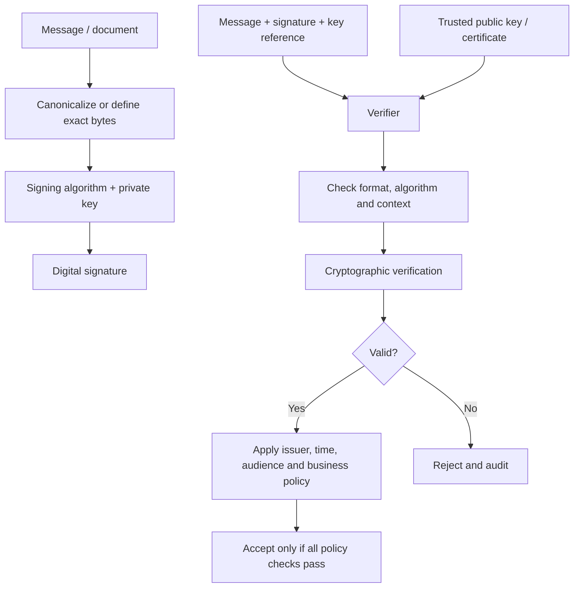

# Test signature verification

**Test signature verification** là hoạt động kiểm thử quá trình xác minh chữ ký số để bảo đảm hệ thống chỉ chấp nhận chữ ký hợp lệ được tạo bằng private key tương ứng, trên đúng dữ liệu, đúng thuật toán, đúng định dạng và đúng ngữ cảnh tin cậy. Kiểm thử cần bao phủ phép toán mật mã, cách chuẩn bị dữ liệu ký, nguồn gốc public key, chứng thư số, trạng thái khóa, xử lý lỗi và hành vi của ứng dụng khi chữ ký không hợp lệ.

Trong quản lý khóa mật mã, xác minh chữ ký là một điểm kiểm soát quan trọng: service có thể dùng public key để xác minh token, artifact, giao dịch, tài liệu hoặc thông điệp do một hệ thống khác ký. Một phép xác minh toán học thành công chưa đủ để kết luận dữ liệu được phép xử lý. Ứng dụng còn phải xác định public key có thuộc đúng issuer hay không, chứng thư có được tin cậy và còn hiệu lực không, thuật toán có được policy cho phép không, thông điệp có đúng audience/tenant và còn trong thời hạn không.

Trong phạm vi **SECURITY_KEY_MANAGEMENT_FUNDAMENTALS**, bài học kết nối chữ ký số, cặp khóa bất đối xứng, KMS/HSM, certificate/PKI, key rotation, access control, audit và testing. Mục tiêu là xây dựng bộ kiểm thử phát hiện lỗi xác minh, lỗi cấu hình và lỗi tích hợp trước khi chúng tạo ra quyết định bảo mật sai trong production.

## 1. Mục tiêu của kiểm thử signature verification

Một hệ thống xác minh chữ ký cần chứng minh được rằng:

- Dữ liệu không bị thay đổi kể từ khi được ký.
- Chữ ký được tạo bởi private key tương ứng với public key đang dùng để xác minh.
- Thuật toán, tham số, encoding và format chữ ký đúng với policy.
- Public key được lấy từ nguồn tin cậy và gắn với đúng issuer/key identity.
- Chứng thư và trust chain đáp ứng yêu cầu về thời gian, mục đích và trạng thái thu hồi.
- Ứng dụng từ chối dữ liệu sai chữ ký, sai ngữ cảnh, sai audience hoặc đã hết hạn.
- Lỗi từ KMS/HSM, certificate service hoặc key registry không làm hệ thống tự động chấp nhận request.
- Rotation không làm mất khả năng xác minh chữ ký hợp lệ được tạo trước đó.
- Audit ghi đủ bằng chứng cần thiết mà không tiết lộ private key, token hoặc dữ liệu nhạy cảm.

Kiểm thử không chỉ chạy một test với chữ ký đúng. Cần chứng minh các trường hợp sai đều bị từ chối và không có đường fallback làm suy yếu chính sách.

## 2. Quy trình ký và xác minh chữ ký số

Với chữ ký bất đối xứng, bên ký dùng private key để tạo chữ ký trên message hoặc digest theo thuật toán quy định. Bên nhận dùng public key tương ứng để xác minh. Private key phải được bảo vệ; public key có thể phân phối nhưng nguồn gốc và binding của nó vẫn phải được xác thực.



Một verification pipeline thường có các bước: parse envelope, chọn key reference, xác thực nguồn public key, kiểm tra thuật toán/format, tái tạo đúng bytes được ký, thực hiện phép xác minh và áp dụng policy nghiệp vụ. Thứ tự cụ thể phụ thuộc giao thức, nhưng không được bỏ qua bước xác thực key provenance hoặc ngữ cảnh chỉ vì phép toán chữ ký trả về `true`.

## 3. Chữ ký số bảo đảm điều gì và không bảo đảm điều gì?

Chữ ký số có thể cung cấp bằng chứng về tính toàn vẹn của dữ liệu và việc chữ ký được tạo bằng private key tương ứng với public key. Khi key được gắn đáng tin với một identity, chữ ký còn hỗ trợ xác thực nguồn ký và non-repudiation theo mô hình pháp lý/vận hành phù hợp.

Chữ ký số tự nó không bảo đảm:

- Dữ liệu là đúng về mặt nghiệp vụ hoặc người ký có thẩm quyền cho hành động đó.
- Public key thuộc đúng người/issuer nếu key binding chưa được xác minh.
- Thông điệp còn mới hoặc chưa từng được gửi lại (replay).
- Certificate chưa bị thu hồi hoặc private key chưa bị compromise.
- Nội dung được giữ bí mật; chữ ký không phải mã hóa.
- Hệ thống đã kiểm tra audience, tenant, expiry, nonce hoặc transaction state.
- Private key được bảo vệ an toàn chỉ vì phép xác minh thành công.

Do đó, test suite cần tách **cryptographic verification** khỏi **certificate/path validation** và **application authorization**. Mỗi lớp có kết quả và lỗi riêng.

## 4. Phân biệt các lớp xác minh

| Lớp | Câu hỏi cần trả lời | Kiểm thử tiêu biểu |
|---|---|---|
| Signature verification | Chữ ký có khớp với bytes và public key không? | Đúng chữ ký, dữ liệu bị sửa, sai public key, chữ ký malformed |
| Key provenance | Public key có đến từ issuer/registry đáng tin không? | Sai issuer, key ID giả, key registry bị thay đổi |
| Certificate path validation | Chứng thư có chain tới trust anchor và đáp ứng constraints không? | Chain sai, certificate hết hạn, key usage sai |
| Revocation/time validation | Certificate/key có bị thu hồi hoặc không hợp lệ tại thời điểm cần xét không? | CRL/OCSP revoked/unknown/stale, thời gian sai |
| Protocol validation | Envelope, algorithm identifier và encoding có đúng chuẩn không? | Header sai, algorithm downgrade, encoding không hợp lệ |
| Application authorization | Người ký có được phép thực hiện hành động này trong ngữ cảnh hiện tại không? | Sai tenant, audience, scope, expiry, replay |

Không gộp tất cả thành một boolean không có reason code. Trong code nội bộ, có thể dùng kết quả tổng hợp, nhưng telemetry và test cần biết lớp nào thất bại.

## 5. Phân biệt signature với MAC và encryption

| Cơ chế | Khóa | Ai có thể xác minh? | Mục đích chính |
|---|---|---|---|
| Digital signature | Private key ký, public key xác minh | Bất kỳ bên nào có public key tin cậy | Integrity và xác thực nguồn ký |
| MAC/HMAC | Secret key dùng chung | Bên nắm secret key | Integrity và xác thực giữa các bên chia sẻ secret |
| Encryption | Public/private hoặc secret key tùy cơ chế | Bên có quyền giải mã | Confidentiality |

Không dùng test HMAC để thay thế test chữ ký bất đối xứng. HMAC verification không chứng minh ai trong số các bên giữ secret đã tạo MAC. Encryption thành công cũng không chứng minh dữ liệu có chữ ký hợp lệ.

## 6. Chọn thuật toán và tham số đúng policy

Verifier cần có allowlist thuật toán và tham số rõ ràng. Không để một trường `alg` do client gửi quyết định tùy ý thuật toán mà hệ thống sẽ chấp nhận.

| Thuật toán | Điểm cần kiểm thử |
|---|---|
| Ed25519 | Đúng key type, signature length/encoding, provider support và test vector |
| ECDSA | Curve được phép, hash đúng, signature format DER hay raw theo giao thức, xử lý scalar ngoài miền |
| RSA-PSS | Hash, MGF1 hash, salt length, trailer field và modulus/key size phù hợp |
| RSA PKCS#1 v1.5 signature | Chỉ dùng khi policy/giao thức còn cho phép; kiểm tra DigestInfo/algorithm identifier và chống downgrade |
| DSA | Chỉ kiểm thử cho hệ thống legacy nếu còn được phép; không tự chọn làm mặc định cho thiết kế mới |

Thuật toán yếu hoặc đã bị loại khỏi policy như MD5/SHA-1 cho chữ ký mới phải bị từ chối theo cấu hình. Nếu hệ thống cần xác minh chữ ký lịch sử được tạo khi thuật toán còn được chấp nhận, cần có policy historical validation riêng với mốc thời gian và bằng chứng phù hợp; không mở lại thuật toán yếu cho request mới.

Với RSA-PSS, hai bên phải thống nhất hash, MGF1 và salt length. Với ECDSA, cùng một chữ ký có thể có encoding DER trong API mật mã nhưng encoding `R || S` cố định độ dài trong một số giao thức. Không được coi hai encoding là hoán đổi trực tiếp nếu chưa chuyển đổi và kiểm tra độ dài/range đúng chuẩn.

## 7. Message bytes và canonicalization

Phần dữ liệu được xác minh phải đúng từng byte với phần dữ liệu đã ký. Nhiều lỗi không nằm trong thuật toán mà ở việc hai bên diễn giải cùng một đối tượng thành các byte khác nhau.

Các điểm cần kiểm thử:

- UTF-8 và Unicode normalization; ký tự nhìn giống nhau có thể có code point khác nhau.
- CRLF và LF, whitespace, trailing newline và BOM.
- Thứ tự field, escaping, số thập phân, exponent và null trong JSON.
- Thứ tự header/payload và base64url padding trong giao thức như JWS.
- URL normalization, query parameter ordering và percent encoding.
- XML canonicalization, namespace và transform nếu dùng XML Signature.
- Nội dung detached signature và cách liên kết signature với đúng file/message.

Không parse một JSON thành object rồi serialize lại bằng serializer tùy ý trước khi verify. Nếu giao thức định nghĩa canonical JSON, phải dùng đúng canonicalization algorithm và test vectors tương ứng. Nếu giao thức ký raw bytes, verifier phải dùng chính bytes đã nhận, không tự “làm sạch” hoặc chuẩn hóa nội dung.

Với structured message, nên có domain separation và ràng buộc ngữ cảnh. Ví dụ, chữ ký cho `payment-approval` không nên được tái sử dụng như chữ ký cho `user-login`. Có thể đưa protocol name, message type, version, tenant hoặc audience vào signed payload theo schema đã định nghĩa.

## 8. Key ID và nguồn gốc public key

Trường `kid` hoặc key ID thường chỉ là gợi ý để tìm public key; bản thân nó không chứng minh key thuộc issuer. Verifier phải lấy key từ trust store, JWKS endpoint, certificate registry hoặc hệ thống quản lý khóa được cấu hình tin cậy.

Kiểm thử cần bao gồm:

- Key ID tồn tại và map tới đúng public key.
- Key ID không tồn tại hoặc đã bị thu hồi.
- Hai key có ID trùng hoặc registry trả nhiều kết quả mơ hồ.
- Attacker thay `kid` để trỏ sang key do attacker kiểm soát.
- JWKS/certificate registry trả key từ issuer hoặc endpoint không được phép.
- Cache key cũ sau rotation và cache poisoning.
- Key metadata có purpose, algorithm, tenant và status phù hợp.

Không tải public key từ URL tùy ý do token/message cung cấp. Với JWKS, URL nguồn phải được cấu hình hoặc xác thực theo issuer policy; kiểm soát redirect, TLS, hostname, cache và key-set version. Nếu `kid` không tìm thấy, không được tự thử tất cả key ở mọi tenant cho đến khi một key bất kỳ làm chữ ký hợp lệ.

## 9. Certificate path validation

Nếu public key được phân phối qua X.509 certificate, verifier thường cần kiểm tra certificate path tới trust anchor được cấu hình. Một certificate có chữ ký toán học đúng vẫn có thể không được tin cậy nếu chain sai hoặc certificate không dành cho mục đích đó.

Những thuộc tính cần kiểm tra:

- Chain từ leaf tới intermediate và trust anchor.
- Issuer/subject và chữ ký của từng certificate trong chain.
- `notBefore` và `notAfter` theo thời điểm validation.
- Basic Constraints và path length của CA certificate.
- Key Usage và Extended Key Usage phù hợp với signing purpose.
- Name constraints, certificate policy và algorithm constraints nếu áp dụng.
- Public key algorithm, curve/modulus và key strength.
- Trust anchor được cấu hình độc lập, không lấy từ message không tin cậy.

Một leaf certificate dùng cho TLS server authentication không tự động phù hợp để ký code hoặc tài liệu. Test cần chứng minh EKU/Key Usage không phù hợp sẽ bị từ chối.

## 10. Revocation và thời điểm xác minh

Certificate có thể bị thu hồi trước ngày hết hạn. Tùy policy, verifier có thể dùng CRL, OCSP hoặc nguồn revocation khác. Phải kiểm thử trạng thái `revoked`, `good` và `unknown`, cũng như freshness và lỗi mạng.

Các trường hợp cần kiểm thử:

- Certificate đã bị revoke với reason code liên quan.
- CRL hết hạn, sai issuer, chữ ký CRL sai hoặc CRL không chứa trạng thái cần thiết.
- OCSP response sai chữ ký, sai responder, sai certificate ID hoặc đã quá `thisUpdate`/`nextUpdate`.
- OCSP responder timeout hoặc không truy cập được.
- Cache giữ trạng thái `good` sau khi certificate bị revoke.
- Policy soft-fail hoặc hard-fail khi revocation service không khả dụng.
- Chữ ký lịch sử cần đánh giá theo trusted timestamp tại thời điểm ký, nếu hệ thống hỗ trợ.

Không tự chọn soft-fail hay hard-fail chung cho mọi hệ thống. Quyết định phụ thuộc threat model, loại giao dịch và yêu cầu vận hành. Với thao tác có rủi ro cao, không nên âm thầm bỏ qua revocation check khi nguồn trạng thái không xác định.

## 11. Kiểm tra thời gian và replay protection

Chữ ký hợp lệ có thể được gửi lại nhiều lần. Chữ ký không tự cung cấp freshness hoặc chống replay.

Nếu giao thức yêu cầu, payload cần chứa và verifier phải kiểm tra:

- `issuedAt` hoặc timestamp có timezone rõ.
- `expiresAt`/`exp` và clock skew được cho phép.
- `nonce`, `jti`, sequence number hoặc transaction ID chưa được sử dụng.
- `audience` đúng service nhận.
- `issuer` đúng danh tính đã cấu hình.
- `tenant`, subject và scope khớp với request hiện tại.
- Message type/version đúng endpoint và nghiệp vụ.

Test replay nên gửi lại đúng một message/chữ ký đã được chấp nhận và xác nhận request thứ hai bị từ chối khi protocol yêu cầu one-time use. Không nhầm test này với phép kiểm tra chữ ký: cùng một chữ ký có thể hợp lệ về mật mã nhưng không còn được phép dùng lại.

## 12. Tích hợp KMS/HSM khi ký và xác minh

Trong nhiều hệ thống, private key nằm trong KMS/HSM và ứng dụng chỉ nhận key handle hoặc gọi API `Sign`. Public key được lấy từ metadata/certificate và dùng để verify trong ứng dụng, hoặc verifier gọi một dịch vụ chuyên dụng.

Kiểm thử tích hợp cần xác minh:

- Private key không bị export khỏi KMS/HSM khi không được phép.
- Principal ký chỉ có quyền `Sign` trên đúng key/purpose.
- Verifier chỉ lấy public key từ nguồn tin cậy và đúng version.
- Algorithm/parameters trong request khớp key metadata và policy.
- Provider trả signature đúng format mà consumer mong đợi.
- Timeout sau khi provider đã ký không tạo ra trạng thái nghiệp vụ mơ hồ hoặc giao dịch lặp.
- Permission denial, throttling, provider outage và key disabled được xử lý fail-closed.
- Audit liên kết request ID, key ID/version, principal, algorithm và kết quả.

Không mock toàn bộ KMS/HSM trong mọi cấp kiểm thử. Unit test có thể dùng fake adapter, nhưng cần integration test với sandbox hoặc thiết bị kiểm thử để phát hiện khác biệt về encoding, parameter, provider behavior và key policy.

## 13. Key lifecycle, rotation và chữ ký lịch sử

Rotation có thể tạo public key mới trong khi chữ ký cũ vẫn cần xác minh. Verifier cần biết key version nào đã ký message và có giữ được public key/certificate lịch sử trong thời hạn yêu cầu hay không.

Một key registry nên lưu metadata như:

| Thuộc tính | Ý nghĩa |
|---|---|
| `keyId` / `kid` | Định danh ổn định để tra cứu |
| `keyVersion` | Phiên bản cụ thể dùng để ký |
| `algorithm` / `parameters` | Thuật toán và tham số được phép |
| `purpose` | Code signing, document signing, token signing hoặc mục đích khác |
| `issuer` / `owner` | Chủ thể chịu trách nhiệm và nguồn phát hành |
| `status` | Active, verify-only, revoked, retired hoặc trạng thái nội bộ tương đương |
| `validFrom` / `validUntil` | Khoảng thời gian được phép dùng theo policy |
| `certificateRef` | Tham chiếu certificate/chain nếu có |

Khi rotation, thường có giai đoạn overlap: key mới được dùng để ký; key cũ chuyển sang verify-only để xác minh chữ ký lịch sử. Việc verify-only là policy ở application/registry; provider có thể có state khác. Nếu key bị compromise, chữ ký được tạo trong khoảng ảnh hưởng cần được đánh giá riêng, không mặc định hợp lệ chỉ vì public key vẫn có trong registry.

## 14. Các lớp kết quả và fail-closed behavior

Verifier nên phân biệt ít nhất các kết quả sau:

| Kết quả | Ý nghĩa | Hành vi |
|---|---|---|
| `VALID` | Phép toán chữ ký đúng và các policy bắt buộc đều đạt | Có thể tiếp tục bước nghiệp vụ |
| `INVALID_SIGNATURE` | Chữ ký không khớp với message/public key | Từ chối |
| `MALFORMED_INPUT` | Signature, envelope hoặc message không đúng format | Từ chối và ghi reason code |
| `UNTRUSTED_KEY` | Không xác thực được nguồn public key | Từ chối |
| `CERTIFICATE_INVALID` | Chain, validity, usage hoặc constraints không đạt | Từ chối |
| `REVOKED` | Certificate/key bị thu hồi theo policy | Từ chối hoặc áp dụng historical validation riêng |
| `UNKNOWN_KEY` | Không tìm thấy key version phù hợp | Từ chối; không thử nguồn tùy ý |
| `UNSUPPORTED_ALGORITHM` | Algorithm/parameters không nằm trong allowlist | Từ chối |
| `POLICY_REJECTED` | Chữ ký toán học đúng nhưng sai tenant, audience, purpose hoặc freshness | Từ chối |
| `DEPENDENCY_UNAVAILABLE` | KMS, registry, OCSP hoặc CRL service không sẵn sàng | Không tự permit; áp dụng fallback đã phê duyệt nếu có |

Không biến exception, timeout hoặc trạng thái `UNKNOWN` thành `VALID`. Nếu có fallback offline, phải giới hạn rõ nguồn key, cache age, loại operation và thời gian; mọi quyết định fallback cần audit.

## 15. Java: tạo và xác minh chữ ký Ed25519

Ví dụ sau dùng JCA tạo một cặp khóa Ed25519 dùng riêng cho test, ký message và kiểm tra các trường hợp đúng, message bị sửa và sai public key. Private key chỉ tồn tại trong bộ nhớ của ví dụ; không dùng cách tạo khóa này để thay thế KMS/HSM trong production.

```java
import java.nio.charset.StandardCharsets;
import java.security.GeneralSecurityException;
import java.security.KeyPair;
import java.security.KeyPairGenerator;
import java.security.Signature;
import java.util.Arrays;
import java.util.Objects;

public final class SignatureVerificationTestDemo {
    private SignatureVerificationTestDemo() {}

    static byte[] sign(byte[] message, java.security.PrivateKey privateKey)
            throws GeneralSecurityException {
        Objects.requireNonNull(message, "message");
        Objects.requireNonNull(privateKey, "privateKey");

        Signature signer = Signature.getInstance("Ed25519");
        signer.initSign(privateKey);
        signer.update(message);
        return signer.sign();
    }

    static boolean verify(byte[] message, byte[] signatureBytes,
                          java.security.PublicKey publicKey)
            throws GeneralSecurityException {
        Objects.requireNonNull(message, "message");
        Objects.requireNonNull(signatureBytes, "signatureBytes");
        Objects.requireNonNull(publicKey, "publicKey");

        Signature verifier = Signature.getInstance("Ed25519");
        verifier.initVerify(publicKey);
        verifier.update(message);
        return verifier.verify(signatureBytes);
    }

    public static void main(String[] args) throws Exception {
        KeyPairGenerator generator = KeyPairGenerator.getInstance("Ed25519");
        KeyPair trustedPair = generator.generateKeyPair();
        KeyPair unrelatedPair = generator.generateKeyPair();

        byte[] message = "payment-approval:v1:transaction-42"
                .getBytes(StandardCharsets.UTF_8);
        byte[] signatureBytes = sign(message, trustedPair.getPrivate());

        boolean valid = verify(message, signatureBytes, trustedPair.getPublic());

        byte[] modifiedMessage = Arrays.copyOf(message, message.length);
        modifiedMessage[0] ^= 0x01;
        boolean modifiedMessageAccepted = verify(
                modifiedMessage, signatureBytes, trustedPair.getPublic());

        boolean wrongKeyAccepted = verify(
                message, signatureBytes, unrelatedPair.getPublic());

        if (!valid || modifiedMessageAccepted || wrongKeyAccepted) {
            throw new AssertionError("Signature verification test failed");
        }

        System.out.println("Valid signature accepted; tampered message and wrong key rejected.");
    }
}
```

Ví dụ cần Java 15 trở lên để dùng Ed25519 qua JCA. Nó minh họa phép toán chữ ký, chưa kiểm tra certificate chain, revocation, key provenance, audience, expiry hoặc replay. `verify` có thể ném `SignatureException` khi signature bytes malformed; lớp gọi cần chuyển lỗi đó thành kết quả từ chối có reason code, không được coi exception là thành công.

Trong production, `sign` nên được thay bằng adapter gọi KMS/HSM với key reference. Public key phải được lấy từ trust store hoặc registry đã xác thực. Không log private key, signature payload nhạy cảm hoặc toàn bộ token.

## 16. Kiểm thử RSA-PSS và tham số

RSA-PSS là ví dụ điển hình cho lỗi hai phía dùng cùng thuật toán tên gọi nhưng khác tham số. Verifier phải dùng đúng hash, MGF1 digest và salt length theo profile đã thỏa thuận.

Ví dụ profile cần cố định:

```text
Signature algorithm : RSASSA-PSS
Message digest      : SHA-256
Mask generation     : MGF1
MGF1 digest         : SHA-256
Salt length         : 32 bytes
Trailer field       : 1
```

Test suite nên tạo chữ ký bằng đúng profile và xác minh thành công. Sau đó tạo các chữ ký với MGF1 digest khác, salt length khác hoặc thuật toán khác và xác nhận verifier từ chối. Không tự suy luận tham số từ signature bytes nếu giao thức yêu cầu cấu hình cố định.

## 17. Kiểm thử format chữ ký và parser

Chữ ký có thể được truyền dưới dạng raw bytes, Base64, Base64URL, DER, JWS compact serialization hoặc định dạng đặc thù của ứng dụng. Lỗi parser có thể dẫn đến xác minh sai hoặc xử lý không nhất quán giữa các thành phần.

Các ca cần có:

- Base64/Base64URL hợp lệ, padding đúng hoặc không padding theo chuẩn.
- Ký tự ngoài alphabet, whitespace bất thường và padding thừa.
- Byte array rỗng, quá ngắn, quá dài hoặc bị cắt giữa chừng.
- DER có length encoding sai, trailing bytes hoặc integer không canonical.
- ECDSA `r`/`s` bằng 0, âm hoặc lớn hơn order của curve.
- JWS có segment thiếu, nhiều dấu chấm, header/payload rỗng hoặc JSON trùng field.
- Algorithm identifier không khớp với key type hoặc policy.
- Signature bị chuyển nhầm giữa DER và fixed-width raw encoding.
- Parser nhận duplicate `kid`, `alg`, `crit` hoặc field có nhiều cách diễn giải.

Parser phải giới hạn kích thước input và độ sâu cấu trúc để tránh resource exhaustion. Reject malformed input sớm, không thử nhiều parser/algorithm fallback tùy tiện.

## 18. Ma trận kiểm thử positive và negative

Một test suite tối thiểu nên bao phủ các trường hợp sau:

| Nhóm | Test case | Kết quả mong đợi |
|---|---|---|
| Positive | Message đúng, signature đúng, public key tin cậy | Accept |
| Integrity | Thay một byte trong message | Reject |
| Signature | Thay một bit trong signature | Reject |
| Key | Dùng public key khác | Reject |
| Key lookup | `kid` không tồn tại | Reject với `UNKNOWN_KEY` |
| Provenance | Key đến từ issuer không tin cậy | Reject |
| Algorithm | Algorithm không nằm trong allowlist | Reject |
| Parameter | RSA-PSS salt/MGF1 không đúng profile | Reject |
| Format | Signature malformed/truncated | Reject có kiểm soát |
| Certificate | Chain sai hoặc certificate hết hạn | Reject |
| Key usage | EKU/Key Usage không dành cho signing purpose | Reject |
| Revocation | Certificate bị revoke | Reject theo policy |
| Freshness | Token hết hạn hoặc `issuedAt` ở tương lai ngoài clock skew | Reject |
| Replay | Gửi lại nonce/jti đã dùng | Reject nếu protocol yêu cầu one-time use |
| Context | Sai tenant, audience hoặc message type | Reject |
| Rotation | Chữ ký mới dùng key mới; chữ ký lịch sử dùng key version cũ còn được phép | Accept đúng theo policy |
| Retirement | Key đã retire khỏi signing nhưng còn verify-only | Verify lịch sử được phép; sign mới bị chặn |
| Compromise | Key bị đánh dấu compromised | Reject theo incident policy hoặc historical assessment riêng |
| Dependency | Registry/OCSP/KMS timeout | Không permit mặc định |
| Audit | Signature invalid hoặc policy reject | Có event và reason code, không lộ secret |

Test phải xác minh cả HTTP/API response, business side effect và audit. Ví dụ, một request bị reject không được tạo payment, phát hành token hoặc cập nhật trạng thái giao dịch.

## 19. Boundary, edge case và test vectors

Ngoài test thông thường, cần kiểm thử biên của dữ liệu và thuật toán:

- Message rỗng, một byte, message rất lớn và đúng giới hạn tối đa.
- Signature có độ dài hợp lệ tối thiểu/tối đa theo thuật toán.
- Public key thiếu parameter, key type sai hoặc key object không được provider hỗ trợ.
- Unicode composed/decomposed và nhiều newline/whitespace.
- Timestamp tại đúng ranh giới `notBefore`, `notAfter`, `exp` và clock skew.
- Certificate chain dài, thiếu intermediate hoặc có cross-signing.
- Nhiều certificate/key cùng tên nhưng khác fingerprint.
- Signature hợp lệ trên message type khác hoặc tenant khác.
- Rotation xảy ra trong khi request đang xác minh và key registry được cập nhật.

Ưu tiên test vector chuẩn từ đặc tả thuật toán và giao thức đang dùng. Lưu vector cùng metadata về algorithm, parameters, input bytes, public key và expected result. Không tự tạo toàn bộ vector bằng chính implementation đang kiểm thử vì cùng một bug có thể xuất hiện ở cả signer lẫn verifier.

## 20. Kiểm thử interoperability giữa provider

Một hệ thống có thể ký bằng HSM vendor A, xác minh bằng Java provider B và được consumer khác xử lý qua một thư viện JWT/XML/COSE. Cần test chéo để phát hiện khác biệt format và parameter.

Ma trận interoperability nên có:

| Signer | Verifier | Mục tiêu |
|---|---|---|
| JCA software provider | JCA provider khác | Xác nhận thuật toán/parameter và format tương thích |
| KMS sandbox | Java verifier | Xác nhận encoding signature do KMS trả về |
| HSM/PKCS#11 | Application verifier | Xác nhận key handle, mechanism và output format |
| Service A | Service B | Xác nhận canonicalization và protocol envelope giống nhau |
| Current version | Historical verifier | Xác minh chữ ký cũ theo key registry và policy lưu trữ |

Không so sánh byte signature của hai lần ký một cách tuyệt đối với thuật toán có tính ngẫu nhiên như ECDSA hoặc RSA-PSS nếu profile không đảm bảo deterministic output. Hãy xác minh từng chữ ký với public key và kiểm tra interoperability theo semantics, không đòi hai chữ ký khác lần phải giống byte-for-byte.

## 21. Kiểm thử certificate validation trong Java

Phép xác minh chữ ký bằng `Signature` chỉ dùng public key được cung cấp. Nếu public key đến từ X.509 certificate, cần kiểm tra path riêng bằng PKIX. Một test certificate hợp lệ phải chain tới trust anchor được cấu hình trong test; các ca sai chain, expired, usage sai hoặc revocation phải bị từ chối.

Ví dụ khung kiểm thử path validation:

```java
import java.security.cert.CertPath;
import java.security.cert.CertPathValidator;
import java.security.cert.CertificateFactory;
import java.security.cert.PKIXParameters;
import java.security.cert.TrustAnchor;
import java.security.cert.X509Certificate;
import java.util.List;
import java.util.Set;

CertificateFactory factory = CertificateFactory.getInstance("X.509");
List<X509Certificate> chain = List.of(leafCertificate, intermediateCertificate);
CertPath path = factory.generateCertPath(chain);

PKIXParameters parameters = new PKIXParameters(
        Set.of(new TrustAnchor(trustedRootCertificate, null)));
parameters.setRevocationEnabled(true);

CertPathValidator validator = CertPathValidator.getInstance("PKIX");
validator.validate(path, parameters);
```

Đây là khung minh họa. Trong test thực tế, cần cung cấp certificate fixture, trust anchor riêng, cấu hình CRL/OCSP và clock validation phù hợp. `setRevocationEnabled(true)` không tự chứng minh mọi deployment đã có revocation behavior giống nhau; hãy cấu hình và kiểm thử `PKIXRevocationChecker` hoặc cơ chế revocation của ứng dụng theo provider/JDK đang dùng.

Không đặt root CA production vào test fixture hoặc trust store dùng chung cho mọi test. Test phải dùng CA test riêng và bảo đảm certificate không thể được dùng ngoài môi trường kiểm thử.

## 22. Kiểm thử key rotation và verify-only overlap

Rotation test cần xác minh hành vi theo từng version:

1. Tạo key version mới và publish public key/certificate mới vào registry.
2. Ký message mới bằng private key version mới.
3. Xác minh message mới bằng public key version mới.
4. Xác minh chữ ký lịch sử bằng public key version cũ trong thời hạn policy cho phép.
5. Xác nhận key cũ không còn được dùng để ký message mới sau cutover.
6. Kiểm tra cache, JWKS refresh, replica và consumer chậm cập nhật.
7. Thu hồi hoặc retire key cũ theo policy và xác nhận hành vi historical validation.
8. Kiểm tra rollback không khiến signer quay về version cũ ngoài ý muốn.

Nếu key cũ bị compromise, historical signature không tự động đáng tin chỉ vì signature bytes hợp lệ. Cần xem thời điểm ký, trusted timestamp, phạm vi compromise và chính sách xác minh lịch sử. Với key signing không có timestamp tin cậy, có thể không xác định chắc chắn chữ ký được tạo trước hay sau thời điểm compromise.

## 23. Kiểm thử lỗi và độ sẵn sàng

Verifier thường phụ thuộc key registry, JWKS, certificate service, OCSP/CRL, KMS/HSM hoặc cache. Cần fault injection có kiểm soát:

- Registry timeout hoặc trả dữ liệu không đầy đủ.
- JWKS endpoint trả HTTP lỗi, JSON malformed, redirect không được phép hoặc key set rỗng.
- Certificate chain fetch không lấy được intermediate.
- OCSP responder timeout, trả `unknown` hoặc response sai chữ ký.
- Cache stale, cache stampede hoặc cache poisoning.
- HSM/KMS bị throttling hoặc key version bị disable giữa request.
- Provider restart, network partition hoặc TLS certificate của provider hết hạn.
- Audit sink mất kết nối trong lúc verifier từ chối chữ ký.

Hệ thống phải có timeout, giới hạn retry và circuit breaker phù hợp. Khi không xác minh được key provenance hoặc trạng thái bắt buộc, không tự chuyển sang accept. Nếu có offline trust cache, phải giới hạn TTL, version và nguồn cập nhật; cảnh báo khi dùng cache cũ.

## 24. Kiểm thử bảo mật parser và fuzzing

Các parser của JWS, COSE, XML Signature hoặc format riêng có thể là bề mặt tấn công. Fuzzing nên tập trung vào input không hợp lệ và sự khác biệt giữa các parser.

Các kỹ thuật hữu ích:

- Mutation fuzzing trên header, payload, signature, certificate và key ID.
- Property-based tests cho canonicalization: cùng một logical message phải tạo bytes canonical nhất quán theo spec.
- Differential testing giữa hai thư viện parser/verification độc lập.
- Test duplicate JSON fields, unknown critical headers và algorithm confusion.
- Giới hạn kích thước, số certificate trong chain, độ sâu JSON/XML và số lần fetch key.
- XML Signature wrapping tests nếu ứng dụng dùng XMLDSig: đảm bảo ứng dụng xử lý đúng node đã được xác minh.
- Kiểm tra timing/error messages không tiết lộ thông tin nhạy cảm về key registry hoặc cấu hình nội bộ.

Fuzz test phải chạy trong sandbox với key/certificate giả. Lưu seed gây lỗi và biến nó thành regression test sau khi sửa.

## 25. Audit và observability cho signature verification

Audit event nên đủ để tái dựng quyết định mà không lưu bí mật:

- Request/correlation ID và thời điểm.
- Principal hoặc service thực hiện verification.
- Key ID/version, issuer và certificate fingerprint khi phù hợp.
- Algorithm, parameter profile và signature format.
- Kết quả từng lớp: signature, provenance, certificate, revocation và application policy.
- Reason code cho trường hợp reject/indeterminate.
- Nguồn key registry/JWKS version và cache age.
- Provider/crypto library version nếu cần phục vụ điều tra.

Không ghi private key, bearer token đầy đủ, plaintext nhạy cảm hoặc raw signature payload nếu không có mục đích và kiểm soát rõ. Với message nhạy cảm, log hash/correlation reference theo thiết kế thay vì nội dung.

Metrics nên theo dõi tỷ lệ valid/invalid, malformed input, unknown key, certificate expiry/revocation, algorithm rejection, registry/OCSP timeout, cache age, provider latency và số lần dùng historical key. Tăng đột biến signature invalid có thể là lỗi triển khai hoặc tấn công; cần phân biệt theo issuer, tenant, endpoint và reason code.

## 26. Lỗi thường gặp khi kiểm thử signature verification

| Lỗi | Hậu quả | Cách khắc phục |
|---|---|---|
| Chỉ test chữ ký hợp lệ | Không phát hiện verifier chấp nhận input sai | Bổ sung negative test và tamper test |
| Tin `kid` mà không xác thực nguồn key | Attacker có thể đưa public key của mình | Key lookup chỉ từ registry/issuer tin cậy |
| Chấp nhận algorithm từ header tùy ý | Algorithm confusion hoặc downgrade | Allowlist theo key metadata và protocol policy |
| Parse rồi serialize message khác bytes đã ký | False reject hoặc xác minh nhầm nội dung | Canonicalization chính xác hoặc verify raw bytes |
| Chỉ kiểm tra chữ ký, bỏ certificate path | Chấp nhận key không được tin cậy | Tách test signature và PKIX validation |
| Bỏ qua revocation khi responder lỗi | Certificate bị thu hồi vẫn được chấp nhận | Policy soft/hard fail rõ ràng và test failure path |
| Xem chữ ký hợp lệ là chống replay | Message cũ được dùng lại | Nonce, jti, sequence, audience và expiry |
| Xóa public key cũ ngay khi rotation | Chữ ký lịch sử không xác minh được | Verify-only overlap và retention policy |
| Dùng mock ở mọi cấp | Bỏ sót provider/encoding differences | Integration test KMS/HSM sandbox |
| So sánh signature bytes giữa hai lần ký ngẫu nhiên | Test flaky hoặc kết luận sai | Verify từng chữ ký thay vì so byte output |
| Catch mọi exception rồi trả true/default | Fail-open nghiêm trọng | Fail-closed và reason code rõ ràng |
| Log toàn bộ token/message | Rò rỉ dữ liệu và credential | Data minimization và correlation reference |

## 27. Checklist kiểm thử signature verification

Trước khi phát hành verifier, hãy xác nhận:

- [ ] Đã xác định protocol, message bytes và canonicalization rule.
- [ ] Algorithm và parameters được allowlist theo key purpose/type.
- [ ] Có test vector chuẩn và test interoperability giữa signer/verifier.
- [ ] Chữ ký đúng được chấp nhận; message bị sửa, chữ ký sai và public key sai bị từ chối.
- [ ] Parser từ chối signature malformed, truncated, oversized và encoding sai.
- [ ] `kid` chỉ dùng để tra cứu trong nguồn key tin cậy; không fetch URL tùy ý.
- [ ] Certificate path, validity, Key Usage/EKU và trust anchor được kiểm tra riêng.
- [ ] CRL/OCSP freshness, revoked, unknown, timeout và cache stale được kiểm thử.
- [ ] Audience, issuer, tenant, expiry, nonce/jti và replay policy được xác minh.
- [ ] Rotation overlap cho phép verify lịch sử nhưng chặn sign bằng key cũ sau cutover.
- [ ] Compromised/revoked key có behavior rõ ràng cho current và historical signatures.
- [ ] KMS/HSM private key không bị export; IAM chỉ cấp quyền đúng purpose/action.
- [ ] Có integration test với provider sandbox hoặc HSM test device.
- [ ] Có fault injection cho registry, OCSP/CRL, KMS/HSM và audit sink.
- [ ] Có fuzz/property/differential tests cho parser và canonicalization.
- [ ] Business side effect không xảy ra khi verification hoặc policy thất bại.
- [ ] Audit/metrics có reason code và không chứa secret hoặc plaintext nhạy cảm.

Test signature verification cần chứng minh cả tính đúng của phép toán lẫn độ tin cậy của toàn bộ đường xác minh. Khi kiểm thử message bytes, thuật toán, key provenance, certificate path, revocation, freshness, rotation và provider failure như các lớp riêng, hệ thống có thể từ chối chữ ký sai một cách nhất quán mà vẫn xác minh được chữ ký hợp lệ trong vòng đời khóa. Đây là cơ sở để dùng chữ ký số an toàn cho token, artifact, tài liệu và giao dịch trong các hệ thống Java.
