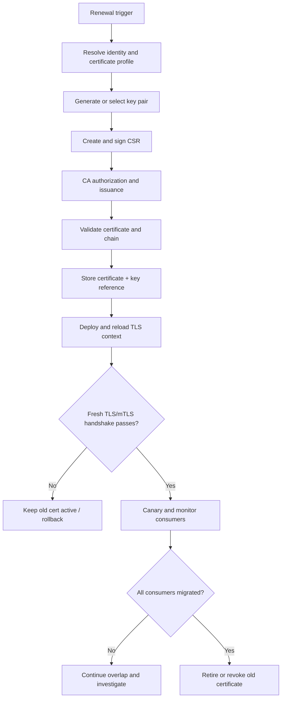

# Test certificate renewal

Test certificate renewal là quá trình xác minh việc cấp, triển khai và chuyển sang chứng thư số mới diễn ra đúng identity, đúng key, đúng trust chain và không làm gián đoạn dịch vụ. Một lần renewal thành công không chỉ có nghĩa CA đã phát hành file certificate mới. Ứng dụng phải nạp đúng certificate/private key, client phải xác minh được chain và hostname, mTLS phải giữ đúng identity, trạng thái thu hồi phải phù hợp và các kết nối mới phải thực sự dùng certificate mới.

Certificate renewal cũng cần được phân biệt với key rotation. Renewal có thể dùng lại key pair hiện tại hoặc tạo key pair mới rồi gửi CSR mới. Nếu chỉ đổi certificate mà không đổi private key, rủi ro khi private key cũ đã lộ vẫn còn. Ngược lại, đổi key pair mà không cập nhật certificate, trust store, pinning hoặc consumer có thể làm TLS handshake thất bại.

Trong quản lý khóa mật mã, kiểm thử renewal phải bao phủ cả PKI lifecycle và vận hành ứng dụng: CSR, CA policy, certificate profile, chain validation, SAN/EKU/key usage, validity, clock skew, secret/key storage, reload, rollout, revocation, monitoring và rollback. Bài học này đưa ra chiến lược test từ unit tới production canary, ví dụ Java, test matrix và cách xử lý các lỗi thường gặp.

## 1. Mục tiêu của kiểm thử certificate renewal

Một quy trình renewal được kiểm thử tốt phải chứng minh:

- Certificate mới được cấp cho đúng subject/SAN và đúng workload identity.
- CSR được tạo từ key pair dự kiến; private key tương ứng vẫn nằm trong security boundary.
- CA phát hành certificate theo profile được duyệt, với algorithm và extensions hợp lệ.
- Certificate chain đi tới trust anchor mà client dự kiến tin cậy.
- Hostname verification, EKU, key usage, validity và policy constraints đều đạt.
- Ứng dụng nạp đúng certificate và private key, không nhầm file hoặc version.
- TLS/mTLS handshake mới thành công sau khi rollout.
- Kết nối hiện hữu, connection pool và session resumption được xử lý theo thiết kế.
- Renewal không tạo khoảng trống giữa certificate cũ và mới.
- Certificate cũ chỉ bị revoke/retire khi consumer đã chuyển, trừ trường hợp compromise cần containment ngay.
- Monitoring phát hiện renewal trễ, lỗi cấp phát, reload thất bại và certificate sắp hết hạn.
- Audit lưu được serial, fingerprint, issuer, validity, key reference và deployment reference mà không lộ private key.

Kiểm thử cần xác nhận cả đường thành công và đường thất bại. Một CA API trả HTTP 200 hoặc một file `.crt` mới xuất hiện chưa đủ để chứng minh dịch vụ đang sử dụng certificate đó.

## 2. Certificate renewal và key rotation khác nhau thế nào?

Certificate là chứng thư ràng buộc public key với identity và được CA ký. Private key là material dùng để chứng minh quyền sở hữu key pair, ví dụ ký handshake hoặc ký dữ liệu. Renewal thay certificate; key rotation thay key pair/material. Hai hoạt động có thể được thực hiện cùng lúc hoặc độc lập.

| Kịch bản | Certificate | Key pair | Rủi ro cần kiểm thử |
|---|---|---|---|
| Renew same key | Certificate mới, public key giữ nguyên | Tái sử dụng private/public key | Nếu private key cũ compromise, renewal không khắc phục được |
| Renew with new key | Certificate mới, public key mới | Tạo key pair mới | Phải cập nhật keystore, HSM reference, pinning và consumer |
| CA/intermediate change | Issuer/chain thay đổi | Có thể giữ hoặc đổi key | Client phải tin chain mới trước khi deploy |
| Identity/SAN change | Subject/SAN/extensions thay đổi | Có thể giữ hoặc đổi key | Có thể đổi phạm vi identity được xác thực |
| Emergency replacement | Certificate mới, có thể key mới | Thường tạo key pair mới khi key compromise | Cần revoke certificate cũ và xử lý consumer khẩn cấp |

Renewal cùng key có thể giảm thay đổi kỹ thuật nhưng kéo dài vòng đời private key. Với certificate có giá trị cao, nên đánh giá tạo key pair mới theo cryptoperiod và policy. Nếu private key bị nghi lộ, không được coi renewal cùng key là biện pháp khắc phục.

## 3. Các thành phần trong renewal workflow

Một workflow thường gồm các bước:

1. Scheduler phát hiện certificate sắp hết hạn hoặc có yêu cầu thay đổi.
2. Workload identity xác thực với CA/ACME service hoặc certificate management platform.
3. Key pair được tạo trong HSM, KMS, keystore hoặc runtime phù hợp.
4. CSR được tạo và ký bằng private key tương ứng.
5. CA xác minh quyền sở hữu domain/identity và áp dụng issuance policy.
6. CA phát hành leaf certificate cùng intermediate chain.
7. Certificate được kiểm tra profile, chain, validity và key match.
8. Certificate/key được ghi vào secret store, keystore hoặc HSM reference.
9. Ứng dụng nạp cấu hình mới và reload TLS context.
10. Health check xác minh handshake với certificate mới.
11. Consumer và client được theo dõi trong giai đoạn overlap.
12. Certificate cũ được retire hoặc revoke theo policy.



Test nên gắn correlation ID giữa scheduler, CSR, CA issuance, secret version, deployment và handshake. Nhờ đó có thể truy vết từ yêu cầu renewal tới certificate thực tế được client nhìn thấy.

## 4. Xác định certificate profile trước khi test

Không thể xác minh renewal nếu không biết certificate nào được mong đợi. Mỗi profile nên xác định:

- Identity/subject và SAN được phép.
- Loại certificate: server TLS, client mTLS, code signing, document signing, CA hoặc service identity.
- Issuer/CA và trust anchor dự kiến.
- Key algorithm, key size/curve và signature algorithm.
- Key Usage (KU) và Extended Key Usage (EKU).
- Basic Constraints, path length và name constraints nếu có.
- Validity period, renewal window và overlap duration.
- Certificate policy OID, name constraints hoặc profile-specific extension.
- Key storage: HSM, KMS, PKCS#11, PKCS#12 hoặc protected keystore.
- Private key exportability và key ownership.
- Revocation mechanism: CRL, OCSP, stapling hoặc policy khác.
- Client population, pinning behavior và trust store distribution.

Profile phải đến từ nguồn cấu hình được quản lý và có version. Không lấy SAN hoặc EKU mong đợi từ certificate mới rồi dùng chính nó làm expected value; cách đó chỉ kiểm tra certificate tự nhất quán, không kiểm tra đúng policy.

## 5. Kiểm thử CSR

CSR (Certificate Signing Request) chứa public key, subject và các thuộc tính yêu cầu; CSR được ký bằng private key tương ứng để chứng minh người yêu cầu sở hữu private key. CA vẫn phải áp dụng policy riêng và không bắt buộc chấp nhận mọi extension do CSR yêu cầu.

Các kiểm tra cần có:

- CSR parse được và chữ ký CSR hợp lệ.
- Public key trong CSR đúng algorithm, key size/curve và profile.
- Subject/SAN đúng identity được phê duyệt.
- Không có SAN wildcard hoặc DNS/IP ngoài scope.
- Requested extensions không mở rộng quyền ngoài policy.
- CSR được tạo bởi workload identity được phép yêu cầu certificate.
- Private key tương ứng được giữ trong boundary dự kiến.
- CSR không chứa dữ liệu nhạy cảm trong subject/attributes không cần thiết.
- CSR ID/request ID được liên kết với issuance event.

Với ACME, cần kiểm thử challenge flow như HTTP-01, DNS-01 hoặc TLS-ALPN-01 tùy thiết kế. Challenge thành công chứng minh control của domain theo cơ chế đó, không thay thế việc kiểm tra certificate profile và key custody.

## 6. Kiểm tra key pair có khớp certificate

Certificate chứa public key. Ứng dụng phải nạp private key tương ứng. Nếu file certificate mới đi cùng private key cũ hoặc alias keystore bị trỏ nhầm, TLS handshake có thể thất bại hoặc hệ thống dùng identity không đúng.

Kiểm tra bằng cách xác minh public key từ certificate tương ứng với key pair. Với RSA, có thể so sánh modulus/exponent nếu API phù hợp; cách tổng quát hơn là dùng private key ký một challenge test và xác minh bằng public key trong certificate. Với HSM non-exportable key, thực hiện sign operation trong HSM và verify bằng public key đã cấp; không export private key để so sánh.

Không ghi private key, encoded key bytes hoặc challenge chứa dữ liệu nghiệp vụ vào log. Test challenge nên là dữ liệu ngẫu nhiên giả lập, có request ID và được loại khỏi production payload.

## 7. Kiểm tra certificate fields

Sau khi nhận certificate, kiểm tra ít nhất:

| Trường | Kiểm tra |
|---|---|
| Serial number | Có giá trị hợp lệ và không trùng trong phạm vi issuer theo CA policy |
| Issuer | Đúng CA/intermediate được phê duyệt |
| Subject | Đúng profile; không dùng subject thay cho SAN trong hostname verification hiện đại |
| Subject Alternative Name | Chứa DNS/IP/URI identity cần thiết và không chứa identity thừa |
| Not Before / Not After | Nằm trong validity window và đủ overlap |
| Public key | Đúng algorithm, key size/curve và khớp private key |
| Signature algorithm | Được policy cho phép; không dùng thuật toán yếu/deprecated |
| Key Usage | Phù hợp mục đích, ví dụ digitalSignature hoặc keyEncipherment theo profile |
| Extended Key Usage | Có serverAuth/clientAuth/codeSigning đúng use case |
| Basic Constraints | Leaf certificate phải là CA:FALSE nếu profile yêu cầu |
| Certificate Policies | OID/profile đúng nếu tổ chức sử dụng |
| Authority/Subject Key Identifier | Liên kết đúng issuer/subject key theo chain |
| CRL Distribution Points / AIA | URL và thông tin revocation/issuer hợp lệ theo profile |

Không phải mọi certificate cần tất cả extension. Expected profile phải quy định extension nào bắt buộc, cấm hoặc tùy chọn. Kiểm tra cả trường hợp extension bị thiếu và trường hợp có extension thừa.

## 8. SAN, hostname và identity verification

Với TLS server, client xác minh hostname/SAN của certificate phải khớp hostname kết nối. Certificate có chain hợp lệ nhưng SAN sai vẫn phải bị từ chối.

Test các trường hợp:

- DNS SAN khớp hostname chính xác.
- Wildcard chỉ khớp đúng phạm vi label theo quy tắc hostname verification.
- Hostname không khớp phải thất bại.
- IP address connection yêu cầu IP SAN phù hợp, không dùng DNS SAN thay thế.
- SNI chọn đúng certificate khi một listener phục vụ nhiều hostname.
- Không fallback sang certificate mặc định sai identity khi SNI lạ.
- IDN/punycode được xử lý nhất quán nếu hệ thống hỗ trợ.
- Subject CN không được dùng để bỏ qua SAN mismatch trong client hiện đại.

Với client certificate mTLS, server cần xác minh identity theo SAN/URI/DNS hoặc mapping được policy quy định. Không chỉ kiểm tra certificate được CA tin cậy; một certificate hợp lệ của workload khác không được phép truy cập service hiện tại.

## 9. Kiểm tra EKU, Key Usage và algorithm constraints

Certificate phải được cấp cho đúng mục đích:

- `serverAuth` cho TLS server khi profile yêu cầu.
- `clientAuth` cho TLS client/mTLS.
- `codeSigning` cho ký mã theo profile.
- CA certificate phải có Basic Constraints `CA:TRUE` và KU phù hợp, ví dụ `keyCertSign`/`cRLSign`.
- Leaf certificate không được có quyền CA nếu không được thiết kế làm CA.

Kiểm tra key algorithm, key size, curve, signature hash và parameter theo crypto policy hiện hành. Ví dụ RSA key quá ngắn, SHA-1 signature hoặc curve không được phép cần bị từ chối. Không hardcode một danh sách thuật toán cho mọi tổ chức; dùng policy được quản lý, version hóa và kiểm tra cả JDK/provider thực tế.

## 10. Chain validation và trust store

Client xác minh certificate path từ leaf qua intermediate tới trust anchor. Chain có thể được gửi kèm leaf và intermediate; trust anchor thường được cấu hình riêng trong trust store. Không nên tin một root chỉ vì server gửi nó trong handshake.

Test cần xác minh:

- Leaf được ký bởi intermediate dự kiến.
- Intermediate chain dẫn tới trust anchor mà client tin cậy.
- Intermediate có Basic Constraints và path length phù hợp.
- Name constraints và policy constraints được tuân thủ.
- Certificate hết hạn hoặc chưa có hiệu lực bị từ chối.
- Chain thiếu intermediate được xử lý đúng theo thiết kế; không phụ thuộc cache ngẫu nhiên.
- Chain sai thứ tự hoặc có certificate không liên quan không được chọn nhầm.
- Root/CA mới được phân phối tới client trước khi server chuyển certificate nếu trust anchor thay đổi.
- Trust store không vô tình thêm root không được phê duyệt.

Nếu CA/intermediate thay đổi, cần test cả client cũ chưa nhận trust update và client mới đã nhận trust update. Giai đoạn overlap phải đủ để cập nhật trust store trước khi server bắt đầu dùng chain mới.

## 11. Validity period và kiểm tra thời gian

Certificate có `NotBefore` và `NotAfter`. Renewal cần bảo đảm certificate mới có hiệu lực trước khi certificate cũ hết hạn, có overlap đủ dài và không bị từ chối vì clock skew.

Test cần bao phủ:

- Certificate mới có `NotBefore` không nằm quá xa trong tương lai.
- Client/server clock lệch trong giới hạn đã định.
- Renewal trigger chạy trước ngưỡng cảnh báo và trước thời điểm hết hạn.
- Scheduler xử lý daylight saving/timezone đúng; thời gian nên lưu và so sánh theo UTC.
- Certificate hết hạn bị từ chối sau `NotAfter` theo policy.
- Certificate chưa có hiệu lực bị từ chối trước `NotBefore`.
- Retry hoặc CA delay không tạo khoảng trống giữa certificate cũ và mới.
- Certificate mới có validity period không vượt giới hạn CA policy.

Không thay đổi clock production để test expiry. Dùng test CA cấp certificate thời hạn ngắn, clock abstraction trong unit test hoặc isolated environment có thời gian được kiểm soát. Không cấp certificate production với `NotBefore` tùy ý để bù clock skew.

## 12. Overlap window và zero-downtime rollout

Renewal an toàn thường cần giai đoạn certificate cũ và mới cùng hợp lệ. Với thay CA, trust store mới phải được phân phối trước khi server chuyển sang chain mới. Với thay key pair, consumer cần xác minh certificate mới và mapping identity trước khi traffic chuyển.

Quy trình overlap gợi ý:

1. Phát hành certificate mới và xác minh profile/chain.
2. Cập nhật trust store trước nếu issuer/intermediate/root thay đổi.
3. Đưa certificate mới vào keystore/secret version mới.
4. Reload TLS context hoặc rollout instance mới.
5. Kiểm tra handshake từ client representative và từng trust domain.
6. Theo dõi certificate serial/fingerprint thực tế trên các connection mới.
7. Chờ consumer/instance cũ chuyển hết trong overlap window.
8. Retire certificate cũ; revoke nếu policy yêu cầu hoặc có compromise.

Không xóa certificate cũ ngay sau khi file mới được tạo. Các client, load balancer, proxy, connection pool hoặc instance cũ có thể vẫn dùng certificate cũ. Nhưng cũng không giữ certificate cũ vô thời hạn; xác định deadline và điều kiện hoàn tất overlap.

## 13. Atomic deployment và TLS reload

Một lỗi vận hành phổ biến là cập nhật certificate và private key bằng hai thao tác riêng. Trong khoảng giữa hai thao tác, ứng dụng có thể đọc certificate mới với private key cũ hoặc keystore đang ghi dở.

Kiểm soát triển khai:

- Ghi certificate, chain và key reference vào version mới; không ghi đè từng file đang được process sử dụng.
- Kiểm tra cặp certificate/private key trước khi publish version.
- Dùng atomic rename/swap hoặc secret version pointer để chuyển đồng bộ.
- Chỉ reload sau khi toàn bộ material đã sẵn sàng và checksum/metadata được xác minh.
- Nếu reload thất bại, giữ TLS context cũ hoạt động và phát alert.
- Xác minh mỗi instance đã nạp fingerprint mới; không chỉ kiểm tra file trên disk.
- Với rolling deployment, theo dõi tỷ lệ instance dùng certificate cũ/mới.
- Với Java process, xác minh framework/server có hỗ trợ hot reload; thay file không tự làm `SSLContext` đang chạy cập nhật.

Nếu không thể reload TLS context an toàn, có thể dùng rolling restart với readiness gate. Thiết kế phải bảo đảm đủ capacity trong lúc từng instance khởi động lại.

## 14. Kiểm thử TLS handshake sau renewal

TLS smoke test cần thực hiện kết nối mới sau khi certificate được triển khai. Kiểm tra tối thiểu:

- TLS version và cipher suite theo policy.
- TLS 1.2/1.3 được bật hoặc tắt đúng profile; không vô tình bật protocol cũ để tương thích certificate mới.
- Signature scheme và certificate key type được client/server thương lượng tương thích, đặc biệt khi đổi RSA sang ECDSA/EdDSA.
- SNI và hostname verification.
- Certificate leaf, serial, fingerprint và chain mà server thực sự gửi.
- Trust store của client có CA cần thiết.
- EKU/KU và algorithm constraints được chấp nhận.
- Client certificate và server-side authorization trong mTLS.
- Session resumption không giữ identity/certificate cũ ngoài thiết kế.
- TLS termination ở load balancer, ingress, service mesh và backend đều được cập nhật đúng.
- Kết nối mới từ các client runtime khác nhau nếu hệ sinh thái có nhiều JDK/OS.

Một kết nối đã tồn tại trước renewal có thể tiếp tục dùng session cũ; nó không chứng minh certificate mới đã được nạp. Phải mở connection mới hoặc kiểm tra TLS session metadata sau reload.

## 15. Kiểm thử mTLS hai chiều

Với mTLS, cả client và server đều trình certificate. Renewal có thể diễn ra ở một phía hoặc cả hai phía.

| Phía | Kiểm tra khi renewal |
|---|---|
| Server certificate | Client tin chain, hostname/SAN đúng, EKU serverAuth và validity đạt |
| Client certificate | Server tin chain, SAN/URI identity đúng, EKU clientAuth và mapping principal đúng |
| Server trust store | Tin CA phát hành client certificate mới và không mở rộng trust ngoài policy |
| Client trust store | Tin CA phát hành server certificate mới |
| Authorization | Certificate hợp lệ nhưng identity không nằm trong allowlist vẫn bị từ chối |
| Revocation | Certificate cũ bị revoke theo đúng thời điểm và policy |
| Mixed fleet | Client/server cũ và mới tương tác được trong overlap đã thiết kế |

Test certificate hợp lệ nhưng thuộc workload khác để xác nhận authorization không chỉ dựa trên CA trust. Với mTLS, “certificate được tin cậy” không đồng nghĩa “principal được phép gọi API”.

## 16. Kiểm thử OCSP, CRL và revocation

Renewal và revocation có quan hệ nhưng là hai hành động khác nhau. Certificate cũ thường được giữ hợp lệ trong overlap, sau đó có thể hết hạn tự nhiên hoặc được revoke theo policy. Nếu key compromise, revocation có thể cần thực hiện ngay và không chờ overlap.

Test các trường hợp:

- OCSP responder trả `good`, `revoked` và `unknown`.
- CRL mới được tải và áp dụng; CRL hết hạn hoặc không thể tải được xử lý theo policy.
- OCSP stapling cung cấp response hợp lệ, đúng certificate/issuer và còn hiệu lực.
- Client xử lý OCSP timeout theo hard-fail/soft-fail policy đã định.
- Certificate cũ bị revoke sau khi consumer chuyển; client mới từ chối theo policy.
- Certificate mới không bị revoke nhầm do serial/issuer mapping sai.
- Cache OCSP/CRL không giữ trạng thái cũ vượt quá freshness policy.
- Revocation endpoint và network dependency có monitoring.

Hard-fail hay soft-fail là quyết định theo threat model và yêu cầu nghiệp vụ. Không thay đổi policy này ngầm trong lúc renewal để “làm handshake chạy được”.

## 17. Kiểm thử automation và scheduler

Renewal tự động cần được test như một workflow có state, retry và idempotency.

- Trigger đúng khi còn đủ thời gian trước expiry.
- Không phát hành nhiều certificate ngoài ý muốn khi scheduler chạy lặp.
- Retry có exponential backoff/jitter và giới hạn số lần.
- CA rate limit, challenge failure và API outage không làm mất certificate cũ.
- Renewal job có workload identity riêng và scope issuance đúng.
- Job không log CSR/private key/password/token.
- Job ghi lại CSR ID, issuance ID, certificate serial/fingerprint và secret version.
- Concurrent renewal không ghi đè version mới hơn bằng version cũ.
- Scheduler restart hoặc leader failover không bỏ lỡ renewal window.
- Alert được tạo khi renewal chưa hoàn tất trước deadline.

Renewal nên có state machine như `DUE`, `REQUESTED`, `ISSUED`, `VALIDATED`, `DEPLOYED`, `VERIFIED`, `RETIRED` và `FAILED`. State transition phải idempotent; không chuyển `DEPLOYED` chỉ vì secret store đã nhận file.

## 18. Kiểm thử lỗi CA và dependency

Mô phỏng các tình huống:

- CA API timeout hoặc trả lỗi 5xx.
- ACME challenge thất bại do DNS/HTTP propagation.
- CA rate limit hoặc quota hết.
- CSR sai chữ ký, sai SAN hoặc algorithm không được phép.
- Issuance trả chain thiếu intermediate hoặc sai issuer.
- Secret Manager/KMS không khả dụng khi lưu certificate/key reference.
- HSM không tạo được key hoặc ký CSR.
- Network partition giữa renewal agent và CA.
- Clock skew làm certificate mới chưa có hiệu lực.
- CA phát certificate gần hết hạn hoặc validity ngoài profile.

Khi dependency lỗi, hệ thống phải giữ certificate hiện tại hoạt động trong thời gian còn hợp lệ, retry theo policy và phát alert đủ sớm. Không tiếp tục sử dụng certificate đã hết hạn chỉ vì CA outage; nếu không còn đường hợp lệ, kích hoạt incident/contingency đã phê duyệt.

## 19. Kiểm thử rollback

Rollback cần phụ thuộc nguyên nhân:

- Nếu certificate mới sai SAN/chain hoặc TLS reload lỗi, có thể chuyển về version cũ nếu certificate cũ còn hợp lệ và không compromise.
- Nếu key mới bị nghi lộ, không quay lại key cũ nếu key cũ cũng có nguy cơ hoặc đã bị compromise.
- Nếu CA/intermediate mới không được client tin, có thể quay lại chain cũ trong overlap nếu trust cũ vẫn hợp lệ.
- Nếu certificate cũ đã bị revoke, rollback sang certificate cũ có thể không hoạt động và không được coi là phương án mặc định.
- Nếu private key cũ bị compromise, phải ưu tiên containment và replacement dù có thể gây gián đoạn.

Test rollback bằng staging CA và test identity. Xác minh rollback không làm alias/version pointer trỏ tới key không khớp certificate, không ghi đè audit evidence và không khôi phục certificate đã revoke.

## 20. Java: kiểm tra validity, SAN và EKU

Java `X509Certificate` cung cấp API để kiểm tra validity và extension của certificate. Đoạn mã sau minh họa các kiểm tra profile cơ bản; chain validation và hostname verification vẫn cần được thực hiện riêng.

```java
import java.security.cert.X509Certificate;
import java.time.Instant;
import java.util.Collection;
import java.util.List;
import java.util.Set;

public final class CertificateProfileCheck {
    private CertificateProfileCheck() {}

    public static void validateServerCertificate(
            X509Certificate certificate,
            Instant now,
            Set<String> expectedDnsNames) throws Exception {

        certificate.checkValidity(java.util.Date.from(now));

        List<String> eku = certificate.getExtendedKeyUsage();
        if (eku == null || !eku.contains("1.3.6.1.5.5.7.3.1")) {
            throw new SecurityException("serverAuth EKU is required");
        }

        boolean sanMatch = false;
        Collection<List<?>> sans = certificate.getSubjectAlternativeNames();
        if (sans != null) {
            for (List<?> san : sans) {
                if (san.size() >= 2 && Integer.valueOf(2).equals(san.get(0))) {
                    Object value = san.get(1);
                    if (value instanceof String dns
                            && expectedDnsNames.contains(dns)) {
                        sanMatch = true;
                    }
                }
            }
        }

        if (!sanMatch) {
            throw new SecurityException("Expected DNS SAN is missing");
        }
    }
}
```

Ví dụ chỉ kiểm tra DNS SAN exact match, không xử lý wildcard, IDN hoặc hostname matching đầy đủ. Production nên dùng hostname verifier/TLS stack đã được chuẩn hóa thay vì tự viết thuật toán hostname verification. EKU OID `1.3.6.1.5.5.7.3.1` là serverAuth; clientAuth có OID `1.3.6.1.5.5.7.3.2`. Certificate không có EKU có semantics phụ thuộc profile/PKI policy; không tự coi là hợp lệ nếu profile yêu cầu EKU rõ ràng.

Ví dụ dùng pattern matching cho `instanceof`, cần Java 16 trở lên.

## 21. Java: xác minh public key và private key tương ứng

Với key không exportable trong HSM, có thể yêu cầu HSM ký một challenge test rồi xác minh bằng public key trong certificate. Ví dụ dưới đây minh họa verify chữ ký RSA SHA-256; phần gọi HSM được biểu diễn qua interface.

```java
import java.security.Signature;
import java.security.cert.X509Certificate;

interface SigningKeyHandle {
    byte[] sign(String algorithm, byte[] message) throws Exception;
}

public final class KeyPairMatchCheck {
    private KeyPairMatchCheck() {}

    public static void verifyMatch(
            SigningKeyHandle keyHandle,
            X509Certificate certificate,
            byte[] challenge) throws Exception {

        byte[] signatureBytes = keyHandle.sign("SHA256withRSA", challenge);
        Signature verifier = Signature.getInstance("SHA256withRSA");
        verifier.initVerify(certificate.getPublicKey());
        verifier.update(challenge);
        if (!verifier.verify(signatureBytes)) {
            throw new SecurityException(
                "Private key does not match certificate public key"
            );
        }
    }
}
```

Đoạn mã giả định RSA và `SHA256withRSA`; với RSA-PSS, ECDSA hoặc Ed25519 cần dùng đúng algorithm và parameters theo certificate/key profile. Challenge phải là dữ liệu test ngẫu nhiên, không chứa secret hoặc payload nghiệp vụ. Không log challenge nếu policy yêu cầu giữ sạch audit; log kết quả, key reference, certificate fingerprint và operation ID.

## 22. Java: kiểm tra certificate path

Chain validation phải dựa trên trust anchor được cấu hình độc lập. Ví dụ khái niệm:

```java
import java.security.cert.CertPath;
import java.security.cert.CertPathValidator;
import java.security.cert.PKIXParameters;
import java.security.cert.TrustAnchor;
import java.security.cert.X509Certificate;
import java.util.Date;
import java.util.Set;

public final class CertificatePathCheck {
    private CertificatePathCheck() {}

    public static void validate(
            CertPath path,
            X509Certificate trustedRoot,
            Date validationTime) throws Exception {

        TrustAnchor anchor = new TrustAnchor(trustedRoot, null);
        PKIXParameters parameters = new PKIXParameters(Set.of(anchor));
        parameters.setDate(validationTime);
        parameters.setRevocationEnabled(true);

        CertPathValidator validator =
            CertPathValidator.getInstance("PKIX");
        validator.validate(path, parameters);
    }
}
```

Đây là ví dụ rút gọn. `CertPath` phải chứa đúng leaf/intermediate theo thứ tự phù hợp; trust anchor được provision từ nguồn tin cậy. Khi `revocationEnabled=true`, runtime cần có cơ chế CRL/OCSP và network/config tương ứng; trong test nên cung cấp revocation data deterministic hoặc cấu hình PKIXRevocationChecker rõ ràng. Không tắt revocation chỉ để test pass nếu production yêu cầu kiểm tra thu hồi.

Đoạn mã dùng `Set.of`, có từ Java 9. Trong test PKIX, phải kiểm soát nguồn CRL/OCSP để kết quả lặp lại được; không phụ thuộc trạng thái responder công khai đang thay đổi ngoài ý muốn.

## 23. Java: kiểm thử TLS handshake bằng trust store

Kiểm tra certificate object riêng lẻ không chứng minh TLS listener đã reload certificate mới. Cần integration test mở kết nối mới tới endpoint test và kiểm tra certificate peer thực tế.

Ví dụ định hướng với Java `HttpsURLConnection`:

```java
import javax.net.ssl.HttpsURLConnection;
import javax.net.ssl.SSLContext;
import java.net.URI;
import java.security.cert.X509Certificate;

public final class TlsRenewalSmokeTest {
    private TlsRenewalSmokeTest() {}

    public static void verifyEndpoint(
            URI endpoint,
            SSLContext approvedContext,
            String expectedFingerprint) throws Exception {

        HttpsURLConnection connection =
            (HttpsURLConnection) endpoint.toURL().openConnection();
        connection.setSSLSocketFactory(approvedContext.getSocketFactory());
        connection.setConnectTimeout(3000);
        connection.setReadTimeout(3000);
        connection.setRequestMethod("GET");

        try {
            int status = connection.getResponseCode();
            if (status < 200 || status >= 500) {
                throw new IllegalStateException("TLS smoke endpoint failed");
            }

            X509Certificate peer = (X509Certificate)
                connection.getServerCertificates()[0];
            String fingerprint = CertificateFingerprints.sha256(peer);
            if (!expectedFingerprint.equalsIgnoreCase(fingerprint)) {
                throw new SecurityException("Unexpected peer certificate");
            }
        } finally {
            connection.disconnect();
        }
    }
}
```

`CertificateFingerprints.sha256` là helper cần triển khai bằng `MessageDigest` trên DER encoding của certificate; không phải API JDK dựng sẵn. `approvedContext` phải được tạo từ trust store được phê duyệt. Không cài trust-all `TrustManager` hoặc hostname verifier luôn trả `true` để smoke test thành công. Dùng endpoint test và mở connection mới sau reload; nếu có load balancer nhiều node, lặp test qua từng node/zone hoặc kiểm tra deployment telemetry.

## 24. Kiểm thử keystore, secret store và HSM reference

Renewal có thể phát hành certificate đúng nhưng lưu sai nơi hoặc ứng dụng nạp nhầm version. Cần kiểm tra:

- Keystore format đúng (`PKCS12`, HSM/PKCS#11 hoặc store được chọn).
- Alias mới đúng và không ghi đè alias khác.
- Certificate chain đầy đủ và đúng thứ tự.
- Private key entry có thể thực hiện operation nhưng không bị export ngoài policy.
- Keystore password/secret reference được lấy qua secret store, không hardcode hoặc log.
- Secret version/keystore version được cập nhật atomically.
- HSM key handle, partition, label và object attributes đúng.
- Backup/restore path của keystore hoặc HSM object đã được kiểm thử.
- Quyền filesystem/secret API chỉ cho workload cần thiết.
- File tạm và artifact build không giữ bản private key ngoài policy.

Nếu certificate được lưu trong Secret Manager, test version promotion, IAM access, reload và rollback. Nếu private key ở HSM, certificate file có thể được phân phối riêng nhưng key reference phải trỏ đúng object trong đúng partition.

## 25. Kiểm thử certificate pinning và client compatibility

Một số client pin public key, certificate fingerprint hoặc CA. Renewal có thể làm client từ chối certificate mới dù chain hợp lệ.

Test cần xác định:

- Client pin leaf certificate, SPKI/public key hay CA/intermediate.
- Renewal cùng key có giữ pin hay không; renewal với key mới có yêu cầu pin overlap.
- Pin set mới được phân phối trước khi server chuyển certificate.
- Có backup pin/secondary pin và expiry/retirement policy không.
- Mobile app, embedded client hoặc partner integration có lịch phát hành riêng không.
- Certificate transparency hoặc policy kiểm tra issuer có ảnh hưởng issuance không.
- Client cũ không hỗ trợ algorithm/chain mới được phát hiện trước cutover.

Không dùng certificate pinning như thay thế trust chain/hostname verification. Pinning policy cần có cơ chế update và recovery để tránh lockout toàn bộ client khi certificate đổi.

## 26. Kiểm thử observability và alert

Renewal pipeline cần phát event đủ để vận hành mà không lộ key material.

Các event hữu ích:

- `certificate_renewal_due` và `certificate_renewal_started`.
- `csr_created` với CSR ID và key reference.
- `certificate_issued` với issuer, serial, fingerprint, SAN summary và validity.
- `certificate_validation_failed` với reason code.
- `certificate_deployed` với secret/keystore version và deployment ID.
- `tls_context_reloaded` và `tls_handshake_verified`.
- `old_certificate_retired` hoặc `certificate_revoked`.
- `renewal_failed` với dependency/error class và retry count.

Không log private key, CSR private material, keystore password, token, HSM PIN hoặc secret payload. CSR là public-key request nhưng có thể chứa metadata nhạy cảm; log reference/fingerprint và identity summary theo policy thay vì toàn bộ CSR.

Alert nên phát khi còn đủ thời gian xử lý: renewal chưa bắt đầu trước threshold, CA issuance thất bại nhiều lần, certificate mới chưa deploy, instance còn dùng serial cũ sau deadline, chain/hostname test fail hoặc certificate production sắp hết hạn.

## 27. Test matrix cho certificate renewal

| Nhóm | Trường hợp thành công | Trường hợp phải thất bại |
|---|---|---|
| CSR | Chữ ký hợp lệ, đúng key/profile | CSR signature sai, key yếu hoặc SAN ngoài scope |
| Issuance | CA cấp đúng issuer/profile | CA sai issuer, thiếu extension hoặc validity quá dài |
| Identity | SAN/URI đúng | Hostname/SAN/tenant identity không khớp |
| Key match | Private key ký được challenge tương ứng | Certificate ghép với private key khác |
| Chain | Leaf/intermediate tới trust anchor | Thiếu intermediate, root không tin hoặc chain sai |
| Validity | NotBefore/NotAfter đúng overlap | Chưa có hiệu lực, hết hạn hoặc clock skew ngoài giới hạn |
| Usage | KU/EKU phù hợp | Thiếu serverAuth/clientAuth hoặc leaf có CA:TRUE trái policy |
| Algorithm | Algorithm/key size/curve được duyệt | SHA-1, key size yếu hoặc curve bị cấm |
| Revocation | OCSP/CRL trạng thái đúng | Certificate revoked hoặc status unknown theo hard-fail policy |
| TLS | Kết nối mới thấy fingerprint mới | Hostname mismatch, trust fail, wrong SNI hoặc cipher bị cấm |
| mTLS | Hai phía xác minh đúng identity | Client cert hợp lệ nhưng sai workload identity |
| Deployment | Atomic update/reload thành công | Reload fail, file pair mismatch hoặc instance stale |
| Automation | Retry/idempotency đúng | Duplicate issuance, race hoặc renewal miss deadline |
| Rollback | Quay lại cert cũ còn hợp lệ khi phù hợp | Cố rollback cert đã revoked/compromised |
| Observability | Event/alert đầy đủ và không chứa secret | Missing event, stale telemetry hoặc secret trong log |

Test matrix cần được chạy trên các JDK/runtime, TLS terminator, load balancer, proxy và client quan trọng thực tế. Một test pass trên JVM developer không chứng minh mọi consumer production tương thích.

## 28. Quy trình test theo tầng

### 28.1. Unit test

Kiểm tra parser, certificate profile validator, validity window, SAN/EKU/KU, key reference mapping, state machine và retry policy bằng fixture/test certificate. Dùng clock abstraction để test thời gian mà không sửa system clock.

### 28.2. PKI integration test

Dùng test CA hoặc isolated PKI để phát hành CSR, xác minh issuance profile, chain, revocation response và certificate version. Không dùng production CA để tạo certificate giả hoặc test negative issuance nếu có thể tránh.

### 28.3. Application integration test

Đưa certificate mới vào keystore/secret store/HSM test partition, reload TLS context và xác minh listener dùng fingerprint mới. Kiểm tra connection pool, mTLS, hostname và client compatibility.

### 28.4. Failure injection

Mô phỏng CA timeout, HSM unavailable, secret store lỗi, bad chain, wrong key, expired cert, reload failure, stale node và revocation endpoint outage. Xác minh certificate cũ vẫn hoạt động trong overlap khi an toàn và alert được gửi.

### 28.5. Staging canary

Triển khai lên một nhóm nhỏ với test identity hoặc workload staging. Kiểm tra TLS handshake từ client đại diện, theo dõi serial/fingerprint, error rate và expiry. Chỉ mở rộng khi tất cả gate đạt.

### 28.6. Production verification

Chỉ thực hiện smoke test an toàn sau khi change được duyệt. Không tạo certificate test, revoke certificate thật hoặc sửa clock production. Xác minh connection mới, telemetry, rollout coverage và old-cert retirement theo policy.

## 29. Tình huống thực tế: renewal thành công ở CA nhưng TLS vẫn dùng certificate cũ

Một Java service dùng PKCS12 keystore và TLS termination trong process. Renewal job tạo CSR, CA phát certificate mới và secret store lưu version mới. Tuy nhiên, ứng dụng chỉ đọc keystore khi startup; job cập nhật file trên disk nhưng không reload `SSLContext`. Dashboard renewal báo `ISSUED` và `DEPLOYED` dựa trên việc file tồn tại, trong khi các connection mới vẫn nhận certificate cũ.

Nhóm bổ sung state riêng `VALIDATED`, `STORED`, `RELOADED` và `HANDSHAKE_VERIFIED`. Sau khi lưu version mới, deployment gọi reload API đã được kiểm thử hoặc rolling restart có readiness gate. Smoke test mở connection mới, xác minh SAN/chain và so fingerprint với expected certificate. Alert phát nếu serial cũ còn được quan sát sau deadline.

Nhóm cũng giữ certificate cũ trong overlap window để rollback khi certificate mới sai profile. Khi mọi instance và client đã chuyển, certificate cũ được retire theo policy. Nhờ vậy, trạng thái renewal phản ánh certificate thực sự được phục vụ, không chỉ artifact đã phát hành.

## 30. Lỗi thường gặp khi test certificate renewal

- **Chỉ kiểm tra CA issuance thành công:** chưa chứng minh ứng dụng dùng certificate mới.
- **Nhầm renewal với key rotation:** renewal cùng key không xử lý private key compromise.
- **Không kiểm tra SAN:** chain hợp lệ nhưng hostname sai vẫn bị chấp nhận ở test không đúng.
- **Bỏ qua EKU/KU:** certificate có thể được dùng sai mục đích.
- **Tin root do server gửi:** trust anchor phải đến từ trust store được quản lý.
- **Không test client cũ:** pinning hoặc trust store chưa cập nhật gây outage.
- **Không mở connection mới:** connection cũ không chứng minh TLS context đã reload.
- **Ghi đè cert và key riêng rẽ:** tạo trạng thái mismatch tạm thời.
- **Revoke cert cũ quá sớm:** consumer chưa chuyển xong sẽ thất bại.
- **Giữ cert cũ vô thời hạn:** làm tăng bề mặt tấn công và khó kiểm soát lifecycle.
- **Tắt revocation check để test pass:** che lỗi OCSP/CRL và thay đổi security semantics.
- **Dùng trust-all TrustManager:** làm vô hiệu kiểm tra chain.
- **Không kiểm tra clock:** NotBefore/NotAfter có thể làm handshake fail.
- **Không test HSM key reference:** certificate đúng nhưng private key handle sai partition.
- **Log CSR/keystore/secret:** tạo thêm bản sao metadata hoặc credential nhạy cảm.
- **Không test rollback:** có thể quay lại certificate đã revoked hoặc key compromised.
- **Không kiểm tra toàn fleet:** một node hoặc load balancer vẫn có thể phục vụ certificate cũ.

## 31. Checklist test certificate renewal

- [ ] Certificate profile và expected identity/SAN được version hóa.
- [ ] Renewal và key rotation được phân biệt rõ; quyết định reuse/new key có approval.
- [ ] CSR signature, public key, SAN và requested extensions được kiểm tra.
- [ ] CA issuance đúng issuer, serial, validity và profile.
- [ ] Certificate key pair match với private key/ HSM handle.
- [ ] SAN, hostname, SNI, EKU, KU và Basic Constraints đúng.
- [ ] Algorithm, key size/curve và signature parameters đáp ứng crypto policy.
- [ ] Chain validation đi tới trust anchor được phê duyệt.
- [ ] NotBefore/NotAfter, clock skew, renewal window và overlap được kiểm thử.
- [ ] OCSP/CRL, stapling, hard-fail/soft-fail và cache được kiểm tra.
- [ ] Trust store/pinning của consumer được cập nhật trước khi cần.
- [ ] Certificate và key được lưu version hóa, atomic và đúng access control.
- [ ] TLS context reload hoặc rolling restart đã được kiểm thử.
- [ ] Handshake mới xác minh fingerprint/serial, hostname và chain.
- [ ] mTLS client/server identity và authorization được kiểm tra hai chiều.
- [ ] Connection pool, session resumption, load balancer và mọi instance đã chuyển.
- [ ] CA/HSM/Secret Manager failure, retry, idempotency và deadline alert được kiểm tra.
- [ ] Rollback chỉ dùng certificate cũ còn hợp lệ và không compromise.
- [ ] Certificate cũ chỉ retire/revoke theo overlap và incident policy.
- [ ] Audit/metrics có issuance, deployment, reload và handshake evidence mà không lộ secret.

## 32. Câu hỏi tự kiểm tra

1. Certificate renewal khác key rotation như thế nào?
2. Vì sao renewal dùng lại private key không xử lý được key compromise?
3. CSR chứng minh điều gì và CA còn phải kiểm tra gì?
4. Vì sao SAN quan trọng hơn việc chỉ so sánh Subject CN cho hostname verification?
5. EKU và Key Usage kiểm soát những mục đích nào?
6. Vì sao server không thể tự làm client tin root certificate chỉ bằng cách gửi root trong handshake?
7. Chain validation khác hostname verification như thế nào?
8. NotBefore, NotAfter và clock skew ảnh hưởng renewal ra sao?
9. Overlap window giúp tránh downtime như thế nào?
10. Vì sao cập nhật file keystore không đảm bảo Java TLS context đã reload?
11. Cần kiểm tra gì sau khi đổi certificate trong mTLS?
12. OCSP và CRL có vai trò gì trong certificate revocation?
13. Hard-fail và soft-fail revocation checking là quyết định gì?
14. Vì sao cần test pinning và client compatibility trước cutover?
15. Renewal scheduler cần idempotency và retry như thế nào?
16. Khi CA outage, hệ thống nên xử lý certificate cũ ra sao?
17. Khi nào rollback certificate cũ là không an toàn?
18. Làm sao xác minh HSM private key tương ứng với certificate mà không export key?
19. Những event nào nên được ghi để audit renewal mà không lộ secret?
20. Bằng chứng nào chứng minh toàn bộ fleet đã phục vụ certificate mới?

Test certificate renewal phải chứng minh trọn chuỗi từ CSR và CA issuance tới key match, trust validation, TLS reload và handshake thực tế. Khi phân biệt renewal với key rotation, kiểm tra profile và revocation, triển khai theo overlap/atomic rollout, xác minh từng client và theo dõi fingerprint trên toàn fleet, tổ chức có thể thay certificate đúng hạn mà không làm suy yếu key custody hoặc gây gián đoạn dịch vụ.
