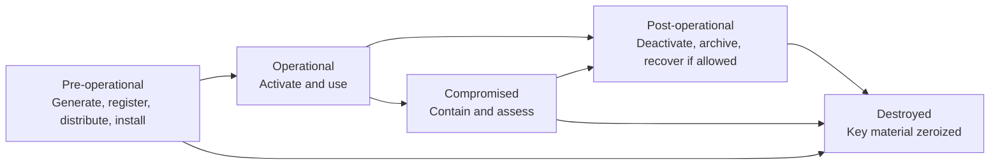
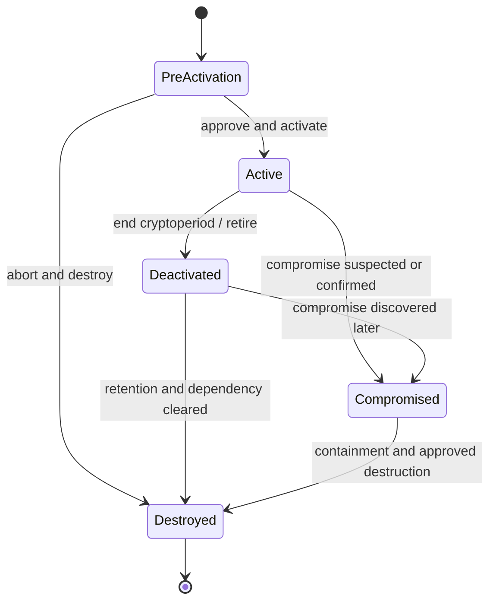

# Key lifecycle theo NIST

## Mục tiêu học tập

Sau bài học này, bạn có thể:

- Giải thích vòng đời khóa mật mã theo hướng dẫn NIST và liên hệ với hoạt động vận hành thực tế.
- Phân biệt các giai đoạn quản lý khóa với các trạng thái của một key.
- Mô tả các hoạt động generation, registration, distribution, installation, activation, use, backup, recovery, rotation, deactivation và destruction.
- Xác định cryptoperiod và phân biệt originator-usage period với recipient-usage period.
- Thiết kế kiểm soát cho key inventory, ownership, purpose, access, audit và assurance.
- Xử lý key compromise, revocation, archival và recovery theo risk và dependency.
- Ánh xạ yêu cầu vào các tài liệu NIST, FIPS và kiểm soát KMS/HSM phù hợp.
- Đánh giá bằng chứng assurance mà không nhầm việc dùng thuật toán chuẩn với việc toàn hệ thống đã được chứng nhận.

## 1. Vì sao cần quản lý vòng đời khóa?

Một key không chỉ được tạo ra rồi đem đi mã hóa dữ liệu. Từ lúc xác định nhu cầu đến khi key bị hủy, tổ chức phải biết ai sở hữu key, key bảo vệ loại dữ liệu nào, được phép dùng cho operation nào, được lưu ở đâu, ai có thể truy cập, thời hạn sử dụng ra sao và cách khôi phục khi có sự cố.

Quản lý vòng đời yếu có thể làm mất dữ liệu dù thuật toán mã hóa đúng. Ví dụ, một tổ chức có thể dùng AES-GCM đúng cách nhưng xóa KEK trước khi các bản backup hết hạn; khi cần restore, ciphertext vẫn còn nhưng không thể unwrap DEK. Ngược lại, giữ key quá lâu hoặc phân phối key quá rộng làm tăng nguy cơ compromise.

NIST SP 800-57 cung cấp hướng dẫn quản lý key material, key states, cryptoperiod, bảo vệ, backup, recovery và destruction. Mục tiêu là quản lý key như một tài sản có owner, purpose, policy, bằng chứng và trạng thái xuyên suốt vòng đời.

## 2. NIST SP 800-57 và cách đọc hướng dẫn

NIST SP 800-57 là bộ hướng dẫn nền tảng về quản lý key. Các phần chính có phạm vi khác nhau:

| Tài liệu | Phạm vi chính |
|---|---|
| SP 800-57 Part 1 Rev. 5 | Khuyến nghị chung, thuật ngữ, key types, states, cryptoperiod và bảo vệ key |
| SP 800-57 Part 2 Rev. 1 | Yêu cầu tổ chức, policy, planning và thực hành quản lý key |
| SP 800-57 Part 3 Rev. 1 | Hướng dẫn quản lý key theo các ứng dụng và giao thức cụ thể |

SP 800-57 không phải một state machine duy nhất bắt buộc cho mọi sản phẩm. Tổ chức phải xác định profile phù hợp với loại key, thuật toán, ứng dụng, threat model và yêu cầu pháp lý. Tên trạng thái trong KMS/HSM có thể khác thuật ngữ NIST; cần lập bảng ánh xạ thay vì giả định chúng đồng nghĩa hoàn toàn.

## 3. Vòng đời tổng thể của key

Vòng đời có thể được nhìn theo bốn giai đoạn lớn:

- **Pre-operational:** chuẩn bị và đưa key vào trạng thái sẵn sàng, gồm generation/establishment, registration, distribution, installation, storage và backup ban đầu.
- **Operational:** key được phép thực hiện các operation mật mã trong phạm vi và cryptoperiod được phê duyệt.
- **Post-operational:** key ngừng tạo bảo vệ mới nhưng có thể còn cần để xử lý dữ liệu đã được bảo vệ, phục hồi hoặc đáp ứng retention.
- **Destroyed:** key material đã được hủy theo quy trình phù hợp, không còn khả năng sử dụng lại từ các bản sao thuộc phạm vi kiểm soát.

Đây là cách nhóm hoạt động để dễ vận hành. Các hoạt động như audit, inventory, access review và incident response diễn ra xuyên suốt, không chỉ ở một giai đoạn.



## 4. Giai đoạn không giống trạng thái key

Giai đoạn mô tả vị trí của key trong quy trình quản lý. Trạng thái mô tả key hiện được phép làm gì và mức độ tin cậy của nó.

Ví dụ:

- Key đang ở pre-operational có thể ở trạng thái pre-activation.
- Key đang operational thường ở trạng thái active.
- Key trong post-operational thường đã deactivated, nhưng có thể còn được giữ để decrypt hoặc verify dữ liệu lịch sử theo policy.
- Key compromised có thể cần containment và xử lý khẩn cấp dù trước đó đang active hoặc deactivated.
- Destroyed là trạng thái cuối khi key material đã được hủy.

Không dùng một cột `status` mơ hồ cho cả lifecycle phase, provider state, approval state và incident state. Tách các khái niệm này trong inventory để policy không hiểu sai.

## 5. Các trạng thái key theo mô hình NIST

SP 800-57 Part 1 mô tả các trạng thái cốt lõi thường được dùng để hiểu vòng đời:

| Trạng thái | Ý nghĩa khái quát | Hành động thường được phép |
|---|---|---|
| Pre-activation | Key đã được tạo/thiết lập nhưng chưa được phép sử dụng | Đăng ký, kiểm tra, phân phối hoặc chuẩn bị activation |
| Active | Key được phép dùng cho các cryptographic services đã phê duyệt | Encrypt, decrypt, sign, verify hoặc operation đúng purpose |
| Deactivated | Không còn dùng để áp dụng bảo vệ mới; có thể còn cần xử lý thông tin đã bảo vệ | Decrypt/verify dữ liệu cũ trong recipient-usage period nếu policy cho phép |
| Compromised | Có bằng chứng hoặc nghi ngờ key material không còn đáng tin | Containment, đánh giá tác động, revoke/replace và xử lý dữ liệu liên quan |
| Destroyed | Key material đã được hủy theo quy trình | Không được dùng lại; chỉ giữ metadata/audit cần thiết |

KMS có thể dùng các nhãn `Enabled`, `Disabled`, `PendingDeletion`, `Deleted` hoặc trạng thái khác. Những nhãn này cần được ánh xạ sang policy nội bộ. `Revoked`, `Suspended` hoặc `Archived` có thể là trạng thái bổ sung của sản phẩm hay PKI; không nên mặc định chúng là tên thay thế chính xác cho mọi trạng thái NIST.

## 6. Chuyển trạng thái và điều kiện kiểm soát

Một state transition phải có điều kiện, actor được phép, audit evidence và tác động tới operation.



Không cho phép chuyển trực tiếp sang trạng thái active chỉ vì resource đã tồn tại. Cần xác minh key spec, ownership, distribution, policy, provider state và approval. Destroyed là terminal state; không tái kích hoạt key đã hủy.

## 7. Giai đoạn 1: xác định yêu cầu và purpose

Trước khi tạo key, xác định:

- Dữ liệu hoặc protocol cần bảo vệ.
- Security service: confidentiality, integrity, authenticity hoặc key establishment.
- Key type và thuật toán phù hợp.
- Workload/principal được phép sử dụng.
- Tenant, environment, region và data classification.
- Allowed usages và prohibited usages.
- Cryptoperiod, rotation trigger và retention.
- Backup, recovery, revocation và destruction requirements.
- Owner, custodian, approver và auditor.

Purpose cần cụ thể. Ví dụ, `invoice-data-encryption` và `token-signing` là hai purpose khác nhau, nên có key và policy riêng. Không tạo một key “general-purpose” rồi để nhiều service tự quyết định cách sử dụng.

## 8. Giai đoạn 2: generation hoặc key establishment

Key có thể được tạo bằng random generation, thiết lập qua protocol, dẫn xuất từ key material khác hoặc import từ nguồn được phê duyệt. Mỗi nguồn có threat model và yêu cầu assurance riêng.

Khi generate:

- Dùng approved algorithm và key size theo baseline.
- Dùng CSPRNG/DRBG phù hợp; bảo đảm entropy source đáp ứng yêu cầu.
- Tạo key trong KMS/HSM nếu cần non-exportability.
- Ràng buộc key attributes với purpose và allowed usages.
- Ghi nhận origin, provider, key ID và effective parameters.
- Không ghi raw key material vào log, source code hoặc pipeline artifact.

Khi key được thiết lập qua protocol, cần xác minh peer identity, authenticated key establishment, transcript/context binding và chống downgrade theo profile tương ứng.

## 9. Generation khác import và derivation

| Origin | Đặc điểm | Assurance cần kiểm tra |
|---|---|---|
| Generated | Key material sinh bên trong provider hoặc boundary được chỉ định | CSPRNG/DRBG, entropy, algorithm, provider và attributes |
| Imported | Key material được đưa từ bên ngoài vào | Nguồn, wrapping, integrity, dual control và import ceremony |
| Derived | Key tạo từ input key material qua KDF | KDF, salt/context, domain separation và nguồn key đầu vào |
| Established | Hai bên tạo/chia sẻ key qua protocol | Authentication, key agreement/transport và transcript binding |
| Restored | Key được khôi phục từ backup hoặc replica | Backup integrity, authorization, provenance và recovery evidence |

Không gắn nhãn `generated` cho key import hoặc restore. Origin là thông tin quan trọng khi đánh giá compromise, migration và compliance.

## 10. Giai đoạn 3: registration và inventory

Sau khi key được tạo hoặc thiết lập, hệ thống cần đăng ký metadata để key có thể được quản lý xuyên suốt vòng đời.

Inventory nên có:

- Key ID ổn định, version và alias.
- Owner, custodian, tenant và application.
- Key type, algorithm, size/curve và provider.
- Origin, purpose và allowed usages.
- Creation/activation/deactivation dates.
- Cryptoperiod và rotation policy.
- Exportability/sensitivity và storage location.
- Backup/recovery reference.
- State, approval, audit references và dependency.

Không lưu raw key bytes trong inventory. Alias không nên là định danh duy nhất vì có thể đổi hoặc trỏ sang version khác. Cần giữ resource ID/version do KMS/HSM cung cấp.

## 11. Giai đoạn 4: distribution và establishment of trust

Key distribution phải bảo vệ confidentiality, integrity, authenticity và binding giữa key với principal/purpose.

- Secret/symmetric key phải được chuyển qua authenticated protected channel hoặc secure key establishment mechanism.
- Private key nên được tạo và giữ trong boundary bảo vệ; tránh phân phối raw private key.
- Public key có thể công khai nhưng cần xác thực binding với identity, issuer hoặc certificate chain.
- Key reference và metadata phải được phân phối nhất quán với key version.
- Import/export cần wrapping, approval và audit theo policy.

Không gửi key qua email, chat, ticket, source control hoặc command-line argument. TLS bảo vệ transport nhưng không tự chứng minh người nhận được phép sử dụng key; authorization và identity binding vẫn cần thiết.

## 12. Giai đoạn 5: installation và activation

Installation đưa key vào nơi sẽ sử dụng: HSM object, KMS resource, KeyStore, provider handle hoặc runtime key reference. Activation là bước cho phép key bắt đầu cung cấp cryptographic service theo policy.

Trước activation, xác minh:

- Key ID/version và metadata khớp inventory.
- Algorithm, key size/curve và usages đúng yêu cầu.
- Key được gắn đúng owner, tenant, environment và purpose.
- Provider/HSM/KMS đang ở trạng thái được phép.
- Access policy chỉ cấp quyền cho principal cần thiết.
- Backup/recovery và audit đã được thiết lập nếu policy yêu cầu.
- Approval/ceremony hoàn tất.

Không activation key chỉ vì bước provisioning thành công. Nếu một kiểm tra quan trọng thất bại, giữ key ở trạng thái chưa hoạt động hoặc hủy theo quy trình.

## 13. Giai đoạn 6: storage và protection

Key storage phải phù hợp với sensitivity và threat model:

- HSM/KMS cho key cần non-exportable hoặc centralized cryptographic operation.
- Protected KeyStore cho một số ứng dụng cần quản lý key cục bộ.
- Secret manager cho secret cần được workload đọc theo policy; cần phân biệt với KMS key.
- OS/process memory chỉ giữ plaintext key trong khoảng thời gian cần thiết.
- Backup và replica phải có protection tương đương với key gốc.

Tách quyền đọc metadata, export key material và sử dụng key qua operation. Áp dụng least privilege, separation of duties, access review và audit. Không coi encryption at rest của ổ đĩa là biện pháp đủ để bảo vệ key khỏi principal có quyền truy cập hệ thống.

## 14. Backup và recovery

Backup key là hoạt động nhạy cảm vì backup có thể trở thành đường truy cập thứ hai vào key material.

Kiểm soát nên có:

- Backup chỉ cho key type và use case được policy cho phép.
- Bảo vệ backup bằng wrapping key hoặc cơ chế HSM/KMS phù hợp.
- Dual control/M-of-N approval khi cần.
- Phân tách backup operator khỏi application operator.
- Kiểm tra integrity, provenance và version.
- Lưu backup ở boundary và region được phê duyệt.
- Kiểm thử restore định kỳ trong môi trường kiểm soát.
- Audit cả backup, restore và quyền truy cập backup.

Không phải mọi key đều nên backup. Một số ephemeral/session key nên được tái tạo thay vì phục hồi. Với key mã hóa dữ liệu lâu dài, phải cân bằng khả năng khôi phục với nguy cơ backup tồn tại quá lâu.

## 15. Giai đoạn 7: operational use

Trong giai đoạn operational, key chỉ được sử dụng cho operation và purpose được phê duyệt.

Ví dụ:

- AES key: encrypt/decrypt theo mode và nonce policy.
- HMAC key: tạo và xác minh MAC.
- Private signing key: sign; public key tương ứng verify.
- KEK: wrap/unwrap DEK.
- Key agreement key: thiết lập shared secret theo protocol.

Runtime cần kiểm tra key state, access policy, tenant/purpose context và metadata version. Audit operation phải ghi principal, key ID, action và kết quả mà không ghi raw key hoặc plaintext nhạy cảm.

## 16. Cryptoperiod là gì?

Cryptoperiod là khoảng thời gian một key được phép sử dụng cho một mục đích mật mã nhất định. Nó giúp giới hạn thời gian và lượng dữ liệu được bảo vệ bởi một key, từ đó giảm tác động nếu key bị lộ.

Cryptoperiod phụ thuộc:

- Key type và thuật toán.
- Security strength và khả năng của attacker.
- Lượng dữ liệu hoặc số lần operation dưới key.
- Mức độ nhạy cảm và lifetime của dữ liệu.
- Khả năng bảo vệ key trong KMS/HSM.
- Yêu cầu tiêu chuẩn, pháp lý và hợp đồng.
- Tốc độ phát hiện compromise và khả năng rotation.

Không có một thời hạn chung áp dụng cho mọi key. Một key ký token, một KEK bảo vệ DEK và một session key có vai trò/lifetime rất khác nhau.

## 17. Originator-usage period và recipient-usage period

NIST phân biệt hai khoảng thời gian sử dụng có ý nghĩa khác nhau:

- **Originator-usage period:** khoảng thời gian key được phép dùng để áp dụng bảo vệ mật mã mới, ví dụ encrypt hoặc sign.
- **Recipient-usage period:** khoảng thời gian key được phép dùng để xử lý thông tin đã được bảo vệ trước đó, ví dụ decrypt hoặc verify.

Với nhiều use case, originator-usage period kết thúc trước recipient-usage period. Khi key ngừng ký hoặc mã hóa dữ liệu mới, hệ thống có thể vẫn cần public/private hoặc symmetric key tương ứng để xác minh/giải mã dữ liệu cũ.

Đây là lý do không nên destroy key ngay khi rotation. Cần giữ key cũ trong trạng thái deactivated/verify-only hoặc decrypt-only theo policy cho đến khi dữ liệu, backup và retention không còn phụ thuộc vào nó.

## 18. Xác định và thực thi cryptoperiod

Cryptoperiod phải được ghi trong policy/inventory và được thực thi bằng automation hoặc control có thể audit.

Các trigger có thể gồm:

- Đến ngày hết hạn hoặc lịch rotation.
- Đạt giới hạn số operation hoặc lượng dữ liệu.
- Thay đổi algorithm/security baseline.
- Thay đổi owner, purpose hoặc trust boundary.
- Provider/HSM compromise hoặc credential exposure.
- Nghi ngờ key material bị sao chép.
- Yêu cầu pháp lý hoặc incident response.

Monitoring cần cảnh báo trước thời điểm hết cryptoperiod. Việc đặt ngày trong inventory mà không có enforcement hoặc alert không bảo đảm key được rotate đúng hạn.

## 19. Rotation và rekey

Rotation thay key đang sử dụng bằng key mới. Rekey có thể tạo key mới hoặc thiết lập lại key material theo protocol. Rotation không nhất thiết đồng nghĩa mã hóa lại toàn bộ dữ liệu ngay lập tức.

Quy trình điển hình:

1. Đánh giá dependency và ciphertext còn dùng key cũ.
2. Tạo key mới, đăng ký metadata và policy.
3. Phân phối public key hoặc reference mới tới verifier/workload.
4. Xác minh key mới trước khi chuyển writer.
5. Chuyển encrypt/sign sang key mới.
6. Giữ khả năng decrypt/verify dữ liệu cũ trong recipient-usage period.
7. Rewrap DEK hoặc re-encrypt dữ liệu nếu cần.
8. Theo dõi usage của key cũ và xử lý dependency.
9. Deactivate, archive hoặc destroy key cũ theo policy.

Không xóa key cũ chỉ vì key mới đã active. Cần chứng minh không còn ciphertext, backup hoặc bản lưu hợp lệ phụ thuộc vào key đó.

## 20. Deactivation và post-operational use

Deactivation ngừng việc dùng key để áp dụng bảo vệ mới. Key có thể vẫn được giữ để xử lý dữ liệu đã được bảo vệ, nếu policy và risk cho phép.

Ví dụ:

- Symmetric encryption key ngừng encrypt nhưng còn decrypt ciphertext lịch sử.
- Signing private key ngừng ký; public key vẫn được giữ để verify chữ ký đã tạo.
- KEK cũ ngừng wrap DEK mới nhưng vẫn unwrap các DEK cũ trong thời gian migration.

Phải giới hạn rõ operation còn được phép. Không để một key deactivated tiếp tục được dùng cho mọi operation chỉ vì resource vẫn tồn tại.

## 21. Archival và retention

Archive giữ key hoặc key reference ở trạng thái bảo vệ để phục vụ decrypt/verify, legal hold hoặc recovery. Archive không có nghĩa key vẫn được phép dùng cho dữ liệu mới.

Archive policy cần xác định:

- Lý do lưu giữ và owner.
- Dữ liệu/ciphertext nào còn phụ thuộc.
- Operation nào được phép.
- Principal và approval cần thiết.
- Thời hạn retention và điều kiện review.
- Backup/replica, location và protection.
- Quy trình destruction sau khi hết dependency.

Không archive key mà không có owner, purpose hoặc ngày review. Cũng không destroy key chỉ vì nó đã deactivated nếu dữ liệu cần giải mã vẫn còn trong retention.

## 22. Recovery và sử dụng key đã archive

Recovery có thể đưa key hoặc key reference trở lại môi trường hoạt động có kiểm soát. Đây là thao tác nhạy cảm, không nên thực hiện chỉ bằng cách khôi phục file backup.

Trước recovery:

- Xác minh request, owner và business need.
- Kiểm tra backup integrity và provenance.
- Xác minh key ID/version và trạng thái compromise.
- Cấp quyền tạm thời tối thiểu.
- Kiểm tra environment, tenant và purpose.
- Ghi audit cho approval, restore và operation.
- Sau khi hoàn tất, thu hồi quyền tạm và đánh giá có cần deactivation lại không.

Không phục hồi key đã compromised để tiếp tục dùng như key tin cậy. Nếu cần truy xuất dữ liệu lịch sử, phải có risk decision và quy trình containment riêng.

## 23. Compromise và incident response

Key compromise xảy ra khi key material hoặc quyền sử dụng key bị lộ, bị truy cập trái phép hoặc không còn đáng tin. Compromise có thể là confirmed hoặc suspected; policy cần định nghĩa ngưỡng hành động.

Khi nghi ngờ compromise:

1. Xác định key ID/version, purpose, owner và thời gian nghi vấn.
2. Contain: hạn chế operation, disable hoặc revoke theo risk.
3. Bảo toàn audit evidence và kiểm tra access logs.
4. Xác định ciphertext, token, signature hoặc DEK phụ thuộc key.
5. Tạo key mới và chuyển workload theo emergency rotation plan.
6. Revoke token/session/certificate hoặc credential liên quan nếu phù hợp.
7. Đánh giá dữ liệu cần re-encrypt/rewrap và thông báo bên phụ thuộc.
8. Hủy key material và bản sao không còn được phép giữ.
9. Ghi incident report, root cause và corrective actions.

Không tiếp tục dùng key compromised chỉ vì rotation gây downtime. Availability cần được xử lý bằng key dự phòng, rollout và recovery plan đã chuẩn bị trước.

## 24. Revocation và khác biệt theo loại key

Revocation là hành động rút lại sự tin cậy hoặc quyền sử dụng key trong một context. Cách thực hiện phụ thuộc key type và hệ sinh thái:

- Certificate/public key: cập nhật trust/revocation status theo PKI profile, ví dụ CRL/OCSP.
- JWT signing key: verifier loại `kid` hoặc key khỏi trust set, refresh cache và áp dụng token/session response.
- Symmetric data key: disable operation, rotate key và xử lý ciphertext/DEK phụ thuộc.
- KMS/HSM key: disable/revoke policy hoặc chuyển state theo API và quy trình sản phẩm.

Revocation không tự xóa các bản sao key đã export và không tự làm ciphertext cũ biến mất. Cần kiểm tra cache, backup, replica, client offline và dữ liệu đã phát hành.

## 25. Destruction và zeroization

Destruction là bước kết thúc khi key material không còn cần thiết và được hủy theo policy. Mục tiêu là ngăn việc sử dụng hoặc khôi phục key từ các bản sao thuộc phạm vi kiểm soát.

Quy trình cần xem xét:

- Key object trong HSM/KMS và mọi version.
- File KeyStore, secret store và bản sao cục bộ.
- Plaintext key trong memory, cache, crash dump hoặc swap.
- Backup, replica, escrow và export package.
- Temporary file, CI artifact và support bundle.
- Key wrapping hierarchy: destroy KEK có thể làm dữ liệu không thể khôi phục.
- Audit evidence và destruction certificate/record.

Zeroization phụ thuộc module, storage medium và provider. Ghi đè một Java byte array không chứng minh mọi bản sao trong JVM, heap dump hoặc provider đã bị xóa. Với HSM/KMS, dùng chức năng destruction được hỗ trợ và lưu bằng chứng kết quả.

## 26. Separation of duties và key custody

Quản trị vòng đời cần chia vai trò để một người hoặc workload không thể tự tạo, cấp quyền, export, thay policy và xóa bằng chứng mà không bị kiểm soát.

| Vai trò | Trách nhiệm điển hình |
|---|---|
| Key owner | Xác định purpose, data dependency và retention |
| Key custodian | Thực hiện custody, backup/recovery ceremony |
| Security administrator | Quản lý policy, role và control |
| Application operator | Sử dụng key qua operation được cấp |
| Auditor | Kiểm tra evidence, access và lifecycle history |
| Approver | Phê duyệt action nhạy cảm theo risk |

Với key quan trọng, áp dụng dual control hoặc M-of-N cho generation/import, backup/restore, export và destruction khi profile yêu cầu. Người phê duyệt và người thực hiện nên độc lập theo threat model.

## 27. Audit evidence xuyên suốt vòng đời

Mỗi lifecycle transition và operation nhạy cảm cần để lại evidence có thể truy vết.

Audit nên ghi:

- Event ID, timestamp, principal và request/correlation ID.
- Key ID/version, owner, purpose và provider.
- State trước/sau và action.
- Algorithm, usages và effective attributes khi liên quan.
- Policy/approval reference và decision.
- Result, failure stage và error category.
- Backup/restore, rotation, revocation và destruction reference.

Không ghi raw key, private key, plaintext DEK, password hoặc credential. Bảo vệ audit bằng append-only/WORM hoặc integrity mechanism phù hợp; tách quyền ghi, đọc và xóa.

## 28. Key inventory và lifecycle automation

Inventory là nguồn thông tin quản trị về key, nhưng phải được đối chiếu với trạng thái thực tế của KMS/HSM và workload.

Automation có thể:

- Cảnh báo key sắp hết cryptoperiod.
- Phát hiện key không có owner/purpose.
- Phát hiện key active ngoài environment/region được phép.
- Đối chiếu allowed usages với effective IAM policy.
- Theo dõi key deactivated vẫn còn usage.
- Kiểm tra dependency trước destruction.
- Phát hiện backup/replica không có retention hoặc recovery test.
- Tạo audit finding khi provider state và inventory lệch nhau.

Automation không nên tự destroy key khi chưa xác định dependency. Những thay đổi phá hủy cần approval và recovery evidence.

## 29. Ánh xạ các chuẩn NIST/FIPS liên quan

Key lifecycle liên quan tới nhiều tài liệu; SP 800-57 không thay thế các tiêu chuẩn kỹ thuật của thuật toán, module hoặc key establishment.

| Tài liệu | Vai trò trong lifecycle |
|---|---|
| NIST SP 800-57 | Quản lý key, states, cryptoperiod, protection và destruction |
| NIST SP 800-130 | Framework thiết kế Cryptographic Key Management System (CKMS) |
| NIST SP 800-152 | Profile CKMS cho môi trường chính phủ liên bang Hoa Kỳ |
| NIST SP 800-131A | Chuyển đổi thuật toán và key length theo security strength |
| NIST SP 800-90A / 90B | DRBG và entropy source cho key generation |
| NIST SP 800-56A/B/C | Key establishment và key derivation |
| FIPS 140-3 | Yêu cầu bảo mật cho cryptographic modules và validation |
| FIPS 197 | AES block cipher |
| FIPS 186-5 | Digital signature standard |
| NIST SP 800-38D | GCM/GMAC mode và yêu cầu liên quan |

Phải kiểm tra đúng revision, errata, transition schedule và profile áp dụng cho hệ thống. Một tài liệu có thể được thay thế hoặc cập nhật; không lấy một bản cũ làm baseline mới mà không kiểm tra trạng thái chính thức.

## 30. Assurance: thuật toán chuẩn không đồng nghĩa hệ thống compliant

Một hệ thống dùng AES hoặc RSA không tự động được xem là compliant với NIST/FIPS. Assurance có nhiều lớp:

- Thuật toán và tham số có nằm trong profile được chấp nhận không?
- Provider/module có được validation theo FIPS 140-3 khi yêu cầu không?
- Module có chạy trong validated configuration và approved mode không?
- Key generation, storage, distribution, backup, access và destruction có đáp ứng policy không?
- Personnel, role, audit, incident và recovery có được quản trị không?
- Bằng chứng có đủ để chứng minh control thực sự vận hành không?

FIPS 140-3 validation áp dụng cho cryptographic module trong phạm vi cụ thể, không chứng nhận toàn bộ ứng dụng hay toàn bộ key management program. Dùng một module đã validation ngoài cấu hình/operating mode được đánh giá không tự động đáp ứng yêu cầu.

## 31. Java example: mô hình hóa key lifecycle state

Ví dụ sau minh họa một state model nhỏ dựa trên các trạng thái cốt lõi. Hệ thống thực tế cần bổ sung authorization, persistence, audit, concurrency control và mapping với trạng thái KMS/HSM.

```java
enum KeyState {
    PRE_ACTIVATION,
    ACTIVE,
    DEACTIVATED,
    COMPROMISED,
    DESTROYED
}

enum KeyEvent {
    ACTIVATE,
    DEACTIVATE,
    MARK_COMPROMISED,
    DESTROY
}

final class KeyLifecycle {
    private KeyLifecycle() {}

    static KeyState transition(KeyState current, KeyEvent event) {
        return switch (current) {
            case PRE_ACTIVATION -> switch (event) {
                case ACTIVATE -> KeyState.ACTIVE;
                case DESTROY -> KeyState.DESTROYED;
                default -> throw invalid(current, event);
            };
            case ACTIVE -> switch (event) {
                case DEACTIVATE -> KeyState.DEACTIVATED;
                case MARK_COMPROMISED -> KeyState.COMPROMISED;
                default -> throw invalid(current, event);
            };
            case DEACTIVATED -> switch (event) {
                case MARK_COMPROMISED -> KeyState.COMPROMISED;
                case DESTROY -> KeyState.DESTROYED;
                default -> throw invalid(current, event);
            };
            case COMPROMISED -> switch (event) {
                case DESTROY -> KeyState.DESTROYED;
                default -> throw invalid(current, event);
            };
            case DESTROYED -> throw invalid(current, event);
        };
    }

    private static IllegalStateException invalid(
            KeyState state, KeyEvent event) {
        return new IllegalStateException(
                "Invalid key transition: " + state + " -> " + event);
    }
}
```

State model trên cố ý không cho phép tự động kích hoạt lại key deactivated hoặc compromised. Nếu một sản phẩm hỗ trợ reactivation, phải định nghĩa riêng điều kiện, approval và risk assessment; không thêm transition chỉ để tiện vận hành. `DESTROYED` là trạng thái terminal.

## 32. Java example: kiểm tra cryptoperiod trước operation

Ví dụ sau minh họa policy gate cho operation tạo bảo vệ mới. Nó không thay thế policy enforcement trong KMS/HSM và không phải nguồn thời gian tin cậy độc lập.

```java
import java.time.Clock;
import java.time.Instant;

record KeyPolicyMetadata(
        String keyId,
        KeyState state,
        Instant originatorUsageEndsAt,
        Instant recipientUsageEndsAt) {}

final class KeyUsagePolicy {
    private final Clock clock;

    KeyUsagePolicy(Clock clock) {
        this.clock = clock;
    }

    void requireAllowedToEncrypt(KeyPolicyMetadata key) {
        Instant now = clock.instant();
        if (key.state() != KeyState.ACTIVE) {
            throw new SecurityException("Key is not active for new protection");
        }
        if (!now.isBefore(key.originatorUsageEndsAt())) {
            throw new SecurityException("Originator usage period has ended");
        }
    }

    void requireAllowedToDecrypt(KeyPolicyMetadata key) {
        Instant now = clock.instant();
        if (key.state() != KeyState.ACTIVE
                && key.state() != KeyState.DEACTIVATED) {
            throw new SecurityException("Key is not allowed for decryption");
        }
        if (!now.isBefore(key.recipientUsageEndsAt())) {
            throw new SecurityException("Recipient usage period has ended");
        }
    }
}
```

Ví dụ tách originator và recipient usage period: key deactivated có thể còn được dùng để decrypt trong khoảng thời gian được phép. Key compromised thường cần xử lý riêng và không được mặc định cho phép decrypt. Production phải xét compromise policy, data retention, key type và authorization; không chỉ dựa vào timestamp.

## 33. Kiểm thử lifecycle và state transitions

Test cần xác minh cả transition hợp lệ lẫn transition bị cấm:

| Trường hợp | Kết quả mong đợi |
|---|---|
| Pre-activation → Active sau approval | Allow và audit |
| Pre-activation → Destroyed khi hủy provisioning | Allow và audit |
| Active → Deactivated khi hết cryptoperiod | Allow, ngừng tạo bảo vệ mới |
| Active → Compromised khi incident | Allow khẩn cấp, alert và contain |
| Deactivated → decrypt trong recipient period | Allow nếu policy cho phép |
| Deactivated → encrypt dữ liệu mới | Deny |
| Compromised → encrypt/sign | Deny |
| Destroyed → bất kỳ operation nào | Deny |
| Destroyed → Active | Deny |
| Destroy khi còn dependency chưa xử lý | Block hoặc require explicit risk approval |

Ngoài state transition, cần test provider mapping, access policy, audit event, cache invalidation, backup/restore và behavior khi nhiều operator cùng cập nhật state.

## 34. Case study: key mã hóa dữ liệu cần giữ lâu hơn cryptoperiod

Một hệ thống lưu hồ sơ tài chính trong nhiều năm. KEK dùng để wrap DEK được lên lịch rotation mỗi năm. Khi đến kỳ, nhóm tạo KEK version mới và chuyển việc wrap DEK mới sang version mới. Các DEK cũ vẫn đang được wrap bằng KEK version cũ.

Nhóm giữ KEK cũ ở trạng thái deactivated cho mục đích unwrap dữ liệu lịch sử, giới hạn operation và chỉ cấp quyền cho recovery/decryption service. Pipeline rewrap DEK sang KEK mới theo batch, audit từng nhóm dữ liệu và xác minh plaintext bằng test fixture. Sau khi inventory chứng minh không còn wrapped DEK, backup hoặc legal hold phụ thuộc KEK cũ, key owner phê duyệt destruction.

Nếu nhóm xóa KEK cũ ngay khi rotation hoàn tất, các bản backup chưa rewrap sẽ không thể phục hồi. Nếu giữ KEK cũ vô thời hạn, blast radius và chi phí bảo vệ tăng. Lifecycle policy phải cân bằng cryptoperiod, recipient usage, retention và recovery evidence.

## 35. Anti-pattern cần tránh

1. **Coi tạo key là hoàn tất lifecycle.** Key còn cần owner, activation, usage policy, rotation và destruction.
2. **Dùng một trạng thái `active/inactive` cho mọi thứ.** Không phân biệt lifecycle phase, provider state và compromise state.
3. **Không xác định purpose.** Key có thể bị dùng cho nhiều service hoặc tenant ngoài dự kiến.
4. **Không có inventory.** Không biết key nào đang tồn tại, ai sở hữu hoặc dữ liệu nào phụ thuộc.
5. **Rotation chỉ theo lịch mà không xét volume/risk.** Có thể vượt giới hạn operation trước ngày dự kiến.
6. **Destroy key ngay sau khi deactivate.** Dữ liệu lịch sử và backup có thể mất khả năng giải mã.
7. **Giữ key deactivated nhưng vẫn cho encrypt/sign.** State không được enforce tại runtime.
8. **Không xử lý compromise riêng.** Key nghi lộ tiếp tục được tin cậy.
9. **Backup không có restore test.** Có bản sao nhưng không chứng minh được khả năng phục hồi.
10. **Dùng FIPS algorithm để tuyên bố toàn hệ thống compliant.** Không xét module validation và operational controls.
11. **Không ghi audit transition.** Không thể chứng minh ai đã activate, revoke hoặc destroy key.
12. **Tái kích hoạt key destroyed.** Phá vỡ ý nghĩa terminal state và có thể dùng lại key material không đáng tin.

## 36. Checklist triển khai theo NIST

- [ ] Có key management policy và owner chịu trách nhiệm.
- [ ] Mỗi key có purpose, type, algorithm, usages và environment rõ ràng.
- [ ] Key origin được ghi đúng: generated, imported, derived, established hoặc restored.
- [ ] Key generation dùng CSPRNG/DRBG và provider phù hợp.
- [ ] Key inventory có ID/version, owner, state, cryptoperiod và dependency.
- [ ] Distribution/establishment bảo vệ identity, integrity và confidentiality.
- [ ] Activation có kiểm tra policy và approval cần thiết.
- [ ] Storage, backup và recovery có access control và audit.
- [ ] Originator-usage period và recipient-usage period được xác định.
- [ ] Rotation có rollout, backward decryption/verification và retirement plan.
- [ ] Deactivation ngăn tạo bảo vệ mới nhưng giữ xử lý dữ liệu cũ nếu được phép.
- [ ] Compromise response có containment, revocation, replacement và data impact analysis.
- [ ] Destruction bao gồm HSM/KMS, file, memory, cache, backup và replica.
- [ ] Separation of duties và dual control áp dụng cho action nhạy cảm.
- [ ] Audit ghi mọi lifecycle transition và operation quan trọng.
- [ ] Inventory được reconcile với KMS/HSM và workload định kỳ.
- [ ] Assurance map đúng revision NIST/FIPS và phạm vi validation.
- [ ] Có test state transition, cryptoperiod, recovery và destruction evidence.

## 37. Câu hỏi tự kiểm tra

**1. NIST SP 800-57 dùng để hướng dẫn điều gì?**

Quản lý key material, key states, cryptoperiod, bảo vệ, backup, recovery và destruction.

**2. Giai đoạn lifecycle khác key state thế nào?**

Giai đoạn mô tả vị trí trong quy trình; state mô tả key hiện được phép làm gì và mức độ tin cậy.

**3. Các key state cốt lõi trong mô hình NIST là gì?**

Pre-activation, active, deactivated, compromised và destroyed.

**4. Pre-activation có nghĩa gì?**

Key đã được tạo/thiết lập nhưng chưa được phép sử dụng cho cryptographic service.

**5. Deactivated key có thể decrypt dữ liệu cũ không?**

Có thể, nếu recipient-usage period và policy vẫn cho phép.

**6. Compromised khác deactivated thế nào?**

Deactivated ngừng áp dụng bảo vệ mới; compromised nghĩa key không còn đáng tin và cần containment/incident handling.

**7. Vì sao cần registration và inventory?**

Để biết key ID, owner, purpose, version, state, cryptoperiod và dependency.

**8. Generated khác imported key thế nào?**

Generated sinh trong provider/boundary; imported đưa key material từ nguồn ngoài vào.

**9. Cryptoperiod là gì?**

Khoảng thời gian key được phép dùng cho một mục đích mật mã nhất định.

**10. Originator-usage period khác recipient-usage period thế nào?**

Originator period dùng để áp dụng bảo vệ mới; recipient period dùng để xử lý dữ liệu đã được bảo vệ.

**11. Vì sao rotation không đồng nghĩa destroy key cũ ngay?**

Ciphertext, backup hoặc chữ ký lịch sử vẫn có thể phụ thuộc key cũ.

**12. Archive có nghĩa key vẫn được dùng để encrypt không?**

Không. Archive thường giữ key để decrypt/verify hoặc recovery theo policy.

**13. Backup key có rủi ro gì?**

Backup tạo thêm bản sao key material và cần protection, access control, dual control và audit.

**14. Khi nào cần đánh dấu key compromised?**

Khi có bằng chứng hoặc nghi ngờ đủ mức theo policy rằng key material/quyền sử dụng đã bị lộ hoặc không đáng tin.

**15. Revocation có xóa mọi bản sao key đã export không?**

Không. Cần xử lý bản sao, cache, backup và rotate/re-encrypt theo risk.

**16. Destruction cần bao gồm những nơi nào?**

HSM/KMS, KeyStore, secret store, memory/cache, backup, replica, export package và temporary artifacts.

**17. Vì sao zeroization trong Java khó chứng minh?**

JVM/provider có thể tạo nhiều bản sao trong heap, dump hoặc internal memory; ghi đè một array không xóa hết.

**18. FIPS 140-3 validation chứng minh điều gì?**

Nó đánh giá cryptographic module trong phạm vi và cấu hình xác định, không chứng nhận toàn bộ ứng dụng.

**19. SP 800-130 liên quan gì đến key lifecycle?**

Nó cung cấp framework thiết kế Cryptographic Key Management System.

**20. Assurance lifecycle cần bằng chứng gì?**

Policy, inventory, approval, provider/module evidence, audit transition, access review, recovery test và destruction record.

## 38. Kết luận

Key lifecycle theo NIST bao quát toàn bộ hành trình của key: xác định purpose, generation hoặc establishment, registration, distribution, installation, activation, storage, backup, use, rotation, deactivation, archival, recovery, compromise handling và destruction. Các trạng thái pre-activation, active, deactivated, compromised và destroyed giúp xác định operation nào được phép tại từng thời điểm.

Cryptoperiod phải phân biệt thời gian dùng key để tạo bảo vệ mới với thời gian cần key để xử lý dữ liệu đã được bảo vệ. Vì vậy rotation, deactivation và destruction là các quyết định khác nhau, phải dựa trên dependency, retention, compromise risk và recovery evidence. Assurance không dừng ở việc chọn thuật toán chuẩn: cần policy, KMS/HSM controls, separation of duties, audit, inventory và bằng chứng vận hành phù hợp với revision NIST/FIPS áp dụng.
