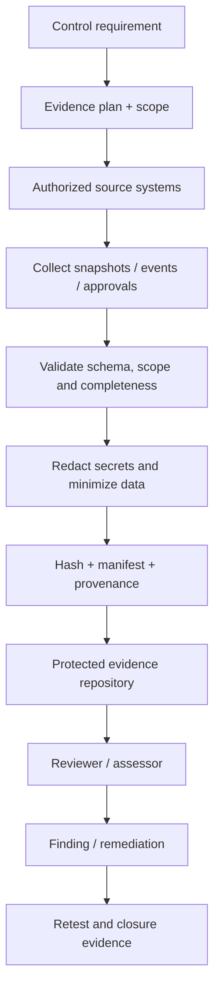

# Compliance evidence

**Compliance evidence** là tập hợp hồ sơ có thể kiểm chứng được dùng để chứng minh một kiểm soát bảo vệ khóa đã được thiết kế, phê duyệt, triển khai và vận hành theo yêu cầu áp dụng. Trong quản lý khóa mật mã, bằng chứng có thể gồm key inventory, policy KMS/HSM, danh sách quyền hiệu lực, access review, audit event, hồ sơ rotation, kết quả backup/restore test, biên bản dual control và xác nhận destruction.

Bằng chứng tuân thủ cần trả lời được ba câu hỏi: tổ chức phải đáp ứng yêu cầu nào; kiểm soát nào được dùng để đáp ứng yêu cầu đó; và hồ sơ nào chứng minh kiểm soát đã hoạt động trong phạm vi, thời gian được đánh giá. Một policy file cho thấy kiểm soát được thiết kế, nhưng chưa tự chứng minh người vận hành đã thực hiện đúng. Một ảnh chụp màn hình có thể cho thấy trạng thái tại một thời điểm, nhưng không tự chứng minh trạng thái đó duy trì trong cả kỳ.

Trong phạm vi **SECURITY_KEY_MANAGEMENT_FUNDAMENTALS**, compliance evidence kết nối vòng đời khóa, cryptographic policy, KMS/HSM, access control, backup/recovery, rotation, destruction, audit retention và assurance. Mục tiêu là xây dựng bằng chứng có nguồn gốc, đầy đủ, đúng phạm vi, bảo vệ khỏi sửa đổi và không làm lộ key material hoặc bí mật nghiệp vụ.

## 1. Compliance evidence chứng minh điều gì?

Một chương trình assurance thường cần chứng minh cả thiết kế lẫn hoạt động thực tế của kiểm soát.

- **Design evidence:** cho thấy kiểm soát được thiết kế để xử lý rủi ro, có owner, phạm vi, quy trình và tiêu chí thành công. Ví dụ: key management policy, cryptoperiod standard, access control matrix và backup procedure.
- **Implementation evidence:** cho thấy kiểm soát đã được cấu hình trên hệ thống. Ví dụ: KMS key policy, HSM partition configuration, IAM role, audit trail setting và storage retention lock.
- **Operating evidence:** cho thấy kiểm soát đã vận hành trong kỳ được đánh giá. Ví dụ: access review đã được phê duyệt, rotation run hoàn tất, restore test có kết quả và alert được xử lý.
- **Outcome evidence:** cho thấy kết quả hoặc trạng thái sau khi kiểm soát chạy. Ví dụ: principal bị thu hồi không còn effective access, backup khôi phục được dữ liệu mẫu hoặc key cũ không còn ký mới.

Không phải mọi kiểm soát đều cần bốn loại artifact riêng biệt. Nhưng người đánh giá cần phân biệt rõ tài liệu mô tả quy trình với bằng chứng thực thi và kết quả. Tránh dùng một policy PDF để kết luận rằng mọi key trong production đều tuân thủ policy đó.

## 2. Từ yêu cầu đến bằng chứng

Luồng truy xuất nên bắt đầu từ requirement hoặc control objective, sau đó ánh xạ sang rủi ro, kiểm soát, owner, hệ thống và evidence artifact.

| Thành phần | Câu hỏi | Ví dụ trong key management |
|---|---|---|
| Requirement | Phải đáp ứng điều gì? | Khóa production chỉ được dùng bởi workload được ủy quyền |
| Risk | Điều gì có thể xảy ra nếu không đáp ứng? | Workload trái phép giải mã dữ liệu khách hàng |
| Control objective | Trạng thái mong muốn là gì? | Quyền sử dụng key bị giới hạn theo identity, purpose và tenant |
| Control activity | Kiểm soát được thực hiện ra sao? | KMS policy, workload identity, ABAC và access review |
| Control owner | Ai chịu trách nhiệm? | Key owner hoặc platform security owner |
| Evidence | Hồ sơ nào chứng minh? | Policy snapshot, effective access report, review decision và audit event |
| Assessment | Bằng chứng có đủ và đáng tin không? | Đối chiếu policy, log sử dụng và kết quả remediation |

Ánh xạ này tạo traceability từ yêu cầu đến artifact. Nếu một requirement có nhiều kiểm soát, cần ghi rõ kiểm soát nào là primary, kiểm soát nào là compensating và bằng chứng nào hỗ trợ từng phần.

## 3. Không đồng nhất evidence với compliance

Có artifact không đồng nghĩa tổ chức đã tuân thủ. Một file cấu hình có thể cũ, một log có thể thiếu nguồn, một báo cáo vendor có thể không bao phủ hệ thống đang dùng hoặc một review có thể đã hoàn tất nhưng phát hiện chưa được remediation.

Khi đánh giá, cần xác định:

- Requirement có thực sự áp dụng cho tổ chức, hệ thống, dữ liệu và kỳ đánh giá này không?
- Control được thiết kế có giải quyết đúng rủi ro không?
- Evidence có đến từ nguồn có thẩm quyền và đúng thời gian không?
- Phạm vi evidence có bao phủ toàn bộ population cần kiểm tra không?
- Có ngoại lệ, khoảng trống, thất bại hoặc remediation còn mở không?
- Kết luận có được giới hạn đúng với những gì evidence chứng minh không?

Một báo cáo assurance chỉ nên kết luận trong phạm vi đã kiểm tra. Ví dụ, một restore test thành công trên một key family không chứng minh tất cả backup của mọi region đều phục hồi được.

## 4. Các nhóm tiêu chuẩn và khung tham chiếu

Tổ chức có thể phải làm việc với nhiều khung quản trị, tiêu chuẩn kỹ thuật, yêu cầu hợp đồng và quy định. Những tài liệu này có mục đích khác nhau; cần lập mapping theo phiên bản và phạm vi áp dụng.

| Khung tham chiếu | Cách thường dùng trong key management assurance | Lưu ý khi thu thập evidence |
|---|---|---|
| ISO/IEC 27001 và 27002 | Hệ thống quản lý an toàn thông tin và hướng dẫn kiểm soát | Chứng minh control được đưa vào ISMS, có owner, risk treatment và vận hành |
| NIST SP 800-57 | Hướng dẫn quản lý khóa mật mã | Dùng để xây dựng policy về key type, lifecycle, cryptoperiod và protection |
| NIST SP 800-53 | Catalog kiểm soát an ninh và quyền riêng tư | Mapping các kiểm soát access, audit, configuration, contingency và cryptographic protection |
| FIPS 140-3 | Yêu cầu và chương trình xác nhận module mật mã | Xác minh đúng module, phiên bản, mode và phạm vi certificate; không suy rộng sang toàn hệ thống |
| PCI DSS | Yêu cầu bảo vệ dữ liệu tài khoản thanh toán trong phạm vi áp dụng | Gắn evidence với CDE, key custodians, key procedures và kiểm soát truy cập liên quan |
| SOC 2 Trust Services Criteria | Tiêu chí đánh giá kiểm soát dịch vụ | Phân biệt mô tả hệ thống, thiết kế kiểm soát, kết quả test và complementary user entity controls |
| Yêu cầu pháp lý/hợp đồng | Nghĩa vụ theo ngành, khu vực hoặc khách hàng | Ghi rõ điều khoản, phạm vi, thời hạn và cách diễn giải đã được phê duyệt |

Đây là nhóm tham chiếu thường gặp, không phải tuyên bố rằng mọi tiêu chuẩn đều áp dụng cho mọi tổ chức hoặc có cùng yêu cầu về một artifact cụ thể. Cần dùng phiên bản chính thức đang có hiệu lực, xác định scope và để legal/compliance owner phê duyệt mapping.

## 5. Evidence matrix cho key management

Evidence matrix giúp biến yêu cầu trừu tượng thành hồ sơ có thể thu thập và kiểm tra.

| Control area | Control objective | Evidence ví dụ |
|---|---|---|
| Key inventory | Biết mọi khóa quan trọng, owner, purpose và trạng thái | Inventory snapshot, reconciliation report, orphan-key finding |
| Key generation | Khóa được tạo bằng nguồn ngẫu nhiên/provider được phê duyệt | KMS/HSM creation event, key metadata, configuration baseline |
| Key storage | Key material được bảo vệ và giới hạn khả năng export | HSM/KMS configuration, keystore ACL, non-exportable attribute |
| Key usage | Chỉ principal được phép mới gọi operation | Effective access report, policy snapshot, operation audit |
| Key distribution | Key reference/certificate được cấp đúng identity và mục đích | Certificate issuance, grant record, approval và recipient inventory |
| Rotation | Key được xoay theo policy và dependency được xử lý | Rotation plan/run, version history, rewrap/re-encrypt report |
| Backup/recovery | Khóa và dữ liệu có thể phục hồi theo yêu cầu | Backup manifest, quorum record, restore test và verification result |
| Revocation/destruction | Khóa bị thu hồi/hủy đúng quy trình | Approval, provider state transition, destruction attestation và dependency check |
| Access review | Quyền được xác nhận và remediation | Review snapshot, certifier decision, ticket và post-change access check |
| Audit/monitoring | Sự kiện được ghi, bảo vệ và cảnh báo | Audit configuration, sample event, integrity report, alert case |
| Incident response | Compromise được xử lý và phạm vi được đánh giá | Incident timeline, containment record, emergency rotation và closure report |

Matrix nên có thêm control ID, requirement reference, owner, frequency, population, evidence source, retention class, reviewer và trạng thái. Không dùng một artifact duy nhất để đại diện cho mọi control area nếu nó không chứng minh đủ từng mục tiêu.

## 6. Xác định phạm vi và population

Một trong những lỗi phổ biến là đưa ra bằng chứng từ một vài key được chọn nhưng kết luận cho toàn bộ hệ thống. Trước khi thu thập, phải xác định population và cách chứng minh tính đầy đủ.

Ví dụ scope có thể gồm:

- Tất cả KMS key thuộc production account/project trong kỳ.
- Tất cả HSM partition có giữ KEK hoặc signing key quan trọng.
- Tất cả principal có quyền `Decrypt`, `Sign`, `Export`, `CreateGrant` hoặc quản trị policy.
- Tất cả key version đã đến hạn rotation trong kỳ.
- Tất cả backup/restore operation liên quan đến key trong phạm vi.
- Tất cả sự kiện disable, revoke hoặc destroy trong kỳ đánh giá.

Nguồn population có thể là KMS inventory, CMDB, cloud account list, HSM inventory, IAM export hoặc service catalog. Cần đối chiếu ít nhất các nguồn có thẩm quyền để phát hiện key không được đăng ký hoặc account bị bỏ sót.

Nếu lấy mẫu, phải lưu phương pháp chọn mẫu, tổng population, kích thước mẫu, tiêu chí và giới hạn kết luận. Một mẫu ngẫu nhiên nhỏ không chứng minh mọi phần tử đều đạt; mẫu theo rủi ro có thể hữu ích nhưng không đại diện thống kê cho toàn bộ population.

## 7. Chất lượng evidence

Evidence tốt cần có các thuộc tính sau:

- **Relevant:** liên quan trực tiếp đến requirement/control objective.
- **Sufficient:** đủ phạm vi, thời gian và chi tiết để hỗ trợ kết luận.
- **Reliable:** đến từ nguồn có thẩm quyền, có integrity và provenance rõ.
- **Timely:** được tạo trong kỳ đánh giá hoặc có timestamp chứng minh trạng thái phù hợp.
- **Complete:** không bỏ sót population, event, page hoặc file liên quan.
- **Understandable:** có schema, field definition, context và hướng dẫn diễn giải.
- **Reproducible:** người đánh giá có thể lặp lại truy vấn hoặc xác minh digest/manifest.
- **Protected:** không làm lộ key material, credential hoặc dữ liệu vượt mục đích.

Ảnh chụp màn hình thường thiếu metadata về truy vấn, bộ lọc, thời điểm và tổng số kết quả. Khi có thể, ưu tiên export có cấu trúc từ API/reporting service, kèm query, filter, timestamp, account/region và checksum. Screenshot có thể bổ sung ngữ cảnh giao diện nhưng không nên là bằng chứng duy nhất cho control có thể xuất dữ liệu máy đọc được.

## 8. Nguồn thu thập và provenance

Mỗi artifact cần xác định nguồn tạo ra, người hoặc service thu thập và các bước xử lý sau đó.

| Nguồn | Artifact | Điểm cần xác minh |
|---|---|---|
| KMS API/audit service | Key metadata, operation event, policy và grant | Account/region, query filter, API version, timestamp và pagination |
| HSM management interface | Partition, role, key attributes, audit log | Device identity, firmware, operator, export completeness |
| IAM/identity provider | Role, group, trust, workload identity và access report | Effective access, federation và thời điểm snapshot |
| Key inventory/CMDB | Owner, purpose, classification và dependency | Sync time, missing records, stale owner và reconciliation |
| CI/CD/configuration management | Deployment, policy change, approval và artifact version | Commit/build reference, actor và release environment |
| Backup/recovery platform | Backup manifest, restore job và result | Backup ID, key reference, integrity và test scope |
| Ticket/change system | Approval, exception, incident và remediation | Người phê duyệt, scope, trạng thái và thời hạn |
| SIEM/log archive | Audit event, alert, investigation evidence | Ingest lag, retention, integrity và source reference |

Không coi tên file hoặc người gửi email là provenance đầy đủ. Artifact cần có source system, resource/account, extraction time, query/filter hoặc export ID và người chịu trách nhiệm.

## 9. Evidence collection pipeline

Thu thập bằng chứng nên được chuẩn hóa để giảm thao tác thủ công, giữ metadata và tạo hồ sơ có thể tái lập.



Pipeline có thể tự động lấy snapshot, chuẩn hóa schema, tính digest và tạo manifest. Nhưng các bước diễn giải, xác nhận owner, đánh giá ngoại lệ và kết luận tuân thủ vẫn cần người có thẩm quyền. Không để một automation job vừa tự tạo control evidence vừa tự phê duyệt kết quả mà không có kiểm soát độc lập.

## 10. Evidence manifest

Manifest là bản mô tả có cấu trúc cho một tập artifact. Nó giúp người đánh giá biết file nào thuộc control nào, được thu thập từ đâu, khi nào và có digest gì.

Một manifest có thể gồm:

| Field | Ý nghĩa |
|---|---|
| `evidenceId` | Định danh duy nhất |
| `controlId` / `requirementRef` | Control và requirement được hỗ trợ |
| `scope` | Account, region, environment, key family hoặc kỳ đánh giá |
| `sourceSystem` | Hệ thống phát hành dữ liệu |
| `sourceReference` | API export ID, query ID, audit range hoặc ticket reference |
| `collectedAt` | Thời điểm thu thập |
| `collector` | Identity của collector hoặc người thực hiện |
| `schemaVersion` | Phiên bản định dạng |
| `artifactName` | Tên artifact trong repository |
| `digestAlgorithm` / `digest` | Thuật toán và digest của nội dung artifact |
| `classification` | Mức phân loại và điều kiện truy cập |
| `retentionClass` / `holdId` | Retention schedule và hold nếu có |
| `reviewStatus` | Collected, validated, accepted, rejected hoặc needs follow-up |

Manifest không tự chứng minh artifact là đúng. Nó giúp bảo toàn mối liên hệ và phát hiện thay đổi sau khi digest được tính. Người đánh giá vẫn cần xác minh source, scope, query, completeness và semantics của dữ liệu.

## 11. Integrity, authenticity và chain of custody

Ba khái niệm này có liên quan nhưng không giống nhau:

- **Integrity:** phát hiện artifact bị thay đổi sau thời điểm kiểm tra, thường bằng hash, checksum, signature hoặc immutable storage.
- **Authenticity/provenance:** chứng minh artifact đến từ nguồn hoặc identity được tin cậy. Hash đơn thuần không chứng minh ai đã tạo file.
- **Chain of custody:** ghi lại ai thu thập, truy cập, sao chép, chuyển giao, xử lý và phê duyệt artifact theo thời gian.

Một quy trình chain of custody nên lưu evidence ID, digest tại lúc thu thập, actor, timestamp, action, source/destination, reason và kết quả xác minh sau chuyển giao. Nếu artifact được redacted hoặc chuyển định dạng, phải lưu quan hệ với bản gốc, người thực hiện, phương pháp và digest của từng phiên bản.

Hash SHA-256 giúp phát hiện thay đổi khi digest gốc được bảo vệ độc lập. Nếu attacker có thể sửa cả artifact lẫn manifest/digest, hash không đủ. Với evidence quan trọng, dùng chữ ký số của manifest, trusted timestamp hoặc immutable repository có quyền quản trị tách biệt.

## 12. Bảo vệ evidence repository

Evidence có thể chứa key ID, principal, account topology, IP, tenant, policy và chi tiết vận hành. Repository cần được bảo vệ như một tài sản nhạy cảm.

- Tách account/project và identity quản trị khỏi KMS/HSM production nếu phù hợp kiến trúc.
- Dùng RBAC/ABAC để giới hạn control owner, collector, reviewer, auditor và repository administrator.
- Mã hóa khi truyền và khi lưu; key bảo vệ evidence có purpose riêng.
- Bật versioning, immutable/WORM hoặc retention lock cho artifact cần bảo toàn.
- Ghi audit cho read, download, replace, delete, share, hold và retention change.
- Tách quyền upload, approve, retention administration và purge.
- Dùng MFA hoặc workload identity cho truy cập nhạy cảm; giới hạn session và download.
- Theo dõi chia sẻ ngoài tổ chức, export hàng loạt và truy cập bất thường.
- Kiểm thử backup/restore và integrity verification của chính repository.

Không đưa raw key material, private key, password, PIN, token hoặc secret vào evidence. Nếu artifact nguồn vô tình chứa bí mật, phải xử lý theo incident/data handling policy, tạo bản redacted được kiểm soát và lưu mapping an toàn nếu cần giữ bản gốc.

## 13. Evidence về key inventory và ownership

Để chứng minh tổ chức kiểm soát được tài sản khóa, cần có inventory đầy đủ và có khả năng đối chiếu với nguồn provider.

Evidence nên bao gồm:

- Snapshot key inventory tại thời điểm xác định.
- Danh sách KMS account/project, region, HSM cluster và partition trong scope.
- Key ID/version, purpose, algorithm, owner, environment, status và rotation date.
- Mapping key tới application, tenant, data class và dependency.
- Reconciliation report giữa inventory nội bộ với API/provider inventory.
- Danh sách key không owner, metadata thiếu, key orphan hoặc key ngoài policy.
- Ticket và kết quả xử lý finding.

Inventory có timestamp cũ không chứng minh trạng thái hiện tại. Khi dùng snapshot cho kỳ đánh giá, cần ghi rõ snapshot date và cách xử lý key được tạo/xóa sau thời điểm đó. Đối với population thay đổi liên tục, có thể cần snapshot đầu kỳ/cuối kỳ và event log để tái dựng biến động.

## 14. Evidence về key generation và storage

Bằng chứng tạo và lưu khóa phải cho thấy nguồn tạo, cấu hình và boundary bảo vệ.

| Control | Evidence phù hợp |
|---|---|
| Approved generation method | KMS/HSM generation event, provider reference, algorithm và key size |
| CSPRNG/provider | Module/provider configuration, validation status và runtime version |
| Non-exportable key | Key attribute, HSM/KMS metadata, test hoặc provider attestation |
| Keystore protection | File ACL, owner, mount configuration, encryption và access review |
| Separation of duties | Role matrix, privileged access listing và approval record |
| Key backup | Backup policy, key wrapping reference, quorum record và restore evidence |

Nếu dùng HSM có chứng nhận hoặc validation, phải xác minh chính xác module name, hardware/firmware version, operational environment và certificate status. Chứng nhận của một cryptographic module không tự chứng minh ứng dụng, IAM, network, backup hoặc toàn bộ quy trình key management đã tuân thủ.

## 15. Evidence về access control

Access evidence cần thể hiện cả quyền được cấp và quyền hiệu lực sau khi hợp nhất các lớp policy.

Artifact có thể gồm:

- Key policy, IAM policy, resource policy và grant snapshot.
- Group membership, trust relationship và workload identity mapping.
- Effective access report cho action `Encrypt`, `Decrypt`, `Sign`, `Export`, `Rotate`, `Disable` và `Destroy`.
- ABAC policy version cùng nguồn thuộc tính như tenant, purpose, environment và key status.
- Access review snapshot, reviewer decision và remediation ticket.
- Bằng chứng thu hồi quyền và negative test sau thay đổi.
- Danh sách break-glass, vendor/support identity và quyền ngoại lệ.

Một policy JSON đơn lẻ có thể không cho thấy quyền kế thừa từ group hoặc resource policy. Evidence nên bao gồm effective access calculation hoặc mô tả rõ giới hạn nếu provider không thể tính đầy đủ. Cần nêu cả quyền có khả năng sửa policy/tạo grant vì đó là đường mở rộng quyền.

## 16. Evidence về rotation và cryptoperiod

Rotation evidence phải chứng minh workflow đã đi qua các bước cần thiết, không chỉ có event tạo version mới.

Một bộ hồ sơ có thể gồm:

1. Policy/cryptoperiod và due-date calculation.
2. Key inventory snapshot cùng dependency graph.
3. Rotation plan, strategy và approval/change ticket.
4. KMS/HSM event tạo key version mới.
5. Rewrap/re-encrypt report và số lượng object đã xử lý.
6. Canary/rollout result và consumer version đang hoạt động.
7. Kiểm tra dữ liệu mới có thể giải mã/xác minh.
8. Backup/replica/archive verification.
9. Trạng thái key cũ: verify-only, unwrap-only, disabled hoặc retired theo policy.
10. Exception, dependency tồn đọng và kế hoạch đóng.

Nếu chỉ có `CreateKeyVersion` event, chưa thể kết luận rotation hoàn tất. Cần kiểm tra workload đã chuyển sang version mới và dữ liệu lịch sử vẫn có thể đọc được theo yêu cầu.

## 17. Evidence về backup và recovery

Backup evidence cần chứng minh backup được tạo, bảo vệ, lưu và có thể phục hồi. Một backup job thành công chỉ chứng minh dữ liệu đã được ghi theo trạng thái của job, không chứng minh toàn bộ hệ thống có thể khôi phục.

Hồ sơ nên gồm:

- Backup scope, key ID/version, dataset và thời điểm.
- Backup manifest, checksum/integrity result và storage location.
- Khóa bảo vệ backup, wrapped DEK reference và quyền truy cập.
- Người tạo, người phê duyệt, quorum/dual-control record nếu có.
- Restore test plan, môi trường, sample hoặc population được thử.
- Kết quả khôi phục, decrypt/verify result và thời gian hoàn thành.
- Finding, lỗi, remediation và lần retest.
- RTO/RPO mục tiêu cùng kết quả đo được.

Không đưa raw key hoặc PIN vào hồ sơ restore. Nếu HSM dùng M-of-N, lưu danh sách participant/role và kết quả ceremony theo policy, không lưu secret share hoặc thông tin đủ để tái tạo share.

## 18. Evidence về revocation và destruction

Thu hồi và hủy khóa có thể gây mất khả năng giải mã hoặc xác minh. Bằng chứng cần cho thấy quyết định đã được phê duyệt, dependency đã được đánh giá và provider đã thực hiện trạng thái mong muốn.

| Giai đoạn | Evidence |
|---|---|
| Request | Key ID/version, owner, reason, scope và ticket |
| Dependency assessment | Dataset, backup, replica, archive, certificate và consumer còn phụ thuộc |
| Approval | Approver, dual control, legal hold check và decision time |
| Execution | Provider operation ID, actor, timestamp và result |
| Verification | Key state, thử operation bị chặn, HSM/KMS confirmation hoặc destruction attestation |
| Closure | Inventory update, audit reference, exception và retention record |

Một trạng thái `PendingDeletion` chưa phải bằng chứng vật liệu khóa đã bị hủy. Cần dùng đúng semantics của provider, ví dụ thời gian chờ, khả năng hủy lịch xóa và trạng thái cuối. Nếu không thể chứng minh physical zeroization, hãy mô tả chính xác assurance mà provider cung cấp; không tuyên bố mạnh hơn bằng chứng.

## 19. Evidence về audit và monitoring

Audit evidence cần chứng minh nguồn log được bật, sự kiện được gửi và bản ghi được bảo vệ.

Artifact có thể gồm:

- Audit configuration/trail và danh sách event source trong scope.
- Sample event có principal, key reference, action, timestamp, result và request ID.
- Ingest/coverage report, producer heartbeat và pipeline gap alert.
- Integrity manifest, signature/checkpoint và WORM/object lock configuration.
- Retention schedule, legal hold registry và purge evidence.
- Alert rule, incident/case record và bằng chứng xử lý.
- Access review đối với audit repository và quyền thay logging configuration.

Một log sample không chứng minh mọi event đều được ghi. Cần xác định population, khoảng thời gian, producer và cơ chế phát hiện log gap. Nếu có nguồn không hỗ trợ operation-level audit, phải ghi rõ giới hạn và evidence bù từ gateway/provider adapter.

## 20. Evidence từ nhà cung cấp và bên thứ ba

Cloud KMS, HSM service, certificate authority hoặc managed key service có thể cung cấp SOC report, ISO certificate, FIPS validation reference, audit export hoặc service assurance document.

Khi sử dụng evidence bên thứ ba, cần xác minh:

- Đúng pháp nhân, dịch vụ, region và product tier đang sử dụng.
- Report/certificate còn hiệu lực và đúng kỳ đánh giá.
- Scope và system boundary có bao phủ dịch vụ thực tế không.
- Subservice organization và carve-out method được mô tả ra sao.
- Complementary user entity controls (CUEC) nào khách hàng phải tự thực hiện.
- Exceptions, qualifications, bridge letter và gap giữa hai kỳ báo cáo.
- Có cần thêm evidence cấu hình của chính tenant/account không.

Chứng nhận của nhà cung cấp không thay thế evidence về cách tổ chức cấu hình và sử dụng dịch vụ. Ví dụ, HSM service có thể được xác nhận theo một tiêu chuẩn nhưng IAM policy của khách hàng vẫn có thể cấp `Decrypt` quá rộng.

## 21. Sampling và cách đánh giá

Khi population quá lớn để kiểm tra từng item, người đánh giá có thể lấy mẫu theo risk-based hoặc statistical method. Phương pháp phải được ghi trước khi chọn mẫu để tránh chỉ chọn những item dễ chứng minh.

Các yếu tố cần ghi:

- Population definition và số lượng tổng thể.
- Kỳ thời gian và nguồn trích xuất.
- Phương pháp lấy mẫu: random, stratified, risk-based hoặc judgmental.
- Sample size, seed/selection logic và tiêu chí phân tầng.
- Cách xử lý item không có evidence hoặc evidence không đọc được.
- Tỷ lệ exception và cách mở rộng mẫu khi phát hiện lỗi.
- Giới hạn kết luận từ mẫu.

Với quyền rất nhạy cảm như export, destroy, HSM administrator hoặc break-glass, review toàn bộ population có thể phù hợp hơn sampling. Với event volume lớn, có thể dùng continuous monitoring và chọn mẫu để kiểm tra chất lượng pipeline.

## 22. Findings, exception và remediation evidence

Một finding cần liên kết requirement, control, evidence, rủi ro, owner và hành động khắc phục. Không chỉ ghi “policy sai” hoặc “thiếu log”.

Một finding tốt gồm:

- Finding ID, severity và thời điểm phát hiện.
- Requirement/control objective bị ảnh hưởng.
- Scope/population và evidence reference.
- Condition: điều gì thực tế đã xảy ra.
- Criteria: yêu cầu hoặc policy nào cần đáp ứng.
- Cause: nguyên nhân gốc nếu đã xác định.
- Risk/impact: khả năng và hậu quả.
- Corrective action, owner, due date và approval.
- Retest evidence và ngày xác minh đóng.

Exception cần có lý do, risk acceptance authority, compensating control, expiry và review date. Không đánh dấu finding đã đóng chỉ vì ticket chuyển sang `Done`; phải có bằng chứng rằng control đã được sửa và kết quả đã được kiểm tra lại.

## 23. Java: tạo digest cho evidence artifact

Ví dụ sau tính SHA-256 cho một artifact và in ra digest dạng hexadecimal. Digest có thể được đưa vào evidence manifest để phát hiện file thay đổi sau khi thu thập.

```java
import java.io.InputStream;
import java.nio.file.Files;
import java.nio.file.Path;
import java.security.MessageDigest;
import java.security.NoSuchAlgorithmException;
import java.util.HexFormat;

public final class EvidenceDigest {
    private EvidenceDigest() {}

    public static String sha256(Path artifact) throws Exception {
        MessageDigest digest = MessageDigest.getInstance("SHA-256");
        try (InputStream input = Files.newInputStream(artifact)) {
            byte[] buffer = new byte[8192];
            int count;
            while ((count = input.read(buffer)) != -1) {
                digest.update(buffer, 0, count);
            }
        }
        return HexFormat.of().formatHex(digest.digest());
    }

    public static void main(String[] args) throws Exception {
        Path artifact = Path.of(args[0]);
        System.out.println(sha256(artifact));
    }
}
```

Ví dụ cần Java 17 trở lên do dùng `HexFormat` và `Path.of`. Với JDK cũ, có thể chuyển digest bytes sang hex bằng formatter tương thích. Trong production, manifest phải ghi digest algorithm, artifact identity, source, collectedAt, collector và scope. SHA-256 chỉ phát hiện thay đổi nếu digest/manifest gốc được bảo vệ độc lập; nó không chứng minh nguồn file hoặc người tạo file. Có thể ký manifest bằng signing key chuyên dụng và lưu signature/checkpoint ở repository tách biệt.

Không tính digest sau khi file đã bị chỉnh sửa rồi coi đó là bằng chứng nguyên bản. Digest cần được tạo ngay khi thu thập hoặc tiếp nhận từ nguồn tin cậy, sau đó được bảo vệ cùng chain of custody.

## 24. Review và phê duyệt evidence package

Trước khi gửi cho auditor hoặc assessor, evidence owner nên thực hiện quality review:

1. Kiểm tra requirement/control mapping đúng phiên bản và đúng scope.
2. Kiểm tra population, query/filter, account/region và kỳ thời gian.
3. Kiểm tra artifact có đầy đủ, đọc được, không bị cắt và có schema.
4. Xác minh source, timestamp, collector, digest và chain of custody.
5. Đối chiếu các artifact liên quan để tìm mâu thuẫn, ví dụ policy cho phép nhưng access review ghi đã revoke.
6. Redact secret, personal data và metadata không cần thiết.
7. Xác minh retention class, access permission và legal hold.
8. Ghi reviewer, decision, finding và follow-up.
9. Phát hành evidence package với manifest/version và kênh chia sẻ được phê duyệt.

Nếu evidence thiếu hoặc mâu thuẫn, đánh dấu `INCOMPLETE` hoặc `NEEDS_FOLLOW_UP`; không tự điền giá trị suy đoán. Ghi rõ limitation để assessor không diễn giải artifact vượt quá phạm vi.

## 25. Checklist compliance evidence cho key management

Trước khi đóng kỳ assurance, hãy xác nhận:

- [ ] Requirement/control mapping có version, scope, owner và approval.
- [ ] Population key, principal, account, region và operation được xác định và đối chiếu.
- [ ] Có phân biệt design, implementation, operating và outcome evidence.
- [ ] Evidence source, query/filter, timestamp, collector và schema được ghi.
- [ ] Artifact đầy đủ, relevant, reliable, timely và có thể tái lập.
- [ ] Manifest có evidence ID, control ID, source reference, digest và classification.
- [ ] Integrity, authenticity và chain of custody được bảo vệ phù hợp.
- [ ] Repository có access control, encryption, retention, audit và backup.
- [ ] Không có raw key material, private key, password, PIN hoặc token trong evidence.
- [ ] Key inventory và ownership được reconcile với KMS/HSM/provider.
- [ ] Access evidence bao gồm effective access, grant, ABAC và remediation.
- [ ] Rotation evidence bao gồm rollout, dependency, verification và key cũ.
- [ ] Backup/restore evidence nêu rõ scope, kết quả, RTO/RPO và limitation.
- [ ] Revocation/destruction evidence phù hợp semantics provider và có dependency check.
- [ ] Audit/monitoring evidence thể hiện completeness, integrity, retention và gap handling.
- [ ] Third-party report đúng scope, kỳ hiệu lực và CUEC đã được xử lý.
- [ ] Sampling method và giới hạn kết luận được ghi rõ.
- [ ] Findings/exception có owner, deadline, approval và retest evidence.
- [ ] Evidence package được review, phê duyệt và chia sẻ qua kênh kiểm soát.

Compliance evidence có giá trị khi người đánh giá có thể truy xuất từ yêu cầu đến kiểm soát, từ kiểm soát đến nguồn dữ liệu và từ artifact đến kết luận mà không phải tin vào lời khẳng định đơn lẻ. Với quản lý khóa, bằng chứng cần bao phủ toàn bộ vòng đời và quyền sử dụng, phản ánh đúng population và kỳ đánh giá, đồng thời bảo vệ integrity, provenance, confidentiality và retention. Khi thiết kế evidence matrix, manifest, chain of custody và quy trình remediation rõ ràng, tổ chức có thể chứng minh mức assurance thực tế mà không làm lộ chính những bí mật mà hệ thống đang bảo vệ.
