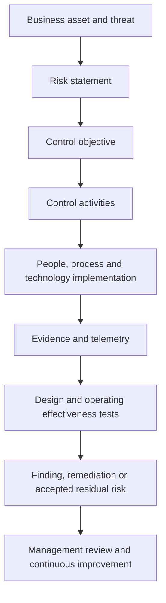

# Control objective và implementation

Control objective (mục tiêu kiểm soát) mô tả kết quả bảo mật mà tổ chức cần đạt để giảm một rủi ro đã xác định. Implementation (cách triển khai) mô tả các chính sách, quy trình, con người và công nghệ được dùng để đạt kết quả đó. Trong quản lý khóa mật mã, mục tiêu có thể là chỉ workload được phê duyệt mới sử dụng key cho đúng purpose; implementation có thể gồm KMS policy, workload identity, HSM boundary, approval workflow, audit event và kiểm thử quyền.

Hai khái niệm này liên quan nhưng không thể thay thế nhau. Một yêu cầu tiêu chuẩn như “quản lý vòng đời khóa” chưa tự nói rõ hệ thống phải dùng sản phẩm KMS nào. Ngược lại, việc triển khai một KMS hoặc HSM chưa chứng minh tổ chức đã đạt mục tiêu kiểm soát: policy có thể quá rộng, key không có owner, backup chưa được thử restore hoặc audit không phát hiện được operation bất thường.

Assurance là hoạt động thu thập và đánh giá bằng chứng để xác định control được thiết kế phù hợp, đã triển khai và vận hành hiệu quả. Một chương trình assurance tốt nối được chuỗi **rủi ro → mục tiêu kiểm soát → hoạt động kiểm soát → implementation → evidence → test → kết luận**. Bài học này áp dụng chuỗi đó vào key management, giải thích cách ánh xạ tiêu chuẩn, xây control matrix, chọn bằng chứng, kiểm tra hiệu lực và quản lý ngoại lệ.

## 1. Control objective là gì?

Control objective mô tả trạng thái cần đạt để xử lý một rủi ro. Nó phải đủ rõ để có thể đánh giá đạt hay không đạt, nhưng không phụ thuộc quá sớm vào một sản phẩm hoặc công nghệ cụ thể.

Ví dụ mục tiêu: “Chỉ principal được xác thực và được cấp quyền rõ ràng mới có thể thực hiện cryptographic operation trên key đúng purpose; mọi operation nhạy cảm có thể truy vết tới principal và key version.”

Mục tiêu này gắn với các rủi ro như:

- Key bị dùng bởi workload hoặc nhân sự không được phép.
- Một principal có quyền decrypt, sign, export và delete rộng hơn nhu cầu.
- Không xác định được ai đã sử dụng key khi xảy ra sự cố.
- Key bị dùng sai tenant, environment hoặc purpose.
- Quyền cũ còn hiệu lực sau khi workload hoặc nhân sự rời hệ thống.

Một control objective tốt thường có các đặc điểm:

- **Risk-linked:** chỉ ra rủi ro hoặc hậu quả cần giảm.
- **Outcome-oriented:** mô tả kết quả mong muốn thay vì chỉ liệt kê công cụ.
- **Testable:** có thể định nghĩa tiêu chí đạt, không đạt và bằng chứng.
- **Scoped:** xác định hệ thống, key class, environment, tenant hoặc quy trình áp dụng.
- **Owned:** có người chịu trách nhiệm và người phê duyệt.
- **Reviewable:** có chu kỳ xem xét khi rủi ro, tiêu chuẩn hoặc kiến trúc thay đổi.

Không nên viết mục tiêu mơ hồ như “bảo vệ key tốt”, “dùng mã hóa an toàn” hoặc “tuân thủ tiêu chuẩn”. Những câu này không xác định được hành vi cần kiểm soát, phạm vi hay cách kiểm chứng.

## 2. Implementation là gì?

Implementation là tập hợp hoạt động cụ thể được triển khai để đạt control objective. Nó có thể gồm nhiều lớp:

| Lớp | Ví dụ trong key management |
|---|---|
| Governance | Key management policy, owner, classification, cryptoperiod, approval và exception process |
| Process | Key generation, provisioning, access review, rotation, backup, recovery, revocation và destruction workflow |
| People | Key custodian, administrator, auditor, approver, recovery operator và separation of duties |
| Identity/access | Workload identity, MFA, RBAC/ABAC, least privilege, default deny và temporary grant |
| Technology | KMS, HSM, protected keystore, Secret Manager, cryptographic library và secure random generator |
| Monitoring | KMS/HSM audit, SIEM alert, key inventory, expiry monitoring và anomaly detection |
| Assurance | Unit/integration tests, configuration review, access recertification, restore drill và audit sampling |

Một objective thường cần nhiều implementation cùng phối hợp. Ví dụ KMS policy có thể giới hạn quyền decrypt, nhưng quy trình onboarding vẫn phải cấp đúng workload identity; inventory phải xác định key owner; audit phải lưu operation; và kiểm thử phải chứng minh request ngoài scope bị deny.

Implementation không nhất thiết là một sản phẩm. Một tổ chức có thể đạt mục tiêu bằng KMS cloud, HSM on-premises, keystore được bảo vệ hoặc kết hợp, miễn là giải pháp đáp ứng yêu cầu rủi ro, tiêu chuẩn và assurance đã xác định.

## 3. Phân biệt tiêu chuẩn, requirement, objective, control và evidence

Các tài liệu assurance thường dùng thuật ngữ gần nhau. Nên phân biệt rõ để tránh coi việc trích dẫn một điều khoản là bằng chứng triển khai.

| Thành phần | Trả lời câu hỏi | Ví dụ |
|---|---|---|
| Standard/framework | Tổ chức tham chiếu bộ yêu cầu hoặc hướng dẫn nào? | ISO/IEC 27001, NIST SP 800-53, PCI DSS |
| Requirement/control reference | Điều khoản hoặc control nào liên quan? | Control về sử dụng mật mã hoặc quản lý cryptographic keys |
| Risk | Điều gì có thể xảy ra và ảnh hưởng ra sao? | Attacker dùng key để giải mã dữ liệu production |
| Control objective | Kết quả nào phải đạt để giảm risk? | Chỉ workload được duyệt mới được decrypt trong đúng scope |
| Control activity | Tổ chức thực hiện hoạt động nào? | Cấp quyền theo key/action, review định kỳ, alert operation bất thường |
| Implementation | Hoạt động được triển khai bằng cách nào? | KMS key policy, workload identity, access review workflow, SIEM rule |
| Evidence | Bằng chứng nào cho thấy control tồn tại và hoạt động? | Policy export, access review record, KMS audit, test report |
| Assurance test | Bằng cách nào đánh giá evidence? | Reperform negative test, sample operation, inspect approval và audit trail |

Một requirement có thể được hỗ trợ bởi nhiều control. Một control cũng có thể hỗ trợ nhiều requirement. Không nên ép quan hệ một-một nếu rủi ro và implementation thực tế không như vậy.

Các nguồn tham chiếu cũng không có cùng tính chất. ISO/IEC 27001 đặt yêu cầu cho ISMS; ISO/IEC 27002 là hướng dẫn control. NIST SP 800-57 là khuyến nghị kỹ thuật; NIST SP 800-53 là catalog control cần tailoring theo hệ thống. FIPS 140-3 đặt yêu cầu validation cho cryptographic module trong phạm vi áp dụng. PCI DSS là standard áp dụng cho môi trường nằm trong scope thanh toán. SOC 2 là engagement/report dựa trên Trust Services Criteria được chọn. Việc một tài liệu có control liên quan không tự làm tài liệu đó trở thành nghĩa vụ pháp lý hoặc hợp đồng của mọi tổ chức.

## 4. Traceability từ rủi ro tới assurance

Traceability giúp auditor, security architect và service owner lần theo lý do một control tồn tại và cách chứng minh nó hoạt động.



Ví dụ: tài sản là dữ liệu khách hàng được mã hóa bằng envelope encryption; threat là workload bị compromise; risk là attacker dùng workload identity để unwrap DEK. Objective là chỉ workload được duyệt mới unwrap DEK cho đúng tenant. Control activities gồm default deny, context binding, access review và monitoring. Implementation gồm KMS policy, IAM role, encryption context, SIEM rule và runbook. Evidence gồm policy version, grant list, KMS audit event, access review record và negative test. Assurance test kiểm tra cả cấu hình lẫn một request sai tenant phải bị từ chối.

Nếu thiếu một mắt xích, assurance bị yếu: không có risk thì control có thể không cần thiết; không có objective thì khó đánh giá implementation; không có evidence thì chỉ còn lời khẳng định; không có test thì chưa biết evidence chứng minh điều gì.

## 5. Control objective cần cụ thể đến mức nào?

Objective phải đủ cụ thể để đo lường nhưng không nên mô tả toàn bộ câu lệnh cấu hình. Có thể dùng cấu trúc:

> Đối với [phạm vi/tài sản], [đối tượng chịu trách nhiệm] bảo đảm [kết quả bảo mật] bằng [nguyên tắc/điều kiện], được kiểm chứng qua [bằng chứng/tần suất].

Ví dụ:

- “Mọi production key có owner, purpose, classification và lifecycle state được ghi trong inventory có kiểm soát; owner xác nhận tính chính xác ít nhất mỗi quý và khi có thay đổi trọng yếu.”
- “Chỉ workload identity được phê duyệt mới được gọi operation phù hợp với purpose của key; request thiếu identity, resource hoặc context phải bị deny.”
- “Key backup có thể khôi phục trong RTO đã duyệt; quy trình restore được kiểm thử định kỳ trong môi trường cô lập.”
- “Mọi thay đổi policy, grant, alias và key state trên production được gắn với approval và có audit trail bảo vệ integrity.”

Các câu trên có thể được đo bằng inventory coverage, policy test, restore drill và audit sampling. Nếu objective chứa từ như “định kỳ”, “nhanh”, “an toàn” hoặc “đầy đủ”, hãy định nghĩa tiêu chí trong control specification hoặc standard nội bộ.

## 6. Control design và operating effectiveness

Assurance thường đánh giá ít nhất hai câu hỏi khác nhau.

- **Design effectiveness:** nếu control được thực hiện đúng như mô tả, nó có đủ khả năng xử lý risk không?
- **Operating effectiveness:** control có thực sự được thực hiện nhất quán trong khoảng thời gian được đánh giá không?

Ví dụ, policy quy định chỉ `orders-api` được `Decrypt` trên Orders KEK có thể có design hợp lý. Nhưng nếu policy thực tế còn grant cho role cũ, operating effectiveness không đạt. Ngược lại, access review có thể được thực hiện đúng lịch nhưng objective thiết kế quá yếu vì reviewer chỉ xác nhận role name mà không xem operation/resource scope.

| Đánh giá | Câu hỏi | Bằng chứng/test gợi ý |
|---|---|---|
| Design | Control có xử lý đúng threat và phạm vi? | Risk assessment, policy design, architecture, role matrix |
| Implementation | Cấu hình/procedure có được triển khai? | KMS policy, HSM configuration, workflow, identity binding |
| Operation | Control có chạy đúng trong thời gian? | Event logs, approval records, access review, rotation history |
| Outcome | Risk có được giảm tới mức chấp nhận? | Negative tests, incident trends, restore tests, anomaly results |

Không kết luận design tốt chỉ vì một test pass. Không kết luận operating effectiveness chỉ từ policy snapshot tại một thời điểm; cần evidence xuyên suốt giai đoạn và sample phù hợp.

## 7. Viết control specification có thể kiểm toán

Một control specification nên ghi tối thiểu:

| Trường | Nội dung cần xác định |
|---|---|
| Control ID | Mã định danh ổn định và duy nhất |
| Control objective | Kết quả/risk outcome cần đạt |
| Risk reference | Risk ID, threat, impact và residual risk |
| Scope | Module, system, key class, environment, tenant và exclusion |
| Control activity | Việc phải thực hiện, điều kiện và trình tự |
| Control type | Preventive, detective, corrective hoặc compensating; manual/automated |
| Owner/operator | Người chịu trách nhiệm và người thực hiện |
| Frequency/trigger | Liên tục, theo event, hàng ngày, hàng quý hoặc khi có thay đổi |
| Implementation reference | Policy, workflow, service, configuration hoặc runbook |
| Evidence source | Log, ticket, report, inventory, test result hoặc attestation |
| Success criteria | Điều kiện PASS/FAIL và ngưỡng chấp nhận |
| Exception handling | Quy trình phê duyệt, expiry, compensating control và review |
| Retention | Thời gian lưu evidence theo policy và nghĩa vụ áp dụng |
| Review date | Ngày đánh giá và trigger cần xem xét lại |

Control ID không nên chứa tên sản phẩm để tránh phải đổi ID khi thay vendor. Implementation reference có thể trỏ tới nhiều hệ thống và phiên bản cấu hình.

## 8. Phân loại control theo mục đích

Một control có thể thuộc nhiều loại, nhưng phân loại giúp hiểu nó ngăn, phát hiện hay khắc phục điều gì.

| Loại | Mục đích | Ví dụ key management |
|---|---|---|
| Preventive | Ngăn hành vi/rủi ro xảy ra | Default deny, least privilege, non-exportable key, dual control |
| Detective | Phát hiện sự kiện hoặc sai lệch | KMS audit alert, key expiry monitoring, access review exception |
| Corrective | Khôi phục trạng thái sau lỗi | Restore backup, revoke grant, rewrap DEK, recover HSM partition |
| Deterrent | Làm giảm động cơ hoặc khả năng lạm dụng | Audit có truy vết, approval và disciplinary policy |
| Compensating | Giảm risk khi control chính chưa khả thi | Network isolation + short-lived identity khi KMS policy feature chưa hỗ trợ điều kiện cần |
| Manual | Con người thực hiện hoặc phê duyệt | HSM key ceremony, dual approval, quarterly review |
| Automated | Hệ thống thực hiện theo rule | Rotation scheduler, policy enforcement, expiry alert |

Compensating control không nên được dùng như miễn trừ lâu dài. Phải ghi rõ risk còn lại, lý do control chính chưa triển khai được, owner, expiry và kế hoạch thay thế.

## 9. Xây dựng control objective cho từng giai đoạn key lifecycle

Một chương trình assurance phải bao phủ vòng đời khóa, không chỉ khâu lưu trữ.

| Giai đoạn | Control objective | Implementation có thể dùng |
|---|---|---|
| Planning | Mỗi key có purpose, owner, classification và requirement xác định trước khi tạo | Key inventory, request workflow, design approval |
| Generation | Key được tạo bằng thuật toán/độ dài phù hợp và nguồn ngẫu nhiên tin cậy | KMS/HSM generation, approved provider, entropy validation |
| Import | Key import được xác thực nguồn gốc và bảo vệ trong quá trình chuyển | Import ceremony, wrapping, dual control, integrity check |
| Distribution | Chỉ consumer được duyệt nhận key hoặc handle cần thiết | Workload identity, Secret Manager, KMS API, secure provisioning |
| Storage | Key material được bảo vệ khỏi truy cập trái phép và sao chép không kiểm soát | HSM, KMS, protected keystore, access boundary |
| Use | Operation được giới hạn theo principal, action, resource và context | Key policy, RBAC/ABAC, encryption context, application authorization |
| Rotation | Key được thay đúng cryptoperiod và consumer chuyển version có kiểm soát | Scheduler, versioning, rewrap/re-encryption workflow |
| Backup/recovery | Key và metadata cần thiết có thể phục hồi trong mục tiêu đã duyệt | Backup/replication, quorum, restore drill, recovery runbook |
| Revocation/disable | Key hoặc quyền bị thu hồi kịp thời khi hết purpose hoặc compromise | Disable, revoke grants, certificate revocation, identity shutdown |
| Destruction | Key bị hủy theo approval và không còn dependency hợp lệ | Deletion workflow, zeroization, evidence, retention review |
| Audit/monitoring | Key operation và thay đổi control plane có thể truy vết và phát hiện | Immutable audit, SIEM, alert, periodic review |

Các objective phải tính đến loại key. Private signing key, DEK, KEK, HMAC key và CA root key có purpose, recovery và destruction semantics khác nhau; không áp một control specification chung mà không phân biệt.

## 10. Ví dụ control matrix cho KMS/HSM

Control matrix ánh xạ objective tới implementation và evidence. Đây là ví dụ mẫu để tổ chức điều chỉnh theo threat model, tiêu chuẩn và kiến trúc thực tế.

| ID | Objective | Implementation | Evidence chính | Assurance test |
|---|---|---|---|---|
| KM-01 | Key có owner, purpose và classification | Inventory + provisioning workflow | Inventory export, approved request | Sample key đối chiếu owner/purpose và consumer |
| KM-02 | Key được tạo bằng cơ chế được duyệt | KMS/HSM generation policy | Key metadata, provider configuration | Inspect algorithm/size/provider và test generation path |
| KM-03 | Chỉ principal được duyệt mới dùng key | Default-deny policy, workload identity | Policy/grant snapshot, KMS audit | Positive/negative authorization tests |
| KM-04 | Key material không bị export ngoài policy | Non-exportable attribute, HSM boundary | HSM object attributes, policy, vendor evidence | Attempt export bằng test role và xác nhận deny |
| KM-05 | Rotation không làm mất khả năng đọc dữ liệu | Versioning, rewrap/re-encryption workflow | Rotation event, consumer version report | Decrypt canary trước/sau rotation |
| KM-06 | Backup có thể phục hồi | Backup/replica + restore procedure | Backup manifest, restore report | Reperform isolated restore và đo RTO |
| KM-07 | Quyền quản trị và sử dụng được tách | Role separation, dual control | Role matrix, approval, IAM audit | Sample privileged user và kiểm tra conflict |
| KM-08 | Key abuse được phát hiện | KMS/HSM audit + SIEM rules | Detection config, alert records | Inject test events và kiểm tra alert/routing |
| KM-09 | Key hết purpose được retire/destroy có kiểm soát | Dependency check, approval, deletion workflow | Destruction ticket, audit event | Sample destruction và xác minh evidence |
| KM-10 | Control được review khi risk/architecture đổi | Periodic review/change management | Review minutes, change records | Trace change tới control re-assessment |

Một dòng matrix có thể được hỗ trợ bởi nhiều control activity. Ví dụ KM-03 cần cả identity lifecycle, KMS policy, resource scope, context validation và monitoring. Đừng đánh dấu PASS chỉ vì có một policy file.

## 11. Ánh xạ với ISO/IEC 27001 và ISO/IEC 27002

ISO/IEC 27001 là tiêu chuẩn yêu cầu cho hệ thống quản lý an toàn thông tin (ISMS); ISO/IEC 27002 cung cấp hướng dẫn triển khai các control. Với quản lý khóa, control tham chiếu quan trọng trong Annex A của ISO/IEC 27001:2022 là **A.8.24 – Use of cryptography**. Các control liên quan khác có thể bao gồm access control, identity management, authentication information, access rights, logging, monitoring, backup, change management và supplier security.

Không nên hiểu A.8.24 là yêu cầu bắt buộc mua KMS hoặc HSM. Tổ chức cần xác định policy sử dụng mật mã, trách nhiệm quản lý key, bảo vệ key trong suốt lifecycle và implementation phù hợp với risk treatment. Việc control nào được áp dụng phải được thể hiện trong Statement of Applicability (SoA) cùng lý do áp dụng/loại trừ theo ISMS.

Ví dụ ánh xạ:

| Chủ đề | Objective nội bộ | Implementation/evidence có thể dùng |
|---|---|---|
| Use of cryptography | Mật mã và key được dùng theo policy, purpose và lifecycle được duyệt | Cryptographic standard, key inventory, algorithm profile, rotation record |
| Access control/identity | Chỉ principal phù hợp được truy cập key | IAM policy, workload identity, access review, deny test |
| Logging/monitoring | Operation và thay đổi key có thể truy vết | KMS/HSM audit, SIEM alert, retention configuration |
| Backup | Key backup và recovery đáp ứng mục tiêu liên tục | Backup policy, restore drill, RTO evidence |
| Change management | Thay policy/key/algorithm có review và approval | Change ticket, diff, approval, deployment audit |
| Supplier security | Dịch vụ KMS/HSM bên ngoài được đánh giá phù hợp | Due diligence, contract/SLA, assurance report, shared responsibility mapping |

ISO yêu cầu tổ chức vận hành ISMS dựa trên phạm vi, risk assessment, risk treatment và SoA. Một mapping bảng control không tự chứng minh chứng nhận ISO; auditor đánh giá hệ thống quản lý và bằng chứng thực tế trong phạm vi chứng nhận.

## 12. Ánh xạ với NIST SP 800-57 và NIST SP 800-53

NIST SP 800-57, đặc biệt Part 1 Rev. 5, cung cấp khuyến nghị quản lý key, bao gồm key types, purpose, protection, cryptoperiod, backup, compromise và lifecycle. Các phần khác có thể cung cấp hướng dẫn bổ sung cho loại key hoặc cơ chế cụ thể. Tài liệu này hữu ích khi xây cryptographic key management policy và key inventory.

NIST SP 800-53 Rev. 5 là catalog security/privacy controls. Một số control family có thể liên quan:

| Control reference | Mối liên hệ với key management |
|---|---|
| AC – Access Control | Giới hạn principal, role và operation được phép |
| IA – Identification and Authentication | Xác thực user/workload trước khi dùng key |
| AU – Audit and Accountability | Ghi nhận operation, thay đổi policy và actor |
| CM – Configuration Management | Kiểm soát key policy, provider config và thay đổi |
| CP – Contingency Planning | Backup, recovery, alternate processing và restore test |
| SC-12 – Cryptographic Key Establishment and Management | Thiết lập và quản lý cryptographic key |
| SC-13 – Cryptographic Protection | Sử dụng cơ chế mật mã phù hợp để bảo vệ thông tin |
| SI – System and Information Integrity | Phát hiện, giám sát và xử lý thay đổi hoặc hoạt động bất thường |

NIST SP 800-57 giúp giải thích khía cạnh key lifecycle; SP 800-53 giúp tổ chức hóa các control về access, audit, contingency và cryptographic management. Khi mapping, phải dùng đúng revision, tailoring, system categorization và control enhancements được chọn. Không khẳng định một implementation cụ thể là bắt buộc chỉ vì một control reference được liệt kê.

## 13. FIPS 140-3 và assurance cho cryptographic module

FIPS 140-3 xác định yêu cầu bảo mật đối với cryptographic module, gồm các lĩnh vực như module specification, interfaces, roles/services/authentication, software/firmware security, operating environment, physical security, sensitive security parameter management, self-tests, lifecycle assurance và mitigation of other attacks.

Điểm quan trọng: **chứng nhận cryptographic module không đồng nghĩa toàn bộ hệ thống key management đã an toàn hoặc tuân thủ mọi tiêu chuẩn**. Module validation chỉ áp dụng cho module, phiên bản, configuration và operational environment được chứng nhận. Cách triển khai của tổ chức vẫn phải dùng module đúng validated configuration và đáp ứng access control, key lifecycle, audit, backup/recovery, application integration và operational procedures.

Khi đánh giá vendor/HSM/KMS, xác minh:

- Certificate validation number và trạng thái validation phù hợp.
- Tên module, version, hardware/firmware/software boundary.
- Approved mode hoặc operational mode cần dùng.
- Platform/environment và configuration nằm trong security policy của module.
- Algorithm/service được phép trong mode đó.
- Cách module được tích hợp với ứng dụng, network, IAM và audit.
- Trách nhiệm của customer so với provider theo shared responsibility.

Không suy luận rằng mọi key được tạo bởi một cloud KMS đều tự động có cùng mức assurance. Cần xem đúng dịch vụ, region, key type, module boundary và chứng cứ validation áp dụng.

## 14. Ánh xạ với PCI DSS

PCI DSS đặt yêu cầu bảo vệ account data và cryptographic key trong môi trường có dữ liệu thẻ. Requirement 3 liên quan tới bảo vệ stored account data và quản lý cryptographic key; các yêu cầu cụ thể về key management bao gồm chính sách, quy trình, custodian, bảo vệ key, thay/retire key và kiểm soát quyền truy cập theo phiên bản tiêu chuẩn áp dụng.

Khi xây control objective, cần chuyển requirement thành kết quả có thể kiểm chứng, ví dụ:

- Key dùng bảo vệ account data có owner/custodian và lifecycle được tài liệu hóa.
- Cleartext key chỉ được truy cập bởi số lượng custodian tối thiểu cần thiết.
- Key-encrypting key được bảo vệ ở mức tương xứng và được tách biệt theo policy.
- Key được thay khi tới cryptoperiod hoặc có dấu hiệu compromise.
- Manual cleartext key handling có split knowledge/dual control khi requirement áp dụng.
- Key backup, storage và distribution không mở rộng quyền truy cập ngoài scope.

Implementation có thể gồm HSM/KMS, key ceremony, M-of-N, dual control, access log, rotation procedure và evidence của custodian. Cần xác định đúng scope cardholder data environment, service provider responsibility và phiên bản PCI DSS mà assessor đang đánh giá. Không dùng một checklist cũ thay cho requirement chính thức hiện hành.

## 15. SOC 2 và các framework assurance khác

SOC 2 là báo cáo attestation dựa trên Trust Services Criteria được chọn và scope của engagement; nó không phải một danh sách cấu hình KMS duy nhất. Key management thường được xem xét trong bối cảnh security, availability, confidentiality hoặc privacy tùy scope và commitments.

Control objective có thể mô tả cách tổ chức bảo vệ key, giới hạn truy cập, theo dõi operation, xử lý rotation và phục hồi khi sự cố. Evidence có thể gồm policy, access review, KMS audit, incident ticket, restore test và vendor assurance. Auditor đánh giá control theo criteria áp dụng và khoảng thời gian review.

NIST CSF, CIS Controls, cloud security benchmark và yêu cầu hợp đồng cũng có thể được dùng làm nguồn tham chiếu. Mỗi framework có mục tiêu, mức độ chi tiết và cách đánh giá khác nhau. Mapping nên ghi rõ framework/version, requirement reference, applicability và evidence; tránh tuyên bố “đã compliant” chỉ từ một bảng đối chiếu nội bộ.

## 16. Một control có thể hỗ trợ nhiều framework

Tổ chức thường có nhiều nghĩa vụ chồng lấn. Thay vì tạo một implementation riêng cho mỗi tiêu chuẩn, có thể xây một control nền tảng dùng chung và ánh xạ tới nhiều requirement, miễn là scope và tiêu chí từng requirement đều được đáp ứng.

Ví dụ control “Key access is restricted and reviewed” có thể hỗ trợ access control trong ISO, AC/IA/AU trong NIST và yêu cầu key access trong PCI DSS. Tuy nhiên, evidence cần bổ sung theo từng framework: SoA/risk treatment cho ISO, control implementation statement và assessment procedure cho NIST, custodian/dual-control evidence cho PCI nếu áp dụng.

Một control chung không có nghĩa mọi framework có cùng test. Một auditor có thể sample quyền truy cập theo quý; một assessor khác có thể kiểm tra split knowledge trong manual key ceremony. Hãy giữ traceability giữa common control và framework-specific test procedure.

## 17. Evidence: bằng chứng nào chứng minh control?

Evidence cần chứng minh một assertion cụ thể. Chọn evidence dựa trên control objective và test, không chọn chỉ vì hệ thống dễ export báo cáo.

| Control/assertion | Evidence phù hợp |
|---|---|
| Key inventory đầy đủ | Inventory snapshot, reconciliation với KMS/HSM account, owner attestation |
| Access policy đúng | Policy export/version, grant list, IAM binding, approved change |
| Key được tạo đúng profile | Key metadata, provider/module configuration, generation audit event |
| Non-exportability được enforce | HSM attributes, module security policy, denied export test, vendor validation evidence |
| Rotation được thực hiện | Rotation history, key version, consumer migration report, canary decrypt/verify test |
| Backup có thể phục hồi | Backup manifest, restore report, quorum record, measured RTO |
| Access được review | Reviewer, population, sample, decisions, removals và closure evidence |
| Operation được giám sát | KMS/HSM audit sample, SIEM rule/config, alert test và incident disposition |
| Key bị destroy theo policy | Approval, dependency check, state transition, destruction evidence |

Evidence cần có nguồn gốc, thời điểm, scope, owner và tính toàn vẹn. Một screenshot đơn lẻ thường yếu hơn export có timestamp, query reproducible và audit record. Một policy snapshot chứng minh cấu hình tại một thời điểm, không tự chứng minh nó đã giữ nguyên suốt kỳ kiểm toán.

## 18. Chất lượng evidence

Đánh giá evidence theo các thuộc tính:

- **Relevant:** trực tiếp hỗ trợ assertion/control đang được test.
- **Reliable:** đến từ nguồn có quyền và integrity phù hợp.
- **Complete:** bao phủ toàn bộ population hoặc sample được xác định.
- **Timely:** nằm trong thời kỳ cần đánh giá và có timestamp rõ.
- **Traceable:** liên kết được tới control ID, system, key, actor và change/request ID.
- **Reproducible:** người đánh giá có thể lặp lại query/test hoặc kiểm tra nguồn.
- **Protected:** không làm lộ raw key, password, PIN, plaintext DEK hoặc secret khác.

Không nên đưa private key, recovery share hoặc plaintext key vào evidence pack. Có thể chứng minh non-exportability bằng configuration, module attestation và negative test đã được kiểm soát; không cần export key để “chứng minh” nó tồn tại.

## 19. Thiết kế test procedure cho assurance

Một test procedure cần nêu rõ assertion, population, sample method, expected result và cách xử lý exception.

Ví dụ test access control cho production KEK:

1. Lấy population key từ inventory và reconcile với KMS/HSM để phát hiện key bị bỏ sót.
2. Chọn sample theo key sensitivity, tenant, environment và operation risk.
3. Thu policy, grants, principal binding và owner approval của từng key.
4. Đối chiếu từng principal/action/resource với approved access matrix.
5. Kiểm tra role conflict: workload có quyền thay policy, export hoặc schedule deletion ngoài nhu cầu không.
6. Reperform negative test bằng test principal hoặc test key để xác nhận action/resource/context ngoài scope bị deny.
7. Sample audit event để xác nhận operation được ghi actor, key ID/version, result và request ID.
8. Ghi exception, owner, remediation, expiry và residual risk.

Không chạy negative test destructive trên production key. Dùng test key, simulator hoặc môi trường được phê duyệt; xác minh policy production qua read-only evidence nếu không có test path an toàn.

## 20. Kiểm tra population và sampling

Một control có thể áp dụng cho hàng nghìn key và nhiều service. Nếu population không đầy đủ, sampling không có ý nghĩa.

Trước khi chọn sample:

- Xác định nguồn population chính: KMS accounts/projects, HSM partitions, keystores, Secret Manager hoặc key inventory.
- Reconcile inventory với nguồn kỹ thuật để tìm key chưa đăng ký.
- Xác định unit of analysis: key, principal, operation, access review, rotation event hay restore test.
- Phân tầng theo risk: production vs non-production, data class, key purpose, exportability, tenant và provider.
- Xác định kỳ kiểm toán và thời điểm control được kỳ vọng chạy.
- Ghi sample method, size, random/targeted selection và lý do chọn.
- Kiểm tra toàn bộ population cho control critical nếu automated query khả thi.

Sample targeted giúp tập trung vào key quan trọng nhưng không chứng minh population-wide completeness. Kết luận phải phản ánh phương pháp và giới hạn sample.

## 21. Control owner và trách nhiệm

Mỗi control cần owner chịu trách nhiệm về hiệu lực, ngay cả khi implementation do nhiều team vận hành.

| Vai trò | Trách nhiệm điển hình |
|---|---|
| Control owner | Định nghĩa objective, scope, frequency, evidence và remediation |
| Key owner | Chịu trách nhiệm purpose, classification, consumer và lifecycle của key |
| Platform/KMS operator | Vận hành KMS/HSM, policy, availability và backup |
| Application owner | Tích hợp key, xử lý secret, reload, rotation và application audit |
| Security architect | Đánh giá threat model, crypto policy, separation of duties và exception |
| Control operator | Thực hiện access review, approval, restore drill hoặc monitoring |
| Evidence custodian | Bảo quản evidence, access và retention |
| Independent assessor/auditor | Đánh giá thiết kế/vận hành theo scope và criteria |

Một team có thể giữ nhiều vai trò, nhưng thao tác nhạy cảm như key ceremony, policy change, backup restore hoặc destruction có thể cần dual control. RACI phải chỉ ra ai accountable, responsible, consulted và informed.

## 22. Metrics và tiêu chí hiệu lực

Control cần có tiêu chí đánh giá. Ví dụ:

| Metric | Ý nghĩa | Ví dụ tiêu chí |
|---|---|---|
| Inventory coverage | Tỷ lệ key có owner/purpose/state | 100% production key có metadata bắt buộc |
| Unapproved principal count | Principal không nằm trong access matrix | 0 quyền không được duyệt |
| Access review completion | Review được hoàn thành đúng hạn | 100% review đến hạn được owner xác nhận |
| Rotation compliance | Key tới hạn đã rotation | Theo cryptoperiod và exception được duyệt |
| Restore test success | Backup phục hồi thành công | Đạt RTO/RPO trong test scope |
| Audit coverage | Operation quan trọng có audit | Không có khoảng trống event ngoài SLA |
| Alert response | Alert critical/high được acknowledge/contain | Theo SLA của incident policy |
| Exception aging | Ngoại lệ còn hiệu lực | Không có exception quá hạn chưa xử lý |

Metric không tự chứng minh control hiệu quả. Ví dụ rotation compliance 100% không có ý nghĩa nếu key được rotate nhưng consumer vẫn dùng version cũ hoặc key material không được bảo vệ. Cần kết hợp metric với test outcome và evidence.

## 23. Quản lý exception và compensating control

Không phải mọi môi trường đều có thể triển khai control mục tiêu ngay lập tức. Legacy HSM, vendor API hoặc yêu cầu uptime có thể tạo exception. Exception phải được quản lý có thời hạn.

Một exception record cần có:

- Control ID và objective bị ảnh hưởng.
- Scope chính xác: key, system, environment, tenant và consumer.
- Lý do không thể đáp ứng control chính.
- Risk assessment và residual risk.
- Compensating controls đang áp dụng.
- Owner chịu trách nhiệm và approver có thẩm quyền.
- Ngày bắt đầu, expiry, review frequency và remediation milestone.
- Điều kiện đóng hoặc thu hồi exception.

Ví dụ: ứng dụng legacy chưa hỗ trợ HSM remote signing. Compensating control có thể là keystore riêng trên host hardened, filesystem ACL, workload identity giới hạn, key access monitoring, short-lived operator access và migration deadline. Đây không tương đương non-exportable HSM key; residual risk phải được chấp nhận rõ.

Không biến exception không thời hạn thành implementation mặc định. Khi kiến trúc hoặc vendor capability thay đổi, phải đánh giá lại khả năng loại bỏ compensating control.

## 24. Assurance với cloud KMS và shared responsibility

Khi dùng cloud KMS, provider và customer chia sẻ trách nhiệm. Provider có thể chịu trách nhiệm vận hành hạ tầng/module, còn customer chịu trách nhiệm key policy, IAM, workload identity, data classification, application integration, logging destination, rotation design và incident response tùy dịch vụ.

Assurance cần xác định:

- Phần nào provider quản lý và phần nào customer cấu hình.
- Dịch vụ/region/key type nào nằm trong scope báo cáo hoặc validation.
- Attestation/report có đúng thời kỳ và legal entity không.
- Control provider được dùng làm complementary user entity controls (CUECs) nào.
- Customer đã triển khai các CUEC cần thiết chưa.
- KMS audit được bật, lưu và giám sát ở phía customer ra sao.
- Provider support, key deletion, region recovery và account closure được xử lý thế nào.

Không lấy chứng chỉ hoặc báo cáo assurance chung của cloud provider làm bằng chứng duy nhất cho toàn bộ key management. Phải đối chiếu đúng dịch vụ, configuration, region, responsibility và customer controls.

## 25. Ví dụ: một objective, nhiều implementation

Objective: “Key dùng mã hóa dữ liệu production chỉ được sử dụng bởi workload được phê duyệt và đúng tenant.”

Implementation có thể gồm:

1. KMS key riêng hoặc key hierarchy theo data domain/tenant.
2. Workload identity riêng cho từng service.
3. Default-deny policy chỉ allow `GenerateDataKey`/`Decrypt` đúng key và operation.
4. Encryption context ràng buộc tenant, application và purpose.
5. Application authorization xác minh tenant từ nguồn tin cậy.
6. KMS audit event được gửi tới log account độc lập.
7. SIEM phát hiện cross-tenant pattern hoặc decrypt burst.
8. Access review xác nhận principal còn thuộc owner/service.
9. Negative test chứng minh tenant khác bị deny.

Evidence gồm key policy/version, workload binding, context schema, access review, KMS audit, SIEM test, negative test result và change approval. Nếu một implementation thay đổi, objective có thể vẫn được đáp ứng bằng cách khác; nhưng phải đánh giá lại evidence và test procedure.

## 26. Ví dụ: objective không đạt dù đã có HSM

Một tổ chức dùng HSM để giữ private signing key. Key object được đặt non-extractable và HSM đã có validation phù hợp. Tuy nhiên, một signing service có quyền `Sign` cho mọi artifact và không kiểm tra release approval. Attacker chiếm service có thể yêu cầu HSM ký artifact độc hại mà không cần export private key.

Control objective thực tế là bảo đảm chỉ artifact đã được duyệt mới được ký bởi signing key production. HSM non-extractability chỉ xử lý một phần risk là key extraction; nó không kiểm soát business authorization cho từng signing request.

Implementation bổ sung gồm workload identity riêng, policy scope, approval verification, artifact provenance, request signing context, rate/anomaly monitoring và audit correlation. Assurance test phải thử cả export deny lẫn sign request không có approval phải bị từ chối. Ví dụ này cho thấy một technology control có thể rất mạnh nhưng không bao phủ toàn bộ objective.

## 27. Ví dụ control specification

```yaml
control_id: KM-ACCESS-003
title: Restrict cryptographic key operations
objective: >
  Only approved identities may perform key operations for the
  assigned purpose, resource and environment.
risk_reference:
  - RISK-KEY-UNAUTHORIZED-USE
scope:
  environments: [production]
  key_classes: [KEK, SIGNING_KEY]
activity:
  type: preventive
  description: >
    Enforce default-deny authorization at the KMS/HSM boundary,
    bind workload identity to approved actions and resources,
    and validate required context.
owner: security-platform
operator: kms-operations
frequency: continuous
evidence:
  - approved-key-policy-version
  - workload-identity-binding
  - kms-audit-events
  - negative-authorization-test
success_criteria:
  - no-unapproved-principal-can-use-production-key
  - out-of-scope-action-is-denied
  - operation-is-attributable-to-principal-and-key-version
review:
  frequency: quarterly
```

Đây là schema nội bộ minh họa, không phải cấu hình KMS có thể nạp trực tiếp. Một control specification thật cần thêm scope chi tiết, evidence retention, exception process, test sampling và approval reference.

## 28. Ví dụ Java: phát evidence metadata mà không lộ key

Ứng dụng có thể phát một record metadata để liên kết operation với control và test. Không đưa key bytes, plaintext hoặc secret vào evidence.

```java
import java.time.Instant;

public record KeyControlEvidence(
    String controlId,
    String keyId,
    String keyVersion,
    String actorRef,
    String action,
    String result,
    String requestId,
    String policyVersion,
    Instant eventTime
) {}

public interface EvidencePublisher {
    void publish(KeyControlEvidence evidence);
}
```

Record này chỉ là metadata envelope. `actorRef`, `keyId`, `policyVersion` và `requestId` phải được lấy từ nguồn đã xác thực; publisher cần bảo đảm authentication, integrity, retry, retention và audit. Nếu evidence sink không khả dụng, application phải theo control design đã phê duyệt: operation có thể bị block, queue an toàn hoặc phát alert; không tự bỏ audit mà không ghi nhận.

Ví dụ dùng Java record, cần Java 16 trở lên.

## 29. Quản lý thay đổi control và tiêu chuẩn

Control objective cần được xem xét lại khi:

- Có key type hoặc purpose mới.
- Chuyển từ self-managed HSM sang cloud KMS hoặc ngược lại.
- Thay KMS provider, region, account hoặc cryptographic module.
- Thay algorithm, key size, provider hoặc cryptoperiod.
- Có incident, audit finding hoặc threat mới.
- Thay đổi data classification, tenant model hoặc legal requirement.
- Framework/standard được cập nhật hoặc phạm vi chứng nhận thay đổi.
- Vendor đổi shared responsibility, service feature hoặc assurance report.

Change assessment cần xác định control ID bị ảnh hưởng, objective còn phù hợp không, implementation/evidence có thay đổi không, test procedure nào phải chạy lại và ai phê duyệt. Không chỉ cập nhật bảng mapping tiêu chuẩn mà bỏ qua cấu hình và vận hành thực tế.

## 30. Lỗi thường gặp khi làm standards and assurance

- **Coi tiêu chuẩn là implementation:** trích điều khoản không chứng minh control đã chạy.
- **Coi có KMS/HSM là đạt objective:** công nghệ không tự bảo đảm policy, lifecycle và monitoring.
- **Objective quá mơ hồ:** không thể xác định PASS/FAIL hoặc evidence.
- **Objective gắn với một sản phẩm:** thay vendor làm control mất ý nghĩa hoặc phải viết lại không cần thiết.
- **Mapping một-một máy móc:** bỏ qua nhiều control cùng hỗ trợ một requirement.
- **Chỉ đánh giá design:** không kiểm tra operating effectiveness trong kỳ.
- **Dùng screenshot làm bằng chứng duy nhất:** thiếu population, timestamp, integrity và traceability.
- **Inventory không đầy đủ:** sample không đại diện cho toàn bộ key population.
- **Không xác định control owner:** finding không có người chịu trách nhiệm remediation.
- **Exception không expiry:** compensating control trở thành lỗ hổng vĩnh viễn.
- **Dùng provider report chung:** không kiểm tra service, region, module version và CUEC.
- **Đưa secret vào evidence:** tạo thêm rủi ro lộ key trong audit package.
- **Đếm metric thay cho hiệu lực:** số lần rotation hoặc review không chứng minh kết quả bảo mật.
- **Không kiểm tra negative path:** chỉ xác minh người được phép, không xác minh người ngoài scope bị deny.
- **Không cập nhật mapping sau change:** control documentation lệch khỏi implementation thực tế.

## 31. Checklist xây control objective và implementation

- [ ] Risk statement xác định asset, threat, likelihood/impact và hậu quả.
- [ ] Control objective mô tả outcome, scope và tiêu chí có thể kiểm chứng.
- [ ] Objective không bị khóa vào một sản phẩm hoặc vendor.
- [ ] Control activity xác định preventive/detective/corrective và manual/automated.
- [ ] Owner, operator, approver và evidence custodian được phân vai.
- [ ] Implementation bao phủ people, process, identity, technology và monitoring.
- [ ] Key lifecycle được bao phủ từ planning/generation tới destruction.
- [ ] Control matrix nối objective, implementation, evidence và test.
- [ ] Framework/version/reference và applicability được ghi rõ.
- [ ] ISO SoA/risk treatment, NIST tailoring, FIPS module scope hoặc PCI scope được đánh giá đúng khi áp dụng.
- [ ] Provider responsibility và customer/CUEC được xác định cho cloud KMS/HSM.
- [ ] Evidence có nguồn gốc, timestamp, scope, integrity, retention và traceability.
- [ ] Evidence không chứa raw key, password, PIN, plaintext DEK hoặc recovery share.
- [ ] Design effectiveness và operating effectiveness được đánh giá riêng.
- [ ] Population completeness và sampling method được ghi nhận.
- [ ] Positive và negative tests kiểm chứng implementation thực tế.
- [ ] Metrics có ngưỡng, owner và cách xử lý khi không đạt.
- [ ] Exception có residual risk, compensating control, approver và expiry.
- [ ] Control được re-assess sau incident, architecture/standard/vendor change.
- [ ] Findings có remediation owner, due date, retest và closure evidence.

## 32. Câu hỏi tự kiểm tra

1. Control objective khác implementation như thế nào?
2. Vì sao có KMS/HSM không tự chứng minh key management đã an toàn?
3. Một control objective tốt cần những đặc điểm nào?
4. Phân biệt standard, requirement, risk, objective, activity, implementation và evidence.
5. Traceability giúp assurance như thế nào?
6. Design effectiveness khác operating effectiveness ở đâu?
7. Một control specification cần ghi những trường nào?
8. Preventive, detective, corrective và compensating control khác nhau thế nào?
9. Vì sao control objective phải bao phủ toàn bộ key lifecycle?
10. Control matrix nối objective, implementation, evidence và test ra sao?
11. ISO/IEC 27001 A.8.24 liên quan gì tới use of cryptography và key management?
12. NIST SP 800-57 khác NIST SP 800-53 ở mục đích sử dụng như thế nào?
13. Vì sao FIPS 140-3 module validation không chứng minh toàn bộ hệ thống KMS tuân thủ?
14. PCI DSS key management có thể cần những evidence nào về custodian và dual control?
15. Vì sao SOC 2 không phải một cấu hình KMS prescriptive?
16. Một evidence tốt cần các thuộc tính relevance, reliability và traceability nào?
17. Làm thế nào xác minh population key trước khi sampling?
18. Exception cần có expiry và compensating control vì sao?
19. Cloud KMS assurance cần kiểm tra shared responsibility và CUEC thế nào?
20. Khi đổi provider hoặc thuật toán, những control/evidence/test nào phải được đánh giá lại?

Control objective xác định kết quả bảo mật cần đạt; implementation biến kết quả đó thành hoạt động có thể vận hành; assurance kiểm tra bằng chứng cho thấy hoạt động thực sự đạt mục tiêu. Khi trace được từ risk tới objective, control, implementation, evidence và test, tổ chức có thể ánh xạ tiêu chuẩn một cách nhất quán, đánh giá đúng hiệu lực và cải thiện key management mà không nhầm sự hiện diện của công nghệ với mức độ bảo đảm.
