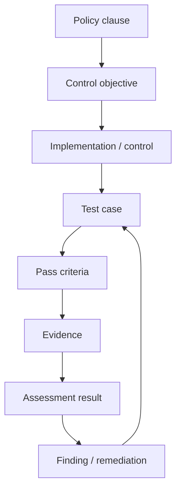

# Mapping policy sang test

Một chính sách quản lý khóa chỉ có giá trị vận hành khi tổ chức chứng minh được các yêu cầu trong chính sách đã được triển khai và hoạt động đúng. **Mapping policy sang test** là quá trình chuyển từng điều khoản chính sách thành mục tiêu kiểm soát, kịch bản kiểm thử, tiêu chí đạt và bằng chứng có thể kiểm tra. Việc ánh xạ này tạo liên kết có thể truy vết từ yêu cầu quản trị tới cấu hình KMS/HSM, IAM, ứng dụng, quy trình vận hành và kết quả assurance.

Trong quản lý khóa mật mã, chính sách có thể yêu cầu khóa production phải có owner, chỉ workload được duyệt mới được decrypt, key material không được export tùy tiện, khóa phải rotate theo cryptoperiod, backup phải phục hồi được và mọi thao tác đặc quyền phải có audit. Mỗi yêu cầu cần được chuyển thành một hoặc nhiều test có thể thực hiện. Nếu một điều khoản không có test, inspection hoặc bằng chứng tương ứng, tổ chức khó xác định nó đã được thực thi hay chỉ tồn tại trên giấy.

Mapping không đơn thuần là gắn một mã NIST vào một test. Một control có thể cần nhiều test ở các lớp khác nhau; một test có thể hỗ trợ nhiều điều khoản; và một kết quả test không tự chứng minh toàn bộ policy đã được tuân thủ. Cần ghi rõ phạm vi, môi trường, giả định, giới hạn và thời điểm bằng chứng được thu thập.

## 1. Mục tiêu của việc mapping policy sang test

Mapping policy sang test giúp:

- Chuyển yêu cầu định tính thành tiêu chí có thể kiểm chứng.
- Xác định mỗi điều khoản được thực thi ở ứng dụng, IAM, KMS/HSM, quy trình hay nhà cung cấp nào.
- Phát hiện điều khoản chưa có test, test không có owner hoặc control không có bằng chứng.
- Thiết kế kiểm thử dương và âm, bao gồm trường hợp quyền bị từ chối.
- Tạo traceability giữa policy version, control, test run, finding và remediation.
- Hỗ trợ audit, risk assessment, change review và assurance của bên thứ ba.
- Chạy lại các test liên quan khi policy, provider, thuật toán, workload hoặc cấu hình thay đổi.

Ví dụ, điều khoản “chỉ workload billing được phép decrypt DEK billing” cần được chuyển thành câu hỏi kiểm thử cụ thể: workload billing có decrypt được đúng key không; workload reporting có bị từ chối không; billing có bị từ chối khi truy cập key của tenant khác không; KMS/HSM có ghi audit event cho allow và deny không; quyền có bị thu hồi đúng hạn sau khi policy thay đổi không.

## 2. Các lớp cần nối trong traceability

Một mapping có thể biểu diễn theo chuỗi:



| Lớp | Nội dung | Ví dụ |
|---|---|---|
| Policy clause | Yêu cầu bắt buộc của tổ chức | Chỉ workload billing được decrypt khóa billing |
| Control objective | Kết quả bảo mật cần đạt | Ngăn principal ngoài phạm vi giải mã dữ liệu billing |
| Implementation | Cơ chế thực thi | IAM policy, key policy, workload identity và KMS |
| Test case | Hành động kiểm tra | Gọi decrypt bằng billing identity và reporting identity |
| Pass criteria | Điều kiện đạt | Billing được phép; reporting bị deny; không có plaintext khi deny |
| Evidence | Bằng chứng lưu lại | Test report, request ID, policy revision, KMS audit event |
| Assessment result | Kết luận có phạm vi | Pass cho key version và môi trường được test tại thời điểm cụ thể |

Không bỏ qua lớp control objective. Nếu chỉ nối policy với một câu lệnh test, khó đánh giá test đó có đo đúng ý định bảo mật hay chỉ kiểm tra một chi tiết triển khai.

## 3. Viết điều khoản policy có thể kiểm thử

Điều khoản policy cần đủ rõ để tạo test. Một câu như “khóa phải được quản lý an toàn” không xác định được điều kiện đạt. Có thể phân rã thành các yêu cầu:

- Mỗi khóa production phải có `keyId`, owner, purpose, classification và trạng thái trong inventory.
- Workload chỉ được gọi action đã cấp trên key ID/version nằm trong phạm vi của nó.
- Export plaintext bị cấm mặc định; ngoại lệ phải có phê duyệt và thời hạn.
- Khóa hết cryptoperiod phải ngừng tạo dữ liệu mới theo rotation plan đã phê duyệt.
- Backup phải được mã hóa/bọc và recovery phải được kiểm thử theo lịch.
- Thao tác create, export, decrypt, rotate, disable, revoke và destroy phải tạo audit event.
- Khi quyền bị thu hồi, mọi điểm thực thi phải từ chối credential cũ trong giới hạn propagation được tổ chức xác định.

Khi viết policy, cần xác định:

1. **Chủ thể:** ai hoặc workload nào phải tuân thủ?
2. **Tài nguyên:** key ID, key class, environment hay dữ liệu nào?
3. **Hành động:** việc gì phải hoặc không được phép?
4. **Điều kiện:** trong hoàn cảnh, thời hạn hoặc approval nào?
5. **Kết quả:** trạng thái bắt buộc sau hành động là gì?
6. **Bằng chứng:** dữ liệu nào chứng minh yêu cầu đã được thực thi?

Đối với giá trị thay đổi theo tổ chức như cryptoperiod tối đa, thời gian propagation hoặc retention, policy nên tham chiếu một standard/profile được quản lý phiên bản. Không tự đặt con số chung rồi gán đó là yêu cầu của NIST.

## 4. Phân biệt policy, control, test và evidence

| Thành phần | Bản chất | Không nên nhầm với |
|---|---|---|
| Policy | Yêu cầu và quy tắc được tổ chức phê duyệt | Một cấu hình cụ thể của cloud provider |
| Control | Cơ chế quản trị hoặc kỹ thuật giúp đáp ứng policy | Một test case đơn lẻ |
| Test | Hoạt động xác minh control có thực hiện đúng không | Bằng chứng rằng mọi môi trường đều đạt |
| Evidence | Artifact chứng minh test/assessment đã diễn ra và kết quả ra sao | Kết luận tuân thủ không có phạm vi hoặc thời điểm |
| Finding | Khoảng cách giữa yêu cầu và kết quả thực tế | Chỉ một test thất bại do lỗi môi trường không được phân tích |

Ví dụ: policy yêu cầu tách quyền decrypt khỏi export. Control là IAM/key policy cấp `Decrypt` nhưng không cấp `ExportKey`. Test gọi cả hai action bằng cùng workload identity. Evidence gồm policy revision, request ID, response, KMS audit log và test report. Nếu export vẫn thành công, finding cần nêu principal, key, môi trường, phạm vi ảnh hưởng và remediation.

## 5. NIST hỗ trợ mapping và assessment như thế nào?

Các tài liệu NIST có vai trò bổ trợ nhau:

| Tài liệu | Cách dùng trong mapping |
|---|---|
| **SP 800-57 Part 1 Rev. 5** | Xác định chủ đề và kỳ vọng quản lý khóa theo vòng đời: loại khóa, mục đích, bảo vệ, cryptoperiod, backup, recovery, compromise và destruction |
| **SP 800-53 Rev. 5** | Chọn control catalog liên quan đến access control, audit, configuration, contingency, incident response và cryptographic key management |
| **SP 800-53A Rev. 5** | Tham khảo phương pháp và thủ tục đánh giá control; các phương pháp chính gồm examine, interview và test |
| **SP 800-130** | Dùng khi mapping yêu cầu thiết kế của cryptographic key management system (CKMS) |
| **SP 800-152** | Tham khảo profile CKMS trong phạm vi hệ thống liên bang Hoa Kỳ khi phù hợp |
| **SP 800-131A Rev. 2** | Mapping yêu cầu chuyển đổi thuật toán và độ dài khóa theo trạng thái chấp thuận |

Một số control family/control ID trong SP 800-53 có thể liên quan:

- `AC-2` Account Management và `AC-3` Access Enforcement.
- `AC-6` Least Privilege.
- `IA-5` Authenticator Management.
- `AU-2` Event Logging, `AU-3` Content of Audit Records và `AU-9` Protection of Audit Information.
- `CM-6` Configuration Settings.
- `CP-9` System Backup và `CP-10` System Recovery.
- `IR-4` Incident Handling.
- `SC-12` Cryptographic Key Establishment and Management và `SC-13` Cryptographic Protection.
- `SA-9` External System Services khi có dịch vụ quản lý khóa bên ngoài.

Việc liệt kê control ID chỉ là điểm bắt đầu. Tổ chức cần chọn control và enhancement phù hợp với baseline, tailoring, system boundary và risk assessment của mình. Không phải mọi control đều áp dụng cho mọi hệ thống; mapping cũng không tự tạo ra chứng nhận NIST hoặc FIPS.

SP 800-53A mô tả cách đánh giá bằng **examine**, **interview** và **test**. Với key management, có thể examine policy, inventory và cấu hình; interview key owner/custodian; test trực tiếp KMS/HSM, IAM, backup/restore và audit. Ba phương pháp bổ trợ nhau, không nên chỉ dựa vào phỏng vấn hoặc tài liệu do chính nhóm triển khai tự khai báo.

## 6. Xây dựng ma trận traceability

Ma trận mapping là artifact trung tâm. Mỗi dòng đại diện cho một yêu cầu có thể kiểm chứng hoặc một phần yêu cầu đủ rõ.

Các cột nên có:

| Trường | Nội dung cần ghi |
|---|---|
| `policyId` | ID ổn định của điều khoản |
| `policyVersion` | Phiên bản policy có hiệu lực |
| `requirement` | Câu yêu cầu và phạm vi áp dụng |
| `controlObjective` | Kết quả bảo mật mong muốn |
| `nistReference` | Control/reference được ánh xạ, nếu áp dụng |
| `implementation` | KMS/HSM, IAM, application, procedure hoặc vendor control |
| `testId` | ID của test case hoặc test suite |
| `testType` | Static, unit, integration, end-to-end, operational hoặc assessment |
| `precondition` | Principal, key state, environment, fixture và dependency |
| `expectedResult` | Pass criteria rõ ràng |
| `evidence` | Artifact cần lưu |
| `owner` | Người/nhóm chịu trách nhiệm |
| `frequency` | Khi chạy và chu kỳ chạy lại |
| `status` | Covered, partial, gap, blocked hoặc not applicable |
| `exception` | ID, approver, expiry và compensating control nếu có |

Một policy clause có thể liên kết nhiều `testId`. Một test cũng có thể liên kết nhiều policy clause nếu cùng xác minh một control objective, nhưng cần ghi rõ từng liên kết để không làm mất traceability.

## 7. Ví dụ mapping cho quyền truy cập khóa

Giả sử policy có điều khoản:

> KMP-AC-01: Workload chỉ được thực hiện các thao tác mật mã đã được cấp trên key ID và environment thuộc phạm vi của workload. Quyền sử dụng khóa không bao gồm quyền export key material.

Mapping minh họa:

| Policy ID | Control objective | NIST reference | Test ID | Expected result |
|---|---|---|---|---|
| KMP-AC-01 | Chỉ principal được cấp quyền mới gọi được action | AC-3, AC-6 | T-AC-001 | Principal hợp lệ được phép đúng action |
| KMP-AC-01 | Ngăn truy cập chéo key/tenant | AC-3 | T-AC-002 | Principal tenant A bị deny trên key tenant B |
| KMP-AC-01 | Tách crypto operation khỏi export | AC-6, SC-12 | T-AC-003 | Decrypt được phép; export plaintext bị deny |
| KMP-AC-01 | Deny phải được audit | AU-2, AU-3, AU-9 | T-AU-004 | Có event deny, không chứa key material |
| KMP-AC-01 | Thu hồi quyền có hiệu lực trên các điểm thực thi | AC-2, AC-3 | T-AC-005 | Request dùng quyền cũ bị deny trong SLA |

Test phải xác minh cả allow lẫn deny. Nếu chỉ chạy negative test, một hệ thống từ chối tất cả request có thể vẫn “pass” dù workload hợp lệ không hoạt động. Vì vậy, mỗi control cần kiểm tra hành vi được phép và hành vi bị cấm.

## 8. Ví dụ mapping cho vòng đời khóa

| Policy ID | Yêu cầu | Control/reference gợi ý | Test/evidence gợi ý |
|---|---|---|---|
| KMP-GEN-01 | Khóa được tạo bằng nguồn ngẫu nhiên mật mã và thuật toán được duyệt | SC-12, SC-13; SP 800-57 | Test cấu hình provider/KMS, kiểm tra key attributes và generation event |
| KMP-STO-01 | Key material production được lưu trong ranh giới được duyệt | SC-12, SC-13 | Kiểm tra KMS/HSM configuration, exportability và storage boundary |
| KMP-AC-01 | Chỉ principal/action được cấp mới được dùng khóa | AC-2, AC-3, AC-6 | Allow/deny test theo principal, action, key ID, tenant và environment |
| KMP-ROT-01 | Khóa được rotate theo cryptoperiod/profile đã phê duyệt | SC-12, CM-6 | Test tạo version mới, canary, cutover, decrypt dữ liệu cũ và retire |
| KMP-BKR-01 | Backup khóa được bảo vệ và phục hồi được | CP-9, CP-10, SC-12 | Restore drill, xác minh key ID/version và decrypt dữ liệu mẫu |
| KMP-REV-01 | Khóa/credential bị thu hồi không còn được chấp nhận theo policy | AC-2, AC-3, SC-12 | Revoke test, propagation test, cache/session và KMS deny event |
| KMP-AUD-01 | Thao tác khóa được ghi nhận và bảo vệ log | AU-2, AU-3, AU-9 | Audit completeness, integrity verification và retention check |
| KMP-INC-01 | Khóa compromise được cô lập và thay thế | IR-4, SC-12 | Incident tabletop, revoke/rotate drill, evidence và recovery check |
| KMP-DEST-01 | Khóa được hủy khi không còn dependency | SC-12, CP-10 | Dependency check, dual approval, destruction record và restore-negative test |

Các reference trên là mapping gợi ý, không phải tuyên bố rằng một test đơn lẻ đáp ứng toàn bộ control NIST. Cần đối chiếu mô tả control, enhancement và baseline thực tế trước khi dùng trong hồ sơ assurance.

## 9. Thiết kế test case có thể đánh giá

Một test case cần có đủ thông tin để người khác chạy lại và hiểu kết quả:

1. **ID và mục tiêu:** liên kết policy clause/control objective.
2. **Scope:** hệ thống, môi trường, key ID/class và phiên bản policy.
3. **Preconditions:** principal, role, key state, test data, provider và dependency.
4. **Steps:** hành động cụ thể, request/API hoặc thao tác cần thực hiện.
5. **Expected result:** kết quả cho phép/từ chối, trạng thái và side effect.
6. **Evidence:** log, request ID, policy snapshot, test output và timestamp.
7. **Cleanup:** thu hồi credential test, disable/destroy key fixture và dọn dữ liệu.
8. **Owner/frequency:** ai chạy, chạy khi nào và trigger chạy lại.

Expected result nên định lượng hoặc xác định rõ. Ví dụ “thu hồi hoạt động nhanh” không đủ; cần tham chiếu SLA propagation đã được tổ chức phê duyệt và mô tả cách đo. Không đưa giá trị thời gian tự chọn vào test rồi coi đó là chuẩn NIST.

## 10. Kết hợp examine, interview và test

Theo cách tiếp cận assessment của NIST SP 800-53A, có thể kết hợp ba phương pháp:

| Phương pháp | Hoạt động | Ví dụ với key management |
|---|---|---|
| Examine | Kiểm tra artifact, cấu hình và hồ sơ | Đọc policy, key inventory, IAM policy, KMS key attributes, audit log, rotation report |
| Interview | Trao đổi với người chịu trách nhiệm | Hỏi key owner cách chọn cryptoperiod, custodian cách recovery, incident responder cách revoke khẩn cấp |
| Test | Thực hiện thao tác để xác minh kết quả | Gọi KMS bằng principal hợp lệ/không hợp lệ, restore backup, kiểm tra audit integrity |

Ví dụ, để đánh giá điều khoản “khóa production không được export plaintext”, không nên chỉ hỏi administrator. Cần examine thuộc tính exportability và IAM policy, interview key custodian về quy trình ngoại lệ, rồi test trực tiếp bằng principal không có quyền export và xác minh KMS/HSM từ chối.

## 11. Chọn loại test theo lớp triển khai

Không phải yêu cầu nào cũng có thể kiểm chứng bằng cùng một loại test.

| Loại test | Phù hợp để xác minh | Ví dụ |
|---|---|---|
| Static/policy-as-code | Cấu trúc policy, wildcard, required metadata và guardrail | CI kiểm tra key production phải có owner và không bật export mặc định |
| Unit test | Logic authorization, state machine và xử lý lỗi trong ứng dụng | Principal không có quyền không gọi KMS client |
| Integration test | Tích hợp IAM, provider, KMS/HSM và audit source | Gọi trực tiếp API bằng principal test để xác minh deny |
| End-to-end test | Luồng nghiệp vụ qua nhiều dịch vụ | Mã hóa, rotation, đọc dữ liệu cũ và revoke quyền |
| Operational test/drill | Khả năng vận hành và phục hồi | Backup restore, key compromise exercise, rollback rotation |
| Assessment/audit | Thiết kế và vận hành control trong phạm vi rộng | Examine hồ sơ, interview owner và sample test trên production control |

Static test có thể bắt lỗi cấu hình nhưng không chứng minh runtime enforcement. Unit test kiểm tra logic cục bộ nhưng không chứng minh KMS policy. Integration test xác minh provider thật nhưng không chứng minh mọi region đã đồng bộ. Cần phối hợp các lớp theo rủi ro và phạm vi.

## 12. Positive test, negative test và boundary test

Mỗi policy quan trọng cần ít nhất ba góc nhìn:

- **Positive test:** hành động hợp lệ được chấp nhận.
- **Negative test:** hành động ngoài quyền hoặc ngoài policy bị từ chối.
- **Boundary test:** điều kiện sát ranh giới, ví dụ key version, tenant, thời hạn, environment, quota hoặc trạng thái chuyển tiếp.

Ví dụ với quyền decrypt:

| Kiểu | Kịch bản | Kết quả mong đợi |
|---|---|---|
| Positive | Billing workload decrypt key billing | Allow và audit success |
| Negative | Reporting workload decrypt key billing | Deny, không plaintext, audit deny |
| Boundary | Billing workload truy cập key billing của version không được cấp | Deny theo policy version/resource |
| Boundary | Quyền vừa hết hạn nhưng cache còn quyết định cũ | Từ chối trong giới hạn propagation đã quy định |
| Boundary | Key chuyển sang decrypt-only | Decrypt được phép theo policy; encrypt bị deny |

Nếu chỉ kiểm tra positive test, quyền có thể quá rộng. Nếu chỉ kiểm tra negative test, ứng dụng có thể từ chối tất cả và gây gián đoạn. Cả hai phải cùng đạt.

## 13. Mapping cho generation và thuật toán

Policy về tạo khóa thường yêu cầu thuật toán và tham số được duyệt, key material có entropy phù hợp và khóa được tách theo mục đích.

Ví dụ mapping:

| Policy clause | Control objective | Test | Evidence |
|---|---|---|---|
| KMP-GEN-01: Chỉ dùng algorithm profile được duyệt | Không tạo khóa với algorithm/size ngoài standard | Kiểm tra KMS create-key request, provider configuration và policy-as-code | Config snapshot, key metadata, CI result |
| KMP-GEN-02: Key material sinh bằng CSPRNG/provider phù hợp | Không dùng seed hoặc nguồn ngẫu nhiên yếu | Examine provider/module; kiểm tra đường tạo khóa; đánh giá cấu hình được chứng nhận nếu áp dụng | Provider name/version, module validation evidence, creation event |
| KMP-GEN-03: Tách khóa theo purpose | Không dùng một key cho nhiều chức năng trái policy | Kiểm tra key usage/algorithm attributes và thử action không phù hợp | Key metadata, deny event, test report |

Không thể chứng minh chất lượng entropy chỉ bằng cách sinh vài khóa rồi so sánh xem có khác nhau. Cần đánh giá cơ chế RNG/provider và module theo yêu cầu, còn test ứng dụng tập trung xác minh nó gọi đúng API và không tự tạo key material bằng nguồn không phù hợp.

## 14. Mapping cho storage, export và access control

Policy lưu trữ và truy cập nên được kiểm tra ở cả metadata lẫn runtime:

- Examine: KMS/HSM type, key attributes, exportability, IAM/key policy, network boundary và key inventory.
- Interview: owner/custodian giải thích cách cấp quyền, exception và dual control.
- Test: principal hợp lệ/không hợp lệ gọi encrypt, decrypt, sign, wrap và export; xác minh đúng allow/deny.
- Evidence: policy revision, request ID, KMS/HSM audit event, key ID/version và kết quả.

Test export cần tách plaintext export khỏi wrapped export. Nếu policy cấm plaintext export, cần thử trực tiếp action tương ứng bằng principal ứng dụng và principal vận hành thông thường. Nếu wrapped export chỉ được phép theo approval, test cả trường hợp thiếu approval, approval hết hạn, sai destination và đúng approval.

## 15. Mapping cho cryptoperiod và rotation

Policy rotation phải chuyển thành các test kiểm tra cả trạng thái khóa và dữ liệu phụ thuộc:

1. Xác minh key inventory có cryptoperiod/profile và owner.
2. Tạo key version mới theo algorithm profile đã duyệt.
3. Xác minh workload được cấp quyền cho version mới đúng phạm vi.
4. Chạy canary và kiểm tra encrypt/decrypt hoặc sign/verify.
5. Cutover write path; xác minh reader vẫn hỗ trợ dữ liệu được mã hóa bằng version cũ.
6. Rewrap DEK hoặc re-encrypt payload theo migration plan.
7. Đối soát checkpoint, lỗi, retry và metadata version.
8. Chuyển key cũ sang retired/decrypt-only khi đủ điều kiện.
9. Xác minh không còn workload ghi bằng key cũ.
10. Chỉ destroy sau khi dependency, backup và recovery được kiểm chứng.

Evidence có thể gồm rotation plan, approval, key version metadata, KMS audit, migration checkpoint, test report, số liệu decrypt thành công và kết quả dependency scan. Một lần đổi alias thành công chưa chứng minh rotation hoàn tất.

## 16. Mapping cho backup và recovery

Điều khoản backup cần test cả tính bảo vệ và khả năng phục hồi. Một file backup tồn tại không chứng minh nó có thể restore.

Các test nên bao gồm:

- Backup chỉ chứa khóa nằm trong phạm vi được phê duyệt.
- Backup được wrap/encrypt và chỉ principal recovery được duyệt mới truy cập.
- Integrity/checksum/fingerprint được xác minh trước khi restore.
- Dual control hoặc quorum được áp dụng nếu policy yêu cầu.
- Restore vào môi trường cô lập và xác minh key ID/version/usage.
- Dùng khóa khôi phục để thực hiện thao tác kiểm tra trên dữ liệu mẫu.
- Backup cũ, backup hết retention và bản sao ngoài phạm vi được xử lý theo policy.
- Audit ghi người yêu cầu, approver, thời điểm và kết quả recovery.

NIST SP 800-53 có các control về backup và recovery như CP-9, CP-10; việc áp dụng cụ thể cần được tailoring theo system boundary. Đối với khóa, cần kiểm tra cả wrapping key và metadata vì backup key material đơn lẻ có thể không đủ để phục hồi dữ liệu.

## 17. Mapping cho compromise, revocation và destruction

| Policy clause | Test chính | Pass criteria | Evidence |
|---|---|---|---|
| KMP-INC-01: Khóa compromise phải được cô lập | Kích hoạt incident drill và thử crypto operation bằng key bị đánh dấu compromise | Thao tác mới bị chặn theo policy; khóa sạch được cấp cho workload cần thiết | Incident timeline, KMS event, approval, test output |
| KMP-REV-01: Credential bị revoke không còn được chấp nhận | Revoke token/permission và thử lại trên mọi điểm thực thi | Credential cũ bị từ chối trong SLA propagation | Revocation event, node results, latency measurement |
| KMP-DEST-01: Chỉ destroy khi hết dependency | Chạy dependency check và thử quy trình approval | Destroy bị chặn nếu còn dependency hoặc thiếu approval | Dependency report, approval record, destruction event |
| KMP-DEST-02: Destroy phải có bằng chứng | Xác minh trạng thái KMS/HSM và audit sau thao tác | Key state và bằng chứng destruction khớp semantics provider | KMS/HSM response, audit record, inventory update |

Không dùng test “xóa alias thành công” để chứng minh key material đã bị hủy. Cần hiểu semantics destruction của KMS/HSM, backup/replica và bằng chứng provider cung cấp. Với crypto-erasure, test cần đánh giá mọi bản sao có thể phục hồi và không chỉ bản ghi active.

## 18. Mapping cho audit và log integrity

Policy yêu cầu audit phải được chuyển thành test về completeness, content, integrity, access và retention:

- Event quan trọng có được ghi cho allow, deny, export, rotate, disable, revoke, recovery và destroy không?
- Event có principal, key ID/version, action, decision, outcome, timestamp và request ID không?
- Log có vô tình chứa key material, token, password hoặc plaintext không?
- Người quản trị KMS có thể sửa/xóa audit evidence mà không bị phát hiện không?
- Hash chain, signature, checkpoint hoặc immutable storage có được verify không?
- Pipeline có phát hiện event bị mất, trễ, trùng hoặc sai thứ tự không?
- Quyền đọc, export và retention của audit log có đúng policy không?

Evidence có thể gồm event sample đã redact, schema validation, signature verification report, WORM retention configuration, access review và pipeline health metrics. Không đưa bí mật vào artifact kiểm thử.

## 19. Mapping cho nhà cung cấp và dịch vụ bên ngoài

Nếu KMS/HSM được cung cấp bởi bên thứ ba, mapping phải bao gồm cả shared responsibility và bằng chứng từ nhà cung cấp.

Các câu hỏi kiểm thử/assessment:

- Dịch vụ có đáp ứng key usage, non-exportability, backup, recovery và audit cần thiết không?
- Có tài liệu assurance/certification phù hợp với yêu cầu hợp đồng và phạm vi module đang dùng không?
- Ai quản lý IAM, key policy, logging, rotation và incident response?
- Audit log có thể xuất và lưu trong miền độc lập của tổ chức không?
- Có quy trình thông báo outage/compromise và thời gian hỗ trợ điều tra không?
- Có thể export wrapped/import hoặc di chuyển khóa khi chấm dứt dịch vụ không?
- Region, data residency và subcontractor có phù hợp policy không?

Không chỉ lưu chứng chỉ của nhà cung cấp rồi đánh dấu tất cả control là pass. Cần xác minh chứng chỉ áp dụng đúng sản phẩm, phiên bản, module, mode và cấu hình đang sử dụng; đồng thời test phần trách nhiệm thuộc tổ chức.

## 20. Ví dụ traceability YAML

Có thể quản lý mapping bằng YAML/JSON hoặc công cụ GRC/test management. Ví dụ sau là schema minh họa nội bộ, không phải schema chính thức của NIST:

```yaml
policyId: KMP-AC-01
policyVersion: "3.2"
requirement: >-
  Workload chỉ được decrypt key thuộc service và environment được cấp;
  quyền decrypt không bao gồm quyền export key material.
controlObjective: Enforce least-privilege key use and prevent unauthorized export.
nistReferences:
  - AC-3
  - AC-6
  - SC-12
implementation:
  - workload-identity
  - kms-key-policy
  - export-control
tests:
  - testId: KMP-AC-01-POS-001
    type: integration
    scenario: billing workload decrypts billing key
    expected: ALLOW
    evidence:
      - test-report
      - kms-audit-event
  - testId: KMP-AC-01-NEG-002
    type: integration
    scenario: reporting workload attempts billing key decrypt
    expected: DENY
    evidence:
      - test-report
      - kms-deny-event
  - testId: KMP-AC-01-NEG-003
    type: integration
    scenario: billing workload attempts plaintext key export
    expected: DENY
    evidence:
      - test-report
      - kms-deny-event
owner: key-platform-team
frequency:
  - policy-change
  - iam-change
  - quarterly
status: COVERED
```

Mapping cần version cùng policy và test suite. Nếu policy version 3.3 thay đổi resource scope, mapping cũ không tự động chứng minh version mới đã được test. CI/CD có thể chặn merge hoặc release nếu policy clause mới chưa có test/evidence phù hợp.

## 21. Ví dụ Java: liên kết test ID với policy clause

Test tự động nên đặt ID ổn định để kết quả có thể nối về mapping. Ví dụ JUnit 5:

```java
import static org.junit.jupiter.api.Assertions.assertThrows;
import static org.mockito.ArgumentMatchers.any;
import static org.mockito.ArgumentMatchers.eq;
import static org.mockito.Mockito.never;
import static org.mockito.Mockito.verify;
import static org.mockito.Mockito.when;

import org.junit.jupiter.api.DisplayName;
import org.junit.jupiter.api.Tag;
import org.junit.jupiter.api.Test;
import org.junit.jupiter.api.extension.ExtendWith;
import org.mockito.Mock;
import org.mockito.junit.jupiter.MockitoExtension;

@ExtendWith(MockitoExtension.class)
class KeyPolicyMappingTest {
    @Mock KeyAuthorizer authorizer;
    @Mock KmsClient kms;

    @Test
    @Tag("KMP-AC-01-NEG-002")
    @DisplayName("KMP-AC-01: deny decrypt outside assigned workload scope")
    void deniesDecryptOutsideScope() {
        Principal reporting = new Principal("reporting-job");
        KeyRef billingKey = new KeyRef("billing-key", "v3");

        when(authorizer.isAllowed(reporting, billingKey, KeyAction.DECRYPT))
                .thenReturn(false);

        KeyAccessService service = new KeyAccessService(authorizer, kms);

        assertThrows(KeyAccessDeniedException.class,
                () -> service.decrypt(reporting, billingKey, new byte[] {1, 2, 3}));

        verify(kms, never()).decrypt(eq(billingKey), any(byte[].class));
    }
}
```

Các domain type và service là ví dụ cần ánh xạ sang implementation thực tế. Unit test này chứng minh ứng dụng không gọi KMS client khi authorizer trả deny; nó không thay thế integration test trực tiếp với KMS/HSM policy. Test report cần xuất tag/test ID để hệ thống traceability liên kết kết quả với `KMP-AC-01-NEG-002`.

## 22. Tiêu chí pass/fail và cách xử lý finding

Trước khi chạy test, cần định nghĩa tiêu chí:

- **PASS:** kết quả quan sát được thỏa tất cả expected result trong phạm vi và thời điểm test.
- **FAIL:** có bằng chứng control không đáp ứng yêu cầu, ví dụ principal không hợp lệ decrypt thành công.
- **BLOCKED:** không thể đánh giá do dependency, credential, test environment hoặc service outage; không được tính là pass.
- **PARTIAL:** chỉ một phần phạm vi được test hoặc một số node/region chưa có bằng chứng.
- **NOT APPLICABLE:** có rationale, owner và phê duyệt giải thích control không áp dụng.

Khi test fail, finding nên ghi policy ID/version, control objective, test ID, resource/principal, môi trường, bằng chứng, mức độ rủi ro, phạm vi ảnh hưởng, owner, remediation và due date. Sau remediation, chạy lại test liên quan và lưu kết quả mới; không xóa kết quả fail ban đầu khỏi lịch sử.

Một test blocked do KMS outage không chứng minh control fail, nhưng cũng không cung cấp bằng chứng pass. Cần giữ trạng thái blocked, điều tra nguyên nhân và chạy lại khi dependency hoạt động.

## 23. Tần suất và trigger chạy lại test

Không phải test nào cũng cần chạy theo cùng một lịch. Tần suất nên dựa trên rủi ro, tốc độ thay đổi và khả năng ảnh hưởng:

| Trigger | Test cần chạy lại |
|---|---|
| Thay đổi policy hoặc IAM role | Access allow/deny, privilege boundary, export và audit |
| Tạo key version mới hoặc thay thuật toán | Key attributes, usage, encrypt/decrypt, compatibility và rotation |
| Thay KMS/HSM/provider | Integration, access control, key operation, audit và recovery |
| Thay đổi ứng dụng hoặc key resolver | Unit, integration, key version mapping và negative tests |
| Thay đổi backup/DR | Backup protection, restore, key recovery và data readability |
| Thay đổi logging/SIEM | Audit completeness, integrity, retention và alerting |
| Incident hoặc nghi ngờ compromise | Revoke, containment, rotation, recovery và forensic evidence |
| Rà soát định kỳ | Sample assessment, access review, inventory và exception review |

Test quan trọng có thể chạy trong CI/CD, test định kỳ hoặc sau change event. Test destructive như disable/destroy chỉ chạy trong môi trường cô lập hoặc theo change window được phê duyệt; không chạy thử trên production key thật nếu chưa có kế hoạch an toàn.

## 24. Quản lý coverage và gap

Coverage không nên chỉ đo bằng số lượng policy clause có ít nhất một test. Cần đánh giá chất lượng và phạm vi:

- **Requirement coverage:** tỷ lệ clause có control và test được liên kết.
- **Control coverage:** tỷ lệ control objective có bằng chứng triển khai.
- **Scenario coverage:** có positive, negative, boundary và failure scenario phù hợp.
- **Environment coverage:** production, non-production, region và tenant được bao phủ đến đâu.
- **Evidence freshness:** bằng chứng có còn phản ánh policy/config hiện hành không.
- **Owner coverage:** mỗi clause/test/finding có owner chịu trách nhiệm không.

Một policy clause có test nhưng test chưa từng chạy hoặc chạy trên môi trường khác có thể vẫn là gap. Dashboard cần phân biệt `COVERED`, `PARTIAL`, `GAP`, `BLOCKED`, `EXPIRED_EVIDENCE` và `NOT_APPLICABLE` thay vì gộp thành một tỷ lệ pass.

## 25. Checklist Mapping policy sang test

- Policy clause có ID, version, owner, scope và ngôn ngữ có thể kiểm thử.
- Mỗi clause được chuyển thành control objective cụ thể.
- Control objective được ánh xạ tới implementation và NIST reference phù hợp nếu áp dụng.
- Mỗi control có test ID, loại test, precondition, steps và expected result.
- Có positive, negative và boundary test theo rủi ro.
- Có evidence source, request ID, timestamp, policy revision và key ID/version.
- Có test ở đúng lớp: application, IAM, KMS/HSM, provider, operations hoặc vendor.
- Có test lifecycle: generation, storage, access, rotation, backup, recovery, revoke và destruction.
- Có kiểm tra audit, log integrity, retention và monitoring.
- Có owner, frequency, trigger chạy lại và cleanup cho test.
- Test fail/blocked/partial được phân biệt và có remediation.
- Policy change không thể merge/release khi thiếu mapping hoặc test bắt buộc.
- Evidence được lưu an toàn, không chứa key material, credential hoặc plaintext.
- Mapping được version cùng policy và được review khi control hoặc provider thay đổi.
- Coverage dashboard phản ánh freshness và phạm vi thật, không chỉ số lượng test.

Mapping policy sang test tạo ra đường truy vết từ yêu cầu quản trị tới kiểm soát thực tế và bằng chứng. Với key management, cần bao phủ toàn bộ vòng đời khóa và kiểm tra cả hành vi được phép lẫn hành vi bị cấm. NIST SP 800-57 giúp xác định chủ đề quản lý khóa; SP 800-53 hỗ trợ chọn control; SP 800-53A cung cấp cách examine, interview và test để đánh giá. Khi policy, control objective, test ID, pass criteria, evidence và owner được liên kết theo phiên bản, tổ chức có thể chứng minh mức độ thực thi, phát hiện gap và ưu tiên remediation dựa trên rủi ro.

## Tài liệu tham khảo

- [NIST SP 800-57 Part 1 Rev. 5: Recommendation for Key Management](https://csrc.nist.gov/pubs/sp/800/57/pt1/r5/final)
- [NIST SP 800-53 Rev. 5: Security and Privacy Controls for Information Systems and Organizations](https://csrc.nist.gov/pubs/sp/800/53/r5/upd1/final)
- [NIST SP 800-53A Rev. 5: Assessing Security and Privacy Controls in Information Systems and Organizations](https://csrc.nist.gov/pubs/sp/800/53/a/r5/final)
- [NIST SP 800-130: A Framework for Designing Cryptographic Key Management Systems](https://csrc.nist.gov/pubs/sp/800/130/final)
- [NIST SP 800-152: A Profile for U.S. Federal Cryptographic Key Management Systems](https://csrc.nist.gov/pubs/sp/800/152/final)
- [NIST SP 800-131A Rev. 2: Transitioning the Use of Cryptographic Algorithms and Key Lengths](https://csrc.nist.gov/pubs/sp/800/131/a/r2/final)
