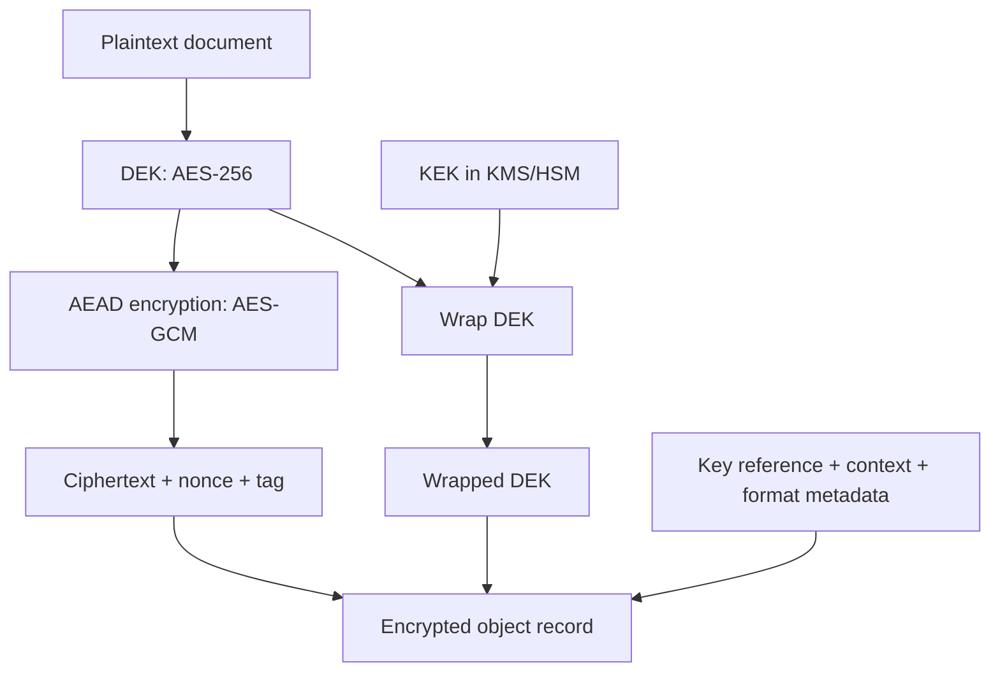
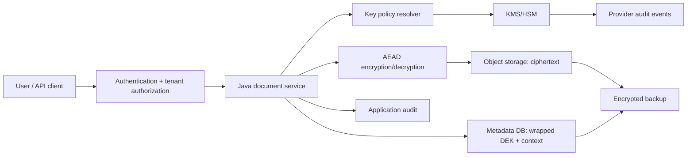
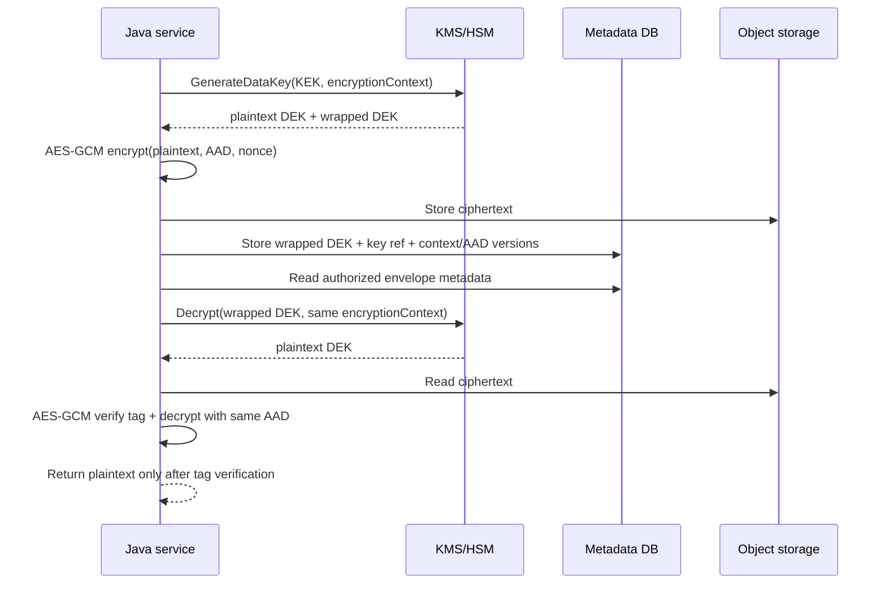

# Thiết kế envelope encryption

**Envelope encryption** là mô hình mã hóa dữ liệu bằng một khóa dữ liệu (Data Encryption Key – DEK), sau đó dùng một khóa bảo vệ khóa (Key Encryption Key – KEK) để bọc DEK. Ứng dụng lưu ciphertext cùng DEK đã được mã hóa (wrapped/encrypted DEK); KEK được giữ trong KMS hoặc HSM và không cần rời khỏi boundary bảo vệ. Khi đọc dữ liệu, hệ thống yêu cầu KMS/HSM mở DEK rồi dùng DEK để giải mã ciphertext.

Bài case study này thiết kế envelope encryption cho một nền tảng SaaS đa tenant lưu tài liệu tài chính và hồ sơ hợp đồng. Thiết kế phải bảo vệ dữ liệu khi database, object storage hoặc backup bị sao chép; giới hạn ảnh hưởng giữa tenant; hỗ trợ rotation và disaster recovery; đồng thời cho phép ứng dụng Java mã hóa/giải mã mà không lưu raw KEK trong cấu hình.

Envelope encryption là một phần của vòng đời quản lý khóa trong **SECURITY_KEY_MANAGEMENT_FUNDAMENTALS**. Thiết kế cần kết nối mật mã đối xứng, AEAD, KMS/HSM, access control, key inventory, rotation, backup/recovery, audit và destruction. Mục tiêu của case study là đi từ yêu cầu đến kiến trúc, data model, workflow, quyết định và cách kiểm thử.

## 1. Bối cảnh case study

Một nền tảng SaaS phục vụ khoảng 300 doanh nghiệp. Mỗi tenant lưu tài liệu hợp đồng, hóa đơn, báo cáo và hồ sơ giao dịch. Ứng dụng viết bằng Java, dữ liệu nằm trong relational database và object storage. Hệ thống chạy ở một region chính và có môi trường disaster recovery ở region thứ hai.

Các đặc điểm giả định:

- Mỗi tài liệu có `tenantId`, `objectId`, loại dữ liệu và mức phân loại.
- Kích thước tài liệu phổ biến từ vài KB đến vài MB; một số tệp lớn hơn cần xử lý theo chunk.
- Workload chạy bằng service identity riêng; người dùng cuối được xác thực qua identity provider.
- KMS/HSM cung cấp key operation qua API; private/raw KEK không được tải về ứng dụng.
- Database lưu metadata và wrapped DEK; object storage lưu ciphertext.
- Backup có thể được sao chép sang region DR và kho archive.

Đây là tình huống minh họa để thiết kế, không phải mô tả một dịch vụ hoặc nhà cung cấp cụ thể. Các quota, API, trạng thái key, replication và semantics rotation cần được xác minh theo KMS/HSM thực tế trước khi triển khai.

## 2. Yêu cầu nghiệp vụ và bảo mật

Thiết kế phải đáp ứng các yêu cầu sau:

| Nhóm | Yêu cầu |
|---|---|
| Confidentiality | Bản sao database, object storage và backup không chứa plaintext tài liệu |
| Integrity | Phát hiện ciphertext, nonce, tag hoặc metadata bị sửa |
| Tenant isolation | DEK/KEK và authorization context không cho tenant này mở dữ liệu tenant khác |
| Key custody | KEK được bảo vệ trong KMS/HSM; ứng dụng chỉ nhận DEK trong thời gian ngắn |
| Least privilege | Workload chỉ được gọi operation cần thiết trên key thuộc phạm vi được cấp |
| Rotation | Có thể thay KEK và rewrap DEK; có chiến lược riêng khi phải thay DEK |
| Availability | KMS outage không làm mất dữ liệu; có cache/DR policy được kiểm soát |
| Recovery | Có thể khôi phục ciphertext, wrapped DEK, metadata và quyền truy cập ở region DR |
| Auditability | Truy vết được ai đọc dữ liệu, key nào được dùng, policy nào cho phép và kết quả ra sao |
| Lifecycle | Có owner, purpose, cryptoperiod, revoke, retention và destruction process |

Các yêu cầu về thời gian đáp ứng, RTO/RPO, retention và thời hạn lưu chữ ký phải được business owner, security và compliance phê duyệt. Không tự đặt một thời hạn chung cho mọi tenant hoặc mọi loại tài liệu.

## 3. Threat model và ranh giới tin cậy

Các mối đe dọa cần xét:

- Attacker lấy được bản dump database hoặc object storage nhưng không có quyền gọi KMS.
- Backup bị đánh cắp hoặc một replica bị truy cập trái phép.
- Workload bị chiếm quyền và cố giải mã dữ liệu ngoài tenant được giao.
- Nhân viên nội bộ có quyền quản trị storage hoặc KMS cố mở rộng quyền.
- Wrapped DEK, nonce, AAD hoặc key reference bị tráo giữa các object.
- KMS/HSM bị outage, policy bị sửa hoặc key bị disable nhầm.
- Rotation tạo key mới nhưng workload/backup vẫn phụ thuộc key cũ.
- Một bản restore cũ ghi đè trạng thái mới hoặc đưa dữ liệu đã revoke trở lại hệ thống.

Envelope encryption bảo vệ dữ liệu khi nghỉ nếu attacker chỉ có ciphertext và wrapped DEK. Nó không bảo vệ plaintext khi ứng dụng hợp lệ đang giải mã, không ngăn người dùng có quyền đọc chụp màn hình/tải file và không cứu được hệ thống nếu workload identity có quyền decrypt quá rộng.

Ranh giới tin cậy gồm identity provider, application authorization, workload runtime, KMS/HSM, database, object storage, backup/DR và audit platform. Cần bảo vệ từng ranh giới bằng identity riêng, policy, network control, integrity và logging.

## 4. Chọn mô hình envelope encryption

Kiến trúc có hai tầng khóa:

- **DEK:** khóa đối xứng dùng để mã hóa payload. DEK được tạo ngẫu nhiên bằng KMS hoặc CSPRNG được phê duyệt và dùng trong một phạm vi dữ liệu xác định.
- **KEK:** khóa trong KMS/HSM dùng để wrap/unwrap DEK. KEK có policy, owner, purpose và lifecycle riêng.



Ứng dụng không lưu KEK dạng rõ. KMS/HSM có thể cung cấp API như `GenerateDataKey`, `Encrypt`, `Decrypt`, `WrapKey` hoặc thao tác tương đương. Tên API và cách trả kết quả phụ thuộc provider; về mặt logic, ứng dụng nhận DEK dạng rõ trong thời gian ngắn và một bản DEK đã được bọc.

## 5. Quyết định key hierarchy và tenant isolation

Với case study này, lựa chọn mặc định là **một KEK riêng cho mỗi tenant trong mỗi environment và region**. Mỗi tài liệu có DEK riêng. Cách này giới hạn blast radius và cho phép disable/rotate một tenant key mà ít ảnh hưởng tenant khác.

| Phương án | Ưu điểm | Đánh đổi |
|---|---|---|
| Một KEK dùng chung toàn hệ thống | Ít key object, dễ vận hành | Blast radius lớn; tenant isolation phụ thuộc nhiều vào application policy và context |
| Một KEK cho mỗi tenant | Phân tách quyền, rotation và incident theo tenant | Nhiều key object, cần automation và theo dõi quota/cost |
| Một KEK cho nhóm tenant | Cân bằng số lượng key và isolation | Một sự cố ảnh hưởng cả nhóm; cần phân nhóm theo rủi ro rõ ràng |
| Một KEK cho mỗi object | Cô lập mạnh | Tăng số lượng key và chi phí quản trị; thường không cần thiết khi đã có DEK per object |

Mô hình per-tenant KEK phải được kiểm tra với quota, số lượng tenant, số region, tốc độ tạo key và giới hạn policy của provider. Nếu quy mô tăng đến mức không thể duy trì một KEK cho từng tenant, có thể dùng key theo isolation tier hoặc tenant group, nhưng cần ghi nhận rủi ro và compensating control.

Không dùng cùng KEK giữa development, staging và production. Không dùng alias làm định danh bảo mật duy nhất; lưu immutable provider key reference và metadata cần thiết để xác định chính xác key.

## 6. Chọn thuật toán và cấu hình AEAD

Payload được mã hóa bằng AES-256-GCM trong case study. GCM là AEAD (Authenticated Encryption with Associated Data), cung cấp confidentiality và kiểm tra integrity/authenticity cho ciphertext cùng AAD.

Profile cơ bản:

| Thành phần | Lựa chọn |
|---|---|
| Data cipher | AES-256-GCM |
| DEK | 256-bit ngẫu nhiên |
| Nonce/IV | 96-bit cho profile GCM thông dụng |
| Authentication tag | 128-bit |
| AAD | Tenant ID, object ID, object version, purpose và format version được canonicalize |
| DEK wrapping | KMS/HSM API theo cơ chế được provider hỗ trợ |
| Key generation | KMS `GenerateDataKey` hoặc CSPRNG được phê duyệt |

Nonce không cần bí mật nhưng phải đáp ứng yêu cầu duy nhất dưới cùng một khóa GCM. Với DEK riêng cho mỗi object và chỉ một lần mã hóa GCM cho mỗi DEK, rủi ro quản lý nonce đơn giản hơn; vẫn phải sinh nonce đúng độ dài bằng CSPRNG và không tái sử dụng DEK cho nhiều lần mã hóa nếu không có nonce allocation nghiêm ngặt.

Với dữ liệu lớn hoặc chunked encryption, phải thiết kế nonce riêng cho từng chunk dưới cùng DEK, ràng buộc chunk index và manifest vào AAD, đồng thời xác thực manifest cuối. Không dùng lại cùng nonce khi retry mã hóa dưới cùng DEK; nếu không chắc một lần mã hóa đã dùng nonce nào, tạo DEK mới hoặc khôi phục trạng thái nonce an toàn theo thiết kế.

## 7. KMS encryption context và AEAD AAD

Hai loại context thường xuất hiện trong thiết kế này:

- **KMS encryption context:** metadata được gửi cùng thao tác wrap/unwrap hoặc generate/decrypt DEK để ràng buộc bản DEK đã bọc với ngữ cảnh. KMS có thể đưa context vào authenticated data của cơ chế bảo vệ nội bộ.
- **AES-GCM AAD:** dữ liệu bổ sung được xác thực cùng ciphertext payload nhưng không được mã hóa.

Hai context có mục đích liên quan nhưng không thay thế nhau. KMS context bảo vệ việc mở wrapped DEK; AAD bảo vệ quan hệ giữa payload và metadata ứng dụng. Khi decrypt, phải tái tạo chính xác context/AAD đã dùng lúc encrypt.

Trong case study, KMS context và AAD cùng ràng buộc tenant, object version và purpose; mỗi loại có encoding/version riêng:

```json
{
  "tenant_id": "tenant-42",
  "object_id": "doc-9f31",
  "object_version": "1",
  "purpose": "document-encryption",
  "environment": "production",
  "format_version": "1"
}
```

Context không phải nơi lưu bí mật. Không đưa password, token, tên khách hàng, email, nội dung tài liệu hoặc PII vào context nếu không cần thiết. Dùng ID ổn định, không nhạy cảm và chuẩn hóa encoding. Nếu provider ghi context vào audit log, các giá trị này vẫn phải được xem là metadata có thể bị lộ.

AAD nên dùng encoding canonical có version, ví dụ các trường có length prefix và encoding UTF-8 cố định. Trong case study, AAD bao gồm cả `object_version` để ràng buộc ciphertext với đúng phiên bản dữ liệu và hỗ trợ phát hiện rollback. Tránh nối chuỗi bằng dấu phân cách không escape vì hai bộ giá trị khác nhau có thể tạo cùng một chuỗi.

## 8. Kiến trúc tổng thể



Luồng mã hóa và giải mã nằm trong data plane của application service. Key policy resolver ánh xạ tenant đã xác thực tới KEK reference; client không được tự chọn một key ARN tùy ý. KMS/HSM thực hiện thao tác bảo vệ DEK, còn Java dùng DEK cho AES-GCM. Database chỉ giữ wrapped DEK và metadata, object storage chỉ giữ ciphertext.

Control plane quản lý KEK lifecycle, key policy, tenant mapping, rotation, approval và audit. Không để workload runtime có quyền tạo/xóa key policy hoặc thay đổi owner/purpose của KEK.

## 9. Luồng mã hóa một tài liệu

Quy trình mã hóa được thiết kế theo các bước:

1. API xác thực caller và xác định tenant từ identity đã xác minh.
2. Authorization layer kiểm tra caller được phép tạo hoặc cập nhật object trong tenant đó.
3. Service cấp `objectId` ổn định và resolve KEK reference từ key inventory có thẩm quyền.
4. Tạo KMS encryption context từ tenant ID, object ID, object version, purpose, environment và format version.
5. Gọi KMS/HSM tạo DEK; nhận plaintext DEK trong bộ nhớ và wrapped DEK.
6. Sinh nonce 96-bit bằng CSPRNG.
7. Canonicalize AAD từ các trường immutable đã định nghĩa.
8. Dùng AES-256-GCM mã hóa plaintext; thu ciphertext cùng authentication tag.
9. Ghi object ciphertext và metadata chứa wrapped DEK, nonce, key reference, context/AAD version.
10. Commit object metadata và trạng thái upload một cách nhất quán; xóa bản sao DEK trong bộ nhớ ở mức ứng dụng có thể kiểm soát.
11. Ghi audit event với key reference, object reference, operation, principal và kết quả; không ghi DEK hoặc plaintext.

Nếu object storage và database không hỗ trợ một transaction phân tán, dùng upload state machine: `PENDING` → `CIPHERTEXT_STORED` → `METADATA_COMMITTED` → `ACTIVE`. Reconciliation job xử lý object mồ côi hoặc metadata thiếu. Không trả object là sẵn sàng đọc trước khi ciphertext và wrapped DEK đã được commit đầy đủ.

## 10. Luồng giải mã một tài liệu

1. Xác thực caller và xác định tenant từ identity server-side.
2. Kiểm tra caller có quyền đọc object cụ thể.
3. Đọc metadata và ciphertext; kiểm tra tenant/object reference khớp request.
4. Resolve KEK reference theo inventory và policy, không tin mù giá trị key reference trong record.
5. Tái tạo chính xác KMS encryption context từ metadata bất biến (gồm object version) và tenant đã xác thực.
6. Gọi KMS/HSM mở wrapped DEK; nếu context sai hoặc key không được phép, từ chối.
7. Tái tạo AAD canonical theo `aadVersion` và metadata đã xác minh.
8. Dùng AES-GCM xác minh tag và giải mã ciphertext.
9. Chỉ phát plaintext sau khi authentication tag được xác minh thành công.
10. Xóa DEK khỏi buffer ứng dụng trong phạm vi có thể kiểm soát và ghi audit kết quả.

Không trả một phần plaintext ra network trước khi GCM tag được xác minh. Với thư viện streaming có thể phát plaintext trước khi `doFinal` kiểm tra tag, phải buffer hoặc dùng chunked AEAD protocol có xác thực từng chunk và manifest. Khi decrypt thất bại, không trả dữ liệu một phần cho caller.

## 11. Data model lưu ciphertext và wrapped DEK

Một bản ghi metadata tối thiểu có thể gồm:

| Field | Ý nghĩa |
|---|---|
| `tenant_id` | Tenant sở hữu object |
| `object_id` | Định danh object ổn định |
| `object_version` | Version dữ liệu được mã hóa |
| `format_version` | Version của envelope format |
| `cipher_suite` | Ví dụ `AES-256-GCM` |
| `nonce` | GCM nonce, 12 bytes theo profile đã chọn |
| `ciphertext_ref` | Vị trí ciphertext trong object storage |
| `wrapped_dek` | DEK đã được KMS/HSM bọc |
| `kek_ref` | Immutable reference tới KEK/provider key |
| `kms_context_version` | Version quy tắc tạo encryption context |
| `aad_version` | Version quy tắc tạo AAD |
| `tag_length` | Độ dài authentication tag theo profile |
| `created_at` | Thời điểm tạo |
| `rotation_state` | Trạng thái migration/rewrap nếu có |

Không lưu `plaintext_dek`, raw KEK hoặc secret token vào database. `wrapped_dek` có thể được lưu cạnh ciphertext; bản thân nó không bí mật như DEK dạng rõ nhưng vẫn cần bảo vệ integrity và access vì attacker có thể thay thế, xóa hoặc phát lại bản cũ.

### 11.1. Ví dụ schema SQL

```sql
CREATE TABLE encrypted_object (
    tenant_id              VARCHAR(80)  NOT NULL,
    object_id              VARCHAR(120) NOT NULL,
    object_version         BIGINT       NOT NULL,
    format_version         SMALLINT     NOT NULL,
    cipher_suite           VARCHAR(40)  NOT NULL,
    nonce                  VARBINARY(12) NOT NULL,
    tag_length             SMALLINT     NOT NULL,
    wrapped_dek            BLOB         NOT NULL,
    kek_ref                VARCHAR(500) NOT NULL,
    kms_context_version    SMALLINT     NOT NULL,
    aad_version            SMALLINT     NOT NULL,
    ciphertext_ref         VARCHAR(1000) NOT NULL,
    rotation_state         VARCHAR(32)  NOT NULL,
    created_at             TIMESTAMP    NOT NULL,
    PRIMARY KEY (tenant_id, object_id, object_version)
);
```

Schema là minh họa; kiểu `BLOB`, `VARBINARY`, giới hạn độ dài và transaction behavior tùy database. Có thể tách metadata và ciphertext object reference khỏi table chính nếu hệ thống dùng object storage. Index theo tenant/object phải không cho phép truy vấn cross-tenant ngoài authorization layer.

## 12. Java: abstraction cho KMS/HSM

Ứng dụng nên phụ thuộc vào interface nội bộ thay vì gọi SDK provider trực tiếp ở mọi lớp nghiệp vụ. Interface có thể biểu diễn thao tác generate/decrypt DEK:

```java
import java.util.Map;

interface DataKeyService {
    GeneratedDataKey generateDataKey(
            String kekReference,
            Map<String, String> encryptionContext);

    byte[] decryptDataKey(
            String kekReference,
            byte[] wrappedDataKey,
            Map<String, String> encryptionContext);
}

final class GeneratedDataKey implements AutoCloseable {
    private final byte[] plaintextKey;
    private final byte[] wrappedKey;
    private final String kekReference;

    GeneratedDataKey(byte[] plaintextKey, byte[] wrappedKey, String kekReference) {
        this.plaintextKey = plaintextKey.clone();
        this.wrappedKey = wrappedKey.clone();
        this.kekReference = kekReference;
    }

    byte[] copyPlaintextKey() {
        return plaintextKey.clone();
    }

    byte[] copyWrappedKey() {
        return wrappedKey.clone();
    }

    String kekReference() {
        return kekReference;
    }

    @Override
    public void close() {
        java.util.Arrays.fill(plaintextKey, (byte) 0);
    }
}
```

`GeneratedDataKey` giữ bản sao DEK để có thể ghi đè buffer do ứng dụng sở hữu khi đóng. Adapter provider cần xử lý buffer trả về từ SDK một cách cẩn thận và xóa bản sao tạm khi có thể. JVM, JIT, provider hoặc thư viện có thể tạo thêm bản sao mà ứng dụng không kiểm soát được; zeroization ở Java chỉ giảm thời gian tồn tại của buffer do ứng dụng quản lý.

## 13. Java: mã hóa AES-GCM bằng DEK

Đoạn code sau minh họa phần mã hóa payload. `CanonicalContext.encodeAad` phải là implementation canonical có version, length-prefix và encoding ổn định; không thay bằng `Map.toString()` hoặc JSON serializer không cố định.

```java
import javax.crypto.Cipher;
import javax.crypto.spec.GCMParameterSpec;
import javax.crypto.spec.SecretKeySpec;
import java.security.GeneralSecurityException;
import java.security.SecureRandom;
import java.util.Arrays;
import java.util.Map;

record EncryptedEnvelope(
        byte[] ciphertextAndTag,
        byte[] nonce,
        byte[] wrappedDek,
        String kekReference,
        int aadVersion) {

    EncryptedEnvelope {
        ciphertextAndTag = ciphertextAndTag.clone();
        nonce = nonce.clone();
        wrappedDek = wrappedDek.clone();
    }

    public byte[] ciphertextAndTag() {
        return ciphertextAndTag.clone();
    }

    public byte[] nonce() {
        return nonce.clone();
    }

    public byte[] wrappedDek() {
        return wrappedDek.clone();
    }
}

final class EnvelopeEncryptor {
    private static final int NONCE_BYTES = 12;
    private static final int TAG_BITS = 128;
    private static final int AAD_VERSION = 1;

    private final DataKeyService dataKeyService;
    private final SecureRandom random = new SecureRandom();

    EnvelopeEncryptor(DataKeyService dataKeyService) {
        this.dataKeyService = dataKeyService;
    }

    EncryptedEnvelope encrypt(
            byte[] plaintext,
            String kekReference,
            Map<String, String> kmsContext,
            byte[] canonicalAad) throws GeneralSecurityException {

        try (GeneratedDataKey generated = dataKeyService.generateDataKey(
                kekReference, kmsContext)) {
            byte[] dek = generated.copyPlaintextKey();
            try {
                byte[] nonce = new byte[NONCE_BYTES];
                random.nextBytes(nonce);

                Cipher cipher = Cipher.getInstance("AES/GCM/NoPadding");
                cipher.init(Cipher.ENCRYPT_MODE,
                        new SecretKeySpec(dek, "AES"),
                        new GCMParameterSpec(TAG_BITS, nonce));
                cipher.updateAAD(canonicalAad);
                byte[] ciphertextAndTag = cipher.doFinal(plaintext);

                return new EncryptedEnvelope(
                        ciphertextAndTag,
                        nonce,
                        generated.copyWrappedKey(),
                        generated.kekReference(),
                        AAD_VERSION);
            } finally {
                Arrays.fill(dek, (byte) 0);
            }
        }
    }
}
```

Đây là phần lõi minh họa, không phải adapter KMS hoàn chỉnh. `record` và compact constructor yêu cầu Java 16 trở lên. Production cần clone/validate input, kiểm tra kích thước, dùng AAD được tạo từ metadata đã xác thực, persist envelope atomically và bảo đảm mỗi DEK không bị dùng lại với nonce GCM trùng. `ciphertextAndTag` thường chứa ciphertext nối với tag theo JCA provider; nếu format lưu trữ tách tag, phải quy định chính xác cách tách/nối trong `formatVersion`. Các accessor trả defensive copy để caller không thể sửa mảng nội bộ của envelope.

## 14. Java: giải mã và xác minh tag

```java
import javax.crypto.Cipher;
import javax.crypto.spec.GCMParameterSpec;
import javax.crypto.spec.SecretKeySpec;
import java.security.GeneralSecurityException;
import java.util.Arrays;
import java.util.Map;

final class EnvelopeDecryptor {
    private final DataKeyService dataKeyService;

    EnvelopeDecryptor(DataKeyService dataKeyService) {
        this.dataKeyService = dataKeyService;
    }

    byte[] decrypt(
            EncryptedEnvelope envelope,
            Map<String, String> kmsContext,
            byte[] canonicalAad) throws GeneralSecurityException {

        byte[] dek = dataKeyService.decryptDataKey(
                envelope.kekReference(), envelope.wrappedDek(), kmsContext);
        try {
            Cipher cipher = Cipher.getInstance("AES/GCM/NoPadding");
            cipher.init(Cipher.DECRYPT_MODE,
                    new SecretKeySpec(dek, "AES"),
                    new GCMParameterSpec(128, envelope.nonce()));
            cipher.updateAAD(canonicalAad);
            // doFinal verifies the GCM authentication tag before returning plaintext.
            return cipher.doFinal(envelope.ciphertextAndTag());
        } finally {
            Arrays.fill(dek, (byte) 0);
        }
    }
}
```

Nếu tag sai, `doFinal` ném `AEADBadTagException` (một `BadPaddingException` subtype). Ứng dụng phải từ chối toàn bộ object, không trả plaintext một phần và không thử bỏ qua tag. Lỗi KMS, context mismatch, key disabled và tag mismatch nên được phân loại để monitoring nhưng không tiết lộ chi tiết cho caller không được phép.

## 15. Authorization trước khi gọi KMS

Không dùng khả năng decrypt của KMS làm authorization nghiệp vụ duy nhất. Trước khi gọi KMS, application phải xác thực user/service, kiểm tra tenant, object ownership, purpose và action.

Các lớp kiểm soát:

- User identity xác định người đang yêu cầu.
- Application authorization xác định người đó có quyền đọc object hay không.
- Workload identity xác định service nào đang gọi KMS.
- KMS key policy/IAM giới hạn service vào đúng KEK và operation.
- KMS encryption context ràng buộc wrapped DEK với tenant/object/purpose.
- AES-GCM AAD ràng buộc ciphertext với metadata object.
- Audit ghi lại principal, key reference, operation và kết quả.

Không nhận `tenantId`, `kekReference` hoặc `purpose` từ request body làm nguồn sự thật. Lấy tenant từ identity đã xác thực, object metadata từ database có kiểm soát và resolve KEK từ key inventory. Nếu record metadata và tenant của caller không khớp, từ chối trước khi gọi KMS.

## 16. KMS/HSM policy và separation of duties

KEK nên được tạo trong KMS/HSM theo policy đã duyệt, với key purpose riêng như `tenant-document-kek`. Raw KEK không được export nếu kiến trúc không yêu cầu và policy không cho phép.

| Identity | Quyền phù hợp | Không nên có mặc định |
|---|---|---|
| Document runtime | GenerateDataKey/Decrypt trên KEK được cấp | Create/destroy key, sửa key policy, export KEK |
| Rotation worker | ReEncrypt/rewrap hoặc operation cụ thể theo plan | Quyền quản trị toàn account |
| Key administrator | Quản lý metadata, policy và lifecycle theo quy trình | Tự phê duyệt và tự thực hiện destroy |
| Security approver | Phê duyệt rotation, disable, exception hoặc destroy | Đọc plaintext nghiệp vụ không cần thiết |
| Auditor | Đọc audit và evidence | Gọi decrypt hoặc sửa policy |
| Backup operator | Tạo/khôi phục backup theo scope | Truy cập raw DEK/KEK ngoài workflow |

Với thao tác nhạy cảm như disable KEK, schedule deletion hoặc thay đổi policy cross-tenant, áp dụng dual control hoặc approval độc lập. Scheduler và runtime dùng workload identity riêng, credential ngắn hạn và scope nhỏ.

## 17. Rotation KEK: rewrap DEK

Khi KEK cần rotation nhưng DEK và payload vẫn phù hợp, hệ thống có thể rewrap DEK. Quy trình:

1. Tạo hoặc kích hoạt KEK version mới theo policy.
2. Chuyển key inventory sang trạng thái cho phép wrap mới bằng KEK mới.
3. Liệt kê wrapped DEK đang tham chiếu KEK cũ, gồm object, backup, replica và archive.
4. Với từng object, dùng KMS/HSM rewrap hoặc unwrap-wrap DEK theo API được phép.
5. Cập nhật `wrapped_dek` và `kek_ref` atomically bằng transaction/CAS.
6. Đọc thử một mẫu object bằng wrapped DEK mới và xác minh AES-GCM tag.
7. Theo dõi dependency còn lại; key cũ chuyển sang unwrap-only/legacy-read theo policy nếu cần.
8. Chỉ retire/disable/destroy KEK cũ khi không còn dependency hoặc có quyết định giữ lịch sử được phê duyệt.

Rewrap không đổi plaintext DEK và không mã hóa lại payload. Nếu KEK cũ bị compromise theo cách có thể lộ DEK hoặc attacker có quyền unwrap, rewrap có thể chưa đủ; cần đánh giá DEK và có thể phải tạo DEK mới rồi re-encrypt dữ liệu.

Một số KMS hỗ trợ rotation material bên trong cùng logical key reference; một số yêu cầu tạo key object mới và gọi re-encryption API. Không giả định provider có `keyVersion` tường minh hoặc tự rewrap mọi wrapped DEK. Ghi chính xác semantics provider vào adapter và inventory.

## 18. Rotation DEK: re-encrypt payload

Khi DEK bị compromise, thuật toán không còn được chấp nhận hoặc policy yêu cầu thay DEK, cần re-encrypt payload:

1. Tạo DEK mới bằng KMS/HSM.
2. Đọc ciphertext cũ và mở DEK cũ theo policy/incident approval.
3. Xác minh tag và giải mã trong memory boundary được kiểm soát.
4. Mã hóa plaintext bằng DEK mới, nonce mới và AAD version phù hợp.
5. Ghi ciphertext mới, wrapped DEK mới và metadata bằng transaction/CAS.
6. Kiểm tra decrypt bằng DEK mới và so sánh integrity/business checksum phù hợp.
7. Cập nhật backup, replica, archive và object version.
8. Sau dependency clearance, retire/revoke DEK cũ theo policy.

Không xóa ciphertext cũ trước khi ciphertext mới và backup được xác minh. Với dữ liệu thay đổi đồng thời, cần version check hoặc transaction để tránh re-encrypt một snapshot cũ rồi ghi đè update mới.

## 19. Backup và disaster recovery

Backup phải bao gồm cả ciphertext và metadata envelope. Chỉ backup object storage mà thiếu wrapped DEK, key reference hoặc AAD/KMS context version sẽ khiến dữ liệu không thể giải mã.

Bộ backup cần giữ:

- Ciphertext và object version.
- Wrapped DEK cùng KEK reference.
- Nonce, tag/format, AAD version và KMS context version.
- Key inventory mapping và metadata cần thiết để resolve key.
- Backup manifest, integrity digest và timestamp.
- Policy/identity/approval cần để thực hiện restore.

Region DR cần có khả năng mở wrapped DEK. Nếu dùng KEK riêng ở DR, phải có workflow rewrap hoặc tạo wrapped copy dưới DR KEK và kiểm thử restore. Nếu dùng multi-region KMS key, phải xác minh provider semantics, replication state và audit behavior. Không coi việc sao chép ciphertext là đã hoàn thành DR.

Restore test phải thử mở wrapped DEK, xác minh GCM tag, đọc dữ liệu mẫu và đo RTO/RPO. Nếu key bị disable hoặc KMS outage, runbook cần xác định ai có quyền break-glass, approval và cách phục hồi identity/KMS dependency.

## 20. Chunked encryption cho tài liệu lớn

Với object lớn, mã hóa một lần bằng AES-GCM có thể vượt giới hạn bộ nhớ hoặc giới hạn kích thước của thư viện. Khi dùng chunking, mỗi chunk phải có authentication riêng và được ràng buộc với object manifest.

Thiết kế chunk cần xác định:

- Một DEK cho object hay DEK riêng cho mỗi chunk/batch.
- Nonce không trùng dưới cùng DEK; nonce có thể kết hợp prefix ngẫu nhiên và counter duy nhất theo object.
- AAD chứa tenant, object ID, object version, chunk index, total chunks và format version.
- Manifest chứa chunk count, thứ tự, kích thước và digest/commitment cần thiết.
- Verifier từ chối thiếu chunk, trùng index, reorder, truncate hoặc ghép chunk từ object khác.
- Plaintext chỉ được phát cho consumer sau khi chunk và manifest tương ứng đã xác thực theo protocol.

Không tự thiết kế nonce derivation hoặc streaming AEAD tùy tiện. Dùng thư viện/protocol đã được đánh giá và test vector rõ ràng. Nếu provider/library không hỗ trợ chunked AEAD an toàn, có thể chia object thành các phần độc lập, mỗi phần có DEK riêng, nhưng phải cân nhắc chi phí KMS và quản lý metadata.

## 21. Cache, performance và KMS availability

Mỗi lần decrypt thường cần KMS unwrap DEK và một lần AES-GCM trong ứng dụng. KMS call có thể tạo latency, quota và dependency availability.

Các biện pháp:

- Dùng DEK per object để giới hạn blast radius; không cache plaintext DEK vô thời hạn.
- Nếu cache DEK được cho phép, đặt TTL ngắn, scope theo tenant/object/version và có invalidation khi compromise/revoke.
- Không chia sẻ cache DEK giữa tenant hoặc process không cùng trust boundary.
- Rate limit và bulkhead KMS call; retry với backoff cho lỗi tạm thời.
- Không retry vô hạn hoặc fail-open khi KMS không xác minh được quyền.
- Dùng circuit breaker và cảnh báo khi KMS latency/denial tăng.
- Xác định rõ hành vi khi KMS unavailable: phục vụ dữ liệu đã giải mã trong cache có TTL hay fail closed.

Cache tăng availability nhưng làm giảm hiệu lực tức thời của revoke. Với incident compromise, cần có cơ chế purge cache, restart workload hoặc thu hồi session để loại bỏ DEK đang giữ. Không có một TTL chung cho mọi dữ liệu; owner phải cân bằng latency, rủi ro và yêu cầu vận hành.

## 22. Audit và monitoring

Audit nên ghi đủ metadata để điều tra nhưng không ghi secret:

- Principal/workload identity và tenant reference.
- Object ID hoặc pseudonymous reference.
- KEK reference và operation (`GenerateDataKey`, `Decrypt`, `ReEncrypt`...).
- KMS encryption context version, policy version và request ID.
- Kết quả, reason code, latency và timestamp.
- Rotation run ID, approval/change ticket và provider operation ID.

Không ghi plaintext DEK, KEK, password, token hoặc nội dung tài liệu. KMS encryption context thường có thể xuất hiện trong audit; chỉ dùng các giá trị không bí mật. Audit log cần được gửi tới hệ thống độc lập, có retention, integrity và access review.

Metrics cần theo dõi số lần GenerateDataKey/Decrypt, decrypt denial, context mismatch, GCM tag failure, KMS latency, throttling, orphan wrapped DEK, key sắp đến hạn, rotation backlog và restore test failure. Alert khi một workload decrypt đột biến hoặc truy cập nhiều tenant ngoài baseline.

## 23. Key compromise và incident response

Phải phân biệt loại material bị lộ:

| Sự cố | Hành động trọng tâm |
|---|---|
| Wrapped DEK bị lộ cùng ciphertext | Đánh giá khả năng attacker có KEK/KMS access; bản thân wrapped DEK không phải DEK rõ |
| Plaintext DEK bị lộ | Tạo DEK mới và re-encrypt payload bị ảnh hưởng; kiểm tra plaintext/cache/backup |
| KEK/KMS authorization bị compromise | Contain identity/policy, điều tra mọi DEK có thể unwrap, rotate KEK và đánh giá re-encrypt |
| Workload identity bị lộ | Revoke credential/session, giới hạn policy, rà soát object/tenant đã decrypt |
| Ciphertext/AAD bị sửa | GCM tag phải thất bại; điều tra nguồn thay đổi và restore bản hợp lệ |
| Backup bị lộ | Kiểm tra wrapped DEK, KEK access, backup identity và khả năng restore/rotate |

Khi nghi ngờ compromise, bảo toàn audit và metadata dependency trước khi thay đổi trạng thái nếu điều đó không làm tăng rủi ro. Disable KEK có thể khiến toàn bộ tenant không đọc được dữ liệu; quyết định containment phải xét blast radius và runbook. Sau rotation, xác minh credential/key cũ không còn được dùng và mọi bản sao cần xử lý đã được lập danh sách.

## 24. Các quyết định kiến trúc và trade-off

| Quyết định | Lựa chọn trong case study | Lý do/đánh đổi |
|---|---|---|
| Data cipher | AES-256-GCM | AEAD tích hợp confidentiality và integrity; cần quản lý nonce đúng |
| DEK scope | Một DEK cho mỗi object version | Giới hạn blast radius và đơn giản hóa nonce; tăng số wrapped DEK |
| KEK scope | Một KEK per tenant/environment/region | Tenant isolation tốt; cần automation và quota planning |
| Key custody | KEK trong KMS/HSM | Raw KEK không vào ứng dụng; phụ thuộc provider availability |
| Context | KMS context và AES-GCM AAD có version | Ràng buộc DEK/payload với tenant/object; phải canonicalize ổn định |
| Storage | Ciphertext trong object store, wrapped DEK trong metadata DB | Dễ quản lý object lớn; phải giữ metadata nhất quán |
| Rotation | KEK rotation bằng rewrap; DEK compromise bằng re-encrypt | Giảm chi phí migration khi chỉ đổi KEK; DEK compromise cần xử lý payload |
| DR | Wrapped DEK có đường mở ở region DR được kiểm thử | Tăng khả năng phục hồi; phải quản lý key mapping/replication |
| Cache | Cache plaintext DEK rất ngắn hoặc không cache theo risk tier | Giảm exposure; tăng KMS latency |

Không có lựa chọn tối ưu cho mọi quy mô. Nếu số tenant tăng mạnh, key-per-tenant có thể gặp quota/cost; nếu dùng KEK chung, cần chấp nhận blast radius lớn hơn và tăng kiểm soát authorization/context. Quyết định phải dựa trên threat model, isolation requirement, provider limits và chi phí vận hành.

## 25. Kiểm thử thiết kế

Test plan cần bao phủ cả cryptography, authorization, storage, lifecycle và failure handling.

| Nhóm | Test case | Kết quả mong đợi |
|---|---|---|
| Positive | Encrypt rồi decrypt đúng tenant/object | Nhận đúng plaintext |
| Integrity | Sửa một byte ciphertext hoặc tag | GCM verification thất bại |
| AAD | Thay tenant ID/object ID/purpose | Decrypt bị từ chối |
| KMS context | Dùng context khác khi mở wrapped DEK | KMS từ chối |
| Tenant isolation | Tenant A yêu cầu object/key của tenant B | Authorization từ chối trước KMS |
| Key reference | Thay KEK reference bằng key khác | KMS/context hoặc GCM verification thất bại |
| Metadata | Tráo wrapped DEK giữa hai object | Context/AAD mismatch và reject |
| Nonce | Tái sử dụng nonce dưới cùng DEK | Test/property check phát hiện vi phạm thiết kế |
| Rotation KEK | Rewrap DEK bằng KEK mới | Ciphertext cũ vẫn decrypt được với wrapped DEK mới |
| Rotation DEK | Re-encrypt bằng DEK mới | Ciphertext mới đọc được; key cũ bị hạn chế theo policy |
| Backup/DR | Restore ciphertext + metadata + key dependency | Decrypt/verify thành công trong DR |
| KMS outage | KMS timeout hoặc throttling | Retry có giới hạn hoặc fail closed theo policy |
| Key disabled | KEK bị disable | Operation bị từ chối và có audit |
| Authorization | Workload không có quyền Decrypt | KMS/IAM từ chối |
| Audit | Decrypt thành công/thất bại | Có event, không chứa plaintext DEK |
| Race | Rotation và write đồng thời | Transaction/CAS không mất cập nhật |
| Rollback | Restore metadata cũ hoặc replay object version | Version/manifest policy phát hiện hoặc từ chối |

Ngoài unit test với fake KMS adapter, cần integration test trên KMS/HSM sandbox để xác minh encryption context, key policy, response format, quota, rotation và provider semantics. Không dùng production KEK hoặc dữ liệu thật trong test tự động.

## 26. Kịch bản vận hành từ đầu đến cuối

Một vòng đời mẫu cho tenant mới:

1. Provisioning service xác thực yêu cầu tenant và tạo KEK trong KMS theo template đã phê duyệt.
2. Key inventory ghi key reference, owner, purpose, environment, region, policy version và rotation due date.
3. Workload identity được cấp quyền tối thiểu trên KEK của tenant.
4. Khi upload tài liệu, application authorize caller, gọi GenerateDataKey, mã hóa AES-GCM và lưu envelope.
5. Khi download, application authorize object, mở wrapped DEK bằng context đúng và xác minh GCM tag trước khi trả plaintext.
6. Audit pipeline ghi operation và kết quả; monitoring phát hiện pattern bất thường.
7. Đến hạn, rotation scheduler tạo KEK version mới, rewrap wrapped DEK theo batch và xác minh dữ liệu.
8. Backup/DR được kiểm thử với key reference và wrapped DEK tương ứng.
9. Khi tenant chấm dứt, data retention/legal hold được kiểm tra; chỉ sau dependency clearance mới disable/destroy KEK theo quy trình phê duyệt.



## 27. Checklist production

Trước khi đưa thiết kế vào production, xác nhận:

- [ ] Threat model bao gồm database dump, backup theft, compromised workload, insider và provider outage.
- [ ] DEK/KEK hierarchy, purpose, owner và tenant boundary được định nghĩa.
- [ ] KEK được giữ trong KMS/HSM; raw KEK không nằm trong application config.
- [ ] AES-GCM profile, nonce uniqueness, tag length và AAD version được cố định.
- [ ] KMS encryption context được tái tạo chính xác khi decrypt và không chứa bí mật/PII không cần thiết.
- [ ] Tenant/object authorization diễn ra trước khi gọi KMS.
- [ ] Wrapped DEK, key reference, nonce, ciphertext và metadata được lưu nhất quán.
- [ ] Java buffer/DEK lifetime được giới hạn; plaintext chỉ phát sau tag verification.
- [ ] Workload identity và KMS policy theo least privilege, có separation of duties.
- [ ] KEK rotation có rewrap workflow và dependency inventory.
- [ ] DEK compromise có re-encryption workflow riêng.
- [ ] Backup/DR giữ đủ ciphertext, wrapped DEK, context/AAD version và key dependency.
- [ ] KMS outage, throttling, cache và break-glass có runbook.
- [ ] Audit ghi operation, principal, key reference, context version và kết quả; không ghi secret.
- [ ] Có test tenant isolation, tamper, context mismatch, rotation, restore, race và rollback.
- [ ] Có retention, legal hold, revocation và destruction process cho tenant kết thúc.
- [ ] Provider quota, key limits, region behavior và API semantics đã được kiểm chứng.

## 28. Kết luận case study

Thiết kế envelope encryption tách khóa mã hóa dữ liệu khỏi khóa bảo vệ khóa. Trong case study này, mỗi object version có DEK riêng để mã hóa bằng AES-256-GCM; DEK được bọc bằng KEK thuộc tenant và được quản lý trong KMS/HSM. KMS encryption context ràng buộc wrapped DEK với tenant/object/purpose, còn AES-GCM AAD ràng buộc ciphertext với metadata ứng dụng.

Thiết kế chỉ an toàn khi các lớp authorization, key policy, inventory, rotation, backup/recovery và audit hoạt động cùng nhau. KEK rotation thường có thể rewrap DEK; DEK compromise thường cần re-encrypt payload. Key cũ chỉ được retire sau khi dữ liệu, backup, replica và archive không còn dependency chưa xử lý. Khi có test negative cho tenant isolation, AAD/context tamper, provider failure và restore, envelope encryption trở thành một kiến trúc có thể vận hành và kiểm toán thay vì chỉ là một lời gọi AES trong ứng dụng.
