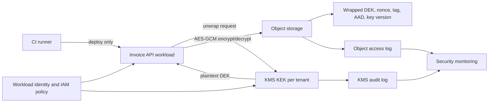

# Thiết kế key compromise response

## Mục tiêu học tập

Sau bài học này, bạn có thể:

- Phân biệt key material compromise, unauthorized key usage, identity compromise và trust/metadata compromise.
- Thiết kế incident response cho KMS/HSM và hệ thống dùng envelope encryption.
- Xác định phạm vi ảnh hưởng theo key ID/version, principal, operation, tenant, dữ liệu và thời gian.
- Chọn hành động containment phù hợp mà vẫn duy trì khả năng phục hồi dữ liệu.
- Lập kế hoạch rotation, rewrap, re-encrypt, revocation và recovery theo loại key.
- Bảo toàn audit evidence, chain of custody và thông tin phục vụ điều tra.
- Phối hợp security, platform, application, data owner và các nhóm quản trị liên quan.
- Xây dựng runbook, decision matrix, tabletop exercise và tiêu chí đóng incident.

## 1. Bối cảnh: key compromise là một incident về niềm tin

Key compromise không chỉ là trường hợp attacker lấy được một file chứa key. Sự cố có thể xảy ra khi raw key material bị lộ, khi một principal trái phép được phép gọi `Decrypt` hoặc `Sign`, khi key policy bị sửa, hoặc khi verifier tin nhầm public key.

Phản ứng đúng cần xác định điều gì đã bị xâm phạm: bí mật của key, quyền sử dụng key, danh tính của workload, hay binding giữa key và identity. Các tình huống này có thể dẫn đến hành động khác nhau. Ví dụ, KMS key non-exportable có thể vẫn nằm an toàn trong HSM, nhưng một service account bị chiếm quyền có thể gọi `Decrypt` để lấy plaintext DEK. Khi đó key material của KEK chưa chắc bị export, nhưng ranh giới authorization đã bị phá vỡ và dữ liệu có thể bị lộ.

Mục tiêu của response là chặn hoạt động trái phép, giới hạn tác động, giữ bằng chứng, khôi phục trust và khả năng vận hành, đồng thời bảo toàn khả năng giải mã dữ liệu hợp lệ còn phụ thuộc vào key.

## 2. Phân biệt các loại compromise

| Loại sự cố | Điều đã bị xâm phạm | Ví dụ | Hướng xử lý trọng tâm |
|---|---|---|---|
| Key material compromise | Bí mật của symmetric/private key | Private key xuất hiện trong build artifact | Coi key không còn đáng tin, thay key và xử lý dữ liệu/token phụ thuộc |
| Unauthorized key usage | Quyền gọi crypto operation | Role lạ gọi KMS `Decrypt` | Thu hồi identity/grant, xác định output và dữ liệu bị ảnh hưởng |
| Identity compromise | Credential hoặc workload identity | CI OIDC trust bị lạm dụng | Disable principal/session, sửa trust policy, kiểm tra mọi resource principal đã truy cập |
| Policy compromise | Key policy, IAM hoặc grant bị sửa | Attacker cấp quyền decrypt cho role khác | Khôi phục policy chuẩn, tìm persistence và rà soát quyền kế thừa |
| Trust/key substitution | Binding giữa key và issuer/identity | JWKS endpoint hoặc certificate bị thay | Khôi phục trust anchor, reject key giả và refresh verifier cache |
| Ciphertext/data exposure | Ciphertext hoặc plaintext bị lấy | Object store bị tải hàng loạt | Xác định dữ liệu, key/DEK liên quan và nghĩa vụ thông báo |

Một incident có thể thuộc nhiều loại cùng lúc. Không dùng cụm từ “key bị lộ” nếu bằng chứng chỉ cho thấy một identity gọi operation trái phép; hãy ghi rõ mức độ material exposure và usage abuse.

## 3. Nguyên tắc phản ứng

Response phải cân bằng bốn yêu cầu:

1. **Containment:** ngăn attacker tiếp tục dùng key hoặc identity.
2. **Evidence:** bảo toàn log, request, policy và trạng thái để điều tra.
3. **Data safety:** giữ khả năng giải mã dữ liệu hợp lệ, backup và bản lưu cần thiết.
4. **Trust recovery:** tạo lại key/identity/policy đáng tin và xác minh verifier/workload đã chuyển đổi.

Không trì hoãn containment khi có hoạt động trái phép đang diễn ra. Đồng thời, không xóa key hoặc backup ngay khi phát hiện alert vì thao tác đó có thể phá hủy bằng chứng và làm mất dữ liệu. Thứ tự cụ thể phụ thuộc mức độ tấn công đang tiếp diễn và tác động availability.

## 4. Case study: dịch vụ hóa đơn đa tenant

Một nền tảng thanh toán lưu hóa đơn cho nhiều tenant. Mỗi object được mã hóa bằng một DEK ngẫu nhiên riêng. DEK dùng AES-256-GCM để mã hóa payload; KMS KEK theo tenant và environment dùng để wrap DEK. Object store lưu ciphertext, nonce, tag, AAD, wrapped DEK, key ID/version và format version.

Ứng dụng `invoice-api-prod` có workload identity được phép gọi KMS `Decrypt` trên KEK của tenant thuộc request. CI runner có quyền deploy ứng dụng nhưng theo thiết kế không được gọi `Decrypt` trên KEK production. Audit KMS, IAM và object store được chuyển về một security account độc lập.



Trong một lần thay đổi pipeline, trust policy OIDC bị cấu hình quá rộng. Đồng thời, một resource policy dùng group CI quá rộng vô tình cấp `Decrypt` trên một tập KEK production cho role release. Attacker lạm dụng token của CI runner để nhận identity `ci-release-prod`. Security monitoring phát hiện role này gọi KMS `Decrypt` với tần suất cao ngoài change window, đồng thời object store ghi nhận nhiều lượt đọc các object chứa wrapped DEK và ciphertext.

KMS KEK được cấu hình non-exportable. Vì vậy, chưa có bằng chứng raw KEK bytes rời HSM/KMS. Tuy nhiên, mỗi lần `Decrypt` thành công có thể trả plaintext DEK cho caller. Nếu attacker lấy được cả DEK lẫn ciphertext tương ứng, họ có thể giải mã object đó bên ngoài KMS.

## 5. Kiến trúc và giả định trước incident

Để điều tra có căn cứ, nhóm cần biết trước:

- Mỗi DEK bảo vệ một object hay một nhóm object.
- KEK được tách theo tenant, environment hay data domain.
- KMS `Decrypt` trả plaintext DEK hay chỉ thực hiện decrypt dữ liệu trực tiếp.
- Encryption context có ràng buộc tenant, object và purpose hay không.
- KMS audit có ghi principal, key ID, request ID, operation và kết quả không.
- Object store audit có thể liên kết request với object ID và caller không.
- Có thể thu hồi token/session và policy grant trong bao lâu.
- Verifier/workload có cache key reference hoặc plaintext DEK không.
- Backup, replica, legal hold và dữ liệu lịch sử còn phụ thuộc key nào.

Nếu các thông tin này chưa có, incident response phải ghi rõ khoảng trống và chọn giả định bảo thủ cho phạm vi chưa xác định.

## 6. Phát hiện ban đầu

Tín hiệu có thể đến từ:

- Số lần `Decrypt`, `UnwrapKey` hoặc `GenerateDataKey` tăng đột biến.
- Principal gọi key ngoài environment, region, subnet hoặc giờ vận hành thông thường.
- CI runner thực hiện operation vốn chỉ dành cho runtime service.
- Nhiều tenant hoặc key ID được truy cập trong một session.
- Object store có lượt tải bất thường trùng thời điểm với KMS decrypt.
- Policy/grant/key attributes bị sửa trước khi có các operation lạ.
- Audit event bị thiếu, trễ hoặc bị thay đổi cấu hình retention.
- Alert về credential federation, runner image hoặc repository compromise.

Một lần `Decrypt` không tự chứng minh plaintext đã bị attacker exfiltrate. Cần đối chiếu kết quả KMS, caller, object access, network egress, application trace và các dấu hiệu khác. Tuy nhiên, nếu không thể xác định output đã đi đâu, phải ghi nhận uncertainty thay vì kết luận an toàn.

## 7. Mục tiêu xử lý và tiêu chí thành công

Incident chỉ được đóng khi đạt các điều kiện phù hợp:

- Principal/session bị lạm dụng không còn khả năng gọi operation trái phép.
- Trust policy và key policy đã được kiểm tra, sửa và xác minh.
- Phạm vi key, tenant, object, ciphertext, plaintext DEK và backup đã được đánh giá.
- Key/DEK bị xác định compromise đã được thay thế hoặc xử lý theo risk decision.
- Workload hợp lệ vẫn có thể encrypt/decrypt dữ liệu được phép.
- Verifier, cache, replica và recovery service đã nhận trạng thái trust mới.
- Audit evidence được bảo toàn và các khoảng trống đã có owner xử lý.
- Nghĩa vụ thông báo, pháp lý và khách hàng được đánh giá bởi bộ phận có thẩm quyền.
- Monitoring mới phát hiện được hành vi tương tự và runbook đã được cập nhật.

## 8. Vai trò trong incident response

| Vai trò | Trách nhiệm |
|---|---|
| Incident commander | Quyết định ưu tiên, điều phối và ghi nhận risk acceptance |
| SOC/forensics | Phân tích alert, bảo toàn log và dựng timeline |
| IAM/platform operator | Thu hồi identity, session, trust relationship và policy grant |
| KMS/HSM custodian | Kiểm tra key state, operation, rotation và recovery |
| Application owner | Xác định luồng dữ liệu, workload và rollout |
| Data owner | Đánh giá object, tenant, backup và tác động dữ liệu |
| Legal/privacy/compliance | Đánh giá nghĩa vụ thông báo và retention evidence |
| Communications lead | Chuẩn bị thông tin cho bên liên quan theo phê duyệt |

Một người có thể đảm nhiệm nhiều vai trò trong tổ chức nhỏ, nhưng thao tác nhạy cảm như export, restore, policy override hoặc destruction vẫn cần separation of duties theo policy.

## 9. Phân loại severity

Severity phải xét loại key, dữ liệu, phạm vi, thời gian và khả năng attacker tiếp tục sử dụng key.

| Mức | Ví dụ | Hướng ưu tiên |
|---|---|---|
| Critical | Private signing key/HMAC secret bị export; master KEK bị lộ; attacker có thể giả mạo identity diện rộng | Contain ngay, reject trust cũ, emergency rotation và đánh giá toàn bộ token/data phụ thuộc |
| High | Unauthorized decrypt hàng loạt; DEK plaintext có thể bị lấy; key policy bị mở rộng trên production | Thu hồi identity/grant, khoanh vùng object/tenant, xử lý DEK và dữ liệu bị ảnh hưởng |
| Medium | Một key hoặc tenant bị truy cập trái phép với phạm vi nhỏ, chưa thấy plaintext/data exfil | Contain, xác minh output, rotate theo risk và tăng monitoring |
| Low / near miss | Request bị deny, không có operation thành công hoặc chỉ có metadata không nhạy cảm | Bảo toàn evidence, sửa policy và theo dõi tái diễn |

Bảng này là ví dụ phân loại nội bộ. Severity cuối cùng phải theo data classification, legal obligation, business impact và incident policy của tổ chức.

## 10. Timeline minh họa

Các mốc dưới đây chỉ là ví dụ để thiết kế playbook, không phải SLA chung:

| Thời điểm | Sự kiện và hành động |
|---|---|
| 09:10 | SIEM phát hiện CI role gọi KMS Decrypt bất thường |
| 09:15 | SOC mở incident, lưu alert và xác nhận principal/key ID |
| 09:20 | Incident commander phê duyệt disable CI session/trust và chặn Decrypt trái phép |
| 09:30 | Bảo toàn KMS, IAM, CI và object store audit logs |
| 10:00 | Correlate request ID, key ID, tenant và object access |
| 10:45 | Xác định các successful decrypt và khoảng thời gian exposure |
| 11:30 | Khoanh vùng object/tenant; chặn egress và workload bị compromise |
| 13:00 | Tạo KEK/DEK mới và bắt đầu migration theo data scope |
| 16:00 | Kiểm thử dữ liệu mới, dữ liệu lịch sử và backup restore |
| Ngày tiếp theo | Hoàn tất impact assessment, thông báo theo quyết định và post-incident review |

## 11. Giai đoạn 0: chuẩn bị trước sự cố

Response hiệu quả phụ thuộc vào thông tin đã chuẩn bị trước. Tối thiểu cần có:

- Key inventory với owner, purpose, key ID/version và data dependency.
- Sơ đồ workload identity, IAM trust và KMS/HSM policy.
- Runbook revoke credential, session, grant và key operation.
- Emergency access được kiểm soát, có approval và audit.
- KMS/HSM audit, CI logs, object access logs và network egress logs được lưu độc lập.
- Quy trình rotation, rewrap, re-encrypt và verifier cache invalidation.
- Recovery key/backup được thử nghiệm định kỳ.
- Danh sách liên hệ incident, data owner, legal/privacy và vendor.
- Tabletop exercise cho từng loại key quan trọng.

Không nên chờ đến incident mới tìm xem key nào bảo vệ dữ liệu nào hoặc ai có quyền gọi `Decrypt`.

## 12. Giai đoạn 1: xác nhận và mở incident

Khi nhận alert:

1. Ghi thời điểm phát hiện và nguồn alert.
2. Lưu nguyên bản event, alert ID và correlation/request ID.
3. Xác định principal, key ID/version, operation và kết quả.
4. So sánh với change window, deployment và workload baseline.
5. Xác định hoạt động có đang tiếp diễn không.
6. Mở incident record và chỉ định incident commander.
7. Đánh giá sơ bộ severity và quyết định containment ban đầu.

Không xóa alert hoặc đóng incident chỉ vì principal là service account hợp lệ. Một identity hợp lệ có thể đang bị attacker sử dụng.

## 13. Giai đoạn 2: bảo toàn evidence

Thu thập và bảo vệ:

- KMS/HSM audit events, key policy snapshots và grant history.
- IAM trust policy, role session, federation claims và credential issuance logs.
- CI/CD run, commit, artifact digest, runner image và job logs.
- Object store access logs, download events và object version history.
- Application logs, trace, request ID và tenant/object mapping.
- Network egress, DNS, proxy và endpoint telemetry.
- Key inventory trước/sau incident và các thay đổi metadata.
- Alert, ticket, approval và hành động containment.

Lưu bản sao read-only ở security account hoặc evidence store độc lập. Ghi hash, thời điểm thu thập, người thu thập, nguồn và chain of custody. Không sửa raw log để làm sạch hoặc loại bỏ dữ liệu nhạy cảm; tạo bản phân tích đã redact riêng.

Containment không được trì hoãn khi attacker vẫn đang hoạt động. Có thể thu thập snapshot nhanh trước khi disable nếu không làm tăng đáng kể rủi ro.

## 14. Giai đoạn 3: xác định identity và đường truy cập

Điều tra identity theo chuỗi:

1. Principal nào gọi KMS?
2. Credential/session được phát hành từ identity provider nào?
3. OIDC `issuer`, `subject`, `audience`, repository, branch và environment có khớp trust policy không?
4. Runner, build job hoặc workload nào đã dùng token?
5. Credential có bị copy sang máy hoặc process khác không?
6. Principal có quyền truy cập key nào khác ngoài key đang điều tra?
7. Có policy/grant mới hoặc role assumption bất thường không?

Thu hồi cả session/credential đang tồn tại và nguồn có thể cấp credential mới. Chỉ xóa một CI variable là chưa đủ nếu trust relationship hoặc runner vẫn bị compromise.

## 15. Giai đoạn 4: xác định key và operation bị ảnh hưởng

Lập danh sách theo từng key:

| Thuộc tính | Câu hỏi điều tra |
|---|---|
| Key ID/version | Key nào đã được gọi? Có alias trỏ sang version khác không? |
| Key type/purpose | KEK, DEK, HMAC, signing hay key agreement? |
| State | Active, deactivated, disabled, compromised hay pending deletion? |
| Operation | Decrypt, unwrap, sign, export, policy update hay describe? |
| Principal | Ai gọi và theo role/session nào? |
| Result | Allow/deny, success/failure, error code và request ID? |
| Scope | Tenant, object, region, environment và thời gian? |
| Dependency | Ciphertext, token, certificate, backup hoặc service nào phụ thuộc? |

Không chỉ tìm key ID trong log. Cần kiểm tra policy changes, key aliases, grants, replica, version và các key liên quan trong hierarchy.

## 16. Giai đoạn 5: đánh giá material exposure và usage abuse

Đánh giá theo hai trục độc lập:

| Câu hỏi | Không có bằng chứng | Có bằng chứng hoặc không thể loại trừ |
|---|---|---|
| Raw key material có rời boundary không? | Provider xác nhận non-exportable, không có export path thành công | Export success, key bytes xuất hiện trong artifact/memory dump hoặc không xác định được boundary |
| Unauthorized crypto operation có thành công không? | Tất cả request bị deny hoặc không có operation thành công | Có successful decrypt/sign/unwrap hoặc operation khác ngoài policy |
| Plaintext/key output có bị lấy không? | Không có đường trả output hoặc có bằng chứng output không rời boundary | Caller nhận plaintext DEK/signature/data hoặc output có thể bị exfiltrate |
| Ciphertext/dữ liệu liên quan có bị lấy không? | Không thấy access và log đủ bao phủ | Object/storage/network evidence cho thấy truy cập hoặc log không đủ để loại trừ |

“Không có log” không đồng nghĩa “không xảy ra”. Ghi rõ coverage, retention gap và confidence level của kết luận.

## 17. Giai đoạn 6: containment identity và permission

Trong case study, hành động containment đầu tiên là ngăn CI runner tiếp tục nhận identity và gọi KMS:

1. Disable hoặc revoke credential/session hiện tại của CI role.
2. Thu hẹp OIDC trust policy về repository, branch, audience và environment hợp lệ.
3. Disable runner/job bị nghi compromise và cô lập artifact liên quan.
4. Gỡ grant `Decrypt` khỏi CI principal và kiểm tra resource policy/key policy.
5. Chặn đường cấp credential mới từ trust relationship bị lạm dụng.
6. Giữ workload identity hợp lệ của `invoice-api-prod` trong policy riêng đã xác minh.
7. Theo dõi các lần assume role hoặc KMS operation tiếp theo.

Nếu cần disable key để ngăn toàn bộ decrypt, phải đánh giá tác động availability và recovery trước. Ưu tiên thu hồi identity/grant bị lạm dụng khi điều đó đủ chặn attacker mà không làm mất khả năng giải mã của workload hợp lệ.

## 18. Giai đoạn 7: containment key và KMS/HSM

Các hành động có thể gồm:

- Chuyển key sang trạng thái disabled/deactivated theo semantics của KMS.
- Thu hồi grant và policy binding.
- Tạo deny rule tạm thời cho principal hoặc operation bị ảnh hưởng.
- Giới hạn network path, region, endpoint hoặc partition.
- Chặn export/import và policy modification ngoài quy trình.
- Bảo toàn key metadata, version và audit reference.

Không mặc định disable toàn bộ KEK ngay khi thấy một role gọi sai. Nếu service production đang cần key để đọc dữ liệu, disable có thể gây outage hoặc ngăn recovery. Incident commander và key custodian cần quyết định theo khả năng attacker còn hoạt động, scope và phương án thay thế.

Nếu raw private/symmetric key đã bị export, phải coi material không còn đáng tin ngay cả khi KMS policy đã được sửa. Policy change không thu hồi các bản sao attacker đã lấy.

Disable key tại KMS/HSM có thể chặn operation mới qua dịch vụ, nhưng không vô hiệu raw key copy hoặc plaintext DEK đã rời boundary trước đó. Nếu material đã bị export, cần thay key và xử lý ciphertext/DEK phụ thuộc; không xem thao tác disable là biện pháp thu hồi bản sao.

## 19. Giai đoạn 8: xác định phạm vi dữ liệu

Trong case study, mỗi KMS decrypt request có thể liên quan tới một wrapped DEK. Nhóm cần liên kết:

- KMS request ID với application trace.
- Key ID/version và encryption context.
- Tenant/object ID được xác thực.
- Wrapped DEK và ciphertext version.
- Object store read/download và network egress.
- Thời điểm operation và caller.

Phân loại object thành:

- **Confirmed affected:** successful unauthorized unwrap/decrypt và có bằng chứng output hoặc ciphertext bị lấy.
- **Potentially affected:** successful unauthorized operation nhưng không xác định được output đã bị exfiltrate hay chưa.
- **Access attempted:** request bị deny hoặc thất bại trước khi trả output.
- **Unaffected with evidence:** audit đầy đủ chứng minh không có unauthorized operation/access trong phạm vi.

Nếu audit không đủ chi tiết để phân biệt, gộp vào potentially affected và ghi rõ lý do. Không thu hẹp phạm vi chỉ để giảm số lượng record cần xử lý.

## 20. Quyết định xử lý theo loại key

| Loại key | Khi material bị lộ | Khi chỉ có unauthorized usage |
|---|---|---|
| DEK | Tạo DEK mới và re-encrypt dữ liệu bị ảnh hưởng | Xác định plaintext DEK/output có bị lấy; nếu không rõ, xử lý theo phạm vi potentially affected |
| KEK | Tạo KEK mới, rewrap DEK; nếu attacker có thể đã lấy DEK/plaintext, re-encrypt dữ liệu liên quan bằng DEK mới | Thu hồi identity/grant; đánh giá operation/output; migrate key hierarchy theo risk |
| HMAC secret | Thay secret trên issuer và mọi verifier; thu hồi token/session phụ thuộc | Thu hồi principal có quyền dùng secret; đánh giá MAC/token đã tạo trong thời gian bị lạm dụng |
| Private signing key | Tạo key pair mới, reject key ID/certificate cũ và xử lý token/chữ ký | Thu hồi quyền ký, điều tra signature đã tạo và thay key nếu trust boundary bị phá |
| Public verification key | Xác minh nguồn, trust binding và certificate/JWKS integrity | Sửa trust source, refresh cache và reject key giả |
| KMS/HSM admin credential | Thay credential, rà soát policy và key objects bị thay đổi | Thu hồi session, khôi phục policy và audit mọi thay đổi |

Không áp dụng cùng một hành động cho mọi key type. Tác động phụ thuộc key purpose, operation, dữ liệu đã bảo vệ và việc attacker có lấy được output hay không.

## 21. KEK compromise và giới hạn của rewrap

KEK thường wrap DEK; dữ liệu được mã hóa bằng DEK. Nếu raw KEK bị lộ, attacker có thể unwrap các wrapped DEK mà họ đã thu thập được. Cần tạo KEK mới và rewrap DEK hợp lệ sang KEK mới.

Tuy nhiên, rewrap chỉ thay lớp bảo vệ DEK đang lưu. Nó không làm vô hiệu bản wrapped DEK cũ mà attacker đã sao chép, và không thu hồi plaintext DEK mà attacker đã lấy trước đó.

Nếu có khả năng attacker đã lấy plaintext DEK hoặc có cả ciphertext/wrapped DEK trong thời gian compromise, cần tạo DEK mới và re-encrypt dữ liệu bị ảnh hưởng. Với dữ liệu lịch sử, đánh giá backup, replica và legal hold; không tuyên bố dữ liệu đã an toàn chỉ vì KEK mới đã được tạo.

## 22. DEK compromise và re-encryption

Khi DEK bị lộ, attacker có thể giải mã ciphertext được mã hóa bằng DEK đó nếu có ciphertext tương ứng. Rewrap cùng DEK bằng KEK mới không khôi phục confidentiality vì attacker đã có DEK.

Quy trình:

1. Xác định mọi object/record dùng DEK bị ảnh hưởng.
2. Tạo DEK mới bằng CSPRNG hoặc KMS `GenerateDataKey`.
3. Mã hóa lại plaintext bằng DEK mới và nonce mới.
4. Tạo wrapped DEK mới bằng KEK được tin cậy.
5. Ghi metadata/key version/AAD mới theo format version.
6. Verify decrypt bằng đường đọc độc lập và đối chiếu integrity.
7. Cập nhật object atomically hoặc dùng versioned write để tránh mất dữ liệu.
8. Xử lý ciphertext/backup cũ theo retention và destruction policy.

Nếu plaintext không còn nguồn tin cậy, không thể đơn giản re-encrypt ciphertext bằng key mới. Cần xác định dữ liệu gốc có còn nguyên vẹn và chưa bị sửa hay không.

## 23. HMAC và signing key compromise

Với HMAC, mọi bên giữ shared secret đều có thể tạo MAC hợp lệ. Khi secret bị lộ, attacker có thể tạo token hoặc message giả. Với rotation định kỳ, có thể dùng overlap ngắn để triển khai verifier và issuer theo thứ tự. Với compromise đã xác nhận, phải ngừng chấp nhận MAC bằng secret cũ càng sớm càng tốt, thay secret ở issuer và toàn bộ verifier, đồng thời revoke token/session phụ thuộc; không giữ overlap chấp nhận secret bị lộ chỉ để tránh gián đoạn.

Với asymmetric signing, private key bị lộ cho phép attacker ký token/chữ ký mới. Response cần:

- Dừng signing bằng private key cũ.
- Tạo key pair mới trong KMS/HSM.
- Công bố public key mới trước khi issuer chuyển sang ký.
- Từ chối `kid` cũ tại verifier khi compromise yêu cầu reject ngay.
- Purge/refresh JWKS cache và CDN theo runbook.
- Revoke refresh token/session và yêu cầu re-authentication theo risk.
- Rà soát chữ ký/token phát hành trong khoảng thời gian nghi vấn.

Không chỉ xóa public key cũ khỏi một JWKS origin rồi cho rằng toàn bộ verifier đã cập nhật. Cache, offline verifier và replica cần được xử lý.

## 24. Identity compromise nhưng key material vẫn non-exportable

Trong case study, KMS KEK không exportable. Nếu chỉ có CI role bị lạm dụng để gọi `Decrypt`, raw KEK có thể vẫn nằm trong HSM/KMS. Tuy nhiên, attacker có thể đã nhận plaintext DEK.

Phân tích phải tách:

- KEK material có bị export không?
- KMS có thực hiện operation trái phép thành công không?
- Plaintext DEK được trả về cho principal nào?
- Caller có đọc ciphertext/object tương ứng không?
- Output có thể được lưu vào runner log, memory dump, artifact hoặc network egress không?

Nếu chỉ identity bị compromise và không có bằng chứng key material lộ, không tự động kết luận KEK đã bị export. Nhưng nếu plaintext DEK có thể bị lấy, dữ liệu liên quan vẫn có thể bị compromise. Quyết định rotate KEK và re-encrypt dữ liệu phải dựa trên phạm vi operation/output, không chỉ dựa vào cờ non-exportable.

## 25. Rotation khẩn cấp và rollout an toàn

Emergency rotation khác rotation định kỳ ở tốc độ và phạm vi, nhưng vẫn cần kiểm soát dependency.

Một rollout an toàn:

1. Provision key mới trong KMS/HSM bằng provisioning identity đã xác minh.
2. Xác minh algorithm, attributes, owner, purpose và policy.
3. Cấp quyền tối thiểu cho workload hợp lệ.
4. Chuyển writer sang key mới.
5. Duy trì reader path có kiểm soát cho dữ liệu cũ nếu key cũ chưa bị compromise material.
6. Rewrap hoặc re-encrypt theo phân loại dữ liệu.
7. Theo dõi lỗi decrypt, access denied và key usage.
8. Disable/revoke key cũ khi dependency và risk cho phép.
9. Lưu audit evidence và cập nhật inventory.

Nếu key material cũ đã bị lộ, không giữ nó trong trust set chỉ để tiện đọc dữ liệu cũ. Nếu dữ liệu cần phục hồi, thực hiện qua recovery enclave/service cô lập, approval độc lập và kiểm soát output.

## 26. Cache, replica và client offline

Key compromise response thường thất bại nếu chỉ sửa trạng thái tại một control plane.

Kiểm tra:

- KMS grant/policy cache và IAM propagation.
- STS/OIDC access token và session chưa hết hạn.
- Application memory/cache chứa plaintext DEK.
- JWKS cache, CDN và verifier offline.
- HSM replica, KMS multi-region replica và backup.
- Secret manager cache, sidecar và CSI mount.
- Queue/job đang giữ wrapped DEK hoặc key reference.
- CI artifacts, crash dump, heap dump và temporary files.

Đặt thời hạn rõ cho invalidation. Nếu không thể purge ngay, phải có deny rule ở verifier hoặc service layer để chặn key ID/principal bị compromise.

## 27. Data recovery và giữ khả năng giải mã

Containment có thể làm hệ thống mất quyền decrypt. Trước khi disable key diện rộng, xác định:

- Dữ liệu production nào cần đọc ngay.
- Backup và archive nào còn phụ thuộc key.
- Có key version dự phòng hoặc replica hợp lệ không.
- Có thể tạo recovery role tạm thời với approval độc lập không.
- Recovery service có thể hoạt động trong network boundary cô lập không.
- Có cần rewrap DEK hoặc restore dữ liệu trước khi retire key cũ không.

Recovery path không được trở thành backdoor lâu dài. Credential tạm phải hết hạn, operation được audit và output phải giới hạn theo object/tenant.

## 28. Xác minh dữ liệu sau re-encryption

Không coi job re-encrypt thành công chỉ vì số record đã xử lý. Cần kiểm tra:

- Object count và tenant coverage khớp manifest.
- Key ID/version mới được ghi đúng.
- Nonce mới được tạo đúng policy.
- AAD bind đúng tenant/object/purpose/schema version.
- Tag được xác minh khi decrypt lại.
- Plaintext hash hoặc business invariant khớp với nguồn tin cậy.
- Backup/replica được cập nhật hoặc giữ trong recovery boundary.
- Record lỗi được retry có idempotency và không bị bỏ sót.
- Audit ghi request, result, key reference và batch ID.

Với dữ liệu lớn, dùng batch manifest, checkpoint và reconciliation. Không xóa ciphertext cũ trước khi có bằng chứng dữ liệu mới có thể đọc và recovery policy đã được đáp ứng.

## 29. Đánh giá exfiltration và data impact

Phạm vi key compromise không tự động bằng phạm vi data breach. Cần xem xét:

- Attacker có key material hoặc plaintext DEK không?
- Attacker có ciphertext tương ứng không?
- Ciphertext có dùng AEAD và metadata/AAD được kiểm tra đúng không?
- Có plaintext cache, export hoặc application response bị lấy không?
- Data classification và tenant nào bị ảnh hưởng?
- Có bản backup hoặc replica ngoài phạm vi kiểm soát không?
- Có thể chứng minh một số object không bị truy cập không?

Phân biệt “có khả năng giải mã” với “đã có bằng chứng đọc plaintext”. Cả hai có thể cần xử lý incident, nhưng mức độ và nghĩa vụ thông báo phải dựa trên policy và đánh giá pháp lý.

## 30. Giao tiếp và thông báo

Thông tin liên lạc phải chính xác và thống nhất. Không tuyên bố “không có dữ liệu bị lộ” khi audit chưa đủ; cũng không tuyên bố “mọi dữ liệu đã bị giải mã” nếu chỉ có một số operation.

Thông báo nội bộ nên nêu:

- Incident ID, thời gian phát hiện và severity.
- Key type/tenant/service bị ảnh hưởng ở mức được phép chia sẻ.
- Hành động containment đã thực hiện.
- Phạm vi đã xác nhận và phần chưa xác định.
- Ảnh hưởng availability và data recovery.
- Quyết định rotation/re-encryption/revocation.
- Người chịu trách nhiệm và thời điểm cập nhật tiếp theo.

Thông báo khách hàng, regulator hoặc đối tác phải do legal/privacy/compliance và người có thẩm quyền phê duyệt theo nghĩa vụ áp dụng. Không gửi raw key, wrapped key, token hoặc log chứa bí mật qua kênh giao tiếp.

## 31. Java example: mô hình hóa đánh giá compromise

Record sau giúp biểu diễn các chiều đánh giá riêng biệt. Nó không tự quyết định key có bị compromise hay không; incident commander và chuyên gia key management phải dựa trên evidence và policy.

```java
import java.time.Instant;
import java.util.Set;

enum ExposureLevel {
    NO_EVIDENCE,
    SUSPECTED,
    CONFIRMED,
    UNKNOWN
}

enum KeyMaterialType {
    DEK,
    KEK,
    HMAC_SECRET,
    PRIVATE_SIGNING_KEY,
    PUBLIC_KEY
}

record KeyCompromiseAssessment(
        String incidentId,
        String keyId,
        int keyVersion,
        KeyMaterialType keyType,
        ExposureLevel materialExposure,
        ExposureLevel unauthorizedUsage,
        ExposureLevel outputExposure,
        Set<String> affectedTenants,
        Instant firstSuspiciousEvent,
        Instant lastSuspiciousEvent,
        String evidenceReference,
        String confidence) {}
```

`UNKNOWN` không được tự động chuyển thành `NO_EVIDENCE`. Khi log thiếu hoặc không có correlation, ghi nhận uncertainty và mở rộng phạm vi điều tra. Không đưa raw key, plaintext DEK hoặc bearer token vào assessment record.

## 32. Pseudocode cho response workflow

Workflow khái niệm:

```text
open incident and assign incident commander
preserve current audit, IAM, KMS and application evidence
identify principal, key IDs, versions, operations and time window
revoke compromised identity sessions and stop unauthorized access
restore least-privilege policy for trusted workloads
assess raw key exposure separately from unauthorized operation output
map keys to ciphertext, DEKs, tokens, tenants and backups
if raw key material is confirmed exposed:
    mark key material untrusted
    provision replacement key and reject old trust
    rewrap or re-encrypt dependent data as required
else if unauthorized DEK/plaintext output may have escaped:
    treat corresponding data objects as potentially exposed
    create fresh DEKs and re-encrypt affected objects
else:
    retain key only under verified policy and continue monitoring
verify workload, recovery, cache and audit behavior
document residual risk and close only with owner approval
```

Đây là logic tham khảo. Mọi thao tác phá hủy, disable diện rộng, giữ key compromised để recovery hoặc thông báo bên ngoài phải theo approval và runbook của tổ chức.

## 33. Monitoring sau containment

Sau khi revoke identity và rotate key, tiếp tục theo dõi:

- Principal cũ còn gọi KMS hoặc assume role không.
- Trust policy mới có bị sửa lại không.
- Key ID cũ còn được dùng để sign/decrypt/unwrap không.
- Workload hợp lệ có bị lỗi do cache hoặc permission propagation không.
- Có credential, runner hoặc artifact mới phát sinh từ nguồn bị compromise không.
- Re-encryption batch có bỏ sót object hoặc tạo nonce collision không.
- Audit pipeline có gap hoặc duplicate sau replay không.
- Attacker có chuyển sang key/region/identity khác không.

Giữ detection rule tăng cường trong khoảng thời gian theo risk. Đóng alert tạm thời không đồng nghĩa incident đã được xử lý hoàn toàn.

## 34. Post-incident review và corrective actions

Sau containment và recovery, tổ chức cần đánh giá:

- Root cause: trust policy, credential, CI runner, source code, KMS grant hay process failure.
- Vì sao detection không phát hiện sớm hơn.
- Log nào thiếu principal, object, result hoặc correlation ID.
- Quyền nào rộng hơn nhu cầu.
- Rotation/recovery có đáp ứng RTO/RPO không.
- Có key/DEK nào chưa được migrate hoặc backup chưa được kiểm tra không.
- Thời gian từ alert tới containment và xác minh.
- Quy trình phê duyệt, giao tiếp và escalation có rõ không.

Corrective action nên có owner, due date, priority và evidence hoàn thành. Ví dụ: thu hẹp OIDC subject, loại `Decrypt` khỏi CI role, bắt buộc per-tenant encryption context, thêm alert theo principal/key, rút ngắn token lifetime và kiểm thử emergency rotation.

## 35. Tabletop exercise

Một buổi tabletop có thể dùng các inject sau:

| Inject | Câu hỏi cần trả lời |
|---|---|
| Alert KMS Decrypt tăng gấp 20 lần | Ai declare incident và xác nhận principal? |
| CI role có token còn hiệu lực | Thu hồi session và chặn token mới ở đâu? |
| KMS audit không ghi object ID | Có thể correlate qua request ID và application trace không? |
| Có 5.000 successful unwrap | Phân biệt output exposure với ciphertext access như thế nào? |
| KEK non-exportable nhưng DEK trả về caller | Data scope nào cần re-encrypt? |
| Disable KEK làm invoice API ngừng đọc dữ liệu | Recovery path và approval nào được dùng? |
| JWKS cache giữ signing key cũ | Làm sao reject key ID cũ ở mọi verifier? |
| Backup chưa rewrap | Giữ key cũ trong recovery boundary bao lâu? |

Kết quả exercise cần ghi decision, thời gian, evidence còn thiếu, người chịu trách nhiệm và thay đổi runbook. Không dùng tabletop để thực hiện thao tác destructive trên production.

## 36. Anti-pattern cần tránh

1. **Chỉ rotate key mà không revoke identity.** Attacker có thể tiếp tục gọi key mới nếu principal vẫn bị chiếm.
2. **Cho rằng non-exportable đồng nghĩa không thể bị lạm dụng.** KMS operation vẫn có thể trả plaintext hoặc chữ ký cho caller.
3. **Rewrap cùng DEK sau khi DEK đã lộ.** Attacker vẫn giữ DEK và giải mã ciphertext cũ.
4. **Disable mọi key ngay lập tức mà không xét recovery.** Có thể gây mất khả năng giải mã dữ liệu hợp lệ.
5. **Xóa audit hoặc runner artifact trước khi bảo toàn evidence.** Làm mất dấu vết điều tra.
6. **Coi mọi KMS decrypt là data exfiltration.** Operation thành công chưa chứng minh ciphertext hoặc plaintext bị lấy.
7. **Coi không có log là không có compromise.** Có thể có retention gap hoặc logging bị tắt.
8. **Chỉ xóa key khỏi JWKS origin.** Cache và verifier offline có thể vẫn tin key cũ.
9. **Giữ key material compromise để tiện decrypt lâu dài.** Mở rộng thời gian attacker có thể lợi dụng key.
10. **Thông báo phạm vi chưa được xác minh như sự thật.** Gây sai lệch quyết định và nghĩa vụ.
11. **Không kiểm tra backup/replica.** Dữ liệu cũ có thể vẫn phụ thuộc key đã bị xử lý.
12. **Đóng incident ngay sau khi alert biến mất.** Persistence, cache và data impact có thể chưa được giải quyết.

## 37. Checklist key compromise response

- [ ] Xác định incident commander và severity.
- [ ] Phân biệt material exposure, unauthorized usage, identity, policy và trust compromise.
- [ ] Xác định key ID/version, type, purpose, owner và provider.
- [ ] Bảo toàn KMS/HSM, IAM, CI, application, storage và network evidence.
- [ ] Thu hồi credential/session/trust relationship bị lạm dụng.
- [ ] Khôi phục least-privilege policy và kiểm tra effective permissions.
- [ ] Xác định operation thành công/thất bại và output có thể đã bị lấy.
- [ ] Map key tới DEK, ciphertext, token, tenant, backup và replica.
- [ ] Đánh giá raw key exposure riêng với plaintext DEK/data exposure.
- [ ] Chọn disable/revoke/rotate theo key type và availability dependency.
- [ ] Rewrap DEK khi chỉ cần thay KEK protection và DEK còn tin cậy.
- [ ] Re-encrypt bằng DEK mới khi DEK/plaintext có thể đã bị lộ.
- [ ] Reject signing key cũ tại mọi verifier và xử lý cache/session.
- [ ] Xác minh workload hợp lệ và recovery service hoạt động.
- [ ] Kiểm tra backup, archive, legal hold và ciphertext lịch sử.
- [ ] Ghi audit, approval, residual risk và chain of custody.
- [ ] Đánh giá nghĩa vụ thông báo với legal/privacy/compliance.
- [ ] Tăng monitoring và hoàn tất corrective actions có owner.

## 38. Câu hỏi tự kiểm tra

**1. Key compromise có luôn nghĩa raw key bytes bị lấy không?**

Không. Có thể chỉ là unauthorized usage, identity compromise, policy compromise hoặc trust/key substitution.

**2. KMS key non-exportable có loại bỏ mọi rủi ro không?**

Không. Caller được phép vẫn có thể gọi Decrypt/Unwrap và nhận plaintext output.

**3. Vì sao phải revoke identity ngoài rotation key?**

Nếu identity vẫn bị chiếm, attacker có thể tiếp tục dùng key mới hoặc resource khác.

**4. KMS Decrypt success có chứng minh data exfiltration không?**

Không. Cần kiểm tra output, ciphertext access, network egress và application trace.

**5. Khi nào rewrap DEK là đủ?**

Khi DEK vẫn được tin cậy và chỉ cần thay KEK bảo vệ DEK; không đủ nếu plaintext DEK đã lộ.

**6. Khi nào phải re-encrypt bằng DEK mới?**

Khi DEK hoặc plaintext có thể đã bị lộ và ciphertext cần tiếp tục được bảo vệ.

**7. Raw KEK bị lộ ảnh hưởng gì?**

Attacker có thể unwrap wrapped DEK mà họ thu thập được; cần thay KEK và đánh giá dữ liệu liên quan.

**8. HMAC secret bị lộ có tác động gì?**

Mọi bên có secret có thể tạo MAC hợp lệ; attacker có thể giả mạo token/message.

**9. Private signing key bị lộ cần làm gì?**

Thay key pair, reject key ID/certificate cũ, refresh verifier trust và xử lý token/session phụ thuộc.

**10. Vì sao phải giữ evidence trước khi sửa policy?**

Để bảo toàn timeline, principal, request và trạng thái ban đầu; containment vẫn phải ưu tiên nếu attacker đang hoạt động.

**11. Không có log có nghĩa không có compromise không?**

Không. Có thể log bị thiếu, trễ, tắt hoặc không đủ correlation.

**12. Vì sao disable KEK có thể gây outage?**

Ứng dụng và recovery service có thể cần KEK để unwrap DEK và đọc dữ liệu hợp lệ.

**13. Nonce/AAD có liên quan gì đến re-encryption?**

Re-encryption cần nonce mới và AAD được tái tạo/kiểm tra đúng theo tenant, object và format version.

**14. Cần kiểm tra cache nào sau revocation?**

IAM/session, KMS grants, plaintext DEK, application, JWKS/CDN, replica, sidecar và client offline.

**15. Khi nào có thể giữ key cũ cho recovery?**

Chỉ khi risk được đánh giá, quyền bị giới hạn, có approval và boundary recovery được kiểm soát; không dùng key material đã lộ như key tin cậy.

**16. Ai quyết định thông báo khách hàng hoặc regulator?**

Legal/privacy/compliance và người có thẩm quyền theo nghĩa vụ áp dụng.

**17. Incident được đóng khi nào?**

Khi containment, scope, recovery, trust, audit, residual risk và corrective actions đạt tiêu chí đã phê duyệt.

**18. Vì sao phải kiểm tra backup sau rotation?**

Backup có thể còn wrapped DEK hoặc ciphertext phụ thuộc key cũ.

**19. Vì sao phải dùng tabletop exercise?**

Để phát hiện thiếu quyền, evidence, dependency, decision owner và recovery path trước khi có incident thật.

**20. Một response tốt cần cân bằng những gì?**

Containment, evidence, data safety và trust recovery.

## 39. Kết luận

Thiết kế key compromise response bắt đầu bằng việc phân loại chính xác điều gì đã bị xâm phạm: key material, quyền sử dụng, identity, policy hay trust binding. Sau đó nhóm phản ứng phải bảo toàn evidence, thu hồi đường truy cập của attacker, xác định key/data dependency và chọn hành động theo loại key. KMS/HSM non-exportable giảm nguy cơ lộ raw key nhưng không ngăn việc lạm dụng operation được cấp.

Với envelope encryption, rewrap thay lớp bảo vệ DEK; nếu DEK đã lộ thì cần DEK mới và re-encrypt dữ liệu bị ảnh hưởng. Với signing key, phải reject key cũ tại mọi verifier và xử lý cache/session. Một response hoàn chỉnh còn phải giữ khả năng recovery, xác minh dữ liệu, đánh giá nghĩa vụ thông báo, tăng monitoring và chuyển bài học thành corrective actions có owner. Rotation chỉ là một phần của quá trình khôi phục niềm tin.
