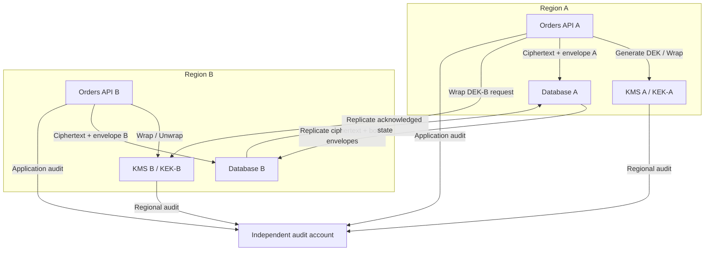
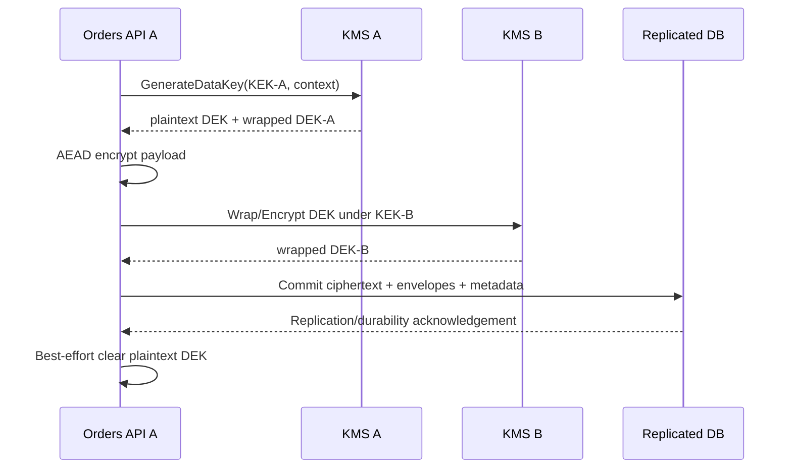
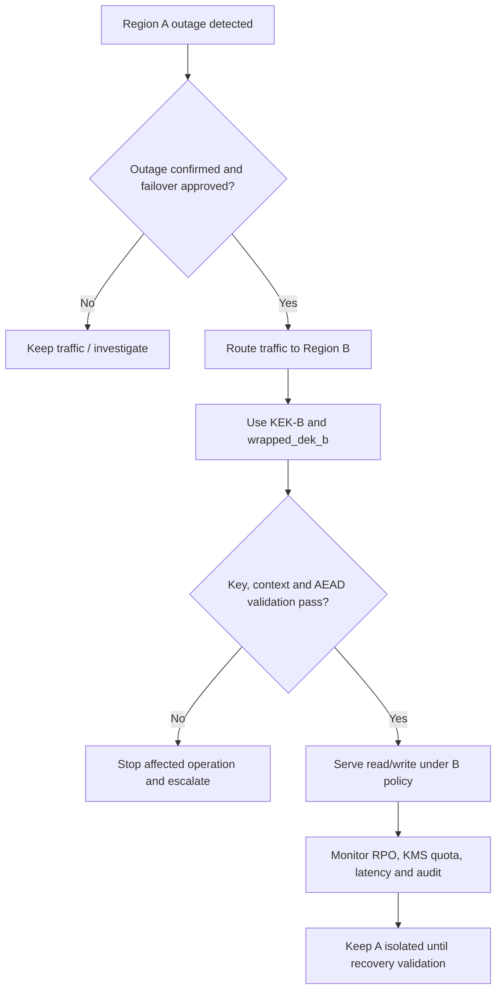

# Thiết kế multi-region key

Thiết kế multi-region key là việc tổ chức key, policy, workload identity, dữ liệu mã hóa và quy trình phục hồi để một hệ thống có thể tiếp tục bảo vệ và truy cập dữ liệu khi một vùng (region) gặp sự cố. Một thiết kế tốt phải trả lời đồng thời ba câu hỏi: key nào được dùng ở từng vùng, dữ liệu ở vùng dự phòng có thể giải mã bằng cách nào và ai được phép chuyển hệ thống sang vùng khác.

Multi-region không chỉ là tạo một bản sao của key ở region thứ hai. Cần phân biệt key material replication, key object/metadata replication, policy replication, data replication và application failover. Các lớp này có thể có consistency, độ trễ và quyền quản trị khác nhau. Việc một KMS hỗ trợ multi-region key không tự động có nghĩa dữ liệu, grant, alias, audit, workload identity hoặc cấu hình ứng dụng đã sẵn sàng cho disaster recovery.

Bài case study này thiết kế hệ thống mã hóa dữ liệu giao dịch ở hai region. Phần trọng tâm là lựa chọn giữa một key material dùng chung nhiều vùng và các KEK độc lập theo vùng, sau đó thiết kế envelope encryption, failover/failback, rotation, residency, access control, audit và kiểm thử. Các tên region, RTO/RPO và quy tắc bên dưới là giả định của tình huống; khi triển khai thực tế phải thay bằng capability và semantics đã xác minh của KMS/HSM đang sử dụng.

## 1. Bối cảnh case study

Công ty giả định **Orchid Commerce** vận hành nền tảng đặt hàng và thanh toán tại hai vùng:

- **Region A:** vùng xử lý chính của phần lớn traffic hiện tại.
- **Region B:** vùng xử lý dự phòng, đồng thời phục vụ một phần traffic và nhận bản sao dữ liệu đã mã hóa.

Hệ thống lưu dữ liệu đơn hàng, thông tin khách hàng, trạng thái thanh toán và audit metadata. Mỗi region có application cluster, database/storage, KMS endpoint và workload identity riêng. Dữ liệu được mã hóa bằng envelope encryption: ứng dụng mã hóa payload bằng Data Encryption Key (DEK), còn Key Encryption Key (KEK) trong KMS bảo vệ DEK.

Sự cố cần xử lý là Region A mất kết nối kéo dài hoặc toàn vùng không khả dụng. Region B phải tiếp quản đọc/ghi trong thời gian mục tiêu mà không cần truy cập trực tiếp vào KMS của Region A.

## 2. Yêu cầu nghiệp vụ và mục tiêu phục hồi

Các mục tiêu mẫu được thống nhất với service owner và data owner:

| Yêu cầu | Mục tiêu của case study | Ý nghĩa thiết kế |
|---|---|---|
| Availability | Region A hoặc B có thể phục vụ độc lập | Không phụ thuộc online vào một KMS endpoint duy nhất |
| RTO | 30 phút cho luồng đơn hàng quan trọng | Key, policy, identity và ứng dụng ở B phải sẵn sàng trước incident |
| RPO | Tối đa 5 phút cho dữ liệu đã xác nhận replicate | Bản sao ciphertext và metadata key phải đi cùng commit semantics |
| Confidentiality | Không lưu plaintext DEK hoặc raw KEK trong database/log | Chỉ KMS/HSM và memory boundary được duyệt xử lý key material |
| Integrity | Phát hiện ciphertext/context bị sửa | Dùng AEAD và ràng buộc AAD/encryption context |
| Isolation | Workload Region A không mặc nhiên dùng key của Region B và ngược lại | IAM, key policy và network scope theo region |
| Auditability | Có thể truy vết operation tại cả hai vùng | Audit event được gửi tới log destination độc lập |
| Recovery | Failover không phụ thuộc operator lấy raw key thủ công | Pre-provision key, policy, wrapped DEK và runbook |
| Rotation | Có thể rotate KEK mà không làm mất khả năng đọc dữ liệu cũ | Lưu key reference/version và hỗ trợ rewrap |

RTO/RPO trên là mục tiêu thiết kế, không phải bảo đảm tự động từ KMS. Phải đo thời gian failover thực tế và xác nhận database replication, application recovery, quota, identity federation cùng key service đều đáp ứng.

## 3. Phân biệt các lớp replication

Trước khi chọn kiến trúc, cần xác định “multi-region” đang nói tới lớp nào.

| Lớp | Nội dung được sao chép | Câu hỏi phải xác minh |
|---|---|---|
| Key material | Cùng material có mặt tại nhiều vùng | Có cùng cryptographic identity không? Ai quản trị replica? |
| Key object/metadata | ID, algorithm, purpose, state, labels và version | ID có giống nhau hay mỗi vùng có ID riêng? |
| Policy/grant | Quyền quản trị và sử dụng | Policy có tự đồng bộ hay phải triển khai riêng? |
| Alias/reference | Tên logic trỏ tới key | Alias có global hay regional? Có thể trỏ sai vùng không? |
| Ciphertext/data | Database, object và backup | Replication có bảo đảm transaction và metadata cùng lúc không? |
| Wrapped DEK | DEK được bảo vệ bởi KEK | Region đích có thể unwrap envelope này không? |
| Identity/configuration | Role, workload identity, endpoint và trust | Identity ở vùng đích có đúng scope và quyền không? |
| Audit/telemetry | Event từ KMS/HSM và ứng dụng | Event có được chuyển tới nơi độc lập khi một region down không? |

Một thiết kế chỉ sao chép key material mà không sao chép policy hoặc workload identity vẫn có thể không dùng được khi failover. Tương tự, database có bản sao nhưng wrapped DEK chỉ dùng được ở Region A thì dữ liệu tại Region B chưa sẵn sàng phục hồi.

## 4. Hai lựa chọn chính về key material

Có hai hướng kiến trúc phổ biến. Tên gọi và tính năng cụ thể tùy nhà cung cấp; cần kiểm tra semantics thay vì giả định mọi KMS hoạt động giống nhau.

### 4.1. Multi-region key dùng chung key material

Một logical key có các resource/replica tại nhiều region và các replica có cùng key material theo capability của dịch vụ. Ứng dụng có thể gọi KMS endpoint tại vùng gần nhất để thực hiện operation trên key tương ứng.

Ưu điểm:

- Ciphertext hoặc wrapped DEK được tạo ở một vùng có thể được xử lý tại vùng khác nếu dịch vụ xác nhận các replica tương thích.
- Giảm nhu cầu rewrap dữ liệu khi failover.
- Dễ duy trì một logical cryptographic identity cho một số use case.
- Có thể giảm số bước chuyển đổi khi chuyển traffic giữa các vùng.

Đánh đổi:

- Cùng key material xuất hiện trong nhiều vùng làm tăng phạm vi ảnh hưởng khi key bị compromise.
- Rotation, disable hoặc deletion có thể ảnh hưởng tất cả replica theo semantics dịch vụ.
- Policy, grant, alias, state và audit có thể vẫn cần cấu hình/quản lý riêng theo vùng.
- Yêu cầu residency hoặc sovereignty có thể không cho phép material được nhân bản sang một số vùng.
- Khả năng hỗ trợ key type, import, asymmetric operation và HSM mode có thể khác nhau.

### 4.2. KEK độc lập theo region

Mỗi vùng có KEK riêng, với material và lifecycle độc lập. DEK được wrap bằng KEK tương ứng. Nếu cần đọc dữ liệu ở vùng khác, phải có wrapped DEK phù hợp với KEK tại vùng đích hoặc có quy trình chuyển đổi được phê duyệt.

Ưu điểm:

- Giới hạn blast radius của compromise hoặc sai policy theo region.
- Hỗ trợ phân vùng quyền quản trị, tenant, environment và residency tốt hơn.
- Có thể rotate/disable một KEK mà ít ảnh hưởng trực tiếp đến vùng còn lại.
- Dễ thiết lập owner và approval riêng theo vùng hoặc data domain.

Đánh đổi:

- Phải quản lý nhiều key reference, policy, version và rotation schedule.
- Cần dual wrapping, rewrap hoặc re-encryption để dữ liệu replicate có thể đọc ở vùng đích.
- Quy trình đồng bộ wrapped DEK và metadata phức tạp hơn.
- Failover có thể thất bại nếu DEK chưa được wrap cho vùng dự phòng.

## 5. So sánh kiến trúc và quyết định cho case study

| Tiêu chí | Cùng material nhiều vùng | KEK độc lập theo vùng |
|---|---|---|
| Cross-region decrypt | Đơn giản hơn nếu provider hỗ trợ replica semantics | Cần envelope đích hoặc rewrap/re-encryption |
| Blast radius | Có thể rộng hơn vì dùng chung material | Cô lập tốt hơn theo vùng |
| Residency | Phải chấp nhận material replication theo phạm vi provider | Dễ giới hạn material theo vùng hơn |
| Rotation | Cần hiểu ảnh hưởng tới mọi replica | Rotation độc lập, nhưng cần quản lý nhiều version |
| Policy management | Resource/policy có thể vẫn regional | Policy độc lập và rõ ranh giới hơn |
| Operational complexity | Ít key material lifecycle hơn | Nhiều key và quy trình envelope hơn |
| Disaster recovery | Ít bước rewrap hơn | Cần bảo đảm wrapped DEK ở vùng đích sẵn sàng |
| Compromise containment | Có thể cần thay material trên nhiều vùng | Có thể cô lập một vùng nếu key không dùng chung |

**Quyết định của Orchid Commerce:** dùng KEK độc lập theo region cho dữ liệu giao dịch production, kết hợp dual-wrapped DEK cho các record được phép replicate sang vùng còn lại. Cách này ưu tiên blast-radius isolation và quyền quản trị riêng, đồng thời chuẩn bị sẵn envelope ở vùng dự phòng để không phải gọi KMS của vùng lỗi trong lúc failover.

Quyết định này dựa trên giả định hai vùng được phê duyệt để lưu dữ liệu và wrapped DEK. Nếu yêu cầu residency cấm chuyển cả plaintext DEK, ciphertext, wrapped DEK hoặc metadata ra khỏi vùng, phải thiết kế regional isolation và data replication khác; không thể coi dual wrapping là mặc nhiên được phép.

## 6. Kiến trúc mục tiêu

Mỗi region có application workload, database replica, KMS endpoint và KEK riêng. Khi tạo record, ứng dụng sinh DEK trong memory, mã hóa payload bằng AEAD, sau đó tạo wrapped DEK cho cả hai region trước khi xác nhận record đã được replicate theo yêu cầu durability.



Sơ đồ là logical architecture. Đường gọi KMS cross-region để wrap DEK phải được chấp thuận về network, data residency, latency và policy. Có thể thay bằng provider-supported re-encryption/rewrap mechanism nếu semantics đáp ứng yêu cầu; không được tự giả định cơ chế đó tồn tại.

## 7. Key hierarchy và phạm vi của từng key

Thiết kế dùng hierarchy đơn giản:

| Key | Vị trí | Purpose | Phạm vi |
|---|---|---|---|
| KEK-A | KMS/HSM Region A | Wrap/unwrap DEK cho dữ liệu Region A | Production data domain A |
| KEK-B | KMS/HSM Region B | Wrap/unwrap DEK cho dữ liệu Region B | Production data domain B |
| DEK | Memory của workload trong thời gian cần thiết | Mã hóa một object/record hoặc batch nhỏ | Một record hoặc scope được định nghĩa |
| Signing key A/B | HSM/KMS riêng theo vùng hoặc signing service | Ký artifact/transaction nếu use case cần | Purpose và issuer riêng |
| Audit signing/integrity key | Security account hoặc audit service | Bảo vệ integrity của audit archive | Tách khỏi workload data keys |

Không dùng một KEK duy nhất cho cả data encryption, signing, HMAC và certificate authority. Key phải có purpose rõ, algorithm/usage phù hợp và policy tách biệt. CA root key hoặc long-lived signing key không nên tự động được nhân bản cùng cơ chế với data KEK; chúng có trust impact và ceremony riêng.

## 8. Envelope encryption và dual-wrapped DEK

Khi ứng dụng tạo record ở Region A:

1. Gọi KMS-A để tạo DEK theo API được hỗ trợ.
2. Nhận plaintext DEK trong memory và wrapped DEK-A.
3. Mã hóa payload bằng AEAD như AES-256-GCM với nonce duy nhất cho mỗi lần dùng key.
4. Gửi plaintext DEK tới cơ chế wrap được duyệt của KMS-B để tạo wrapped DEK-B, hoặc dùng thao tác rewrap được provider hỗ trợ.
5. Lưu ciphertext, nonce, tag, AAD metadata, wrapped DEK-A và wrapped DEK-B.
6. Xóa plaintext DEK theo best-effort ngay sau operation.
7. Chỉ xác nhận durability đa vùng sau khi envelope và ciphertext được commit theo transaction protocol.



Đây là luồng khái niệm. API `GenerateDataKey`, `Encrypt`, `ReEncrypt` hoặc HSM wrapping khác nhau theo sản phẩm. Nếu dùng KMS-B để mã hóa plaintext DEK, DEK sẽ đi qua memory của ứng dụng và network tới Region B; TLS, workload identity, memory handling và residency phải được đánh giá. Nếu không được phép chuyển DEK qua vùng, dual wrapping theo cách này không phù hợp.

Với record được tạo ở Region B, luồng được thực hiện đối xứng: tạo DEK bằng KEK-B, mã hóa payload tại B và tạo wrapped envelope cho KEK-A trước khi record được đánh dấu replicate-complete. Cả hai chiều phải có policy riêng, quota và kiểm thử residency; không để một replication role có quyền wrap tùy ý mọi key.

## 9. Metadata cần lưu cùng ciphertext

Record đã mã hóa cần đủ metadata để giải mã đúng version trong tương lai. Metadata không được chứa plaintext key.

| Trường | Mục đích |
|---|---|
| `format_version` | Version của envelope/ciphertext schema |
| `algorithm` | AEAD algorithm/mode |
| `nonce` | Nonce/IV dùng để mã hóa |
| `tag` | Authentication tag nếu format lưu riêng |
| `aad_version` | Version schema của additional authenticated data |
| `tenant_ref` | Tenant reference đã xác minh/pseudonymized |
| `object_ref` | ID object/record bất biến |
| `purpose` | Mục đích mã hóa |
| `wrapped_dek_a` | DEK được wrap bằng KEK-A |
| `kek_ref_a` | Key ID/version/region của KEK-A |
| `wrapped_dek_b` | DEK được wrap bằng KEK-B |
| `kek_ref_b` | Key ID/version/region của KEK-B |
| `created_region` | Vùng tạo record |
| `created_at` | Thời điểm tạo theo UTC |
| `ciphertext_checksum` | Metadata integrity/reference nếu hệ thống cần |

AAD có thể bao gồm tenant, object ID, data class và format version để ngăn tráo ciphertext giữa record. AAD phải được dựng từ metadata tin cậy và tái tạo đúng khi decrypt. Không đưa password, PII không cần thiết hoặc key material vào AAD/log.

## 10. Active-active và active-passive

**Active-active** cho phép cả hai vùng nhận ghi. Mỗi write cần có transaction/replication semantics để ciphertext và hai wrapped DEK được lưu nhất quán. Phải xử lý concurrent update, duplicate request, conflict resolution và idempotency. Nếu một region không wrap được DEK cho vùng kia, hệ thống phải quyết định rõ có từ chối write, ghi trạng thái chưa DR-protected hay chuyển sang degraded mode.

**Active-passive** chỉ một vùng nhận write bình thường; vùng còn lại nhận replication và được kích hoạt khi failover. Mô hình này dễ kiểm soát consistency hơn nhưng vẫn phải chuẩn bị key, policy, identity, quota và endpoint ở passive region. “Passive” không có nghĩa key ở đó chưa cần kiểm thử.

| Tiêu chí | Active-active | Active-passive |
|---|---|---|
| Write availability | Cả hai vùng | Chủ yếu một vùng |
| Conflict handling | Phức tạp hơn | Đơn giản hơn nếu single writer |
| Key readiness | Cả hai vùng dùng key liên tục | Passive key phải được kiểm thử định kỳ |
| Replication lag | Cần theo dõi hai chiều | Chủ yếu theo một chiều |
| Operational complexity | Cao | Thấp hơn nhưng failover cần orchestration |
| Use case phù hợp | Global traffic, latency-sensitive service | Workload cần DR rõ ràng và single writer |

Orchid chọn active-active cho API stateless, nhưng database có write ownership theo partition/tenant để tránh conflict. Các record chỉ được xác nhận replicated khi ciphertext cùng hai wrapped DEK đã được commit. Nếu không đáp ứng được điều kiện đó, service trả trạng thái retryable hoặc chỉ chấp nhận write theo degraded policy đã duyệt.

## 11. Quy tắc khi một region không khả dụng

Khi Region A mất kết nối:

1. Health controller xác minh outage qua nhiều tín hiệu, không chỉ một timeout.
2. Incident commander hoặc failover automation được ủy quyền xác nhận chuyển traffic.
3. Region B nhận traffic mới và dùng KEK-B để unwrap `wrapped_dek_b`.
4. Ứng dụng kiểm tra tenant/object/purpose context và xác minh AEAD tag trước khi trả plaintext.
5. Read/write ở B tiếp tục theo database replication state và RPO đã công bố.
6. KMS-A không còn là dependency của đường đọc/ghi đang failover.
7. Audit ghi rõ failover event, actor, key reference, region và policy version.



Không tự động chuyển sang KEK-B nếu record không có `wrapped_dek_b`. Trường hợp envelope thiếu phải đi theo recovery/re-wrap workflow có kiểm soát hoặc trả lỗi; không thử unwrap bằng key tùy ý.

## 12. Consistency giữa ciphertext và key metadata

Một failure mode nghiêm trọng là database replicate ciphertext trước nhưng chưa replicate wrapped DEK-B, hoặc metadata trỏ tới key version chưa tồn tại ở vùng đích.

Thiết kế cần:

- Ghi ciphertext và envelope metadata trong cùng transaction hoặc commit protocol.
- Có trạng thái record như `PREPARING`, `REGION_ENVELOPES_READY`, `REPLICATED` và `COMMITTED` nếu replication không atomic.
- Không đánh dấu record DR-ready trước khi wrapped DEK của vùng đích được xác minh.
- Dùng immutable key reference/version thay vì chỉ lưu alias có thể đổi target.
- Dùng idempotency key cho retry tạo envelope.
- Có reconciliation job tìm record thiếu envelope hoặc tham chiếu key không tồn tại.
- Không xóa envelope cũ cho tới khi envelope mới đã được test và consumer migration hoàn tất.

KMS key replication và database replication là hai hệ thống khác nhau. Cần có readiness check riêng cho key version và wrapped DEK coverage.

## 13. Data residency và sovereignty

Multi-region có thể xung đột với yêu cầu dữ liệu chỉ được xử lý hoặc lưu trong một lãnh thổ. Phải đánh giá toàn bộ data flow, không chỉ vị trí KMS.

Các câu hỏi cần trả lời:

- Ciphertext có được phép replicate sang Region B không?
- Wrapped DEK có được coi là dữ liệu mật mã nhạy cảm và được phép chuyển vùng không?
- Plaintext DEK có đi qua network hoặc memory ở region khác không?
- KMS/HSM provider lưu key material/backup/metadata tại đâu?
- Audit log, telemetry, support snapshot và backup có thể đi ra ngoài region không?
- Ai có thể truy cập control plane và support plane xuyên biên giới?
- Quy định yêu cầu customer-managed key, external key store hoặc key residency cụ thể nào?

Nếu residency không cho phép chuyển wrapped DEK hoặc plaintext DEK, có thể phải giữ dữ liệu và key hoàn toàn theo region, dùng replication dữ liệu đã được phê duyệt nhưng chỉ cho phép giải mã tại region gốc, hoặc xây quy trình chuyển đổi có kiểm soát trong boundary được phép. Không tuyên bố “ciphertext không phải dữ liệu nhạy cảm” nếu chưa có đánh giá pháp lý và phân loại dữ liệu.

## 14. IAM và key policy theo region

Mỗi workload chỉ được dùng key trong region/purpose được giao. Policy cần tách:

- Workload role dùng `GenerateDataKey`/`Decrypt` trên KEK cục bộ.
- Replication/rewrap role có quyền tối thiểu để tạo wrapped envelope ở vùng đích.
- Key administrator quản trị policy/rotation, không mặc nhiên có quyền decrypt dữ liệu.
- Auditor chỉ đọc audit/metadata cần thiết.
- Recovery operator có quyền break-glass theo approval và expiry.
- Security service quản lý alert/containment tách khỏi workload role.

Các policy cần ràng buộc principal, action, resource, region, environment và encryption context. Explicit deny nên chặn cross-environment hoặc action không đúng purpose nếu policy engine hỗ trợ. Không dùng wildcard toàn account để giải quyết lỗi failover.

```yaml
# Pseudo-policy minh họa, không phải cú pháp nạp trực tiếp vào KMS.
default_effect: DENY
rules:
  - id: region-a-orders-use
    effect: ALLOW
    principal: workload:orders-api-a
    actions: [GenerateDataKey, Decrypt]
    resource: key:orders-kek-a
    conditions:
      region: region-a
      environment: production
      purpose: order-record-encryption

  - id: region-b-orders-use
    effect: ALLOW
    principal: workload:orders-api-b
    actions: [GenerateDataKey, Decrypt]
    resource: key:orders-kek-b
    conditions:
      region: region-b
      environment: production
      purpose: order-record-encryption

  - id: replication-wrap
    effect: ALLOW
    principal: workload:envelope-replication
    actions: [Encrypt]
    resource: key:orders-kek-b
    conditions:
      source_region: region-a
      approved_replication_job: true
```

Policy cần được triển khai và kiểm thử riêng tại từng region. Không giả định grant hoặc identity binding tự đồng bộ cùng key material.

## 15. Network và service dependency

KMS call phải đi qua endpoint và network path được duyệt. Thiết kế cần:

- Private endpoint hoặc đường kết nối phù hợp với threat model.
- TLS và certificate validation cho mọi kết nối.
- DNS/endpoint mapping có thể chuyển sang vùng dự phòng.
- Egress policy chỉ cho workload gọi đúng KMS endpoint.
- Timeout, retry, exponential backoff và jitter để tránh retry storm.
- Circuit breaker và bounded concurrency khi KMS throttling.
- Quota đủ cho failover load, không chỉ normal traffic.
- Health check kiểm tra authorization/operation bằng test key, không chỉ TCP connect.

Khi Region A down, Region B có thể nhận traffic gấp đôi. Cần load test KMS-B và HSM partition ở mức failover peak. Không retry vô hạn hoặc fallback sang plaintext/local key khi KMS không sẵn sàng.

## 16. Rotation cho multi-region KEK

Với KEK độc lập, rotation diễn ra riêng từng region nhưng cần giữ compatibility với envelope của cả hai vùng.

Quy trình gợi ý:

1. Tạo version mới của KEK-A và KEK-B theo cùng change plan hoặc lịch riêng đã duyệt.
2. Cấu hình policy và replication/rewrap role cho version mới.
3. New writes dùng KEK version mới tại từng vùng.
4. Rewrap DEK cũ từ KEK version cũ sang version mới trong từng vùng; không cần re-encrypt payload nếu DEK vẫn an toàn.
5. Cập nhật metadata key reference/version theo transaction.
6. Test decrypt canary ở cả A và B.
7. Kiểm tra consumer coverage và không còn wrapped DEK phụ thuộc version cũ trước khi retire.
8. Giữ key version cũ ở decrypt-only trong thời hạn retention đã duyệt.
9. Disable/destroy version cũ theo lifecycle và evidence policy.

Nếu provider hỗ trợ automatic rotation, cần xác minh cách key version được chọn cho encrypt/decrypt và tác động tới replica. Automatic rotation không tự rewrap mọi DEK bên ngoài KMS, không cập nhật metadata ứng dụng và không chứng minh mọi consumer đã chuyển.

## 17. Compromise và blast radius

Nếu dùng chung key material nhiều region, compromise một replica có thể làm lộ khả năng sử dụng material tương ứng ở các vùng khác. Với KEK độc lập, compromise KEK-A có thể được cô lập ở A nếu policy, data flow và DEK wrapping thực sự tách biệt.

Khi nghi ngờ compromise:

- Revoke workload identity/session/grant liên quan.
- Chặn operation theo incident policy và giữ audit evidence.
- Xác định key material có bị export hay chỉ quyền sử dụng bị chiếm.
- Nếu KEK-A bị compromise, không rewrap DEK bằng chính KEK-A như cách khắc phục; tạo KEK-A mới và đánh giá DEK/payload.
- Nếu DEK bị compromise, rewrap bằng KEK mới là không đủ; cần tạo DEK mới và re-encrypt dữ liệu.
- Kiểm tra replica, backup, wrapped DEK và audit ở cả hai vùng.
- Không tự động promote key/backup cũ sang vùng khác nếu có thể mang compromise theo.
- Thực hiện certificate revocation hoặc signing trust update nếu asymmetric key bị ảnh hưởng.

## 18. Backup và disaster recovery cho key

Backup của KMS/HSM phụ thuộc provider và loại key. Một số dịch vụ quản lý durability/replication; một số HSM yêu cầu backup set và security domain; một số key import có quy trình riêng. Không được giả định mọi key có thể export hoặc restore bằng file.

Runbook phải chỉ rõ:

- Key class nào được backup, replicate hoặc không thể backup theo semantics dịch vụ.
- Backup location, encryption boundary, retention và access control.
- Security domain/quorum/custodian cần thiết cho HSM restore.
- Cách phục hồi policy, grants, alias và key reference.
- Cách xác minh fingerprint/public key hoặc test operation sau restore.
- RTO/RPO thực tế và owner phê duyệt.
- Cách giữ backup của key compromised ở trạng thái cô lập để forensic.

Multi-region replica không thay thế backup độc lập nếu thao tác xóa hoặc compromise có thể lan tới replica. Restore test phải chạy trong môi trường cô lập và không thay thế key production đang hoạt động.

## 19. Audit và monitoring đa vùng

Audit cần ghi được cả operation data plane lẫn thay đổi control plane tại từng vùng.

Các event quan trọng:

- `GenerateDataKey`, `Encrypt`, `Decrypt`, `ReEncrypt`, `WrapKey`, `UnwrapKey`.
- `CreateKey`, `ReplicateKey`, `RotateKey`, `DisableKey`, `ScheduleDeletion`.
- Policy/grant/alias/role changes.
- Failover/failback, region health và KMS endpoint switch.
- Access denied, throttling, latency và quota exhaustion.
- Restore/backup ceremony, quorum event và break-glass use.
- Rewrap progress, envelope coverage và key version migration.

Gửi audit tới destination độc lập với region đang phục vụ, bảo vệ integrity và retention. Mỗi event nên có actor, action, key ID/version, region, request ID, result và timestamp. Không log plaintext DEK, raw key, password, PIN hoặc payload.

Monitoring cần phát hiện một vùng không phát event, event ingest trễ, key policy drift, replica/version drift và wrapped DEK coverage thấp. Không coi dashboard trống là “không có sự cố” nếu audit pipeline đang mất kết nối.

## 20. Quy trình failover chi tiết

### 20.1. Trước failover

- Xác minh Region B có KEK enabled và policy đúng.
- Xác minh workload identity B còn hiệu lực và có quyền trên KEK-B.
- Kiểm tra database replica lag và số record đã đạt trạng thái `REPLICATED`.
- Kiểm tra tỷ lệ record có `wrapped_dek_b` và key reference hợp lệ.
- Kiểm tra KMS-B quota, latency và HSM capacity ở failover load.
- Xác minh audit pipeline B hoạt động.
- Xác định owner/approver và tiêu chí chuyển traffic.

### 20.2. Trong failover

1. Ghi incident ID và thời điểm quyết định.
2. Fence Region A để tránh split-brain hoặc concurrent writer ngoài kế hoạch.
3. Chuyển traffic theo routing policy.
4. Dùng endpoint và workload identity B.
5. Decrypt canary record bằng wrapped DEK-B và xác minh AEAD tag/AAD.
6. Kiểm tra read/write test, audit event và business invariant.
7. Mở traffic theo từng bước và theo dõi RPO, error rate, latency, KMS quota.

### 20.3. Sau failover

- Xác định record chưa replicate và xử lý theo RPO/business recovery.
- Không gọi KMS-A khi region còn bị cô lập.
- Tiếp tục write bằng KEK-B/version đang active.
- Theo dõi envelope metadata và không tạo record chỉ có envelope A trong trạng thái DR-ready.
- Cập nhật incident timeline, key usage và audit.

## 21. Quy trình failback

Failback cần được xem là một migration có kiểm soát. Khi Region A phục hồi:

1. Xác minh hạ tầng, KMS-A, KEK-A, policy, identity và audit đã sạch/healthy.
2. Kiểm tra Region A có key version mới nhất và policy/grant không drift.
3. Replicate dữ liệu phát sinh tại B về A theo database consistency protocol.
4. Với record mới chỉ có wrapped DEK-B, tạo wrapped DEK-A trước khi A được phép đọc.
5. Xác minh mọi record được đánh dấu DR-ready có envelope A hợp lệ.
6. Chạy decrypt canary ở A và kiểm tra audit.
7. Chuyển traffic theo canary, tránh hai vùng cùng ghi ngoài ownership policy.
8. Theo dõi lỗi, latency và key version usage.
9. Chỉ retire temporary routing/config sau khi failback hoàn tất.

Không failback chỉ vì Region A trả health check xanh. Cần xác minh key, policy, data, identity và audit đều đồng bộ.

## 22. Xử lý record thiếu wrapped DEK ở vùng đích

Nếu record có ciphertext và wrapped DEK-A nhưng thiếu wrapped DEK-B, Region B không thể tự giải mã bằng KEK-B. Các lựa chọn:

- **Rewrap trước failover:** background job sử dụng KEK-A để unwrap DEK và KEK-B để wrap lại, sau đó commit envelope B.
- **Dual-wrap khi ghi:** mọi record mới chỉ được đánh dấu replicate-complete sau khi có cả hai envelope.
- **On-demand migration:** chỉ dùng khi Region A còn khả dụng và dữ liệu có thể được xử lý theo policy; không phù hợp làm giả định cho outage A.
- **Không replicate record đó:** nếu residency hoặc policy cấm dual envelope, giữ record ở vùng gốc và chấp nhận recovery scope hạn chế.

Không có giải pháp nào tự động khôi phục khả năng decrypt nếu cả KEK-A lẫn mọi backup/envelope phù hợp đều mất. Phải đưa data loss/availability limitation vào risk acceptance và business continuity plan.

## 23. Quản lý alias và key reference

Alias thuận tiện cho deployment nhưng không nên là định danh duy nhất trong ciphertext metadata. Alias có thể được chuyển sang version hoặc key khác.

Khuyến nghị:

- Lưu immutable key ID và version trong envelope metadata.
- Lưu alias như metadata tiện tra cứu, không thay thế key ID.
- Mỗi region có alias namespace rõ, ví dụ `orders-kek-active-a` và `orders-kek-active-b`.
- Giới hạn ai được cập nhật alias target.
- Audit mọi thay đổi alias và kiểm tra drift giữa inventory với KMS.
- Rotation update alias sau khi version mới được test.
- Không dùng alias của Region A trong workload Region B nếu không có explicit mapping.

## 24. Signing key và asymmetric operation trong multi-region

Không nên mặc nhiên áp thiết kế dual-wrapped DEK cho signing key. Với signing:

- Nếu hai vùng dùng cùng private signing key, compromise một vùng có thể ảnh hưởng trust ở cả hai.
- Nếu dùng signing key độc lập theo vùng, consumer cần trust public key/certificate của cả hai issuer/key identity.
- Signature verification phải xác định đúng key ID, certificate, algorithm và timestamp.
- Certificate chain, revocation và key usage phải được phân phối tới consumer trước failover.
- CA root/private key nên có governance và HSM ceremony riêng; không nhân bản theo luồng data KEK thông thường.
- Nếu chữ ký cần một global identity, có thể dùng central signing service hoặc HSM cluster được thiết kế riêng, nhưng đây là dependency availability phải được xử lý trong threat model.

Chọn mô hình theo ý nghĩa identity, non-repudiation, certificate policy và khả năng consumer xác minh nhiều public key. Không để failover làm thay đổi signer identity mà consumer không nhận biết.

## 25. Thử nghiệm failover và chaos testing

Test multi-region cần chứng minh cả đường thành công lẫn các điều kiện phải fail closed.

| Test | Kịch bản | Kết quả mong đợi |
|---|---|---|
| Region outage | KMS-A và application A không khả dụng | B đọc được record có envelope B |
| KMS-B unavailable | B không gọi được KMS | Decrypt/write nhạy cảm fail closed, alert được gửi |
| Missing envelope | Record không có wrapped DEK-B | B từ chối có kiểm soát, không thử key khác |
| Wrong key reference | Metadata trỏ nhầm KEK/version | Operation thất bại và được audit |
| Context mismatch | Tenant/object AAD không khớp | AEAD validation thất bại, không trả plaintext |
| Policy drift | B mất quyền hoặc có grant thừa | Readiness check phát hiện trước cutover |
| Replication lag | Ciphertext tới trước envelope | Record chưa được đánh dấu DR-ready |
| Quota exhaustion | Failover traffic vượt quota KMS-B | Backpressure/alert, không fallback plaintext |
| Key rotation | KEK-B đổi version trong lúc B active | Old envelopes vẫn đọc được; new writes dùng version mới |
| Compromise | KEK-A bị nghi lộ | A bị isolate/rotate; B không promote material compromised |
| Audit outage | Event sink không khả dụng | Buffer/alert theo policy; không mất dấu operation âm thầm |
| Failback | A phục hồi sau thời gian B active | A nhận data và envelope mới trước khi nhận traffic |

Chaos test phải dùng test keys, test data và môi trường có approval. Không disable hoặc xóa production KEK để mô phỏng outage. Test phải ghi rõ fault injection, expected behavior, stop condition và recovery owner.

## 26. Metrics và readiness gate

Các metric cần theo dõi theo từng region:

- KMS operation success/deny/error/throttle rate.
- KMS latency p50/p95/p99 và quota utilization.
- Key state, key version và policy drift.
- Wrapped DEK coverage theo region và key version.
- Replication lag của ciphertext và envelope metadata.
- Số record `REPLICATED` nhưng thiếu envelope đích (mục tiêu bằng 0).
- Failover/failback duration so với RTO.
- Data loss/replication gap so với RPO.
- Audit ingestion delay và event coverage.
- Rotation progress và số consumer còn dùng version cũ.

Readiness gate trước khi cho phép failover tự động:

- KEK vùng đích enabled và policy đã kiểm thử.
- Workload identity vùng đích hoạt động.
- Wrapped DEK coverage đạt ngưỡng yêu cầu cho dataset critical.
- Database replica lag trong RPO.
- KMS quota đủ failover peak.
- Audit pipeline và alerting hoạt động.
- Canary decrypt và business health check PASS.

Nếu một gate quan trọng không đạt, không tự chuyển traffic theo cơ chế “best effort” mà không thông báo giới hạn. Incident commander có thể quyết định degraded mode theo risk acceptance đã định nghĩa.

## 27. Cost và vận hành

Chi phí multi-region không chỉ gồm số key. Cần tính:

- KMS/HSM key versions và request volume ở mỗi region.
- Thêm một lần wrap hoặc rewrap cho mỗi DEK nếu dual envelope.
- Cross-region network và data transfer.
- Audit storage, retention và SIEM ingestion.
- Backup, restore drill, HSM partition và support.
- Engineering effort cho metadata schema, migration, reconciliation và runbook.
- Capacity dư cho failover peak, không chỉ traffic bình thường.

Dual wrapping làm tăng KMS request và có thể tăng latency write. Có thể batch/reuse DEK theo data partition nếu threat model cho phép, nhưng reuse quá rộng tăng blast radius và yêu cầu nonce discipline. Đừng tối ưu chi phí bằng cách dùng một KEK global cho mọi tenant/region nếu điều đó phá vỡ isolation requirement.

## 28. Phương án thay thế và khi nào chọn

| Phương án | Phù hợp khi | Hạn chế |
|---|---|---|
| Provider multi-region key cùng material | Cần cross-region decrypt đơn giản và provider bảo đảm semantics | Shared blast radius, residency và policy nuances |
| Regional KEK độc lập + dual wrapping | Cần isolation và failover không phụ thuộc source region | Thêm KMS calls, metadata và consistency logic |
| Regional KEK + rewrap trước DR | Dữ liệu có thể migrate trước, không cần dual wrap mọi write | Source region phải còn khả dụng trong quá trình rewrap |
| Regional isolation, không cross-region decrypt | Có yêu cầu residency/sovereignty nghiêm ngặt | DR chỉ có thể phục hồi trong boundary được phép |
| Central signing service | Cần một signer identity chung cho nhiều region | Tạo dependency trung tâm và yêu cầu HA riêng |

Không có kiến trúc tốt nhất cho mọi hệ thống. Quyết định phụ thuộc data residency, threat model, provider capabilities, RTO/RPO, workload pattern, key type và chi phí vận hành.

## 29. Pseudo-configuration cho record envelope

```yaml
record_encryption:
  format_version: 2
  algorithm: AES-256-GCM
  aad_fields:
    - tenant_ref
    - object_ref
    - purpose
    - format_version
  dek_scope: one-record
  regional_envelopes:
    region-a:
      kek_ref: orders-kek-a
      key_version_required: true
    region-b:
      kek_ref: orders-kek-b
      key_version_required: true
  commit_rule:
    replicated_state_requires:
      - ciphertext_committed
      - wrapped_dek_region_a_committed
      - wrapped_dek_region_b_committed
  plaintext_dek:
    persistence: forbidden
    logging: forbidden
    memory_lifetime: minimum_required
```

Đây là schema minh họa cho ứng dụng, không phải cấu hình KMS có thể import. `kek_ref` trong production metadata cần được resolve tới immutable key ID/version và region, không chỉ alias.

## 30. Pseudocode đọc dữ liệu tại region đích

```java
// Pseudocode: interfaces and provider calls are intentionally abstract.
Envelope envelope = repository.load(objectId);
RegionalKeyRef keyRef = envelope.keyFor(currentRegion);

if (keyRef == null || envelope.wrappedDekFor(currentRegion) == null) {
    throw new RecoveryNotReadyException("No envelope for this region");
}

byte[] dek = kms.unwrap(
    keyRef,
    envelope.wrappedDekFor(currentRegion),
    trustedContext(envelope)
);

try {
    byte[] plaintext = aead.decrypt(
        dek,
        envelope.nonce(),
        envelope.ciphertext(),
        envelope.aad()
    );
    return plaintext;
} finally {
    Arrays.fill(dek, (byte) 0); // best-effort memory clearing
}
```

Pseudocode chỉ mô tả luồng. Implementation thực tế cần bảo đảm AAD được dựng từ metadata đã xác minh, kiểm tra tag trước khi trả plaintext, xử lý exception và xóa mọi bản sao DEK có thể kiểm soát. Không ghi DEK hoặc plaintext ra log. Việc xóa byte array trong managed runtime chỉ là best-effort vì provider/JVM có thể tạo bản sao nội bộ.

## 31. RACI và quyền phê duyệt

| Hoạt động | Service owner | Key admin | Security | Data owner | Recovery operator |
|---|---|---|---|---|---|
| Chọn kiến trúc multi-region | A/R | C | C | C | I |
| Provision KEK | C | R | A | I | I |
| Cấp workload permission | R | R | A | C | I |
| Dual-wrap/rewrap workflow | R | R | C | A | I |
| Failover | R | C | A/C | C | R |
| Rotation | R | R | A/C | C | I |
| HSM restore/quorum | I | C | A | I | R |
| Destroy/retire key | C | R | A | A/C | I |
| Audit review | C | C | A/R | I | I |

RACI chỉ là ví dụ; tổ chức phải xác định người Accountable duy nhất cho từng quyết định và approval path cho emergency. Không để một principal có thể tự tạo key, tự cấp quyền, tự dùng key và xóa audit evidence.

## 32. Lỗi thường gặp trong thiết kế multi-region key

- **Chỉ replicate database:** ciphertext tới vùng đích nhưng wrapped DEK không dùng được.
- **Cho rằng multi-region key đồng nghĩa mọi metadata đồng bộ:** policy, grant, alias và audit có semantics riêng.
- **Dùng chung material mà không đánh giá blast radius:** compromise một vùng ảnh hưởng toàn hệ thống.
- **Dùng KEK độc lập nhưng không dual-wrap:** failover cần source region để rewrap.
- **Ghi nhận replicated quá sớm:** ciphertext và envelope chưa commit đồng bộ.
- **Dùng alias làm key identity:** alias đổi target có thể làm decrypt sai key/version.
- **Không test quota vùng đích:** failover traffic gây throttling và outage mới.
- **Bỏ qua residency:** plaintext DEK hoặc wrapped envelope vượt biên giới không được phép.
- **Dùng cùng key cho data encryption và signing:** purpose separation và blast radius bị phá vỡ.
- **Không có failback plan:** vùng cũ phục hồi nhưng key version/policy/data bị drift.
- **Không giữ old key version cho decrypt:** dữ liệu cũ không đọc được sau rotation.
- **Tự động fallback sang key khác:** có thể che corruption hoặc context mismatch.
- **Không có audit độc lập:** outage vùng chính làm mất cả bằng chứng vận hành.
- **Coi replica là backup:** xóa/compromise có thể lan sang replica.
- **Không diễn tập:** RTO/RPO chỉ là giả định trên tài liệu.

## 33. Checklist triển khai

- [ ] RTO/RPO và data residency được data owner/business owner phê duyệt.
- [ ] Đã chọn shared-material multi-region key hay regional KEK độc lập và ghi rõ trade-off.
- [ ] Đã xác minh semantics thực tế của KMS/HSM: key material, replica, policy, grant, alias, rotation và deletion.
- [ ] Mỗi key có purpose, owner, algorithm, region, version và lifecycle state.
- [ ] KEK data, signing key, HMAC key và CA key được tách purpose.
- [ ] Envelope metadata lưu immutable key ID/version và region.
- [ ] Ciphertext, nonce, tag, AAD và wrapped DEK được commit nhất quán.
- [ ] Record chỉ được đánh dấu DR-ready khi có envelope hợp lệ tại vùng đích.
- [ ] Plaintext DEK không được persist/log; memory lifetime được giảm thiểu.
- [ ] IAM, key policy, workload identity và network endpoint được cấu hình riêng theo vùng.
- [ ] Cross-region wrap/rewrap được phê duyệt về residency và security boundary.
- [ ] KMS quota/latency đủ cho failover peak.
- [ ] Audit được gửi tới destination độc lập và có integrity/retention.
- [ ] Rotation hỗ trợ rewrap và giữ key version cũ trong thời hạn cần thiết.
- [ ] Compromise procedure phân biệt KEK compromise và DEK compromise.
- [ ] Backup/restore, quorum và recovery credential được kiểm thử.
- [ ] Failover/failback runbook có approval, fencing, canary và stop condition.
- [ ] Negative tests bao gồm missing envelope, wrong key, wrong context và cross-region denial.
- [ ] Chaos test dùng test keys/data và không phá hủy production key.
- [ ] Metrics bao gồm envelope coverage, replication lag, key drift, KMS quota và audit delay.
- [ ] RACI, owner và approval cho rotation, failover, restore, disable và destruction được ghi rõ.

## 34. Câu hỏi tự kiểm tra

1. Multi-region key khác key replication và data replication như thế nào?
2. Vì sao ciphertext được replicate chưa đủ để vùng đích đọc dữ liệu?
3. Shared-material multi-region key có ưu điểm và rủi ro gì?
4. KEK độc lập theo region giới hạn blast radius ra sao?
5. Vì sao Orchid chọn regional KEK kết hợp dual-wrapped DEK?
6. Dual wrapping ảnh hưởng latency, cost và residency như thế nào?
7. Metadata nào cần lưu cùng ciphertext để giải mã đúng version?
8. Vì sao phải commit ciphertext và wrapped DEK theo cùng durability rule?
9. Active-active khác active-passive ở consistency và failover như thế nào?
10. Region B xử lý record thiếu wrapped DEK-B ra sao?
11. Vì sao KMS replica không tự bảo đảm policy/grant/identity đồng bộ?
12. Data residency cần đánh giá những luồng dữ liệu nào ngoài ciphertext?
13. IAM và key policy nên tách workload, replication, administrator và auditor thế nào?
14. Rotation KEK khác rotation DEK ra sao?
15. Khi KEK compromise, vì sao cần tạo KEK mới và đánh giá DEK/payload?
16. Khi DEK compromise, vì sao rewrap không đủ?
17. Signing key multi-region cần cân nhắc identity và trust như thế nào?
18. Những readiness gate nào phải đạt trước khi failover?
19. Failback cần xử lý record chỉ có envelope của vùng B ra sao?
20. Những test nào chứng minh RTO/RPO và key readiness thực tế?

Thiết kế multi-region key chỉ hoàn chỉnh khi key, wrapped DEK, policy, identity, dữ liệu, audit và quy trình vận hành cùng sẵn sàng ở vùng dự phòng. Orchid chọn KEK độc lập theo region và dual-wrapped DEK để cân bằng isolation với khả năng phục hồi; quyết định này chỉ đúng khi cross-region envelope được phép, consistency được bảo đảm và failover/failback được diễn tập. Với mỗi hệ thống, cần chọn kiến trúc theo residency, blast radius, provider semantics và RTO/RPO đã được đo kiểm, không dựa vào nhãn “multi-region” của riêng KMS.
