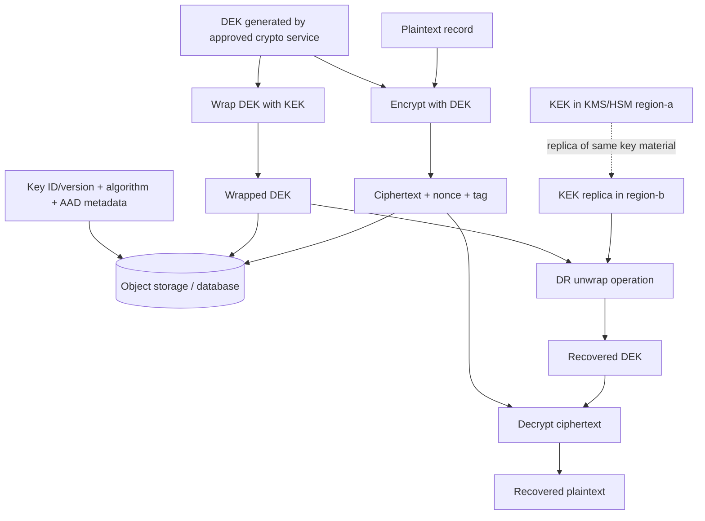
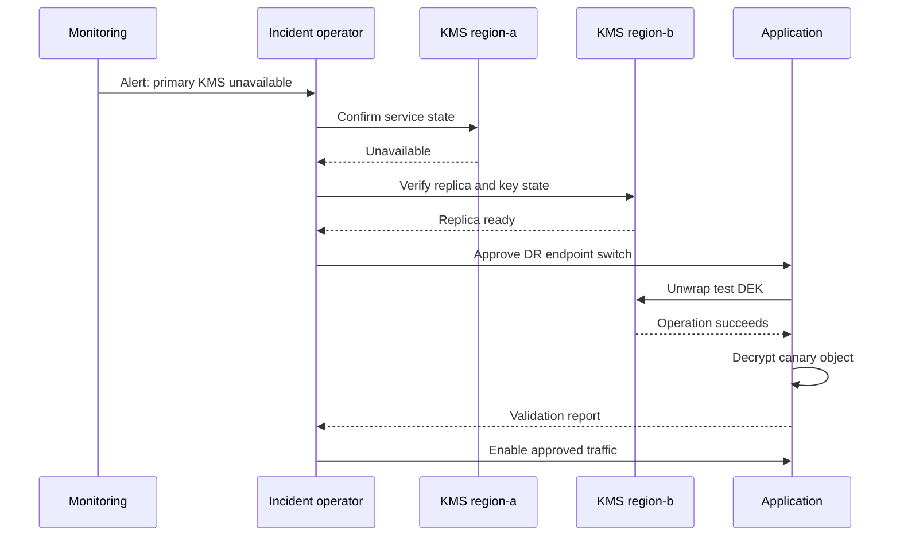

# Thiết kế key recovery

Một hệ thống mã hóa dữ liệu chỉ có thể phục hồi sau sự cố khi dữ liệu, metadata và khóa cần thiết để giải mã vẫn còn sẵn sàng và có thể được sử dụng an toàn. **Key recovery** là khả năng khôi phục quyền sử dụng đúng key material hoặc khôi phục một đường đi mật mã tương đương đã được thiết kế trước, để workload được phép tiếp tục giải mã, xác minh chữ ký hoặc thực hiện thao tác cần thiết sau sự cố.

Case study này thiết kế key recovery cho một nền tảng SaaS đa tenant lưu hồ sơ khách hàng và giao dịch. Nền tảng dùng envelope encryption, KMS/HSM, nhiều vùng triển khai và backup dữ liệu độc lập. Tình huống chính là vùng KMS chính bị gián đoạn hoặc một thao tác quản trị làm khóa không thể sử dụng. Thiết kế cũng xem xét mất key material, lỗi backup, compromise và khôi phục sau thảm họa.

Điểm quan trọng của bài toán là khôi phục khả năng truy cập dữ liệu mà vẫn giữ nguyên ranh giới bảo mật. Việc tạo một khóa mới cùng tên không khôi phục key material cũ; nếu ciphertext hoặc wrapped DEK phụ thuộc vào khóa cũ, khóa mới không thể giải mã chúng. Vì vậy, recovery phải được chuẩn bị từ lúc thiết kế key hierarchy, replication, backup, metadata, phân quyền và quy trình diễn tập.

## 1. Bối cảnh case study

Công ty giả định **Mây Việt** cung cấp nền tảng SaaS quản lý hồ sơ và thanh toán cho nhiều doanh nghiệp. Mỗi tenant có dữ liệu riêng; ứng dụng lưu ciphertext trong object storage và database. Dữ liệu nhạy cảm được mã hóa bằng AES-GCM, còn key material được quản lý qua KMS/HSM.

Kiến trúc hiện tại có các thành phần:

- API và worker chạy trong vùng chính `region-a`.
- Một vùng dự phòng `region-b` có thể tiếp nhận traffic khi vùng chính gặp sự cố.
- KMS được bảo vệ bởi HSM và có cơ chế replica đa vùng cho các key được chọn.
- DEK dùng mã hóa dữ liệu; KEK trong KMS bảo vệ các DEK theo envelope encryption.
- Ciphertext, wrapped DEK và metadata được lưu cùng tham chiếu phiên bản khóa.
- Audit log được gửi tới tài khoản lưu trữ độc lập.
- Backup dữ liệu và cấu hình được quản lý theo lịch, có kiểm thử restore.

Một sự cố ở vùng chính có thể khiến ứng dụng không gọi được KMS, dù object storage và database vẫn còn hoạt động. Nếu không có replica hoặc đường recovery cho đúng key material, dữ liệu vẫn tồn tại nhưng không thể giải mã. Đây là rủi ro cần giải quyết.

## 2. Yêu cầu nghiệp vụ và giả định thiết kế

Case study dùng các mục tiêu minh họa sau. Đây là giả định của bài toán, không phải giá trị bắt buộc do NIST quy định:

| Yêu cầu | Mục tiêu giả định | Lý do |
|---|---:|---|
| RTO cho đọc dữ liệu quan trọng | 60 phút | Khôi phục khả năng đọc sau khi KMS vùng chính gián đoạn |
| RPO cho metadata và wrapped DEK | Tối đa 5 phút | Giảm số object không thể giải mã do metadata chưa được sao lưu |
| RPO cho ciphertext | Tối đa 5 phút | Phù hợp với cơ chế replication dữ liệu của nền tảng |
| Khả năng đọc dữ liệu lịch sử | Toàn bộ dữ liệu còn trong retention | Key version cũ phải còn khả năng decrypt hoặc có bản chuyển đổi đã xác minh |
| Quyền recovery | Dual control | Không một cá nhân đơn lẻ có thể tự phục hồi root/KEK nhạy cảm |
| Audit | Có thể truy vết end-to-end | Ghi actor, key ID/version, hành động, approval và kết quả |

RTO là thời gian mục tiêu để khôi phục dịch vụ; RPO là lượng dữ liệu hoặc trạng thái có thể mất tính theo thời gian. Đối với key recovery, cần xác định rõ RPO áp dụng cho key metadata, policy, wrapped DEK và ciphertext. Chỉ nói “KMS có backup” là chưa đủ để chứng minh đạt RTO/RPO.

Giả định kỹ thuật:

- Mỗi tenant hoặc nhóm dữ liệu có KEK riêng hoặc có phạm vi tách biệt theo phân loại rủi ro.
- DEK được sinh ngẫu nhiên bằng KMS/provider phù hợp và dùng cho một phạm vi dữ liệu giới hạn.
- KEK không được export dạng plaintext về ứng dụng.
- KMS replica tại vùng dự phòng phải đại diện cho đúng key material hoặc có cơ chế migration đã chuẩn bị trước.
- Ứng dụng lưu key ID/version và thông tin thuật toán cần thiết trong metadata của ciphertext.
- Khóa bị compromise sẽ đi theo quy trình forward recovery, không tự động bật lại chỉ để phục hồi dịch vụ.

## 3. Phân biệt key recovery, data recovery và disaster recovery

Ba hoạt động này liên quan nhưng không đồng nghĩa:

| Hoạt động | Khôi phục điều gì? | Ví dụ |
|---|---|---|
| Key recovery | Khả năng sử dụng đúng key material hoặc key version cần thiết | Khôi phục HSM backup vào HSM dự phòng hoặc chuyển sang KMS replica chứa cùng key material |
| Data recovery | Ciphertext, wrapped DEK và metadata | Restore object storage, database và metadata từ backup |
| Disaster recovery (DR) | Toàn bộ dịch vụ và dependency để tiếp tục nghiệp vụ | Chuyển API, worker, database, KMS endpoint và traffic sang vùng dự phòng |

Một hệ thống có thể restore ciphertext thành công nhưng vẫn không đọc được dữ liệu vì KEK đã mất. Ngược lại, key material còn nguyên nhưng metadata bị mất có thể khiến ứng dụng không biết ciphertext dùng key version, nonce, tag hoặc AAD schema nào. Recovery plan phải xử lý cả ba lớp.

## 4. Tài sản và dependency cần phục hồi

Trước khi thiết kế, cần lập danh sách những thành phần mà một lần giải mã phụ thuộc vào:

| Tài sản | Vai trò trong recovery | Nếu thiếu |
|---|---|---|
| KEK/key material | Unwrap DEK hoặc thực hiện crypto operation | Không mở được DEK được bảo vệ bởi KEK đó |
| Wrapped DEK | Bản DEK đã được bảo vệ để lưu cùng dữ liệu | Không có đầu vào để lấy lại DEK |
| Ciphertext | Payload đã mã hóa | Không có dữ liệu để phục hồi |
| Key ID/version | Chọn đúng khóa và phiên bản | Có thể gọi nhầm key hoặc không tìm được khóa |
| Algorithm/format metadata | Xác định cách giải mã | Không thể tái tạo chính xác thao tác decrypt |
| Nonce/IV, tag và AAD | Tham số cần cho AEAD | Xác thực thất bại hoặc không giải mã được |
| KMS policy/grant | Cho phép recovery identity sử dụng key | Key còn nhưng không ai được phép gọi |
| HSM domain/backup metadata | Phục hồi key object trong miền HSM | Không thể restore bản backup đúng cách |
| Identity và credential recovery | Xác thực operator/workload | Không thể truy cập control plane khi DR |
| Audit và approval record | Chứng minh ai đã thực hiện recovery | Không đủ bằng chứng kiểm toán và điều tra |

Inventory cần thể hiện dependency giữa dữ liệu, DEK, KEK, key version, tenant và backup. Chỉ có danh sách key ID mà không biết dữ liệu nào phụ thuộc vào từng key sẽ khiến recovery khó kiểm soát.

Ứng dụng cần có quy tắc commit nhất quán cho ciphertext, wrapped DEK và metadata. Nếu không thể ghi cả ba trong một transaction, hãy dùng manifest/version pointer hoặc trạng thái object như `PENDING` rồi chỉ đánh dấu `COMMITTED` sau khi mọi thành phần đã được lưu bền vững. Khi recovery, chỉ phục hồi object ở trạng thái hoàn tất; object dở dang phải được đối soát hoặc xử lý riêng. Điều này tránh trường hợp ciphertext đã được replicate nhưng wrapped DEK hoặc metadata tương ứng chưa có trong snapshot DR.

## 5. Threat model và tình huống sự cố

Thiết kế cần xem xét cả sự cố sẵn sàng lẫn sự cố mất độ tin cậy:

| Tình huống | Tác động | Hướng xử lý chính |
|---|---|---|
| KMS vùng chính outage | Workload không gọi được KEK | Failover sang replica đã xác minh |
| KMS account hoặc policy bị cấu hình sai | Request hợp lệ bị deny | Khôi phục policy/config đã phê duyệt sau khi xác minh nguyên nhân |
| Key bị disable nhầm | Không thể unwrap DEK | Xác minh không compromise rồi enable/cancel theo quy trình |
| Key scheduled for deletion | Cửa sổ phục hồi có giới hạn | Hủy lịch xóa nếu được phép và key còn đáng tin cậy |
| Key material bị destroy | Không còn key material tại hệ thống chính | Restore từ HSM backup hợp lệ hoặc dùng bản đã replicate; nếu không có thì dữ liệu có thể mất |
| HSM cluster hoặc domain bị mất | Không truy cập được key object | Phục hồi vào HSM tương thích trong cùng trust domain hoặc DR domain được thiết kế |
| Backup bị hỏng hoặc không nhất quán | Restore không hoàn chỉnh | Dùng bản backup/checkpoint khác và đối soát integrity |
| KEK bị compromise | Attacker có thể unwrap DEK đã lấy được | Cô lập key, tạo KEK sạch, đánh giá rewrap và re-encrypt |
| Recovery credential bị lộ | Attacker có thể truy cập key recovery | Thu hồi credential, kích hoạt incident response và kiểm tra thao tác đã thực hiện |

Không được dùng cùng một quy trình cho outage và compromise. Outage có thể cần failover sang replica chứa cùng key material; compromise yêu cầu ngăn sử dụng khóa cũ và chuyển sang khóa sạch.

## 6. Nguyên tắc thiết kế key recovery

Các nguyên tắc chính:

1. **Recoverability by design:** khả năng phục hồi phải được quyết định trước khi tạo khóa, không đợi tới khi mất khóa mới tìm cách backup.
2. **Không làm lộ key material:** ưu tiên KMS/HSM replication hoặc backup được bảo vệ trong miền mật mã.
3. **Tách biệt vùng lỗi:** primary và DR không cùng phụ thuộc một credential, một vùng, một tài khoản quản trị hoặc một đường mạng duy nhất.
4. **Dual control:** thao tác phục hồi khóa nhạy cảm cần nhiều người/đơn vị phê duyệt.
5. **Metadata đầy đủ:** ciphertext phải chỉ ra đúng key ID/version và tham số giải mã.
6. **Fail closed:** nếu không xác minh được nguồn gốc hoặc integrity của key backup, không sử dụng nó.
7. **Test thường xuyên:** backup chưa từng restore không phải bằng chứng có thể phục hồi.
8. **Forward recovery khi compromise:** không tái kích hoạt key material đã mất độ tin cậy.

Recovery không được tạo ra một con đường vòng bỏ qua IAM, audit hoặc HSM policy. Quy trình khẩn cấp vẫn phải xác thực actor, phê duyệt và ghi bằng chứng.

## 7. Kiến trúc khóa: envelope encryption

Mây Việt dùng envelope encryption để tránh dùng KEK trực tiếp mã hóa toàn bộ payload. DEK mã hóa dữ liệu; KEK bảo vệ DEK. Ứng dụng lưu ciphertext, wrapped DEK và metadata.



Trong mô hình này:

- KEK được tạo và quản lý trong KMS/HSM.
- DEK được sinh bằng cơ chế mật mã được duyệt và dùng để mã hóa một object hoặc một phạm vi dữ liệu giới hạn.
- DEK được wrap bằng KEK; wrapped DEK có thể lưu cùng ciphertext.
- Metadata ghi key ID/version của KEK và DEK, thuật toán, nonce/IV, tag, AAD version và format version.
- Khi đọc, workload có quyền yêu cầu KMS unwrap DEK rồi giải mã payload theo metadata.

Nếu dùng API kiểu `GenerateDataKey`, plaintext DEK có thể xuất hiện tạm thời trong memory của ứng dụng. Cần giảm thời gian tồn tại, giới hạn dump/telemetry, không ghi vào log và xóa best-effort sau khi sử dụng. Mảng byte bị ghi đè trong Java không bảo đảm mọi bản sao trong heap/JIT/GC đều bị xóa; nếu yêu cầu không cho key material rời HSM, cần chọn API hoặc kiến trúc thực hiện crypto operation bên trong ranh giới đó.

## 8. Kiến trúc DR cho KMS/HSM

Case study chọn KMS có khả năng tạo replica đa vùng cho key material được chọn. Replica vùng `region-b` phải đại diện cho cùng logical key và có khả năng thực hiện đúng thao tác unwrap đối với wrapped DEK được tạo ở `region-a`. Đây là semantics cần xác minh theo tài liệu và API của nhà cung cấp; không thể giả định hai key cùng tên ở hai vùng là cùng key material.

Các lớp kiến trúc:

- **Primary KMS/HSM:** tạo và sử dụng KEK trong vận hành bình thường.
- **DR KMS/HSM replica:** duy trì khả năng sử dụng cùng logical key theo cơ chế replication được hỗ trợ.
- **Data replication:** sao chép ciphertext, wrapped DEK và metadata sang vùng DR.
- **Policy replication:** duy trì IAM, key policy, grants, aliases và role cần thiết theo cấu hình được kiểm soát.
- **Independent recovery identity:** danh tính break-glass được bảo vệ riêng, không phụ thuộc hoàn toàn vào primary identity provider.
- **Audit archive:** lưu audit event và approval record ở miền độc lập.
- **HSM backup domain:** nếu dùng HSM do tổ chức quản lý, backup được bảo vệ bằng cơ chế backup/domain key và quorum theo hướng dẫn thiết bị.

Nếu nhà cung cấp không hỗ trợ replica chứa cùng key material, phải có kế hoạch khác trước sự cố: rewrap DEK sang KEK DR, dual-wrap DEK trong giai đoạn chuyển tiếp hoặc di chuyển khóa bằng cơ chế wrapped export/import được hỗ trợ. Một KEK mới độc lập không thể tự unwrap các DEK đã wrap bằng KEK cũ.

## 9. Chọn mô hình recovery

Có ba mô hình thường gặp. Tổ chức cần chọn dựa trên khả năng provider, yêu cầu kiểm soát và mức độ di động.

| Mô hình | Cách hoạt động | Ưu điểm | Rủi ro/giới hạn |
|---|---|---|---|
| Managed KMS replication | Provider duy trì replica của cùng logical key trong vùng DR | Không cần export key material; failover nhanh | Phụ thuộc semantics, availability và control plane của provider |
| HSM secure backup/restore | Backup key object trong HSM domain, restore vào HSM tương thích | Có thể kiểm soát backup và quorum ở cấp tổ chức | Cần quản lý backup domain, thiết bị tương thích, custodians và diễn tập |
| Rewrap/dual-wrap migration | DEK được bảo vệ trước bởi KEK đích hoặc nhiều wrapping key đã duyệt | Có thể chuyển đổi sang miền khóa khác | Phải triển khai trước; tăng metadata và độ phức tạp; không cứu được dữ liệu đã mất key material trước khi rewrap |

Không có mô hình nào tự động phù hợp cho mọi loại khóa. Ví dụ, khóa ký root có thể cần HSM và quy trình quorum; KEK mã hóa dữ liệu có thể dùng KMS replica; khóa tạm thời cho dữ liệu ngắn hạn có thể không cần backup nếu dữ liệu cũng không cần phục hồi.

## 10. Backup những gì?

Backup cho key recovery phải bao gồm toàn bộ dependency cần để sử dụng khóa đúng cách:

| Thành phần | Cách bảo vệ/backup | Kiểm tra khi restore |
|---|---|---|
| Key material | KMS replication hoặc HSM secure backup theo khả năng nền tảng | Đúng key ID/version và khả năng crypto operation |
| KMS/HSM metadata | Export cấu hình được phép hoặc lưu inventory versioned | Algorithm, usage, state, origin, owner và version |
| IAM/key policy/grants | Policy-as-code và snapshot cấu hình đã phê duyệt | Recovery identity có đúng quyền; workload không được cấp rộng hơn |
| Wrapped DEK | Backup cùng dữ liệu hoặc trong metadata store | Unwrap được bằng KEK version tương ứng |
| Ciphertext | Replication/backup dữ liệu theo RPO | Integrity, completeness và khả năng giải mã |
| Nonce/IV, tag, AAD metadata | Lưu cùng object theo format version | Decrypt và xác thực AEAD thành công |
| Alias/key mapping | Inventory và cấu hình định tuyến versioned | Alias trỏ đúng logical key; không thay thế key ID/version gốc |
| HSM backup domain/config | Lưu theo quy trình bảo mật của thiết bị | Có đủ quorum, domain key và HSM tương thích |
| Recovery identity/approval | Backup cấu hình IAM và danh sách custodian độc lập | Có thể xác thực trong DR mà không mở quyền quá rộng |
| Audit/checkpoint | Archive độc lập, immutable theo policy | Có thể truy vấn timeline và xác minh integrity |

Với managed KMS, khách hàng có thể không được phép export key material hoặc tự tạo backup dạng file. Khi đó, cần dựa vào tính năng replication/durability và cam kết phục hồi đã được xác minh của nhà cung cấp, đồng thời backup cấu hình, policy, metadata và dữ liệu. Không được tạo bản sao plaintext bằng cách tìm cách vượt qua giới hạn non-exportable.

## 11. HSM backup, quorum và dual control

Nếu tổ chức tự quản lý HSM, backup phải tuân theo cơ chế bảo vệ của thiết bị và trust domain. Không sao chép file chứa key material rõ ra USB, shared folder hoặc máy chủ backup thông thường.

Một mô hình quản trị có thể gồm:

- Backup được tạo bằng chức năng secure backup/clone được nhà sản xuất hỗ trợ.
- Backup được bảo vệ bằng backup domain key hoặc cơ chế wrapping của HSM.
- Các thành phần khôi phục được chia cho nhiều custodian theo cơ chế M-of-N/quorum nếu thiết bị hỗ trợ.
- Mỗi custodian được định danh riêng; không dùng một PIN hoặc smart card dùng chung.
- Backup được lưu ở vị trí vật lý và miền quản trị độc lập với HSM primary.
- Việc mở backup/restore cần change hoặc incident ticket, approval và audit.
- Thử restore trên HSM DR tương thích định kỳ để phát hiện backup hỏng hoặc thiếu thành phần.

Quorum không chỉ là số người ký vào biểu mẫu. Cần kiểm tra cơ chế kỹ thuật thực sự yêu cầu đủ thành phần mới cho phép restore hoặc mở backup. Nếu một người có thể tự lấy đủ mọi share, dual control chỉ tồn tại trên giấy.

## 12. Recovery identity và break-glass access

Trong DR, identity provider hoặc hệ thống IAM chính cũng có thể bị gián đoạn. Vì vậy, recovery identity cần được chuẩn bị độc lập nhưng bị giới hạn rất chặt.

Yêu cầu thiết kế:

- Có danh tính break-glass riêng cho KMS/HSM recovery, không dùng chung với tài khoản vận hành hàng ngày.
- Credential được lưu theo cơ chế bảo vệ offline hoặc vault có kiểm soát và MFA mạnh.
- Kích hoạt cần ticket/incident, xác nhận hai người và lý do cụ thể.
- Quyền chỉ giới hạn vào key, region, action và thời gian cần thiết.
- Credential có thời hạn hoặc được rotate ngay sau khi kết thúc recovery.
- Mọi lần sử dụng được audit và gửi cảnh báo tới nhóm độc lập.
- Recovery identity không được mặc định có quyền export plaintext hoặc destroy key.

Không nên tạo một tài khoản super-admin duy nhất có thể khôi phục mọi key, sửa policy và xóa audit. Nếu bắt buộc có quyền khẩn cấp rộng, cần quorum, giới hạn thời gian, giám sát độc lập và kiểm tra sau sự cố.

## 13. Runbook: KMS vùng chính bị outage

Đây là tình huống phục hồi thường gặp nhất trong case study. Dữ liệu và wrapped DEK vẫn tồn tại, nhưng workload không thể gọi KMS ở `region-a`.

Quy trình:

1. **Declare incident:** xác nhận outage từ monitoring và mở incident record.
2. **Freeze key changes:** dừng tạo, rotate, disable, schedule deletion và policy change không cần thiết để tránh trạng thái split-brain.
3. **Identify affected keys:** truy vấn inventory để xác định KEK/version và workload phụ thuộc.
4. **Verify DR replica:** kiểm tra replica ở `region-b` có cùng logical key material, đúng state và key usage.
5. **Verify permissions:** kiểm tra workload identity và KMS policy ở vùng DR; không cấp quyền wildcard để chữa cháy.
6. **Run canary:** dùng một object test có wrapped DEK và ciphertext đã biết để unwrap/decrypt.
7. **Switch endpoint/config:** chuyển workload sang KMS DR endpoint bằng thay đổi có version và audit.
8. **Refresh consumers:** cập nhật cache, worker, connection pool và job nền.
9. **Validate service:** đọc dữ liệu cũ, ghi dữ liệu mới nếu policy cho phép và kiểm tra audit.
10. **Monitor:** theo dõi decrypt failure, latency, throttling, deny event và trạng thái replica.
11. **Reconcile:** khi primary phục hồi, đối soát key state, policy, metadata và event trước khi failback.
12. **Close incident:** lưu bằng chứng, thời gian phục hồi và các vấn đề còn lại.



Chỉ chuyển traffic sau khi xác minh replica thật sự có thể unwrap dữ liệu đã tạo ở vùng chính. Việc endpoint phản hồi hoặc key ID giống nhau chưa đủ chứng minh cùng key material.

## 14. Runbook: khóa bị disable hoặc scheduled for deletion nhầm

Nếu khóa bị disable hoặc lên lịch xóa do lỗi vận hành, cần xác minh nguyên nhân trước khi bật lại.

Quy trình:

1. Xác định key ID/version, actor, thời điểm và audit event gây thay đổi.
2. Xác nhận đây không phải thao tác ứng phó compromise hoặc yêu cầu pháp lý.
3. Kiểm tra trạng thái thật tại KMS/HSM, không chỉ đọc metadata cache.
4. Nếu key chỉ bị disable và còn an toàn, phê duyệt enable theo quy trình.
5. Nếu đang pending deletion, kiểm tra có API cancel/restore và thời hạn chờ theo provider.
6. Kiểm tra policy, grants, aliases và usage attributes sau khi khôi phục.
7. Chạy canary unwrap/decrypt và kiểm tra dữ liệu mẫu.
8. Theo dõi workload, audit và các request bị deny.
9. Ghi lại nguyên nhân gốc và bổ sung guardrail ngăn thao tác lặp lại.

Không giả định mọi KMS/HSM có cùng trạng thái hoặc thời gian chờ deletion. Nếu key material đã bị destroy không thể đảo ngược, không thể phục hồi chỉ bằng cách tạo một key mới có cùng alias.

## 15. Runbook: mất key material hoặc HSM primary

Nếu key material không còn khả dụng ở thiết bị chính, chỉ có thể phục hồi nếu có replica hoặc backup hợp lệ chứa đúng material.

Các bước:

1. Cô lập thiết bị hoặc account bị sự cố để tránh tiếp tục ghi trạng thái không nhất quán.
2. Xác minh backup ID, nguồn, thời điểm, key ID/version và integrity metadata.
3. Xác nhận backup domain key, quorum shares và custodian sẵn sàng.
4. Chuẩn bị HSM đích đúng model/firmware/configuration theo yêu cầu tương thích.
5. Thực hiện restore trong maintenance window với dual control.
6. Xác minh key object, usage, attributes và check value/fingerprint theo cơ chế được thiết bị hỗ trợ.
7. Kiểm tra quyền của workload và audit trước khi mở traffic.
8. Chạy decrypt test với ciphertext/wrapped DEK đã biết.
9. Cập nhật inventory, endpoint, alias và recovery record.
10. Bảo vệ lại backup, rotate credential quản trị nếu có khả năng bị lộ và điều tra nguyên nhân.

Với khóa đối xứng, không được export key bytes chỉ để tính fingerprint tùy tiện. Có thể dùng key check value hoặc phép kiểm tra được HSM/provider hỗ trợ; với khóa bất đối xứng, public key fingerprint có thể giúp xác minh cặp khóa. Cần dùng phương thức phù hợp với loại khóa và chính sách thiết bị.

Nếu không có backup/replica chứa đúng key material, một khóa mới không thể thay thế khóa cũ để giải mã ciphertext cũ. Khi đó phải xác định dữ liệu có bản plaintext/backup khác hay không; nếu không, cần ghi nhận khả năng mất dữ liệu và thực hiện quy trình xử lý sự cố.

## 16. Runbook: KEK bị compromise

Compromise khác outage. Nếu attacker lấy được KEK hoặc có quyền unwrap trái phép, việc failover sang replica cùng key material sẽ tiếp tục dùng một khóa đã mất độ tin cậy.

Hướng xử lý:

1. Kích hoạt incident response và bảo toàn audit/log/bằng chứng.
2. Chặn principal, session và API operation liên quan; disable hoặc revoke KEK theo quyết định incident commander.
3. Xác định phạm vi ciphertext, wrapped DEK, backup và dữ liệu attacker có thể đã lấy.
4. Tạo KEK sạch mới trong KMS/HSM được kiểm soát.
5. Rewrap DEK sang KEK mới nếu DEK và ciphertext chưa bị lộ theo phạm vi đánh giá.
6. Nếu DEK hoặc plaintext có thể đã bị lộ, tạo DEK mới và re-encrypt payload; rewrap đơn thuần không đủ.
7. Cập nhật metadata version, policy, workload và recovery replica.
8. Kiểm tra mọi backup có chứa wrapped DEK cũ và đánh giá thời gian lưu giữ.
9. Thu hồi/destroy key cũ và các bản sao theo quy trình khi dependency được xử lý.
10. Thông báo và xử lý dữ liệu bị ảnh hưởng theo nghĩa vụ của tổ chức.

Nếu attacker đã lấy ciphertext, wrapped DEK và KEK, họ có thể giải mã bản sao đã lấy. Re-encrypt dữ liệu hiện tại không thể làm cho bản sao đã bị đánh cắp trở lại bí mật. Cần xác định phạm vi phơi lộ, thời điểm, dữ liệu liên quan và nghĩa vụ thông báo; không tuyên bố sự cố đã được đảo ngược chỉ vì đã rotate KEK.

## 17. Khôi phục metadata và dữ liệu phụ thuộc

Sau khi key service sẵn sàng, ứng dụng vẫn cần metadata chính xác để chọn đúng thao tác. Metadata tối thiểu cho một encrypted object có thể như sau:

```json
{
  "objectId": "tenant-42/customer-901",
  "formatVersion": 3,
  "encryption": {
    "algorithm": "AES-256-GCM",
    "dekId": "tenant-42-data-dek",
    "dekVersion": "v12",
    "wrappingKeyId": "tenant-42-kek",
    "wrappingKeyVersion": "v5",
    "nonce": "base64url(...)",
    "tagLengthBits": 128,
    "aadSchema": "customer-record-v2"
  },
  "backup": {
    "snapshotId": "snapshot-2026-11-28-0400",
    "migrationState": "VERIFIED"
  }
}
```

Khi restore, cần xác minh metadata khớp với ciphertext và wrapped DEK. Không được tự thay `wrappingKeyVersion` bằng version mới chỉ vì alias đã được cập nhật. Nếu metadata có thể bị sửa độc lập, cần bảo vệ integrity của nó, ví dụ dùng authenticated metadata/AAD hoặc audit/checksum được kiểm soát.

Data restore nên theo thứ tự:

1. Khôi phục metadata schema và inventory.
2. Khôi phục ciphertext và wrapped DEK từ snapshot tương thích.
3. Khôi phục/định tuyến KMS key version.
4. Chạy integrity check trên object và metadata.
5. Thử unwrap DEK và decrypt canary object.
6. Đối soát số lượng object, tenant và key version.
7. Mở traffic theo từng nhóm dữ liệu sau khi xác minh.

## 18. Ví dụ Java: khôi phục DEK qua KMS abstraction

Ví dụ dưới đây minh họa cách ứng dụng dùng metadata để yêu cầu KMS unwrap đúng wrapped DEK. Ứng dụng không tự tìm một key mới cùng tên để thay thế key version cũ.

```java
import java.util.Arrays;

public record WrappedDataKey(
        String keyId,
        String keyVersion,
        byte[] encryptedKeyBlob,
        byte[] encryptionContext) {}

public interface RecoveryKmsClient {
    byte[] unwrapDataKey(WrappedDataKey wrappedKey);
}

public interface PayloadDecryptor {
    byte[] decrypt(byte[] ciphertext, byte[] dataKey, byte[] nonce, byte[] aad)
            throws Exception;
}

public final class EncryptedObjectRecovery {
    private final RecoveryKmsClient kms;
    private final PayloadDecryptor decryptor;

    public EncryptedObjectRecovery(
            RecoveryKmsClient kms,
            PayloadDecryptor decryptor) {
        this.kms = kms;
        this.decryptor = decryptor;
    }

    public byte[] recover(
            WrappedDataKey wrappedKey,
            byte[] ciphertext,
            byte[] nonce,
            byte[] aad) throws Exception {

        byte[] dataKey = kms.unwrapDataKey(wrappedKey);
        try {
            return decryptor.decrypt(ciphertext, dataKey, nonce, aad);
        } finally {
            Arrays.fill(dataKey, (byte) 0); // Best-effort clearing only.
        }
    }
}
```

Đây là abstraction minh họa. Trong triển khai thực tế, KMS API có thể yêu cầu `keyId`, encryption context và ciphertext blob theo định dạng riêng. Phải xác minh `keyVersion`, tenant và AAD trước khi gọi unwrap. `Arrays.fill()` chỉ là best-effort trong JVM; runtime có thể đã tạo bản sao trong heap, register hoặc buffer. Giảm thời gian giữ DEK, tránh heap dump, không log byte array và ưu tiên xử lý trong HSM/crypto boundary nếu yêu cầu bảo mật không cho plaintext key rời thiết bị.

Nếu KMS trả lỗi `AccessDenied`, `KeyDisabled`, `NotFound` hoặc `InvalidCiphertext`, ứng dụng không được thử lần lượt các key khác một cách mù quáng. Cần phân loại lỗi, kiểm tra metadata và audit; chỉ thử key version khác khi inventory xác nhận đó là version hợp lệ cho object.

## 19. Kiểm soát truy cập trong recovery

Recovery là thao tác đặc quyền và có thể mở rộng phạm vi truy cập dữ liệu. Policy nên tách rõ:

| Vai trò | Quyền trong recovery |
|---|---|
| Incident commander | Kích hoạt incident và phê duyệt phạm vi khôi phục |
| Key custodian | Thực hiện thao tác KMS/HSM theo ticket và quorum |
| Data/platform operator | Khôi phục ciphertext, metadata và workload |
| Security approver | Xác nhận key state, trust status và điều kiện mở quyền |
| Auditor/observer | Theo dõi và xác minh audit; không có quyền thay key material |

Các kiểm soát:

- Dual control/quorum cho restore key material và break-glass.
- Least privilege theo key ID, region, action và thời hạn.
- Credential tạm thời, MFA và xác thực workload.
- Không dùng recovery identity cho hoạt động ứng dụng thường ngày.
- Không cho operator tự phê duyệt và tự thực hiện cùng một thao tác rủi ro cao nếu policy yêu cầu phân tách.
- Audit event được gửi tới kho độc lập và cảnh báo khi có recovery.
- Sau recovery, thu hồi quyền tạm thời và rotate credential quản trị nếu cần.

## 20. Bảo vệ integrity và tính nhất quán của backup

Backup có thể bị hỏng, bị sửa hoặc không khớp giữa key metadata và ciphertext. Trước khi restore cần xác minh:

- Nguồn backup, snapshot ID, thời gian tạo và người/role tạo.
- Checksum hoặc integrity metadata của ciphertext và wrapped DEK.
- Phiên bản schema, thuật toán và format được hỗ trợ.
- Key ID/version có tồn tại trong inventory và đúng owner/tenant.
- Backup domain key/HSM configuration đúng trust domain.
- Policy và grant không bị mở rộng ngoài ý muốn trong quá trình restore.
- Checkpoint và audit record có thể xác minh tính toàn vẹn.

Không restore một backup không xác minh được chỉ vì đó là bản gần nhất. Chọn bản backup trước đó đã được xác minh, ghi nhận RPO thực tế và điều tra bản hỏng. Nếu backup key material bị compromise, không dùng nó để phục hồi vận hành bình thường.

## 21. Monitoring và tiêu chí hoàn tất recovery

Một lần recovery chỉ được coi là hoàn tất khi có bằng chứng cả về kỹ thuật và vận hành.

Metrics nên theo dõi:

- Thời gian từ declare incident đến KMS/HSM ready.
- Thời gian tới lần unwrap/decrypt canary thành công.
- Tỷ lệ decrypt success/failure theo key ID/version.
- KMS latency, throttling, authorization deny và HSM health.
- Số object/tenant được đối soát và còn thiếu.
- Số wrapped DEK không unwrap được hoặc metadata không hợp lệ.
- Thời gian propagation của policy và config tới mọi workload.
- Số recovery credential còn active sau incident.

Tiêu chí hoàn tất:

- Replica/restore chứa đúng key material và state cần thiết.
- Recovery identity đã được sử dụng đúng approval và thu hồi/giới hạn sau thao tác.
- Canary unwrap và decrypt thành công với dữ liệu mẫu đã biết.
- Workload đọc dữ liệu lịch sử và ghi dữ liệu mới theo policy.
- Key metadata, policy, grant, alias và inventory nhất quán.
- Audit đầy đủ, có thể truy vấn và không chứa bí mật.
- Data integrity và tenant isolation được xác minh.
- RTO/RPO thực tế được ghi lại và so với mục tiêu.
- Có kế hoạch failback hoặc duy trì DR nếu primary chưa an toàn.

## 22. Kiểm thử và diễn tập key recovery

Không chờ tới sự cố thật mới kiểm tra backup. Một chương trình diễn tập nên bao gồm:

| Bài diễn tập | Mục tiêu | Bằng chứng |
|---|---|---|
| KMS regional outage | Chuyển sang replica cùng key material | Thời gian failover, canary decrypt, audit |
| Key disable nhầm | Khôi phục trạng thái khi key còn tin cậy | Approval, state transition và decrypt test |
| Scheduled deletion | Hủy lịch trong cửa sổ cho phép | KMS response, audit và dependency check |
| HSM restore | Restore backup vào thiết bị DR | Quorum record, key check/fingerprint và test vector |
| Metadata restore | Khôi phục key mapping và format metadata | Schema validation và object reconciliation |
| Recovery identity unavailable | Kiểm tra break-glass độc lập | Kết quả MFA/quorum và audit |
| KEK compromise tabletop | Không failover sang key đã compromise | Incident decision, key replacement và rewrap/re-encrypt plan |
| Backup corruption | Phát hiện và chọn bản backup hợp lệ | Integrity report và RPO thực tế |

Diễn tập cần có phạm vi được phê duyệt và dùng dữ liệu/key test hoặc production-safe procedure. Không thử destroy production key thật để chứng minh quy trình; thao tác không thể đảo ngược cần được kiểm tra trong môi trường cô lập hoặc qua mô phỏng có kiểm soát.

## 23. Những lỗi thiết kế thường gặp

- **Chỉ backup ciphertext:** dữ liệu còn nhưng không có KEK để unwrap DEK.
- **Backup key mà thiếu metadata:** không biết key version, algorithm, nonce hoặc AAD cần thiết.
- **Tạo key mới cùng alias:** nhầm tên logic với key material; key mới không giải mã ciphertext cũ.
- **Dùng key khác ở DR:** KEK độc lập không unwrap được wrapped DEK cũ nếu chưa rewrap.
- **Phụ thuộc một admin identity:** khi identity provider chính outage, không ai có thể thực hiện recovery.
- **Quorum chỉ trên giấy:** một người vẫn có thể lấy đủ thành phần hoặc bypass approval.
- **Không kiểm thử restore:** backup tồn tại nhưng thiếu domain key, firmware tương thích hoặc quyền cần thiết.
- **Failover khi key compromise:** chuyển sang replica cùng key material bị xâm phạm làm tăng phạm vi thiệt hại.
- **Xóa khóa quá sớm:** còn ciphertext, archive hoặc backup phụ thuộc vào key version cũ.
- **Không đối soát replication:** replica tồn tại nhưng policy, grant hoặc metadata chưa đồng bộ.
- **Không bảo vệ audit:** recovery được thực hiện nhưng không có bằng chứng đáng tin cậy.

## 24. Checklist thiết kế key recovery

- Xác định RTO/RPO cho key service, key metadata, wrapped DEK và ciphertext.
- Lập inventory và dependency map từ object/tenant tới DEK, KEK và key version.
- Chọn KMS replica, HSM secure backup/restore hoặc mô hình rewrap/dual-wrap phù hợp.
- Xác minh DR key có đúng key material cần thiết; không chỉ cùng alias hoặc cùng tên.
- Backup policy, grants, metadata, wrapped DEK, ciphertext và audit theo phạm vi.
- Bảo vệ HSM backup bằng domain key, quorum và custodian độc lập.
- Thiết kế recovery identity độc lập, MFA, dual control và quyền tạm thời.
- Có runbook riêng cho outage, disable nhầm, pending deletion, mất key và compromise.
- Không khôi phục khóa bị compromise vào vận hành bình thường; dùng forward recovery.
- Xác minh integrity của backup, metadata, ciphertext và key version trước restore.
- Thực hiện canary unwrap/decrypt trước khi mở traffic.
- Kiểm tra cache, replica, workload, tenant isolation và audit sau failover.
- Diễn tập định kỳ và đo RTO/RPO thực tế.
- Có tiêu chí failback, cleanup recovery credential và post-incident review.

## 25. Kết luận case study

Thiết kế key recovery của Mây Việt dựa trên envelope encryption, KMS/HSM có replica đa vùng, backup cấu hình và metadata, backup dữ liệu độc lập, recovery identity được bảo vệ và quy trình dual control. Khi KMS vùng chính outage, hệ thống có thể chuyển sang replica chỉ sau khi xác minh replica chứa đúng key material và thực hiện thành công canary unwrap/decrypt. Khi HSM mất key object, chỉ backup secure có đúng trust domain mới phục hồi được key material. Khi KEK bị compromise, hệ thống phải cô lập khóa cũ và tiến hành forward recovery; failover sang replica cùng khóa không phải giải pháp an toàn.

Kết quả quan trọng nhất của thiết kế là khả năng khôi phục được chứng minh bằng diễn tập: ciphertext, wrapped DEK, metadata, key version, policy và identity cùng sẵn sàng; thao tác recovery có phê duyệt và audit; dữ liệu mẫu giải mã thành công; RTO/RPO thực tế được đo. Nếu thiếu key material hoặc bản backup hợp lệ, không có thao tác đổi alias hay tạo key mới nào có thể tái tạo khóa cũ. Vì vậy, recoverability phải là một thuộc tính được thiết kế, kiểm thử và quản trị xuyên suốt vòng đời khóa.

## Tài liệu tham khảo

- [NIST SP 800-57 Part 1 Rev. 5: Recommendation for Key Management](https://csrc.nist.gov/pubs/sp/800/57/pt1/r5/final)
- [NIST SP 800-130: A Framework for Designing Cryptographic Key Management Systems](https://csrc.nist.gov/pubs/sp/800/130/final)
- [NIST SP 800-152: A Profile for U.S. Federal Cryptographic Key Management Systems](https://csrc.nist.gov/pubs/sp/800/152/final)
- [NIST SP 800-34 Rev. 1: Contingency Planning Guide for Federal Information Systems](https://csrc.nist.gov/pubs/sp/800/34/r1/upd1/final)
- [NIST SP 800-53 Rev. 5: Security and Privacy Controls for Information Systems and Organizations](https://csrc.nist.gov/pubs/sp/800/53/r5/upd1/final)
- [FIPS 140-3: Security Requirements for Cryptographic Modules](https://csrc.nist.gov/pubs/fips/140-3/final)
